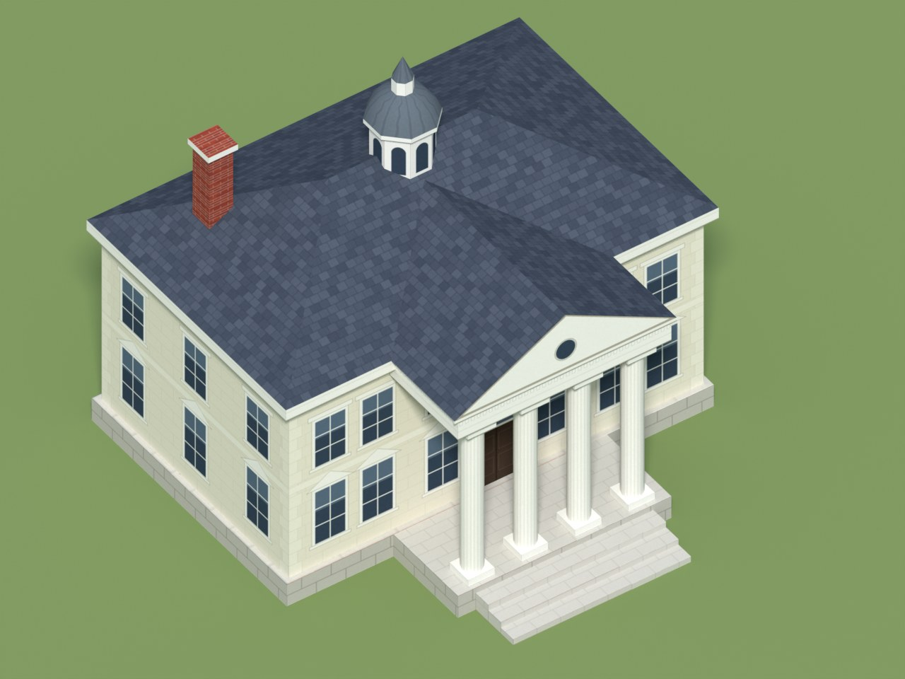

# White House (low-poly building)

A low-poly neoclassical government house for the USA "State" building proposal (WoL, 2026-11-02):
a two-storey block, a portico with four columns and a pediment, steps, a hipped slate roof, a
cupola and a chimney. The mesh is built from exact primitives, so walls are flat and edges straight,
and the detail (windows, door, stone courses, slate, dentils) is painted in the texture, as in the
stock buildings.



| | |
|---|---|
| Triangles | 355 (299 vertices) |
| Texture | 1024 × 1024, diffuse only, one UV set, no baked lighting |
| Size | 14.6 × 14.4 m footprint (steps included), 13.3 m high, 1 unit = 1 m |
| Orientation | Blender Z-up, portico facing −Y; the exports are Y-up |
| Origin | centre of the footprint, at ground level |
| Attach point | empty `flag_attach` at the top of the cupola spire |

## Files

| File | What |
|---|---|
| `make_whitehouse.py` | The generator: mesh, UV atlas, painted texture, exports and previews. |
| `model/whitehouse.blend` | Blender scene (texture packed; a Triangulate modifier, quads kept for editing). |
| `model/whitehouse.glb`, `.fbx` | Triangulated mesh with the texture embedded, plus `flag_attach`. |
| `model/whitehouse.obj`, `.mtl` | Triangulated mesh; the `.mtl` points to `whitehouse_diffuse.png`. |
| `model/whitehouse_diffuse.png` | The texture. |
| `model/preview_*.jpg` | Renders: front and back three-quarter views, and a clay view with edges. |
| `model/stats.txt` | The counts above. |

## Regenerating

The dimensions and the facade layout (window bays, door) are constants at the top of the script.

```
python -m venv bvenv
bvenv/bin/pip install bpy==5.2.3 pillow numpy      # Blender 5.2 as a Python module (Python 3.13)
bvenv/bin/python make_whitehouse.py                # writes model/; --no-render skips the previews
```

or, with a Blender install: `blender -b -P make_whitehouse.py -- --out model`.

Do not keep files named like standard modules (`inspect.py`, …) next to a script that imports
`bpy`: Blender then initialises twice and aborts.

## Getting it into the game (not done yet)

None of this was tested in game. Each step names what to copy from a stock building rather than
guessing it.

1. **Scale.** Import a stock building of similar size (the Capitol, a Town Center) with the
   community Granny add-on for Blender, and give this model one uniform scale so it matches. The
   1 unit = 1 m above is a working assumption.
2. **Orientation.** Check which way the stock buildings face and rotate this one to match.
3. **Export** to `.gr2` with the same add-on, on Windows.
4. **Texture.** Convert `whitehouse_diffuse.png` to `.ddt`. Stock building textures may carry a
   player-colour mask in their alpha; this one has none yet.
5. **Anim XML.** Copy the anim file of a stock building of similar size and swap only the model.
   That keeps its construction stages, damage states and destruction. Rename `flag_attach` to the
   attach point name that file expects for the flag.
6. **Proto.** In `protoy.xml` (and its XMB), set the obstruction to the footprint after scaling.

## Known limits

- The texture is painted by code: clean and readable, but plainer than hand-painted art. A
  texture can also be made by uploading `whitehouse.glb` to a texturing tool (Meshy's texture
  mode) with the shape kept as is.
- No player colour, no LOD, no destruction pieces of its own (step 5 reuses the stock ones).
- The portico ceiling and the faces hidden inside other parts are not modelled.
