# Bug fixes and performance

The keys here add nothing to WoL's data: each one fixes something the game does wrong, or makes it
run faster. Most need only their line in `wol.cfg`. The keys that add new mechanics are in the
[modding guide](modding-guide.md#5-feature-reference), which also explains the `wol.cfg` file
([section 3](modding-guide.md#3-the-wolcfg-file)), the log ([section 4](modding-guide.md#4-reading-uhclog)),
the columns of the tables ([section 5](modding-guide.md#5-feature-reference)) and multiplayer
([section 7](modding-guide.md#7-multiplayer-saved-games-and-replays)).
[Latest changes](modding-guide.md#latest-changes) lists the keys of both documents by date.

- [Bug fixes](#bug-fixes): the game, or WoL's data, does something wrong, and the key corrects it.
- [Performance](#performance): the game runs or loads faster, with nothing else changed.

## Bug fixes

Grouped as in the modding guide.

### Game files and startup

| Key | What it does | WoL's DLL | WoL also needs | In-game status |
|---|---|---|---|---|
| [`compatMode`](#compatmode) | Offers every 32-bit display mode as a 16-bit mode too. | **in `wol.cfg`** | Nothing. | confirmed |

#### compatMode

*Brings back the 16-bit display modes that current graphics drivers no longer list.*

**Added:** Tuesday 2026-11-03 10:43

```
compatMode
```

- **Effect:** every 32-bit display mode the graphics card reports is also offered as a 16-bit mode.
  Current drivers report only 32-bit modes, so the game's list has no 16-bit entry. `wol.cfg` has
  this line.
- **Log:** `compatMode: 32-bit display modes are also offered at 16 bits`; at startup, `hook
  reached: compatMode (0x54D6D1): <W>x<H> also offered at 16 bits`.
- **Simulation:** display only.
- **Status:** confirmed (2026-11-03): the hook runs at startup for the adapter's modes and the game
  starts and plays normally.

### Combat

| Key | What it does | WoL's DLL | WoL also needs | In-game status |
|---|---|---|---|---|
| [`stealthTargeting`](#stealthtargeting) | A unit in stealth stays hidden from enemies, large units such as ships too, and no enemy attacks it while its player cannot see it. | **new** | Nothing. | confirmed (single player) |
| [`snareOnlyHitUnit`](#snareonlyhitunit) | A snared unit no longer slows the group it moves with; only the hit unit slows. | **new** | Nothing. | confirmed (single player) |
| [`rofFix`](#roffix-stunmovingtargetfix-nodamageonunbuiltfoundations-and-fallenherotacticsfix), [`stunMovingTargetFix`](#roffix-stunmovingtargetfix-nodamageonunbuiltfoundations-and-fallenherotacticsfix), [`noDamageOnUnbuiltFoundations`](#roffix-stunmovingtargetfix-nodamageonunbuiltfoundations-and-fallenherotacticsfix), [`fallenHeroTacticsFix`](#roffix-stunmovingtargetfix-nodamageonunbuiltfoundations-and-fallenherotacticsfix) | Four small combat fixes: orders keep the attack timer, stuns survive a moving target, unbuilt foundations take no damage, units keep their tactic when knocked out. | always on | Nothing. | applied, effects not seen yet |
| [`impactBoneFix`](#impactbonefix) | An impact effect that is a visual (the `<wood>` of `cannon.impacteffect`) shows on the building it hits, not over the whole screen, when the model's impact bones are scaled. | **new** | Nothing. | confirmed (single player) |

#### snareOnlyHitUnit

*A slowed unit no longer slows the group moving with it.*

**Added:** Thursday 2026-10-29 06:39 · **Filmed in WoL:** Wednesday 2026-11-04 12:48

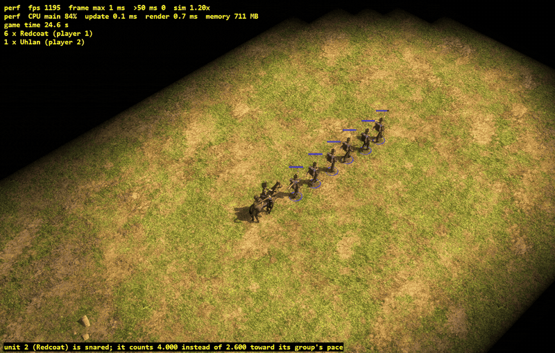

*In WoL, with `snareOnlyHitUnit log` (British, the camera follows the group):* six Redcoats march
east in one group while an Uhlan chases and lances them (`handCavalry.tactics`, a
`TargetSpeedBoost` attack). Each snared Redcoat counts at its full speed toward the group's pace
(`counts 4.000 instead of 2.600 toward its group's pace`): it falls back alone while the others go
on, and the group reaches the end of the map (151 m) at 50 s of game time.
[Full video (MP4)](media/snareOnlyHitUnit-wol.mp4).

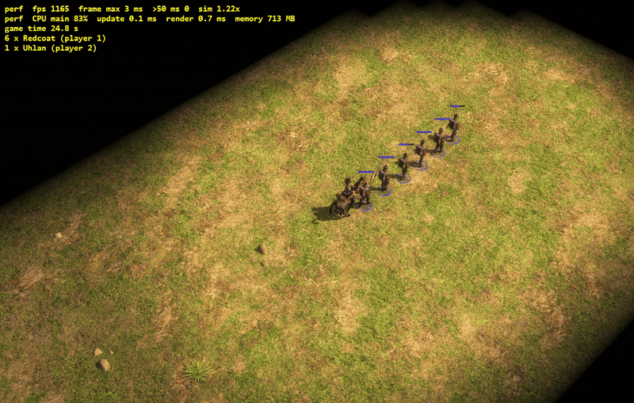

*In WoL, key off (the same scene):* every snare slows the whole group to the snared unit's pace, so
it stays together and arrives at about 54 s; at 41-42 s its mean position is 117 m against 123 m
with the key (sampled once a second).
[Full video (MP4)](media/snareOnlyHitUnit-wol-control.mp4).

```
snareOnlyHitUnit [log]
```

- **In WoL today:** an attack whose tactics action has `<TargetSpeedBoost>1</TargetSpeedBoost>` snares its
  target: the target's speed is multiplied by 0.65 for 3 seconds. WoL gives it to most melee attacks and
  many more. A unit that moves in a group (several units ordered together) does not use its own speed: the group
  moves at the speed of its slowest member. One snared unit therefore slows its whole group to
  0.65× for 3 s.
- **Effect:** the group's pace ignores the snare: a snared member counts with the speed it would
  have without it (other speed modifiers, such as auras, still count). While the snare lasts, the
  snared member also no longer makes the group wait when it falls behind its place in the
  formation. Only the hit unit slows down.
- **After the snare:** the exe's rule for stragglers applies again. If the unit is then more than
  2 m behind its place, the group moves at 0.83× its speed until the unit is back, as for a unit
  that got stuck. A unit snared again and again keeps falling behind while the group goes on.
- **WoL needs:** nothing. Every `<TargetSpeedBoost>` attack is covered, and only those: the attacker's own
  `<SpeedBoost>`, speed auras and techs still act on the group.
- **`log`:** one line per snare and unit when the snare is left out of the group's pace, and one
  when the snared unit falls behind without making the group wait.
- **Log:** at startup `snareOnlyHitUnit: a snared unit (TargetSpeedBoost) no longer slows its
  group; the group neither paces at nor waits for it while the snare lasts (multiplayer
  unverified)` (with `log`: `…lasts, every snared member logged (multiplayer unverified)`); in a
  game, `hook reached: snareOnlyHitUnit (0x4FD3FD)` (the first time any group recomputes its
  speed), and `(0x4FA17D)`, `(0x6AA514)` or `(0x6AA56A)` the first time a member falls more than
  2 m behind its place. With `log`: `snareOnlyHitUnit: unit N (Redcoat) is snared; it counts
  4.000 instead of 2.600 toward its group's pace` and `snareOnlyHitUnit: unit N (Redcoat) is
  snared and lags behind its formation slot; its group does not wait for it (0x4FA17D)`.
- **Limits:** a unit that is not in a group already slowed alone. A snare is exclusive: while a unit is
  snared, its later speed modifiers are ignored and several snares do not stack; the key keeps that.
  The value and duration (0.65, 3 s) do not change.
- **Simulation:** yes.
- **Status:** confirmed in single player. In WoL (2026-11-04), six Redcoats harassed by an Uhlan reached the
  end of the map at 50 s with the key and about 54 s without, positions sampled once a second.

#### rofFix, stunMovingTargetFix, noDamageOnUnbuiltFoundations and fallenHeroTacticsFix

*Four combat fixes: attack timing, stuns, damage to foundations and knocked-out units' tactics.*

**Added:** Tuesday 2026-11-03 11:26

```
rofFix
stunMovingTargetFix
noDamageOnUnbuiltFoundations
fallenHeroTacticsFix
```

WoL's DLL does these four always, so `wol.cfg` has no lines for them. This DLL needs the lines, and with
them WoL plays as it does with its own DLL.

- **rofFix:** ordering a unit to use an ability or command no longer clears its attack timer, so
  orders cannot be used to fire sooner.
- **stunMovingTargetFix:** a stun action is no longer cancelled when its target check fails (a
  target that moves away).
- **noDamageOnUnbuiltFoundations:** a building whose construction has not started yet (a
  foundation just placed) takes no damage, unless the attacker's player is in the state the game
  sets when an effect changes that player's diplomacy with every other player.
- **fallenHeroTacticsFix:** a unit keeps the tactic its player chose when it is knocked out,
  stunned or building; the exe resets it to the first tactic.
- **Log:** one line per key at startup; `noDamageOnUnbuiltFoundations: <Proto> (an unbuilt
  foundation) took no damage from player N` the first time it applies.
- **Simulation:** change combat: every player needs the same lines.
- **Status:** applied and running in WoL (2026-11-03): the four load, and the damage test runs on every
  hit with no change to normal damage (a finished House took 20 per shot with the key). Their effects
  were not seen in a test yet: the trigger that should place a foundation placed none.

#### stealthTargeting

*A unit in stealth stays hidden from enemies, ships and other large units too, so enemies and the AI no longer attack it.*

**Added:** Thursday 2026-11-12 15:51 · **Filmed in WoL:** Thursday 2026-11-12 15:52

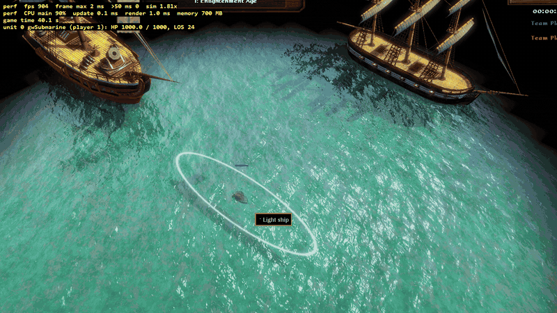

*In WoL, with `stealthTargeting` (a stealthed `gwSubmarine`, selected; a `Frigate` and a `Monitor` of player 2 appear 22 m away, in
range):* they stay idle and the submarine keeps its 1000 HP. [Full video (MP4)](media/stealthTargeting-wol.mp4).

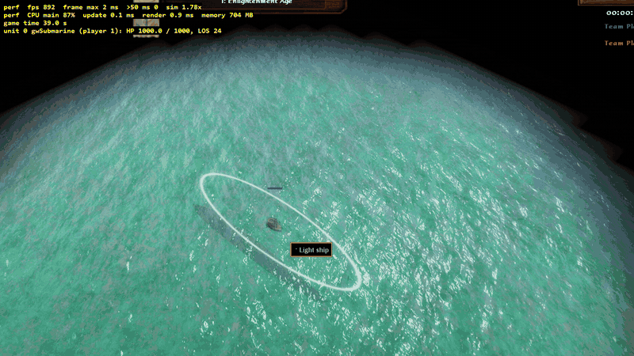

*In WoL, key off (the same scene):* both ships fire at the stealthed submarine at once; it falls to 280 HP in 15 s.
[Full video (MP4)](media/stealthTargeting-wol-control.mp4).

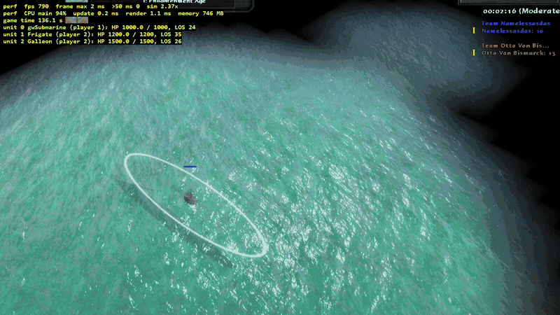

*In WoL, with `stealthTargeting`, a skirmish against the German AI (British player, a stealthed submarine; the AI has a `Frigate`
32 m away and a `Galleon` 50 m away):* the AI's ships stay out of the fight and the submarine keeps its 1000 HP.
[Full video (MP4)](media/stealthTargeting-ai-wol.mp4).

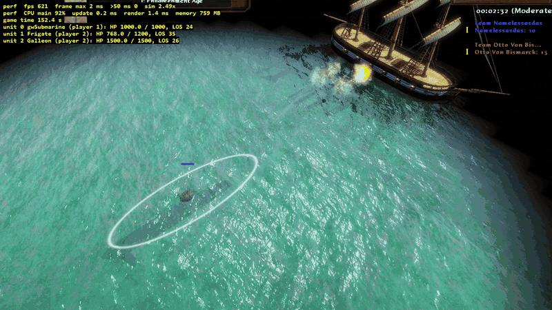

*In WoL, key off (the same skirmish):* the AI's Frigate keeps firing at the stealthed submarine, and the AI sends a Galleon to it
from 50 m. [Full video (MP4)](media/stealthTargeting-ai-wol-control.mp4).

```
stealthTargeting [log]
```

- **The bug (WoL #60 and #61):** the game hides a unit in stealth from every player but its owner and allies, but only for units
  whose `ObstructionRadiusX` and `ObstructionRadiusZ` are at most 1.0. For a larger one, such as a ship or WoL's `gwSubmarine`
  (Z 2.5), the visibility code takes another branch that forgets the stealth: every enemy whose line of sight covers it sees
  it, its units attack it on their own, and the AI finds it and sends ships. Small units (a `xpSpy`, infantry, cavalry) were
  already hidden. In WoL, the stealth units with a radius over 1.0 are `gwSubmarine`, `Steamboat` and `WoLHotAirBalloonFrench`.
- **What the key does:** a large unit in stealth is hidden as a small one is. And no unit picks a stealthed unit its player does
  not see as a target, so an order on a unit seen before it went into stealth (as the AI's ship tried) starts no attack.
- **Unchanged:** a unit of `AbstractCanSeeStealth` that has it in its line of sight still forces it out of stealth, and the
  owner and allies still see it. Area damage still hits it.
- **With other keys:** none shares its sites.
- **Tested in WoL (2026-11-12, single player):** key off, the stealthed submarine was seen by player 2 (visibility mask 0x6) as soon
  as enemy ships appeared, and sunk; key on, the mask stayed 0x2 (its owner) and it took no damage over 50 s; the skirmish
  against `wolOtto` (Germans) as above, with no XS error (the log shows one refused try of the AI's Frigate at the submarine); a stealthed `xpSpy` among 3 `Crossbowman`s and 2 `Hussar`s stayed
  hidden with the key off too. Beside WoL's own DLL (`dinput8.dll`), `applied` and the submarine stayed hidden. 792 fps
  against 776 with 80 units fighting (update 0.151 ms against 0.155). Not tested: multiplayer, a saved game.

#### impactBoneFix

*Cannon splinters land on the building they hit, instead of flying over the whole screen, on models whose impact bones are scaled.*

**Added:** Thursday 2026-11-12 15:45 · **Filmed in WoL:** Thursday 2026-11-12 16:03

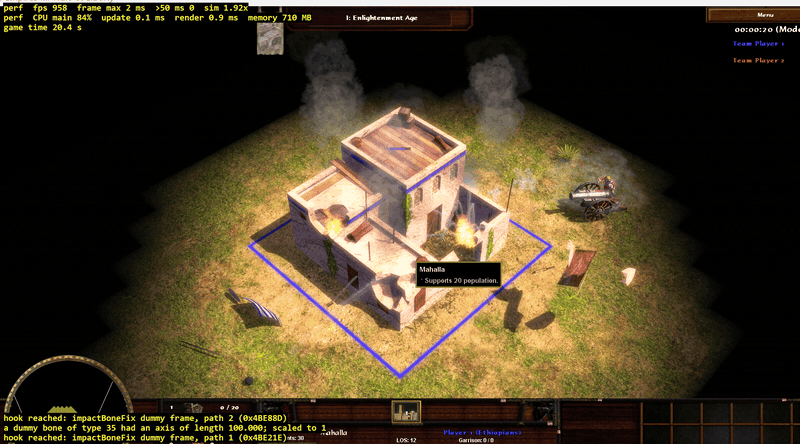

*In WoL, with `impactBoneFix log` (a Persian `Mahalla` whose `mahalla1A/B/C.dmg` had `impacttype="wood"` on every impact
point, hit by a Falconet; the Mahalla stays selected):* each cannonball plays the wood impact on the wall it hits: a burst
of splinters, smoke and fire, at the size of the building. The log shows `a dummy bone of type 35 had an axis of length
100.000; scaled to 1`. [Full video (MP4)](media/impactBoneFix-wol.mp4).

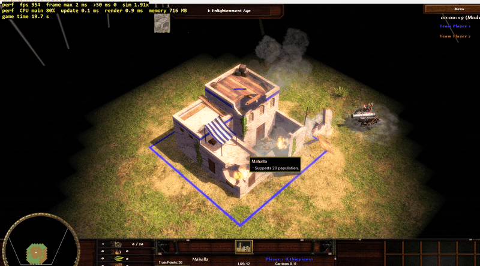

*In WoL, key off (the same data and scene):* every hit throws long grey streaks across the whole view, from the top of the
screen down past the building: the same splinters, a hundred times too big.
[Full video (MP4)](media/impactBoneFix-wol-control.mp4).

```
impactBoneFix [all] [log]
```

- **In WoL today:** JTMaston's #49. The Middle East buildings (Afghans, Persians, Saudis, Uzbeks: `art\WoL\buildings\ME`)
  use `stone` and `rooftile`, and their `oasis*.dmg` uses `wood`; any of them with `wood` shows the bug.
- **Why:** an impact effect whose `<particleset>` names an `.xml` (stock `cannon.impacteffect`'s `<wood>` names
  `effects\impacts\cannonball_impact_wood.xml`) is a visual, and the game hangs it on the bone of the impact point it hit,
  with the bone's whole frame. The bones of these models are scaled by 100 (the export's centimetres); the stock House's
  have length 1. A `<particleset>` with a plain particle set name (`stone`, `rooftile`) is placed at the hit point and never
  reads the bone, so it looks right. WoL's own DLL shows the same streaks: it is the data and the exe, not a DLL.
- **Effect:** the three axes of the bone are brought to length 1 before the visual is placed; its position stays the
  bone's. Bones of length 1 (every stock model) are not touched.
- **`all`:** the same for any visual hung on a bone (flags, smoke, fire points), not only the impact points. Not needed for
  #49; not tested.
- **Without the key, in the data:** export the models with unscaled bones, or use a plain particle set in that element of
  the `.impacteffect`.
- **Simulation:** no, it is drawing only.
- **Log:** `impactBoneFix: effects attached to impact bones get unit-length axes`, `hook reached: impactBoneFix dummy frame,
  path 1 (0x4BE21E)` and `path 2 (0x4BE88D)`; with `log`, the first bone it scales and its length.
- **Tested in WoL (2026-11-12):** the Mahalla with `wood`: streaks on screen with the key off, splinters on the walls with
  it on; the stock House (`wood`, bones of length 1) looks the same either way; the Mahalla with its own `stone`: no streaks
  either way. Beside WoL's own DLL, key off, the streaks show too. Not tested: `all`, ships, multiplayer.

### Gathering and farms

| Key | What it does | WoL's DLL | WoL also needs | In-game status |
|---|---|---|---|---|
| [`gatherFix`](#gatherfix) | Gatherers collect on a fixed interval, so the gather rate is the data's and not the animation's. WoL's balance assumes it. | always on | Nothing. | confirmed |
| [`workRateByAbstractType`](#workratebyabstracttype) | A `WorkRate` effect on an abstract type, `AbstractMine` by default, also reaches the rates a unit has for the protos of that type. | **new** | Take `AbstractMine` off the buildings the techs already name, or those techs count twice on them. | confirmed |
| [`betterfreedynamicunit`](#betterfreedynamicunit) | Dynamic free units grow smoothly with game time, not in 2-minute steps. | **in `wol.cfg`** | Nothing. | confirmed |

#### gatherFix

*Units gather at the rate set in the data, whatever their animation does.*

**Added:** Tuesday 2026-11-03 11:15 · **Filmed in WoL:** Wednesday 2026-11-04 13:58

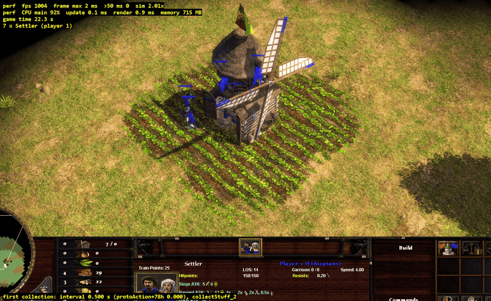

*In WoL, with `gatherFix`:* four settlers on a Mill and three on trees gather at the rate the data gives:
167 food and 128 wood at 92 s of game time. [Full video (MP4)](media/gatherFix-wol.mp4).

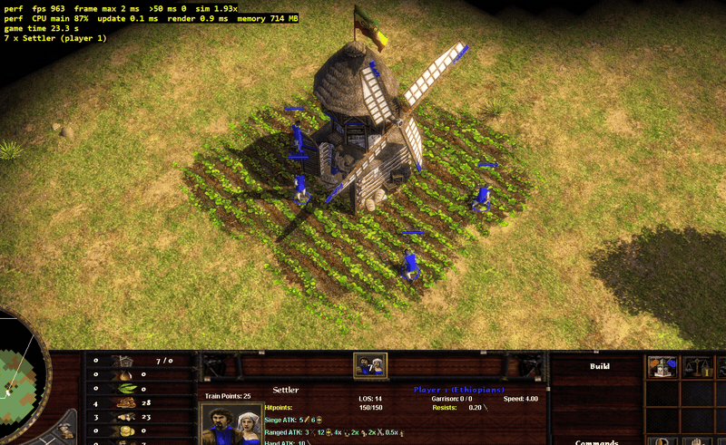

*In WoL, key off (the same scene):* the rate follows the animation: 222 food and 153 wood at the same
time. [Full video (MP4)](media/gatherFix-wol-control.mp4).

```
gatherFix
```

- **In WoL today:** WoL's DLL does this always, so `wol.cfg` has no line for it. This DLL needs the line,
  and without it WoL's economy is wrong: the exe collects once per loop of the gather animation, an
  amount for the animation's length, which makes the real rate depend on the animation.
- **Effect:** gatherers collect on a fixed time interval, so the gather rate is the one in the data.
- **Log:** `gatherFix: gatherers collect on a fixed interval, ...`; the first collection, `interval
  I s (protoAction+78h V), collectStuff | collectStuff_2`.
- **Simulation:** changes gathering: every player needs the same line.
- **Performance:** a collection every 0.5 s per gatherer. With 40 gatherers: update 0.143 / 0.142
  ms with / without, no frame over 50 ms, about 10% fewer frames per second (711–733 vs 815).
- **Status:** confirmed (single player, on WoL): in 120 s, 3 settlers on trees (rate 0.5) gathered 179.5
  wood with the key (0.50 per second each) and 281.3 without it (0.78), and 4 on a Mill 235.5 food against
  367.3.

#### workRateByAbstractType

*Techs that boost gathering from a category, like mines, also reach units' specific rates.*

**Added:** Wednesday 2026-11-04 16:29 · **Filmed in WoL:** Wednesday 2026-11-04 16:29

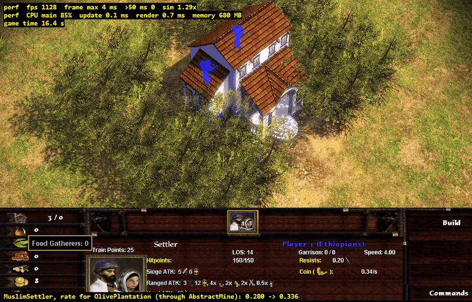

*In WoL, with `showGatherRate` and `workRateByAbstractType log=MuslimSettler` (Ethiopians, an
`OlivePlantation`, WoL's own mining techs):* `Amalgamation`, `HCSilversmith` and `HCIronmonger` each add
20 %, and the villager's rate in the panel goes from 0.28 to 0.34, 0.39 and 0.45 coin per second.
[Full video (MP4)](media/workRateByAbstractType-wol.mp4).

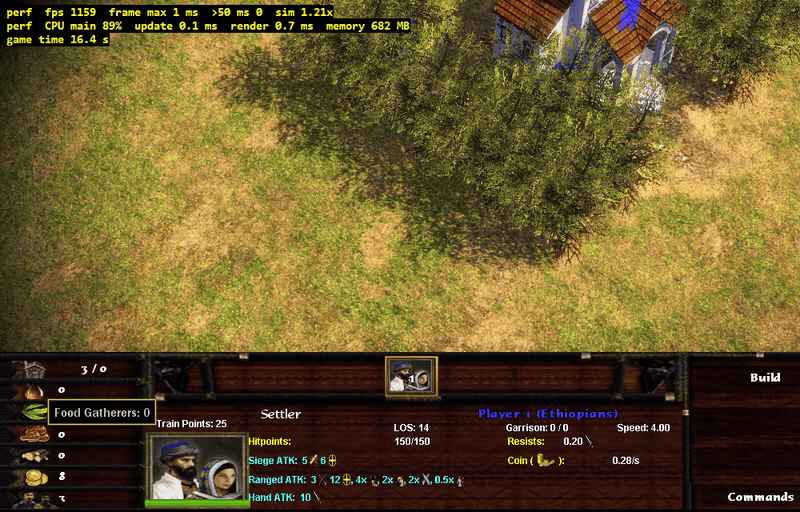

*In WoL, key off (the same scene):* the three techs change nothing here, and the rate stays at 0.28.
[Full video (MP4)](media/workRateByAbstractType-wol-control.mp4).

```
workRateByAbstractType [UnitType ...] [log | log=<Proto>]
```

- **Why (JTMaston's #11):** a unit's rate for a target is its rate for that exact proto if it has one,
  and only if not, its rate for an abstract type of the target. A `WorkRate` effect changes the one rate it
  names. A villager has its own `Plantation` rate, so a mining tech never reached a Plantation, although the
  Plantation carries `AbstractMine`.
- **Effect:** when a `WorkRate` effect names a listed type (default `AbstractMine`, up to 8), the same
  change goes to every rate the unit has for a proto of that type, with the same relativity and amount.
  Removing the effect takes it back. A unit with no rate of its own for that proto is left alone: it already
  reads the abstract rate.
- **Each player's rates:** the change is made on the player whose tech it is.
- **WoL also needs a data decision.** Of WoL's 177 techs with a `WorkRate` effect on `AbstractMine`, 75 name
  no other proto of that type: those are the ones the key fixes. The other 102 already name `Plantation`,
  `OlivePlantation` or another such proto, and with the key they count **twice** on it while it carries
  `AbstractMine` (`ImpExcessiveTaxation`, ×1.5 twice: a Settler's `Plantation` rate goes 0.35 → 0.525 →
  0.70). JTMaston's plan is to take the tag off the plantations; then those buildings keep exactly the techs
  that name them, and the key serves the buildings that keep the tag.

  <details>
  <summary>The 102 techs that name both</summary>

  `Age0Dutch`, `CapitolDualMonarchy`, `ChurchCodeNapoleon`, `ChurchEconmediaManor`, `EarthCeremony`, `EarthGiftCeremony`, `EUpoliticianDutchUK`, `EUpoliticianFrenchUK`, `HCAycinenaWykeTreaty`, `HCBerthierRifle`, `HCCardGeologicalSurvey`, `HCCasadeMoneda`, `HCEconomicTheoryChile`, `HCEGYFRANCE1`, `HCEGYFRANCE10`, `HCEGYFRANCE11`, `HCEGYFRANCE12`, `HCEGYFRANCE13`, `HCEGYFRANCE14`, `HCEGYFRANCE15`, `HCEGYFRANCE16`, `HCEGYFRANCE17`, `HCEGYFRANCE18`, `HCEGYFRANCE19`, `HCEGYFRANCE2`, `HCEGYFRANCE20`, `HCEGYFRANCE21`, `HCEGYFRANCE22`, `HCEGYFRANCE23`, `HCEGYFRANCE24`, `HCEGYFRANCE25`, `HCEGYFRANCE26`, `HCEGYFRANCE27`, `HCEGYFRANCE28`, `HCEGYFRANCE29`, `HCEGYFRANCE3`, `HCEGYFRANCE30`, `HCEGYFRANCE4`, `HCEGYFRANCE5`, `HCEGYFRANCE6`, `HCEGYFRANCE7`, `HCEGYFRANCE8`, `HCEGYFRANCE9`, `HCEUEconomicTheoryAH`, `HCEURoyalMintAH`, `HCExtractivism`, `HCGuilds`, `HCLlanquihueArtisans`, `HCMinieBall`, `HCRoyalMint`, `HCRoyalMintChile`, `HCShipAfricanAskaris1Egypt`, `HCShipAfricanAskaris2Egypt`, `HCShipAfricanAskaris3Egypt`, `HCShipAfricanAskaris4Egypt`, `HCShipAfricanEscortEgypt1`, `HCShipAfricanEscortEgypt2`, `HCShipAfricanEscortEgypt3`, `HCShipAfricanEscortEgypt4`, `HCShipConsulateFrench1`, `HCShipConsulateFrench2`, `HCShipConsulateFrench3`, `HCShipConsulateFrench4`, `HCVillaCosmopolis`, `HCXPEconomicTheory`, `ImmigrantMetaStuff`, `ImpExcessiveTaxation`, `ImpExcessiveTributeNative`, `MapucheIronmonger`, `MapucheRoyalMint`, `MapucheSilversmith`, `MEPerCourtFR1`, `MEPerCourtFR2`, `MEPerCourtFR3`, `NAtechUSAuniquetechunion07`, `NAtechUSAuniquetechunion08`, `NAtexaco04`, `NatXPKlamathWorkEthos`, `NatXPNavajoCraftsmanship`, `TicketOfLeave`, `WhipSlaves`, `WhipSlaves2`, `WhipSlaves3`, `WhipSlaves4`, `WhipSlaves5`, `WOLHCAntwerpDiamondDistrict`, `WOLHCEconomicTheoryDanish`, `WOLHCGumbootDance`, `WOLHCHermitKingdom`, `WOLHCQueteletIndex`, `WOLHCRoyalMintDanish`, `WOLNatJadidONE`, `ypBigConsulateFrench`, `ypBigConsulateSPCFrench`, `ypBigSequesterInitialClone1`, `ypBigSequesterInitialFrench`, `ypBigSequesterRemoveClone1`, `YPHCChonindoTeam`, `YPHCEconomicTheoryAsia`, `YPHCRoyalMintIndians`, `ypImpExcessiveTributeAsian`, `YPNatSufiFasting`

  </details>

- **Log:** `workRateByAbstractType: applied`, `hook reached: workRateByAbstractType apply (0x8F987C)`, and at
  the first such effect `AbstractMine has 33 protos`. With `log=<Proto>`, each change to that unit's rates,
  `MuslimSettler, rate for OlivePlantation (through AbstractMine): 0.280 -> 0.336`. Plain `log` writes every
  unit's, up to 2000 lines: for debugging only, it stalled the game about 3 s per tech in WoL.
- **Arguments:** a proto name is ignored with a log line the first time an effect names it; an unknown name
  is registered as a type with no protos. More than 8 types, or `log=` with no proto: not applied.
- **Simulation:** changes gathering: every player needs the same line.
- **Saved games:** the rates are rebuilt on load through the same effects, so they load right, and no effect
  counts twice (a Settler's `Plantation` rate was 0.42 before and after, in a new process, and the next tech
  took it to 0.49). The game needs the same line.
- **Performance:** it runs only when a tech applies, never per unit or per tick. In the filmed scene, without
  `log`: longest frame 10 ms against 13 ms for the control, no frame over 50 ms in either.
- **The Torp's tags, tested in WoL (2026-11-06, Ethiopians, `tools/torp_testdata.py`):** one Sawmill, five auras: a Mine paid
  with an own Plantation in range that never did, one BerryBush of two, a Deer and a Sheep only once a trigger killed them,
  two crates at 4/s; `ModifyRate` 0.5 took the Mine from 0.80 to 0.39 per update and the log said `0.27 -> 0.135`;
  `ActionEnable` 0 took a tree aura from 7 takes to none. With 9 Sawmills on 3 Mines and 4 bushes: 895 fps against 898 with
  the key off, update 0.14 ms in both, no frame over 50 ms (60 s, `perfprobe.py`). Not tested: a loaded game with these
  tags, an AI that builds them, a real Torp's 14 m trees, multiplayer.
- **Status:** confirmed (single player, on WoL): the rates above; a real removal, `Age0Egyptian` at game
  start with `workRateByAbstractType All`, took 0.536 back to 0.670; with `AbstractMine` taken off `Plantation`
  in `protoy.xml`, 32 protos and no change to its rate; a skirmish against the AI, which played on (16 to 24
  units in 120 s of game time). Multiplayer not tested.

#### betterfreedynamicunit

*Free units that scale with game time grow smoothly, not in 2-minute steps.*

**Added:** Tuesday 2026-11-03 10:43 · **Filmed in WoL:** Wednesday 2026-11-04 13:58

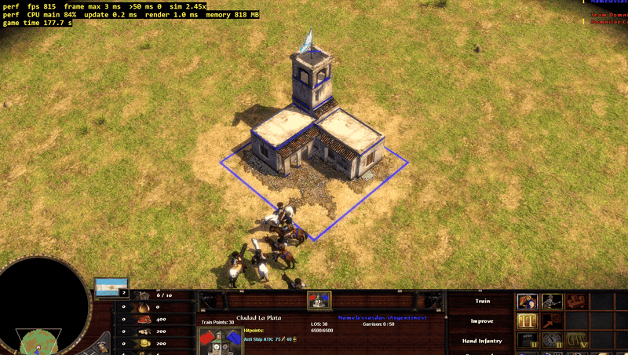

*In WoL (an Argentinean skirmish, on a test map whose trigger turns on `Corderos`, −2 Sheep, at 205 s):* 3
Sheep, from 1.71 two-minute steps × 2 (`-> 3.417`). [Full video (MP4)](media/betterfreedynamicunit-wol.mp4).

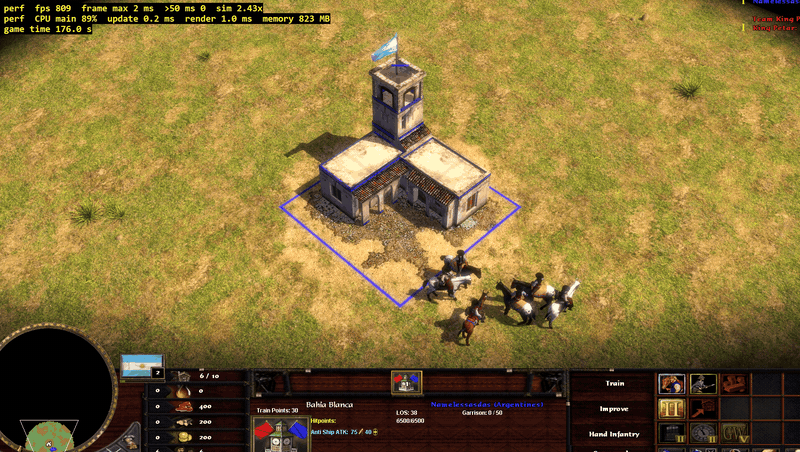

*In WoL, key off (the same scene):* the exe rounds up to 2 steps: 4 Sheep.
[Full video (MP4)](media/betterfreedynamicunit-wol-control.mp4).

```
betterfreedynamicunit
```

- **Effect:** "dynamic" free units (a `FreeHomeCityUnit` effect with a negative `amount`, about 55 techs
  in WoL) grow smoothly with game time: `-amount × min(time / 2 min, 15)`. The exe uses a whole number
  of 2-minute steps, rounded up (at 3.5 steps it already counts 4). `wol.cfg` has this line.
- **WoL needs:** nothing beyond the negative amounts. The player needs a home city (the free units come
  from it; scenario players without one get none, with or without the key).
- **Log:** `betterfreedynamicunit: dynamic free units grow ...`; the first time, `amount A at S
  steps of 2 min -> N`.
- **Simulation:** changes how many units arrive: every player needs the same line.
- **Status:** confirmed (single player, on WoL): `Corderos` (−2 Sheep), set by a map trigger, at 205 s gave
  3 Sheep with the key and 4 without; at 420 s, 7 and 8.

### Buildings and training

| Key | What it does | WoL's DLL | WoL also needs | In-game status |
|---|---|---|---|---|
| [`liveBuildingWorkRate`](#livebuildingworkrate) | Makes `BuildingWorkRate` techs (train, research and `Maintain` speed) apply to buildings that already stand, not only to those completed after the tech, and `TrainPoints` techs to units already queued or in training. | **new** | Nothing. | confirmed (single player) |
| [`maintainWaitForPop`](#maintainwaitforpop) | When a marked building's automatic production finishes a unit while its player is at the population cap, keeps the unit and spawns it as soon as there is room. | **new** | The name of an existing type or proto (`TownCenter`, `Factory`), or that unit type on the producing buildings in `protoy.xml`. | confirmed (single player) |

#### liveBuildingWorkRate

*Techs that speed up training also reach existing buildings and queued units.*

**Added:** Thursday 2026-10-29 06:39 · **Filmed in WoL:** Wednesday 2026-11-04 12:48

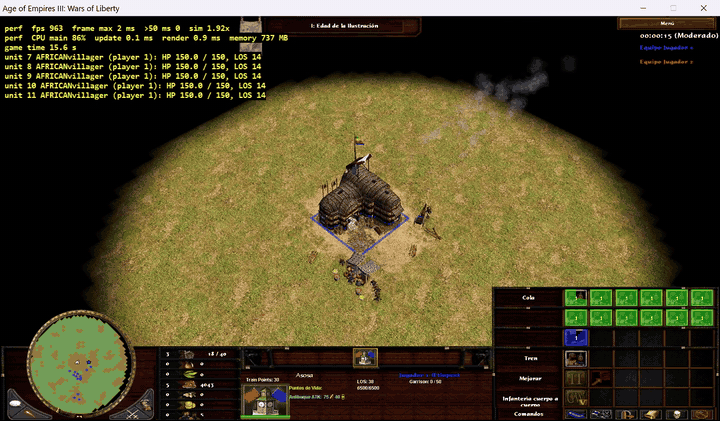

*In WoL, with `liveBuildingWorkRate log` (an African civ's Town Center, selected so its queue
shows):* the TC trains 15 `AFRICANvillager`; at 30 s a test tech (`UHCBwrTest`, BuildingWorkRate x3
on `TownCenter`, appended to the bed's techtree for the test and removed after) turns on. The
standing TC works at 3.0 at once (`works at BuildingWorkRate 3.000, not its snapshot 1.000`), and
it has 12 villagers by 92 s (5 at the start).
[Full video (MP4)](media/liveBuildingWorkRate-wol.mp4).


*In WoL, key off (the same scene):* the exe keeps the TC's snapshot of 1.0, so the tech changes nothing
for it: 8 villagers by 92 s, the queue still long.
[Full video (MP4)](media/liveBuildingWorkRate-wol-control.mp4).

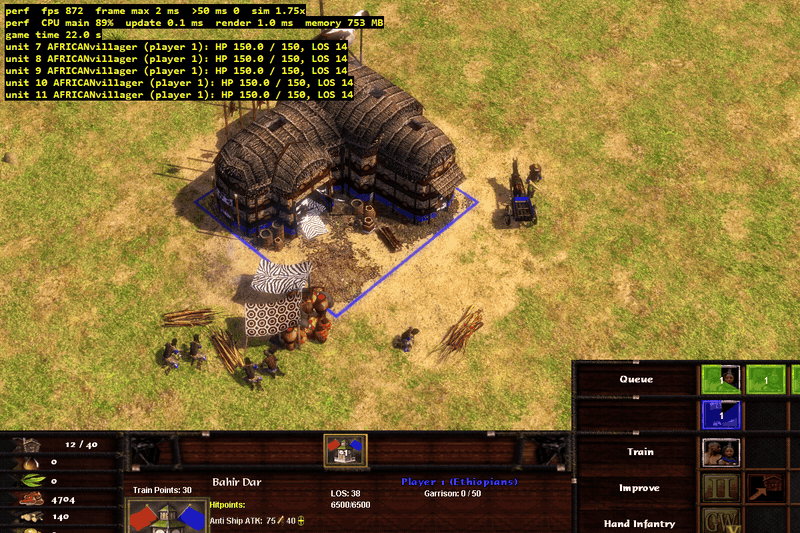

*In WoL, `TrainPoints`:* six `AFRICANvillager` are queued with their `TrainPoints` of 25, and a test tech
sets them to 6.25 at 30 s (`trains AFRICANvillager at TrainPoints 6.250, not the 25.000 it was queued
with`). The one in training finishes at once, and the others take 6.25 s each.
[Full video (MP4)](media/liveBuildingWorkRate-trainpoints-wol.mp4).

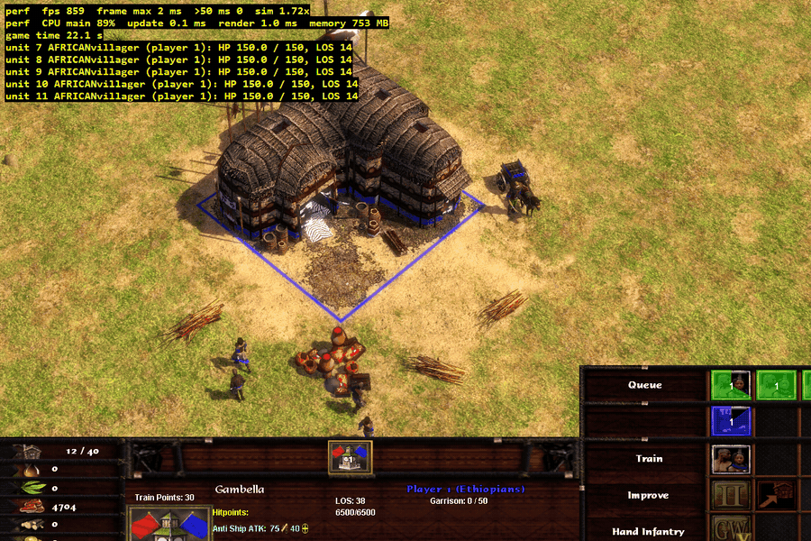

*In WoL, key off (the same scene):* the queue keeps the 25 points it took, so the tech reaches no villager
already queued: 8 units against 11 at the end. [Full video (MP4)](media/liveBuildingWorkRate-trainpoints-wol-control.mp4).

```
liveBuildingWorkRate [log]
```

- **In WoL today:** two kinds of tech change how fast units are trained, and the exe applies both late
  (WoL request #5, "workrate techs only affect units / buildings created after the tech"):
  - **`BuildingWorkRate`** (`type='Data' subtype='BuildingWorkRate'`, 15 techs in WoL). A building's
    `<BuildingWorkRate>` scales how fast it trains units, researches techs and spawns the units of its
    `Maintain` actions. The exe copies the proto's value into the building once, when the building is
    completed (for a unit with the flag `ForceBuildingData`, when it is created), and the train,
    research and `Maintain` code read that copy. The tech changes only the proto. So the buildings
    completed after the tech get the new speed, and the ones already standing keep the old one,
    although their panel shows the new value. Loading a saved game copies the value again for completed
    buildings, so the bug seems to vanish after a save and load.
  - **`TrainPoints`** (`type='Data' subtype='TrainPoints'` on the trained unit, 328 techs in WoL). Each
    queued unit (or batch) takes the unit's TrainPoints when it is queued and keeps them. A tech
    therefore misses the unit in training and every unit already in the queue, on old and new buildings
    alike; only the units queued after the tech train faster. A `Maintain` action takes them when its
    cycle starts, so the current cycle keeps the old time.
  - **Already live:** `ResearchPoints` (`type='Data' subtype='ResearchPoints'` on a tech, 85 techs in
    WoL). A research reads them on every tick, so the tech reaches every building, even a research in
    progress. WoL has no `WorkRate` / `WorkRateSpecific` effect with `action='Train'` or `'Research'`.
- **Effect:**
  - every building and `ForceBuildingData` unit trains, researches and spawns at its proto's
    current `BuildingWorkRate`;
  - a unit in training or in a queue, and the current `Maintain` cycle, take the trained unit's
    current `TrainPoints` on every tick. The progress already made is kept in points, as it is for
    research: when the points drop below it, the unit is done at once.

  So both techs apply at once to everything that exists, in both directions (a tech that is removed
  again, a trigger, any later change of the value). Units without building data already worked this way
  for `BuildingWorkRate`.
- **WoL needs:** nothing. It works with the techs WoL has:

  ```xml
  <Effect type ='Data' amount ='2.00' subtype ='BuildingWorkRate' relativity ='BasePercent'>
      <Target type ='ProtoUnit'>Stable</Target></Effect>
  <Effect type ='Data' amount ='0.75' subtype ='TrainPoints' relativity ='BasePercent'>
      <Target type ='ProtoUnit'>WOLLineInfantry</Target></Effect>
  ```

- **`YPForceTrainAtBaseTrainPoints`:** a trainer whose proto has this flag (the Confucian Academy and
  Summer Palace wonders) trains at the base proto's TrainPoints, which no tech changes; the key keeps
  that rule.
- **Not covered:** the action rates. `type='Data' subtype='WorkRate'` effects (gathering, building,
  healing, …) and `type='Data2' subtype='WorkRateSpecific'` effects are read live already (static
  reading), so they already reach existing units; this key does not change them.
- **Transformed buildings:** a building that changes proto in place (a `TransformUnit` tech) now works at
  the new proto's rate; the exe kept the old proto's copy.
- **`log`:** one line for each building whose speed this key changes, and for each trainer and
  unit type whose points it changes, the first time and again only if the values change later.
  Use it to check your data, not in a release.
- **Log:** at startup `liveBuildingWorkRate: train, research and Maintain speed follow the
  proto's current BuildingWorkRate, and queued, training and Maintain units their current
  TrainPoints (multiplayer unverified)` (with `log`: `…TrainPoints, every building and unit it
  changes logged (multiplayer unverified)`). In a game, `hook reached: liveBuildingWorkRate
  (0x9BFE33)` the first time any building trains, researches or spawns, `hook reached:
  liveBuildingWorkRate TrainPoints (0x9EA1FA)` the first time a unit trains, and `hook reached:
  liveBuildingWorkRate Maintain TrainPoints (0x9E27E4)` the first time a `Maintain` cycle runs.
  With `log`:
  - `liveBuildingWorkRate: unit N (Proto, player P) works at BuildingWorkRate 4.000, not its
    snapshot 1.000`;
  - `liveBuildingWorkRate: unit N (TownCenter, player 1) trains Settler at TrainPoints 6.250, not
    the 25.000 it was queued with`;
  - `liveBuildingWorkRate: unit N (BloodFactory, player 1) spawns Musketeer at 7.500 points per
    cycle, not the 30.000 its cycle started with`.
- **Limits:**
  - with `log`, a unit is logged once per unit ID (and trained type) and pair of values in a game;
    a new game starts the list again;
  - whether a building under construction can train or research was not checked. If it can, it
    now uses the proto's rate there, where the exe used 1.0. `Maintain` never runs on an unfinished
    building;
  - a queued unit that has not started yet keeps the points it was queued with until it starts
    (nothing reads them before), so the queue panel may show its old time until then.
- **Simulation:** yes. Saved games load with or without the key: the building's copy and the queued
  points are kept and saved as always (with the key, the values it last wrote).
- **Status:** confirmed in single player.
  - **In WoL (2026-11-04):** `BuildingWorkRate` x3 on `TownCenter`: the standing TC had 12 villagers by
    92 s, and 8 without the key. `TrainPoints` ×0.25 on `AFRICANvillager`: 11 units against 8.
  - **On the stock game (2026-10-29 and 30):** `Maintain`, 12 units against 3 with `BuildingWorkRate` 4
    on one player's factory, 3 and 3 without the key; `BuildingWorkRate` on train and research, a
    research in progress finishing 3.2 s after the tech; `TrainPoints` ×0.25, the unit in training
    done at the tech, the queued ones in 6.25 s, a `Maintain` cycle taking the new points at once, also
    after loading a game saved before the tech. An AI skirmish played with no XS error. A bad argument
    logged the error, and the key was not applied.

#### maintainWaitForPop

*Automatically produced units wait for population room instead of being lost.*

**Added:** Thursday 2026-10-29 06:39 · **Filmed in WoL:** Friday 2026-11-06 11:33

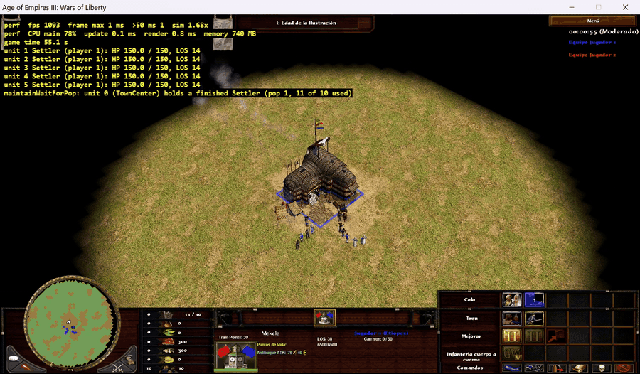

*In WoL, with `maintainWaitForPop TownCenter log` (WoL's `Age0Ottoman` turns on the TC's
`MaintainSettlersOttoman`; the TC is selected):* the population is over its cap (11 of 10), so at
62 s the TC holds its finished settler (`holds a finished Settler (pop 1, 11 of 10 used)`). Two
settlers die at 70 s and the held one comes out at once (`releases its Settler (pop 1, 9 of 10
used)`). [Full video (MP4)](media/maintainWaitForPop-wol.mp4).

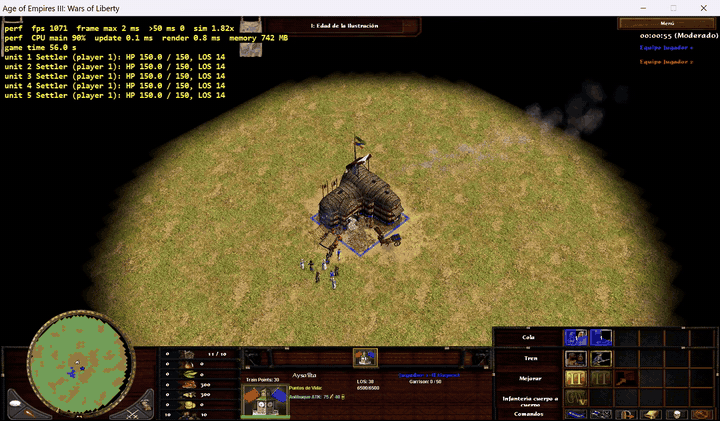

*In WoL, key off (the same scene):* the cycle that ended at full population is lost; after the
two deaths at 70 s the next settler needs a whole new cycle and appears about 23 s later.
[Full video (MP4)](media/maintainWaitForPop-wol-control.mp4).

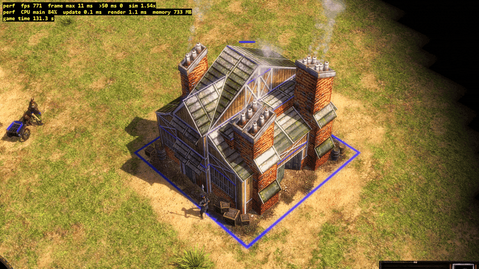

*In WoL, with `maintainWaitForPop Factory log` (a Factory on its Cannon tactic, 7 of 10 population):* the finished Cannon waits, and
comes out as soon as population is freed. [Full video (MP4)](media/maintainWaitForPop-factory-wol.mp4).

```
maintainWaitForPop [<UnitType>] [log]     default AbstractMaintainWaitForPop
```

- **In WoL today:** some buildings produce units on their own, through a `Maintain` action in their
  tactics file: the factory's `SpawnCannon`, the Ottoman Town Center's settlers, the dock's `SpawnBoat`,
  the native trading posts' warriors, and many more. The building fills a timer: `<rate type="X">n</rate>`
  gives the unit X and n units per cycle, and the cycle costs n × X's `TrainPoints` at the building's
  work rate. When the timer is full, the game tries to spawn the units. A unit that does not fit in the
  player's population is not created, and the game does not check whether anything was spawned:
  - a normal action starts the next cycle from zero, so after a house is built the next unit comes a
    whole cycle later;
  - a `SingleUse` action (dock boats, native warriors) ends, so its units are lost.
- **Effect:** for a building whose proto is of `<UnitType>`, a cycle that ends while the first
  unit does not fit is **held**: the timer stays full and no new cycle starts. The unit spawns on
  the first game update with room (a unit dies, a house is finished, a tech raises the cap). A
  held `SingleUse` action waits instead of ending. Any other building behaves as before.
- **"Does not fit"** is exactly the exe's test that would have refused the unit: its
  `PopulationCount` against the player's current population and cap, with `AllowOverPopCap` and
  `AlwaysAllowOverPopCap`, and with the cap set by `basePop` / `extraPop`. A unit with no
  population cost is never held. After a revolution, settlers and coureurs are tested as
  `xpColonialMilitia`, as the game spawns them.
- **Which buildings:** the marker goes on the **producing building**, not on the produced unit. An
  existing type or proto name works with no data change: `maintainWaitForPop TownCenter` (the video),
  `maintainWaitForPop Factory`, or `maintainWaitForPop Building` for every building. To choose them one
  by one, list the default `AbstractMaintainWaitForPop` on the buildings in `data\protoy.xml`.
- **Balance:** this is a gameplay change. With `TownCenter`, a housed Ottoman player gets the next free
  settler as soon as a house is up, instead of a whole cycle later. Mark only the buildings you mean.
- **Limits** (the exe's rules, kept):
  - batches (`<rate>` above 1): a cycle is held only while its **first** unit does not fit. When there
    is room for some but not all, the spawn creates what fits and drops the rest;
  - `AbstractMonk` spawns: the exe may reuse an existing unit without testing the population, so they
    are never held;
  - a cycle that spawns nothing for another reason (the build limit, no room to place the unit) still
    restarts.
- **`log`:** one line when a building starts holding a unit and one when it releases it.
- **Log:** at startup `maintainWaitForPop: buildings of unittype X keep a finished Maintain unit
  until there is population room (multiplayer unverified)` (with `log`: `…room, holds and releases
  logged (multiplayer unverified)`); when the data loads, `unit types: X -> <ID> …`; in a game,
  `hook reached: maintainWaitForPop (0x6AB27D)` the first time any `Maintain` cycle ends. With
  `log`: `maintainWaitForPop: unit N (TownCenter) holds a finished Settler (pop 1, 10 of 10 used)`
  and `maintainWaitForPop: unit N (TownCenter) releases its Settler (pop 1, 9 of 10 used)`.
- **Saved games:** a held cycle is saved as a full timer, with no extra data. Loaded without the key, it
  behaves as a normal cycle.
- **Simulation:** yes. It may also add a unit type, which changes the unit type count.
- **Status:** confirmed in single player, in WoL (2026-11-04) with an Ottoman Town Center (`Age0Ottoman`
  gives it `MaintainSettlersOttoman`): it held its finished settler and released it right after two
  settlers died; without the key, the next settler came about 23 s later. A real Factory (2026-11-06): a Cannon held at 7 of 10 came at 154.8 s, right
after room at 150 s; key off, at 245.9 s, a whole cycle later. Batches and
  `SingleUse` spawns were not tested.

### Techs and transforms

| Key | What it does | WoL's DLL | WoL also needs | In-game status |
|---|---|---|---|---|
| [`techPrereqRecheck`](#techprereqrecheck) | Re-checks techs whose prerequisites count units (`<TypeCount>`) when units are created or die, not only at the player's next house, age-up or tech change. | **new** | Nothing: WoL has 12 `<TypeCount>` prerequisites in 9 techs. | confirmed (single player) |
| [`transformUpdatesLOS`](#transformupdateslos) | A unit transformed in place (a `TransformUnit` tech effect, a revolution) takes the line of sight of its new proto. | **new** | Nothing. | confirmed (single player) |
| [`transformInventory`](#transforminventory) | A unit transformed in place (a `TransformUnit` tech effect, a revolution) takes its new proto's `InitialResource` when the two protos hold different resource types. | **new** | Nothing; with a new marker, that type on the target protos. | confirmed (single player) |

#### techPrereqRecheck

*Techs that depend on unit counts unlock or lock as soon as the count changes.*

**Added:** Thursday 2026-10-29 06:39 · **Filmed in WoL:** Wednesday 2026-11-04 12:48

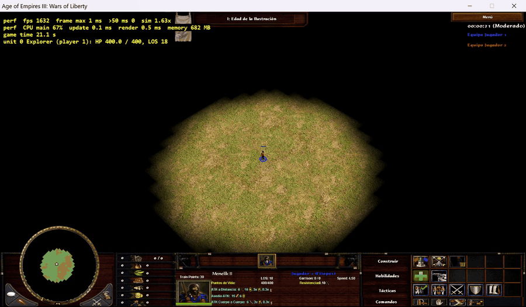

*In WoL, with `techPrereqRecheck log` (Ethiopians: the Explorer is Menelik II, selected so his HP
shows in the panel):* a trigger creates a Dock at 24 s. A test tech (`UHCTypeCountDock`: no research
time, prerequisite one living Dock, Explorer hit points x0.5; appended to the bed's techtree and
removed after) is the same pattern as WoL's `WOLEnableInfanteDeMarina`. It activates in the same
update (`prerequisites now met ... game time 24002 ms`): 400/400 becomes 200/200.
[Full video (MP4)](media/techPrereqRecheck-wol.mp4).

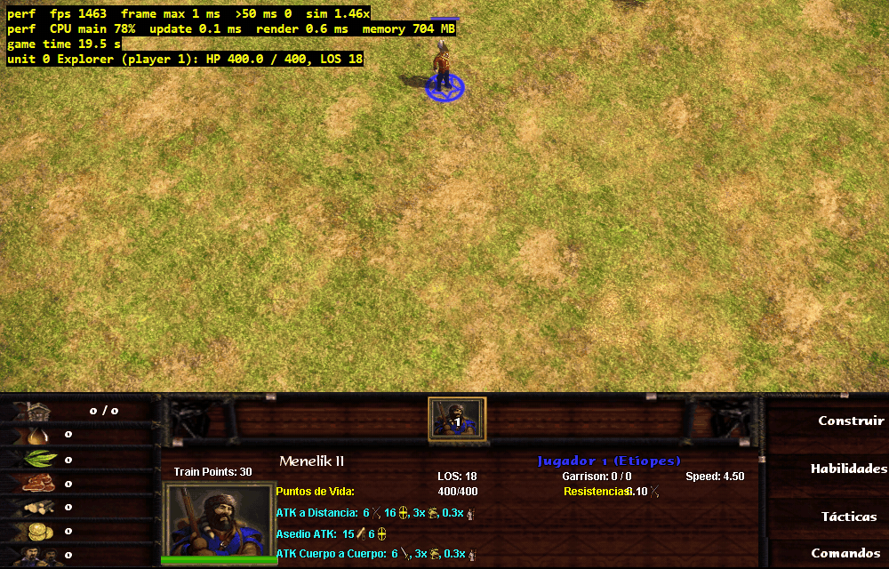

*In WoL, key off (the same scene):* the Dock stands but nothing re-checks the tech, so the Explorer
keeps 400 HP (the exe waits for a tech change or a house).
[Full video (MP4)](media/techPrereqRecheck-wol-control.mp4).

```
techPrereqRecheck [N] [full] [log]       N: check each player every N world updates (default 1)
```

- **In WoL today:** the game evaluates a tech's `<Prereqs>` only when the player's tech tree is marked for a re-check: when one of the player's techs changes status (researched, activated,
  made obtainable, a shipment), at an age-up, at a home city level-up, and when the player's
  population cap changes (a house is built or destroyed). Creating or killing any other unit never
  does. A `<TypeCount>` prerequisite counts the player's units, so it is noticed late: a tech with
  `<TypeCount unit='Dock' count='1' state='noneState aliveState' operator='gte'/>`, the pattern of
  WoL's `WOLEnableInfanteDeMarina`, waits for the player's next house after the first dock is built. WoL
  has 12 `<TypeCount>` prerequisites in 9 techs.
- **Effect:** on every world update (or every N), for each tech with a `<TypeCount>` prerequisite, the
  DLL evaluates the tech's prerequisites for each player exactly as the exe's re-check does, and
  compares the result with the one the game cached. On a difference it starts the exe's re-check at
  once, the same as after a house:
  - a tech with no research time (`<ResearchPoints>0</ResearchPoints>`) whose prerequisites are now
    met activates;
  - a `Volatile` tech activates or deactivates;
  - the AI's tech list and the UI are updated.

  Techs without `<TypeCount>` are not checked by the DLL, but the re-check it starts re-evaluates them
  too.
- **`N`:** each player is checked every N world updates, offset by its player number so the
  players' checks are spread out. A larger N costs less and reacts later.
- **`full`:** for measurements only. It starts the exe's re-check of every tech for each player every N
  updates, whether anything changed or not. That re-check walks every tech, and WoL has 10,552, so use a
  large N (e.g. 60).
- **Writing `<TypeCount>`** (from the exe's XML handler, static reading):
  - all four attributes are required: `unit`, `count`, `operator`, `state`. Without one, the game
    drops the prerequisite with an error;
  - `state` is a list of words. It starts as "any state"; `noneState` clears it, then
    `aliveState`, `deadState` and `buildingState` add those states. A lone `state='aliveState'`
    still means any state: write `state='noneState aliveState'`;
  - `operator` is read as substrings `lt`, `e` and `gt`, so `gte` means "greater or equal";
  - `count` is read as an integer.

  ```xml
  <Tech name ='WOLEnableInfanteDeMarina' type ='Normal'>
      <DBID>…</DBID>
      <ResearchPoints>0.0000</ResearchPoints>
      <Status>OBTAINABLE</Status>
      <Flag>Shadow</Flag>
      <Prereqs>
          <TypeCount unit ='Dock' count ='1' state ='noneState aliveState' operator ='gte'></TypeCount></Prereqs>
      <Effects>…</Effects>
  </Tech>
  ```
- **`log`:** one line per re-check started, and a summary per game minute (checks, evaluations,
  re-checks started, time spent in the checks). Use it to check your data or measure the cost,
  not in a release.
- **Log:**
  - at startup, `techPrereqRecheck: techs with TypeCount prerequisites are re-checked every N
    world update(s); a change starts the stock re-check (multiplayer unverified)` (with `log`,
    `…; every re-check and a summary every game minute are logged (multiplayer unverified)`; with
    `full`, `techPrereqRecheck: full: the stock re-check of every tech runs every N world
    update(s) for each player (multiplayer unverified)`);
  - in a game, `hook reached: techPrereqRecheck (0x491A18)`;
  - once per data load, `techPrereqRecheck: K tech(s) of T have TypeCount prerequisites (P in
    all)` and one `techPrereqRecheck:   tech <ID> (<Name>), n TypeCount prerequisite(s)` line per
    tech, up to 100. With none: `…; nothing to re-check`;
  - the first re-check is always logged: `techPrereqRecheck: player P, tech <ID> (<Name>):
    prerequisites now met; stock re-check at step S, game time T ms (add log to see every
    re-check)` (or `no longer met`). With `log`, every re-check is, and every game minute
    `techPrereqRecheck: game minute M: … check(s), … evaluation(s), … re-check(s) started, … full
    pass(es) requested, … us in checks`;
  - a bad argument: `techPrereqRecheck: unexpected argument X (expected: [N] [full] [log], N a whole
    number of world updates from 1 to 1000000); feature not applied`.
- **Limits:**
  - the counts are the ones the player's knowledge base keeps, the counts XS `kbUnitCount` reads;
  - only `<TypeCount>` prerequisites are watched; `<Culture>` and `<Civilization>` prerequisites
    after a civilization change are not;
  - a tech that is not relevant to the player yet (unobtainable and not named by its civ's techs)
    has no status entry. Nothing evaluates it until a status change creates one.
- **Simulation:** yes: techs activate earlier. Every player needs the same setting, N included. The check reads only game state and the world's step count.
- **Status:** confirmed in single player. In WoL (2026-11-04), a test tech with one living Dock as its
  prerequisite activated in the same update as the Dock (24 s); without the key it never did in that
  scene. On the stock game (2026-10-29), with two test techs, a unit's creation and a unit's death each
  activated theirs at once, for about 4 ms per game minute. The cost with WoL's 9 techs was not
  measured.

#### transformUpdatesLOS

*A transformed unit gets the line of sight of its new form.*

**Added:** Thursday 2026-10-29 06:39 · **Filmed in WoL:** Wednesday 2026-11-04 12:48

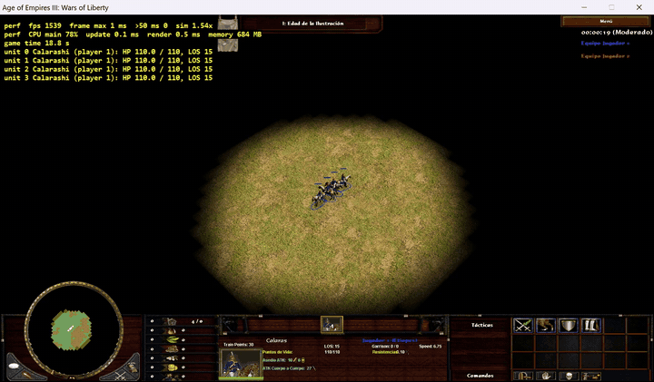

*In WoL, with `transformUpdatesLOS log` (Romanians, the units selected):* WoL's
`ShiftingCalarasToVanator` turns four Calarashi (LOS 15) into Vanatori (LOS 22) at 26 s; they take
LOS 22 at once (`LOS 15 -> 22`, the panel and the lit area grow).
[Full video (MP4)](media/transformUpdatesLOS-wol.mp4).

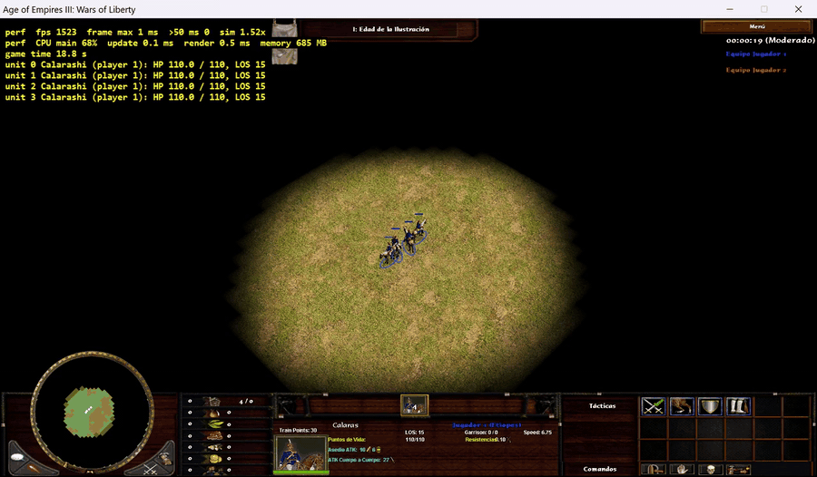

*In WoL, key off (the same scene):* the Vanatori keep the Calarashi's LOS 15 (the panel shows 15)
and the lit area does not change. Some WoL cards work around the bug in their data:
`WOLHCItaliaIrredenta` (Pikeman 12 to WOLAlpino 28) also assigns LOS 28 to the Alpino, so it is
right with or without the key; 45 of WoL's transforms have no such line.
[Full video (MP4)](media/transformUpdatesLOS-wol-control.mp4).

```
transformUpdatesLOS [log]
```

- **In WoL today:** each unit has its own line of sight. The game copies it from the proto's `<LOS>` when
  the unit is created, when a building is finished, and when a tech changes that proto's LOS. A tech
  effect `<Effect type ='TransformUnit' fromprotoid ='A' toprotoid ='B'>` and a revolution change living
  units into another proto in place: the unit keeps its ID, HP ratio and orders, but also keeps A's LOS.
  So `ShiftingCalarasToVanator` leaves the Vanatori at the Calarashi's LOS 15 instead of 22, and a
  revolution leaves its Settlers at 14 instead of the `xpColonialMilitia`'s 18. The old LOS stays until
  something resets it, for example a later tech that changes B's LOS, so the bug looks random. Some
  cards work around it in their data (see the video); 45 of WoL's transforms do not.
- **Effect:** the transformed unit takes the LOS of its player's copy of B, so LOS techs that
  player already has for B count. The fog of war around it and everything else that reads its LOS
  use the new value from the moment it changes.
- **Units that keep their own LOS:** a unit whose LOS is not its old proto's at the moment of the
  transform keeps it. The exe gives some units a LOS of their own on purpose: a foundation under
  construction and a knocked-out hero (6). One case is kept by mistake: a unit converted from another
  player keeps the LOS of its former owner's copy of the proto (the exe does not update it on
  conversion), so if the two players' LOS techs for that proto differ, a later transform leaves
  that unit's LOS alone too. With `log` these units show up as `keeps its own LOS`.
- **Not affected (already right):** transforms that replace the unit with a new unit,
  such as walls into gates, and the trigger effect "Change Unit Type" (`trUnitChangeProtoUnit`),
  which takes another path: in game the unit kept its ID and already had the new proto's LOS.
- **WoL needs:** nothing. The key covers every in-place transform; there is no per-unit marker.
- **`log`:** one line per unit transformed in place. A tech that transforms many units writes one
  line for each.
- **Log:** at startup `transformUpdatesLOS: units transformed in place (TransformUnit, revolution)
  take their new proto's LOS (multiplayer unverified)` (with `log`: `…LOS, every transform logged
  (multiplayer unverified)`); in a game, `hook reached: transformUpdatesLOS (0x9C763F)` the first
  time a unit is transformed in place. With `log`: `transformUpdatesLOS: unit N (Calarashi ->
  Vanator) LOS 15 -> 22`, or `transformUpdatesLOS: unit N (A -> B) keeps its own LOS 6 (its
  proto's is 18)`.
- **Simulation:** yes: line of sight decides what a player sees and what units can target.
- **Status:** confirmed in single player, in WoL (2026-11-04): four Calarashi turned into Vanatori by
  `ShiftingCalarasToVanator` got LOS 22; without the key they kept 15. "Change Unit Type" never reached
  the hook and was already right. Revolutions were not tested.

#### transformInventory

*A transformed unit gets the resources of its new form.*

**Added:** Thursday 2026-10-29 10:35 · **Filmed in WoL:** Friday 2026-11-06 13:55

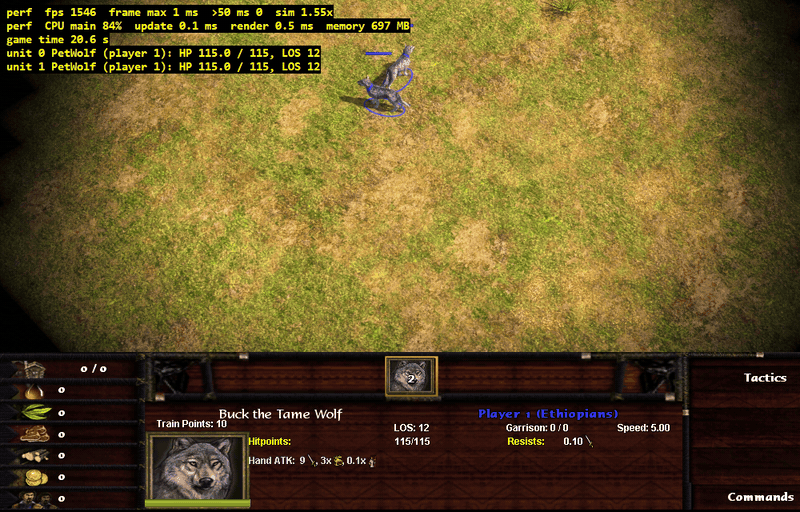

*In WoL, with `transformInventory log` (Ethiopians, the units selected so the panel shows the
crate):* WoL's card `HCCardDogTaxWar` turns two `PetWolf` into `CrateofCoin` at 24 s. Each crate
gets the coin crate's inventory (`inventory created: none -> {0: 100}`), and the panel shows
`Coin: 100.0`. [Full video (MP4)](media/transformInventory-wol.mp4).

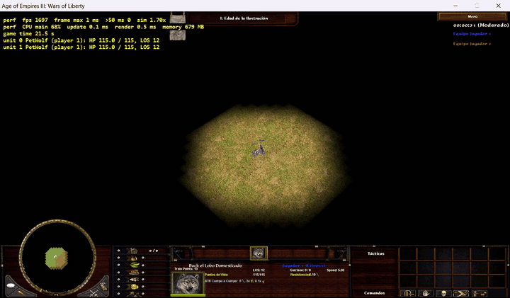

*In WoL, key off (the same scene):* the crates have no inventory: the panel shows no coin line, and
they can never be gathered. [Full video (MP4)](media/transformInventory-wol-control.mp4).

```
transformInventory [all] [scale] [<UnitType>] [log]
```

- **In WoL today:** a unit that holds resources (a crate, a herdable, a mine, a tree) has its own resource
  inventory. The game fills it from the proto's `<InitialResource>` when the unit is created, and
  gatherers take from that inventory, not from the proto. A tech effect `<Effect type ='TransformUnit'
  fromprotoid ='A' toprotoid ='B'>` and a revolution change living units into another proto in place, but
  never touch the inventory: the unit keeps A's resource types and amounts, or has none at all. WoL has
  64 such effects (static scan of its techtree):
  - `CrateofCoin` → `CrateofXP` (`WOLNatAssyrianTWO`): the "XP crate" still holds 100 gold;
  - `MerinoRam` → `Cow` (`WOLHCBlueBreed`): the cow holds the ram's gold;
  - a pet or a priest → a crate (`HCCardDogTaxWar`, `WOLHCOrganizedSecularism`): the crate has no
    inventory, so it can never be gathered and never empties;
  - a later conversion or capture of such a unit makes it worse: the owner change rescales each resource
    by the proto's `InitialResource` and zeroes every type the proto does not list. A gold-holding XP
    crate that changes owner ends up with nothing.
- **Effect:** when the old and new protos list different resource types in `<InitialResource>`,
  the unit gets the new proto's `InitialResource` (its player's copy, so that player's
  `InventoryAmount` techs count), as if it had just been created. A unit that had no inventory
  gets one. A unit whose two protos list the same types keeps its inventory: a fattened goat turned into a
  cow keeps its food.
- **`all`:** also rebuilds units whose protos list the same types (a `ypGoatFat` with 300 food
  turned into a `Cow` gets the cow's 50), and removes the inventory of a unit whose new proto has
  no resources at all (as the trigger "Change Unit Type" does). Without `all`, such a unit keeps its old
  inventory.
- **`scale`:** the new amounts are scaled by the fraction of the old `InitialResource` the unit
  still held: a coin crate half gathered becomes half an XP crate. A unit that held more than its
  old `InitialResource` (fattened) gets the full new amounts.
- **`<UnitType>`:** only transforms into protos of that type are changed. A new name is registered as a
  marker unit type (like `healNonIdle`'s); an existing type or a proto name works too
  (`transformInventory AbstractResourceCrate`). Without a type, every in-place transform is covered.
- **WoL needs:** nothing, unless you use a marker. The key covers every `TransformUnit` effect and
  revolution. The trigger effect "Change Unit Type" and `uiTransformSelectedUnit` (the `*Maturing` units)
  already give the new proto's resources and are not changed.
- **Gatherers:** a unit already gathering a target whose resource type changes keeps gathering the old
  type; that amount is now 0, so it stops at its next gather tick and must be re-tasked. Without the key
  it would keep collecting the old resource.
- **`log`:** one line per unit transformed in place that holds or receives resources. A tech that
  transforms many units writes one line for each.
- **Log:** at startup `transformInventory: units transformed in place (TransformUnit, revolution)
  take their new proto's InitialResource when the resource types differ (multiplayer
  unverified)`. With a type the line reads `…(TransformUnit, revolution) into protos of unittype
  X take…`; with `all`, `…InitialResource always, and lose their inventory when it has none…`;
  `scale` adds `, scaled by the fraction left`, and `log` `, every transform logged`. With a type,
  when the data loads, `unit types: X -> <ID> …`. In a game, `hook reached: transformInventory
  (0x9C7625)` the first time any unit is transformed in place. With `log`:
  - `transformInventory: unit N (Sheep -> CrateofCoin) inventory rebuilt: {2: 53.6} -> {0: 100}`;
  - `transformInventory: unit N (PetWolf -> CrateofCoin) inventory created: none -> {0: 100}`;
  - `transformInventory: unit N (ypGoatFat -> Cow) keeps its inventory {2: 300} (same resource
    types)`;
  - `transformInventory: unit N (ypCrateofCoin1 -> Settler) keeps its inventory {0: 100} (the new
    proto has no resources; "all" frees it)`;
  - with `all`: `transformInventory: unit N (A -> B) inventory freed: {0: 100} -> none`;
  - with `scale`: `… inventory rebuilt: {1: 80} -> {2: 80} (scaled by 0.8)`;
  - `transformInventory: unit N (A -> B) got no inventory (pool exhausted)`, if the engine's
    inventory pool is empty (not seen).

  The numbers before the colons are resource IDs in the order the exe registers the resource names
  (0x5381E0): Gold 0, Wood 1, Food 2, Fame 3, SkillPoints 4, XP 5, Ships 6, Trade 7. That these are
  also the inventory's indices was checked in game for Food: a crate logged `{2: 100}` showed
  100 food in the game's panel. For the other resources it is an inference.
- **Simulation:** yes. Inventories decide what and how much gatherers collect, what the AI sees,
  and when a `DieAtZeroResources` unit dies. Every player needs the same DLL and the same line;
  `scale` divides two game values in the DLL, so every player also needs the same build.
- **Limits:** units that a saved game already holds with a mismatched inventory are not fixed when
  it loads; only their next transform fixes them. Callers of the in-place transform other than
  `TransformUnit` and the revolution (construction objects and a few internal ones) are covered
  too; WoL's data was not surveyed for them.
- **Status:** confirmed in single player. In WoL (2026-11-04), `HCCardDogTaxWar` turned two `PetWolf` into
  `CrateofCoin` with 100 coin each; without the key the crates had no inventory. On the stock game
  (2026-10-29), a test tech covered a change of resource type, a unit with no inventory, a unit with the
  same types (kept) and a new proto with no resources (kept without `all`). `all`, `scale`, a marker,
  revolutions and a conversion after a transform were not tested.
- **By effect:** `inventory='keep'`, `'rebuild'` or `'scale'` on a `TransformUnit` effect decides over the cfg: keep is stock, rebuild is
  `all`, scale is `all scale`. A transform with no effect, a turn back or a revolution, follows the cfg.
  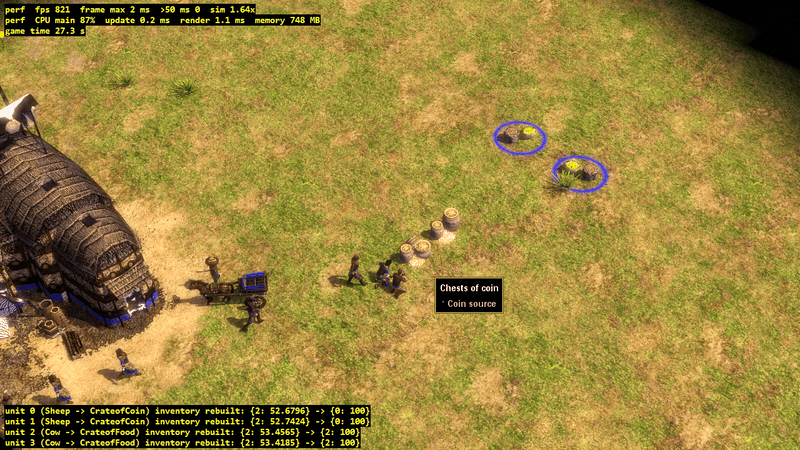 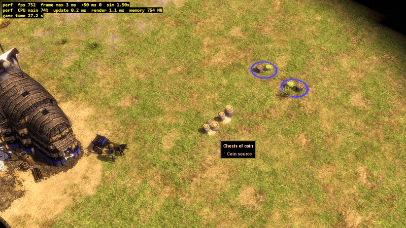
  [Video](media/transformInventory-effect-wol.mp4), [control with keep](media/transformInventory-effect-wol-control.mp4).

### Interface

| Key | What it does | WoL's DLL | WoL also needs | In-game status |
|---|---|---|---|---|
| [`noCorpseDopples`](#nocorpsedopples) | A dead unit of a marked type (a hunt's carcass) leaves no frozen copy in the fog of war. Live units are still remembered. | **new** | Nothing: WoL's hunts are `Doppled`; `noCorpseDopples Huntable` covers them. | confirmed (single player) |
| [`steadyHitpointBars`](#steadyhitpointbars) | The floating HP bars stay at one height over each unit instead of jumping when it attacks, gallops or idles. | **new** | Nothing. | confirmed (single player, UI) |
| [`politicianPlacesFix`](#politicianplacesfix) | The age-up dialog shows only as many politicians as its layout has places, instead of crashing on a fifth politician with WoL's four-place dialog. | **new** | Nothing; a fifth place in `uipoliticianEuropeandlg.xml` shows five. | confirmed (single player, UI) |

#### noCorpseDopples

*Dead units, such as hunted animals, don't stay as ghosts in the fog of war.*

**Added:** Thursday 2026-10-29 06:39 · **Filmed in WoL:** Friday 2026-11-06 14:28

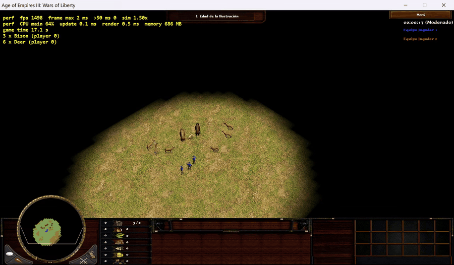

*In WoL, with `noCorpseDopples Deer log` (WoL's own data: its Deer and Bison are `Doppled`):* three
Rangers watch two herds; at 18 s three deer and three bison are killed, and at 26 s the Rangers walk
away, so the spot falls into the fog. The dead deer leave no copy (`left player 1's view dead; no
dopple`); the dead bison, not named by the rule, stay in the fog as frozen carcasses.
[Full video (MP4)](media/noCorpseDopples-wol.mp4).

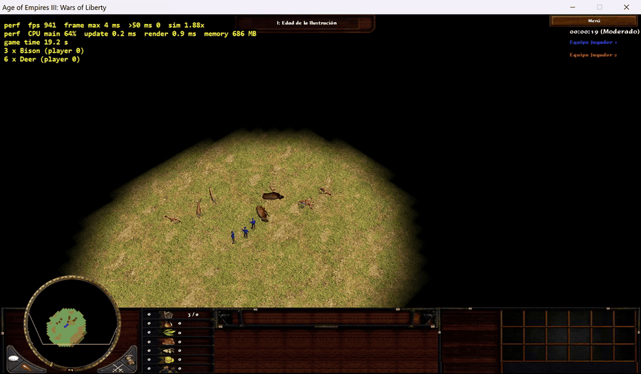

*In WoL, key off (the same scene):* every carcass stays in the fog in its death pose, deer and
bison alike. [Full video (MP4)](media/noCorpseDopples-wol-control.mp4).

```
noCorpseDopples [<UnitType>] [log]      default AbstractNoCorpseDopple
```

- **In WoL today:** a *dopple* is the copy of a unit that a player keeps seeing in the fog of war after the
  unit left his view. Only protos with `<Flag>Doppled</Flag>` get one: 1,076 in WoL, buildings, mines,
  trees and most of its hunts, so that a herd stays where it was last seen. The game makes it when the
  unit leaves the player's view, for him and for the players who share his vision, and removes it only
  when the player sees the unit or the spot again. It never asks whether the unit is alive. So a carcass
  that still holds food when it leaves a player's view stays in his fog in its death pose, long after
  it was eaten or abandoned, until he looks at the spot again.
- **Effect:** a unit whose proto is of `<UnitType>` and that is not alive (0 hitpoints, killed)
  gets no dopple when it leaves a player's view, for any player: it simply disappears into the
  fog. A live unit of that type is still doppled. A carcass that is fully gathered was never
  doppled: the game takes it out of the world before it decays.
- **WoL needs:** nothing: `noCorpseDopples Huntable` covers every hunt (`Huntable` is a built-in type). A
  proto name works too (`noCorpseDopples Deer`). With the default marker, or any new name, add it to the
  protos in `data\protoy.xml`.
- **Do not mark livestock** or other `DoppleOnlyWhenDead` protos: that flag exists to leave a
  corpse dopple, and the key removes it.
- **`log`:** one line per dopple it skips, up to 1000 lines per session.
- **Log:** at startup `noCorpseDopples: dead units of unittype X leave no dopple in the fog of war
  (multiplayer unverified)` (with `log`: `…of war, every skipped dopple logged (multiplayer
  unverified)`); when the data loads, `unit types: X -> <ID> …` (`already defined` for `Huntable`
  or a proto name); in a game, `hook reached: noCorpseDopples (0x49534D)` the first time any
  doppled unit (a building, a tree, …) leaves a player's view. With `log`: `noCorpseDopples: unit N
  (Deer, hp 0.0) left player 1's view dead; no dopple`.
- **Limits:**
  - the dopple of a **live** animal that is then killed and eaten out of the player's sight still
    shows the live animal until he looks at the spot again. Removing dopples when a unit leaves
    the world would fix that; it is not implemented;
  - a saved game made without the key keeps the corpse dopples it already had;
  - `MutateDopples` protos (none in WoL's data) refresh their dopples through another path
    that the key does not cover.
- **Simulation:** probably not, but unverified. Dopples belong to the game state, which every
  machine keeps the same way; the key only reads that state (unit types, hitpoints). Give every
  player the same setting. With a new marker it also adds a unit type.
- **Status:** confirmed in single player, in WoL (2026-11-04), with `noCorpseDopples Deer log` on WoL's own
  data: the dead deer left no copy, and the dead bison, not named, stayed in the fog. Without the key,
  all of them stayed.

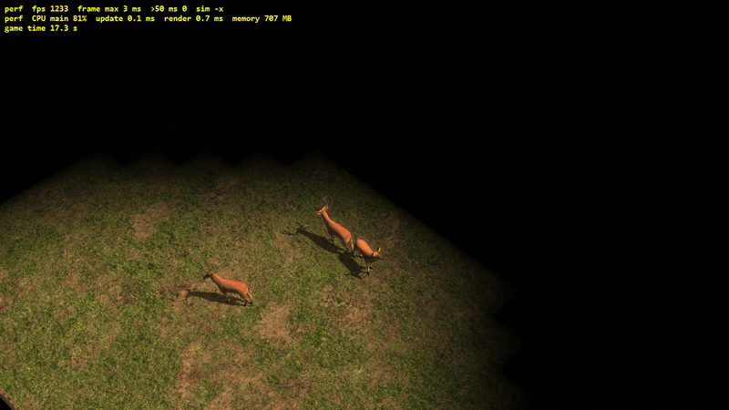

*In WoL, with `noCorpseDopples Huntable expire=20 log`:* the dopples made at 8.1 s end at 28.1 s, and the fog is empty.
[Full video (MP4)](media/noCorpseDopples-expire-wol.mp4).

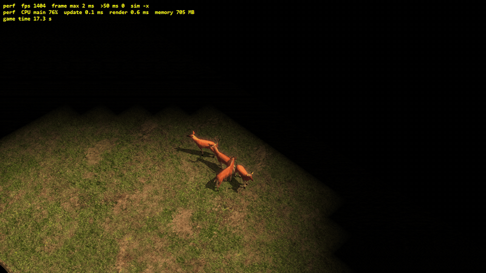

*In WoL, without `expire=`:* the Deer were killed at 34 s out of sight, and their dopples stay.
[Full video (MP4)](media/noCorpseDopples-expire-wol-control.mp4).

- **`expire=<seconds>`:** every dopple of a marked proto ends that long after it was made, live or dead, so its going says nothing about
  the unit. Changes the simulation: every player needs the same line.
- **Tested in WoL (2026-11-06, expire):** with `expire=20`, dopples made at 8.2 s ended at 28.2 s; saved at 38 s with `expire=45`, they kept
  their time and ended at 53.2 s. Not tested: beside WoL's DLL, multiplayer.

#### steadyHitpointBars

*The health bars over units stay still instead of jumping up and down while the units fight or move.*

**Added:** Monday 2026-11-09 08:13 · **Filmed in WoL:** Friday 2026-11-13 11:50

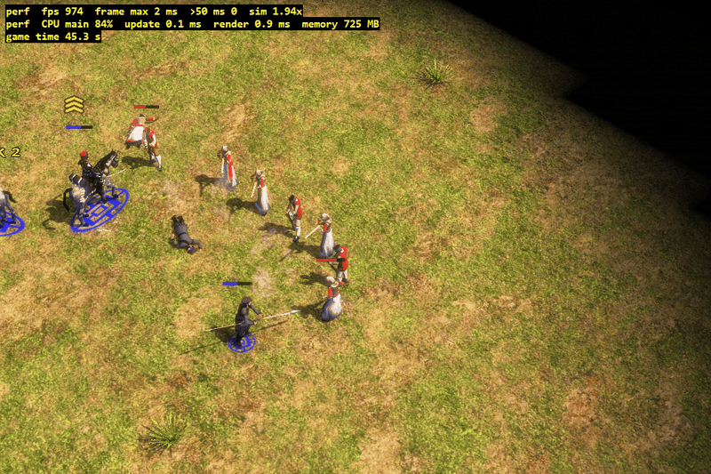

*In WoL, with `steadyHitpointBars log` (Ethiopians, 3 `Hussar` and 3 `Pikeman` against 16 `Settler` and 3 `Crossbowman`,
the ranks of `veterancyBonus` on, the selected units' bars shown):* the Hussars charge, fight and stand; each bar keeps
one height over its rider, and the rank chevrons stay just above it. [Full video (MP4)](media/steadyHitpointBars-wol.mp4).

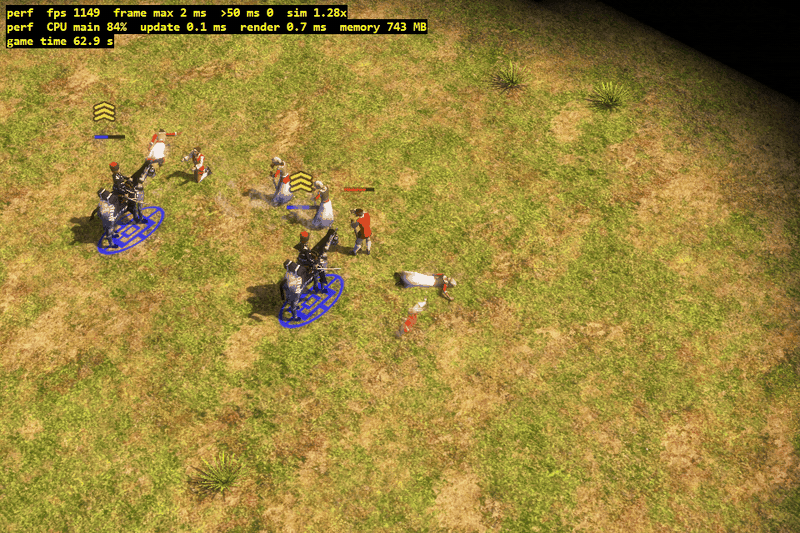

*In WoL, key off (the same scene):* a Hussar's bar drops by about 9 px when it swings or gallops and comes back when it
stands, also under a steady chevron. [Full video (MP4)](media/steadyHitpointBars-wol-control.mp4).

```
steadyHitpointBars [UnitType ...] [log]
```

- **In WoL today:** a unit's floating HP bar sits on the `HITPOINTBAR` tag of its current animation. The tags of an
  animation are in its tag file, `<animation>.gr2.precomp` (see "Fix in the data" below). A Hussar's walk, gallop and
  attacks have the tag, 4.08 to 4.15 m up, and so do two of its eight idles; the other six (`horse_idle_a` to `_g`, 90
  of the 140 weight of its `Idle`), its `Bored`, `Cheer` and `Raze_idle` have none, and then the game puts the bar at a
  height from the data instead, lower. So the bar jumps between the two each time the unit changes animation, every
  couple of seconds even when it stands. The `veterancyBonus` chevrons, which hang at a fixed height, make it plain to
  see. These horse idles are the base game's own, so TAD's cavalry has the same jump (from the data; not filmed in TAD).
- **Effect:** each unit's bar keeps the height of its tag: the highest the tag reached over the last 3 to 6 seconds of
  animations that have it, and the middle of its sideways and forward sway. While the animation has no tag, the bar
  stays there. It moves towards a new height by at most 1.5 m a second, so a change of stance never jumps.
- **Which units:** every unit with a floating bar, or with types listed (unit types or proto names, up to 8), only the
  units of those types.
- **Buildings and ships:** a model whose tag does not move keeps its bar exactly where it was (a Caravel's tag is still
  at 9.86 m); a building without the tag, such as WoL's Barracks, keeps the stock place. A unit whose tag was never seen
  keeps the stock bar.
- **With `overhealHitpointBars segment`:** the orange segment is drawn at the bar's place, so it follows it.
- **With `veterancyBonus`:** the chevrons do not follow the tag at all (they hang on the unit, at a height per kind of
  unit); with the key, the bar stays at its idle height, where the chevrons were set to sit above it.
- **Multiplayer:** display only. Every player can have it or not, with other types.
- **Log:** `steadyHitpointBars: floating HP bars hold their position (every unit) (display only)`, and with `log`, once
  per proto: `steadyHitpointBars: unit 0 (Hussar): the bar holds at height 4.15 in model space; over 3 s the tag went
  from 4.07 to 4.15 (...), and 1244 of 4269 frames had no tag`.
- **Performance:** measured with `perfprobe.py`, 60 s each, the fight above: 1349 fps, 0.64 ms of render a frame and
  83 % of the main thread with the key; 1275 fps, 0.68 ms and 86 % without; no frame over 50 ms in either.
- **Tested in WoL (2026-11-09):** measured on the masters frame by frame: without the key, 7 of the 26 bars seen standing
  for 4 s or more moved by 6 to 28 px (a Hussar's: 9 px, back and forth); with it, none moved by more than 1 px once
  tracking errors were checked (2 px across 22 s of torch attacks on a Barracks, 1 px across 24 s of melee). Also a
  Hussar charge, Settlers, a Caravel and a Fluyt, a Barracks, a saved game loaded, and a 100 s skirmish against a
  European AI with no XS error. Not tested: an orange segment on screen (no Hussar was above its 100 % in this data),
  types listed in the key, beside WoL's DLL, multiplayer.

**Fix in the data (2026-11-13).** The key stays the runtime fix, for every player and for what the data fix cannot
reach. The bug itself is in the art: the animations without the tag can get it, and then the bars hold with the key off.

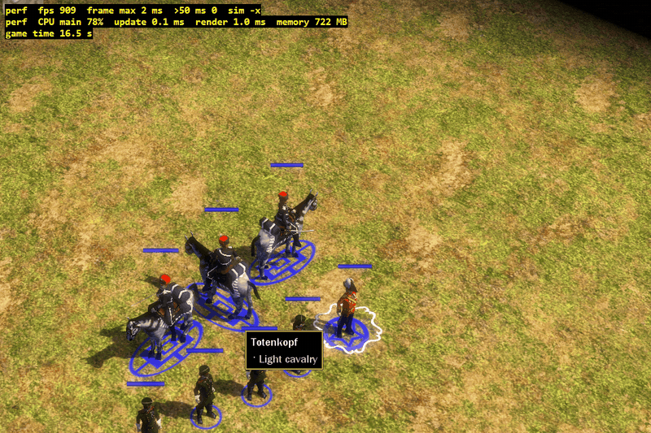

*In WoL, key off, with the tag files of the three units fixed (scenario player 1, the Ethiopians in this bed: 3 `Hussar`,
4 `InfantryVoivod` and an `Explorer` against 8 `WOLLandwehr`, the selected units' bars shown):* the Hussars stand, then
charge and fight; each Hussar's bar keeps one height over its rider through the idles, the charge and the melee.
[Full video (MP4)](media/steadyHitpointBars-datafix-wol.mp4).

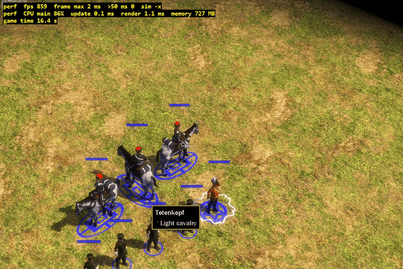

*In WoL, key off, the data as it ships (the same scene):* while the Hussars stand, their bars drop by 12 to 14 px and come
back each time the horse picks another idle, about every 2 s. [Full video (MP4)](media/steadyHitpointBars-datafix-wol-control.mp4).

- **Where the tag is:** not in the anim XML (its `<tag type="Attack">` lines are timed events). Each Granny animation
  `x.gr2` has a tag file `x.gr2.precomp` beside it, the positions of a few named bones (`MASTER`, `HEAD`, `NECK`,
  `PELVIS`, `ATTACHPOINT`, `HITPOINTBAR`) sampled over the animation. REA: FUN_0059DDCE reads the file's "MS" block into
  the animation's tag table, the one 0x45F072 searches (names at `+8`, 12-byte position tracks at `+34h`, duration at
  `+58h`; how-it-works, steadyHitpointBars); `rea/evidence/hitpointbar-precomp-20261113.json`, `ev_b5108f5e…`. The format
  and the reader are in aoe3-blender-tools: `aoe3game/precomp.py` and `docs/game-formats.md`, "Animation tags".
- **The tool:** `tools/fix_hitpointbar_tags.py` of aoe3-blender-tools. For each unit's anim file it finds the
  animations of the unit's own model (not attachments, not `Death*`) whose tag file lacks `HITPOINTBAR`, and adds a
  constant one at the median height of the unit's `Idle` animations that have it; nothing else of the file changes, and
  the anim file is not touched. A tag file inside a `.bar` comes out as a loose file at the same art path, which the game
  reads instead of the archive's (seen in this test).

  ```
  python -I tools/fix_hitpointbar_tags.py --proto <WoL>\data\protoy.xml --art <WoL>\art --dry-run
  python -I tools/fix_hitpointbar_tags.py --proto <WoL>\data\protoy.xml --art <WoL>\art --units Hussar,Explorer --out <folder>
  ```

  Without `--out` it writes into the art folder and keeps a loose file it replaces as `.orig`. The fixed files for these
  three units are 14 tag files, 2 to 49 KB each.
- **Scan of WoL (dry run, 2026-11-13, every proto of `protoy.xml`):** 2,443 anim files; 668 have the tag in every
  animation, 1,242 in none (their bar never moves), and **533 lack it in some**: 243 tag files to fix, 214 that the tool
  fixes and 29 it refuses (16 animations shared by units that want two heights, as many on each side, such as the
  `sowarCamel_*` files; 12 tag files with no tracks; 1 sampled on several models). Another 390 uses of animations have
  no tag file at all (367 of a loose `.gr2` of WoL, 23 of a missing one): their tags must come from the `.gr2` itself,
  which the tool does not edit (not traced). Examples: `Hussar`, `Dragoon`, `Cuirassier`, `Cossack`, `Uhlan`, `Ruyter`,
  `Lancer` and the other horse riders (6 horse idles and `Bored`, `Cheer`, `Raze_idle`, height 4.15); `Settler` (107
  animation files, gathering and others); `Pikeman`, `Halberdier` (the stance animations); `Explorer` (`Idle`, `Walk`,
  `RangedAttack`, `Reload`, 2.97); `Priest`, `Surgeon`, `Imam` (`Idle`, `Walk`, `Heal`); `CoveredWagon` (`Idle`, `Walk`,
  5.48). An animation that units of different heights share gets the height of most of them (33 such), so a unit in
  the minority still sees a step there, as it does today.
- **Tested in WoL (2026-11-13, `C:\AoE3-UHC-WoLReal4`, key off):** the 14 fixed tag files of `Hussar`, `Explorer` and
  `InfantryVoivod` as loose files, against the same scene without them, measured on the masters frame by frame
  (bars found as blue strips, a jump = a bar that moves 4 px or more in one frame while its x holds): with the shipped
  data, 10 jumps of 12 to 14 px in the first 10 s, while the Hussars stand (their idles changing); with the fixed files,
  none while they stand, and in the fight only bars of units on the move. The files were removed after the test.
  Not tested: the whole scan's 214 files at once, TAD's own cavalry, a unit whose animations have no tag file.

#### politicianPlacesFix

*The age-up dialog shows only as many politicians as it has places, instead of crashing the game.*

**Added:** Friday 2026-11-13 09:01 · **Filmed in WoL:** Friday 2026-11-13 09:01

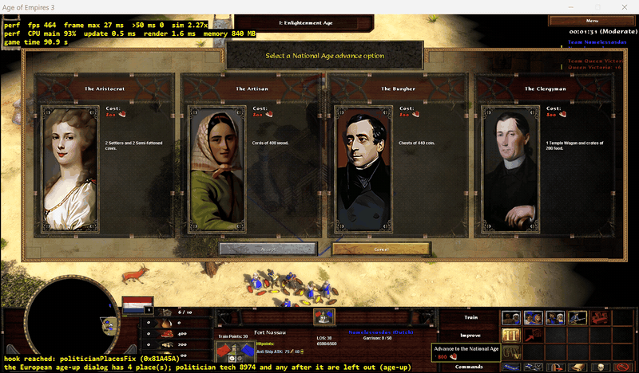

*In WoL, with `politicianPlacesFix log` (a Dutch skirmish against the British AI, test data: six politicians of the
next age obtainable, WoL's four-place `uipoliticianEuropeandlg.xml`):* the Town Center's age-up opens the dialog with
four politicians (Aristocrat, Artisan, Burgher, Clergyman), and the log says which one was left out. Key off, the same
click closed the game (access violation at 0x81A80C). [Full video (MP4)](media/politicianPlacesFix-wol.mp4).

```
politicianPlacesFix [log]
```

- **The bug (WoL #62):** the exe lists up to five politicians of the next age and fills one place of the dialog for
  each. WoL's `data\uipoliticianEuropeandlg.xml`, like the stock one, has four places
  (`PoliticianDlg-Politician0` to `3`). A fifth obtainable politician then has no place, and the game reads its
  missing name gadget and closes. WoL's civs have four politicians per age today, so nobody meets it yet; a fifth
  in the data, a tech that makes one obtainable, or a building of [`ageUpBuildings`](modding-guide.md#ageupbuildings)
  that lists more is enough.
- **What the key does:** before a politician takes a place, the dialog checks that the place exists in the layout
  (its `PoliticianDlg-Politician<n>` panel and its `PoliticianDlg-Poli<n>Name` text). When it does not, the list ends
  there: the dialog shows the politicians it has places for, and the others are left out of this dialog (they stay
  obtainable). With a fifth place in the file, five show, as without the key; more than five never show (the exe
  keeps five).
- **With a five-place layout:** see
  [Five politicians in the European age-up](modding-guide.md#five-politicians-in-the-european-age-up) for the
  edit of `uipoliticianEuropeandlg.xml`. The key is still worth keeping: a layout from another mod, or a file edited
  by hand, can have fewer places.
- **Not covered:** the Asian and native dialogs. Their stock and WoL files have five places, so they do not meet the
  bug. Of their code, only the shared list FUN_00818EE5 was read in full: it checks every gadget it uses. The wonder
  and native lists put a politician in the place their own data names; they were not traced further.
- **With other keys:** [`ageUpBuildings`](modding-guide.md#ageupbuildings) hooks the same list, one instruction
  before; both work together (tested).
- **Log:** `politicianPlacesFix: the European age-up dialog lists only the politicians its layout has places for`;
  the first time a politician is left out, `politicianPlacesFix: the European age-up dialog has 4 place(s);
  politician tech 8974 and any after it are left out (age-up)` (`revolutions` for the revolution list); with `log`,
  each time. In a game, `hook reached: politicianPlacesFix (0x81A45A)` the first time the dialog fills a place.
- **Simulation:** none. The dialog is the local player's interface; the politician chosen is sent as the game's own
  command. Players may differ.
- **Tested in WoL (2026-11-13, single player, Dutch, test data: `WuOLClergyman` and `WuOLartisan` added to
  `Age0Dutch`, six politicians):** key off with WoL's four-place file, the age-up click closed the game (Windows: access
  violation, offset 0x41A80C, the instruction 0x81A80C); key on, four showed and the game went on, also with
  `ageUpBuildings` on and the dialog opened twice; with the five-place file, five showed. A bad argument logged
  `unknown option` and `FAILED`. 497 fps and no frame over 50 ms while the dialog was open. Not tested: a revolution,
  multiplayer.

## Performance

Fewer stutters, faster loading and more frames per second. A player can switch some of them on or off
in the options menu ([`menuOptions`](#menuoptions)).

| Key | What it does | WoL's DLL | WoL also needs | In-game status |
|---|---|---|---|---|
| [`bufferedFileReads`](#bufferedfilereads) | Reads the game's files through a read-ahead buffer instead of millions of tiny reads, for fewer and shorter stutters and faster loading. | **new** | Nothing. | confirmed (single player) |
| [`fastVertexFill`](#fastvertexfill) | Builds the waving flags' vertices without reading back from video memory, for more frames per second when flags are on screen. | **new** | Nothing. | confirmed (single player) |
| [`fastLastInLine`](#fastlastinline) | Removes the freeze of a third of a second after each home city shipment of any player: the game's check of which tech of each line is the last one runs through a list instead of testing every tech against every other. | **new** | Nothing. | confirmed (single player) |
| [`rendererOption`](#rendereroption) | Adds a Renderer entry to the options menu: DirectX 9 or Vulkan, the second through DXVK for more frames per second, from the next start. | **new** | The field in `data\options.xml` and the `dxvk` folder. | confirmed (single player) |
| [`menuOptions`](#menuoptions) | Lets the player switch `bufferedFileReads` and `fastVertexFill` on or off in the options menu, from the next start. | **new** | A field per key in `data\options.xml`. | confirmed (single player) |

#### bufferedFileReads

*The game reads its files more efficiently, so it loads faster and stutters less.*

**Added:** Wednesday 2026-10-28 16:34

```
bufferedFileReads [<KB>] [readahead] [verify]      default 64 KB
```

- **In WoL today:** the exe reads the archives (`art\Art*.bar`, `data\Data*.bar`, `sound\*.bar`, …) and
  the loose files a few bytes at a time, with one Windows read call for every 1 to 16 bytes. WoL reads
  far more loose files than the stock game (all its XML and 622 tactics files). When a match needs a
  model or an animation it has not loaded yet, those reads run inside the frame, and the frame stalls
  (a stutter).
- **Effect:** every file the game opens for reading only gets a read-ahead buffer. One Windows read
  fills the buffer, and the game's small reads are served from memory. The game receives the
  same bytes.
- **Measured** ([performance.md](performance.md), §9, "readahead, and the first measurement in WoL"),
  150 s recordings of a late save, two runs per setting, on a PC that other tests shared:

  | | Stock, without | Stock, with | WoL, without | WoL, with |
  |---|---|---|---|---|
  | Frames over 100 ms | 3, 3 | 0, 0 | 13, 9 | 10, 11 |
  | Frames over 50 ms | 4, 4 | 2, 2 | 17, 13 | 15, 14 |
  | Longest frame | 189, 190 ms | 94, 97 ms | 508, 386 ms | 570, 396 ms |
  | Time in file reads, whole session | 8.5, 8.7 s | 0.35, 0.35 s | 3.9, 3.9 s | 0.38, 0.40 s |
  | Loading the save | 10.1, 10.0 s | 5.1, 5.5 s | 11.6, 11.4 s | 9.6, 9.4 s |

- **What it does not fix:**
  - **WoL's stutters are not file reads.** In WoL's slow frames, file reads and granny are 2 % each;
    the time is in two pieces of the game's own code, not identified yet. So in WoL the key makes
    loading faster and cuts the time spent reading, but it does not remove the stutters.
  - In the stock game, most of what remains is the animation library (granny) unpacking a model or an
    animation it meets for the first time: granny stores them compressed, and unpacking is processing
    work, not reading ([performance.md](performance.md), §9, "The remaining stutters").
- **WoL needs:** nothing. To let players switch it in the options menu, see [`menuOptions`](#menuoptions).
  - `<KB>` (4 to 1024) is the buffer size per open file.
  - `readahead` adds a worker thread: while the game uses one block of a file, the worker reads
    the next one. It reads through a second handle of its own, so the game's file handle is never
    touched, and a block is used only for the place in the file it was read from. **It moves about
    30 % of the block reads off the game's thread in the stock game** (2,930 of ~10,450 per session),
    and 14 % in WoL (2,450 of ~18,000); the rest are the first read after the game jumps to another place in an archive, which it
    cannot guess. It changed no frame count in the runs above, so it is optional.
  - `verify` also reads every buffered request from the file for real and compares the two. It is
    a correctness test and makes reading slower.
- **Log:**
  - at startup, `bufferedFileReads: read-only files get a 64 KB read-ahead buffer (multiplayer-safe: same bytes)`,
    followed by `; readahead: a worker thread reads the next block of each file` with `readahead`;
  - with `verify`, at exit: `bufferedFileReads verify: N buffered reads checked, M mismatches`.
    M must be 0;
  - with `readahead`, at exit: `bufferedFileReads readahead: N blocks asked of the worker, N read,
    N used by the game (N waited for, N ms in all); N buffer refills read on the game's thread; N files
    without a second handle`.
- **Simulation:** no. It changes how the bytes are fetched, not which bytes, so players do not
  need the same setting.
- **Status:** confirmed in single player, on the stock game and in WoL. `verify` found no mismatch:
  7.5 million buffered reads on the stock game's 25-minute save, and with `readahead` 6.9 million there
  and 3.0 million on a 32-minute WoL save. Not tested in multiplayer.

#### fastVertexFill

*The game draws its waving flags with less work, so it runs at more frames per second when flags are on screen.*

**Added:** Tuesday 2026-11-10 12:54 · **Filmed in WoL:** Tuesday 2026-11-10 17:34

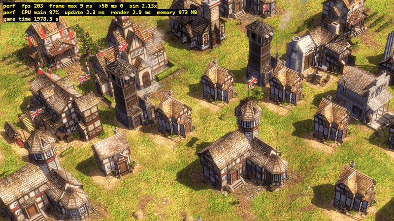

*In WoL, with `fastVertexFill` (the 32-minute five-player save of the tables below, map revealed, the camera still on
Queen Victoria's first Town Center, 1920×1080, Direct3D 9):* the British flags on the Town Center and the houses
wave as usual. The picture is the same as without the key by design, since the same bytes reach the video card; only
the frame rate changes. The overlay at the top gives the frame rate once a second: 184 FPS on average over the 32 s
take, the render part 3.1 ms per frame.
[Full video (MP4)](media/fastVertexFill-wol.mp4).

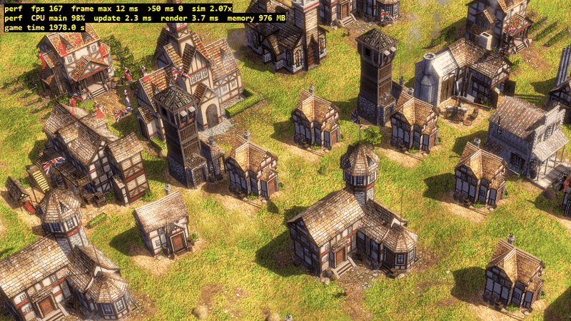

*In WoL, key off (the same save, camera and window):* the same flags and the same picture, at 155 FPS on average,
the render part 4.0 ms: the key gave +19 % in this pair of takes (one take each, measured while the video was being
recorded; the tables below have the 60 s runs).
[Full video (MP4)](media/fastVertexFill-wol-control.mp4).

```
fastVertexFill [log] [verify]
```

- **In the game today:** the flags that wave on Town Centers, other buildings and ships are cloth: a grid of
  points the game moves every frame. To draw a flag, the exe writes the grid into video memory twice, once for
  each side of the cloth, and it builds the second side by reading back the first one it has just written. Video
  memory of that kind is made for writing; reading from it is very slow. With flags on screen, that reading
  alone took 5.5 to 7.8 % of the game's main thread in the test below.
- **Effect:** the second side is built from the game's own copy of the grid. The flags get the same bytes, so
  the picture is the same, and the frame is shorter.
- **Measured** in a late 8-AI game of the stock game ([performance.md](performance.md), §11, "fastVertexFill"),
  60 s per run, with stock Direct3D 9 on an NVIDIA RTX 4090; each number is one run:

  | Window | Without | With | Change | Render time per frame | The flags' share of the main thread |
  |---|---|---|---|---|---|
  | 1920×1080 | 188.7 / 193.5 FPS | 203.4 / 204.0 FPS | **+7 %** | 3.05 → 2.72 ms | 6.5–7.0 % → 0.0 % |
  | 2560×1600 | 201.8 / 203.7 FPS | 217.9 / 216.8 FPS | **+7 %** | 2.80 → 2.49 ms | 5.5–5.6 % → 0.0 % |
  | 3840×2160 | 190.5 / 188.5 FPS | 198.8 / 210.7 FPS | **+8 %** (+4 % and +12 %) | 3.05 → 2.70 ms | 7.4–7.8 % → 0.0 % |
  | 1280×720 (no flag drawn) | 253.4 FPS | 256.9 FPS | none (within noise) | 1.79 → 1.76 ms | 0.0 % → 0.0 % |

  The simulation's time per frame, the frames over 50 ms (0 or 1 per run either way) and the memory did not
  change.
- **Measured in WoL** (2026-11-10, [performance.md](performance.md), §11, "fastVertexFill in WoL"): a 32-minute
  five-player save (four European AIs, 456 units), 60 s per run, stock Direct3D 9, the same PC. WoL keeps the
  window inside the monitor, so the runs asked at 2560×1600 and 3840×2160 drew 2560×1440. The flags take more of
  the frame in WoL than in the stock game, so the gain is larger:

  | View | Window | Without | With | Change | Render time per frame | The flags' share of the main thread |
  |---|---|---|---|---|---|---|
  | A Town Center, map revealed | 1920×1080 | 162.5 / 161.8 FPS | 180.0 / 185.7 FPS | **+13 %** | 3.90 → 3.27 ms | 12–13 % → 0.0 % |
  | A Town Center, map revealed | 2560×1440 (four pairs) | 141.8–166.5 FPS (mean 152.6) | 174.6–182.6 FPS (mean 178.5) | **+17 %** (+8 to +24 % per pair) | 3.72–4.34 → 3.17–3.36 ms | 11.5–13.6 % → 0.0 % |
  | A battle in a town | 2560×1440 | 126.0 FPS | 147.3 FPS | **+17 %** | 5.33 → 4.30 ms | 7.7 % → 0.0 % |
  | The save's own camera (player 1's base) | 2560×1440 | 276.0 FPS | 316.4 FPS | **+15 %** (lowest 5 %: 135 → 238) | 1.55 → 1.26 ms | 4.2 % → 0.0 % |

  The simulation's time per frame did not rise, and the frames over 50 ms (4–12 per run, WoL's own file loads)
  were the same with and without the key. Most runs had another program using up to 1.6 cores of the 16.
- **With DXVK** (a Direct3D 9 to Vulkan wrapper some players use): the same reading made DXVK 3.1.1 slower
  than stock Direct3D 9 in this test (179.6 FPS). With the key it gave 237.2 FPS, with no `dxvk.conf` (one run each).
  In WoL, at 2560×1440 on the Town Center (one run each): DXVK with no `dxvk.conf` 97.0 FPS without the key (the
  flags 38.5 % of the main thread) and **194.3 FPS with it**; with `d3d9.cachedWriteOnlyBuffers = True`, 179.6 and
  187.0 FPS. With the key on, DXVK needs no `dxvk.conf` in WoL either, and both are ahead of stock Direct3D 9 with
  the key (178.5 FPS).
- **Limits:**
  - it only helps while cloth flags are on screen; with none, the code does not run and nothing changes;
  - the gain follows how many flags are drawn, in the view or in the water's reflection: in the test, one Town
    Center's flag was on screen at 2560×1600, and at 1280×720 the camera showed none;
  - it was measured on one PC. How slow that reading is depends on the video driver, so the gain can be smaller
    or larger on another card.
- **WoL needs:** nothing. To let players switch it in the options menu, see [`menuOptions`](#menuoptions).
  - `verify` is a correctness test: the stock code fills the flags, and every fill is compared, byte for byte,
    with what the key would have written. It is slower than stock.
  - `log` writes the session's counts at exit.
- **Log:**
  - at startup, `fastVertexFill: the cloth flags' vertices are built without reading the locked vertex buffer
    (display only: same bytes)`;
  - `hook reached: fastVertexFill cloth flag fill (0x40D523)` the first time a flag is drawn;
  - with `verify`, at exit: `fastVertexFill verify: N fills checked against the stock loops (V vertices), M
    mismatches, …`. M must be 0.
- **Simulation:** no. It changes how the flags' vertices reach the video card, not which vertices, and it
  touches nothing the game rules read, so players do not need the same setting.
- **Status:** confirmed in single player (2026-11-10).
  - On the stock game: `verify` compared 76,365 fills (10.5 million vertices) of a 60 s run of a 25-minute
    save with the stock code and found no mismatch; the game also changed resolution twice (a new Direct3D
    device each time) and was minimized and restored with the key on.
  - In WoL, beside the other keys of this guide: `verify` compared 105,340 fills (15.6 million vertices) of a
    five-player skirmish (a Dutch player and German, British, French and Spanish AIs, 2.4 game minutes) with no
    mismatch and no XS error; with the key on, Highlanders and Jaegers fought beside an Ethiopian Town Center
    and its flag was drawn. On the 32-minute save of the table above, `verify` compared 158,397 fills (17.5
    million vertices): no mismatch.
  - Beside WoL's own `uhc.dll` (2026-11-10), with the `dinput8.dll` of this project in a WoL install (WoL's
    `uhc.dll`, `wol.cfg` and `data\uhc` untouched, their hashes the same after): `dinput8.dll 0.3.0`,
    `fastVertexFill: applied`, no FAILED; the hook was reached; `verify` compared 129,140 fills (15.4 million
    vertices) with no mismatch; in a skirmish against a German AI (Otto von Bismarck, 29 units after 4 minutes)
    `xsErrorLog` logged no XS message, the Town Center's flag was drawn, and two resolution changes and a
    minimize and restore went on drawing. Frame rate on the same save, the key line on and off, two runs each:
    152.5 → 176.0 FPS (**+15 %**) at 1920×1080 and 153.8 → 174.8 FPS (**+14 %**) at 2560×1440. That install has
    ReShade's `d3d9.dll`, so these numbers include ReShade: compare them with each other, not with the table above.
    Removing `dinput8.dll` and `engine-ext\` gives WoL's main menu again.
  - Not tested: multiplayer, a full-length game, other video cards and drivers.

#### fastLastInLine

*The game no longer freezes for a third of a second each time a player gets a home city shipment.*

**Added:** Thursday 2026-11-12 08:17

```
fastLastInLine [log] [verify]
```

- **In the game today:** after a home city shipment (or a card that becomes available again), the game works out
  for that player which tech of each line is "last in line", the one the command panels show. It does it by
  testing every tech against every other tech and its prerequisites. With WoL's 10,542 techs that is about
  170 million tests: a frame of 340–590 ms, once per shipment of any player, AI or human. In a 32-minute
  five-player save these frames were 74 % of all the time spent in frames over 50 ms
  ([performance.md](performance.md), §9, "What WoL's stutters are").
- **Effect:** the DLL builds once, when the data loads, the list of which techs require which tech, and tests
  only those, with the game's own tests. The result is the same bits; the work takes 0.4–1.6 ms.
- **`verify`** lets the game's own code run as well and compares every bit with the DLL's; each recompute logs
  a line with the bits that differ (must be 0) and both times. `log` writes a line per recompute.
- **WoL needs:** the line `fastLastInLine` in `wol.cfg`: then it is on for everyone. To let players turn it off in
  the options menu, also name it on the [`menuOptions`](#menuoptions) line and add its `OptionFastLastInLine` field;
  it still starts on, and stays on until a player switches it off. Checked in WoL (2026-11-12): with no choice
  stored the entry shows On and the key applies; Off chosen in Graphics Options is stored, the next start does not
  apply the key, and the entry reads back Off.
- **Multiplayer:** the game computes exactly the same thing, so players may set it differently. Not tested in
  multiplayer.
- **Measured in WoL** (the 32-minute five-player save, 150 s per run, key off and on in turns):

  | | Off | On | Off | On |
  |---|---|---|---|---|
  | Frames over 50 ms | 12 | **3** | 15 | **3** |
  | Frames over 100 ms | 6 | **1** | 11 | **2** |
  | Longest frame | 382 ms | **191 ms** | 384 ms | **243 ms** |

  What is left over 100 ms is mostly the AI's `towerManager` rule, whose `sin` and `cos` are slow in
  `aiWoLMain.xs`; a fixed copy of that file is described in [performance.md](performance.md), §9, "What WoL's
  stutters are".
- **Status:** confirmed in single player. `verify` found 0 differing bits in 31 recomputes: 14 on the save, 7 in a
  new skirmish, 6 with WoL's own DLL and our `dinput8.dll` (applied, hooks reached, nothing failed), 4 in the stock
  game. Not tested in multiplayer. No video: the change is a freeze that no longer happens, which a GIF does not
  show; the frame times are above.

#### rendererOption

*Adds a Renderer choice to the options menu: DirectX 9, or Vulkan for more frames per second.*

**Added:** Tuesday 2026-11-10 14:43 · **Filmed in WoL:** Tuesday 2026-11-10 17:34

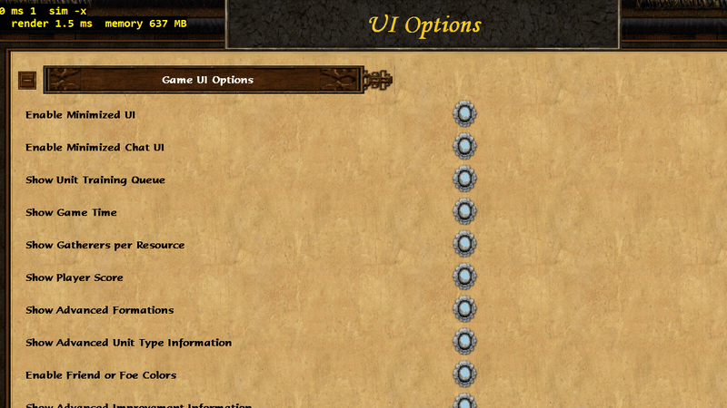

*In WoL, with `fastVertexFill` and `rendererOption log`, at the main menu (1920×1080):* Options → Graphics Options
shows the Renderer entry on DirectX 9. The cursor rests on it and its tooltip shows; the list opens, Vulkan (DXVK) is
picked, and OK goes back to the main menu with the choice stored (`uhc-options.cfg`: `renderer vulkan`; the log:
`Vulkan chosen in the menu; it takes effect at the next start`).
[Full video (MP4)](media/rendererOption-wol.mp4).

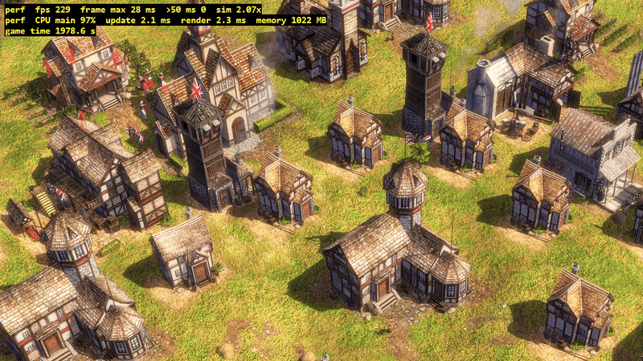

*The next start, with Vulkan (DXVK 3.1.1 loaded from `dxvk\`, no DXVK option since `fastVertexFill` is on), in the
late save and Town Center view of `fastVertexFill`'s videos:* 203 FPS on average over the 32 s take, the render part
2.7 ms per frame. The picture is the same as with DirectX 9.
[Full video (MP4)](media/rendererOption-vulkan-wol.mp4).

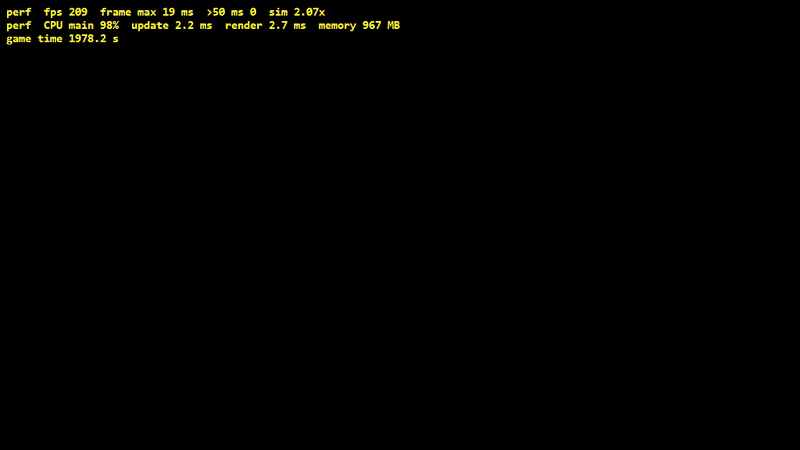

*Control, DirectX 9 chosen (both keys on, the same scene):* the same picture at 182 FPS on average, the render part
3.2 ms: Vulkan gave +12 % in this pair of takes (one take each, filmed while the video was being recorded).
[Full video (MP4)](media/rendererOption-wol-control.mp4).

```
rendererOption [vulkan|dx9] [folder=<dir>] [log] [conf=<DXVK options>]
```

- **In WoL today:** the game draws with Direct3D 9. A player can install DXVK (a free library that runs Direct3D 9
  games on Vulkan) by hand, two files next to the exe, and with the right option it is faster
  ([performance.md](performance.md), §11, "DXVK in WoL"); nothing in the game offers it.
- **Effect:** Options → Graphics shows a **Renderer** list with *DirectX 9* and *Vulkan (DXVK)*. The choice is used
  from the next start. With Vulkan, the DLL loads DXVK's `d3d9.dll` from the `dxvk` folder next to the exe. No file
  next to the exe changes and the profile is not touched: the choice is kept in `uhc-options.cfg` next to `UHC.log`.
  DirectX 9 stays the default. The same menu can switch other keys on or off: [`menuOptions`](#menuoptions).
- **DXVK's option:** without [`fastVertexFill`](#fastvertexfill), DXVK is only fast with
  `d3d9.cachedWriteOnlyBuffers = True`, so the DLL gives it that option. With `fastVertexFill` on, the slow read-back
  that option works around is gone, and DXVK gets no option. The log says which one and why.
- **WoL needs:**
  1. the `dxvk` folder of the release zip (DXVK 3.1.1's 32-bit `d3d9.dll` and its license) next to `age3y.exe`;
  2. the field in `data\options.xml`, in the Graphics group (here after Anti-alias Quality). Plain text works; the
     first `<value>` is DirectX 9, the second Vulkan:

     ```xml
     <field>
         DropDown
         <name>OptionRenderer</name>
         <label>Renderer</label>
         <value>DirectX 9</value>
         <value>Vulkan (DXVK)</value>
         <tooltip>Vulkan draws the game through DXVK (the dxvk folder): usually more frames per second. Takes effect when the game starts again.</tooltip>
     </field>
     ```
  3. WoL's large-address-aware exe, which WoL ships: DXVK takes about 250 MB more address space.
- **Arguments:** `vulkan` or `dx9` is the choice of a player who never picked one (default `dx9`); `folder=<dir>` is
  where `d3d9.dll` is, relative to the exe or absolute (default `dxvk`); `log` logs every read and write of the entry;
  `conf=` replaces DXVK's options and takes the rest of the line (several options separated by `;`). A player who
  sets `DXVK_CONFIG` in Windows' environment keeps it.
- **During a match** the entry is greyed out, as the other options that need a restart.
- **If Vulkan fails:** no `dxvk` folder, a broken `d3d9.dll`, or no Vulkan on the PC: the game starts with DirectX 9
  and the log says why. If a start with Vulkan crashes or hangs before its first frame, the next start uses DirectX 9
  and stores it, so the player can always get back to the menu.
- **Log:**
  - at startup, `rendererOption: <path>\uhc-options.cfg: Vulkan` (or `DirectX 9`, or `no choice stored yet`), then
    `rendererOption: Vulkan: <path>\dxvk\d3d9.dll loaded at 0x…; the game's Direct3DCreate9 is DXVK's`; then
    `rendererOption: no DXVK options (fastVertexFill is on, …)` or `rendererOption: DXVK_CONFIG=d3d9.cachedWriteOnlyBuffers
    = True (fastVertexFill is off, failed or in verify mode)`, `Direct3DCreate9(0x20) answered by DXVK`,
    `CreateDevice -> hr 0x00000000` and `first frame presented (hr 0x00000000); start marker removed`;
  - when the options screen opens, `rendererOption: options screen field OptionRenderer (…); shows Vulkan`;
  - on Apply, `rendererOption: Vulkan chosen in the menu; it takes effect at the next start`;
  - DXVK's own log, `dxvk\age3y_d3d9.log`: `Found config env: d3d9.cachedWriteOnlyBuffers = True` near its top when
    the option is given.
- **Limits:**
  - **a restart is needed** to change the renderer;
  - one PC was measured (an NVIDIA RTX 4090): another card or driver, an integrated GPU (DXVK needs Vulkan 1.3) and
    exclusive fullscreen with Alt+Tab are untested;
  - **multiplayer is untested** (see "Simulation");
  - about 250 MB more address space, so only with a large-address-aware exe;
  - it does not touch the stutters (the frames over 100 ms), which come from the game's file loads.
- **Simulation:** no. It changes which library draws, not what the game computes, and the x87 control word of the
  game's main thread stays as with Direct3D 9. Players may choose differently, but no multiplayer game has been run
  with DXVK yet.
- **Measured** in WoL ([performance.md](performance.md), §11, "rendererOption"), a late five-player save, the camera on
  a Town Center, 60 s per run, on an NVIDIA RTX 4090:

  | Window | Direct3D 9 + `fastVertexFill` | Vulkan from the menu + `fastVertexFill` (the default: no DXVK option) | the same with the option | DXVK installed by hand, with the option, no `fastVertexFill` |
  |---|---|---|---|---|
  | 1920×1080 | 180.6 FPS | **196.5 / 194.4** (+8 %) | 182.8 / 178.9 | 181.3 |
  | 2560×1440 | 180.7 FPS | **200.2 / 194.0** (+9 %) | 184.5 / 190.0 | 188.6 |

  Vulkan chosen in the menu is as fast as DXVK installed by hand (178.7 and 191.2 FPS with the same option, within
  1.5 %). The PC was not idle during these runs (a browser used about half a core), so take the numbers as a
  comparison between the variants.
- **Status:** confirmed in single player (2026-11-10), on WoL's exe and data:
  - the menu: the entry shows in Graphics Options (English and Spanish copies), the choice survives a restart, and
    the profile written after Options → OK is byte for byte the one a game without the key writes (both change
    only `optionrefreshrate`, which the stock screen rewrites);
  - the switch: Vulkan → restart → DXVK 3.1.1 loaded from `dxvk\`, the device created, the first frame presented; back
    to DirectX 9 → restart → the system's Direct3D 9;
  - the safety net: no `dxvk` folder, a `d3d9.dll` that is not a DLL, and a start marker left behind: all three
    started with DirectX 9 and said why in the log (the third also stored DirectX 9);
  - with Vulkan from the menu: a 32-minute save with four AIs played 3.5 game minutes (the AIs fought and built), then
    minimize and restore, two resolution changes, a save and its load: no fault, frames and the game clock went on;
    with every key of `examples\Startup\uhc.cfg` and `fastVertexFill`: 40 keys applied, none failed; the x87 control
    word 0x007F after CreateDevice and 0x027F in play, as with Direct3D 9;
  - beside WoL's own DLL (`dinput8.dll`, with `engine-ext\`): the entry shows and switches, DXVK loads and draws, and
    removing it leaves WoL's folder byte for byte as it was. ReShade, which that copy has as `d3d9.dll` next to the
    exe, is not used with Vulkan (DXVK is loaded by its full path), so ReShade's effects are off while Vulkan is
    chosen.
  - Not tested: multiplayer, another video card or driver, exclusive fullscreen and Alt+Tab, a stock (not
    large-address-aware) exe with DXVK.

#### menuOptions

*Lets the player switch some of the performance keys on or off in the game's options menu.*

**Added:** Thursday 2026-11-12 11:40

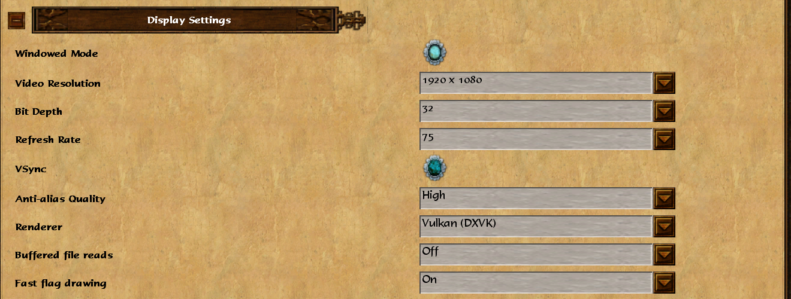

*In WoL, with `rendererOption` and `menuOptions bufferedFileReads fastVertexFill` (1920×1080):* Options → Graphics
Options with the three entries switched (Vulkan, buffered reads Off, flag drawing On) just before OK. No video: the
switch itself is the same dropdown as the Renderer's, filmed in [`rendererOption`](#rendereroption).

```
menuOptions <key> [<key> ...]        the keys: bufferedFileReads, fastVertexFill, fastLastInLine
```

- **In WoL today:** `bufferedFileReads` and `fastVertexFill` are on or off for every player as `wol.cfg` says; a
  player who wants the other setting has to edit the cfg.
- **Effect:** each key named on the line gets an Off / On entry in the options menu (Options → Graphics, next to
  [`rendererOption`](#rendereroption)'s Renderer). The choice is used from the next start and kept in
  `uhc-options.cfg` next to `UHC.log`, as the renderer's; the profile is not touched.
- **Who decides, in order:**
  1. a key **not** named on a `menuOptions` line: its own line in the cfg alone, as before;
  2. a named key, once the player has chosen in the menu: the player's choice;
  3. a named key the player never switched: its own line in the cfg. With the line (and its arguments, such as
     `bufferedFileReads 64 readahead`), it starts on; without it, it starts off.

  So the mod keeps control: it decides which keys players may switch, what each starts as, and the arguments a key
  applies with. A key switched on in the menu with no line in the cfg applies with its defaults.
- **WoL needs:** a field per key in `data\options.xml`, in the Graphics group (here after the Renderer field). The name
  is fixed per key; the label and tooltip are free text; the first `<value>` is Off, the second On:

  ```xml
  <field>
      DropDown
      <name>OptionBufferedReads</name>
      <label>Buffered file reads</label>
      <value>Off</value>
      <value>On</value>
      <tooltip>Reads the game's files through a buffer instead of many tiny reads: faster loading, shorter stutters. Takes effect when the game starts again.</tooltip>
  </field>
  <field>
      DropDown
      <name>OptionFastVertexFill</name>
      <label>Fast flag drawing</label>
      <value>Off</value>
      <value>On</value>
      <tooltip>Draws the waving flags without reading back from video memory: more frames per second with flags on screen. Takes effect when the game starts again.</tooltip>
  </field>
  <field>
      DropDown
      <name>OptionFastLastInLine</name>
      <label>No freeze on shipments</label>
      <value>Off</value>
      <value>On</value>
      <tooltip>Removes the short freeze after each home city shipment. Takes effect when the game starts again.</tooltip>
  </field>
  ```

  Add a field only for a key named on the `menuOptions` line: a field whose key is not named shows as an empty list,
  as any `<name>` the game does not know. Without the fields, the menu is the stock one.
- **Example** (`wol.cfg`): `bufferedFileReads` and `fastLastInLine` start on, `fastVertexFill` starts off, and players
  can switch all three:

  ```
  menuOptions bufferedFileReads fastVertexFill fastLastInLine
  bufferedFileReads
  fastLastInLine
  ```
- **During a match** the entries are greyed out, as the other options that need a restart.
- **Log:**
  - at startup, before the keys: `menuOptions: bufferedFileReads follows OptionBufferedReads: on (no choice stored
    yet: its cfg line)` (or `(the player's choice)`), one line per key, then `menuOptions: applied (2 keys follow the
    options menu)`; then the key's own `applied` line, or none when it is off;
  - when the options screen opens, `bufferedFileReads: options screen field OptionBufferedReads (…); shows on`;
  - on Apply, `bufferedFileReads: off chosen in the menu; it takes effect at the next start`, and the line
    `bufferedFileReads off` in `uhc-options.cfg`;
  - a name that cannot follow the menu: `menuOptions: <name> cannot follow the options menu (these can: …); ignored`,
    and `menuOptions: FAILED`; the other names still work.
- **Simulation:** no. Both keys change how the game reads its files or feeds the video card, not what it computes, so
  players may choose differently. Only such keys can be named; `fastLastInLine` (the same bits as stock) could be added
  the same way, as one line of the DLL.
- **Status:** confirmed in single player (2026-11-12), in WoL with this DLL, beside `rendererOption`, over seven
  starts:
  - the three entries show in Graphics Options with the start values (Renderer DirectX 9, buffered reads On from its
    cfg line, flag drawing Off with no cfg line); switched to Vulkan / Off / On and OK: `uhc-options.cfg` holds
    `renderer vulkan`, `bufferedFileReads off`, `fastVertexFill on`;
  - the next start: DXVK loaded and drew, `fastVertexFill: applied` (no cfg line: its defaults) and its hook reached,
    no `bufferedFileReads` line; the menu showed the stored values;
  - switched back (DirectX 9 / On / Off), with a `fastVertexFill` line added to the cfg: the system's `d3d9.dll`,
    `bufferedFileReads: applied`, and `fastVertexFill` not applied despite its cfg line (the player's choice wins);
  - `menuOptions bogusKey`: logged, `menuOptions: FAILED`, and both keys followed their cfg lines alone although the
    file said `fastVertexFill off`; the fields of keys not named showed as empty lists, as with no hook at all;
  - WoL's own `options.xml` (no fields) with the line: the stock Graphics Options;
  - the profile was byte for byte the same after every OK.

  Not tested: multiplayer, `dinput8.dll` beside WoL's DLL, a choice made during a match (the entries are greyed out
  there).
