# Modding guide for Wars of Liberty

How to add these features to Wars of Liberty (WoL): what each one does in WoL, the `wol.cfg` line and
the WoL data it needs, how to check it in the game, and how far it was tested in WoL.

This page is private, as WoL's own files are. For the code of each feature, written for WoL's DLL, see
[porting-to-another-dll.md](porting-to-another-dll.md). For how the features work inside the engine,
see [how-it-works.md](how-it-works.md). To build the DLL, see
[developer-guide.md](developer-guide.md).

Contents:
- [Latest changes](#latest-changes): every feature, newest first, with day, date and time
- [Adding these features to WoL](#adding-these-features-to-wol): start here
1. [What you need](#1-what-you-need)
2. [WoL's folder](#2-wols-folder)
3. [The wol.cfg file](#3-the-wolcfg-file)
4. [Reading UHC.log](#4-reading-uhclog)
5. [Feature reference](#5-feature-reference)
6. [Editing the game data](#6-editing-the-game-data)
7. [Multiplayer, saved games and replays](#7-multiplayer-saved-games-and-replays)
8. [WoL's keys that are not implemented](#8-wols-keys-that-are-not-implemented)
9. [Troubleshooting](#9-troubleshooting)

## Latest changes

Every feature, newest first, with the day, date and time of its latest change (the commit's
local time). The details are in the feature's section, under its heading; the bug fixes and the
performance keys are in [Bug fixes and performance](bug-fixes.md).

A new test video counts as a change: a feature filmed again in WoL moves back to the top.

| Date and time | Key | What changed | Status |
|---|---|---|---|
| Friday 2026-11-27 07:50 | [`perCivEffects`](#perciveffects) | Added. `onlyciv="Spanish"` on any tech `<Effect>` makes that effect work only for a player of that civ: for shared cards, shared techs and each member of a team tech. | The attribute on the effects that want it. |
| Friday 2026-11-27 07:46 | [`partisans`](#partisans) | Added. The guerrilla of a destroyed building per civ: `<CivPartisan civ>` on the building gives each civ its own unit and count, `Data` techs change them, and `<PartisanFromNearby>` makes the owner's nearby buildings spawn them instead. | The tags on the building in `protoy.xml`; the techs in `techtreey.xml`. |
| Thursday 2026-11-26 16:24 | [`cultureUI`](#cultureui) | Filmed in WoL, with a control. The minimised in-game interface takes its own textures per family of civs, and others again from the Great War: `X_as.ddt` beside `X.ddt` restyles texture X for the Asian family. | The art, one `.ddt` per texture and family (`<texture>_<family>[_gw].ddt`, from aoe3-blender-tools' templates), and `data\uhc\cultureui.xml` with the nine families: `wol-fixes/culture-ui/`. |
| Thursday 2026-11-26 15:43 | [`powerShots`](#powershots) | Filmed in WoL, with a control. An ability's attack (an explorer's "Hammer Fanning") with `<PowerShots>N</PowerShots>` fires a shot at each Attack tag of its animation, up to N a use, instead of only the first. | The tag on the abilities' attacks (the Explorer's `SharpshooterAttack` and `CrackshotAttack`): the `wol-fixes/hammer-fanning` pack. |
| Thursday 2026-11-26 11:34 | [`turretArc`](#turretarc) | Filmed in WoL, with a control. An attack with `<Turret>` turns its gun on the mount toward a target inside the turret's arc, the unit's body still; beyond the arc the unit turns until the target sits at the gun's rest. | `<Turret>` on the attack in its tactics, a model with a turning gun bone and its aim file (aoe3-blender-tools' `make_gun_camel.py`: the gatling camel pack). |
| Thursday 2026-11-26 10:26 | [`garrisonConvert`](#garrisonconvert) | Filmed in WoL, with a control. `<GarrisonConvertTo delay="5" eject="true" from="Settler">Pikeman</GarrisonConvertTo>` in a building: the units that enter it become that unit, at once or one every 5 seconds, kept inside or put out, with the train button's pie over the building's portrait; several tags take turns, a conversion waits at the population cap, and techs change the tags. | The tag on the buildings that want it. |
| Thursday 2026-11-26 10:14 | [`nurseryFactor`](#nurseryfactor) | Filmed in WoL, with a control. A building or unit keeps its own count, its "factor" (the minks of a mink nursery), that grows with time (linearly or as b^t) up to a cap, is changed by techs, takes in the units sent into it and is spent or bought with its own command buttons; it multiplies the unit's AutoGather and can multiply a home city shipment, and the panels show it as `3/10 minks` with a two-line rollover and a progress pie. | The `NurseryFactor*` tags on the proto, an AutoGather action, the techs that want the Data subtypes, and for the buttons their command types and `protounitcommands.xml` entries; `art\ui\uhc\pie\` for the pie after the row. |
| Wednesday 2026-11-25 08:42 | [`selectFattened`](#selectfattened) | Filmed in WoL, with a control. A button and a hotkey select the player's livestock that has reached its maximum food, on the whole map; the button shows how many there are and hides at none. | The button and the hotkey: `wol-fixes/select-fattened`. |
| Wednesday 2026-11-25 08:22 | [`editorAutosave`](#editorautosave) | Added. The scenario editor saves the open scenario every few minutes to `autosave-1` ... | Nothing. |
| Wednesday 2026-11-25 08:11 | [`editorSearch`](#editorsearch) | Filmed in WoL, with a control. The scenario editor's Objects palette, its Forbidden Units/Techs dialog and its trigger editor (the Type list and the unit, unit type and tech lists, and the list of triggers) get a search field: typing part of a name keeps only the entries that match. | The search fields in `uieditorpalettes.xml`, `uiforbiddenunitstechs.xml` and `uitriggereditor.xml`: `wol-fixes/editor` has the three. |
| Wednesday 2026-11-25 07:55 | [`displayedRange`](#displayedrange) | Filmed in WoL, with a control. A selected unit shows the reach of its ranged attacks as rings on the ground, measured as the game measures it (from a building's walls, to the target's edge), while Alt is held, or always with `AlwaysDisplayRange`; the player turns them on or off in the options menu, at once. | `<DisplayRange>1</DisplayRange>` or `<AlwaysDisplayRange>1</AlwaysDisplayRange>` on the protos, and `tools/rings` in `art/effects/uhc_rings` (copy it again: the ring files changed on 2026-11-24); the options-menu pack `wol-fixes/options-menu/` for the switch. |
| Tuesday 2026-11-24 09:08 | [`techGadgets`](#techgadgets) | Filmed in WoL, with a control. Shows one interface gadget once a tech is active for the player, and another before it: WoL's resource panel without the oil row before the Great War, with it after. | Two named children per panel variant in `uimainnew.xml` (the oil panel pack, `wol-fixes/oil-panel/`), and one line per variant. |
| Tuesday 2026-11-24 09:08 | [`incomeRates`](#incomerates) | Filmed in WoL, with a control. A text for the resource panel, `{uhcIncome(food)}`: what the player's gatherers, AutoGather units and trickles bring in per second, as DE's panel shows its gather rates. | The text in the panel's layout (the oil panel pack, `wol-fixes/oil-panel/` with `--rates`, has it under each amount and in the tooltips). |
| Monday 2026-11-23 13:56 | [`faithResource`](#faithresource) | Added. Optional: resource 4 becomes faith, gathered by villagers praying at their church or mosque, cut from the home city's skill points; a faith Gather plays its own animation. | The opt-in pack `wol-fixes/faith/` (and `wol-fixes/faith-panel/` for the panel row). |
| Monday 2026-11-23 09:18 | [`dmgPartBoneFix`](bug-fixes.md#dmgpartbonefix) | Added. Stops the game from reloading a 3D model in use when a damage template names a bone the model lacks, the other cause of the Granny crashes (WoL #78). | Nothing; `wol-fixes/art-dmg-bones-20261123/` fixes the data itself. |
| Monday 2026-11-23 08:05 | [`modelCacheLimit`](bug-fixes.md#modelcachelimit) | Added. Stops the game from unloading 3D models that units still use, the cause of the Granny crashes in big games (WoL #78). | The two data fixes in `wol-fixes/art-dmg-bones-20261123/`. |
| Monday 2026-11-23 07:59 | [`resendableCards`](#resendablecards) | Added. `<resendeveryage>1</resendeveryage>` in a home city card: the card can be sent again each time its player reaches a new age (its `<maxcount>` back, no stacking across ages). | The tag on the cards that want it. |
| Monday 2026-11-23 07:59 | [`quickArrivalCards`](#quickarrivalcards) | Added. `<Flag>QuickArrival</Flag>` on a card's tech adds the bullet line *This is a QUICK-ARRIVAL card.* to the card's rollover, after its *may be sent ... | The flag on the cards' techs; a string in the string table to translate the line. |
| Monday 2026-11-23 07:56 | [`retargetInAction`](#retargetinaction) | Added. An attack with `<RetargetInAction>1</RetargetInAction>` whose target dies before the last shot of its attack animation (a machine gun's Attack tags, a burst's quick shot) fires the rest at a new target in range, instead of losing them. | The tag on the attacks that want it (the machine guns' `CannonAttack` in `organGun.tactics`). |
| Sunday 2026-11-22 13:54 | [`unitResourceAuras`](#unitresourceauras) | Filmed in WoL, with a control. An `AutoRangedModify` action with `<ModifyType>UnitResource</ModifyType>` gathers from the units around it, with DE's tags. | Nothing: WoL's `sawmill.tactics` already has such an aura. |
| Sunday 2026-11-22 12:35 | [`broadsideSoundSet`](#broadsidesoundset) | Filmed in WoL, with a control. A `BroadsideAttack` action plays the sound set of its `<BroadsideSoundSet>` at each shot instead of `ShipCannonShoot`. | The tag on the rocket ships' actions in `frigate.tactics` (`RangedAttackRocket`, `BroadsideAttackRocket`). |
| Sunday 2026-11-22 12:35 | [`numberOfShots`](#numberofshots) | Filmed in WoL, with a control. An attack with `<NumberOfShots>` fires that many shots, `<ShotInterval>` seconds apart, keeping its firing pose between them (`<BurstPose>`), before its reload; with `projectiles`, `<NumberProjectiles>` launches that many projectiles per shot. | The tags on the attacks that want them; `projectiles` reads the `numberprojectiles` WoL's tactics already have. |
| Sunday 2026-11-22 12:23 | [`buildingGather`](#buildinggather) | Added. A building with a Gather action gathers from a mine, a bush, a tree or a crate within the action's range, straight into its owner's stockpile. | A Gather action in the building's tactics and a `<CarryCapacity>` per resource; `<AutogatherFrom>` for it to start on its own. |
| Sunday 2026-11-22 12:23 | [`deadReplacementAtZeroInventory`](bug-fixes.md#deadreplacementatzeroinventory) | Filmed in WoL, with a control. A hunt, a herdable or any unit that leaves a body to gather drops its `<DeadReplacement>` when the body is used up, not when it falls. | `<DeadReplacement>` on the protos that want one (none has it today). |
| Sunday 2026-11-22 12:08 | [`ageFiveShipments`](#agefiveshipments) | Filmed in WoL, with a control. Home city cards of the Imperial Age (`<age>4</age>`) are in the deck, shown at the right end of the Age IV row (the Age IV cards stay at the left), greyed until the Imperial Age, then sent like the others. | `<age>4</age>` on the cards that want it. |
| Sunday 2026-11-22 12:08 | [`shipmentCounts`](#shipmentcounts) | Filmed in WoL, with a control. Counts the home city cards each player ships of each age, the age that enables the card (each once it arrives, kept in saved games), for the `Data` effect `FreeHomeCityUnitByShipmentCount` (one unit per card, one age or a range) and the XS calls `xsGetShipmentCount` and `xsGetShipmentCountRange`. | The effect in the cards or techs that want it. |
| Sunday 2026-11-22 12:08 | [`transformChecks`](#transformchecks) | Filmed in WoL, with a control. A transform button turns grey with the reason when none of the selected units can transform, and a transform respects the target's build limit. | Transform buttons (`uiTransformSelectedUnit`): `wol-fixes/special-transforms` makes them for the four kraal maturings and the fireship. |
| Sunday 2026-11-22 11:56 | [`scenarioCivs`](#scenariocivs) | Added. Reads a second civ file, `data\scenariocivs.xml`, after `civs.xml`: its civs come after the others (no ID moves), show in the scenario editor's list and not in the skirmish and lobby lists. | The file, with `<civ>` elements in `civs.xml`'s format. |
| Saturday 2026-11-21 15:50 | [`autoScout`](#autoscout) | Filmed in WoL, with a control. A unit explores the map on its own, unexplored ground first, as DE's envoys do, keeping away from enemy buildings that shoot and backing off when hit: a tactic in its tactics file switches it on, and any order switches it off. | A tactic `AutoScout` in the unit's tactics file and two buttons: `wol-fixes/auto-scout` does it for the raven, the parrots, the balloon, the envoy and the European explorers. |
| Saturday 2026-11-21 15:25 | [`overhealDecay`](#overhealdecay) | Filmed in WoL, with a control. The HP of those units above `InitialHitpoints` goes back down to it over time, at each proto's `<OverhealDecay>` rate (2 % a second by default), except while an own unit of a chosen type is near. | `overhealHitpointBars`; `<OverhealDecay>` where the default does not fit. |
| Saturday 2026-11-21 15:25 | [`detonationDeath`](#detonationdeath) | Filmed in WoL, with a control. `<DetonationProtoAction>` makes a unit fire an action around itself when it dies, with the action's impact effect where it stood. | The tag, and an action with `DamageArea`. |
| Saturday 2026-11-21 15:06 | [`veterancyBonus`](#veterancybonus) | Filmed in WoL, with a control. `<VeterancyBonus>` rows make a proto stronger with its kills, a row with `tech=` only while the player has that tech; defaults by unit type, by civilization, added rows and rank names in `veterancy.xml`. | The rows on the protos that want them. |
| Saturday 2026-11-21 12:11 | [`broadsideMuzzleLimit`](#broadsidemuzzlelimit) | Filmed in WoL, with a control. Lets a ship's broadside fire from up to N muzzles per side instead of 6. | A ship model with more than 6 muzzles per side: `ypTekkousen` has 10. |
| Saturday 2026-11-21 12:00 | [`overhealSources`](#overhealsources) | Filmed in WoL, with a control. Only heal actions with `<CanOverheal>1</CanOverheal>` heal those units above `InitialHitpoints`, up to their `<OverhealCap>`, and techs can turn it on or off; every other heal stops there. | `overhealHitpointBars`, and the tags on the `Heal` actions that may overheal. |
| Saturday 2026-11-21 11:55 | [`herdWalkAwayFix`](bug-fixes.md#herdwalkawayfix) | Added. A fattened herdable that walks away from its pen or nomad stays there, instead of walking back to where it stood before the pen or nomad drew it in. | Nothing; for nomads, `wol-fixes/me-herdables`. |
| Saturday 2026-11-21 11:52 | [`autoGatherFrom`](#autogatherfrom) | Added. A unit idle for a few seconds gathers on its own from a unit of the type named in its gather action, if one is within the action's range. | `<AutogatherFrom>` in the gather action of the units that want it. |
| Saturday 2026-11-21 11:35 | [`shipTechLimit`](#shiptechlimit) | Filmed in WoL, with a control. `<ShipTechLimit>N</ShipTechLimit>` in a civ caps the techs that cost Ships (WoL's Mapuche council techs) a player of that civ researches per game, repeatable techs excepted. | The tag on the civ in `civs.xml`. |
| Saturday 2026-11-21 11:03 | [`auraStacking`](#aurastacking) | Filmed in WoL, with a control. `<ForbidUnitType>` on any aura: the aura leaves units of a type or proto alone; that an aura does not stack is the game's own `<ModifyExclusive>`. | The tags on the aura. |
| Friday 2026-11-20 18:41 | [`lanAutoStart`](#lanautostart) | Added. Takes the game from the main menu to a LAN game with no clicks: it hosts, or joins an address by Direct IP, as a launcher asks on the command line. | Nothing; a launcher that passes `+uhcLanHost` or `uhcLanJoin="<address>"`. |
| Friday 2026-11-20 15:39 | [`steadyHitpointBars`](bug-fixes.md#steadyhitpointbars) | Filmed in WoL, with a control. The floating HP bars stay at one height over each unit instead of jumping when it attacks, gallops or idles. | Nothing. |
| Friday 2026-11-20 11:59 | [`politicianEnablesTech`](#politicianenablestech) | Filmed in WoL, with a control. A politician of the European age-up dialog shows the techs it makes available as icons with their names and their research rollover, and its picture shows only the flag. | `<PoliticianEnablesTech>` lines in the politicians' `<Tech>`, and the new gadgets in `uipoliticianEuropeandlg.xml` (`wol-fixes/politician-ui`). |
| Friday 2026-11-20 11:59 | [`researchOnTheMove`](#researchonthemove) | Added. A unit of the abstract type `ResearchOnTheMove` keeps researching while it walks, fights or does anything else, instead of standing still until its research is done. | `<UnitType>ResearchOnTheMove</UnitType>` on the protos: `wol-fixes/research-on-the-move` gives it to the Mapuche council. |
| Friday 2026-11-20 11:50 | [`homeCityTechsInUnits`](#homecitytechsinunits) | Added. A home city card's tech listed in a proto's `<Tech>` rows is researched there like a normal tech. | The card's tech in the `<Tech>` rows, made obtainable for the civ. |
| Friday 2026-11-20 11:39 | [`truckAttackResourceFix`](bug-fixes.md#truckattackresourcefix) | Added. A `TruckAttack` (the mustard gas, the tornado, the fire power, the monster truck) no longer empties the Mills, plantations and other gather buildings it hits, so villagers can still gather there afterwards. | Nothing. |
| Thursday 2026-11-19 15:22 | [`attackTypeIcons`](#attacktypeicons) | Filmed in WoL, with a control. A bonus multiplier against an abstract type the attack rows have no icon for (WoL's Maneuver, Assault, Standing units...) shows in both panels, with the icon and name the line gives it. | Nothing: the line of `wol.cfg`. |
| Thursday 2026-11-19 15:22 | [`multiplierDecimals`](bug-fixes.md#multiplierdecimals) | Filmed in WoL, with a control. The attack rows' bonus multipliers show two decimals, as the data has them: `1.25x` instead of a rounded `1.3x`, in both panels and their tooltips. | Nothing. |
| Tuesday 2026-11-17 14:11 | [`preloadDll`](#preloaddll) | Added. Our `dinput8.dll` also loads another DLL of the game folder, such as WoL's `WoL.dll`, at the moment WoL's own `dinput8.dll` loader would. | Nothing. |
| Tuesday 2026-11-17 10:30 | [`minUIStats`](#minuistats) | Filmed in WoL, with a control. The minimized interface shows what the big one shows, and more: building armor, live speed, LOS, garrison, every attack, in rows a data file lists, and `{uhc...}` texts. | A `uiunitselectionmin.xml` with the rows: `wol-fixes/min-ui` has one from the stock panel. |
| Friday 2026-11-13 17:27 | [`killSpawn`](#killspawn) | Filmed in WoL, with a control. A civ turns the enemies it kills into livestock: `<killSpawn>` in civs.xml lists the animals and their weights, with a chance and the victims' types; a `Data` tech can change the chance. | The tags on the civ in `civs.xml`. |
| Friday 2026-11-13 13:06 | [`impactBoneFix`](bug-fixes.md#impactbonefix) | Filmed in WoL, with a control. An impact effect that is a visual (the `<wood>` of `cannon.impacteffect`) shows on the building it hits, not over the whole screen, when the model's impact bones are scaled. | Nothing. |
| Friday 2026-11-13 10:46 | [`randomCost`](#randomcost) | Added. `<RandomCost resourcetype="Gold" min="80" max="120"/>` in a proto gives each unit trained a price rolled in that range, a new one after each purchase, and the button shows the exact price. | The tag on the protos that want it. |
| Friday 2026-11-13 10:03 | [`playerIcon`](#playericon) | Filmed in WoL, with a control. In a LAN lobby, the player's slot shows an icon of the mod's choosing instead of the civ's portrait, and keeps it when the player changes civ. | `data\avatar_*.xml` naming the icons, and their `.ddt` files: `tools/make_avatar_table.py` lists WoL's own pictures in `data\avatar_wol.xml`. |
| Friday 2026-11-13 09:01 | [`politicianPlacesFix`](bug-fixes.md#politicianplacesfix) | Added. The age-up dialog shows only as many politicians as its layout has places, instead of crashing on a fifth politician with WoL's four-place dialog. | Nothing; a fifth place in `uipoliticianEuropeandlg.xml` shows five. |
| Friday 2026-11-13 08:06 | [`kothTimer`](#kothtimer) | Added. The King of the Hill time comes from a table by the number of players, or of teams. | Nothing. |
| Friday 2026-11-13 07:37 | [`ageUpBuildings`](#ageupbuildings) | Added. The age-up button opens the politician dialog on the buildings you list too, not only on the Town Center, and each building offers only the politicians its own proto lists. | The politicians (techs with `AgeUpgrade`) in those buildings' `<Tech>` lists. |
| Friday 2026-11-13 07:24 | [`orPrereqsQty`](#orprereqsqty) | Added. `<Flag qty="N">OrPrereqs</Flag>` makes a tech available when N of its prerequisites are met, not one. | The attribute on the techs that want it. |
| Thursday 2026-11-12 18:35 | [`inventoryBars`](#inventorybars) | Filmed in WoL, with a control. While Alt is held, a unit, mine, bush or carcass with resources shows a bar under its HP bar: how much of its resources is left, in the colour of the resource. | Nothing. |
| Thursday 2026-11-12 18:26 | [`directionalAttack`](#directionalattack) | Filmed in WoL, with a control. A shot that flies on past its target and hits every unit it flies over, before and after the target. | `<DirectionalAttack>` or `<DirectionalFiringRange>` on the attack. |
| Thursday 2026-11-12 18:01 | [`customWalls`](#customwalls) | Added. A building with `<WallPiece>` tags is laid like a wall, from point A to point B, with its own posts and pieces instead of the civ's stone wall. | The tags and the `wallBuild` flag on the post, and `wallBuild` and `wall.xml` placement on the pieces. |
| Thursday 2026-11-12 17:40 | [`customImpactTypes`](#customimpacttypes) | Filmed in WoL, with a control. New impact type names, after the game's 15, for `impacttype` in a `.dmg`, `<ImpactType>` and the elements of an `.impacteffect`. | The names in the cfg, their elements in the `.impacteffect` files (compiled to `.xmb`), and `impacttype` in the `.dmg`. |
| Thursday 2026-11-12 15:52 | [`stealthTargeting`](bug-fixes.md#stealthtargeting) | Filmed in WoL, with a control. A unit in stealth stays hidden from enemies, large units such as ships too, and no enemy attacks it while its player cannot see it. | Nothing. |
| Thursday 2026-11-12 15:40 | [`researchGrants`](#researchgrants) | Filmed in WoL, with a control. A building with `<ResearchGrantInterval>` gathers grant points over game time, and each point makes one of its player's researches cheaper or free. | The tags on the buildings that grant; optional `Data` effects in `techtreey.xml`. |
| Thursday 2026-11-12 13:25 | [`overhealHitpointBars`](#overhealhitpointbars) | Filmed in WoL, with a control. The HP bars and HP texts of marked units take `InitialHitpoints` as 100 %, not `MaxHitpoints`. | `MaxHitpoints` above `InitialHitpoints` on those units (no unit has it today), and the unit type on them, or an existing type such as `AbstractCavalryInfantry`. With `segment`, `art\ui\uhc\health_overheal.ddt` for the orange portrait end. |
| Thursday 2026-11-12 11:40 | [`menuOptions`](bug-fixes.md#menuoptions) | Added. Lets the player switch `bufferedFileReads`, `fastVertexFill` and `fastLastInLine` on or off in the options menu, from the next start, and the range rings of `displayedRange` at once, also during a match. | A field per key in `data\options.xml` (the pack `wol-fixes/options-menu` adds the rings' one). |
| Thursday 2026-11-12 08:17 | [`fastLastInLine`](bug-fixes.md#fastlastinline) | Added. Removes the freeze of a third of a second after each home city shipment of any player: the game's check of which tech of each line is the last one runs through a list instead of testing every tech against every other. | Nothing. |
| Wednesday 2026-11-11 15:50 | [`smartHealTargets`](#smarthealtargets) | Filmed in WoL, with a control. A healer's automatic search heals the best candidate, not the first: listed unit types, then the lowest HP ratio, the nearest, the lowest unit ID; with `switch`, a running heal moves to a much worse unit. | Nothing (unit types or proto names are optional). |
| Wednesday 2026-11-11 15:49 | [`healNonIdle`](#healnonidle) | Filmed in WoL, with a control. Lets healers marked with a unit type heal units that are busy (moving, fighting or doing something else); options pick the states and a lower rate on busy units. | That unit type on the healers in `protoy.xml`, or the name of an existing type (`xpMedicineMan`, `AbstractMonk`). |
| Tuesday 2026-11-10 17:34 | [`fastVertexFill`](bug-fixes.md#fastvertexfill) | Filmed in WoL, with a control. Builds the waving flags' vertices without reading back from video memory, for more frames per second when flags are on screen. | Nothing. |
| Tuesday 2026-11-10 17:34 | [`rendererOption`](bug-fixes.md#rendereroption) | Filmed in WoL, with a control. Adds a Renderer entry to the options menu: DirectX 9 or Vulkan, the second through DXVK for more frames per second, from the next start. | The field in `data\options.xml` and the `dxvk` folder. |
| Sunday 2026-11-08 10:31 | [`nativePreview`](#nativepreview) | Added. Selecting an empty native socket shows the units and techs its Trading Post would offer, with their rollovers, read-only. | Nothing: WoL's 88 native sockets have `NativeSocket` and a `<SubCiv>`. With `tagged`, `<NativePreview/>` on the sockets that get it. |
| Sunday 2026-11-08 10:23 | [`annexFacing`](#annexfacing) | Added. An annex (`<AnnexOf>Barracks</AnnexOf>` in its proto) faces the building it belongs to, also when the AI places it, and falls when that building dies or is destroyed. | The tag on the annexes; a placement distance that leaves room for the turned annex. |
| Sunday 2026-11-08 10:10 | [`containedUnitsROF`](#containedunitsrof) | Added. An attack with `<ScaleByContainedUnits target="ROF">` fires faster with the units inside: its ROF is divided by their number, at most `<DamageFactorCap>`. | The attribute on the attacks that want it (none has it today). |
| Sunday 2026-11-08 09:58 | [`spreadAnyAccuracy`](#spreadanyaccuracy) | Filmed in WoL, with a control. Reads `<maxspread>` and `<spreadfactor>`, which 317 of WoL's tactics files have and the exe ignores, for every miss, and makes every shot of marked units, `InstantBallistics` included, scatter like that whatever their accuracy and hit what it lands on. | The tags are there; the unit type or proto name of the units that should always scatter, in the cfg. |
| Friday 2026-11-06 16:04 | [`sharedBuildLimit`](#sharedbuildlimit) | Filmed in WoL, with a control. Protos share a build limit: by unit type, with weights, or across a team. | The tags on the protos that share. |
| Friday 2026-11-06 15:02 | [`buildingWorkRateAuras`](#buildingworkrateauras) | Filmed in WoL, with a control. Lets auras and other stat modifiers use the `ModifyType` `BuildingWorkRate`, which scales train, research and `Maintain` speed. | An `AutoRangedModify` action (or a power) with that `ModifyType`. |
| Friday 2026-11-06 14:35 | [`customHotkeyContexts`](#customhotkeycontexts) | Filmed in WoL, with a control. Makes keymap contexts named `<ProtoName>Accel` work, such as WoL's `WOLBarracksGreekAccel`. | Those contexts in `data\DefaultKeyMapY.xml`; WoL's file already has three. |
| Friday 2026-11-06 14:33 | [`snareValues`](#snarevalues) | Filmed in WoL, with a control. The factor and length of `<TargetSpeedBoost>`, per action and by tech. | The tags on the action. |
| Friday 2026-11-06 14:28 | [`noTrainNearEnemyTC`](#notrainnearenemytc) | Filmed in WoL, with a control. Marked units (the Daimyos and the Shogun by default) do not train while they stand near an enemy's first Town Center or an enemy building of a `near` type, with a warning over your own held units; the queue resumes when the blocker dies. | Nothing for the Daimyos (20 protos carry `AbstractDaimyo`); with a new marker, that type on the trainers or on the blocking buildings in `protoy.xml`. |
| Friday 2026-11-06 14:28 | [`noCorpseDopples`](bug-fixes.md#nocorpsedopples) | Filmed in WoL, with a control. A dead unit of a marked type (a hunt's carcass) leaves no frozen copy in the fog of war. | Nothing: WoL's hunts are `Doppled`; `noCorpseDopples Huntable` covers them. |
| Friday 2026-11-06 14:15 | [`unitTypeTechs`](#unittypetechs) | Added. Data tech effects `AddUnitType` and `RemoveUnitType`, for one player's copy of a proto. | The effects in your techs. |
| Friday 2026-11-06 14:06 | [`firstTC`](#firsttc) | Filmed in WoL, with a control. One line for `civFirstTC` and `startingTC`, with the town units and shipments worked out from the civ's tag. | `<firstTC>` in `civs.xml`, and the proto in `placementrules\colonies.xml` `<starttypes>`. |
| Friday 2026-11-06 13:55 | [`danceBonusCivs`](#dancebonuscivs) | Filmed in WoL, with a control. Lets the civs you list get the fire pit's Training, XPTrickle, Gathering and Regeneration dances, which the exe applies only to `XPIroquois`, `XPSioux`, `XPAztec` and `XPSPC`. | A building with `AbstractFirePit`, its dance enabled for those civs, and villagers that can work on it. |
| Friday 2026-11-06 13:55 | [`transformInventory`](bug-fixes.md#transforminventory) | Filmed in WoL, with a control. A unit transformed in place (a `TransformUnit` tech effect, a revolution) takes its new proto's `InitialResource` when the two protos hold different resource types. | Nothing; with a new marker, that type on the target protos. |
| Friday 2026-11-06 13:50 | [`hcShipmentPointFallback`](#hcshipmentpointfallback) | Filmed in WoL, with a control. When the building holding the shipment point dies and none of the exe's 10 fallback types (Town Center, Outpost, forts, …) is left, moves the point to the first alive building of the types you list, or to the player's first town center (`FirstTC`). | Nothing beyond the proto names in the cfg; `FirstTC` needs `startingTC` or `civFirstTC`. |
| Friday 2026-11-06 13:36 | [`showGatherRate`](#showgatherrate) | Filmed in WoL, with a control. Shows a gathering unit's rate per second in WoL's unit panel, and through the data ref `{currentUnitGatherRateString}`. | Nothing; for the data ref, a `formatText` gadget. |
| Friday 2026-11-06 13:02 | [`damageOverTime`](#damageovertime) | Filmed in WoL, with a control. Poison: an attack that names an attachment proto keeps damaging its target every few seconds after the hit. | `<AttachProtoUnit>` on the attack, a new attachment proto in `protoy.xml`, and a small tactics file. |
| Friday 2026-11-06 12:56 | [`xsErrorLog`](#xserrorlog) | Added. Writes the XS compiler's messages to the log, with file and line. | Nothing. |
| Friday 2026-11-06 12:52 | [`dataLint`](#datalint) | Added. While the data loads, lists what it asks for and the game drops. | Nothing. |
| Friday 2026-11-06 12:40 | [`lifespanAfterConstruction`](#lifespanafterconstruction) | Filmed in WoL, with a control. Starts the `<Lifespan>` of marked buildings when their construction is finished, not when the foundation is placed. | A `<Lifespan>` on the buildings, and the unit type on them (or a type or proto name in the cfg). |
| Friday 2026-11-06 11:33 | [`resourceGatherAuras`](#resourcegatherauras) | Filmed in WoL, with a control. Auras can change the gather rate of one kind of target (`MineGatherRate`, …) or one resource (`GoldGatherRate`, …). | A `<ModifyType>` with those names. |
| Friday 2026-11-06 11:33 | [`maintainWaitForPop`](bug-fixes.md#maintainwaitforpop) | Filmed in WoL, with a control. When a marked building's automatic production finishes a unit while its player is at the population cap, keeps the unit and spawns it as soon as there is room. | The name of an existing type or proto (`TownCenter`, `Factory`), or that unit type on the producing buildings in `protoy.xml`. |
| Friday 2026-11-06 10:47 | [`doNotQueue`](#donotqueue) | Filmed in WoL, with a control. `<DoNotQueue/>` in a proto trains it ahead of what waits in the building. | The tag on the protos that want it. |
| Friday 2026-11-06 09:06 | [`linkedResource`](#linkedresource) | Filmed in WoL, with a control. A resource building gathers the stock of a mine beside it. | The tags on a resource building of your own. |
| Thursday 2026-11-05 15:23 | [`cantBeSlowed`](#cantbeslowed) | Filmed in WoL, with a control. A unit with the type `CantBeSlowed` ignores `TargetSpeedBoost`; the attacker's type `CannotSnare` was retired on 2026-11-21 (take the snare out of the attack in its tactics). | The type on the protos that want it. |
| Thursday 2026-11-05 13:29 | [`pillageGold`](#pillagegold) | Added. A unit of the type `AbstractCanPillage` steals `<PillageAmount>` gold from the owner of the building it hits with its `BuildingAttack`. | The type and the tag on the protos. |
| Thursday 2026-11-05 10:29 | [`accuracyTechs`](#accuracytechs) | Filmed in WoL, with a control. A tech can change an action's `<Accuracy>`, with a `Data` effect of subtype `Accuracy`. | The `Data` effects in `techtreey.xml`. |
| Thursday 2026-11-05 10:29 | [`cratePriority`](#cratepriority) | Filmed in WoL, with a control. The order in which a civ's units gather crates, instead of the exe's hardcoded one. | One line per civ in `wol.cfg`. |
| Thursday 2026-11-05 10:29 | [`nextResearchFree`](#nextresearchfree) | Filmed in WoL, with a control. A tech can make the next research of a building free, with a `Data` effect of subtype `NextResearchIsFree`. | The `Data` effects in `techtreey.xml`. |
| Thursday 2026-11-05 10:29 | [`transformSpan`](#transformspan) | Filmed in WoL, with a control. `transformspan='<seconds>'` on a `TransformUnit` effect turns the units back when the time ends. | The attribute on the effects that want it. |
| Thursday 2026-11-05 10:21 | [`hcTargetTechs`](#hctargettechs) | Added. The tech flags `HCTargetEnemy` and `HCTargetAll` send a tech's effects to the owner's enemies, or to every player. | The flag on the techs that want it. |
| Thursday 2026-11-05 09:39 | [`killBountyTechs`](#killbountytechs-resourcebounty-and-teamkillbounty), [`resourceBounty`](#killbountytechs-resourcebounty-and-teamkillbounty), [`teamKillBounty`](#killbountytechs-resourcebounty-and-teamkillbounty) | Added. Techs change a proto's `<Bounty>`, `<Bounty resourcetype>` pays a resource, and the type `TeamKillBounty` pays the killer's whole team. | The effects and tags. Turning on `killBountyTechs` turns on WoL's 10 `subtype='Bounty'` effects. |
| Thursday 2026-11-05 08:01 | [`resourceDebt`](#resourcedebt) | Filmed in WoL, with a control. Only trickles and the rates of units may take a stockpile below 0. | A negative `ResourceTrickleRate` and `MinimumResourceTrickleRate`, or a negative AutoGather. |
| Thursday 2026-11-05 07:53 | [`trainBatchSize`](#trainbatchsize) | Added. `<TrainBatchSize>N</TrainBatchSize>` in a proto limits how many of it share one Train action. | The tag on the protos that want it. |
| Thursday 2026-11-05 07:36 | [`costEscalationTechs`](#costescalationtechs) | Added. A tech can change a proto's `<CostEscalation>`, with a `Data` effect of subtype `CostEscalation`. | The `Data` effects in `techtreey.xml`. |
| Wednesday 2026-11-04 17:03 | [`autoGatherScaleByContained`](#autogatherscalebycontained) | Added. `<ScaleByContainedUnits>` also works on AutoGather actions: the rate is multiplied by the units inside. | `<scalebycontainedunits>1</scalebycontainedunits>` on the action. |
| Wednesday 2026-11-04 16:29 | [`workRateByAbstractType`](bug-fixes.md#workratebyabstracttype) | Added. A `WorkRate` effect on an abstract type, `AbstractMine` by default, also reaches the rates a unit has for the protos of that type. | Take `AbstractMine` off the buildings the techs already name, or those techs count twice on them. |
| Wednesday 2026-11-04 14:48 | [`dodgeAnyUnit`](#dodgeanyunit-dodgesoundset-and-criticalsoundset), [`dodgeSoundSet`](#dodgeanyunit-dodgesoundset-and-criticalsoundset), [`criticalSoundSet`](#dodgeanyunit-dodgesoundset-and-criticalsoundset) | Filmed in WoL, with a control. Lets units marked with a unit type dodge hits like the Japanese monk (no damage, 15 % of the hits, while their player has `YPDodge`). | That unit type on the units in `protoy.xml`, or a type or proto name in the cfg, and `YPDodge` active for their players. |
| Wednesday 2026-11-04 13:58 | [`selectionLimit`](#selectionlimit) | Filmed in WoL, with a control. A selection holds up to N units (50 in the exe). | Nothing. |
| Wednesday 2026-11-04 13:58 | [`enableAllTeams`](#enableallteams) | Filmed in WoL, with a control. Teams 3 and 4 in the single-player game setup. | Nothing. |
| Wednesday 2026-11-04 13:58 | [`customProtoUnitCommands`](#customprotounitcommands) | Filmed in WoL, with a control. Adds the command types (buttons) listed in `data\uhc\customprotounitcommands.xml` (55 today). | The file, and the `<Command>` lines that use them. |
| Wednesday 2026-11-04 13:58 | [`customSyscalls`](#customsyscalls) | Filmed in WoL, with a control. Loads `wolPlugin.upl` and `wolai.upl` and adds the XS syscalls they register. | The plugins. |
| Wednesday 2026-11-04 13:58 | [`customCheats`](#customcheats) | Filmed in WoL, with a control. The cheats of WoL's plugins work in the chat. | `customSyscalls`, and plugins that register cheats. |
| Wednesday 2026-11-04 13:58 | [`kbUnitSyscalls`](#kbunitsyscalls) | Filmed in WoL, with a control. Five KB syscalls for AI scripts: a unit's inventory, its workers and its targeters. | AI scripts that call them. |
| Wednesday 2026-11-04 13:58 | [`asianCivs`](#asiancivs) | Filmed in WoL, with a control. Egyptians, Ethiopians, Koreans, Zulu and Maori count as Asian civs: consulate, export and wonders. | Those civs' data. |
| Wednesday 2026-11-04 13:58 | [`nativeCivs`](#nativecivs) | Filmed in WoL, with a control. WallMapu, Tupinamba and Tawantinsuyu count as native civs: fire pit, dances and council age-up. | Those civs' data. |
| Wednesday 2026-11-04 13:58 | [`wonderCivUnitType`](#wondercivunittype) | Filmed in WoL, with a control. `Rangatira` may start the Maori age-up. | Nothing. |
| Wednesday 2026-11-04 13:58 | [`multiarmor`](#multiarmor) | Filmed in WoL, with a control. A proto keeps one armor per damage type, and `Armor` tech effects change the one their `damagetype` names. | Several `<Armor>` lines on the protos. |
| Wednesday 2026-11-04 13:58 | [`enableFarmAnim`](#enablefarmanim-enablerectfarmanim-and-farmingradius), [`enableRectFarmAnim`](#enablefarmanim-enablerectfarmanim-and-farmingradius), [`farmingRadius`](#enablefarmanim-enablerectfarmanim-and-farmingradius) | Filmed in WoL, with a control. Mill and Rice Paddy gathering on WoL's farm buildings, and a gather area per building. | Nothing. |
| Wednesday 2026-11-04 13:58 | [`nowalkfarm`](#nowalkfarm) | Filmed in WoL, with a control. Gatherers on a farm keep the spot they take. | Nothing. |
| Wednesday 2026-11-04 13:58 | [`marketUnits`](#marketunits) | Filmed in WoL, with a control. Owning a unit of a listed proto (`WOLMarketGreek`, `SoukCaravan`, …) counts as owning a Market. | Nothing. |
| Wednesday 2026-11-04 13:58 | [`trainSingleAbstractType`](#trainsingleabstracttype) | Filmed in WoL, with a control. Marked units leave a training building one at a time, not as a batch. | `AbstractTrainLimitOne` on the protos (36 have it). |
| Wednesday 2026-11-04 13:58 | [`repairWallGlobal`](#repairwallglobal) | Filmed in WoL, with a control. A UI syscall that repairs every wall of the local player. | A button or hotkey that calls `repairWallGlobal()`. |
| Wednesday 2026-11-04 13:58 | [`gatherFix`](bug-fixes.md#gatherfix) | Filmed in WoL, with a control. Gatherers collect on a fixed interval, so the gather rate is the data's and not the animation's. | Nothing. |
| Wednesday 2026-11-04 13:58 | [`betterfreedynamicunit`](bug-fixes.md#betterfreedynamicunit) | Filmed in WoL, with a control. Dynamic free units grow smoothly with game time, not in 2-minute steps. | Nothing. |
| Wednesday 2026-11-04 12:48 | [`techRenameEffect`](#techrenameeffect) | Filmed in WoL, with a control. The tech effect `SetTechName`: a tech gives another tech a new name, rollover and help text, for the players it reaches only. | `<Effect type='SetTechName' …/>` in a tech, and the string IDs in `stringtabley.xml`. |
| Wednesday 2026-11-04 12:48 | [`dodgeChance`](#dodgechance) | Filmed in WoL, with a control. A dodge chance per unit type, with the tech it needs (or none) and a filter for ranged or melee hits; the first matching rule decides. | A unit type or proto name in the cfg, and the rule's tech active for their players unless `notech`. |
| Wednesday 2026-11-04 12:48 | [`abilitySlots`](#abilityslots) | Filmed in WoL, with a control. Lets the command panel show up to N abilities per unit instead of 6. | Nothing: WoL's Explorer lists 8 abilities in `abilities.xml`. |
| Wednesday 2026-11-04 12:48 | [`wonderPanelSkipAuras`](#wonderpanelskipauras) | Filmed in WoL, with a control. The wonder power panel shows a wonder's first available ability that is not a passive aura, instead of only its first ability. | The power listed after the aura in `abilities.xml`, on an `AbstractWonder` with an `Abilities` command. |
| Wednesday 2026-11-04 12:48 | [`snareOnlyHitUnit`](bug-fixes.md#snareonlyhitunit) | Filmed in WoL, with a control. A snared unit no longer slows the group it moves with; only the hit unit slows. | Nothing. |
| Wednesday 2026-11-04 12:48 | [`liveBuildingWorkRate`](bug-fixes.md#livebuildingworkrate) | Filmed in WoL, with a control. Makes `BuildingWorkRate` techs (train, research and `Maintain` speed) apply to buildings that already stand, not only to those completed after the tech, and `TrainPoints` techs to units already queued or in training. | Nothing. |
| Wednesday 2026-11-04 12:48 | [`techPrereqRecheck`](bug-fixes.md#techprereqrecheck) | Filmed in WoL, with a control. Re-checks techs whose prerequisites count units (`<TypeCount>`) when units are created or die, not only at the player's next house, age-up or tech change. | Nothing: WoL has 12 `<TypeCount>` prerequisites in 9 techs. |
| Wednesday 2026-11-04 12:48 | [`transformUpdatesLOS`](bug-fixes.md#transformupdateslos) | Filmed in WoL, with a control. A unit transformed in place (a `TransformUnit` tech effect, a revolution) takes the line of sight of its new proto. | Nothing. |
| Wednesday 2026-11-04 11:29 | [`basePop`](#basepop-and-extrapop), [`extraPop`](#basepop-and-extrapop) | Filmed in WoL, with a control. Raises the population caps (200 and 50 in the exe) and removes the 250 hard cap. | Enough population buildings: 20 houses of 10 give 200 today. |
| Wednesday 2026-11-04 11:29 | [`civFirstTC`](#civfirsttc) | Filmed in WoL, with a control. A civ's `<firstTC>Proto</firstTC>` in `civs.xml` replaces the `TownCenter` that random maps place for its players (not in a Nomad start); that building is their first town center (`FirstTC`) and receives their town starting units. | The tag in `civs.xml`; for the town starting units, `<Flag>StartingColonyBuilding</Flag>` on the proto and the proto in `placementrules\colonies.xml` `<starttypes>`; for shipments, `hcShipmentPointFallback FirstTC`. |
| Wednesday 2026-11-04 11:13 | [`startingTC`](#startingtc) | Filmed in WoL, with a control. Lets buildings of a marked type be a player's first town center, the unit the placement rules call `FirstTC` (no enemy building within 65 m), not only a `TownCenter`; one also replaces a first town center that is gone, dead or about to expire. | That unit type on the starting buildings in `protoy` (e.g. `MaoriPa`), or an existing type or proto name in the cfg. |
| Wednesday 2026-11-04 09:59 | [`decimalPopulation`](#decimalpopulation) | Filmed in WoL, with a control. Population with decimals: `<PopulationCount>0.5`, `<PopulationCapAddition>7.5` and decimal amounts in their tech effects; the counter and the tooltips show them. | The decimals in `protoy` and `techtreey`. |
| Tuesday 2026-11-03 11:26 | [`rofFix`](bug-fixes.md#roffix-stunmovingtargetfix-nodamageonunbuiltfoundations-and-fallenherotacticsfix), [`stunMovingTargetFix`](bug-fixes.md#roffix-stunmovingtargetfix-nodamageonunbuiltfoundations-and-fallenherotacticsfix), [`noDamageOnUnbuiltFoundations`](bug-fixes.md#roffix-stunmovingtargetfix-nodamageonunbuiltfoundations-and-fallenherotacticsfix), [`fallenHeroTacticsFix`](bug-fixes.md#roffix-stunmovingtargetfix-nodamageonunbuiltfoundations-and-fallenherotacticsfix) | Added. Four small combat fixes: orders keep the attack timer, stuns survive a moving target, unbuilt foundations take no damage, units keep their tactic when knocked out. | Nothing. |
| Tuesday 2026-11-03 10:43 | [`compatMode`](bug-fixes.md#compatmode) | Added. Offers every 32-bit display mode as a 16-bit mode too. | Nothing. |
| Monday 2026-11-02 21:19 | [`bigButtonCivs`](#bigbuttoncivs-and-nobigbuttonblds), [`noBigButtonBlds`](#bigbuttoncivs-and-nobigbuttonblds) | Added. Gives the command panel's big button to the listed civs, and takes it from the listed buildings. | Nothing. |
| Monday 2026-11-02 21:10 | [`twoScoutCivs`](#twoscoutcivs) | Added. The Koreans get the interface of the civs that start with two heroes. | A second hero. |
| Monday 2026-11-02 21:10 | [`explorerUnits`](#explorerunits) | Added. WoL's listed protos (40 triples) get a hero's name and knockout message. | The string IDs. |
| Monday 2026-11-02 20:04 | [`customAbstractTypes`](#customabstracttypes) | Added. Turns every name in `data\uhc\customabstracttypes.xml` (47 today) into an abstract unit type that protos, techs, auras and XS scripts can use. | The file. |
| Monday 2026-11-02 19:51 | [`noAILimitV2`](#noailimitv2) | Added. Shows WoL's 52 `AI4\*.personality` files in game setup. | The personality files. |
| Thursday 2026-10-29 06:39 | [`gaiaSocketsOnly`](#gaiasocketsonly) | Added. Lets a socketed building (`TradingPost`, or WoL's on saltpeter) be placed only on a socket that Gaia owns, as the placement preview already shows. | Nothing for the global rule; with a new marker, that type on the sockets in `protoy.xml`. |
| Wednesday 2026-10-28 19:12 | [`multipleInstances`](#multipleinstances) | Added. Lets this copy of the game run while a copy from another folder is running. | Nothing. |
| Wednesday 2026-10-28 16:34 | [`bufferedFileReads`](bug-fixes.md#bufferedfilereads) | Added. Reads the game's files through a read-ahead buffer instead of millions of tiny reads, for fewer and shorter stutters and faster loading. | Nothing. |
| Wednesday 2026-10-28 10:56 | [`ignoreRegistryPath`](#ignoreregistrypath) | Added. Reads the game data from WoL's folder (the exe's folder), and not from the Steam install in the registry. | Nothing. |
| Wednesday 2026-10-28 10:56 | [`deckCardCount`](#deckcardcount) | Added. Raises the 25-card deck cap. | A higher `<maxdecksize>` in `data\homecitylevels.xml` (25 at all 132 levels today). |
| Wednesday 2026-10-28 10:56 | [`noAILimit`](#noailimit) | Added. Shows every `AI4\*.personality` file in game setup. | The personality files. |
| Wednesday 2026-10-28 10:56 | [`customRevolutionBanners`](#customrevolutionbanners) | Added. Shows a banner for each of WoL's 29 `XPRevolution<Name>` techs, not only O'Higgins. | A banner texture per revolution. |
| Wednesday 2026-10-28 10:56 | [`removeFameRestriction`](#removefamerestriction) | Added. Shows Fame, XP and shipment costs on politician screens, and Fame/XP icons on home city cards. | Two icon textures. |
| Wednesday 2026-10-28 10:56 | [`removeConversionRestriction`](#removeconversionrestriction) | Added. Lets `ConvertGuardian` convert any unit, not only treasure guardians. | Nothing. |

## Adding these features to WoL

There are three ways. In the first two, the `wol.cfg` lines and the data edits of this guide are the same.

**1. Add the feature to WoL's own `uhc.dll` (the way to ship).** WoL's DLL has features this project
does not have yet ([section 8](#8-wols-keys-that-are-not-implemented)), so WoL keeps its DLL and adds
the code of the features it wants. [porting-to-another-dll.md](porting-to-another-dll.md) has that
code, with the patch sites, the expected bytes and how to check each one.

**2. Run WoL on this project's DLL (the way to try a feature).** Every video in this guide was
filmed like this, on a copy of WoL. It takes five minutes, and it is how to see a feature working
before porting it:

1. **Work on a copy of the WoL folder,** never on the one your players use. Keep the copy complete.
2. **Keep WoL's DLL:** rename `uhc.dll` to `uhc.dll.wol-orig`.
3. **Copy this project's `UHC.dll` next to `age3y.exe`.** Build it as
   [developer-guide.md](developer-guide.md#1-build) says. WoL's exe needs no patch: it already has the
   loader, and its `LoadLibraryA("UHC.dll")` finds the file whatever the case of its name.
4. **Add these lines to `Startup\wol.cfg`.** WoL's DLL does these things always, and this DLL only
   when asked:

   ```
   customAbstractTypes
   customProtoUnitCommands
   kbUnitSyscalls
   gatherFix
   rofFix
   stunMovingTargetFix
   noDamageOnUnbuiltFoundations
   fallenHeroTacticsFix
   ```

5. **Add the lines of the features you are trying,** with the data each section asks for.
6. **Start the copy's `age3y.exe`,** then read `UHC.log` next to it
   ([reading the log](#4-reading-uhclog)):
   - the first lines are `UHC.dll x.y.z` and `UHCMain: working directory <the copy>`;
   - every key you added says `applied`;
   - six of WoL's own keys say `not implemented yet`
     ([section 8](#8-wols-keys-that-are-not-implemented)). That is expected.

To go back, delete `UHC.dll` and rename `uhc.dll.wol-orig`.

**What this way does not cover yet.** Besides the six keys, WoL's DLL has work this one has not
rebuilt: the `Data` tech subtypes `ROF`, `GathererLimit` and `MinimumRange`, a group of
smaller fixes, multiplayer save and restore, and the ESOC lobby. Do not ship WoL on this DLL. The
list is in [wol-migration.md](wol-migration.md#wols-always-on-patches-inventory-2026-11-03).

**Notes:**
- **Multiplayer:** nothing here has been tested in multiplayer, and every player needs the same
  files ([section 7](#7-multiplayer-saved-games-and-replays)).
- **Home cities and the profile** live in `Documents\My Games\Wars of Liberty`. A copy of WoL shares
  them with the real one. A copy that starts with other settings can change your resolution
  ([section 9](#9-troubleshooting)).

**3. Run this project's code beside WoL's DLL (nothing of WoL changes).** The exe, `uhc.dll`, `wol.cfg` and `data\uhc`
stay exactly as they are. Our code is a `dinput8.dll` with its own folder:

1. From the release zip's `beside-another-dll` folder, or from `build\Release` and an empty `engine-ext` folder, copy
   `dinput8.dll` next to `age3y.exe`, and the `engine-ext` folder next to it.
2. Put the keys you want in `engine-ext\engine-ext.cfg`, with the syntax of `wol.cfg`. Not in `wol.cfg`.
3. Files the keys read by default go in `engine-ext\`: `customabstracttypes.xml`. `data\uhc` is not read.
4. Start the game as usual. `engine-ext\engine-ext.log` lists each key: `applied` or `FAILED`.
5. To remove it, delete `dinput8.dll` and `engine-ext`. The game is as it was.

- **WoL's `WoL.dll`:** WoL loads it with its own `dinput8.dll`, which this one replaces. Add `preloadDll WoL.dll` to
  `engine-ext.cfg` ([preloadDll](#preloaddll)) and keep your copy of WoL's `dinput8.dll` aside to go back.
- **A key that fails changes nothing:** it means WoL's DLL holds that place, and the key does not write. Almost all of
  those are keys WoL has: keep them in `wol.cfg`. The table is in
  [wol-uhc-map.md](wol-uhc-map.md#running-beside-wols-dll-dinput8dll-2026-11-05).
- **`decimalPopulation`:** one cost line stays K times too large, because WoL's DLL holds it. The rest works.
- **Every player needs the same files,** as with `wol.cfg`: the keys change the simulation.
- **Tested in WoL (2026-11-05, the other edition's names):** the Ethiopians with `<SettlerProtoName>AFRICANvillager</SettlerProtoName>`,
  the villager with `<SettlerBuildLimit>1</SettlerBuildLimit>`, `BuildLimit` 10 and the type
  `LogicalTypeSettlerBuildLimit`, which `Settler` and `Coureur` also carried. With 5 villagers, 2 Settlers and a Coureur
  the log said `sharedBuildLimit: proto 1842: limit of -1, 3 protos count, own weight 1, the civ's settler limit` and
  `player 1, proto 1842: room 7 of 10 (stock 10)`, and a console order for 3 villagers trained 2 of them (5 alive, room for 7), in three Train actions of 1 (DontTrainInBatches: `3 asked, in pieces of 1`); with the keys off the same order trained all 3 (8 villagers).
  The Cow with `<UseSharedBuildLimit>` and `<SharedBuildLimitUnitTypes weight="2">Sheep</SharedBuildLimitUnitTypes>`
  loaded with no error (not driven in game).
- **Tested in WoL (2026-11-05):** `hcTargetTechs` and `transformSpan` by effect with a control, a skirmish against a
  German AI, and removal. Multiplayer and saved games are not tested.

## 1. What you need

- **A complete WoL folder.** WoL's `age3y.exe` has the SHA-256 `0a277f14e08df516…`: it is the stock
  game with the loader and WoL's own patches (`AI3` to `AI4`, `RM3` to `RM4`, large address
  aware). The DLL checks the exe at startup and does nothing if the build is different.
- **To port a feature:** WoL's DLL source, and [porting-to-another-dll.md](porting-to-another-dll.md).
- **To try a feature on this DLL:** the DLL of this repository. It needs Visual Studio with the
  C++ tools and CMake ([developer-guide.md](developer-guide.md#1-build)).
- **Python 3 and the `tools/` folder** only if you edit XMB or BAR files
  ([section 6](#6-editing-the-game-data)). WoL's data is plain XML, so most keys need neither.

### Getting an exe with the loader

You don't need to: WoL's exe already has it. The loader calls `_UHCMain@0` in `UHC.dll` before the
game's own startup code, and reads the path of the cfg from the exe, which in WoL's exe is
`Startup\wol.cfg`. The exact bytes are in [binaries.md](binaries.md).

If something goes wrong:
- **`host is not a UHC-patched age3y.exe`:** the exe is a different build, and the DLL does nothing.
- **The loader shows *Failed to load UHC.dll!* and the game exits:** the DLL is missing, or a library
  it needs is. This project's DLL needs the Visual C++ runtime only if it was built with it.
- **No `UHC.log` at all:** the DLL next to the exe is WoL's. It writes no `UHC.log`.

## 2. WoL's folder

```
Wars of Liberty\
    age3y.exe            WoL's exe, with the UHC loader
    uhc.dll              WoL's DLL, or this project's during a test
    uhc.dll.wol-orig     WoL's DLL, kept during a test
    UHC.log              written by this project's DLL; it grows by one block on every start
    Startup\wol.cfg      the features to enable. The Startup\uhc.cfg next to it is not read.
    AI4\  RM4\           WoL's AI scripts and random maps (AI3\ and RM3\ are not read)
    data\                WoL's data: XML, tactics, BAR archives
    data\plugins\        wolPlugin.upl and wolai.upl, loaded by customSyscalls
    data\uhc\            customabstracttypes.xml, customprotounitcommands.xml
    art\                 WoL's art
```

- **Where the data comes from.** WoL's `wol.cfg` has [`ignoreRegistryPath`](#ignoreregistrypath), so the
  game reads the data of the folder it started from, and not the Steam install's.
- **The working directory.** This DLL makes the exe's folder the working directory at startup. A
  double-click, a shortcut and a launcher all start the mod the same way.
- **User files:** `Documents\My Games\Wars of Liberty` holds the profile, the home cities, the saved
  games, the scenarios and the game's own logs.

## 3. The wol.cfg file

`Startup\wol.cfg` selects the features. The syntax below is this DLL's, and it also reads every line
of WoL's own file as it is.

- **Syntax:** one key per line, followed by its arguments, separated by spaces or tabs. The form
  `basePop=500` also works.
- **Case:** keys are case-insensitive (`NativeCivs` = `nativeCivs`). Arguments keep their case.
- **Comments:** a line whose first word starts with `#`, and anything after `//`, even at the end of a
  line. A `#` later in a line is **not** a comment: in `deckCardCount 40 # more cards`, the words `#`,
  `more` and `cards` are arguments.
- **One line per key:** a key that takes values reads only its first line. Write
  `hcShipmentPointFallback` once, with all its names. The exceptions: `dodgeSoundSet`,
  `criticalSoundSet`, `dodgeChance`, `danceBonusCivs`, `cratePriority`, `techGadgets`, `menuOptions`,
  `perfAutoExec` and `preloadDll` (in `engine-ext.cfg`) read every line, and
  `broadsideMuzzleLimit` and `noTrainNearEnemyTC` refuse a second line.
- **Unknown keys:** a key this DLL does not handle, whether one of WoL's or a misspelling, is logged in
  lowercase as `<key>: not implemented yet; ignored`.
- **Absent keys** leave the game as it is.

## 4. Reading UHC.log

`UHC.log` is appended on every start; delete it before a test to read a single run.

| Line | Meaning |
|---|---|
| `UHC.dll x.y.z` | The version of the DLL that wrote this run. Always the first line of a run. |
| `UHCMain: working directory <folder>` | The DLL made the exe's folder the working directory ([section 2](#2-wols-folder)). |
| `UHCMain: <path>, N keys` | The cfg was read; N distinct keys. |
| `UHCMain: host is not a UHC-patched age3y.exe; doing nothing` | Wrong exe. See [section 1](#getting-an-exe-with-the-loader). |
| `UHCMain: cannot read <path> (error N); no features applied` | The cfg is missing or unreadable. |
| `<feature>: applied` | The feature patched the game. |
| `<feature>: FAILED` | It did not. The line before says why (bad arguments, or the next row). |
| `<feature>: site <Name> at 0x… does not hold the stock bytes; feature not applied` | The exe differs from the stock build at that address. Nothing was written there. |
| `<key>: not implemented yet; ignored` | A key this DLL does not handle: one of WoL's ([section 8](#8-wols-keys-that-are-not-implemented)), or a misspelled key. |
| `UHCMain: N applied, M failed` | The summary of this start. |
| `hook reached: <name> (0x…)` | The first time the game ran that patched code. Use it to confirm that a feature is really used in a game. |

Feature-specific lines are listed in each section below.

## 5. Feature reference

Each feature that works in game shows a short clip of a test, with the live numbers (game time, hit points, LOS and the feature's own `log` lines) drawn over it by `tools/testbed.py record`, and a link to the full recording.

Each section gives the `wol.cfg` line, what changes in the game, what WoL's data must provide, how to
confirm it works, and its test status. "Simulation" says whether every player in a multiplayer game
needs the same setting ([section 7](#7-multiplayer-saved-games-and-replays)).

The tables have a column, **WoL's DLL**:

| Value | Meaning |
|---|---|
| **in `wol.cfg`** | WoL's DLL has it, and WoL's cfg turns it on. There is nothing to port. |
| **in WoL's DLL** | WoL's DLL has it, but WoL's cfg does not use it. |
| **always on** | WoL's DLL does it with no cfg line. This DLL needs the line. |
| **new** | WoL's DLL does not have it. Its code is in the [porting guide](porting-to-another-dll.md). |
| **for tests** | A tool for testing. Don't port it. |

The features are grouped by what they change. Each group starts with a table of its keys;
each feature's section starts with one line on what it does, then the day, date and time it was added. [Latest changes](#latest-changes) lists them all by date.

- [Game files and startup](#game-files-and-startup): Where the game reads its data, how it reads it, and how it starts.
- [Population, decks and limits](#population-decks-and-limits): Caps that are fixed in the exe.
- [New data and scripting](#new-data-and-scripting): New names the game's data and scripts can use.
- [Civs](#civs): What the exe decides by civ.
- [Healing and hit points](#healing-and-hit-points): Who heals, whom, and how far.
- [Combat](#combat): Attacks, armor, and what a hit does.
- [Gathering and farms](#gathering-and-farms): Resources, gatherers, and what pays for them.
- [Buildings and training](#buildings-and-training): How buildings train, spawn, live and get replaced.
- [Techs and transforms](#techs-and-transforms): What happens when a tech activates or a unit changes proto.
- [Interface](#interface): What the panels and the fog of war show.

The keys that fix a bug of the game or of WoL's data, and the performance keys, are in their own
document: [Bug fixes and performance](bug-fixes.md). The benchmark keys `perfStats`, `perfAutoExec`, `perfExecFile` and
`perfFileLog` are for measuring, not for players: they are in [performance.md](performance.md#benchmark-harness).

Every feature was tested in single player only; none was tested in multiplayer.

### Game files and startup

Where the game reads its data, how it reads it, and how it starts.

| Key | What it does | WoL's DLL | WoL also needs | In-game status |
|---|---|---|---|---|
| [`ignoreRegistryPath`](#ignoreregistrypath) | Reads the game data from WoL's folder (the exe's folder), and not from the Steam install in the registry. | **in `wol.cfg`** | Nothing. | confirmed |
| [`xsErrorLog`](#xserrorlog) | Writes the XS compiler's messages to the log, with file and line. | **new** | Nothing. | confirmed |
| [`dataLint`](#datalint) | While the data loads, lists what it asks for and the game drops. | **new** | Nothing. | confirmed |
| [`multipleInstances`](#multipleinstances) | Lets this copy of the game run while a copy from another folder is running. With `background`, its window stays behind every other window and never takes the focus. | for tests | Nothing. | confirmed (two copies, single player) |
| [`preloadDll`](#preloaddll) | Our `dinput8.dll` also loads another DLL of the game folder, such as WoL's `WoL.dll`, at the moment WoL's own `dinput8.dll` loader would. | `dinput8.dll` build only | Nothing. | confirmed (`WoL.dll` v1.33, single player) |
| [`lanAutoStart`](#lanautostart) | Takes the game from the main menu to a LAN game with no clicks: it hosts, or joins an address by Direct IP, as a launcher asks on the command line. | **new** | Nothing; a launcher that passes `+uhcLanHost` or `uhcLanJoin="<address>"`. | confirmed (host, and Connect with no host; a join between two machines not tested) |

#### ignoreRegistryPath

*The game loads the mod's files from its own folder instead of the Steam install.*

**Added:** Wednesday 2026-10-28 10:56

```
ignoreRegistryPath
```

- **Effect:** the game uses its current working directory as the install folder, and not the path
  stored in the registry, which is the Steam install. `wol.cfg` has this line, and WoL does not load
  without it. Since this DLL makes the exe's folder the working directory at startup, the game reads
  WoL's data however it is started.
- **WoL needs:** nothing.
- **Check:** WoL's data loads. This key writes no `hook reached` line, because it only rewrites one
  branch.
- **Simulation:** no.
- **Status:** confirmed: every test in this guide depends on it.

#### xsErrorLog

*The log shows why an AI script failed to compile, with its file and line.*

**Added:** Friday 2026-11-06 12:56

```
xsErrorLog [lines]
```

- **In WoL today:** a broken AI script shows only `XS: Error 0003: could not compile file 'aiLoaderStandard.xs'`, and the AI does
  nothing. `tools/re/trace_xs.py` was the only way to see the cause.
- **Effect:** the XS compiler's messages go to `UHC.log`, or `engine-ext\engine-ext.log`, with file and line, for at most `lines`
  lines (200 by default). The log says when it stops. It changes nothing in the game, so players may set it differently.
- **Log:** `xsErrorLog: applied`, `hook reached: xsErrorLog report (0x43A3A4)`, `hook reached: xsErrorLog message (0xA5667F)`, and
  `xsErrorLog: C:\...\AI4\aiWoLMain.xs(33806): Error 0324: invalid expression, likely is not enclosed by parentheses.`
- **Tested in WoL (2026-11-06):** a broken script gave its 6 messages and Error 0003, key off none; a cap of 3 stopped and said so;
  beside WoL's DLL, the same lines. A clean skirmish of 165 s reached neither hook. Not shown: a runtime message. Array errors, an
  unknown rule, a division by zero and a recursion of 400 print nothing, and an unbounded recursion ended the game.

#### dataLint

*Lists, while loading, everything in the mod's data that the game silently ignores.*

**Added:** Friday 2026-11-06 12:52

```
dataLint [log] [file]
```

- **What it does:** while the data loads, it says what the data asks for and the game drops: unknown `<UnitType>`, proto and action
  tags, Data subtypes, `<ModifyType>` names with no stat, `<ProtoAction>` names not in the unit's tactics, and effects the game
  deletes. Stock says nothing about any of them.
- **Output:** one line per name, with how many times and the first proto or tech, up to 40 per kind, then a summary. `log`: all of
  them. `file`: the whole report, with every deleted effect, in `dataLint.txt` next to the log.
- **No effect on the game:** it changes nothing, and nothing runs after the load.
- **Tested in WoL (2026-11-06):** 105 names on WoL's data, among them about 518 `TechStatus` effects on techs that do not exist and 88
  `<ModifyType>GATHER`. One typo per kind was caught. Beside WoL's DLL too. The load time was not measured well, as other games
  were running. Not covered: unknown `<Flag>` names, and why an effect was deleted.

#### multipleInstances

*Lets this copy of the game run beside a copy from another folder.*

**Added:** Wednesday 2026-10-28 19:12

```
multipleInstances [background]
```

A tool for testing, not for WoL's players: nothing needs porting.

- **In WoL today:** one copy of the game per machine. A second copy, even one started from another
  folder, stops at "Only one copy of the game can run at a time".
- **Effect:** this copy no longer collides with copies in other folders. Two copies started from the
  same folder still refuse each other, because they would share that folder's files (`UHC.log`, the
  `perfExecFile` file, …). Only one of the two copies needs the key.
- **`background` and your mouse:** this copy also ignores the real mouse and keyboard: it does not follow the
  cursor, real clicks and keys do not reach it, and it cannot move or confine your cursor. Only messages posted by a
  test tool reach it. Don't use it to play.
- **`background`:** this copy's windows open behind every other window, stay there and never take the
  focus. The copy cannot cover another window or receive the clicks and keys meant for it. This is
  for unattended tests driven through `perfExecFile`
  ([developer guide](developer-guide.md#driving-the-game-unattended)). Define
  `config("DontPauseWhenLosingFocus")` too: a game in progress pauses whenever its window is not
  focused, which with `background` is always.
- **Shared files:** every copy of WoL uses the same `Documents\My Games\Wars of Liberty` folder: the
  profile (the last copy to exit writes it), saved games, scenarios and the game's own `Age3Log.txt`.
  Give saves and scenarios different names in each copy.
- **WoL needs:** nothing.
- **Log:**
  - at startup, `multipleInstances: this copy may run beside copies in other folders (semaphore suffix -XXXXXXXX)`;
  - when the game checks for another copy, `multipleInstances: single-instance semaphore "…" renamed to "…-XXXXXXXX"`;
  - with `background`, one line per window: `multipleInstances background: window of class … placed at the bottom, never activated`.
- **Simulation:** no.
- **Status:** confirmed on 2026-10-28 with two copies on one machine.
  - A copy with `multipleInstances background` started while a copy without the key sat at the main
    menu. It loaded a 25-minute save and ran a 60 s benchmark at 179 FPS (195 when alone).
  - Its log showed the stock name `Global\Age3` renamed to `Global\Age3-BCD865D7`.
  - Sampled every second, its window stayed second from the bottom of 50 windows and was never the
    focused window. The copy without the key did take the focus when it started.
  - Every video in this guide marked `--background` was filmed with this key, on the WoL copy.

#### preloadDll

*One `dinput8.dll` loads both this project's code and WoL's `WoL.dll`.*

**Added:** Tuesday 2026-11-17 14:11

```
preloadDll <file> [<file> ...]      in engine-ext\engine-ext.cfg only
```

- **In WoL today:** WoL's second DLL, `WoL.dll`, is loaded by WoL's own `dinput8.dll`, a small proxy whose `DllMain`
  loads `<game folder>\WoL.dll` before the exe's entry point, so before `uhc.dll`. This DLL's
  [third way](#adding-these-features-to-wol) is also a `dinput8.dll`, and a folder holds only one file of that name.
- **Effect:** our `dinput8.dll` reads this line in its own `DllMain`, at the moment WoL's proxy would, and loads each
  named file from the exe's folder, by full path, in cfg order. So `WoL.dll` patches first, then `uhc.dll` (WoL's or this
  one), then the keys of `engine-ext.cfg`, the same order as with WoL's proxy. WoL's proxy is then not needed.
- **Only a file name:** a path, `dinput8.dll` and `UHC.dll` are refused (the last two are loaded already). The line is
  read only from `engine-ext\engine-ext.cfg`; `UHC.dll` logs `preloadDll: only dinput8.dll reads it` and ignores it.
- **Loader lock:** the load happens while Windows holds the loader lock, as with WoL's proxy. That is safe for a DLL whose
  own `DllMain` only reads files, writes patches and starts threads without waiting for them, as `WoL.dll` does.
- **Log:** `preloadDll: WoL.dll: loaded at 6ACD0000, before the game's entry point`, or `cannot load (error N)`, right
  after `dinput8.dll x.y.z`.
- **Simulation:** no, but the DLL it loads may change it.
- **Tested in WoL (2026-11-17, single player):** WoL's `uhc.dll` with our `dinput8.dll` and `preloadDll WoL.dll`
  (`WoL.dll` v1.33, MD5 `4B1A2B2C…`): `WoL.dll` reported every hook active, its 13 patches were in place at the menu and in
  a game, and our keys failed only where WoL's `uhc.dll` holds the site: the same 33 as without `WoL.dll`. A revolution,
  `banTech` and an AI skirmish ran. Details:
  [wol-uhc-map.md](wol-uhc-map.md#woldll-v133-with-its-real-load-order-2026-11-17).
  - Not tested: three or more copies, multiplayer.

#### lanAutoStart

*Takes the game straight to a LAN game: it hosts, or joins the host's address, with no clicks.*

**Added:** Friday 2026-11-20 18:41

```
lanAutoStart [host [rules=N] | join <address>]
```

For a launcher that has already decided who hosts (a lobby with Radmin VPN, for example).

- **In WoL today:** every player clicks Multiplayer, LAN, then Host, or types the host's address in
  Direct IP and clicks Connect. The command line cannot open that screen.
- **Effect:**
  - With the line alone, the action comes from the game's command line. `+uhcLanHost` hosts a LAN
    game; `uhcLanJoin="<address>"` joins the game hosted at that address by Direct IP. With neither,
    the game starts as stock, so `wol.cfg` can keep the line on for everyone.
  - `uhcLanRules=N` (or `rules=N` after `host` in the cfg) picks the host's Game Rules entry before
    Host: 0 Standard, 1 Classic, 2-6 the treaties, 7 King of the Hill. The Game Type stays as the
    game opens it (Supremacy).
  - `host` or `join <address>` in the cfg does the same with no command line; the command line wins.
  - About 4 s after the main menu shows, the game opens the LAN / Direct IP screen and hosts, or,
    5 s later, fills Direct IP and presses Connect (the host loads the same game and needs a
    moment to host). A joiner whose host is not up yet gets "No game was found" when the game's
    15-second wait for an answer ends; Connect is pressed again 3 s later, never while a wait is
    running, for up to 3 minutes, while the screen stays. The game shows that message in its one
    message dialog, so it never stacks. A Connect the game refuses at once is not pressed again.
  - **Record Game** needs nothing from this key: the lobby's box opens with the value of
    `gamerecordgame` in the host profile's `MultiplayerGameSettings` block (`Users3\*.xml`), which
    the game saves from the last lobby. A launcher sets it to `true` there before a competitive
    match.
  - With Radmin, the launcher also passes `OverrideAddress="<this player's Radmin address>"` so the
    game binds to the VPN, and gives the joiners the host's Radmin address.
- **WoL needs:** nothing. A launcher that passes the arguments.
- **Log:**
  - at startup, `lanAutoStart: will host a LAN game once the main menu is up` (or `will join
    <address>`), or `no action` when the command line has neither;
  - `attempt 1: doMPSetup(false)`, `the LAN / Direct IP dialog is open`, then `hosting a LAN game`
    or `joining <address> by Direct IP`; with rules, `Game Rules entry N` before hosting;
  - a bad address: `uhcLanJoin on the command line has no valid address; ignored`; a bad rules
    value: `uhcLanRules on the command line is not an entry number (0-63); ignored`, or `Game Rules
    entry N does not exist (8 entries); left as it is`.
- **Simulation:** no. It only presses the menu's buttons, before any game exists; a player without
  the key joins the same game through the menus.
- **Status:** confirmed on 2026-11-15 in WoL (`C:\AoE3-UHC-WoLReal`, this DLL, `wol.cfg` with every
  key of the bed, 35 applied, 0 failed):
  - `+uhcLanHost OverrideAddress="26.162.244.170"`: the hosted game's lobby, with that address at the
    top;
  - `uhcLanJoin="26.10.20.30"` with no host: Direct IP filled, Connect pressed again every 6 s, no
    stacked messages;
  - the line with no argument and no command-line token: WoL's main menu as always; a bad address:
    ignored and logged.
  - `uhcLanRules=7` and `=1`: the hosted lobby shows King of the Hill and Classic (WoL and the
    stock game); `uhcLanRules=2`, `=5` and `=6` on the stock game: the 10 and 40 minute treaties and
    Treaty: No Blockade; `uhcLanRules=99`: ignored and logged, Standard. WoL names its treaty entries
    "Not supported", which is its team's statement; the entries are the same.
  - The joiner's new wait: each Connect waited for the game's 15-second answer, then 3 s; four in
    70 s with no host, one message dialog on screen.
  - `gamerecordgame` set to `true` in the profile: the hosted lobby opened with Record Game ticked.
  - Beside WoL's own DLL (`dinput8.dll` and `engine-ext\engine-ext.cfg` with the line), 2026-11-15:
    host with Classic rules, Connect with no host, and no action without the command line, as above.
    The first try FAILED: WoL's DLL hooks the Host button and replaces the dialog's vtable; both are
    handled now ([how it works](how-it-works.md#lanautostart)).
  - Also on a copy of the stock game on 2026-11-14: host, Connect with no host, and no action
    without the command line.
  - With the stock exe and no loader (`dinput8.dll` hooked at the entry point), 2026-11-15: host
    with the 20 minute treaty, Connect with no host, no action without the command line.
  - Not tested: a join between two machines (two copies on one machine share the game's ports, so
    they cannot).

### Population, decks and limits

Caps that are fixed in the exe.

| Key | What it does | WoL's DLL | WoL also needs | In-game status |
|---|---|---|---|---|
| [`basePop`, `extraPop`](#basepop-and-extrapop) | Raises the population caps (200 and 50 in the exe) and removes the 250 hard cap. | in WoL's DLL | Enough population buildings: 20 houses of 10 give 200 today. | confirmed |
| [`decimalPopulation`](#decimalpopulation) | Population with decimals: `<PopulationCount>0.5`, `<PopulationCapAddition>7.5` and decimal amounts in their tech effects; the counter and the tooltips show them. | **new** | The decimals in `protoy` and `techtreey`. | confirmed (single player, also a skirmish vs AI) |
| [`deckCardCount`](#deckcardcount) | Raises the 25-card deck cap. | in WoL's DLL | A higher `<maxdecksize>` in `data\homecitylevels.xml` (25 at all 132 levels today). | confirmed above the level table; see the section |
| [`ageFiveShipments`](#agefiveshipments) | Home city cards of the Imperial Age (`<age>4</age>`) are in the deck, shown at the right end of the Age IV row (the Age IV cards stay at the left), greyed until the Imperial Age, then sent like the others. | **new** | `<age>4</age>` on the cards that want it. | confirmed (single player) |
| [`resendableCards`](#resendablecards) | `<resendeveryage>1</resendeveryage>` in a home city card: the card can be sent again each time its player reaches a new age (its `<maxcount>` back, no stacking across ages). | **new** | The tag on the cards that want it. | confirmed (single player) |
| [`quickArrivalCards`](#quickarrivalcards) | `<Flag>QuickArrival</Flag>` on a card's tech adds the bullet line *This is a QUICK-ARRIVAL card.* to the card's rollover, after its *may be sent ... times* line. | **new** | The flag on the cards' techs; a string in the string table to translate the line. | confirmed (single player) |
| [`selectionLimit`](#selectionlimit) | A selection holds up to N units (50 in the exe). `wol.cfg` sets 75. | **in `wol.cfg`** | Nothing. | confirmed |
| [`noAILimit`](#noailimit) | Shows every `AI4\*.personality` file in game setup. WoL uses `noAILimitV2` instead. | in WoL's DLL | The personality files. | confirmed |
| [`noAILimitV2`](#noailimitv2) | Shows WoL's 52 `AI4\*.personality` files in game setup. Without it, a random AI crashes the game. | **in `wol.cfg`** | The personality files. | confirmed |
| [`enableAllTeams`](#enableallteams) | Teams 3 and 4 in the single-player game setup. | **in `wol.cfg`** | Nothing. | partly confirmed |

#### basePop and extraPop

*Raises the maximum population a player can reach.*

**Added:** Wednesday 2026-10-28 10:56 · **Filmed in WoL:** Wednesday 2026-11-04 11:29

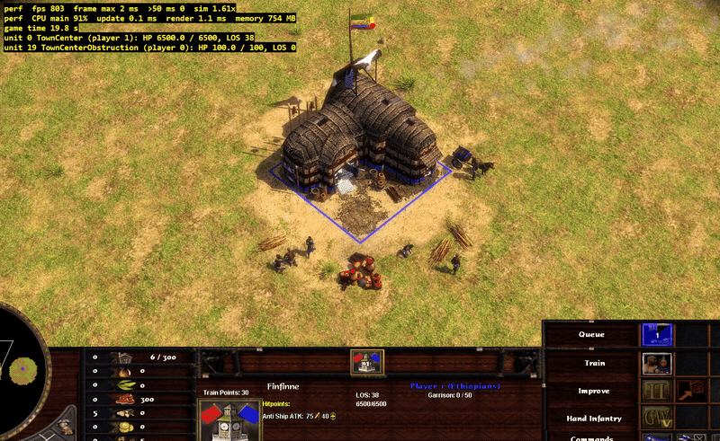

*In WoL, with `basePop 300` (three `BloodFactory`, +100 population each, for the test):* the counter reads
`6 / 300`. [Full video (MP4)](media/basePop-wol.mp4).

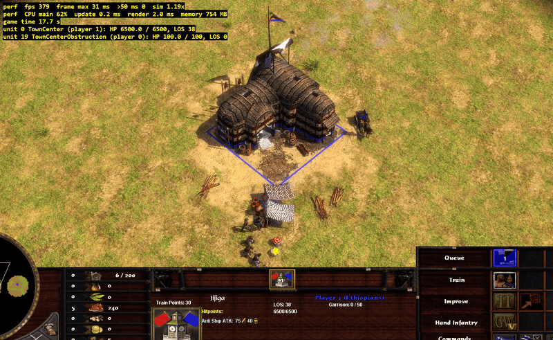

*In WoL, key off (the same scene):* the exe stops the cap at 200: `6 / 200`.
[Full video (MP4)](media/basePop-wol-control.mp4).

```
basePop <N>              N from 0 to 10000, 200 in the exe
extraPop <N>             N from 0 to 10000, 50 in the exe
```

- **In WoL today:** `wol.cfg` does not set these keys, so the exe's limits apply. The cap is what the
  player's buildings provide (houses, Town Centers, …), limited to 200 plus the extra population
  granted by techs and cards, which is itself limited to 50. It is also limited to that extra
  population plus a world-level value of 200. Then a player bonus is added, and the result never
  exceeds 250.
- **Effect:** the 200 becomes `basePop`, the 50 becomes `extraPop`, and the world-level clamp and the
  250 cap are removed. Either key alone keeps the other at the exe's value.
- **WoL needs:** buildings must still provide the population. WoL's `House`, `Manor`, `HouseAztec` and
  `ypHouseIndian` give 10 each with a `BuildLimit` of 20, so to reach 300 raise one of the two in
  `protoy.xml`.
- **Not changed:** the shared team population mode keeps the exe's limit of 200 per player.
- **With [`decimalPopulation`](#decimalpopulation):** both limits stay in whole population
  (`basePop 300` is 300 population with any K).
- **Log:** `basePop/extraPop: base X, extra Y (…)`;
  `basePop/extraPop: expected integers from 0 to 10000`;
  `hook reached: basePop/extraPop/decimalPopulation (0x4581F3)`.
- **Simulation:** yes.
- **Status:** confirmed in single player, in WoL (2026-11-04): the cap reads 300 with `basePop 300`, and 200
  without it. On the stock game a skirmish went past 200 with `basePop 300`. Not tested in WoL: a
  player's real population above 200, and `extraPop` above 50.
- **Fixed from the original DLL:** upstream missed the path taken when the extra population is negative,
  where the stock 200/250 limits stayed active.

#### decimalPopulation

*Units and population buildings can use fractions, such as half a population slot.*

**Added:** Thursday 2026-10-29 21:24 · **Filmed in WoL:** Wednesday 2026-11-04 09:59

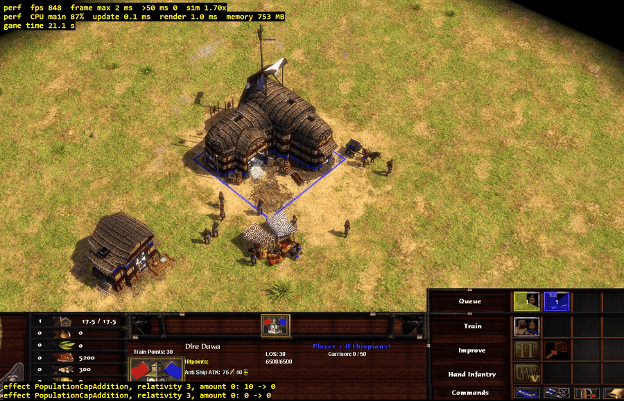

*In WoL, with `decimalPopulation 10 log` (Ethiopians, the Town Center selected):* in the bed's data, for
the test, a villager costs 1.5 population and a house gives 7.5. The panel reads `17.5 / 17.5` with 11
villagers and the Explorer, and the next villager in the queue waits: there is no room for 1.5.
[Full video (MP4)](media/decimalPopulation-wol.mp4).

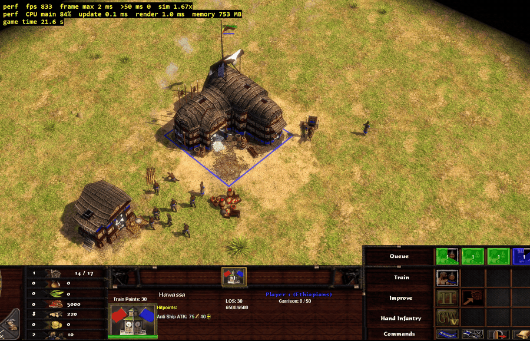

*In WoL, key off (the same data):* the exe drops the decimals: a villager costs 1 and the house gives 7,
so the panel reads `14 / 17` with 13 villagers and the queue goes on.
[Full video (MP4)](media/decimalPopulation-wol-control.mp4).

*The limits (tested in the original game on 2026-10-29):* a test tech gives `PopulationCap` +300 at 12 population. With `decimalPopulation 10` the cap stops at the exe's 200; with `basePop 300` added, at 300; with `basePop 300` alone (the control), at 300, the decimals dropped (6 population).

```
decimalPopulation [<K>] [log]      K from 2 to 1000, default 10: population in steps of 1/K
```

- **In WoL today:** `<PopulationCount>` and `<PopulationCapAddition>` are whole numbers. The exe reads
  them with `%d`, so `0.5` becomes 0 (a free unit) and `7.5` becomes 7, with no message. WoL's `Kami`
  has `<PopulationCount>0.5</PopulationCount>` and is free for that reason. A player's population,
  the population its queues reserve and its cap are sums of them, and every test (can this unit be
  queued, can it spawn, is the player at the cap) compares those sums.
- **Effect:** both tags take decimals, and population works in steps of 1/K. Inside the engine
  every population number is kept K times larger, so all of its tests stay exact:
  - **tech effects:** `PopulationCount` and `PopulationCapAddition` (on protos) and
    `PopulationCap` (on the player) take decimal amounts (`amount='0.5'`). `Absolute` adds the
    amount and `Assign` sets it, rounded to the nearest step; `BasePercent` is rounded to the
    nearest step too (the exe truncates it, so a decrease came out one step high: 1.5 × 0.6 gives
    0.9, the exe's formula 1.0); `Percent` multiplies by a whole number, as in the exe. A
    `PopulationCount` effect that would bring a unit to 0 or less still gives it 1, as in the exe.
    WoL's `techtreey.xml` has 97 `PopulationCount`, 44 `PopulationCapAddition` and 20
    `PopulationCap` effects;
  - **limits:** the cap keeps the exe's limits (200 from buildings, plus 0 to 50 extra, at most 250),
    or those of [`basePop` and `extraPop`](#basepop-and-extrapop), in whole population;
  - **interface:** the population counter (`{totalPop} / {popcap}`, and `{pop}` and `{futurepop}`) and
    its tooltip show decimals (`16.5 / 17.5`), and so do the population cost in unit tooltips (red when
    it does not fit), the unit help (`Population: 0.5`) and the population of a shipment;
  - **AI and scripts:** XS still sees whole numbers. `kbGetPop`, `kbGetPopCap`,
    `trPlayerGetPopulation`, `aiGetEconomyPop`, `aiGetMilitaryPop`, `aiGetAvailableEconomyPop`,
    `aiGetAvailableMilitaryPop`, `aiGetCurrentEconomyPop`, `aiGetPopNeeds`, `kbGetPopCapAddition`
    and `kbGetPopulationSlotsBy{QueryID,UnitTypeID}` return the population rounded to the nearest
    whole number (halves away from zero); `kbGetPopSlots` (a unit's cost) rounds up, so a unit
    that costs population never reads as 0 (an AI script may divide by it);
    `kbUnitPickGet{Minimum,Maximum}Pop` round, and keep −1 as −1. `aiSetEconomyPop`,
    `aiSetMilitaryPop` and `kbUnitPickSet{Minimum,Maximum}Pop` take whole numbers as before (−1
    stays −1).
- **WoL needs:** the decimals, in the two tags and in the effect amounts. With the key, `Kami` costs
  0.5 and stops being free: decide if that is what you want. Whole numbers behave exactly as without
  the key. A UI gadget that shows `{pop}`, `{popcap}`, `{futurepop}` or `{totalPop}` now gets text
  such as `12.5` instead of a number; that is fine in a `formatText` gadget, which is how WoL uses
  them.
- **Choosing K:** 10 for one decimal (0.5, 1.5), 100 for two (0.25), or any value from 2 to 1000.
  Texts show up to three decimals, trailing zeros dropped (K = 3 shows 0.333).
- **Not adapted:** the post-game timeline's population curves draw K times the population: a player
  with 9 population is drawn at 90 (seen in game). The AI's debug text (`AIDebugPopToggle`) does the
  same (read in the code, not seen).
- **Saved games** keep the population as stored: load them with the same K. A game saved without
  the key, or with another K, loads with wrong populations.
- **Log:** at startup `decimalPopulation: population in 1/10 steps (<PopulationCount> and
  <PopulationCapAddition> take decimals; caps (stock limits), effects, 19 XS syscalls and the
  population texts scaled)` (`(basePop/extraPop limits)` with those keys; `, decimal values and
  changes logged` with `log`); `decimalPopulation: expected a scale from 2 to 1000 and/or log, got
  "x"`. Hooks: `hook reached: decimalPopulation <PopulationCount> (0x5FB92E)`,
  `… <PopulationCapAddition> (0x5FD719)`, `… effect PopulationCount (0x8FA835)`,
  `… effect PopulationCapAddition (0x8FA8CF)`, `… PopulationCap effect (0x8D87AB)`,
  `… start cap bonus (0xA0D2D1)`, `basePop/extraPop/decimalPopulation (0x4581F3)`,
  `… data ref totalpop` (and `popcap`, `futurepop`, `pop`), `… colorizePop argument (0x6F576F)`,
  `… printed population (unit help, costs)` (and `(colorizePop)`, `(population help)`), and one
  `… XS <name>` per syscall. With `log` (at most 200 lines): each decimal value read
  (`decimalPopulation: Settler <PopulationCount>1.5</PopulationCount> = 1.5`), each effect
  (`decimalPopulation: effect PopulationCount, relativity 2, amount 0.6: 1.5 -> 0.9`; relativity 1
  is `Absolute`, 2 `BasePercent`, 3 `Assign`), and each XS setter's value when it changes
  (`decimalPopulation: aiSetEconomyPop(80) stored as 800`).
- **Simulation:** yes: every player needs the same key and the same K. Not tested in multiplayer.
- **Status:** confirmed in single player.
  - **In WoL (2026-11-04):** Ethiopian villagers at 1.5 and a house at 7.5, K = 10: the panel reads
    `17.5 / 17.5` and the next villager waits; without the key, `14 / 17` and the queue goes on.
  - **On the stock game (2026-10-29),** K = 10 and 100, with the data of
    [`tools/pop_testdata.py`](../tools/README.md#pop_testdatapy): training refused and allowed at the
    right sums, the four effect modes, `PopulationCapAddition` and `PopulationCap`, the counter, its
    tooltip and the tooltips' cost in red, a saved game (K = 100, saved at 17 / 20, loaded at
    17 / 20), bad values (`1`, `abc`, `5000` log the error and `FAILED`), shipment tooltips, the
    shared team population, and all 19 XS syscalls. Three skirmishes against two Hard AIs ran with no
    XS error, and a Russian AI reached 62.5 population of a 95 cap.
  - **Not run:** multiplayer; taking back a `PopulationCap` effect (0x8D20AB): a trigger that sets the
    tech's status back does not take its effects back, and no path that does was found; the unit help
    `Population: %d` (FUN_004C8748).

#### deckCardCount

*Home city decks can hold more than 25 cards.*

**Added:** Wednesday 2026-10-28 10:56

```
deckCardCount <N>        N from 20 to 10000
```

- **In WoL today:** `wol.cfg` does not set this key, so the exe's cap applies. The maximum deck size of
  a home city is the `<maxdecksize>` of its level in `data\homecitylevels.xml`, clamped to 20..25. A
  home city whose level is past the end of that table gets 25. WoL's table has 132 levels, all with
  `<maxdecksize>25</maxdecksize>`.
- **Effect:** the upper clamp becomes N instead of 25, and levels past the table get N.
- **WoL needs:** to reach N cards at normal levels, raise `<maxdecksize>` in `data\homecitylevels.xml`,
  which is plain XML in WoL. Without that edit, only home cities above the last level (131) get N
  cards.
- **Check:**
  - a deck can only hold cards that its home city has unlocked, so a 40-card deck also needs a home
    city with at least 40 unlocked cards, i.e. a high level;
  - in the deck screen, the deck must accept more than 25 cards;
  - `UHC.log` must show `hook reached: deckCardCount (0x7EF026)`.

  Home cities are shared between copies of WoL
  ([notes](#adding-these-features-to-wol)).
- **Log:** `deckCardCount: limit N`; `deckCardCount: expected an integer from 20 to 10000`;
  `hook reached: deckCardCount (0x7EF026)`.
- **Simulation:** decks are part of the game setup; give every player the same value.
- **Status:**
  - confirmed on the stock game with 40 cards for a Japanese home city of level 9999 (past the table);
  - with a raised `homecitylevels.xml`, the engine's level table reads 40 at every level, but
    building a 40-card deck at a normal level has not been tried in game yet;
  - not filmed in WoL yet.

#### ageFiveShipments

*Home city cards of the Imperial Age (`<age>4</age>`) can be in a deck and be sent once the player reaches that age.*

**Added:** Saturday 2026-11-21 12:07 · **Filmed in WoL:** Sunday 2026-11-22 12:08

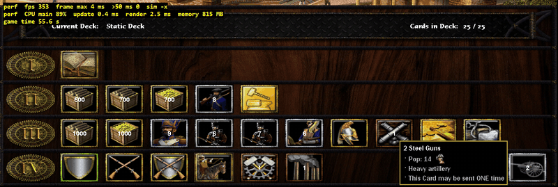

*In WoL, with the key (2026-11-22, a skirmish on a test map, Portuguese against a German AI, already in the Imperial Age;
three Age IV cards of the Lisbon deck, "16 Line Infantry", "14 Ultramarinos" and "2 Steel Guns", given `<age>4</age>`;
2x speed):* the Age IV row holds its six Age IV cards at the left and the three Age V cards at the right end, with the
two slots between them empty. The cursor rests on "2 Steel Guns" (its rollover is the card's own); a click sends it,
then a click on "16 Line Infantry" sends that one, and both turn dark, as a sent card does. The log said `ships tech 745
(HCShipCannons1), a card of Age V` and `tech 5508 (WOLHCShipLineInfantry5)`: each click sent the card under the cursor.
[Full video (MP4)](media/ageFiveShipments-wol.mp4).

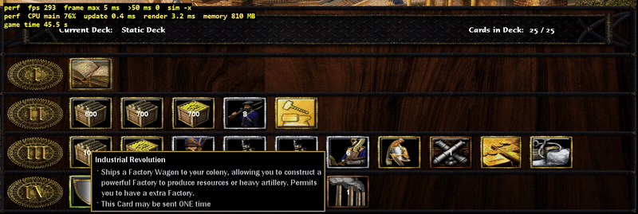

*In WoL, key off (the same data, deck and map, in a new game, Imperial Age; 2x speed):* the Age IV row has only its six
Age IV cards and the counter still says 25 / 25: the three Age V cards are in the deck but the game left them out.
[Full video (MP4)](media/ageFiveShipments-wol-control.mp4).

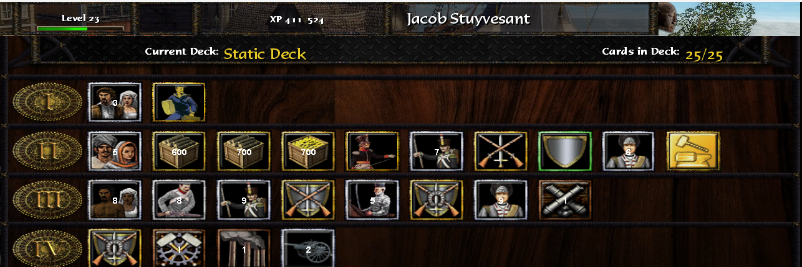

*"Build a Deck" on the home city screen, with the key: the same layout as in game.* More pictures in
`wol-fixes/age5-shipments`: the deck builder with two, one and no Age V cards, with the key off, and with too many
cards for one row; the in-game panel in Age III (the Age V cards greyed, with *This Card cannot be sent until Age 5*)
and in Age V; the deck chooser of a game with two decks.

```
ageFiveShipments
```

- **In WoL today:** no card has `<age>4</age>`. The exe leaves such a card out of the game: a deck of 25 with one plays
  with 24 cards (the game builds its deck one age at a time, ages I to IV only), and both deck panels stop at four rows.
  JTMaston's #83 (2026-11-21).
- **What the key does:** a card of `<age>4</age>` is in the game's deck, after the Age IV cards. It is shown **in the
  Age IV row, at its right end**: the Age IV cards stay packed at the left as before, the Age V cards are packed at the
  right, in the order of the deck, and the slots between the two groups stay empty (JTMaston's request of 2026-11-22;
  before, the Age V cards came right after the Age IV cards). The same layout is used in the in-game shipment panel,
  in the home city's deck builder ("Build a Deck") and in the deck chooser a game opens when the home city has several
  decks. Until the player reaches the Imperial Age an Age V card is greyed, and its rollover says, in red, *This Card
  cannot be sent until Age 5* (the game's own line); a send before that is refused, as stock refuses a card of a later
  age. In the Imperial Age it is sent like any other card. [`shipmentCounts`](#shipmentcounts) counts it in Age V.
- **Not a fifth row:** each deck panel holds four rows of 11 buttons in the exe, and the row is the card's age. A fifth
  row needs those panels rebuilt (`how-it-works.md`, ageFiveShipments); the Imperial cards share the Age IV row instead.
- **A full row:** a row holds 11 cards. When the Age IV and Age V cards together are more than 11, the Age V cards keep
  the right end and the last Age IV cards are not shown (with a line in the log): they stay in the deck, but with no
  button the player cannot send them, as stock does with a twelfth card of a row. A deck with no Age V card is laid
  out as stock lays it out.
- **What a modder writes:** `<age>4</age>` in the card of the home city file (`data\homecityxxx.xml`), as for the
  other ages (`0` is Age I). The card goes in a deck the usual way; the "By Age" view of the card inventory has four
  tabs and does not list it (use "By Building").
- **Off:** as stock: the card never reaches the game.
- **Multiplayer:** every player needs the same setting (it changes which cards a deck holds in the game).
- **Log:** `ageFiveShipments: cards of the fifth age (<age>4</age>) are in the game's deck, shown at the right of the
  fourth age's row of the shipment panel and the deck panels (the Age IV cards at the left), and sendable in the fifth
  age`; `hook reached: ageFiveShipments panel (0x9A5A22)`, `... panel column (0x9A5A7C)`, `... deck builder (0x9A0489)`,
  `... deck builder column (0x9A04B0)`, `... deck editor (0x9A77BE)`, `... deck editor column (0x9A77E5)`. Once per
  change of a panel's counts: `ageFiveShipments: the in-game shipment panel's Age IV row: 6 Age IV card(s) at the left,
  3 Age V card(s) at the right (columns 9 to 11)` (also `the deck builder's`, `the deck editor's`); a full row: `... Age
  IV row gets 9 Age IV and 3 Age V cards, more than its 11 buttons: the Age V cards keep the right side, and 1 Age IV
  card(s) are not shown`.
- **Tested in WoL (2026-11-21, single player, `C:\AoE3-UHC-WoLReal11`, Dutch skirmish on a test map,
  `HCShipCannons1` given `<age>4</age>` in the copy's `homecitydutch.xml`):** key off, the game's deck held 23 of the 25
  cards (that card and a card with no `<age>` left out) and both panels showed three Age IV cards; key on, 24 (the Age V
  card last), shown fourth in the Age IV row of the shipment panel and of "Build a Deck", greyed with *This Card cannot
  be sent until Age 5* in Ages I to IV; a send in Age IV refused (nothing queued); in Age V sent, arrived, and counted
  by `shipmentCounts` (`a card of age 5, in age 5`, `0, 0, 0, 0, 1`). Not tested: the AI with an Age V card in its
  deck; the `homeCityDeck` dialog (its hook was not reached: no screen of the tests opened it).
- **Tested in WoL (2026-11-22, the right-hand layout, single player, `C:\AoE3-UHC-WoLReal2`, Portuguese skirmishes on
  a test map against a German AI; in the copy's `homecityportuguese.xml` `HCShipCannons1`, `WOLHCShipLineInfantry5` and
  `WOLHCShipAtiradores2`, three Age IV cards of the Lisbon deck, given `<age>4</age>`; pictures and videos above and in
  `wol-fixes/age5-shipments`):**
  - "Build a Deck": six Age IV cards in columns 1 to 6, the three Age V cards in columns 9 to 11, 7 and 8 empty; the
    rollover of each Age V card named that card (*16 Line Infantry*, *14 Ultramarinos*, *2 Steel Guns*, each with
    *cannot be sent until Age 5*), and an Age IV card's its own;
  - a click on a deck card takes it out of the deck: column 10 removed *Ultramarinos* (24/25), the two others moved to
    columns 10 and 11; column 10 again removed *Line Infantry*, *Steel Guns* moved to column 11; column 11 removed it,
    and the row went back to the stock layout (six cards, 22/25). The log followed each step (3, 2, 1 Age V cards);
  - the in-game panel in Age III: the same layout, the Age IV and Age V cards greyed; rollovers of columns 1, 6, 9, 10
    and 11 gave their own cards; clicks on an Age V and an Age IV card sent nothing (6 shipments left);
  - in Age V (two games): clicks on columns 11 and 9 shipped `HCShipCannons1` and `WOLHCShipLineInfantry5` (`a card of Age
    V, in Age V`), on Age IV columns 1 and 2 `HCRangedInfantryHitpointsPortugueseTeam` and `HCRangedInfantryDamagePortuguese`
    (`a card of Age IV`), the cards the rollovers named; the counts `0, 0, 0, 1, 2`;
  - a full row (three Age III cards also made Age IV: 9 + 3): in game and in "Build a Deck", eight Age IV cards at the
    left, the three Age V cards at the right, one Age IV card not shown, logged;
  - the deck chooser (the `homeCityDeck` dialog, reached for the first time: a second deck copied in "Build a Deck", then
    "Select a Deck" in the game's home city panel): the same layout, a rollover of column 11 named *2 Steel Guns*, and
    after OK the panel showed the chosen deck the same way;
  - key off: six Age IV cards, no Age V card, 25/25 (panel and deck builder).
  - Not tested: the AI with an Age V card, multiplayer, other resolutions (the panels' own buttons are used, so none
    expected).

#### resendableCards

*Lets a home city card be sent again each time its player reaches a new age.*

**Added:** Monday 2026-11-23 07:59 · **Filmed in WoL:** Monday 2026-11-23 07:59

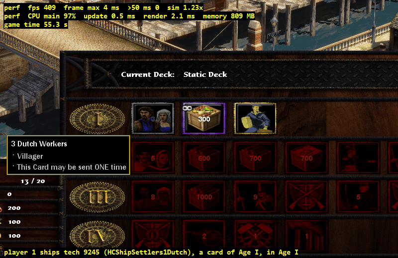

*In WoL, with `resendableCards log` (2026-11-23, a skirmish on a test map, Dutch against a German AI, the ages set by
triggers at 1:00 and 2:00; in the copy's `homecitydutch.xml` `<resendeveryage>1</resendeveryage>` on "3 Dutch Workers"
(Age I, which also has `<infiniteinlastage>`) and on "Cords of 600 wood" (Age II); "Chests of 700 coin" untagged; 6x
speed):* "3 Dutch Workers", sent in Age I, is dark until the Age II comes, then it can be sent again. In Age II the 600
wood and the 700 coin are sent and turn dark; when the Age III comes the 600 wood is lit again and the 700 coin stays
dark. The log at the bottom: `player 1 reached Age III: card 715 (HCShipWoodCrates2) can be sent 1 time(s) again`.
[Full video (MP4)](media/resendableCards-wol.mp4).

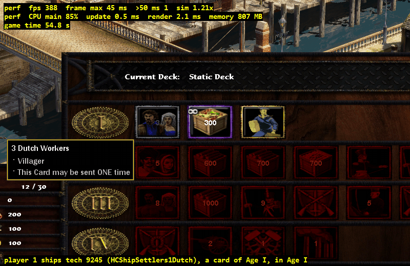

*In WoL, key off (the same data, deck, map and clicks, in a new game; 6x speed):* the three cards stay dark after they
are sent, through Age II and Age III. [Full video (MP4)](media/resendableCards-wol-control.mp4).

```
resendableCards [log]
```

- **In WoL today:** a card is sent at most `<maxcount>` times in a game. `<infiniteinlastage>1</infiniteinlastage>` is
  the game's only reset: when the player reaches the Imperial Age, the card gets its sends back once (it does not become
  unlimited). JTMaston's #97 (2026-11-23).
- **What the key does:** a card with `<resendeveryage>1</resendeveryage>` gets its sends back each time its player
  reaches a new age: it is sendable again as many times as its `<maxcount>` (once for `1`). The reset **sets** the sends
  to `<maxcount>`, it never adds to them: a card sent in Age II and not in Age III has one send in Age IV, not two. A
  card not sent since the last age-up is left as it is, and an infinite card (`-1`) is not touched. The panel lights the
  card again at the age-up, its rollover shows it as sendable, and the AI's card list is the same list, so an AI with
  such a card can send it again too.
- **With `<infiniteinlastage>`:** the Imperial Age is one more age-up, so such a card gets its sends back then as well,
  once (the game's own refill and this one are the same reset). Nothing else changes for the cards with only
  `<infiniteinlastage>`.
- **What a modder writes:** in the card of the home city file (`data\homecityxxx.xml`), next to the other tags, in lower
  case like them (the name is not case sensitive):
  ```xml
  <card>
      <name>HCShipWoodCrates2</name>
      <maxcount>1</maxcount>
      <level>0</level>
      <prereqtech>HCShipWoodCrates1</prereqtech>
      <age>1</age>
      <displayunitcount>600</displayunitcount>
      <infiniteinlastage>1</infiniteinlastage>
      <resendeveryage>1</resendeveryage>
  </card>
  ```
  `1` or `true` turns it on, `0` or `false` off; another value is logged and ignored. The tag belongs to that civ's card:
  the same tech in another civ's home city file keeps its own setting.
- **Off:** the game reads past the tag, as before.
- **Saved games:** the card's sends and the tag are kept in the save by the game itself; a save loaded with the key goes
  on as it was (a card sent in that age stays sent until the next age-up). A save made with the key and loaded without
  it: those cards are no longer reset, and a card that also has `<infiniteinlastage>` loses its Imperial Age refill.
- **Multiplayer:** every player needs the same setting (it changes what a player can send).
- **Log:** `resendableCards: a card with <resendeveryage>1</resendeveryage> gets its sends back (its maxcount) each time
  its player reaches a new age ... (multiplayer unverified)`; with `log`, each tagged card as its home city is read
  (`card 715 (HCShipWoodCrates2) of home city ... is sent again in each new age (maxcount 1)`) and each reset (`player
  1 reached Age III: card 715 (HCShipWoodCrates2) can be sent 1 time(s) again (it had 0 left)`); `hook reached: card tags
  (0x630017)`, `... resendableCards age (0x8D502F)`, `... resendableCards rollover (0x710804)`.
- **Tested in WoL (2026-11-23, single player, `C:\AoE3-UHC-WoLReal2`, Dutch skirmishes on a test map against a German AI
  (`wolOtto`), XP granted at 0:03, the ages set by `trPlayerSetAge` triggers; the cards' sends read from memory):**
  - "3 Dutch Workers" (Age I, tag and `<infiniteinlastage>`) sent in Age I: 0 sends left, 1 again at the Age II;
  - "Cords of 600 wood" (Age II, tag) sent in Age II: back at the Age III; not sent in Age III: still 1 (not 2) in Age
    IV; sent in Age IV: back at the Age V;
  - "Chests of 700 coin" (untagged, with `<infiniteinlastage>`): sent in Age II, still 0 in Ages III and IV, 1 at the
    Age V (the game's own refill);
  - saved games: a save in Age III and one in Age IV, after a send, loaded in the same process: the sends as they were
    when saved, the tag kept on the cards, and no reset at the load; a save in Age III after a send, loaded: the card
    came back at the next age-up (Age IV);
  - key off, the same clicks: no card comes back (the video above);
  - the test AI resigned at about 4 to 5 minutes in every run, with and without the key (on a test map with only a Town
    Center and settlers), so an AI sending a tagged card twice was not seen. Not tested: multiplayer.

#### quickArrivalCards

*Adds the line "This is a QUICK-ARRIVAL card." to the rollover of the cards whose tech has the QuickArrival flag.*

**Added:** Monday 2026-11-23 07:59

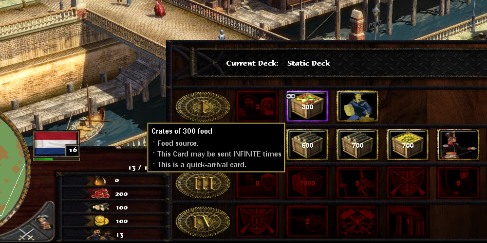

*In WoL (taken again on 2026-11-25 with the line in capitals; a Dutch skirmish, the in-game shipment panel;
`<Flag>QuickArrival</Flag>` added to `HCShipFoodCrates1` and `HCShipCoinCrates3` in the copy's `techtreey.xml`):* the
infinite card "Crates of 300 food" ends with *This Card may be sent INFINITE times* and then *This is a QUICK-ARRIVAL
card.*, as its own bullet.

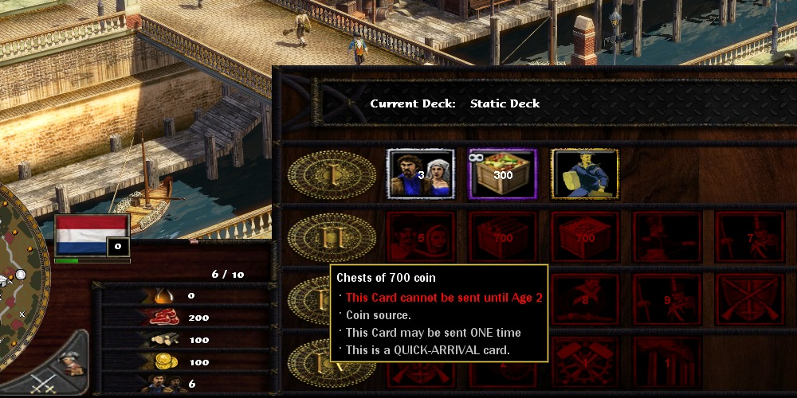

*The same panel, "Chests of 700 coin" (sent once, greyed in Age I):* the game's red *This Card cannot be sent until Age
2*, its rollover text, *This Card may be sent ONE time*, then the new line.

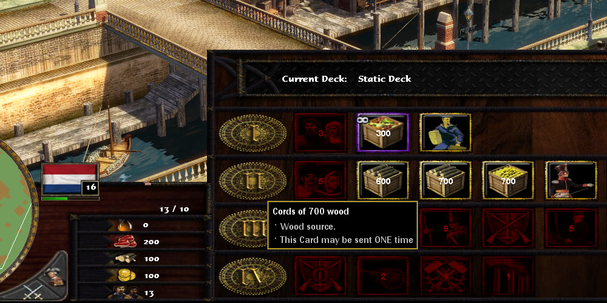

*The same panel, "Cords of 700 wood" (no flag):* unchanged.

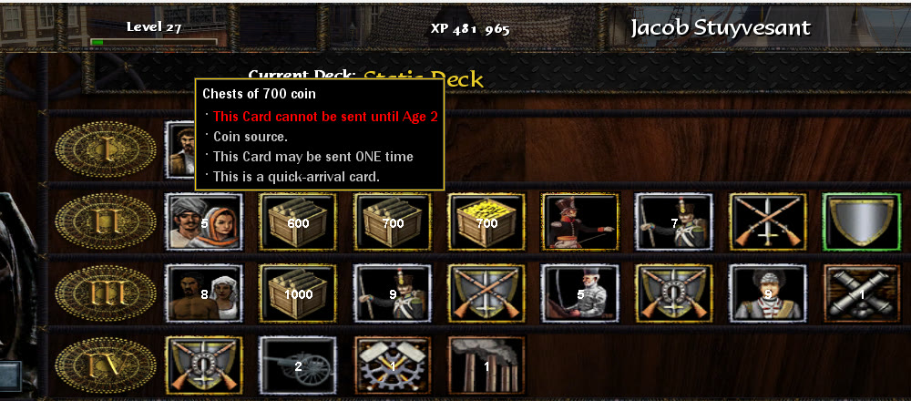

*"Build a Deck" on the home city screen:* the same line on the card with the flag, after the game's red *This Card cannot
be sent until Age 2*, its rollover text and its send limit. More: the infinite card (taken again on 2026-11-25 too) and
the control card in "Build a Deck", and the line taken from the string table (`stringid`), in
`docs/media/quickArrivalCards-*.jpg`. The control pictures and the `stringid` one show no default line, so they stayed.

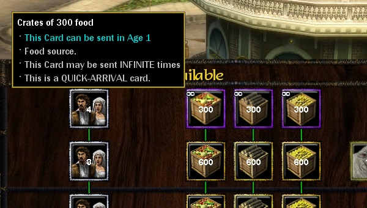

*"View All Cards" on the home city screen (2026-11-26, after JTMaston's report that the line was missing there; Germans,
the same two flagged techs):* the infinite card "Crates of 300 food" ends with *This Card may be sent INFINITE times*
and then *This is a QUICK-ARRIVAL card.* That screen builds its card rollovers with a second function of the game, which
the key now covers too. More: the once card ("Chests of 700 coin", the line after *This Card may be sent ONE time*),
the control ("Cords of 700 wood", no line) and the line from the string table (`stringid 35898`, *Single Player
Skirmish*) in `docs/media/quickArrivalCards-view-all-cards-*.jpg`.

```
quickArrivalCards [stringid N] [log]
```

- **In WoL today:** nothing in a card's rollover says that it arrives quickly. JTMaston's #99 (2026-11-23).
- **What the key does:** for a card whose tech has `<Flag>QuickArrival</Flag>`, the card's rollover gets one more bullet,
  *This is a QUICK-ARRIVAL card.*, right after the line *This Card may be sent INFINITE times* (or *ONE time*, or the
  *N times* line), so it sits between the card's own rollover text and the advanced information (the detailed help, when
  that option is on). The line looks like the game's other lines of the card. It shows wherever a card's rollover
  shows: the in-game shipment panel, "Build a Deck" (the deck and the inventory below it), the deck chooser and "View
  All Cards". Nothing else about the card changes: the flag does not change how fast a card arrives.
- **`stringid N`:** the line is string N of the string table (`data\stringtabley.xml`), so it can be translated; an
  empty or missing string falls back to the English text. Without it, the English text, with *QUICK-ARRIVAL* in
  capitals since 2026-11-25 (JTMaston's request; it read *quick-arrival* before). A string set with `stringid` is
  shown as written.
- **What a modder writes:** in the card's tech in `techtreey.xml`:
  ```xml
  <Tech name ='HCShipFoodCrates1' type ='Normal'>
      ...
      <Flag>HomeCity</Flag>
      <Flag>QuickArrival</Flag>
  ```
- **Off:** the game ignores the flag, as it ignores any name it does not know.
- **Multiplayer:** display only; players may set it differently.
- **Log:** `quickArrivalCards: the tech flag QuickArrival adds the line "This is a QUICK-ARRIVAL card." to a card's
  rollover` (or `the line of string N`); with `log`, `tech 935 has the QuickArrival flag` per flagged tech and, once,
  `the line was added to the rollover of tech 935`; `hook reached: tech flags (0x620C2F)`, `... quickArrivalCards
  (0x710909)` (the shipment panel, the deck), `... quickArrivalCards card tree (0x710F24)` ("View All Cards", the
  inventory of "Build a Deck").
- **Tested in WoL (2026-11-23, single player, `C:\AoE3-UHC-WoLReal2`, Dutch, the flag on `HCShipFoodCrates1` (infinite)
  and `HCShipCoinCrates3` (once), `HCShipWoodCrates3` as the control):** the line after the send-limit line on both
  flagged cards, in the in-game panel (in Ages I to III, greyed or not) and in "Build a Deck"; none on the control card;
  with `stringid 36865` the line read the text of that string. With `hcTargetTechs` on and `<Flag>HCTargetEnemy</Flag>`
  on a test tech, both keys read their flags through the shared hook (`hcTargetTechs: HCTargetEnemy read`). Not tested:
  the deck chooser (the same rollover builder), another language.
- **Tested again (2026-11-25, `C:\AoE3-UHC-WoLReal3`, the same flags; the copy's own profile with `HCShipFoodCrates1`
  in the Dutch deck):** the log reads `adds the line "This is a QUICK-ARRIVAL card."`, and the line shows in capitals
  in the in-game panel and in "Build a Deck" (the four pictures above).
- **Fixed (2026-11-26, JTMaston: "the string doesn't show up on the view all cards screen"):** "View All Cards" and the
  inventory pane of "Build a Deck" show the home city's card tree, whose rollovers come from a second builder of the
  game that the key did not cover; it now adds the line there too, at the same place. Tested in `C:\AoE3-UHC-WoLReal4`
  (single player, its own profile, Germans, the flag on `HCShipFoodCrates1` and `HCShipCoinCrates3`): with the DLL of
  2026-11-25 "View All Cards" showed no line (reproduced); with the fix the line after the send-limit line on the
  infinite and the once card there and in the inventory of "Build a Deck", none on `HCShipWoodCrates3`, the text of
  string 35898 with `stringid 35898`; the deck of "Build a Deck" and the in-game shipment panel (a skirmish) still show
  the line once; the AI played (no XS error, 18 units at 3 min 28 s). Not tested: the deck chooser (the first
  builder, unchanged), another language.

#### selectionLimit

*Changes how many units fit in one selection.*

**Added:** Monday 2026-11-02 20:33 · **Filmed in WoL:** Wednesday 2026-11-04 13:58

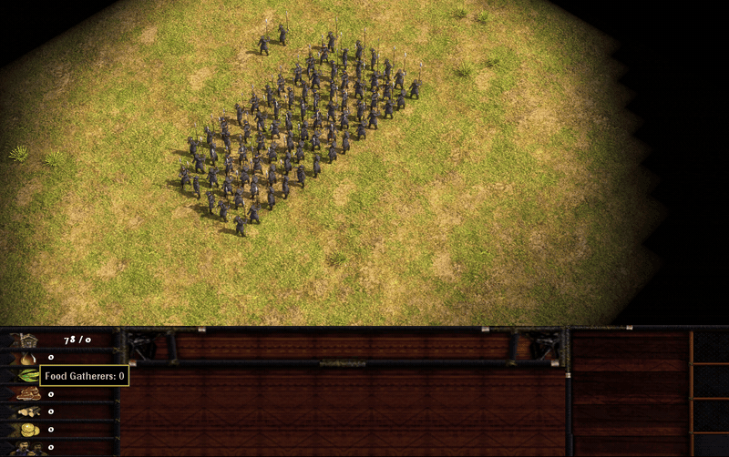

*In WoL:* with `selectionLimit 75`, a box over 78 Pikemen selects 75 (the number on the selection icon).
[Full video (MP4)](media/selectionLimit-wol.mp4).

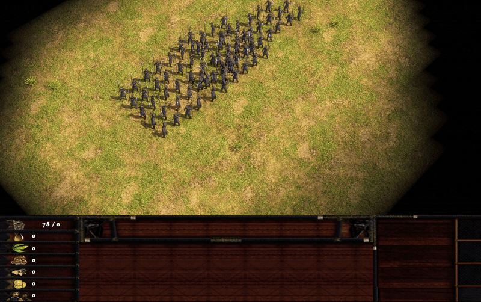

*In WoL, key off (the same scene):* the same box stops at 50. [Full video (MP4)](media/selectionLimit-wol-control.mp4).

```
selectionLimit N
```

- **Effect:** one selection holds up to N units (1 to 200; 50 in the exe), for box selection, double
  click and control groups alike. `wol.cfg` has `selectionLimit 75`.
- **Log:** `selectionLimit: a selection holds up to N units (stock 50)` (`; above 75 not tested`
  for larger values); `selectionLimit: needs a number from 1 to 200` for a bad value (not
  applied).
- **Simulation:** no: it only changes what the local player can select. Players may set it
  differently.
- **Status:** confirmed (single player, on WoL): with 75, a box over 78 Pikemen selected 75; without the
  key, 50.

#### noAILimit

*Game setup lists every AI personality in the folder, not just the built-in ones.*

**Added:** Wednesday 2026-10-28 10:56

```
noAILimit
```

- **Effect:** the AI personality list in game setup shows every `AI4\*.personality` file of WoL's
  folder, sorted by file name (case-insensitive). The exe's built-in list has 14 stock personalities.
  The folder name and the extension are read from the exe, so WoL's `AI4\` works. WoL's `wol.cfg` uses
  [`noAILimitV2`](#noailimitv2), which gives the same list.
- **WoL needs:** the personality files. To add one, copy a file of `AI4\` to a new name and change its
  fields. WoL's `wolRauparaha.personality` is a good model:

  ```xml
  <AI>
     <version>2</version>
     <script>_TeRauparaha</script>
     <nameID>1001432</nameID>
     <tooltipID>1001433</tooltipID>
     <forcedciv>Maori</forcedciv>
     <rushboom>0</rushboom>
     <icon>WoL\ui\singleplayer\cpai_avatar_maori-xs</icon>
     <chatset>huayna</chatset>
     <playerNames>
        <nameID>1001432<civ>Maori</civ></nameID>
     </playerNames>
  </AI>
  ```

  `nameID` and `tooltipID` are string table IDs. Give each personality its own strings in
  `data\stringtabley.xml`.
- **Log:** `noAILimit: N personalities from <folder>\AI3\*.personality`;
  `noAILimit: no personality files match …; keeping the stock list`;
  `hook reached: noAILimit (0x603B0B)`.
- **Simulation:** the list feeds game setup; every player needs the same personality files.
- **Status:** confirmed on the stock game: an added personality appeared in game setup and played.
- **Fixed from the original DLL:** upstream leaves two of the function's variables uninitialized.

#### noAILimitV2

*The version of noAILimit that WoL uses: game setup lists all its AI personalities.*

**Added:** Monday 2026-11-02 19:51

```
noAILimitV2
```

- **In WoL without it:** the game has only the exe's stock personalities, which WoL does not ship. A
  random-personality AI gets one of them, starts with no civ, and the game crashes at 0x7C252C.
- **Effect:** the same list as `noAILimit`, every `AI4\*.personality` file sorted by file name, 52 in
  WoL. It is installed later in the same function: the exe's code that builds the built-in list runs,
  then only its count and table are replaced. With both keys, `noAILimit` is used.
- **Log:** `noAILimitV2: N personalities from <folder>\AI3\*.personality`;
  `hook reached: noAILimitV2 (0x603C34)`.
- **Simulation:** as `noAILimit`.
- **Status:** confirmed (2026-11-02): the list held WoL's 52 personality files, sorted, with a random
  personality playing a skirmish. A hardware breakpoint at 0x603C4F read the same table (52 names,
  `ai22` first) with WoL's own DLL and with this one.

#### enableAllTeams

*Single-player game setup also offers Teams 3 and 4.*

**Added:** Monday 2026-11-02 20:40 · **Filmed in WoL:** Wednesday 2026-11-04 13:58

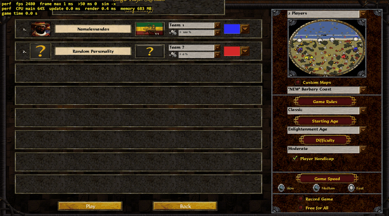

*In WoL:* the setup's team list offers Team 1 to 4. [Full video (MP4)](media/enableAllTeams-wol.mp4).


*In WoL, key off (the same screen):* only Team 1 and Team 2. [Full video (MP4)](media/enableAllTeams-wol-control.mp4).

```
enableAllTeams
```

- **Effect:** the single-player game setup offers Team 3 and Team 4 besides Team 1, Team 2 and
  "?". The multiplayer lobby is not changed.
- **WoL needs:** nothing: string IDs 36143 and 36144, `Team 3` and `Team 4`, are in WoL's string table.
- **Log:** `enableAllTeams: Team 3 and Team 4 in the single-player setup (multiplayer lobby
  unchanged: single player only)`; `hook reached: enableAllTeams setup list (0x7A0709)`.
- **Simulation:** it only adds choices; the teams chosen are part of the game setup as usual.
- **Status:** partly confirmed (2026-11-02, single player): the list shows Team 1–4 and "?", and
  a skirmish with Team 3 against Team 4 started and played; how the game numbers the teams inside was not
  read.
- **Fixed from the original DLL:** upstream loads the temporary string's destructor but never calls it
  (a leak per list fill).

### New data and scripting

New names the game's data and scripts can use.

| Key | What it does | WoL's DLL | WoL also needs | In-game status |
|---|---|---|---|---|
| [`customAbstractTypes`](#customabstracttypes) | Turns every name in `data\uhc\customabstracttypes.xml` (47 today) into an abstract unit type that protos, techs, auras and XS scripts can use. | always on | The file. | confirmed |
| [`auraStacking`](#aurastacking) | `<ForbidUnitType>` on any aura: the aura leaves units of a type or proto alone; that an aura does not stack is the game's own `<ModifyExclusive>`. | **new** | The tags on the aura. | confirmed (single player) |
| [`customProtoUnitCommands`](#customprotounitcommands) | Adds the command types (buttons) listed in `data\uhc\customprotounitcommands.xml` (55 today). | always on | The file, and the `<Command>` lines that use them. | confirmed |
| [`customHotkeyContexts`](#customhotkeycontexts) | Makes keymap contexts named `<ProtoName>Accel` work, such as WoL's `WOLBarracksGreekAccel`. Today the exe drops them. | **new** | Those contexts in `data\DefaultKeyMapY.xml`; WoL's file already has three. | confirmed (single player) |
| [`techRenameEffect`](#techrenameeffect) | The tech effect `SetTechName`: a tech gives another tech a new name, rollover and help text, for the players it reaches only. | **in `wol.cfg`**, but WoL's renames for all players | `<Effect type='SetTechName' …/>` in a tech, and the string IDs in `stringtabley.xml`. | confirmed (single player) |
| [`customSyscalls`](#customsyscalls) | Loads `wolPlugin.upl` and `wolai.upl` and adds the XS syscalls they register. WoL's AI needs it. | **in `wol.cfg`** | The plugins. | confirmed |
| [`customCheats`](#customcheats) | The cheats of WoL's plugins work in the chat. | **in `wol.cfg`** | `customSyscalls`, and plugins that register cheats. | confirmed |
| [`kbUnitSyscalls`](#kbunitsyscalls) | Five KB syscalls for AI scripts: a unit's inventory, its workers and its targeters. | always on | AI scripts that call them. | confirmed |

#### customAbstractTypes

*A mod can create its own unit categories for its data, techs, auras and scripts.*

**Added:** Monday 2026-11-02 20:04

```
customAbstractTypes [file]
```

- **In WoL today:** WoL's DLL reads `data\uhc\customabstracttypes.xml` always, so `wol.cfg` has no line
  for it. This DLL needs the line. Without it, WoL's 47 types are dropped from about 2,800 `<UnitType>`
  uses, and the AI does not compile (`cUnitTypeAbstractWoLHandCavalry`).
- **Effect:** every name in the file becomes an abstract unit type, as if it were compiled into the
  game: protos list it in `<UnitType>`, techs and auras target it, XS scripts use `cUnitType<Name>`.
  The exe drops any `<UnitType>` that is not on its built-in list, silently. The names get their IDs in
  file order, before the types other keys add, so their IDs do not depend on the other keys.
- **WoL needs:** the file, by default `data\uhc\customabstracttypes.xml` (relative to the game folder; an
  absolute path works too). To add a type, add a line to WoL's file:

  ```xml
  <AbstractTypes>
     <AbstractType stringId="430103">AbstractWoLCavalry</AbstractType>  <!-- comment -->
     <AbstractType>AbstractTrainLimitOne</AbstractType>
  </AbstractTypes>
  ```

  A name is letters, digits and `_`. `stringId` is read but not used yet (a display name for the
  type). A name the game already knows keeps its ID.
- **Log:** `customAbstractTypes: N abstract types from <file> (M with a stringId, not used yet)`;
  on each data load, one `unit types: <Name> -> <ID> (bit …), added` line per name;
  `customAbstractTypes: cannot read <file>`; `<Name> is listed twice`.
- **Simulation:** changes the data every player loads: everyone needs the same file.
- **Status:** confirmed (2026-11-02, single player, on WoL): WoL's 47 names registered (IDs 3837–3883),
  carried by the protos that list them (668 protos for the most used one), and WoL's AI scripts, which
  use `cUnitType<Name>` constants, compiled. Before it, `aiLoaderStandard.xs` failed on
  `cUnitTypeAbstractWoLHandCavalry`.

#### customProtoUnitCommands

*A mod can add its own command buttons to units and buildings.*

**Added:** Tuesday 2026-11-03 08:39 · **Filmed in WoL:** Wednesday 2026-11-04 13:58

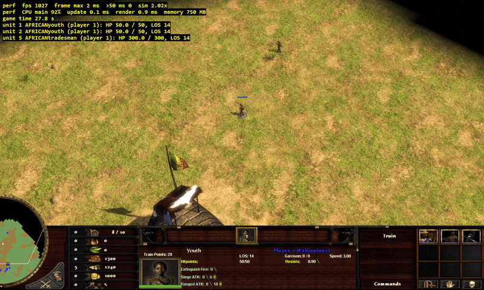

*In WoL (Zulu `AFRICANyouth`):* the unit's `<Command>` buttons use WoL's command types. Their tooltips come
from `protounitcommands.xml`, and a real click on each runs its command: two transforms into "maturing"
units, which become a Tradesman and a Bowman about 10 s later.
[Full video (MP4)](media/customProtoUnitCommands-wol.mp4).


*In WoL, key off (the same scene):* the same unit has no such buttons, and the clicks do nothing.
[Full video (MP4)](media/customProtoUnitCommands-wol-control.mp4).

```
customProtoUnitCommands [file]
```

- **In WoL today:** WoL's DLL does this always, so `wol.cfg` has no line for it. This DLL needs the line.
  Without it, WoL's 55 command types and their `<Command>` buttons on 36 protos are dropped.
- **Effect:** every `<CommandType>` name in the file becomes a command type, like the 129 compiled into
  the exe (`MarketBuy1` ... `Tactic32` ... `RansomExplorerAsian`). Entries of `protounitcommands.xml` with
  that `<name>` and protos' `<Command>` tags with that name are kept instead of dropped, so the button
  shows and runs its `<command>`.
- **WoL needs:** the file (default `data\uhc\customprotounitcommands.xml`). To add one:

  ```xml
  <ProtoUnitCommandTypes>
    <CommandType>TransformWOLCentralAmericaBananaMaturing</CommandType>
  </ProtoUnitCommandTypes>
  ```

  plus a `protounitcommands.xml` entry and a `<Command>` per button, as for any other type. Names are
  letters, digits and `_`; a name the exe already knows is skipped.
- **Buttons on the tactics page** (`page="9"`) of a building show only for the buildings the exe lets
  switch tactics (Factory, Rice Paddy...); the key does not change that. So the Fazenda's four tactic
  buttons need more than this key, and they were not seen in a test.
- **Log:** `customProtoUnitCommands: N command type(s) from <file>; M command records`; when the
  game builds its tables, `customProtoUnitCommands: N command type(s) added (IDs 129..), K already
  known, R refused`.
- **Simulation:** changes the data: every player needs the same file.
- **Status:** confirmed (2026-11-03, single player, on WoL): with WoL's 55 names, a Zulu `AFRICANyouth`
  showed its six transform buttons with their tooltips, and two clicks transformed two units; each
  became a maturing unit and then the final unit (a Tradesman, a Bowman). The maturing unit trains the
  final unit with a `Maintain` action that the Zulu start tech `Age0zulu` enables. Without the key the
  same unit showed none. The game's command records are a fixed array (130), and a first build that
  only added the names showed no button and wrote past it; the key enlarges the array.

#### customHotkeyContexts

*Units and buildings added by a mod can have their own hotkeys.*

**Added:** Thursday 2026-10-29 06:39 · **Filmed in WoL:** Friday 2026-11-06 14:35

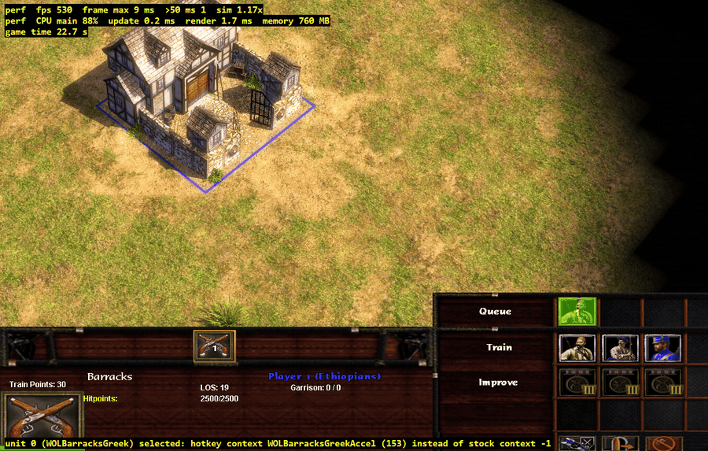

*In WoL, with `customHotkeyContexts log` (Greeks in age II, the Greek barracks selected):* WoL's own
`DefaultKeyMapY.xml` maps `o` to `tis("Klepht")` in the context `WOLBarracksGreekAccel`, which the
exe does not know. The DLL registers it (`registered keymap context WOLBarracksGreekAccel as context
153`) and turns it on when the barracks is selected; three real presses of `o` queue three Klephts.
[Full video (MP4)](media/customHotkeyContexts-wol.mp4).

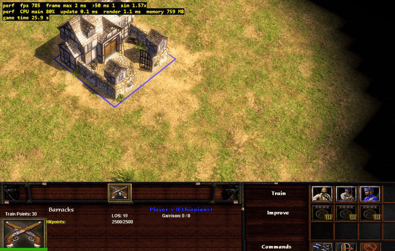

*In WoL, key off (the same scene and key presses):* the context is dropped when the keymap loads,
so `o` does nothing and no Klepht is queued.
[Full video (MP4)](media/customHotkeyContexts-wol-control.mp4).

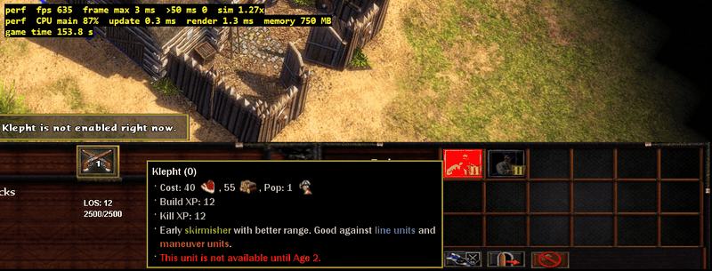

*In WoL, with `customHotkeyContexts log` (test data: Klepht enabled for Ethiopians, the Greek barracks selected):* the tooltip reads
`Klepht (O)`. [Full video (MP4)](media/customHotkeyContexts-tooltip-wol.mp4).

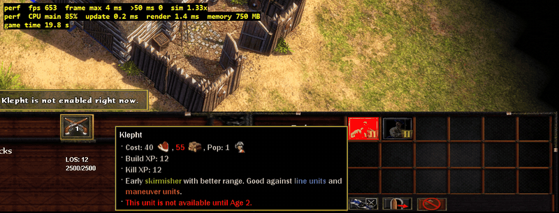

*In WoL, key off (the same data):* `Klepht`, with no letter. `Scytheman (P)` keeps its letter: a stock context has it.
[Full video (MP4)](media/customHotkeyContexts-tooltip-wol-control.mp4).

```
customHotkeyContexts [log]
```

- **In WoL today:** every hotkey in `data\DefaultKeyMapY.xml` belongs to a `<context>`, e.g. `BarracksAccel`
  for the keys that train units while a Barracks is selected. The exe knows a fixed list of 123 context
  names (35 of them are unit contexts, `TownCenterAccel` … `WonderAccel`) and silently drops every
  `<keymapdata>` whose context is not on that list. So the entries of WoL's three new contexts,
  `WOLBarracksGreekAccel`, `WOLBarracksKoreanAccel` and `WOLStableGreekAccel`, do nothing. Which context a
  selected unit turns on is also fixed in the exe: a table of about 40 protos (for example
  `ypCaravanserai` → `StableAccel`), plus shrines and wonders by unit type. A selected unit that is not
  a building but has a `<Train>` list only ever gets `BuildAccel`.
- **Effect:** a `<context>` named `<ProtoName>Accel` that the exe does not know is registered when
  the game reads the keymap, so its entries are kept. `<ProtoName>` is the `name` of a `<Unit>` in
  `protoy.xml` (case does not matter). While a unit of that proto is selected, that context is on,
  **instead of** the context the exe gives that proto, if it had one. Selecting anything else switches
  it off. Contexts the exe already knows are never redirected.
- **Which units use it:** only units that enter a hotkey context at all:
  - a building with a `<Train>` list;
  - any other unit with a `<Train>` list (a wagon, a settler), which then enters its own context
    instead of `BuildAccel`;
  - a fire pit (`AbstractFirePit`);
  - a unit whose proto has the flag `EnterHotkeyContext`.

  Other units (a soldier, a hero) never enter a context, so theirs stays off although it is
  registered: give them the flag `EnterHotkeyContext`.
- **WoL needs:** nothing for its three contexts: `DefaultKeyMapY.xml` already names them this way. For a
  new one, add its entries to that file. `<context>` is `<ProtoName>Accel`:

  ```xml
  <keymapgroup name="Greek Barracks Hotkeys" displayname="Greek Barracks Hotkeys">
    <keymapdata>
      <name>Train Klepht</name>
      <displayname>Train Klepht</displayname>
      <event>o</event>
      <context>WOLBarracksGreekAccel</context>
      <command>tis("Klepht")</command>
    </keymapdata>
  </keymapgroup>
  ```

  An added context replaces the one the exe would turn on, so copy into it every key the unit should
  keep. For a trainer that is not a building, copy the `BuildAccel` keys it needs.
- **`log`:** one line each time the selection turns an added context on (repeats of the same unit
  and context are not logged again in a game), and once per proto when a unit that is not a
  building enters its context.
- **Log:**
  - at startup, `customHotkeyContexts: a keymap context named <ProtoName>Accel that the game does
    not know becomes that proto's hotkey context` (`, every switch logged` with `log`);
  - when the keymap is read, `hook reached: customHotkeyContexts (0x5C1778)` and one line per added
    context: `customHotkeyContexts: registered keymap context WOLBarracksGreekAccel as context 153`;
  - on the first selection, `hook reached: customHotkeyContexts (0x79F1A5)` and `… (0x79F897)`; on
    the first selected trainer that is not a building, `… (0x64A034)`;
  - with `log`: `customHotkeyContexts: unit N (WOLBarracksGreek) selected: hotkey context
    WOLBarracksGreekAccel (153) instead of stock context -1` (-1: the proto had none) and `customHotkeyContexts: unit N
    (ForgeCaravan) is not a building: units of this proto enter hotkey context ForgeCaravanAccel
    (152) instead of BuildAccel (logged once per proto)`;
  - when the context table is too full: `customHotkeyContexts: N contexts are registered; keymap
    context X not registered, its entries are dropped (the last 32 of the 255 context IDs stay free
    for the game)`.
- **The letter in the tooltip:** a key of an added context shows on its button, as a stock one does. A unit mapped in a stock context
  and in an added one shows the stock letter. Only `tis("Proto")` counts, not `tis("Proto",5)`.
- **Tested in WoL (2026-11-06, tooltip):** 41 protos gain a letter (556 to 597) and no stock letter changes; the same after a load and
  beside WoL's DLL; an AI skirmish of 100 s with no XS error. Not tested: tech buttons, the building branch, multiplayer.
- **Limits:**
  - at most 255 contexts in all; the DLL stops adding at ID 222 to leave the game room. About 70 can
    be added: the game registers about 151 before the keymap;
  - names the exe already knows (`SettlerAccel`, `CoveredWagonAccel`, …) keep the exe's meaning;
  - a context is on only for the last unit of the selection;
- **Simulation:** no. A hotkey issues the same command as clicking the button, so players may set
  the key differently. Not tested in multiplayer.
- **Status:** confirmed in single player. In WoL (2026-11-03), three real presses of `o` queued three
  Klephts at the selected Greek barracks; without the key the context is dropped and the same presses
  do nothing. On the stock game (2026-10-29), test contexts on a Sacred Field, a Caravanserai (instead
  of its `StableAccel`) and a market wagon (not a building, instead of `BuildAccel`) switched by the
  log. Not tested in WoL: a trainer that is not a building.

#### techRenameEffect

*A tech can rename another tech, only for the players it reaches.*

**Added:** Thursday 2026-10-29 06:39 · **Filmed in WoL:** Wednesday 2026-11-04 12:48

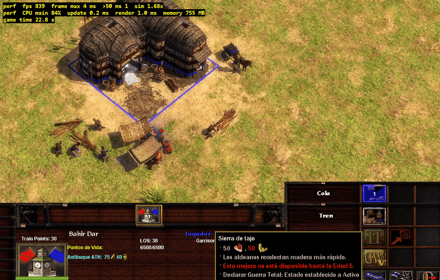

*In WoL, with `techRenameEffect log` (Ethiopians; the cursor rests on the Town Center's GW button
so its rollover stays on screen):* a test tech (`UHCRenameTest`, appended to the bed's techtree and
removed after) carries `<Effect type='SetTechName' tech='GreatWarButton' newName='11070'
newRolloverTextID='10670'/>` and turns on at 22 s. "Declare Total War" becomes "Gang Saw", with its
rollover; cost and effect stay those of `GreatWarButton`. [Full video (MP4)](media/techRenameEffect-wol.mp4).

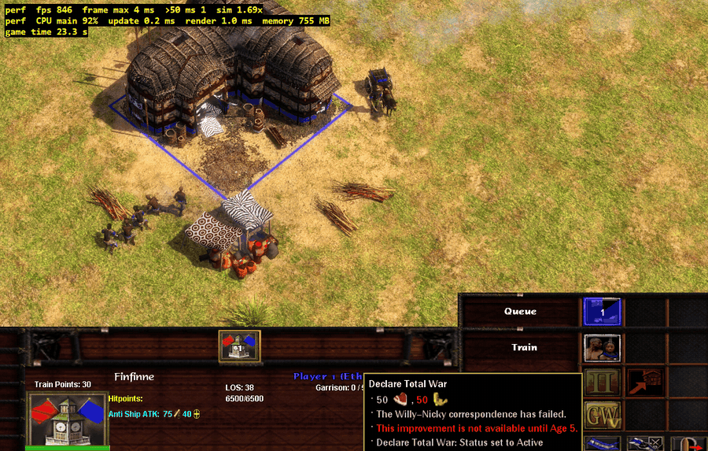

*In WoL, key off (both `techRenameEffect` and WoL's `enableTechRenameEffect` line removed from the
cfg):* the game drops the `SetTechName` effect, and the button stays "Declare Total War".
[Full video (MP4)](media/techRenameEffect-wol-control.mp4).

```
techRenameEffect [log]
enableTechRenameEffect [log]     the same key under WoL's name
```

- **In WoL today:** `wol.cfg` has `enableTechRenameEffect`, and WoL's DLL adds the effect `SetTechName`.
  It writes the new string IDs into the database's copy of the tech, which all players share: when one
  civ's tech renames a tech, every player sees the new name. WoL's `techtreey.xml` has no `SetTechName`
  yet. The exe's own `SetName` effect renames a *unit* for one player.
- **What changes for WoL:** the same effect and attributes, so WoL's data works unchanged, but the
  rename reaches only the players of the tech that carries it. To have this, replace WoL's handler
  with the code in the porting guide.
- **Effect:** adds the tech effect `SetTechName`. When a tech that carries it becomes active for a
  player, the named tech shows the new name, rollover and help text **for that player only**. If
  the carrier is a team tech, every member of the team gets the rename. Costs, prerequisites,
  effects, icon and research stay as before.
- **WoL needs:** the effect in the `<Effects>` of any tech:

  ```xml
  <Effect type='SetTechName' tech='HuntingDogs' newName='11070' newRolloverTextID='10670'/>
  ```

  | Attribute | Meaning |
  |---|---|
  | `tech` | Required. The name of the tech to rename. |
  | `newName` | New `DisplayNameID` (the button and message name). |
  | `newRolloverTextID` | New `RolloverTextID` (the button's rollover). |
  | `newLongRolloverTextID` | New `LongRolloverTextID` (the long help text). WoL's effect has no such attribute. |

  The three string IDs are optional, but at least one must be given; leave one out, or write `-1`, to
  keep that text. The IDs come from `data\stringtabley.xml`. "Per civ" means placing the effect in a
  tech that only that civ gets, such as its `Age0<Civ>` shadow tech or a home city card's tech.
- **Where the new texts show:** wherever the game reads the tech through the player's own tech
  tree: the buttons and rollovers of that player's buildings and the "researching" /
  "researched" messages. From the code, these keep the original texts: the in-game help (F1), the home
  city screens and every screen outside a game. Other players and observers see the original texts.
- **When:** from the moment the carrier tech becomes active. A saved game re-applies the rename
  when it loads (static reading; not tested). Nothing undoes a rename: a carrier that is
  deactivated later leaves the new texts, as `SetName` does. Two carriers that rename
  the same tech for one player: the last one applied wins, text by text.
- **Without the key** the game does not know `SetTechName`: it drops each such effect with its own
  error and loads the rest of the techtree.
- **`log`:** one line per `SetTechName` read from the data and one per rename.
- **Log:** at startup `techRenameEffect: the tech effect SetTechName (tech, newName,
  newRolloverTextID, newLongRolloverTextID) renames a tech for the players it reaches (multiplayer
  unverified)` (the line starts with `enableTechRenameEffect:` under WoL's key name; with `log`,
  `…reaches, every rename logged (multiplayer unverified)`), then
  `techRenameEffect/enableTechRenameEffect: applied`; at data load `hook reached: techRenameEffect
  register (0x524CB5)`, `techRenameEffect: effect type SetTechName -> 17` and, at the first effect
  read, `hook reached: techRenameEffect factory (0x62146F)`. Data errors are always logged, and
  the effect is dropped while the rest of the file loads:
  - `techRenameEffect: SetTechName: unknown tech 'X'; this effect is dropped`;
  - `techRenameEffect: SetTechName without tech='...'; this effect is dropped`;
  - `techRenameEffect: SetTechName on X: newName='abc' is not a string ID (a number from 0, or -1 to
    keep the text); this effect is dropped`;
  - `techRenameEffect: SetTechName on X sets none of newName, newRolloverTextID,
    newLongRolloverTextID; this effect is dropped`.

  With `log`: `techRenameEffect: read SetTechName on X (tech N): newName …` per effect read, and
  `techRenameEffect: player P: tech N (X), from tech M: name a -> b, rollover c -> d, long rollover
  e -> f (node …, NodeData … -> copy …)` per rename.
- **Simulation:** no gameplay change: only string IDs differ. The effect does run inside the
  simulation (tech activation), so give every player the same setting; multiplayer is not tested.
- **Status:** confirmed in single player. In WoL (2026-11-04), a test tech renamed `GreatWarButton` for
  player 1, and the button and its rollover changed. On the stock game (2026-10-29), memory showed the
  database's tech data, which other players see, unchanged, and only player 1's copy with the new IDs;
  a second effect naming an unknown tech was logged and dropped, and the techtree still loaded. Saved
  games were not tested.

#### customSyscalls

*Loads plugins that add new functions to AI, map, trigger and UI scripts.*

**Added:** Monday 2026-11-02 20:13 · **Filmed in WoL:** Wednesday 2026-11-04 13:58

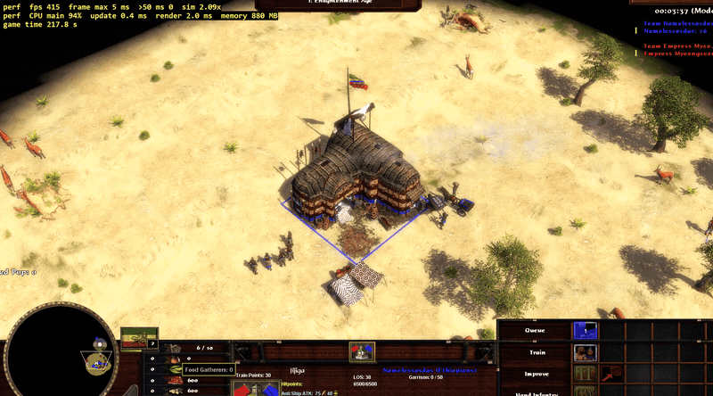

*In WoL (a skirmish against the AI):* with `customSyscalls wolPlugin.upl wolai.upl`, WoL's AI compiles and
plays: no XS error, and it gathers and trains from the start.
[Full video (MP4)](media/customSyscalls-wol.mp4).

```
customSyscalls [file or pattern ...]
```

- **In WoL without it:** the AI does not compile (`aiWoLMain.xs` calls `kbGetTechID` 36 times), and 36
  `RM4\ESOC_*` maps need it too.
- **Effect:** loads plugins (`.upl` files) and adds the XS syscalls they register to AI, trigger,
  random-map and UI scripts. Without arguments it loads every `*.upl` file in the game folder; with
  arguments, the files or patterns listed, relative to the game folder. A plugin that crashes while it
  starts is logged and skipped. `wol.cfg` has `customSyscalls wolPlugin.upl wolai.upl`.
- **Plugins:** a `.upl` is a 32-bit DLL that exports `int UHCPluginMain(UHCPluginInfo*)` (cdecl).
  `UHCPluginInfo` holds five cdecl function pointers, in this order:
  `RegisterCheat(text, enabled, callback)`,
  `RegisterSyscall(group, returnType, name, function, paramCount, comment)` (returns a handle),
  `SyscallSetParam(handle, index, type, defaultValue)`, `CheatAddResource(playerData, resource,
  amount, flag)` and `CheatSpawnUnit(playerData, protoName)`. Groups: 0 AI, 1 HC, 2 KB, 3 RM,
  4 TR, 5 UI, 6 UI2, 7 XS. Types: 1 void, 2 int, 4 float, 8 bool, 16 string, 32 vector. A
  syscall function is cdecl and takes the XS arguments in order. WoL's two plugins load unchanged.
  Cheats go to the game with `customCheats` (below).
- **Log:** `customSyscalls: <file>: N syscalls, M cheats (UHCPluginMain returned R)`;
  `customSyscalls: K of L plugin(s) loaded, …`; once per script module,
  `syscalls: group XS: N added, M refused`; a refused syscall (a name the game already has, a bad
  type) is named, and the others still register; `hook reached: syscall group XS (0x6257D9)` and
  the other seven groups.
- **Simulation:** scripts compiled with these syscalls need them on every player's machine:
  everyone needs the same plugins.
- **Status:** confirmed (2026-11-02, single player, on WoL): both plugins loaded (17 syscalls in the XS,
  AI and KB groups, 33 cheats collected), and WoL's AI compiled and played a skirmish.
- **Fixed from the original DLL:** upstream's syscall table overflows into the population and deck limits
  when the list is long, loads plugins by bare file name (directories do not resolve), and stops
  a whole group at the first refused syscall.

#### customCheats

*Cheats added by plugins work when typed in the chat.*

**Added:** Monday 2026-11-02 20:47 · **Filmed in WoL:** Wednesday 2026-11-04 13:58

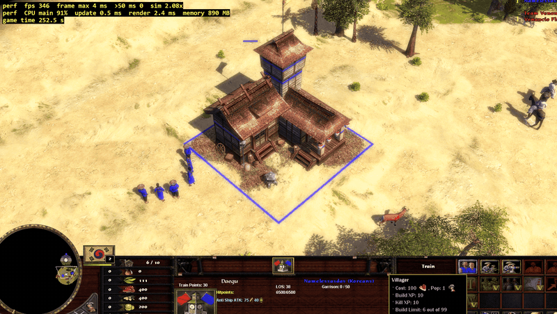

*In WoL (a skirmish):* `kill 'em all`, a cheat of `wolPlugin.upl` typed in the chat, spawns 50 Cannons.
[Full video (MP4)](media/customCheats-wol.mp4).

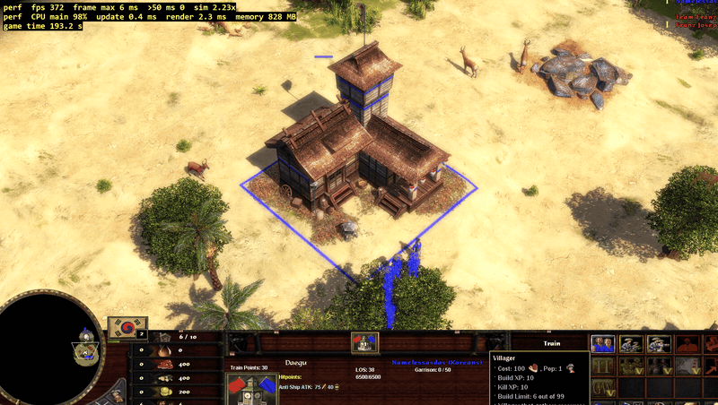

*In WoL, key off (the same scene):* the same text does nothing. [Full video (MP4)](media/customCheats-wol-control.mp4).

```
customCheats
```

- **Effect:** the 33 cheats that WoL's plugins register (see `customSyscalls`) work in the chat like the
  game's own: typed as written (lower case), they run on every player's machine through the game's
  cheat command. Plugins load when either `customSyscalls` or `customCheats` is set;
  without `customSyscalls` their syscalls are ignored.
- **Log:** `customCheats: N plugin cheat(s) added to the cheat table (M entries)` the first time
  the table is built; `hook reached: customCheats cheat table (0x551FE6)`.
- **Simulation:** a cheat runs as a game command, as the game's own cheats do; every player needs the
  same plugins.
- **Status:** confirmed (single player, on WoL): 33 plugin cheats added after the exe's 23, and `kill 'em
  all` spawned 50 Cannons in a skirmish; none without the key. Cheats do not run in a scenario.

#### kbUnitSyscalls

*AI scripts can ask about a unit's resources, its workers and which units target it.*

**Added:** Tuesday 2026-11-03 08:16 · **Filmed in WoL:** Wednesday 2026-11-04 13:58

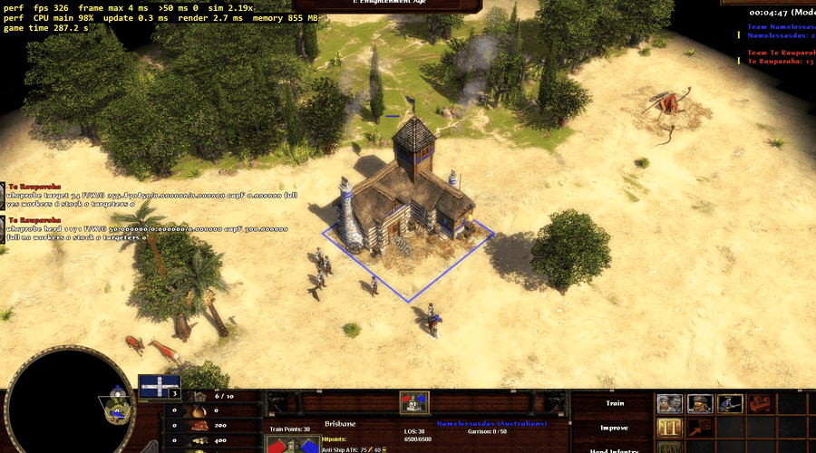

*In WoL (the Maori AI Te Rauparaha):* its script calls the five syscalls, compiles and plays; a test rule
prints them in the chat for what the AI's villagers gather and for its livestock. Without the key this
AI does not compile (`Error 0172`), so there is no control video.
[Full video (MP4)](media/kbUnitSyscalls-wol.mp4).

```
kbUnitSyscalls
```

- **In WoL today:** WoL's DLL has these always, so `wol.cfg` has no line for them. This DLL needs the
  line. Only the Maori personality Te Rauparaha uses them (`AI4\_TeRauparaha.xs`, 38 calls), and without
  them that AI does not compile (`Error 0172` on `kbUnitGetCurrentInventory`).
- **Effect:** adds five KB syscalls for AI scripts, about resource units. "The player" is the AI whose
  script runs.

  | Syscall | Returns |
  |---|---|
  | `float kbUnitGetCurrentInventory(int unitID, int resourceID)` | the amount of that resource the unit holds (a mine's gold, a bush's food, an animal's food) |
  | `float kbUnitGetInventoryCapacity(int unitID, int resourceID)` | how much of it the unit can hold (its proto's carry capacity) |
  | `bool kbUnitIsInventoryFull(int unitID)` | the engine's own "inventory full" test (for livestock: fully fattened) |
  | `int kbUnitGetNumberWorkersIfSeeable(int unitID)` | for a unit the player can see, the number of its gatherers the player can see; 0 if it cannot see the unit. The exe's `kbUnitGetNumberWorkers` answers only for the player's own units |
  | `int kbUnitGetNumberTargeters(int unitID)` | the number of the player's gatherers ordered to the unit that are not working it yet |

  An unknown unit ID gives 0 (inventory), false, or -1 (the two counts).
- **WoL needs:** nothing; AI scripts call the syscalls. A script that calls them fails to compile
  without the key (`XS: Error 0003: could not compile file ...`).
- **Log:** `kbUnitSyscalls: 5 kb syscalls added`, then `syscalls: group KB: 5 added, 0 refused`
  when the game builds its KB syscalls; the first call of each, `hook reached: kbUnitSyscalls
  <name>`.
- **Simulation:** reads only; AI scripts run on the host, so only the host needs the line.
- **Status:** confirmed (2026-11-03, single player, against the AI Te Rauparaha): the script compiled and
  ran. A test rule printed the syscalls every 20 s: a hunted animal's food fell from 207.7 to 62.5 while
  `kbUnitGetNumberWorkersIfSeeable` gave 6 (`kbUnitGetNumberWorkers` gave 0 for that Gaia unit; game
  memory showed the same 6 gatherer IDs); the AI's livestock showed food 50 of capacity 300, not full; a
  mine and a bush at full showed "full". `kbUnitGetNumberTargeters` was reached but gave 0 in that
  window (every gatherer was already working its target).

#### auraStacking

*An aura can skip chosen units; that several carriers of one aura do not multiply is the game's own `<ModifyExclusive>`.*

**Added:** Friday 2026-11-06 13:44 · **Filmed in WoL:** Saturday 2026-11-21 11:03

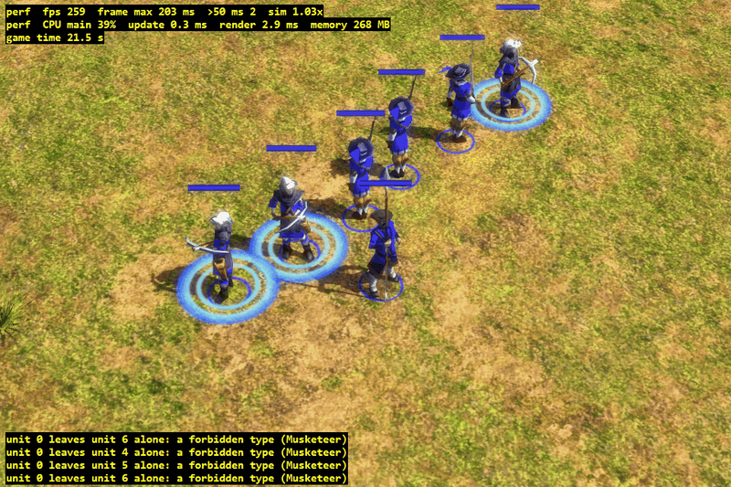

*In WoL, with `auraStacking log` (Danes; a Pikeman carries a test aura `Speed` ×1.5 on `AbstractInfantry`, 12 m, with
`<ModifyExclusive>`, `<ForbidUnitType>Musketeer</ForbidUnitType>` and [`ring_speed.xml`](#aura-rings)):* the three Crossbowmen
wear the blue ring and walk at 6.0, the three Musketeers have no ring and stay at 4.0; the log names each refusal.
[Full video (MP4)](media/auraStacking-wol.mp4).

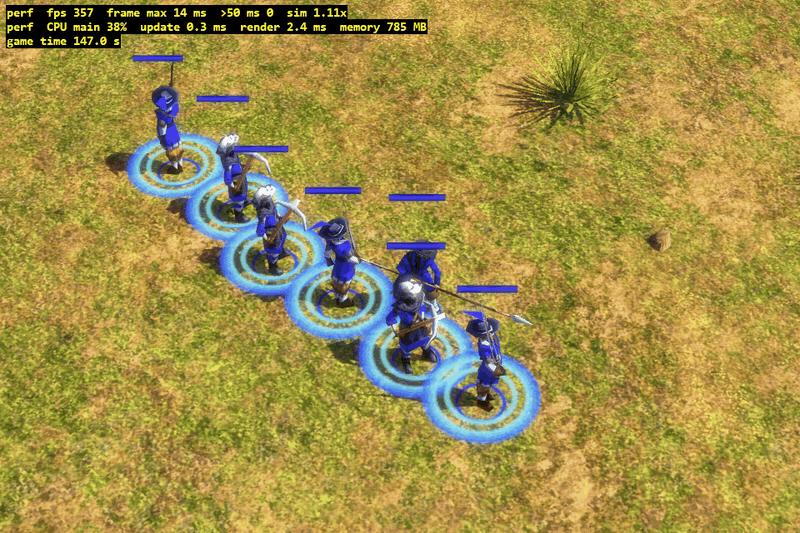

*In WoL, key off (the same data):* the game skips the tag, and the Musketeers wear the ring too.
[Full video (MP4)](media/auraStacking-wol-control.mp4).

```
auraStacking [log]
```

```xml
<action>
    <name>MyAura</name>
    <type>AutoRangedModify</type>
    <modifyexclusive>1</modifyexclusive>           <!-- stock: carriers of this aura do not multiply -->
    <forbidunittype>Musketeer</forbidunittype>      <!-- this key -->
</action>
```

- **`<ForbidUnitType>`** (or `<ForbidAbstractType>`, more than once, a unit type or a proto): the aura leaves those units alone,
  on any aura. A name the game does not know is logged once and ignored.
- **Stacking is stock:** `<ModifyExclusive>1</ModifyExclusive>` on the aura. Every carrier still gives each unit its
  modifier, but the game's stat sum stops at the first exclusive one, so five carriers of a ×1.5 aura give ×1.5, not
  ×1.5⁵, and when a carrier dies the others' modifiers are already there. It also stops the auras of the same stat that
  come after it: a unit under two exclusive Speed auras, ×1.5 and ×1.2, walks at ×1.5. The same holds for the stats of
  [`buildingWorkRateAuras`](#buildingworkrateauras) and [`resourceGatherAuras`](#resourcegatherauras), and for
  [`unitResourceAuras`](#unitresourceauras), where each target then pays one carrier, with this key on or off.
- **`<NoStack>` is retired** (JTMaston, 2026-11-21: `<ModifyExclusive>` already did it). Data that still has it loads:
  the key logs `auraStacking: proto Pikeman: <NoStack> is retired, use <ModifyExclusive>1</ModifyExclusive>; ignored`
  (20 lines at most) and [`dataLint`](#datalint) counts it as an unknown action tag. Put `<ModifyExclusive>1</ModifyExclusive>`
  in its place.
- **Changes the simulation:** every player needs the same setting and data.
- **Saved games:** nothing to keep: the modifiers are the game's, and the payer of a `UnitResource` target is chosen again
  after a load.
- **Log:** `auraStacking: applied`, `hook reached: auraStacking filter (0x9D0633)`, and with `log`
  `unit 0 leaves unit 4 alone: a forbidden type (Musketeer)`, `unit 7 leaves unit 9 to unit 8: <ModifyExclusive>`.
- **Not covered:** the applier of auras with no range, FUN_009D7328, and powers.
- **Tested in WoL (2026-11-21, `<ModifyExclusive>`):** five Pikemen with six test auras, read in game memory and the keys'
  logs: villagers under an exclusive Speed ×1.5 at 6.00 from 4.00, the Explorer under the same aura without the tag at
  34.17 from 4.5 (×1.5⁵); `buildingWorkRateAuras` ×2 on the Town Center with the tag; `resourceGatherAuras` wood ×2 with
  the tag against food ×32 without it, on the same villagers. Four carriers killed one after the other: the villagers
  stayed at 6.00, the Explorer went down to 6.75. Two Sawmills over three trees with `<ModifyExclusive>`: each tree paid
  one Sawmill.
- **Tested in WoL (2026-11-21, the key without `<NoStack>`):** `<ForbidUnitType>Musketeer` and
  `<ForbidAbstractType>AbstractGunpowderTrooper`: the Crossbowmen held both modifiers, the Musketeers none; a bad name
  logged once; old `<NoStack>` data loaded and logged as retired; a game saved and loaded kept the modifiers, and the
  Sawmills one payer per tree. Not tested: multiplayer, recorded games.

### Civs

What the exe decides by civ.

| Key | What it does | WoL's DLL | WoL also needs | In-game status |
|---|---|---|---|---|
| [`asianCivs`](#asiancivs) | Egyptians, Ethiopians, Koreans, Zulu and Maori count as Asian civs: consulate, export and wonders. | **in `wol.cfg`** | Those civs' data. | confirmed |
| [`nativeCivs`](#nativecivs) | WallMapu, Tupinamba and Tawantinsuyu count as native civs: fire pit, dances and council age-up. Without it, WallMapu's age-up crashes the game. | **in `wol.cfg`** | Those civs' data. | confirmed |
| [`twoScoutCivs`](#twoscoutcivs) | The Koreans get the interface of the civs that start with two heroes. | **in `wol.cfg`** | A second hero. | not tested in game |
| [`bigButtonCivs`](#bigbuttoncivs-and-nobigbuttonblds), [`noBigButtonBlds`](#bigbuttoncivs-and-nobigbuttonblds) | Gives the command panel's big button to the listed civs, and takes it from the listed buildings. | **in `wol.cfg`** | Nothing. | partly confirmed |
| [`danceBonusCivs`](#dancebonuscivs) | Lets the civs you list get the fire pit's Training, XPTrickle, Gathering and Regeneration dances, which the exe applies only to `XPIroquois`, `XPSioux`, `XPAztec` and `XPSPC`. | **new** | A building with `AbstractFirePit`, its dance enabled for those civs, and villagers that can work on it. | confirmed (single player) |
| [`wonderCivUnitType`](#wondercivunittype) | `Rangatira` may start the Maori age-up. Without it, the Maori cannot age up. | **in `wol.cfg`** | Nothing. | confirmed |
| [`ageUpBuildings`](#ageupbuildings) | The age-up button opens the politician dialog on the buildings you list too, not only on the Town Center, and each building offers only the politicians its own proto lists. | **new** | The politicians (techs with `AgeUpgrade`) in those buildings' `<Tech>` lists. | confirmed (single player) |
| [`politicianEnablesTech`](#politicianenablestech) | A politician of the European age-up dialog shows the techs it makes available as icons with their names and their research rollover, and its picture shows only the flag. | **new** | `<PoliticianEnablesTech>` lines in the politicians' `<Tech>`, and the new gadgets in `uipoliticianEuropeandlg.xml` (`wol-fixes/politician-ui`). | confirmed (single player) |
| [`startingTC`](#startingtc) | Lets buildings of a marked type be a player's first town center, the unit the placement rules call `FirstTC` (no enemy building within 65 m), not only a `TownCenter`; one also replaces a first town center that is gone, dead or about to expire. | **new** | That unit type on the starting buildings in `protoy` (e.g. `MaoriPa`), or an existing type or proto name in the cfg. | confirmed (single player) |
| [`civFirstTC`](#civfirsttc) | A civ's `<firstTC>Proto</firstTC>` in `civs.xml` replaces the `TownCenter` that random maps place for its players (not in a Nomad start); that building is their first town center (`FirstTC`) and receives their town starting units. | **new** | The tag in `civs.xml`; for the town starting units, `<Flag>StartingColonyBuilding</Flag>` on the proto and the proto in `placementrules\colonies.xml` `<starttypes>`; for shipments, `hcShipmentPointFallback FirstTC`. | confirmed (single player; Nomad start not tested) |
| [`firstTC`](#firsttc) | One line for `civFirstTC` and `startingTC`, with the town units and shipments worked out from the civ's tag. | **new** | `<firstTC>` in `civs.xml`, and the proto in `placementrules\colonies.xml` `<starttypes>`. | confirmed (single player) |
| [`scenarioCivs`](#scenariocivs) | Reads a second civ file, `data\scenariocivs.xml`, after `civs.xml`: its civs come after the others (no ID moves), show in the scenario editor's list and not in the skirmish and lobby lists. | **new** | The file, with `<civ>` elements in `civs.xml`'s format. | confirmed (single player) |
| [`customRevolutionBanners`](#customrevolutionbanners) | Shows a banner for each of WoL's 29 `XPRevolution<Name>` techs, not only O'Higgins. | **in `wol.cfg`** | A banner texture per revolution. | partly confirmed |
| [`removeFameRestriction`](#removefamerestriction) | Shows Fame, XP and shipment costs on politician screens, and Fame/XP icons on home city cards. | **in `wol.cfg`** | Two icon textures. | not tested in game |

#### asianCivs

*Chosen civs count as Asian: consulate, exports and age-up by wonders.*

**Added:** Monday 2026-11-02 20:27 · **Filmed in WoL:** Wednesday 2026-11-04 13:58

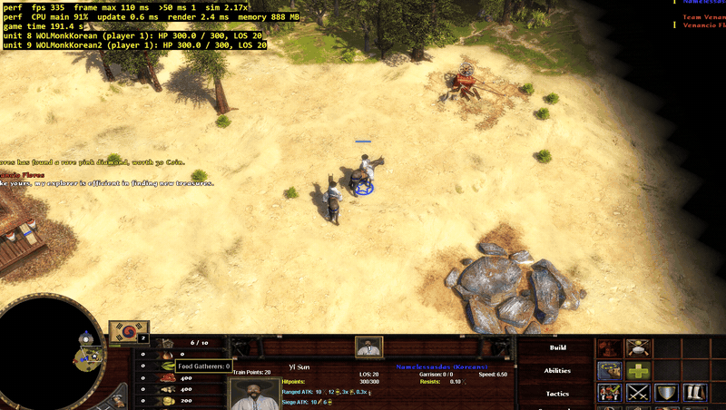

*In WoL (a Korean skirmish):* the two Korean monks show their hero names (`explorerUnits`), then a real
click on the villager's age-up button opens the list with the Koreans' five wonders.
[Full video (MP4)](media/asianCivs-wol.mp4).

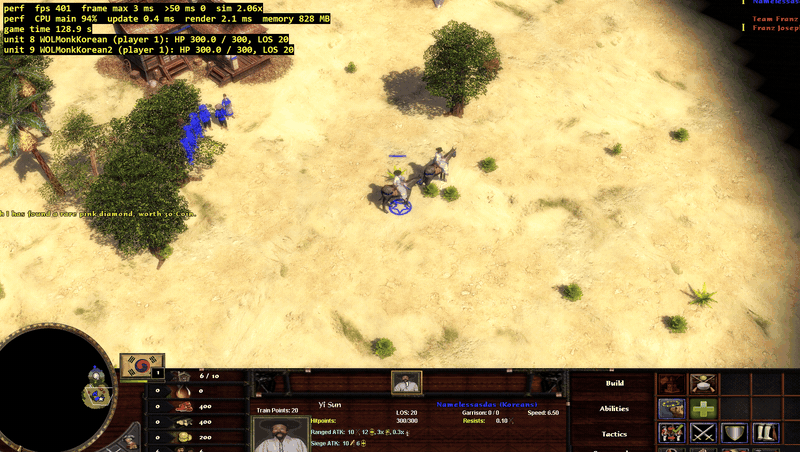

*In WoL, key off (the same scene):* the same click opens nothing.
[Full video (MP4)](media/asianCivs-wol-control.mp4).

```
asianCivs Civ [Civ ...] [log]
```

- **In WoL today:** `wol.cfg` has `asianCivs Egyptians Ethiopians Koreans Zulu Maori`. Without the line
  those civs lose export, the consulate and the wonder age-up.
- **Effect:** the listed civs (names from `civs.xml`) count as Asian civs where the game compares a
  player's civ with the Asian civs: the extended Asian-civ test (consulate, export and the other Asian
  features that call it), the Asian civs' value branch, and the wonder age-up list. In that list a
  listed civ gets the wonders whose civ name is its name in the cfg; the exe gives a civ that is not
  Chinese, Japanese or Indian no wonder at all.
- **WoL needs:** for the wonder age-up, entries in `data\politiciandata.xml` with `nativeciv="<Civ>"` and
  the civ's wonders. The file has 20 entries each for `Koreans` and `Maori`, which are the model.
- **Log:** `asianCivs: N civ(s) count as Asian civs`; when `civs.xml` is read, one
  `asianCivs: <Civ> -> civ <ID>` line per name (`… is not a civ in civs.xml; ignored` otherwise);
  with `log`, `asianCivs: <Civ> gets its wonders in the age-up list` once;
  `hook reached: asianCivs isAsianCiv (0x454F1D)`, `… civ value (0x8D6AC4)`,
  `… wonder age-up (0x818284)`.
- **Simulation:** changes what the listed civs may do: every player needs the same line.
- **Status:** confirmed (single player, a skirmish on WoL): the five civs resolved, and a Korean villager
  opened the wonder age-up list with its five wonders; without the key, nothing opens.
- **Fixed from the original DLL:** upstream tests EAX instead of AL after `0x49A2D8` in the wonder list,
  so the "civ has no entry" path (EAX = 0xFFFFFF00) counted as true.

#### nativeCivs

*Chosen civs count as native: fire pit, dances and age-up by council.*

**Added:** Monday 2026-11-02 21:19 · **Filmed in WoL:** Wednesday 2026-11-04 13:58

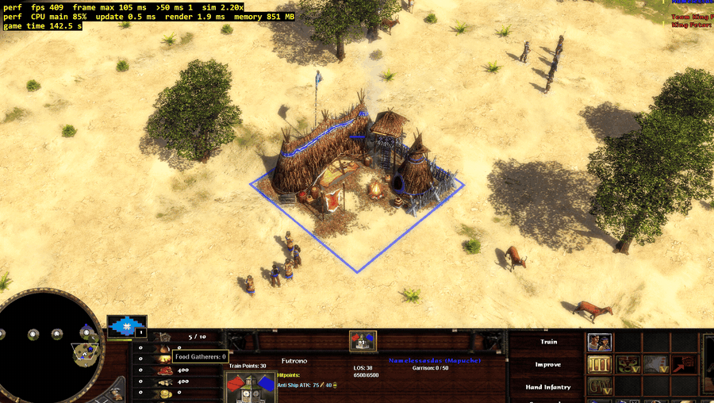

*In WoL (a WallMapu skirmish):* the Town Center opens the council age-up list with its five council
members. There is no video without the key: the same click closes the game.
[Full video (MP4)](media/nativeCivs-wol.mp4).

```
nativeCivs Civ [Civ ...]
```

- **In WoL today:** `wol.cfg` has `NativeCivs Tupinamba WallMapu Tawantinsuyu`. Without the line, the
  WallMapu age-up closes the game: the civ is taken for a European one, and the politician dialog reads
  a gadget it does not have (0x81A5FB to 0x81A80C in the exe).
- **Effect:** the listed civs count as native civs: the civ flag the `civs.xml` loader sets for
  the native civs, the game's native civ tests, the fire pit's Training, XPTrickle, Gathering and
  Regeneration dances (through the same four gates as `danceBonusCivs`), and the council age-up
  list, where a listed civ gets the council members whose civ name is its name in the cfg.
- **WoL needs:** for the council age-up, entries in `data\politiciandata.xml` with `nativeciv="<Civ>"`.
  The file has 20 each for `WallMapu`, `Tupinamba` and `Tawantinsuyu`.
- **Log:** `nativeCivs: N civ(s) count as native civs`; `nativeCivs: K of N civ(s) marked native
  in civs.xml`; `nativeCivs: <Civ> -> civ <ID>` and `danceBonusCivs: <Civ> -> civ <ID>` when
  `civs.xml` is read; `hook reached: nativeCivs civ flags (0x52B581)`, `... test 2 (0x51271F)`,
  `... isNativeCiv (0x453D5E)`, `... test 7 (0x67B0A5)`, `... test 9 (0x8D52AF)`,
  `... council age-up (0x81ADEB)`.
- **Simulation:** changes what the listed civs may do: every player needs the same line.
- **Status:** confirmed (2026-11-03, single player): the three civs marked native, every hook ran in a
  skirmish, the four dance gates resolved them, and the WallMapu Town Center opened the council age-up
  list with its five council members. Without the key, the same click closed the game.
- **Fixed from the original DLL:** upstream compares a dword where isNativeCiv compares a byte, and its
  council hook clobbers EAX.

#### twoScoutCivs

*Chosen civs get the interface of the civs that start with two heroes.*

**Added:** Monday 2026-11-02 21:10

```
twoScoutCivs Civ [Civ ...]
```

- **Effect:** the listed civs get the hero interface of the civs that start with two heroes (Japanese
  and Indians) in the four places the game decides it by civ. `wol.cfg` has `twoScoutCivs Koreans`.
- **Log:** `twoScoutCivs: N civ(s) get the two-hero UI`; `twoScoutCivs: <Civ> -> civ <ID>` when
  `civs.xml` is read; `hook reached: twoScoutCivs hero UI 1 (0x77EBB2)` to `... 4 (0x77DFF4)`.
- **Simulation:** no: interface only.
- **Status:** implemented, not tested in game (2026-11-02): the four functions did not run during a
  skirmish, in the home city menus or in its customize screen; they are probably the new home city
  dialog, which names the heroes.

#### bigButtonCivs and noBigButtonBlds

*Chooses which civs get the command panel's big button, and which buildings don't.*

**Added:** Monday 2026-11-02 21:19

```
bigButtonCivs Civ [Civ ...]
noBigButtonBlds Proto [Proto ...]
```

- **Effect:** the command panel's big button, which the exe gives to native civs, also goes to the
  listed civs; and neither native nor listed civs get it on a building of a `noBigButtonBlds` proto.
  Either line may be used alone. `wol.cfg` has `bigButtonCivs Tawantinsuyu WallMapu Tupinamba` and a
  `noBigButtonBlds` list that starts with `SANmonument`.
- **Log:** `bigButtonCivs/noBigButtonBlds: N civ(s) get the native big button, M building proto(s)
  never show it`; `hook reached: bigButtonCivs command panel (0x461BD8)`.
- **Simulation:** no: interface only.
- **Status:** partly confirmed (2026-11-02, single player): the hook ran when a WallMapu Town Center was
  selected; a building of a listed proto was not checked.

#### danceBonusCivs

*Chosen civs can use the fire pit dances that normally work only for native civs.*

**Added:** Thursday 2026-10-29 06:39 · **Filmed in WoL:** Friday 2026-11-06 13:55

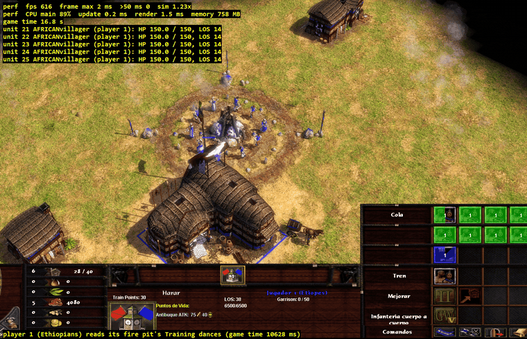

*In WoL, with `danceBonusCivs Ethiopians log` (Ethiopians, the Town Center selected so its queue
shows):* ten settlers do WoL's Fertility Dance (`FertilityDance`, a `Training` dance, turned on for
the test by an appended tech, removed after) at a fire pit while the TC trains villagers. The
Ethiopian TC gets the dance's train bonus (`reads its fire pit's Training dances`): 4 villagers
trained by 65 s of game time. [Full video (MP4)](media/danceBonusCivs-wol.mp4).

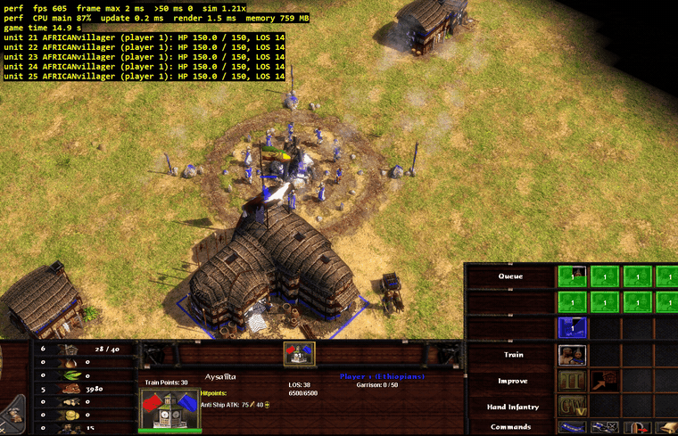

*In WoL, key off (the same scene):* the settlers dance but the bonus applies only to the native
civs, so the TC trains at its normal rate: 2 villagers by 65 s.
[Full video (MP4)](media/danceBonusCivs-wol-control.mp4).

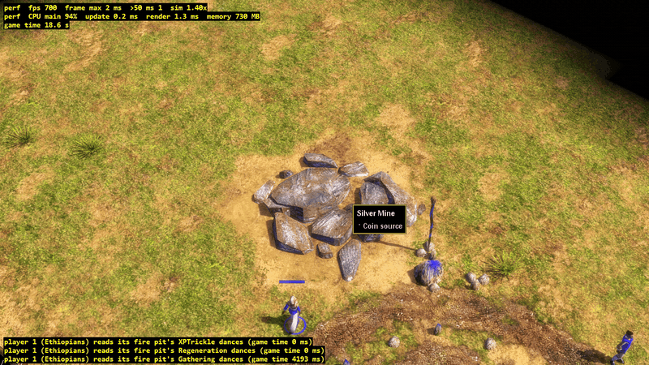

*In WoL (Ethiopians, 9 dancers at a `FirePit`, test data):* the Gathering dance and then the XP dance, with the miners' rate and the XP
in the corner. [Full video (MP4)](media/danceBonusCivs-all-wol.mp4).

- **Tested in WoL (2026-11-06):** Gathering ×1.47–1.50 against none with the key off; XPTrickle 7.0–7.3 XP/s against about 2.0. WoL's
  tactics do not use `GatherRateIncrease`: add it to a dance to use it. Training: 4 villagers against 2 at 65 s.

```
danceBonusCivs <Civ> [<Civ> ...] [log]     civ names as in civs.xml; several lines add up
```

- **In WoL today:** a fire pit dance is a tactic of the building (`data\tactics\firepit.tactics`); its
  actions have `<type>DanceBonus</type>` and a `<dancebonustype>`. Four kinds act by themselves for any
  civ that owns the building and has the tactic: `UnitModification`, `UnitSpawn`, `PopCap` and
  `WarChiefRansom`. The other four are applied by the engine where it needs them, and only for the
  civs `XPIroquois`, `XPSioux`, `XPAztec` and `XPSPC`, a list fixed in the exe:
  - `Training`: train rate (Fertility Dance, action `VillagerTrainFaster`);
  - `XPTrickle`: XP trickle (Gift Dance, `XPTrickleIncrease`);
  - `Gathering`: gather rate of every resource (the action `GatherRateIncrease` is in
    `firepit.tactics`);
  - `Regeneration`: heals the units of `<modifyabstracttype>` that have been idle for 3.5 s (Healing
    Dance, `RegenAllUnits`).

  For any other civ these four dances run, the villagers dance and (except Gift Dance) the tooltip
  even shows the bonus, but nothing happens. WoL's own key `danceCiv` only changes interface checks.
- **Effect:** the listed civs get these four kinds exactly as those four civs do: the same strength,
  the same building (the player's first `AbstractFirePit` building) and the same targets. The civ does
  not become "native" for anything else, unlike [`nativeCivs`](#nativecivs), which also misses the Gift
  Dance.
- **WoL needs:**
  - the internal civ names (the `<name>` in `civs.xml`: `Ethiopians`, `Greeks`, …); case does not
    matter;
  - a building with `<UnitType>AbstractFirePit</UnitType>`: WoL's `FirePit`, `WOLMaypole`, `SANmonument`
    or the `ypWCSummerPalace2` to `5`. Only the player's first such building is read, and the dancer
    count needs that type;
  - the dance tactic in the building's tactics file, enabled for the civ by a tech, and a button for
    it;
  - villagers that can work on the building (a `Gather` rate for it in their tactics:
    `settler.tactics` already has `FirePit`).
- **`log`:** one line the first time each player passes each of the four checks in a game. A
  listed civ with no fire pit gets the line too: the check passes, then the engine finds no
  building and the bonus stays 1.0.
- **Log:** at startup `danceBonusCivs: civs A, B get the fire pit's Training, XPTrickle, Gathering
  and Regeneration dances like the native civs (multiplayer unverified)` (with `log`: `…civs, each
  player's first use of each kind logged (multiplayer unverified)`); on the first use with each
  data load, one `danceBonusCivs: <Civ> -> civ <ID>` line per name, or `danceBonusCivs: <Civ> is not
  a civ in civs.xml; ignored` (and, when no name is valid, `danceBonusCivs: none of the listed civs
  exists; the four dance kinds stay native-only`). In a game: `hook reached: danceBonusCivs
  Training (0x8D47AB)`, `… XPTrickle (0x4E0DFF)`, `… Gathering (0x4ECD53)` and `… Regeneration
  (0x49048B)` the first time the game evaluates each kind for any player. With `log`:
  `danceBonusCivs: player N (<Civ>) reads its fire pit's <Kind> dances (game time T ms)`. Without
  any civ name: `danceBonusCivs: expected "danceBonusCivs <Civ> [<Civ> ...] [log]" with at least
  one civ name; feature not applied`.
- **Limits:**
  - only the player's first `AbstractFirePit` building counts, as for the native civs;
  - each listed civ now looks for its fire pit (a scan of its units) on every train, gather-rate,
    XP trickle and regeneration evaluation, as the native civs always did. List only the civs that
    can own a dance building;
  - new dance kinds, more dance buttons and several dance buildings per player are not covered.
- **Simulation:** yes.
- **Status:** confirmed in single player for the four kinds. `Training` in WoL (2026-11-04): Ethiopian settlers
  dancing the Fertility Dance, 4 villagers by 65 s, 2 without the key. `Regeneration` in WoL
  ([overhealSources](#overhealsources)), and on the stock game (2026-10-29), where damaged units healed
  to full with the key and stayed at 90 without. `Gathering` and `XPTrickle` in WoL (2026-11-06, the test above):
  Gathering ×1.47–1.50 against none with the key off, XPTrickle 7.0–7.3 XP/s against about 2.0.

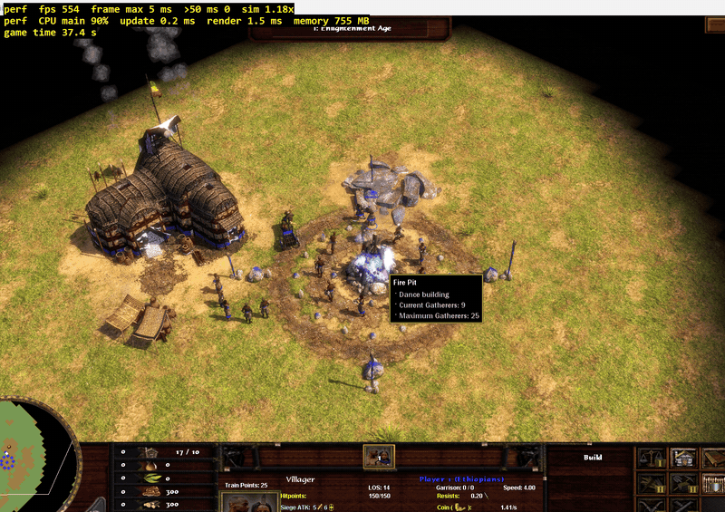
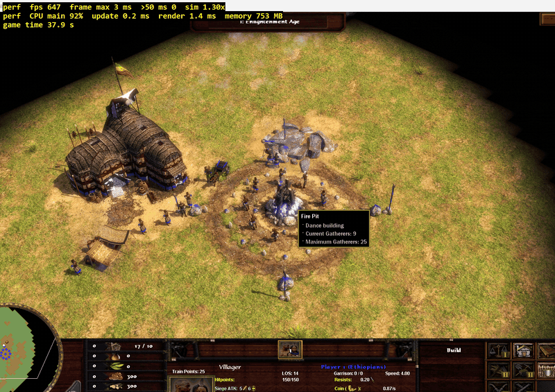

*In WoL (Ethiopians, 9 dancers, `<DanceWeight>3`, a test Gathering dance):* the selected miner's rate is in the panel.
[Full video (MP4)](media/danceBonusCivs-weight-wol.mp4). [Control, no tag](media/danceBonusCivs-weight-wol-control.mp4).

- **`<DanceWeight>N</DanceWeight>`** in a proto: that unit counts as N dancers, from 0 to 1000, instead of 1 for a villager and 2 for
  any other unit. Tested: 1.19/s with no dance, 1.74/s, 2.88/s with weight 3 (expected ×2.35, measured ×2.42, not explained),
  1.20/s with weight 0.
- **The fire pit** is now found through a memory of where it is in the player's list, without changing what the game finds.
  With 60 miners no gain could be measured: 0.36–0.39 ms against 0.39–0.46 ms, other games running.
- **A resource dance, in data:** a `DanceBonus` of type `UnitModification` with `<modifytype>AutoGatherRate</modifytype>` multiplies the
  trickle of the buildings it names, and needs no key. On `Building`, multiplier 0.2, 9 dancers: a Sawmill went from 1.75 to 4.9 wood/s.
  `UnitResource` does nothing in a dance: only an aura reads it. There is no cost discount: no stat exists for it.

#### wonderCivUnitType

*Chosen units can start a wonder age-up.*

**Added:** Tuesday 2026-11-03 07:25 · **Filmed in WoL:** Wednesday 2026-11-04 13:58

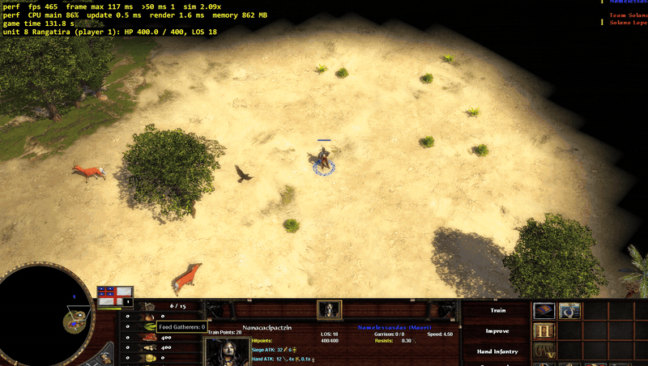

*In WoL (a Maori skirmish):* the Maori age up with voyages and start without a Town Center. The
`Rangatira` opens the age-up list. [Full video (MP4)](media/wonderCivUnitType-wol.mp4).

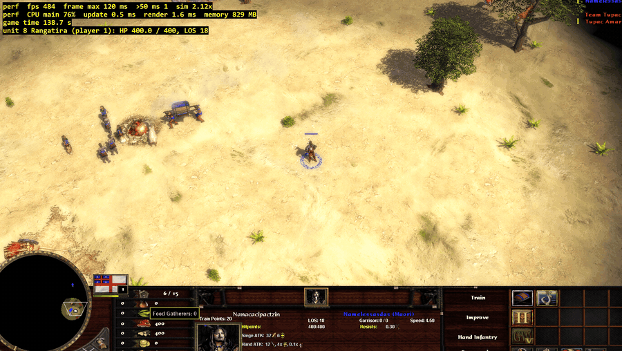

*In WoL, key off (the same scene):* the same click opens nothing.
[Full video (MP4)](media/wonderCivUnitType-wol-control.mp4).

```
wonderCivUnitType Proto [Proto ...]
```

- **In WoL without it:** the Maori cannot age up: their Rangatira cannot start the voyage.
- **Effect:** for a civ that ages up with wonders (the Asian civs and those of
  [`asianCivs`](#asiancivs)), units of the listed protos may start the age-up and place its wonder,
  besides the units the exe accepts (abstract type 16h). `wol.cfg` has `wonderCivUnitType Rangatira`.
- **Log:** `wonderCivUnitType: N proto(s) may place the age-up wonder of a wonder civ`; when
  `protoy.xml` is read, `wonderCivUnitType: K of N protos found in the data`; the first time it
  applies, `wonderCivUnitType: <Proto> accepted for the wonder age-up`.
- **Simulation:** changes who may age up: every player needs the same line.
- **Status:** confirmed (2026-11-03, single player): the Maori Rangatira opened the age-up list; without
  the key the same click opened nothing.

#### ageUpBuildings

*Lets other buildings than the Town Center age up, each with its own politicians.*

**Added:** Friday 2026-11-13 07:37 · **Filmed in WoL:** Friday 2026-11-13 07:37

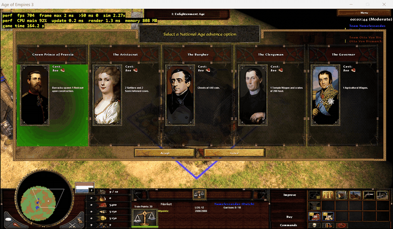

*In WoL (a Dutch skirmish against a German AI, test data):* the Town Center's age-up opens the dialog
with five politicians (the 5-slot layout of
[Five politicians in the European age-up](#five-politicians-in-the-european-age-up)). Then the Market's
age-up button, which stock ignores, opens it with the three politicians the Market lists (Crown Prince of
Prussia, Aristocrat, Burgher); the Aristocrat is accepted and the age-up is queued in the Market, for 800
food. [Full video (MP4)](media/ageUpBuildings-wol.mp4).

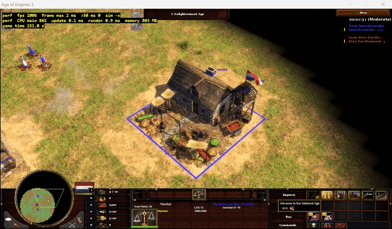

*In WoL, key off (the same scene):* the Market's age-up button shows its rollover, and a click opens
nothing. [Full video (MP4)](media/ageUpBuildings-wol-control.mp4).

```
ageUpBuildings [log] Proto [Proto ...]
```

- **In WoL without it:** a politician listed on another building shows an age-up button there, but the
  click does nothing: the exe opens the dialog only for a Town Center (WoL's Greeks, Serbians and others
  work around it with `NativeDance` techs such as `GREEKageupMILL01`).
- **Effect:** the age-up button (and `uiPoliticianUI` / `uiPoliticianUIInSelected`) opens the politician
  dialog on the listed protos too. On a listed proto the dialog shows only the politicians of the next age
  that the proto's `<Tech>` list holds; the Town Center keeps every politician the player may research.
  The chosen politician is researched in that building, at its own speed, and ages the player up as from
  the Town Center.
- **Data:** add the politicians to the building's `<Tech>` list in `protoy.xml`
  (`<Tech column="0" page="1" row="0">WuOLAristocrat</Tech>`); the command panel then shows the age-up
  button on it.
- **Not for:** the civs that age up with wonders (the Asian civs and those of
  [`asianCivs`](#asiancivs)): their age-up needs a builder, which [`wonderCivUnitType`](#wondercivunittype)
  chooses. Revolutions use the same dialog and the same filter, but were not tested.
- **Log:** `ageUpBuildings: N proto(s) open the age-up dialog besides the Town Center, with the politicians
  they list`; `ageUpBuildings: K of N protos found in the data`; with `log`, `ageUpBuildings: the age-up
  dialog opens on proto <ID>` each time, and the filter's first decision. No proto listed: `FAILED`.
- **Simulation:** the dialog is interface; the research it sends is a normal research of that building.
  Every player needs the same line. The AI picks its politicians in its scripts, not in this dialog
  (inferred; its age-ups in the test were not watched).
- **Status:** confirmed (2026-11-13, single player, Dutch): the Market opened the dialog with its three
  politicians and aged up; key off, nothing opened. Not tested: multiplayer, a native civ's council, a
  revolution.

#### politicianEnablesTech

*An immigrant politician shows its flag apart from the techs it unlocks, each tech with its icon, name and rollover.*

**Added:** Friday 2026-11-20 11:15 · **Filmed in WoL:** Friday 2026-11-20 11:59

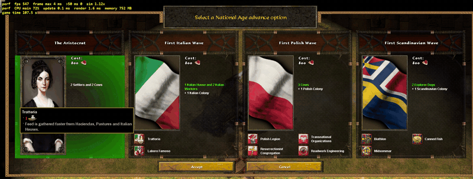

*In WoL (scenario, test data: the Aristocrat, and the Argentine waves with two, four and three tags):* the
Italian, Polish and Scandinavian places show the flag alone and, under it, the techs the wave unlocks, one per
row for two techs and two per row for three or four. The cursor rests on Trattoria, Laboro Famoso, Polish Legion,
Transnational Organizations, Resurrectionist Congregation, Biathlon and Midsommar, and each shows the rollover of its
own research button (with "not available until Age 2" in red, as there); the Aristocrat, with no tag, is as before.
[Full video (MP4)](media/politicianEnablesTech-wol.mp4).

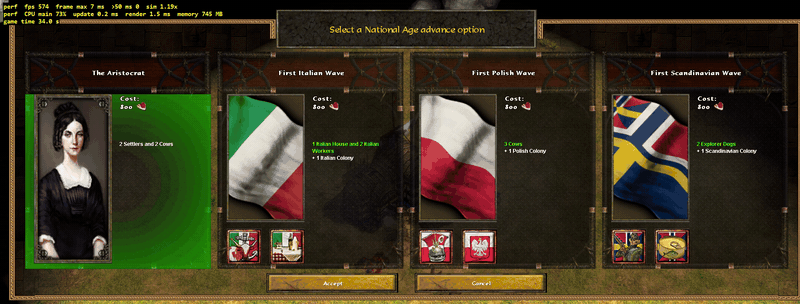

*In WoL, key off (the same scene and data):* the dialog shows WoL's pictures with the two tech icons drawn in,
and the cursor on them shows nothing. [Full video (MP4)](media/politicianEnablesTech-wol-control.mp4).

```
politicianEnablesTech [log] [flag <u> <v>]
```

- **In WoL without it:** a Latin American politician's picture is the immigrant flag with the icons of its two
  techs painted in, and its rollover text lists the techs by hand. The icons have no name and no rollover.
- **Data:** in `techtreey.xml`, inside the politician's `<Tech>`, one line per tech, in the order they show
  (at most four):

  ```xml
  <Tech name ='LAItalianII' type ='Normal'>
      ...
      <Icon>War of the Triple Alliance\Icons\age_2</Icon>
      <PoliticianEnablesTech>WOTTAimmigrantIT01</PoliticianEnablesTech>
      <PoliticianEnablesTech>WOTTAimmigrantIT02</PoliticianEnablesTech>
  ```

  The tag only drives the dialog: it enables nothing. The politician's `TechStatus obtainable` effects still
  make the techs available, as now. The game ignores a `<Tech>` child it does not know, so the lines do no harm
  without the key.
- **Layout:** `uipoliticianEuropeandlg.xml` gets, in each place `n`, hidden gadgets the key fills:
  `PoliticianDlg-Poli{n}EnablesTechPortrait` (the flag), `PoliticianDlg-Poli{n}EnablesTechDescription` (the
  description, ending above the techs), `PoliticianDlg-Poli{n}EnablesTech{k}Icon` and `...Name` (k = 0, 1: one
  or two techs, one per row) and `PoliticianDlg-Poli{n}EnablesTechGrid{k}Icon` and `...Name` (k = 0 to 3: three
  or four techs, two per row). `wol-fixes/politician-ui/apply_fix.py` writes them into WoL's file from each
  place's own portrait and description, for four or five places, and adds the tags to every politician from its
  `TechStatus obtainable` effects on immigrant techs (74 politicians, 148 tags in WoL 1.2.0e).
- **Effect:** for a politician with tags, the dialog hides the place's stock portrait and description and shows
  the flag part of the same picture (`flag`: the share of the picture's width and height, default `0.75 0.5833`,
  the 145 × 231 pixel flag of WoL's 192 × 396 pictures), the description in a shorter box, and each tech's icon
  (its `<Icon>`) and name (its `DisplayNameID`). Resting the cursor on an icon or a name shows the rollover of
  the tech's own research button (name, cost, `RolloverTextID`). A click on them selects the politician, as a
  click anywhere in its place. A politician without tags looks as without the key. No new picture is needed:
  `politiciandata.xml` keeps pointing to WoL's pictures.
- **Strings:** with the techs on screen, the hand-written list at the end of the politicians' rollover texts
  (`\n+ Technologies:\n- Trattoria: ...`) repeats them. `apply_fix.py --strings` takes it out of every string
  table (English and the translations); only with the key on, since without it nothing else names the techs.
- **Not for:** the Asian and native dialogs (their own builders and files); revolutions use the European dialog
  but have no tags.
- **Log:** `politicianEnablesTech: ... (flag 0.7500 x 0.5833)` and `applied`; at the first dialog,
  `politicianEnablesTech: the age-up dialog has this key's gadgets` (or `does not have`: an old layout, nothing
  changes) and `N politician(s) with M <PoliticianEnablesTech> tag(s)`; a tag naming no tech:
  `<PoliticianEnablesTech>X</PoliticianEnablesTech> in tech Y: no such tech; left out`; more than four: the rest
  left out, with a line. With `log`, each place and tech filled. Bad `flag` values: `FAILED`.
- **Simulation:** interface only: the dialog is the local player's, and the politician chosen is researched as
  before.
- **Status:** confirmed (2026-11-20, single player, scenario with test data in `C:\AoE3-UHC-WoLReal5`): the
  Argentine (Italian, Polish, Scandinavian) and Mexican (French, Chinese, Confederate) waves, two, three and four
  tags, a politician without tags, a tag naming no tech, accepting a tagged politician (the age-up started), the
  dialog closed and opened again, English and Spanish, the four-place file and the five-place one, with
  `politicianPlacesFix` (a fifth politician left out of four places), beside WoL's own DLL (our `dinput8.dll`;
  WoL's DLL writes its own description text, which goes into the shorter box), and key off. Also in real
  skirmishes (2026-11-20, against a German AI): Argentines in Ages II to V at 1920 × 1080 and at 1024 × 768 windowed
  (with `--strings`), and Mexicans at 1920 × 1080. Every tooltip, click and accept worked, and the Age V politicians
  (no tags) looked as with the key off. The longest name, "Resurrectionist Congregation", fits on one line. At 1024 ×
  768 the icons are drawn 22 × 30 px, a little taller than wide, as the layout's size stretches them, like the flags at
  4:3. Not tested: multiplayer, a saved game, a revolution.

#### startingTC

*Another building can act as a player's first Town Center, and replace one that is lost.*

**Added:** Thursday 2026-10-29 10:35 · **Filmed in WoL:** Wednesday 2026-11-04 11:13

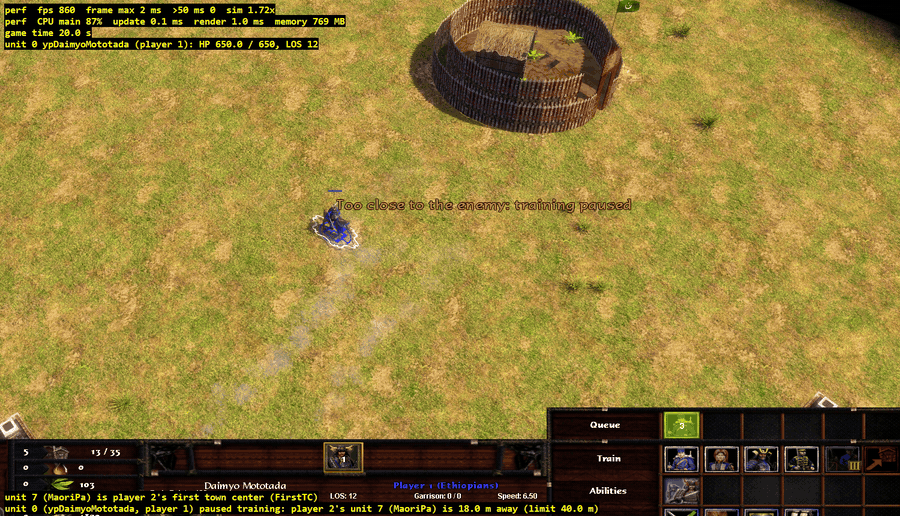

*In WoL, with `startingTC MaoriPa log` and `noTrainNearEnemyTC 40 log` (Japanese Daimyo selected, Maori
enemy; the fog is off for the video):* the Maori `Age0Maori` start: the enemy's `TownCenter` dies at once
and the `MaoriPa` replaces it (`unit 8 (MaoriPa) replaces player 2's first town center 7 (TownCenter),
which is dead`). So the Daimyo, 18 m from the Pa, cannot train: its 3 Kihei wait until the Pa falls at
58 s of game time. [Full video (MP4)](media/startingTC-wol.mp4).

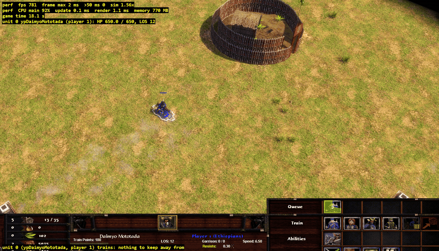

*In WoL, key off (the same scene):* the Maori's first town center stays the dead `TownCenter`, so the Pa
protects nothing, and the 3 Kihei train next to it (`trains: nothing to keep away from`).
[Full video (MP4)](media/startingTC-wol-control.mp4).

```
startingTC [<UnitType>] [log]          default AbstractStartingTC
```

- **In WoL today:** each player has one *first town center*, the unit the placement rules call
  `FirstTC`: the first unit of the exact proto `TownCenter` that is added to him (placed by the map,
  shipped, built, converted). The placement rules use it twice: no building within 65 m of an enemy's
  first town center (`buildingsmall.xml`, `buildinglarge.xml`, …: error 25521), and, in a no-rush game
  (`norushonly`), buildings only within 75 m of a team's first town center. The choice is made once and
  never undone:
  - a player who starts with another building (a Pa, a Presidio) has no first town center, so no enemy
    is kept 65 m away from him;
  - a player whose first town center dies keeps the dead one, and the rules skip him too.

  WoL's Maori start is the second case (static reading of WoL's techtree and of the exe): `Age0Maori`
  gives `TownCenter` a `Lifespan` of 0.5 s, then a free `MaoriPa`. The Pa is added while the town center
  still lives, so the first town center stays the town center, which dies half a second later. From
  then on the Maori have no 65 m protection, and the no-rush rule fails for their team.
- **Effect:** a building whose proto is of `<UnitType>` can be a first town center too:
  - a player who has none takes the first marked building added to him, as the exe takes a
    `TownCenter`;
  - a player whose first town center is **gone** (no longer in the game), **dead**, or has a
    **pending lifespan** (it is about to expire, like WoL's town center under `Lifespan 0.5`)
    takes the next marked building added to him instead.

  The `FirstTC` rules then measure from that building. A `TownCenter` behaves as before, and a live
  first town center with no lifespan is never replaced.
- **What it does not cover:** only the `FirstTC` rules follow the marked building. Other code
  still looks for the `TownCenter` proto itself (scoping of request #3, static reading):
  - the age-up picker (`uiPoliticianUI`) and the age-up progress display;
  - the start camera;
  - the AI: its automatic main base, its build plan and its chat lines;
  - the `trPlayerToggleAllowTCSpawning` gate on `Maintain`;
  - the town starting units (`<townstartingunit>`: settlers, crates), which go to the first
    built `TownCenter` ([`civFirstTC`](#civfirsttc) sends them to its own building);
  - the `CoveredWagon` build limit and a Town Center's fixed repair cost.

  The home city shipment point is covered by [`hcShipmentPointFallback`](#hcshipmentpointfallback):
  list `FirstTC` there (the marked building that is the player's first town center), or the marked
  protos. For a civ that starts with another building on every map, see [`civFirstTC`](#civfirsttc), as
  Mandos designed request #3 ([wol-requests.md](wol-requests.md)); the other checks above stay as they
  are.
- **WoL needs the marker** on the buildings that stand in for a town center at the start, in
  `data\protoy.xml`: `MaoriPa`, `Presidio`, `EGYtowncenterCARAVAN` and the `*Colony` protos
  (`AmericanColony`, `FrenchColony`, …):

  ```xml
  <Unit id ='…' name ='MaoriPa'>
      ...
      <UnitType>AbstractStartingTC</UnitType>
  ```

  The DLL registers the marker. An existing type or proto name works too (`startingTC MaoriPa`).
  `TownCenter` needs nothing. `Age0Maori` needs no change: the Pa replaces the dying town center the
  moment it is added.
- **Choose the marked protos with care:** once a player's first town center is dead or gone, the
  next marked building he gets becomes his first town center, wherever it stands. Mark the
  buildings that replace a town center, not a common building. A `TownCenter` built after the first
  one died does not replace it, unless `TownCenter` is marked too.
- **With [`civFirstTC`](#civfirsttc):** both keys can be on; they share the hook that sets a
  player's first town center. A player with none takes the first unit added to it that is a
  `TownCenter`, of its civ's `<firstTC>` proto, or of the marked type. Only `startingTC`
  replaces a first town center that is gone, dead or about to expire.
- **`log`:** one line for each marked building that becomes a first town center. This happens
  about once per player per game, so it can stay on.
- **Log:** at startup `startingTC: units of unittype X can be a player's first town center
  (FirstTC) like TownCenter, and replace one that is gone, dead or has a pending lifespan
  (multiplayer unverified)` (with `log`: `…pending lifespan, every new FirstTC logged (multiplayer
  unverified)`); when the data loads, `unit types: X -> <ID> …`; in a game,
  `hook reached: startingTC (0x49880A)` and `hook reached: FirstTC proto check (0x506B3B)` (the
  hook it shares with `civFirstTC`) as the map's first units are added to their players. With
  `log`:
  - `startingTC: unit N (Market) is player 2's first town center (FirstTC)`;
  - `startingTC: unit N (MaoriPa) replaces player 2's first town center M (TownCenter), whose
    lifespan ends in 0.50 s`, or `…first town center M (TownCenter), which is dead`, or `…first
    town center M, which is gone`.
- **Limits:**
  - a first town center captured by another player is not replaced: it still exists and lives;
  - a dead first town center is replaced only when a marked building is added afterwards; nothing
    happens at its death;
  - the no-rush rule passes for everyone while **any** player has no first town center. A player who
    gets one through this key therefore turns that rule back on for the whole game, as a `TownCenter`
    would.
- **Simulation:** yes: the first town center decides where buildings may be placed. Every player
  needs the same line and the same data. It also adds a unit type when the name is new.
- **Status:** confirmed in single player. In WoL (2026-11-04), the Maori case: a `MaoriPa` replaced the
  dead `TownCenter` of a player with `Age0Maori`, and `noTrainNearEnemyTC` measured from the Pa; without
  the key the Pa was no first town center. In a scenario the Pa is placed by the map, because the free
  `MaoriPa` of `Age0Maori` comes from the home city, which a scenario player lacks. On the stock game
  (2026-10-29): a marked `Market` for a player with no Town Center became his first town center. Not
  driven in game: the visible effect on placement (the 65 m refusal), and a pending lifespan: in the test
  the town center was already dead.

#### civFirstTC

*Each civ can start random maps with its own building instead of a Town Center.*

**Added:** Thursday 2026-10-29 12:03 · **Filmed in WoL:** Wednesday 2026-11-04 11:29

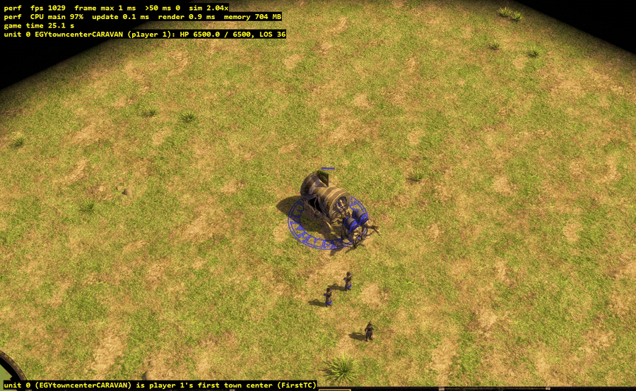

*In WoL, with `civFirstTC log` (Ethiopians with `<firstTC>EGYtowncenterCARAVAN</firstTC>` in `civs.xml`, for
the test, removed after):* the test map places a `TownCenter` for player 1, and the player gets the
caravan instead, which is its first town center (`unit 0 (EGYtowncenterCARAVAN) is player 1's first town
center (FirstTC)`). No town starting units come, because this proto has no `StartingColonyBuilding`.
[Full video (MP4)](media/civFirstTC-wol.mp4).

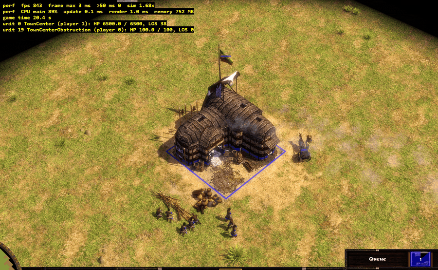

*In WoL, key off (the same data and map):* the exe ignores the tag: the same map places the `TownCenter`,
and its town starting units appear. [Full video (MP4)](media/civFirstTC-wol-control.mp4).

```
civFirstTC [log]
```

In `civs.xml`, inside a `<civ>`, next to its `<startingunit>` entries:

```xml
<civ>
    <name>Egyptians</name>
    ...
    <firstTC>EGYtowncenterCARAVAN</firstTC>
</civ>
```

- **In WoL today:** no civ in `civs.xml` has this tag. Each random map script places the players' first buildings itself,
  usually `rmAddObjectDefItem(startingTCID, "TownCenter", 1, 0.0)` and then an `rmPlaceObjectDef*` call,
  or a `CoveredWagon` in a Nomad start (`rmGetNomadStart()`). That is why the Maori start with a
  `TownCenter` that a tech removes ([`startingTC`](#startingtc)). `civs.xml` only lists a civ's units: `<startingunit>` (placed by
  `rmCreateStartingUnitsObjectDef`) and `<townstartingunit>` (settlers and crates that appear at
  the first built Town Center). A civ therefore cannot start with another building unless every
  map script is changed, and only a `TownCenter` becomes the player's first town center
  (`FirstTC`, see [`startingTC`](#startingtc)).
- **Effect,** for the players of a civ that has `<firstTC>Proto</firstTC>`:
  - **Map placement:** where a random map places `TownCenter` through an object def, the player
    gets `Proto` instead, at the same place. The placement uses the larger of the two footprints.
    The same object def still places a `TownCenter` for the players of other civs, and the map
    scripts are not changed. Items are compared by proto ID, so any spelling of `TownCenter` in a
    script counts.
  - **First town center:** the building becomes the player's `FirstTC`, as a `TownCenter` does: the
    placement rules (no enemy building within 65 m, the no-rush rule),
    [`noTrainNearEnemyTC`](#notrainnearenemytc) and `hcShipmentPointFallback FirstTC` use it. A
    unit of that proto added in any other way while the player has no first town center becomes
    it too, so a scenario or a saved game loaded later gets the same first town center.
  - **Town starting units:** the civ's `<townstartingunit>` units appear at the building, when the
    data below allows it.
- **Nomad start:** when `rmGetNomadStart()` is true, nothing is substituted: the map's own start
  (a `CoveredWagon`) stays, and a building of the `<firstTC>` proto does not become the first
  town center through this key. A `TownCenter` the player builds becomes it.
- **Not substituted:** a `TownCenter` from the civ's `<startingunit>` list (the
  `Special_StartingUnits` object def of `rmCreateStartingUnitsObjectDef`, whose items the game
  rebuilds from the civ's list), by design; and Town Centers that triggers, cards, techs or
  players create.
- **The tag:** its name may be written in any case; its text is a proto name as in `protoy.xml`
  (matched in any case; spaces around it are dropped); the last `<firstTC>` of a civ counts. An
  empty tag, or a name that is not a proto, leaves the civ's players with `TownCenter` (logged).
  `<firstTC>TownCenter</firstTC>` changes nothing. The exe ignores the tag, so the file still loads with
  the key off: the civ then starts with its `TownCenter`.
- **WoL needs:**
  - **`data\civs.xml`:** the tag.
  - **For the town starting units,** two more edits. Without them the player gets those units
    only once the player builds a `TownCenter`; none is lost.
    - `<Flag>StartingColonyBuilding</Flag>` on the proto, in `protoy.xml`. The game asks for the town
      starting units when a unit with that flag is created; `TownCenter`
      has it, `Market` does not. In the test, a Market without the flag became the first town
      center and a colony started at it, but no settler came.
    - The proto in the `<starttypes>` of `placementrules\colonies.xml`, e.g.
      `<type maxcount="1">Market</type>`. The units spawn only at a building where a colony
      starts; otherwise the log says `no colony starts at player N's first town center …`.
  - **For shipments:** the exe's fallback of the shipment point knows only 10 building types
    (`TownCenter`, `Outpost`, forts, …). Add `hcShipmentPointFallback FirstTC` (or the proto name)
    so that home city shipments arrive at the building
    ([hcShipmentPointFallback](#hcshipmentpointfallback)).
  - `TownCenter` also has the flags `ColonyPlacementCenter`, `HasGatherPoint`,
    `AllowAutoGarrison` and `ShowGarrisonButton`, which `Market` lacks. This key needs none of
    them; what they change on another building was not tested.
- **What it does not cover:** other code still looks for the `TownCenter` proto itself:
  - the AI scripts: in the test, an AI whose civ had the tag got its Market and its settlers, then
    stayed idle, because its scripts expect a Town Center. WoL's AI must learn the new building;
  - the engine's automatic AI main base;
  - the age-up picker (`uiPoliticianUI`);
  - the start camera (it looks for `TownCenter`, then `CoveredWagon`, `Explorer`, …);
  - the `trPlayerToggleAllowTCSpawning` gate on `Maintain`.

  The [`startingTC`](#startingtc) section lists the rest.
- **With other keys:** [`startingTC`](#startingtc) can be on too: the two share the hook that sets
  the first town center, and only `startingTC` replaces one that is gone, dead or about to
  expire. [`hcShipmentPointFallback`](#hcshipmentpointfallback) `FirstTC` sends shipments to the
  building, and [`noTrainNearEnemyTC`](#notrainnearenemytc) measures to its edge.
- **`log`:** adds a line for each substitution (per player and object def, when the map is
  generated), one when the building becomes a first town center, and one per game and player
  when the town starting units go to it. That is a few lines per game, so it can stay on.
- **Log:**
  - at startup, `civFirstTC: a civ's <firstTC> proto in civs.xml replaces the TownCenter random
    maps place for its players (not in a Nomad start) and is their first town center (FirstTC)
    (multiplayer unverified)` (with `log`: `…(FirstTC), every substitution logged (multiplayer
    unverified)`);
  - each time `civs.xml` is read, for each tag: `civFirstTC: civ N (Egyptians) starts with Market
    instead of TownCenter`, or `civFirstTC: civ N (Egyptians): empty <firstTC>; its players keep
    TownCenter`;
  - the first time a name is used after the data loads, if it is not a proto: `civFirstTC: civ N
    (Egyptians): <firstTC> names no proto unit (Markt); its players keep TownCenter`;
  - once per game for each player and building, when no colony starts at the building:
    `civFirstTC: no colony starts at player 1's first town center N (Market): its town starting
    units wait for a TownCenter (add the proto to placementrules\colonies.xml <starttypes>)`;
  - `hook reached: civFirstTC civs.xml (0x52BB07)` when `civs.xml` is read, `civFirstTC map
    placement (0x925F4C)` when the map places its first object def, `FirstTC proto check
    (0x506B3B)` (the hook it shares with `startingTC`) and `civFirstTC town units (0x679AC8)` in
    a game.

  With `log`:
  - `civFirstTC: player 1 gets Market instead of TownCenter in object def D 'startingTC'`;
  - `civFirstTC: player 1 keeps TownCenter in object def D 'startingTC' (Nomad start)`;
  - `civFirstTC: unit N (Market) is player 1's first town center (FirstTC)`;
  - `civFirstTC: player 1's town starting units go to its first town center N (Market)`, once per
    game for each player and building.
- **Simulation:** yes: the substitution, the first town center and the town starting units are
  all game state. Every machine needs the same line, `civs.xml`, `placementrules\colonies.xml`
  and `protoy`. A recorded game generates its map again when it is played back, so playback needs
  them too. The key adds no unit type.
- **Status:** confirmed in single player. In WoL (2026-11-04), the Ethiopians with `EGYtowncenterCARAVAN`: the
  substitution and the first town center, on a test map. On the stock game (2026-10-29), with
  `<firstTC>Market</firstTC>`:
  - a test map that places a `TownCenter` for both players: the tagged civ got a Market, which became
    its first town center, and the other kept its `TownCenter`;
  - a skirmish on Mongolia, with the Market in `colonies.xml` `<starttypes>`: without
    `StartingColonyBuilding` a colony started at it but no settler came; with the flag, 6 Settlers
    spawned at it;
  - an AI of a tagged civ got a Market and its settlers, then stayed idle. An Iroquois AI without the
    tag kept its Town Center and played normally, and a shipment landed at player 1's Market
    ([hcShipmentPointFallback](#hcshipmentpointfallback)).

  Not tested: a skirmish in WoL, the town starting units at a WoL building, WoL's AI with the tag, a Nomad
  start, multiplayer, recorded games, the `no colony` log line.

#### firstTC

*One line that sets up a civ's own starting building, with its starting units and shipments.*

**Added:** Friday 2026-11-06 13:11 · **Filmed in WoL:** Friday 2026-11-06 14:06

```
firstTC [UnitType] [log]
```

One line for [`civFirstTC`](#civfirsttc) and [`startingTC`](#startingtc): the first always, the second when a type is named. A plain
`firstTC` registers no marker, so it does not change the unit type count. If `startingTC` or `civFirstTC` is in the cfg too, that key
keeps its own line. Bad arguments fail only the `startingTC` part.

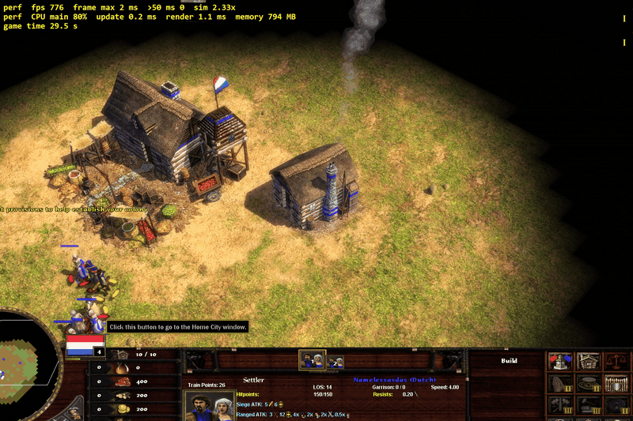

*In WoL, with `firstTC log` (Dutch, `<firstTC>Market</firstTC>`, the Market in `<starttypes>`, no flag in `protoy`):* the town units and
crates come to the Market, and a card's workers arrive there. [Full video (MP4)](media/firstTC-derived-wol.mp4).

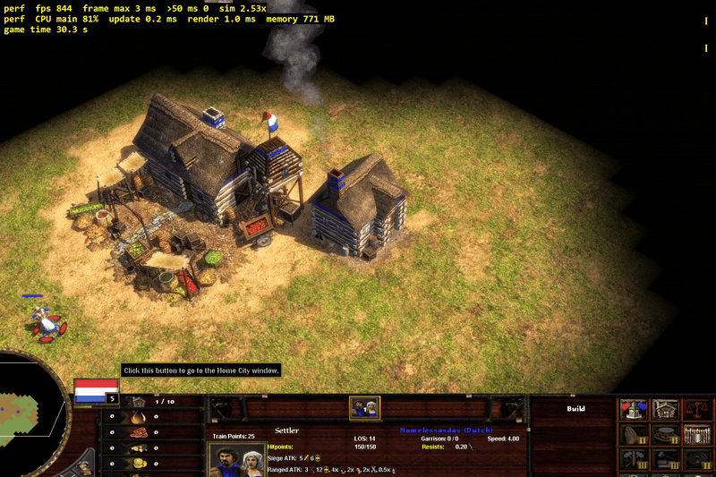

*In WoL, with `civFirstTC log` (the same data):* nothing comes, and the card is refused. [Full video (MP4)](media/firstTC-derived-wol-control.mp4).

- **What it derives from the tag:** `StartingColonyBuilding`, for that civ's first town center only, without writing the proto, and
  `FirstTC` first in `hcShipmentPointFallback`'s list, with or without that key. The `<starttypes>` entry in `colonies.xml` is still yours.
- **Tested in WoL (2026-11-06, Dutch):** town units, 400 food, 200 wood, 200 gold, and 2 -> 5 workers from a card; `civFirstTC` alone, none
  of it. An AI skirmish of 80 s had no XS error. A card needs population: the Market gives none, so the test has a House. Not tested:
  a loaded game, beside WoL's DLL, multiplayer.

#### scenarioCivs

*A second civ file for the civs of scenarios and campaigns: they show in the scenario editor, not in the skirmish lists.*

**Added:** Sunday 2026-11-22 11:56

```
scenarioCivs [log]
```

Asked by JTMaston (WoL #95, 2026-11-22). Put the civs meant for scenarios and campaigns in `data\scenariocivs.xml`, in the format
of `civs.xml`:

```xml
<?xml version="1.0" encoding="utf-8"?>
<civs>
    <civ>
        <name>HistFarrapos</name>
        <main>1</main>
        <displaynameid>444433</displaynameid>
        ...
    </civ>
</civs>
```

- **Where they go:** right after the civs of `civs.xml`, in the file's order. The game reads `civs.xml` first, then this file, and
  appends its civs to the same list, so every civ of `civs.xml` keeps its ID. A civ's ID is its place in the list: the first
  scenario civ is one past the last civ of `civs.xml` (169 in WoL 1.2.0e, which has 168 civs after Mother Nature).
- **Who sees them:** each civ of this file gets `<visible>0</visible>` and `<visibleineditor>1</visibleineditor>`, whatever the file
  says: it is in the scenario editor's player civ list (Scenario, Player Data), and never in the lists that skirmishes and the
  lobby build from visible civs. WoL's skirmish picks an AI by personality, so a civ without a personality is not there anyway.
- **What reads them:** the same code as a `civs.xml` civ, tag by tag, the tags of [`civFirstTC`](#civfirsttc) and
  [`sharedBuildLimit`](#sharedbuildlimit) included. XS gets a constant `cCiv<name>` for each.
- **What stops the whole file** (the reason is in the log, and the game goes on with `civs.xml` alone): a root other than `<civs>`;
  any element under it that is not a `<civ>` (`civs.xml`'s `<subcivalliancecost>` and the like would be read again and replace its
  values); a civ `<name>` that another civ already has (two `cCiv` constants of one name stop the AI scripts from compiling) or
  that is not made of letters, digits and `_`; XML that is not well formed. No file: nothing happens.
- **Scenarios store civs as numbers.** A scenario that uses a scenario civ needs the key and the same files. Without the key its
  players get IDs past the end of the list: the scenario still loads, and the game knows no civ for them. When `civs.xml` gets a
  new civ, every scenario civ moves up by one, as a civ appended to `civs.xml` would. `tools/scnfix.py player:NAME=CIV` counts the
  civs of this file after those of `civs.xml`.


*In WoL, with `scenarioCivs log` and a test `scenariocivs.xml` (copies of the British and the Japanese named `ScnRegencyBritish` and
`ScnBakumatsuJapan`, shown as "Redcoats" and "The Shogunate", own home city files, `<visible>1` in the file on purpose):* the end of
the editor's civ list, Scenario, Player Data. The log: `civ 169 ScnRegencyBritish`, `civ 170 ScnBakumatsuJapan`, `2 civ(s) added`.


*The same, player 1 on "The Shogunate" and player 2 on "Redcoats".*


*Key off, the same files:* the list ends with the last editor civ of `civs.xml` ("Japanese", `SPCJapanese`).


*Key on, the skirmish setup:* player 2's list, WoL's computer personalities, ends with "Random Personality"; no scenario civ.

- **Tested in WoL (2026-11-22, single player, `C:\AoE3-UHC-WoLReal5`):** the list dumped from memory, key off and on: the first
  169 entries identical, the two new ones at 169 and 170 with Visible 0 and VisibleInEditor 1. A scenario with players 1 and 2 on the
  two civs loaded, its armies fought, it was saved as a game and the save loaded with the same civs. An AI skirmish with the key and
  the file: the AI built and trained, no XS error. A duplicate name (`British`), a `<subcivalliancecostfactor>` element, a broken
  file and no file: each logged, 169 civs, no error dialog. `civs.xml` is read once per launch: neither a scenario load nor a
  skirmish start read it again. Not tested: the lobby, multiplayer, beside WoL's DLL, a civ of this file in a campaign.
- **Performance:** one more small file read at startup; no hook in the game itself.

#### customRevolutionBanners

*Each revolution shows its own banner, not just O'Higgins.*

**Added:** Wednesday 2026-10-28 10:56

```
customRevolutionBanners
```

- **Effect:** every revolution tech named `XPRevolution<Name>` shows the banner texture
  `ui\ingame\politicians\REV_banner_<Name>`. The exe shows a banner only for `XPRevolutionOHiggins`
  (`REV_banner_chile`), and that one is kept. `wol.cfg` has this line.
- **WoL needs:** `art\ui\ingame\politicians\REV_banner_<Name>.ddt` for each revolution. WoL's 29 revolution
  techs include `XPRevolutionWOLAlbania` and `XPRevolutionWOLAlgeria`, and their banners are already
  loose in that folder (`rev_banner_wolalbania.ddt`, …). A new revolution only needs its file. File
  names are not case-sensitive.
- **Log:** `hook reached: customRevolutionBanners (0x81A7CC)`.
- **Simulation:** no (interface only).
- **Status:** partly confirmed, on the stock game: the hook runs and the O'Higgins banner still shows.
  WoL's banners were not tested with this DLL.
- **Fixed from the original DLL:** the banner path is bounded; upstream overflows its buffer on long tech
  names.

#### removeFameRestriction

*Age-up screens show Fame, XP and shipment costs, and home city cards show Fame and XP icons.*

**Added:** Wednesday 2026-10-28 10:56

```
removeFameRestriction
```

Three changes:
1. **Politician (age-up) screens** list the Fame, XP and shipment costs of a choice. The second
   politician screen also lists the export resource. The exe shows only food, wood, gold and, on the
   first screen, export.
2. **Home city cards** that cost Fame or XP show an icon for those resources.
3. **"Fame trickle":** the built-in abstract unit type `FavoriteUnit` is renamed `Fame` (same ID). The
   original UnHardcoded project applies this change under that name; how it enables a Fame trickle was
   not traced. WoL's `protoy.xml` and `techtreey.xml` use neither name.

- **WoL needs:** the icons `art\ui\home_city\xp_hc_icon.ddt` and `art\ui\home_city\fame_hc_icon.ddt`.
  They are not in WoL's art, loose or in the archives. Without them, those cards show no icon. `wol.cfg`
  has this line.
- **Log:** `removeFameRestriction: icons need …`;
  `hook reached: removeFameRestriction costs #1 (0x80E490)` (also `#2`, `icon load`,
  `fame icon case`, `XP icon case`).
- **Simulation:** the unit type rename changes game data; give every player the same setting.
- **Status:** not tested in game, on any game.
- **Fixed from the original DLL:** on the second politician screen, upstream passes the wrong object
  as the owner of each cost line.

### Healing and hit points

Who heals, whom, and how far.

| Key | What it does | WoL's DLL | WoL also needs | In-game status |
|---|---|---|---|---|
| [`healNonIdle`](#healnonidle) | Lets healers marked with a unit type heal units that are busy (moving, fighting or doing something else); options pick the states and a lower rate on busy units. | **new** | That unit type on the healers in `protoy.xml`, or the name of an existing type (`xpMedicineMan`, `AbstractMonk`). | confirmed (automatic healing) |
| [`smartHealTargets`](#smarthealtargets) | A healer's automatic search heals the best candidate, not the first: listed unit types, then the lowest HP ratio, the nearest, the lowest unit ID; with `switch`, a running heal moves to a much worse unit. | **new** | Nothing (unit types or proto names are optional). | confirmed |
| [`overhealHitpointBars`](#overhealhitpointbars) | The HP bars and HP texts of marked units take `InitialHitpoints` as 100 %, not `MaxHitpoints`. | **new** | `MaxHitpoints` above `InitialHitpoints` on those units (no unit has it today), and the unit type on them, or an existing type such as `AbstractCavalryInfantry`. With `segment`, `art\ui\uhc\health_overheal.ddt` for the orange portrait end. | confirmed (single player, UI) |
| [`overhealSources`](#overhealsources) | Only heal actions with `<CanOverheal>1</CanOverheal>` heal those units above `InitialHitpoints`, up to their `<OverhealCap>`, and techs can turn it on or off; every other heal stops there. | **new** | `overhealHitpointBars`, and the tags on the `Heal` actions that may overheal. | confirmed (single player) |
| [`overhealDecay`](#overhealdecay) | The HP of those units above `InitialHitpoints` goes back down to it over time, at each proto's `<OverhealDecay>` rate (2 % a second by default), except while an own unit of a chosen type is near. | **new** | `overhealHitpointBars`; `<OverhealDecay>` where the default does not fit. | confirmed (single player) |

#### healNonIdle

*Chosen healers also heal units that are moving or fighting.*

**Added:** Wednesday 2026-10-28 12:48 · **Filmed in WoL:** Wednesday 2026-11-11 15:49


*In WoL, with `healNonIdle xpMedicineMan` (Iroquois; the two units are selected):* a Tomahawk fights
a `WOLLineInfantry` while the medicine man heals it between hits: its bar drops with each hit and
fills again. It wins and ends at full HP.
[Full video (MP4)](media/healNonIdle-wol.mp4).


*In WoL, key off (the same scene):* the medicine man does not heal the fighting Tomahawk; its bar
only shrinks and it dies at about 57 s of game time, the enemy left at 70 HP. The medicine man is
next.
[Full video (MP4)](media/healNonIdle-wol-control.mp4).


*In WoL, with `healNonIdle busyRate=50` (the medicine man gets the marker by a tech, the same scene with a
`WOLLineInfantry` walking in at 22 s; the two units are selected):* the medicine man heals the fighting Tomahawk at half
speed: it falls from 150 to 46.6 HP and wins at about 54 s, then is healed to 150 at the full rate.
[Full video (MP4)](media/healNonIdle-busyrate-wol.mp4).


*In WoL, `healNonIdle` with no option (busyRate 100, the same scene):* the Tomahawk stays between 126 and 135 HP through
the fight and wins at 128.9. [Full video (MP4)](media/healNonIdle-busyrate-wol-control.mp4).

```
healNonIdle [<UnitType>] [moving] [fighting] [busyRate=<percent>]   default AbstractHealNonIdle, both states, 100
```

- **`moving`, `fighting`:** the busy states a marked healer may heal. With neither, both (as before these options).
  With one alone, the other keeps its stock test: with `moving`, a fighting unit is no candidate of the search and a heal
  ends when its target fights; with `fighting`, the same for a moving unit. A unit doing anything else (gathering,
  building) counts as before. The two tests are the ones the stock heal tick uses: "moving" is the target's current
  action moving, "fighting" the exe's own fight test.
- **`busyRate=<percent>`** (1 to 1000, default 100): a heal tick whose target is moving or fighting adds that percent of
  what it would add; an idle target is healed at the full rate. `busyRate=50%` works too.
- **A bad option** stops the key: `healNonIdle: busyRate=abc: expected busyRate=<percent>, 1 to 1000; feature not
  applied`, or `…: expected healNonIdle [UnitType] [moving] [fighting] [busyRate=<percent>]; feature not applied`.
- **Measured in WoL (2026-11-11),** the scene above, the Tomahawk's HP when the enemy dies: `busyRate=50` 46.6 (fight
  from 28 to 54 s); no option 128.9; `moving` alone, not healed while fighting: it dies at about 50 s, the enemy left at
  32 HP, as with the key off. Idle, the medicine man heals about 10 HP/s; at 50 % about 5 HP/s.
- **Saved games:** nothing is kept in the DLL; the options act on each tick.
- **Through a tech:** with [`unitTypeTechs`](#unittypetechs), `AddUnitType` with the marker on one player's healers
  (`<Target type ='ProtoUnit'>xpMedicineMan</Target>`) turns the key on for that player only. Tested in WoL
  (2026-11-11): Player 1's medicine man healed his fighting Tomahawk (it lost 4.3 HP/s and won at 77.6 HP), Player
  2's, without the tech, did not heal his (6.3 HP/s, dead).

- **In WoL today:** a healer (`Surgeon`, `NAnurse`, `xpMedicineMan`, a monk) only picks targets that are
  idle, and stops healing as soon as its target moves or fights. So a healer behind a line of infantry
  does nothing during a fight.
- **Effect:** healers whose proto is of `<UnitType>` also pick targets that are busy (moving, fighting
  or doing something else), and keep healing them while they move or fight. The other checks still
  apply: the target must be damaged, a valid heal target for that healer, and reachable. Any other
  healer behaves as before.
- **WoL needs:** the name of an existing type or proto needs no data change: `healNonIdle xpMedicineMan`
  (the video) applies the feature to that proto, `healNonIdle AbstractMonk` to WoL's 11 monks. To choose
  the healers one by one, use a marker. Abstract unit types are a fixed list compiled into the exe, and
  any other `<UnitType>` in `protoy.xml` is silently dropped, so this DLL **registers `<UnitType>` as a
  new abstract type** when the data does not define it. List it on any healer in `data\protoy.xml`:

  ```xml
  <Unit id ='424' name ='Surgeon'>
      ...
      <UnitType>LogicalTypeHealed</UnitType>
      <UnitType>AbstractHealNonIdle</UnitType>
  ```

  In WoL's own DLL, add the name to `data\uhc\customabstracttypes.xml` instead.
- **Monks and other fighting healers** may still choose to attack instead of heal: that is the unit's
  own behavior and is not changed. Pure healers such as `Surgeon`, `NAnurse` and `xpMedicineMan` show the
  feature best.
- **Log:** `healNonIdle: healers of unittype X heal busy targets (multiplayer unverified)` (`moving (not fighting)` or
  `fighting (not moving)` with one state; `…targets, at 50 % of their rate…` with busyRate, and in a game `hook reached:
  healNonIdle busyRate (0x9E0CC7)`); when
  the data loads, `hook reached: abstract unit types (0x51BA31)` and
  `unit types: X -> <ID> (bit B of N), added` (or `already defined`); in a game,
  `hook reached: healNonIdle auto-search (0x9CD9C7)` and `hook reached: healNonIdle (0x9E0C79)`.
- **Check the data:** with the game running, `python -I tools/re/inspect_unittypes.py
  AbstractHealNonIdle` lists the protos that carry the type.
- **Simulation:** yes. It also adds a unit type, which changes the unit type count.
- **Status:** confirmed in WoL (2026-11-04), through the automatic search: the medicine man heals the
  fighting Tomahawk, which wins at full HP; without the key it dies at about 57 s. A direct order
  (right-click) on a fighting unit was not verified. The options (2026-11-11): the numbers above, a saved game, an AI
  skirmish of 100 s with every heal and overheal key on and no XS error. Not tested: `fighting` alone, multiplayer.

#### smartHealTargets

*Healers go for the units that need healing most, not the first they find.*

**Added:** Thursday 2026-10-29 13:19 · **Filmed in WoL:** Wednesday 2026-11-11 15:50


*In WoL, with `smartHealTargets log` (United States; the units are selected, so their HP bars show):*
four settlers are hit at once (90, 70, 45 and 33 % HP); the `NAnurse` heals the one at 33 % first
(8.2 m away), then 45, 70 and 90 %.
[Full video (MP4)](media/smartHealTargets-wol.mp4).


*In WoL, key off (the same scene):* the nurse takes the first settler the query returns, the one
at 45 % 4 m away, while the one at 33 % waits at 50 HP; the settlers at 70 and 90 % wait too.
[Full video (MP4)](media/smartHealTargets-wol-control.mp4).


*In WoL, with `smartHealTargets switch=20 log` (a `NAnurse`, three settlers hit at 18, 23 and 25 s; all selected):* the
nurse heals the first settler from 33 %; when the second falls to 47 % she leaves the first at 70 % (more than 20 %
higher) and heals the one at 20 % at once, then tops the three up in turns. [Full video (MP4)](media/smartHealTargets-switch-wol.mp4).


*In WoL, `smartHealTargets log` without `switch` (the same scene):* she heals the first settler to full while the one at 20 %
waits at 30 HP for about 5 s. [Full video (MP4)](media/smartHealTargets-switch-wol-control.mp4).

```
smartHealTargets [<UnitType> ...] [switch=<percent>] [log]   up to 8 types, in priority order
```

- **`switch=<percent>`** (1 to 100; default off): stock never looks again while a heal runs. With the option, once a
  second of game time, a heal this search started is checked against the units the search would accept now: if one
  ranks at the target's listed type or before it and its HP ratio is lower than the target's by more than the margin
  (`switch=20`: a target at 70 % is left for a unit below 50 %), the heal ends as when the target is full, and the
  healer's next search takes the best unit, as above. The margin keeps it from flipping back and forth: a unit only a
  little worse does not interrupt. A heal the player ordered is never checked.
- **Measured in WoL (2026-11-11),** the scene above: with `switch=20` the settler hit to 20 % at 25 s was healed from
  that second; without it, from about 29.5 s, after the first one was full. All three were full by about 56 s either way.
  With a gap of 17 % (63 % against 47 %), no switch.
- **Saved games:** the healer's last pick lives in the DLL, so after a load a heal started before the save is not
  checked (it runs to the end as without the option); every heal started after the load is. The same on every machine
  that loads the save. Tested: a save while the nurse healed the first settler, loaded: she healed it to full, then
  switched as usual.
- **A bad option** stops the key: `smartHealTargets: switch=0: expected switch=<percent>, 1 to 100; feature not applied`.

- **In WoL today:** an idle healer looks for a unit to heal on its own: it asks for the units around it
  and heals the **first** one that passes every test (damaged, alive, idle, a valid heal
  target, not already healed by others, in range). The order is the query's, so a healer often
  tops up a nearly full unit next to it while a badly hurt one waits.
- **Effect:** the same tests decide which units can be healed, and among them the healer picks:
  1. the unit types you list, in their order (a unit of none of them comes after them);
  2. then the lowest HP ratio (HP / max);
  3. then the nearest to the healer;
  4. then the lowest unit ID.

  No memory address and no query order is used, so every machine picks the same unit. With no
  type, it is the most hurt unit in reach. Only the automatic search changes: a direct order
  (right-click) heals what the player chose.
- **Every healer:** the key applies to every healer, with no marker on the healers: the search is
  the same function for surgeons, nurses, monks, priests and the others, and the key only reorders
  units the exe already accepts. Name a type to favour targets, e.g.
  `smartHealTargets AbstractInfantry Settler`.
- **With `healNonIdle`:** both keys hook the same search at different points and work together:
  marked healers also see busy units, and the best of all candidates is healed.
- **Log:** `smartHealTargets: automatic heal searches pick the best candidate: <types, >lowest HP
  ratio, nearest, lowest unit ID (multiplayer unverified)`; in a game `hook reached:
  smartHealTargets candidate (0x9CDA36)` and `pick (0x9CDA58)`; with `log`, every pick (the first
  200): `smartHealTargets: unit 0 (Surgeon) heals unit 4 (Settler, rank 0, HP ratio 0.333, 10.0
  m) among 4 candidates; stock would heal unit 1 (Settler, HP ratio 0.900)`. With `switch`, the startup line adds `; a
  running heal switches to a candidate more than 20 % lower`, a game `hook reached: smartHealTargets switch
  (0x9E0C3A)`, and `log` each switch: `smartHealTargets: unit 0 (NAnurse) leaves unit 1 (Settler, rank 0, HP ratio
  0.703) for a better candidate, unit 2 (Settler, rank 0, HP ratio 0.467; switch margin 0.20)`.
- **Simulation:** yes, every machine needs the same line. A listed name that is not a type yet is
  registered as a marker unit type, which changes the unit type count.
- **Status:** confirmed in single player. In WoL (2026-11-04), a `NAnurse` with four settlers hit at once
  healed them in the order 33, 45, 70, 90 %; without the key it took the first the query returned, at
  45 %. On the stock game (2026-10-29), with a listed type, that type came first, and with
  `healNonIdle` both hooks ran. A skirmish against the AI with the key on played normally. `switch` (2026-11-11):
  the numbers above, a saved game, an AI skirmish of 100 s with every heal key on and no XS error. Multiplayer
  was not tested.

#### overhealHitpointBars

*Health bars treat a unit's normal health as 100 %, and show any extra as overheal.*

**Added:** Thursday 2026-10-29 10:35 · **Filmed in WoL:** Thursday 2026-11-12 13:25


*In WoL, with `overhealHitpointBars segment stat log` and `art\ui\uhc\health_overheal.ddt` in the game
folder (British: a Highlander, selected, marked for the test with `MaxHitpoints` 180 over its 150; the
Surgeon is created next to it; bed data, removed after):* close up, the Highlander's floating bar and the
panel under it. At `150/150` both bars are full and green. A hit takes it to `60/150`: the portrait bar is
the game's yellow low-health bar. The Surgeon heals it past its 100 %: at `156/150` the `Overheal: 6/30`
row appears in orange, and at `180/150` the floating bar has its right 20 % orange and the portrait bar an
orange right end, `Overheal: 30/30`. [Full video (MP4)](media/overhealHitpointBars-wol.mp4).


*In WoL, keys off (the same data and scene):* the fresh Highlander shows `150/180` and a bar 83 % full, as
if damaged; healed, it ends at `180/180` with full green bars, no orange and no row.
[Full video (MP4)](media/overhealHitpointBars-wol-control.mp4).


*In WoL, damage after the overheal (the same key; the Highlander selected):* the Surgeon has taken it to
`180/150`, orange ends on both bars, and is removed. A hit takes it to `110/150`: the orange goes and WoL's
normal bar comes back, 73 % green. A second hit, `60/150`: the yellow low-health bar, a different colour
from the orange overheal end. [Full video (MP4)](media/overhealHitpointBars-damage-wol.mp4).


*In WoL, a group (three marked Highlanders selected):* at 180 each, every floating bar and the portrait bar
have their orange end (the portrait shows the group's average overheal). The Surgeon is removed and one is
hit down to 80: the portrait bar is the group's normal one, 84 % green, with no orange, although the other
two keep their orange floating segments: the portrait shows the overheal only while every selected unit is
at or above its 100 %. [Full video (MP4)](media/overhealHitpointBars-group-wol.mp4).

```
overhealHitpointBars [<UnitType> ...] [segment[=RRGGBB]] [bar=<texture>] [stat[=<Label>]] [log]   default AbstractOverheal; up to 8 types
```


*In WoL (Ethiopians, Pikeman with the marker, a tech with `subtype='MaxHPOnly'` 1.20 BasePercent at 22 s):* the HP stay at 122 and the
room above 100 % grows. [Full video (MP4)](media/overhealHitpointBars-maxonly-wol.mp4).


*In WoL, the same tech with the stock subtype `Hitpoints`:* HP and InitialHitpoints go to 151.5, so the unit stays at 100 %.
[Full video (MP4)](media/overhealHitpointBars-maxonly-wol-control.mp4).

- **`MaxHPOnly`:** the tech Data subtype that writes only MaxHitpoints. Units keep their HP and new ones keep InitialHitpoints.
- **Tested in WoL (2026-11-06):** 135.85 -> 164.45 with HP 122.9, kept by a saved game; a marked House showed 1290/1200 and a Caravel
  850/800, both with the Overheal row, HP written in memory. Not tested: auto-repair above 100 %, multiplayer.
- **In WoL today:** a unit is created with its proto's `<InitialHitpoints>` and can be healed up to
  `<MaxHitpoints>`. Every HP display takes `MaxHitpoints` as 100 %: the floating HP bar over a unit, the
  selection panel's HP bar (green, yellow below 66 %, red below 33 %), and the texts `HP/max`, or
  `HP/max (base+bonus)` when techs raised the max. WoL plans `MaxHitpoints` = 1.1 × `InitialHitpoints` on
  infantry and cavalry, so that healers can push them above their starting HP. Today no unit in
  `protoy.xml` has it, and with that data every fresh unit would show as damaged: a 91 % bar and
  `150/165`.
- **Effect:** for a unit whose proto is of `<UnitType>` and has `InitialHitpoints` below
  `MaxHitpoints`, the displays take `InitialHitpoints` as 100 %:
  - a fresh unit (HP = `InitialHitpoints`) shows a full bar and `150/150`;
  - an overhealed unit shows a full bar (the bar is not drawn past 100 %) and `165/150`;
  - a damaged unit shows its HP against `InitialHitpoints`: 105 HP is a 70 % green bar and `105/150`,
    where the exe shows a 64 % yellow bar and `105/165`;
  - the selection's average health counts each unit at most 100 %;
  - `(base+bonus)`: the base is the proto's `InitialHitpoints` in the data, the bonus what techs
    added since.

  Units of other types, and marked units whose `InitialHitpoints` is not below `MaxHitpoints`, display
  as before.
- **`segment`** (Overwatch style): the HP above 100 % is shown too.
  - The floating bar stays full and the overheal is drawn over its right end, in orange: a unit at
    165/150 has its right 10 % orange; from twice its 100 % the whole bar is orange. The bar keeps its
    width.
  - The unit panel's HP text above 100 % is orange too (`165/150`), through the game's own colour
    markup.
  - `segment=RRGGBB` sets another colour (hex, e.g. `segment=40C0FF`).
  - The floating bar is drawn in the player's colour, so the segment sits next to it.
  - No data change is needed beyond the marker for these.
  - The bar under the selected unit's portrait shows the overheal too, on the game's own green bar:
    while the selected units have overheal, the green part ends earlier and the right end shows the
    overheal in orange, (HP − 100 %) / 100 % of its width (the average of the selected units). Below
    100 % the green, yellow or red bar shows as without the key. The orange needs one file, see "The
    portrait bar" below.
- **`stat`:** in WoL's minimized interface (`optionminimizedui`), which has no stat panel, the row goes in
  the unit panel, in the gadgets `unitResourceRateLabel` and `unitResourceRateValue` that
  `showGatherRate` also uses, with one unit selected and only while it has overheal: `Overheal: 30/30`,
  the HP above its 100 % and the most it can have (max − 100 %), truncated like the HP row. A gathering
  unit shows its rate instead, since the row is one. With `segment` the value is in the segment colour.
  The label is `Overheal`, or `stat=<Label>`: one word, `_` for a space (`stat=Sobre_curación`; UTF-8 or
  ANSI), or a number, which takes that string from `stringtabley.xml` (`stat=90001`), so a language can
  translate it.
  - In the normal interface, the same row goes in the "Unit information" panel, right after the HP
    row, for every marked unit, and the rows below move down one.
- **What does not change:** the hit points themselves, healing (healers still heal up to
  `MaxHitpoints`, which is what makes the overheal possible), techs, auras, AI, triggers and every
  other game rule: they all keep reading `MaxHitpoints`.
- **Choosing the units:** an existing type works with no marker: `overhealHitpointBars
  AbstractCavalryInfantry` covers the 910 protos that carry that type, WoL's infantry and cavalry. A
  proto name works too, and up to 8 names may follow the key on one line. The default marker
  `AbstractOverheal` is registered by the DLL, like `healNonIdle`'s.
- **WoL needs:** `<MaxHitpoints>` above `<InitialHitpoints>` on the units, in `data\protoy.xml`:

  ```xml
  <Unit name ='Tomahawk'>
      ...
      <InitialHitpoints>150.0000</InitialHitpoints>
      <MaxHitpoints>165.0000</MaxHitpoints>
  ```

- **Techs and auras:** a `Hitpoints` tech adds the same amount to the max, to `InitialHitpoints` and to the HP of a built unit, so a
  unit at its 100 % stays there: 141.75/156.75 went to 158.25/173.25 with `BasePercent`, and 139.28/154.28 to 154.70/169.70 with
  `Percent`, as a new unit gets. A unit at its max stays at its max. Only an unbuilt unit is scaled. An aura or
  modifier that changes one unit's max scales its reference by the same factor, so a full unit stays
  full (seen on the stock game: a Golden Pavilion's MaxHP x1.1 aura took a unit from `165/150` to
  `181/165 (150+15)`, `Overheal 15/15` to `16/16`). In a skirmish, an Explorer marked for a test (400 /
  440 in the data) showed `180/180` and `Overheal 0/40`: a start-of-game effect lowers both values by
  the same amount, and the reference follows it.
- **The portrait bar.** It is WoL's `unitselectionpanel-unitHealthBarGreen`: no UI change. While there is
  overheal the DLL changes the texture of that bar's background and shortens its green part, and puts the
  background back when the overheal ends. The texture of the overheal end:
  - **WoL copies one file:** `art\ui\uhc\health_overheal.ddt` (in the release zip; `tools/make_bar.py` of
    [aoe3-blender-tools](https://github.com/Gorgorito12/aoe3-blender-tools)
    draws it) into the game's `art\ui\uhc\` folder. It is an orange bar in the segment's default colour
    `FF8C00`, shaded like the game's green, yellow and red bars (16×8 texels, DXT1). When the file is there
    at startup, the end is orange (the texture `ui\uhc\health_overheal`).
  - **Without the file** the end uses the game's `ui\ingame\ingame_ui_health_yellow`, the yellow of the
    low-health bar, and the log says so at startup (below). Nothing else changes.
  - **`bar=<texture>`** chooses another texture (a path under `art` with no extension), for example one
    packed in a `.bar` archive, which the DLL's check for the file does not see. A texture the game cannot
    find draws nothing: the bar's right end stays empty, with no error and no crash (tried 2026-11-12).
  - **`segment=RRGGBB` does not change the portrait:** the DLL writes no texture. For another colour, draw
    one with `python -I tools/make_bar.py --colour 40C0FF --out health_blue.ddt` (aoe3-blender-tools), copy it to
    `art\ui\uhc\` and name it: `bar=ui\uhc\health_blue`.
- **`log`:** one line for the first unit of each proto whose reference differs from its max (once
  per proto name in a session).
- **Log:** at startup `overhealHitpointBars: HP bars and HP texts of units of unittype X take
  InitialHitpoints as 100 % (display only)` (several types are listed as `X, Y`; with `log`: `…as
  100 %, the first unit of each proto logged (display only)`); when the data loads, `unit types: X
  -> <ID> …`; in a game, `hook reached: overhealHitpointBars (0x45FAAF)` (the first floating HP
  bar), `(0x4C5014)` (the first selection), and for the HP texts `(0x698B35)`, `(0x4D7575)` with
  `(0x4D7615)`, or `(0x9AFA2A)` with `(0x9AFA4E)`, depending on which panel shows them. With
  `log`: `overhealHitpointBars: unit N (Tomahawk) HP 150.0 is shown against 150.0 instead of its
  max 165.0 (InitialHitpoints 150.0, MaxHitpoints 165.0); logged once per proto`.
  With `segment`: the startup line adds `HP above it shown as a segment and texts coloured
  FF8C00, the portrait bar's end with ui\uhc\health_overheal` (or the `bar=` texture); without the file,
  first `overhealHitpointBars: art\ui\uhc\health_overheal.ddt is not in the game folder: the portrait bar
  shows the overheal with ui\ingame\ingame_ui_health_yellow`; in a game `hook reached: overhealHitpointBars segment queue (0x45FB6C)`, `segment fit
  (0x45C4B9)`, `segment vertices (0x45CB72)` and `text (0x4D7651)` (`text (0x69A9C0)` for the
  `(base+bonus)` form); with `log`, `overhealHitpointBars: unit N (Tomahawk) HP 165.0 is above its
  100 % 150.0: overheal segment of 10.0 % of the bar; logged once per proto`; and, only if a frame
  ever has more bars than the vertex buffer holds (about 9,700), `… bars do not fit in the vertex
  buffer …: this frame's K overheal segments were dropped (logged once)`. A wrong colour stops the
  key: `overhealHitpointBars: segment=…: expected segment or segment=RRGGBB (hex); feature not
  applied`. The portrait bar: `hook reached: overhealHitpointBars portrait bar (0x4C83DF)`; with `log`,
  `the portrait bar shows an overheal of 10.0 % of the bar (1 units; logged once)`.
  With `stat`: the startup line adds `an overheal stat row labelled 'Overheal'` (or `labelled by
  string N`); in a game `hook reached: stat panel rows (0x4D76DB)`; with `log`,
  `stat row 2 of unit N (Tomahawk): overheal 15/15 (logged once)` (with its colour markup). A bad
  label stops the key: `overhealHitpointBars: stat=…: expected stat or stat=<label> (a word, '_'
  for a space, or a string table ID); feature not applied`.
- **Limits:**
  - without `segment` the floating bar stops at 100 %;
  - in the minimized interface `unitHitPointsValue` prints colour markup as text (seen in game), so the
    HP text stays white and only the `stat` row is coloured. The ObjectInfo panel (the scenario
    editor's) is not coloured either;
  - other places still compare HP with `MaxHitpoints` and see a fresh marked unit as damaged: the
    damage-state visuals, the AutoRepairUnit command check (moot for infantry and cavalry), and the
    HP shown in tech and card rollovers;
  - whether the multi-selection stack buttons draw their own HP bars was not established.
- **Simulation:** no. Only display code is hooked (floating bars, the selection's group, three HP
  texts, the portrait bar, the stat row); every game rule reads the real max. Players may set it differently. A new marker name
  adds a unit type, which changes the unit type count: load saved games and replays with the same
  cfg.
- **Status:** confirmed in single player.
  - **The orange portrait end, in WoL (2026-11-12):** with the file, a marked Highlander healed to `180/150`
    had an orange end on the portrait bar (20 %) beside the orange floating segment; the yellow low-health bar
    at `60/150` is another colour. Without the file, the startup line named the yellow texture; with
    `bar=ui\uhc\nonexistent` the end stayed empty and the game ran on. Damage back to `110/150` (73 % green)
    and a group of three with one at 80 (84 % green, no orange) as in the videos above.
  - **In WoL (2026-11-04):** a marked Tomahawk at `180/150` with `Overheal: 30/30` in the unit panel and the
    end of WoL's portrait bar in the overheal colour, which shrinks with the decay and is gone at
    `150/150`; a damaged unmarked Aenna selected in between shows its normal bar; without the keys,
    `180/180` and no row. A Tomahawk hit from `180/150` to `110/150` goes back to WoL's normal bar, 73 %
    green with its dark background, and at `60/150` to the yellow one. With three marked Tomahawks
    selected, the bar shows their average overheal; when one falls below its 100 % (80, 180, 180) it
    shows the group's normal bar, 84 % green, with no overheal, although the other two still have it.
  - **On the stock game (2026-10-29), normal interface:** fresh units at `150/150` with a full bar, the
    orange segment and text, `segment=40C0FF`, a `Hitpoints` tech (`189/174 (150+24)`), an allied
    player's units, the aura case
    above, and a skirmish against the AI.
  - **Not tested:** the portrait bar in the normal interface since it moved to the game's own bar, the
    ObjectInfo panel, multiplayer.

#### overhealSources

*Only chosen healers can heal a unit above its normal health.*

**Added:** Thursday 2026-10-29 13:37 · **Filmed in WoL:** Saturday 2026-11-21 12:00


*In WoL, with `overhealSources log`, `overhealDecay log` and `overhealHitpointBars AbstractOverheal segment stat` (2026-11-21,
a scenario; a `Pikeman` marked for the test, `MaxHitpoints` 156, and an `NAnurse` beside it, both selected; the techs
`UHCOvhNurseOn` and `UHCOvhNurseOff` are test data: `Data` `CanOverheal` with `action="Heal"`, `Assign` 1 and 0):* hit at 8
s, the nurse heals it to its 100 %, `122.2/148`, and stops: her `Heal` has no `<CanOverheal>`. At 22 s a trigger gives
player 1 `UHCOvhNurseOn`, and she takes it to `148.2/148`, its max (`tech subtype CanOverheal, relativity 1, amount 1: 0
-> 1`). At 42 s `UHCOvhNurseOff` (`1 -> 0`): she stops, and the overheal decays at the default 2 % a second (2.44 HP/s)
back to `122.2` by 55 s. [Full video (MP4)](media/overhealSources-canoverheal-wol.mp4).


*In WoL, `overhealSources` and `overhealDecay` off (the same data and scene):* the nurse heals the Pikeman straight to
`148.2`, before any tech, and it stays there. [Full video (MP4)](media/overhealSources-canoverheal-wol-control.mp4).

*The dance videos below were filmed before 2026-11-21, when a healer's unit type made it a source (`AbstractOverhealer`, then the default); they still show what an area heal does: it is not a `Heal` action with `<CanOverheal>`, so it stops at the 100 %.*


*In WoL, an area heal, the Regeneration dance (Ethiopian fire pit, `danceBonusCivs Ethiopians`; the
tactic is turned on for the test):* it heals the marked Tomahawk to `150/150` and stops there, because
a dance is not a source. [Full video (MP4)](media/overhealSources-dance-wol.mp4).


*In WoL, key off (the same scene):* the dance takes it to `180/150`, `Overheal: 30/30`.
[Full video (MP4)](media/overhealSources-dance-wol-control.mp4).

```
overhealSources [<UnitType> [cap=<percent>] ...] [log]   no type by default; up to 8 types
```

```xml
<action>
    <name>Heal</name>
    <type>Heal</type>
    <rate type="LogicalTypeHealed">5.0</rate>
    <CanOverheal>1</CanOverheal>      <!-- this heal may go above the 100 % (default 0) -->
    <OverhealCap>110</OverhealCap>    <!-- up to 110 % of the 100 % (100 to 1000; default: up to MaxHitpoints) -->
</action>
```

- **Which heals overheal (2026-11-21, JTMaston's #85):** the heal action says so itself. `<CanOverheal>1</CanOverheal>`
  in a `Heal` action, in its `.tactics` file or in the proto's `<ProtoAction>`, lets that action heal a marked unit above
  its 100 %; without it (the default) the action stops there. `<OverhealCap>percent</OverhealCap>` (100 to 1000) stops it
  at that percent of the 100 % (never above `MaxHitpoints`); without it, up to `MaxHitpoints`. Above the 100 % the action
  heals at its own `<rate>`, as below it: there is no separate overheal rate. A `.tactics` file shared by several protos
  gives the tags to each of them; a `<ProtoAction>` to its proto only. The tags on an action whose name has no "Heal" are
  logged and ignored, and so is a bad value (`<CanOverheal>` takes 1 or 0).
- **Techs:** a `Data` effect of subtype `CanOverheal` or `OverhealCap`, with `action="Heal"` (or `allactions="1"`),
  changes them for the player who gets the tech, as stock's `Damage` changes an action:
  `<Effect type="Data" amount="1" subtype="CanOverheal" action="Heal" relativity="Assign"><Target type="ProtoUnit">NAnurse</Target></Effect>`
  turns it on, `amount="0"` with `Assign` turns it off, `OverhealCap` with `Assign` sets the cap (`Absolute` adds, as for
  any value). A saved game gets them back when its techs apply again on the load.
- **`AbstractOverhealer` is no longer a source by default.** The cfg's unit types are an explicit opt-in that still works
  (until the data moves to the tags): a healer of a listed type overheals with every heal action, to its type's
  `cap=<percent>` (100 to 1000) or up to `MaxHitpoints`. `rate=` is gone: it is logged and ignored (`rate= is gone, an
  overhealing action heals at its own <Rate>; ignored`). A bad `cap=` stops the key: `overhealSources: cap=110: expected
  <UnitType> [cap=<percent>, 100 to 1000] after each type; feature not applied` (also for an option before any type).
- **Measured in WoL (2026-11-11),** the scene above: 107.8 → 123.6 → 140.0 in steps of 1.6 s (about 10 HP/s), then
  152.7 → 160.4 in 1.55 s (5.0 HP/s), held at 165.0; without the options 159.0 → 174.8 in 1.57 s (10 HP/s) up to 180.
  At the start, a fresh Tomahawk (150) was taken to 165 by the source, 180 without the cap.
- **Saved games:** nothing is kept in the DLL.

- **Needs** [`overhealHitpointBars`](#overhealhitpointbars): its unit types mark the units that
  have overheal, and its 100 % (`InitialHitpoints`, scaled when an aura changes the max) is the
  limit here. Without that line the key is not applied.
- **Effect,** for a marked unit:
  - a heal action with `<CanOverheal>1</CanOverheal>` (or a healer of a type named in the cfg) heals it up to
    its `<OverhealCap>` or `MaxHitpoints`;
  - any other heal action heals it only up to its 100 %: its automatic search does not pick a marked
    unit at its 100 %, and its heal action ends when the unit gets there (the healer goes idle);
    a direct order on such a unit ends at once;
  - every other way of gaining HP stops at the 100 % too: regeneration, the Regeneration dance,
    area heals, self heals, powers and triggers that add HP. Only the single-target heal action of
    an overhealing action overheals. Damage, and code that sets HP rather than adding it (creation,
    transforms, the aura rescale), are not touched.

  Unmarked units heal as before.
- **WoL needs:** `<CanOverheal>1</CanOverheal>` (and `<OverhealCap>` where wanted) in the `Heal` actions that may
  overheal, in their `.tactics` files or `<ProtoAction>`; until then, a cfg type keeps today's behaviour:
  `overhealSources AbstractOverhealer cap=110`.
- **Log:** `overhealSources: only heal actions with <CanOverheal>1</CanOverheal> (Data subtypes CanOverheal and
  OverhealCap) heal marked units above their 100 %; every other heal stops there (multiplayer unverified)`; with `log`,
  each tag as the data loads, `overhealSources: proto Surgeon, action Heal (protoy): <CanOverheal> 1`, each tech,
  `overhealSources: proto 1682, action Heal, tech subtype CanOverheal, relativity 3, amount 0: 1 -> 0`; a tag on another
  action, `proto Settler, action Build: <CanOverheal> is for heal actions only, ignored`, a bad value, `proto
  ypMonkIndian, action Heal: <OverhealCap>abc</OverhealCap> needs a percent from 100 to 1000, ignored`;
  in a game `hook reached: overhealSources heal search (0x9CD984)`, `heal tick (0x9E0BBB)`, `heal
  (0x9E0CE9)` and `overheal add HP (0x4823A3)`. With `log`, the first of each proto: `overhealSources:
  a heal of unit N (Pikeman) stops at its 100 % 122.2 (…; not from an overhealing heal)` and `…unit N
  (Pikeman) is healed above its 100 % 122.2 by an overhealing heal (…)`; with a cap, `overhealSources: an
  overheal of unit N (Longbowman) stops at its cap 132.0, 110 % of its 100 % 120.0 (…)`. With cfg types the startup
  line adds `; and every heal of a healer of unittype AbstractOverhealer (up to 110 %)`. Without
  `overhealHitpointBars`: `overhealSources: needs overhealHitpointBars, …; feature not applied`.
- **Simulation:** yes. Every machine needs the same line (and `overhealHitpointBars` with the same
  types). The source type is a new unit type, which changes the unit type count.
- **Status:** confirmed in single player.
  - **`<CanOverheal>`, `<OverhealCap>` and the techs (2026-11-21, WoL, scenarios; British `Longbowman` and `Pikeman` marked for
    the test, 120 of 144 and 130 of 156):** a `Surgeon` with both tags in its `<ProtoAction>` (cap 110) held its Longbowman at
    `132.0`, 110 % of 120; an `xpMedicineMan` with `<CanOverheal>1</CanOverheal>` in `healer.tactics` (no cap) took its
    Longbowman to `144.0`, its max (the same file gave the tag to `Imam`, `NatMedicineMan` and `AboriginalElder` too); an
    `NAnurse` without it stopped at the 100 %, 122.2, until `UHCOvhNurseOn` (`Assign` 1), then 148.2, and after
    `UHCOvhNurseOff` (`Assign` 0) the overheal decayed to 122.2 in about 11 s; `UHCOvhNurseCap` (`Assign` 120) stopped her at
    `146.6`. Player 2's nurse, without the techs, kept its Pikeman at 122.2 the whole time. A saved game loaded with
    the techs active kept them (a Pikeman held at 148.2 with its decay set to 0 by a tech stayed there after the load).
    `<CanOverheal>` on a Settler's `Build` and `<OverhealCap>abc</OverhealCap>` were logged and ignored. The keys applied
    and worked beside WoL's own `uhc.dll` (our `dinput8.dll`), and an AI skirmish (Germans, `wolOtto`) played with them on (17 AI units at 159 s, no XS error). `perfprobe.py`, 60 s of 20 marked Longbowmen with 5 healers against 20 Pikemen with 3 overhealing nurses: keys on 526 fps, update 0.20 ms, main thread 65 %, no frame over 50 ms; keys off 578 fps, 0.24 ms, 77 %, none (other games ran beside it). Not tested: multiplayer.
  - **In WoL (2026-11-04):** a `NAnurse` healed a marked Tomahawk to `150/150` and stopped, and a source
    medicine man took it to `179/150`; without the key the nurse herself went past it. The Regeneration
    dance stopped at `150/150`, and went to `180/150` without the key.
  - **On the stock game (2026-10-29):** a healing building stopped at the 100 %, an idle surgeon ignored
    a marked unit at its 100 %, a direct order ended on arrival, and a unit's own regeneration stopped
    at its 100 %. A knocked-out hero still gets up, at about 40 % of its HP. A skirmish against the AI
    played normally.
  - **`cap` and `rate` (2026-11-11, WoL):** the numbers above; the source type given to one player's medicine man by
    an `AddUnitType` tech ([`unitTypeTechs`](#unittypetechs)): Player 1's took his fresh Tomahawk to 165; Player 2's Tomahawk, without
    the tech, stayed at 150; an AI skirmish of 100 s with every heal and overheal key on, no XS error.
  - **Not tested:** powers (`PowerHeal` goes through the same add-HP entry, 0x7C378C / 0x8CCA6F),
    multiplayer.

#### overhealDecay

*Extra health above a unit's normal maximum slowly wears off.*

**Added:** Thursday 2026-10-29 13:50 · **Filmed in WoL:** Saturday 2026-11-21 15:25


*In WoL, with `overhealDecay 3 1 log` and `overhealHitpointBars segment stat log` (Indians: a Sepoy,
selected, marked for the test with `MaxHitpoints` 216 over its 180; an Indian monk healed it to its max
before the video; bed data, removed after):* close up, the Sepoy starts above its 100 %: `216/180`, the
floating bar's right 20 % orange, the portrait bar's right end orange, `Overheal: 36/36`. The monk is
removed at 30 s; a second later the decay takes 3 HP a second: `195/180` and `Overheal: 15/36` with both
orange ends shorter, then `180/180` at about 43 s, when the orange and the row go and both bars are plain
green. [Full video (MP4)](media/overhealDecay-wol.mp4).


*In WoL, `overhealDecay` off (the same scene and `overhealHitpointBars` line):* the monk is removed at 30 s
and the Sepoy keeps `216/180`, `Overheal: 36/36` and both orange ends to the end of the video.
[Full video (MP4)](media/overhealDecay-wol-control.mp4).


*In WoL, with `overhealDecay 2 1 holdNear xpMedicineMan 12 log` (2026-11-21, a scenario; `overhealSources log`, with
`<CanOverheal>1</CanOverheal>` and `<OverhealCap>110</OverhealCap>` on the `xpMedicineMan`'s Heal, and `overhealHitpointBars
xpTomahawk segment stat`; test data: an `xpTomahawk` with `MaxHitpoints` 180 over its 150; both units selected):* the
medicine man walks up at 40 s and heals the Tomahawk to `165/150`, its 110 %, by 50 s; while he stands 4 m away it stays
at 165.0 with no more heals; he walks off at 62 s, and once he is 12 m away, at 64 s, it goes down 2 HP a second, to 150 at
71.6 s. [Full video (MP4)](media/overhealDecay-holdnear-wol.mp4).


*In WoL, `overhealDecay 2 1 log` without `holdNear` (the same scene, data and `overhealSources` line):* the overheal
starts to go 1 s after each heal, so the medicine man keeps healing it back: between 164.4 and 165 while he stands
there; he walks off at 62 s and it goes down at once, to 150 by 70.8 s.
[Full video (MP4)](media/overhealDecay-holdnear-wol-control.mp4).

```
overhealDecay [<rate>[%] [<delay>]] [<UnitType> ...] [holdNear <UnitType> <metres> ...] [log]
```

```xml
<Unit name="Longbowman">
    <OverhealDecay delay="2">5</OverhealDecay>   <!-- 5 % of its 100 % per second, 2 s after its last gain -->
</Unit>
```

- **Per proto (2026-11-21, JTMaston's #85):** `<OverhealDecay delay="S">R</OverhealDecay>` in a marked unit's proto: it
  loses R % of its 100 % per second, S seconds (default 0) after its last gain; 0 keeps its overheal. A marked proto
  without the tag takes the cfg line's rate and delay, or **2 % per second and no delay** when the line has none: the
  line `overhealDecay` alone is the switch. A bad value is logged and the tag ignored.
- **Techs:** `Data` effects of subtype `OverhealDecay` (the percent) and `OverhealDecayDelay` (seconds) on a proto or a
  unit type change them for the player who gets the tech:
  `<Effect type="Data" amount="0" subtype="OverhealDecay" relativity="Assign"><Target type="ProtoUnit">AbstractInfantry</Target></Effect>`
  stops the decay of that player's infantry. A saved game gets them back when its techs apply again on the load.

- **`holdNear <UnitType> <metres>`** (up to 4; more than 0, at most 200 m): a unit due to decay keeps its HP while a
  unit of that type (or proto) **of the same player**, alive and built, other than itself, is within that distance
  (measured to the other unit's edge, as the game's own area queries do). Allies' units do not hold it: an ally's
  healer does not change a player's own decay. A held moment is skipped, not saved up: the decay resumes at the same
  rate when no such unit is near (the `delay` still counts from the last gain). Typical: `holdNear AbstractOverhealer
  12`, so the overheal lasts while a source healer stays with the unit, and the "re-heal it" micro goes.
- **A bad `holdNear`** stops the key: `overhealDecay: expected holdNear <UnitType> <metres> (more than 0, at most 200;
  up to 4); feature not applied`.
- **Measured in WoL (2026-11-11),** in the scene filmed then (`holdNear xpAenna 12`; the medicine man removed at 20 s, an
  Aenna 2 m from the Tomahawk until 34 s): held at 165.0 from 20 to 34 s, then 163.1, 159.6, 156.0, 152.7 and
  150.0 at 41.5 s; the same after loading a game saved at 26 s (165 until 34 s, 150.0 at 41.6 s). Without `holdNear`,
  179.8 at 19.9 s down to 150.0 at 34.9 s.

- **Needs** [`overhealHitpointBars`](#overhealhitpointbars): its types mark the units and its
  100 % (`InitialHitpoints`, scaled when an aura changes the max) is where the decay stops.
- **Effect:** a marked unit whose HP is above its 100 % loses its proto's `<OverhealDecay>` percent of its 100 % per
  second, or the line's `rate` HP per second (`2`) or percent (`2%`), 2 % by default, counted in game time (paused games and game speed
  follow), once `delay` seconds (default 0, decimals allowed) have passed since it last gained HP
  above its 100 %. It stops exactly at its 100 %: the decay never goes below it and never kills.
  With unit types (or proto names) listed, only marked units of those types decay. Works with or
  without [`overhealSources`](#overhealsources): with it, only overhealing heal actions create overheal to
  decay; without it, any heal above the 100 % does.
- **What counts as a gain:** any heal that takes the unit above its 100 % (healers, area heals,
  powers…) restarts the delay. Regeneration (the unit's own, and the Regeneration dance) does not:
  it heals a little on every step, so it would hold the delay forever; a unit that regenerates
  above its 100 % decays at once (the rate minus what it regenerates). With `overhealSources`,
  regeneration never passes the 100 % anyway. HP that a unit has above its 100 % without any gain
  (a transform into another marked proto, for instance) does not decay until its next gain.
- **Log:** `overhealDecay: marked units above their 100 % lose their <OverhealDecay> (% of it per second, after its
  delay; Data subtypes OverhealDecay and OverhealDecayDelay), or 2.00 % of it per second of game time 0.0 s after their
  last gain, down to it (multiplayer unverified)`; with `log`, each tag, `overhealDecay: proto Longbowman loses 5.00 % of
  its 100 % per second, 2.0 s after its last gain`, and each tech, `overhealDecay: proto Pikeman, tech subtype
  OverhealDecay, relativity 3, amount 0: 2 -> 0`; in a game `hook reached: overheal add
  HP (0x4823A3)`, `hook reached: world update (0x481A57)`, `hook reached: overhealDecay
  regeneration (0x490881)` and, with a Regeneration dance, `overhealDecay Regeneration dance
  (0x67A03B)`. With `log`, the first of each proto:
  `overhealDecay: unit N (Tomahawk) decays from 165.0 toward its 100 % 150.0 at 2.00 HP/s` and
  `… is back at its 100 % 150.0`. Without `overhealHitpointBars`: `overhealDecay: needs
  overhealHitpointBars, …; feature not applied`; a bad rate: `overhealDecay: expected <HP per
  second>[%] [delay seconds] [UnitType ...] [log], …; feature not applied`. With `holdNear`, the startup line adds `;
  held while their player has a unit of xpAenna within 12.0 m`, and `log` writes each start and end of a hold (the
  first 200): `overhealDecay: unit 1 (xpTomahawk) holds its overheal at HP 165.0: unit 2 (xpAenna) of xpAenna is within
  12.0 m` and `… decays again from HP 165.0: no unit that holds it is near`.
- **Simulation:** yes, every machine needs the same line. A listed name that is not a type yet is
  registered as a marker unit type.
- **Saved games:** the delay goes on after a load. Saved at 11 s with `overhealDecay 5 20`, the decay ran from 24.2 s
  to 30.2 s in both runs (WoL, 2026-11-06). A unit transformed while it waits loses that until its next gain.
  `holdNear` keeps nothing of its own: it looks again on every tick.
- **Status:** confirmed in single player.
  - **`<OverhealDecay>` and the techs (2026-11-21, WoL, scenarios):** a Longbowman with `<OverhealDecay delay="2">5</OverhealDecay>`
    went from 144 to 138 in a second, 2 s after its healer's last heal (5 % of 120 per second); a Pikeman without the tag
    decayed at the default 2 % (2.44 HP/s of its 122.2) with the line `overhealDecay log` alone; `UHCOvhDecayInfantry`
    (`Assign` 0 on `AbstractInfantry`) stopped player 2's Pikeman at 148.2, also after a save and a load, while player 1's,
    without it, decayed. The tag's log line: `overhealDecay: proto Longbowman loses 5.00 % of its 100 % per second, 2.0 s
    after its last gain`.
  - **In WoL (2026-11-12):** with `overhealDecay 3 1`, a marked Sepoy at `216/180` went down 3 HP a second from
    1 s after its healer was removed, to `180/180`, and the orange ends of both bars and the row went with it
    (`decays from 216.0 toward its 100 % 180.0 at 3.00 HP/s`, then `is back at its 100 % 180.0`); without the key
    it stayed at `216/180`.
  - **In WoL (2026-11-04):** with `overhealDecay 2 1`, Menelik II, marked, stayed at `400/400` while he
    regenerated; without the key he went to `447/400` and on. With `overhealDecay 2 3`, a Tomahawk fell
    back to 150 after its healer died.
  - **On the stock game (2026-10-29):** `overhealDecay 2% 1 Musketeer` took 3 HP per second (2 % of 150)
    down to 150, and naming another proto left that unit alone; other players' units decay too; poison
    (`damageOverTime`) ticked normally; a skirmish against the AI played normally. Only the game world
    decays: the world update also runs for the home city's world, which the key ignores.
  - **`holdNear` (2026-11-21, WoL):** the two videos above, with the overheal from the `<CanOverheal>` and `<OverhealCap>`
    tags.
  - **`holdNear` (2026-11-11, WoL):** the numbers measured then (above), a saved game, an AI skirmish of 100 s with every heal and
    overheal key on and no XS error.
  - **Not tested:** multiplayer; `holdNear` with a unit of another player beside the unit (the Gaia unit tried for it
    attacked the Tomahawk).

### Combat

Attacks, armor, and what a hit does.

| Key | What it does | WoL's DLL | WoL also needs | In-game status |
|---|---|---|---|---|
| [`multiarmor`](#multiarmor) | A proto keeps one armor per damage type, and `Armor` tech effects change the one their `damagetype` names. | **in `wol.cfg`** | Several `<Armor>` lines on the protos. | confirmed |
| [`snareValues`](#snarevalues) | The factor and length of `<TargetSpeedBoost>`, per action and by tech. | **new** | The tags on the action. | confirmed |
| [`directionalAttack`](#directionalattack) | A shot that flies on past its target and hits every unit it flies over, before and after the target. | **new** | `<DirectionalAttack>` or `<DirectionalFiringRange>` on the attack. | confirmed (single player) |
| [`detonationDeath`](#detonationdeath) | `<DetonationProtoAction>` makes a unit fire an action around itself when it dies, with the action's impact effect where it stood. | **new** | The tag, and an action with `DamageArea`. | confirmed |
| [`dodgeAnyUnit`](#dodgeanyunit-dodgesoundset-and-criticalsoundset) | Lets units marked with a unit type dodge hits like the Japanese monk (no damage, 15 % of the hits, while their player has `YPDodge`). | **new** | That unit type on the units in `protoy.xml`, or a type or proto name in the cfg, and `YPDodge` active for their players. | confirmed (single player) |
| [`dodgeSoundSet`, `criticalSoundSet`](#dodgeanyunit-dodgesoundset-and-criticalsoundset) | Chooses the sound set a unit plays when it dodges or lands a critical hit. | **new** | A sound set name in the cfg. | confirmed (single player, from the log) |
| [`dodgeChance`](#dodgechance) | A dodge chance per unit type, with the tech it needs (or none) and a filter for ranged or melee hits; the first matching rule decides. | **new** | A unit type or proto name in the cfg, and the rule's tech active for their players unless `notech`. | confirmed (single player) |
| [`damageOverTime`](#damageovertime) | Poison: an attack that names an attachment proto keeps damaging its target every few seconds after the hit. | **new** | `<AttachProtoUnit>` on the attack, a new attachment proto in `protoy.xml`, and a small tactics file. | confirmed (single player) |
| [`spreadAnyAccuracy`](#spreadanyaccuracy) | Reads `<maxspread>` and `<spreadfactor>`, which 317 of WoL's tactics files have and the exe ignores, for every miss, and makes every shot of marked units, `InstantBallistics` included, scatter like that whatever their accuracy and hit what it lands on. | **new** | The tags are there; the unit type or proto name of the units that should always scatter, in the cfg. | confirmed (single player) |
| [`accuracyTechs`](#accuracytechs) | A tech can change an action's `<Accuracy>`, with a `Data` effect of subtype `Accuracy`. | **new** | The `Data` effects in `techtreey.xml`. | confirmed |
| [`containedUnitsROF`](#containedunitsrof) | An attack with `<ScaleByContainedUnits target="ROF">` fires faster with the units inside: its ROF is divided by their number, at most `<DamageFactorCap>`. | **new** | The attribute on the attacks that want it (none has it today). | confirmed |
| [`numberOfShots`](#numberofshots) | An attack with `<NumberOfShots>` fires that many shots, `<ShotInterval>` seconds apart, keeping its firing pose between them (`<BurstPose>`), before its reload; with `projectiles`, `<NumberProjectiles>` launches that many projectiles per shot. | **new** | The tags on the attacks that want them; `projectiles` reads the `numberprojectiles` WoL's tactics already have. | confirmed (single player) |
| [`retargetInAction`](#retargetinaction) | An attack with `<RetargetInAction>1</RetargetInAction>` whose target dies before the last shot of its attack animation (a machine gun's Attack tags, a burst's quick shot) fires the rest at a new target in range, instead of losing them. | **new** | The tag on the attacks that want it (the machine guns' `CannonAttack` in `organGun.tactics`). | confirmed (single player) |
| [`powerShots`](#powershots) | An ability's attack (an explorer's "Hammer Fanning") with `<PowerShots>N</PowerShots>` fires a shot at each Attack tag of its animation, up to N a use, instead of only the first. | **new** | The tag on the abilities' attacks (the Explorer's `SharpshooterAttack` and `CrackshotAttack`): the `wol-fixes/hammer-fanning` pack. | confirmed (single player) |
| [`turretArc`](#turretarc) | An attack with `<Turret>` turns its gun on the mount toward a target inside the turret's arc, the unit's body still; beyond the arc the unit turns until the target sits at the gun's rest. | **new** | `<Turret>` on the attack in its tactics, a model with a turning gun bone and its aim file (aoe3-blender-tools' `make_gun_camel.py`: the gatling camel pack). | confirmed (single player) |
| [`broadsideMuzzleLimit`](#broadsidemuzzlelimit) | Lets a ship's broadside fire from up to N muzzles per side instead of 6. | **new** | A ship model with more than 6 muzzles per side: `ypTekkousen` has 10. | confirmed (single player) |
| [`broadsideSoundSet`](#broadsidesoundset) | A `BroadsideAttack` action plays the sound set of its `<BroadsideSoundSet>` at each shot instead of `ShipCannonShoot`. | **new** | The tag on the rocket ships' actions in `frigate.tactics` (`RangedAttackRocket`, `BroadsideAttackRocket`). | confirmed (single player) |
| [`cantBeSlowed`](#cantbeslowed) | A unit with the type `CantBeSlowed` ignores `TargetSpeedBoost`; the attacker's type `CannotSnare` was retired on 2026-11-21 (take the snare out of the attack in its tactics). | **new** | The type on the protos that want it. | confirmed |
| [`killBountyTechs`, `resourceBounty` and `teamKillBounty`](#killbountytechs-resourcebounty-and-teamkillbounty) | Techs change a proto's `<Bounty>`, `<Bounty resourcetype>` pays a resource, and the type `TeamKillBounty` pays the killer's whole team. | **new** | The effects and tags. Turning on `killBountyTechs` turns on WoL's 10 `subtype='Bounty'` effects. | confirmed |
| [`pillageGold`](#pillagegold) | A unit of the type `AbstractCanPillage` steals `<PillageAmount>` gold from the owner of the building it hits with its `BuildingAttack`. | **new** | The type and the tag on the protos. | confirmed |
| [`veterancyBonus`](#veterancybonus) | `<VeterancyBonus>` rows make a proto stronger with its kills, a row with `tech=` only while the player has that tech; defaults by unit type, by civilization, added rows and rank names in `veterancy.xml`. | **new** | The rows on the protos that want them. | confirmed |
| [`killSpawn`](#killspawn) | A civ turns the enemies it kills into livestock: `<killSpawn>` in civs.xml lists the animals and their weights, with a chance and the victims' types; a `Data` tech can change the chance. | **new** | The tags on the civ in `civs.xml`. | confirmed (single player) |
| [`partisans`](#partisans) | The guerrilla of a destroyed building per civ: `<CivPartisan civ>` on the building gives each civ its own unit and count, `Data` techs change them, and `<PartisanFromNearby>` makes the owner's nearby buildings spawn them instead. | **new** | The tags on the building in `protoy.xml`; the techs in `techtreey.xml`. | confirmed (single player) |
| [`removeConversionRestriction`](#removeconversionrestriction) | Lets `ConvertGuardian` convert any unit, not only treasure guardians. | **in `wol.cfg`** | Nothing. | not confirmed |
| [`customImpactTypes`](#customimpacttypes) | New impact type names, after the game's 15, for `impacttype` in a `.dmg`, `<ImpactType>` and the elements of an `.impacteffect`. | **new** | The names in the cfg, their elements in the `.impacteffect` files (compiled to `.xmb`), and `impacttype` in the `.dmg`. | confirmed (single player, picture; sound not filmed) |

#### detonationDeath

*A unit can deal area damage around itself when it dies, and the blast shows on the unit that dies, over the whole of a building.*

**Added:** Thursday 2026-11-05 10:21 · **Filmed in WoL:** Saturday 2026-11-21 15:25


*In WoL, with `detonationDeath log` (2026-11-21, a scenario; a `TownCenter` whose `CitadelBombardAttack` is its blast, 60
Siege, `DamageArea` 10, `GAIAEnemy`, `<DetonationImpactEffect>effects\impacts\mortar</DetonationImpactEffect>`; eight Gaia
`CoveredWagon` around it, their HP on screen):* a trigger destroys the Town Center at 55 s, and it blows up over its
whole footprint, nine explosions on the building (`blast drawn at 9 points over its footprint`). The wagons show no
explosion of their own and go from 250 to between 217.6 and 238.0 HP, the same as with the previous version of the key.
[Full video (MP4)](media/detonationDeath-building-wol.mp4).


*In WoL, key off (the same data and scene):* the Town Center collapses with its stock destruction only, and the wagons
keep 250 HP. [Full video (MP4)](media/detonationDeath-building-wol-control.mp4).


*In WoL, with the key (the same scenario; a British `Grenadier` whose `BuildingAttack` is its blast, 40 Siege,
`DamageArea` 6, the mortar effect; three Gaia `CoveredWagon` beside it):* a trigger kills the grenadier at 20 s: one
mortar explosion where it stood (`blast drawn at 1 point`), none on the wagons, which go to 243.2, 233.9 and 235.2 HP.
[Full video (MP4)](media/detonationDeath-onunit-wol.mp4).


*In WoL, key off (the same data and scene):* the grenadier falls, nothing explodes, and the wagons keep 250 HP.
[Full video (MP4)](media/detonationDeath-onunit-wol-control.mp4).


*Filmed on 2026-11-13: in the MP4 the units hit still cry out; since 2026-11-21 they are silent.* *In WoL, with the key (two `xpAenna` with `<DetonationImpactEffect>effects\impacts\mortar</DetonationImpactEffect>` in front,
two `Engineer` behind with their own `BuildingAttack`, whose `<impacteffect>` is the dynamite; both blasts 40 Siege,
`DamageArea` 5, `GAIAEnemy`; six enemy `WOLScytheman`):* each archer that falls bursts into a mortar explosion, and each
Engineer knocked down into a dynamite one, where the scythemen around it lose HP. Four of the six scythemen died, the
other two were left at 16 and 28 HP. [Full video (MP4)](media/detonationDeath-blast-wol.mp4).


*In WoL, key off (the same data and scene):* the four fall with no explosion, and all six scythemen live (135, 135, 135,
77, 77 and 38 HP). [Full video (MP4)](media/detonationDeath-blast-wol-control.mp4).


*Filmed on 2026-11-13: in the MP4 the units hit still cry out; since 2026-11-21 they are silent.* *In WoL, with the key (an `xpAenna` with the mortar effect and `<DetonationCommand>Delete</DetonationCommand>`, deleted with
its Delete button next to an enemy `CoveredWagon`):* the mortar explosion where it stood, the log line `kill flags 1 0 0
(a delete)`, and the wagon destroyed. [Full video (MP4)](media/detonationDeath-delete-wol.mp4).


*In WoL, with the key (the same archer without `<DetonationCommand>`, deleted with its Delete button beside a Gaia
`CoveredWagon`):* it falls with no explosion, the wagon keeps 250 of 250 HP, and the log says `deleted without a
DetonationCommand, no blast`. The wagon then goes into the fog: the archer was the only one who saw it.
[Full video (MP4)](media/detonationDeath-delete-nocommand-wol.mp4).


*In WoL, with the key (two `xpAenna` with `<DetonationImpactEffect>none</DetonationImpactEffect>` against four
`WOLScytheman`):* the first archer falls and its blast hits (`unit 0, proto 714, at 36.9, 43.1`; a scytheman goes from
135 to 56 HP in the same moment, with the arrows), and nothing shows on screen.
[Full video (MP4)](media/detonationDeath-none-wol.mp4).


*In WoL, with `detonationDeath log` (2026-11-21, a scenario on a water map; a `Caravel` with `SHIPmelee` as its blast,
200 Siege, `DamageArea` 8, `GAIAEnemy`, and `<DetonationImpactEffect>effects\impacts\mortar</DetonationImpactEffect>`; three
Gaia `FishingBoat` beside it; a trigger deals it 5000 damage at 35 s):* the ship bursts over its footprint, four mortar
explosions on the water (`blast drawn at 4 points over its footprint`), and sinks. The boats show no explosion of their
own and go from 200 to 54.3, 46.0 and 46.0 HP, then into the fog: the Caravel was the only one who saw them.
[Full video (MP4)](media/detonationDeath-water-wol.mp4).


*In WoL, key off (the same data and scene):* the stock sinking only, and the boats keep 200 HP.
[Full video (MP4)](media/detonationDeath-water-wol-control.mp4).


*In WoL, with the key (an `Engineer`, which has `KnockoutDeath`, with its dynamite `BuildingAttack` as its blast and no
`<DetonationOnKnockout>`; beside it an `xpAenna` with the mortar effect and no `<DetonationCommand>`):* a 5000 damage
trigger knocks the Engineer out and nothing explodes (`knocked out (KnockoutDeath), no blast`); then the trigger `Kill`
takes the archer, and it explodes (`kill flags 1 0 0 (a trigger's Kill)`).
[Full video (MP4)](media/detonationDeath-knockout-off-wol.mp4).


*In WoL, with the key (an `Explorer` with `<DetonationOnKnockout>1</DetonationOnKnockout>` and the mortar effect; a
trigger deals it 5000 damage at 34 s and again at 154 s):* it explodes at the knockout, and again at the knockout after its
revival. [Full video (MP4)](media/detonationDeath-knockout-on-wol.mp4).


*In WoL, with the key (a test action on `Settler`: 1000 Siege, `DamageArea` 6, `GAIAEnemy`):* a trigger kills a settler and the
4 enemy `Coureur` around it die; another kills one of 3 settlers beside 3 enemy settlers, and all six go in a chain. The blue
`Coureur` in the middle is out of range. Filmed before the blast had an effect on screen: `Build` has no `<impacteffect>`.
[Full video (MP4)](media/detonationDeath-wol.mp4).


*In WoL, key off (the same data):* the settlers die and nothing else happens.
[Full video (MP4)](media/detonationDeath-wol-control.mp4).

```
detonationDeath [log]
```

```xml
<Unit name="Settler">
    <DetonationProtoAction>Build</DetonationProtoAction>
    <ProtoAction>
        <Name>Build</Name>
        <Damage>1000.000000</Damage>
        <DamageType>Siege</DamageType>
        <DamageArea>6.000000</DamageArea>
        <DamageFlags>GAIAEnemy</DamageFlags>
    </ProtoAction>
</Unit>
```

- **In WoL today:** no unit can do something when it dies. `selfdestruct` in a tactics file is another thing: the unit dies from
  its own attack. JTMaston's #39.
- **Effect:** when a unit of that proto dies, the action named by the tag fires around it: the stock area damage, with the
  action's damage, `DamageArea`, damage type, bonuses and `DamageFlags`. The action needs `DamageArea` above 0, and the proto
  must have it: an action its tactics file does not list does nothing, and the log says so.
- **Use an action the unit does not attack with.** The tag reads any action with a `<Damage>`, so `Build` works on a settler. If
  it is the unit's weapon, raising the damage also raises its normal attacks.
- **Which deaths:** combat, damage from a trigger (`Damage Unit`), the trigger `Kill`, an expired `Lifespan`, and a unit
  that dies in a blast. Not `Destroy` (the trigger that removes a unit with no death), and not a knockout (below). The
  trigger `Kill` (`trUnitDelete(false)`) sends the same delete command as the Delete button, but the key tells them apart
  (since 2026-11-13; before, a trigger `Kill` counted as a delete): it detonates like a death, without
  `<DetonationCommand>`, and the log line ends in `(a trigger's Kill)`.
- **Chains:** a unit that dies from a blast fires too, later in the same pass of the game's kill queue, not inside the blast.
- **Friendly fire:** `DamageFlags` decides it, as on any attack. {FF}
- **On screen (2026-11-13):** the blast plays the action's own `<impacteffect>` (the one in its tactics file) where the
  unit stood, as when a shot lands on the ground there: a mortar's impact effect, or the dynamite of WoL's miners and engineers, gives a mortar explosion
  with its sound, on grass, dirt, snow or water as the ground is. An action without `<impacteffect>` (`Build`) shows
  nothing, as before. `<DetonationImpactEffect>path</DetonationImpactEffect>` on the proto names another impact effect,
  as in a tactics file (`effects\impacts\mortar`, `effects\impacts\dynamite`, `effects\impacts\cannon`, or one of yours),
  so a unit whose blast action is a bow shot can still explode; `<DetonationImpactEffect>none</DetonationImpactEffect>`
  shows nothing. The effect is loaded with the data; a name the game cannot load is logged and the action's own
  effect stays. It is only drawn where the player can see, as a shot's landing is: a blast in the fog or the black
  map damages as usual and shows nothing. Over water the effect's water entry plays (`terrainwater`; for the mortar a
  water burst with its sound). Drawing and sound only: nothing in the simulation changes.
- **The blast is on the unit that dies, not on what it hits (2026-11-21, JTMaston's #86):** a wide unit, a building or a
  ship (`ObstructionRadiusX` or `ObstructionRadiusZ` from 1.5), bursts over its whole footprint: the effect plays at a grid
  of points over it, about one every 3 m and at most 3 × 3 (a `House` 2 × 2, a `TownCenter` 3 × 3), so the building
  itself blows up; a smaller unit gets the effect once, where it stood. The units hit show no effect of their own (the
  game's area damage draws none: they only flinch) and, since this change, play no hit or pain sound: the only explosion
  seen and heard is the one on the unit that dies. The damage is the same as before.
- **A unit with `KnockoutDeath`** (WoL's `Engineer`, explorers, heroes) is knocked out, not killed, so it does not
  detonate (since 2026-11-13). `<DetonationOnKnockout>1</DetonationOnKnockout>` on the proto makes it detonate at each
  knockout: once per knockout, as damage while it lies knocked out does nothing, and again at the next knockout after
  its revival. A delete with `<DetonationCommand>` detonates either way.
- **Decided (2026-11-13):** the action's own `<impacteffect>` stays the default and `none` opts out. There is no option
  for an explosion proto or a model: a proto would put a real unit into the simulation (population, stats, sync) only
  to get a picture, and an impact effect already brings the picture and the sound.
- **Techs:** the action is the player's copy, so a tech that changes its damage counts.
- **The other three tags (2026-11-05):**
  - `<DetonationCommand>Name</DetonationCommand>`: the unit detonates when it is **deleted**. Give the proto a command of
    that name whose `<command>` in `protounitcommands.xml` is `uiDeleteSelectedUnit`, the same console command the stock
    Delete button and the Delete key run (register the name with `customProtoUnitCommands`); the button and the key then
    both detonate the unit. Without this tag a delete gives no blast, whatever the other tags say. The name is not
    checked against the proto's commands: the tag only says that a delete detonates.
  - `<DetonationHitpointThreshold>Ratio</DetonationHitpointThreshold>` (0 to 1): when a loss of hit points leaves the unit at
    or under that share of its max HP (the modifiers counted), it detonates by itself: it is killed as if by the blow,
    and the blast fires. A unit inside another does not; the blow that kills it outright goes the normal way.
  - `<DetonationHitpointDecay>HP per second</DetonationHitpointDecay>`: with a threshold, the unit does not die at once:
    from the threshold on it loses that many HP per second of game time, through the game's HP setter (the damage
    visuals follow), and detonates when it reaches 0, or earlier if anything kills it. Healed back over the threshold,
    the decay stops until the next loss takes it under again. Not kept in a saved game: after a load the unit decays
    again from its next loss under the threshold.

  Only `<DetonationProtoAction>` is needed for any of them: a threshold or a command without it does nothing.
  `<DetonationImpactEffect>` (above, "On screen") and `<DetonationOnKnockout>` (above, `KnockoutDeath`) are the fifth
  and sixth; they too need `<DetonationProtoAction>`.
  at an HP ratio) and `DetonationHitpointDecay`. Without the threshold, one tag is the whole of it: there is no flag to set.
- **Multiplayer:** it changes the simulation: every player needs the same setting and data.
- **Log:** `detonationDeath: the proto tags DetonationProtoAction, DetonationCommand, DetonationHitpointThreshold, DetonationHitpointDecay, DetonationImpactEffect and DetonationOnKnockout are on`, in game `knocked out (KnockoutDeath), no blast` and a blast line ending in `(a trigger's Kill)`, with `log` `detonationDeath: proto 298 detonates when knocked out`, with `log` `detonationDeath: proto 714: its blast plays the impact effect effects\impacts\mortar (11)` / `its blast plays no impact effect`, and without `log` `<DetonationImpactEffect> X is not an impact effect, ignored`; with `log` `detonationDeath: proto 296 detonates on its command Detonate (a delete)` / `detonates at 25 % of its hit points` / `loses 100.00 hit points a second under its threshold`, and in game `detonationDeath: unit 0, proto 323: HP 79.5 of 165.0 (48 %) under the threshold 50 %: kill queued`, `… loses 100.00 HP a second from here`, `unit 0 decayed to 0: kill queued`, a blast line ending in `(a delete)`, or `deleted without a DetonationCommand, no blast`, and with `log`: `detonationDeath: proto 294 fires Build` and
- **Performance:** every loss of hit points asks the tag table once (a map lookup by proto ID), and the decay walks only
  the decaying units each world update. Measured with `perfprobe.py` (60 s, 30 Pikemen against 30, no tag on them): key on 1467 fps, main thread 79 %, longest frame 2.5 s (the load) and no frame over 50 ms after it; key off 1444 fps, 81 %, 3.7 s. With 30 Musketeers of 4000 HP against 30 that carry a threshold and a decay of 100 HP/s the game ran at 640 fps against 1461 and the render time tripled: that is the decaying units themselves (the HP setter's damage visuals on 30 units every update), not the hook, which runs on untagged units at no measurable cost.
  `detonationDeath: unit 8, proto 294, at 195.0, 45.0, kill flags 0 0 0; blast drawn at 1 point` (a building: `blast drawn at 9 points over its footprint`). Kill flags 1 0 0: a trigger's kill; 0 0 0 anything else seen.


*In WoL, with `detonationDeath log` (2026-11-21, a scenario; a Musketeer of 4000 HP, threshold 0.25, decay 100,
`VolleyRangedAttack` as its blast with `<DetonationImpactEffect>effects\impacts\mortar</DetonationImpactEffect>`, since that
attack's own `effects\impacts\gun` is a small puff of dust; a trigger takes 76 % of its HP at 35 s):* from 960 HP it loses
100 a second and detonates at 0, at 45 s: one mortar explosion where it stood (`blast drawn at 1 point`).
[Full video (MP4)](media/detonationDeath-threshold-wol.mp4).


*In WoL, key off (filmed on 2026-11-05, the same Musketeer without `<DetonationImpactEffect>`, which the key off ignores
anyway):* it stays at 960 HP. [Full video (MP4)](media/detonationDeath-threshold-wol-control.mp4).


*In WoL, with the key (2026-11-21; the same Musketeer, at its full 4000 HP, with `<DetonationCommand>Detonate</DetonationCommand>`,
deleted with its Delete button at 33.5 s):* the mortar explosion where it stood and the line `kill flags 1 0 0 (a delete);
blast drawn at 1 point`. [Full video (MP4)](media/detonationDeath-command-wol.mp4).


*In WoL, key off (filmed on 2026-11-05, the same Musketeer without `<DetonationImpactEffect>`):* the Delete key removes it
with no line.
[Full video (MP4)](media/detonationDeath-command-wol-control.mp4).

- **Tested in WoL (2026-11-21, the blast on the unit that dies, JTMaston's #86):** the two videos above. The damage is
  the same as before the change: with the build of 2026-11-20 and the same data and scene, the eleven wagons ended at the
  same HP to the tenth (217.6 to 243.2). The area damage was read in REA: it draws nothing on the units it hits (they
  flinch; the impact argument of TakeDamage is −2), so the only change for them is that they no longer play a hit sound.
  A chain of three Gaia grenadiers (one killed, the two beside it at 5 HP): three blasts, one per grenadier, each `blast
  drawn at 1 point`. Beside WoL's own `uhc.dll` (our `dinput8.dll`): applied, and a grenadier's blast as above. An AI
  skirmish (Germans, `wolOtto`) with the key and the test data on: 17 AI units at 159 s, no XS error.
  Refilmed the same day with this build: the Caravel over water (4 points, the boats at 54.3, 46.0 and 46.0 HP; on
  2026-11-13, 46.0, 54.3 and 54.3), and the Musketeer's threshold and delete (1 point each). Its delete went through the Delete button: the
  console's `uiDeleteSelectedUnit` crashed this background copy at 0x7E51C8 again (a stock crash, not the key's: typed
  in the console, that command reads the in-game interface, which a console call does not set up; see below).
- **Tested in WoL (2026-11-13, the blast on screen):** the scene of the first two videos (Ethiopians against an enemy
  of six `WOLScytheman`): four blasts, `unit 3, proto 714, at 41.9, 45.1` and `unit 2 … at 43.8, 45.2` (the archers,
  mortar effect) and `unit 1, proto 1482, at 38.5, 45.9` and `unit 0 … at 36.9, 46.6` (the Engineers, dynamite), each
  with its explosion at that point; key on, 4 of 6 scythemen dead and 2 at 16.1 and 28.3 HP; key off, all six alive. A
  delete with `<DetonationCommand>` from the Delete button (third video): `kill flags 1 0 0 (a delete)` and the explosion;
  the same archer without the command: `deleted without a DetonationCommand, no blast` (log only, not filmed). With
  `<DetonationImpactEffect>none</DetonationImpactEffect>`: `its blast plays no impact effect` at the load and the archer's
  blast line when it fell (not filmed). An AI skirmish (Germans, `wolOtto`) with the key on: the AI built a Manor and trained
  settlers. Performance while filming, key on: 1092 fps on average, no frame over 50 ms; key off 1057 fps, none.
- **Tested in WoL (2026-11-13, the rest):**
  - Water: a `Caravel` killed by a 5000 `Damage Unit` trigger on a water map: `unit 0, proto 299, at 39.0, 41.0, kill
    flags 0 0 0`, a mortar burst on the water, three Gaia fishing boats at 46.0, 54.3 and 54.3 of 200 HP; key off, the
    stock sinking and 200 HP each.
  - The fog: a caravel of the other player dies 65 m away in the black map (a trigger), with two Gaia boats beside it:
    the blast line, the boats at 125.2 and 87.1 HP, no crash. Hardware breakpoints (`tools/re/trace_exec.py`) on the terrain
    impact 0x4CB11C, its type block 0x4CB266 and the spawn 0x49C1E5: the hidden blast reached 0x4CB11C and stopped at the
    visibility test; the visible one (the player's own caravel) reached the type block with EBX = 7 (water) and the spawn
    once, both from the death observer (return 0x493D94).
  - Delete without `<DetonationCommand>` (the archer's Delete button): `deleted without a DetonationCommand, no blast`,
    nothing on screen. (The trigger `Kill` gave the same line until the change below.)
  - `<DetonationImpactEffect>none</DetonationImpactEffect>`: the blast line and the damage, nothing drawn.
  - `KnockoutDeath`, before the change below (a knockout then detonated): an `Engineer` given 5000 damage at 30, 70, 110
    and 150 s blasted at 30 s and 150 s only. It lay knocked out from 30 s (LOS 6, its HP back from 1.9 to 62.5 by 112 s),
    the hits at 70 and 110 s did nothing, it stood again by 148 s (LOS 18, 87.1 HP), and the hit at 150 s knocked it out
    again with a second blast. No double blast, no crash.
- **Tested in WoL (2026-11-13, knockouts and the trigger `Kill`):**
  - The Engineer without `<DetonationOnKnockout>`, 5000 damage at 30 s: `unit 0, proto 1482: knocked out (KnockoutDeath),
    no blast`, no explosion (its proto flag 123 read from memory: set; a Settler's and an archer's: clear).
  - An `Explorer` with `<DetonationOnKnockout>1</DetonationOnKnockout>`, 5000 damage at 34 s and 154 s: a blast at each,
    `unit 1, proto 298, at 44.0, 36.9, kill flags 0 0 0` twice.
  - The trigger `Kill` of an `xpAenna` and of a `Settler`, neither with `<DetonationCommand>`: `kill flags 1 0 0 (a
    trigger's Kill)` for both, a mortar explosion, and a Gaia wagon beside the settler from 250 to 237.3 HP.
  - The Delete button on another Settler and another archer, no `<DetonationCommand>`: `deleted without a
    DetonationCommand, no blast` for both.
  - All these went through the executor's kill-queue call (`hook reached: detonationDeath delete command, kill queue
    (0x7CD0DC)`): every unit seen there has proto flag 13. The HP-setter call (0x7CD0CF, a proto without flag 13) was not
    reached in these tests.
- **Tested in WoL (2026-11-05, the three tags):** a Grenadier with `MusketVolleyRangedAttack` and threshold 0.5 under three
  Pikemen: `HP 79.5 of 165.0 (48 %) under the threshold 50 %: kill queued`, then the blast with flags 0 0 0, and the unit
  gone; with the key off it fought on and died at 0. A Musketeer of 4000 HP with threshold 0.25 and decay 100, taken to
  960 HP by a trigger: 236.7 HP two seconds later, `decayed to 0: kill queued`, the blast; with the key off it stayed at
  960. The same Musketeer with `<DetonationCommand>Detonate</DetonationCommand>`, selected by console and the real
  Delete key: the blast line `kill flags 1 0 0 (a delete)` and the unit gone; a Grenadier without the command, deleted
  the same way: `deleted without a DetonationCommand, no blast`, dead. Not tested: a proto with the stock flag 0Dh (the
  kill-queue branch of the delete), a delete from the command panel's button (the same console command), the decay
  across a saved game, a unit healed back over the threshold, multiplayer. The blasts of these WoL actions have no
  `<DamageArea>`, so they hit nothing: the log lines are the proof.
- **Tested in WoL (2026-11-05):**
  - Performance, with `resourceDebt`, `sharedBuildLimit`, `transformSpan`, `veterancyBonus` and `detonationDeath` on and off, twice each, on 320 units in combat, about 120 of them with a timer: update 0.72 and 0.68 ms on, 0.72 and 0.73 off, and no more frames over 50 ms. A key-specific A/B was not run, and that scene did not show gatherers at work, so the gather hooks of `resourceDebt` were not measured under load.
  - A kill by trigger, combat with 6 `Pikeman`, an expired `Lifespan`: each killed the enemy `Coureur` around it.
  - `Destroy`: no blast, and the 3 `Coureur` kept 180 HP.
  - Own units in the blast with `GAIAEnemy`: 180 HP kept, the enemy's dead. With `GAIAEnemySelfAlly`: the own ones died too.
  - A chain of 3 + 3 settlers of both players: 23, then 26, 27 and 28, then 24 and 25, with no recursion.
  - Key off: no blast, in the same scene.
  - Not tested: a unit that dies garrisoned, and a building that dies with units inside: four trigger attempts left nobody
    inside (`[unit+74h]` stayed 0). The player's delete key from a script: `uiDeleteSelectedUnit` typed in the console
    crashes the stock game at 0x7E51C8 with or without keys (it reads the in-game interface first, a null pointer when
    the command comes from the console), so the Delete button was used. Multiplayer, and an A/B: with four games open the numbers are not clean.

#### multiarmor

*A unit can have a different armor against each damage type.*

**Added:** Tuesday 2026-11-03 09:33 · **Filmed in WoL:** Wednesday 2026-11-04 13:58


*In WoL:* a `HonorGuard`, with `<Armor type="Hand" value="0.2"/>` and `<Armor type="Ranged" value="0.2"/>`,
under three Pikemen. Its Hand armor counts, so it lasts longer and leaves a Pikeman at 33 HP.
[Full video (MP4)](media/multiarmor-wol.mp4).


*In WoL, key off (the same scene):* the unit keeps only its last armor, Ranged, and falls sooner, with that
Pikeman at 56 HP. [Full video (MP4)](media/multiarmor-wol-control.mp4).

```
multiarmor
```

- **In WoL today:** `wol.cfg` has this line, and 32 protos and 76 tech effects depend on it. Without it,
  the exe keeps one armor per proto: each `<Armor>` replaces the one before, so only the last one
  counts. It also reads no `damagetype` on effects: an `Armor` effect always changes that one armor.
- **Effect:** a proto keeps one armor per damage type, and an `Armor` tech effect changes the one its
  `damagetype` names. The unit uses the armor of the incoming damage type. An effect whose `damagetype`
  is the last armor's type, or that has no `damagetype`, works as in the exe.
- **WoL needs:** several `<Armor>` lines on the proto, as `HonorGuard` has, and `damagetype` on the
  effects:

  ```xml
  <Armor type="Hand" value="0.2000" />
  <Armor type="Ranged" value="0.2000" />
  ```

  ```xml
  <Effect type='Data' amount='1.50' subtype='Armor' damagetype='Ranged' relativity='BasePercent'>
    <Target type='ProtoUnit'>AbstractLightInfantry</Target></Effect>
  ```

  Up to 8 armors per proto. An effect on a damage type the proto has no armor for starts from 0 (so
  `BasePercent` changes nothing there).
- **What stays as it is:** the unit panel shows the last armor only.
- **Saved games:** the other armors' tech changes are not saved, but a load applies the effects again: tested on 2026-11-06, a
  `Pikeman` hit `HonorGuard` for 19 with an `Armor` effect on `Hand`, and for 19 again after a load in a new process.
- **Log:** `multiarmor: protos keep one armor per damage type; ...`; `multiarmor: <Proto> has N
  armors` for the first proto with several; `multiarmor: an Armor effect changed damage type T of
  <Proto> (now V; stock type S kept)` the first time an effect goes to another armor;
  `unknown damagetype "..."` for a name the game does not know.
- **Simulation:** changes combat: every player needs the same line.
- **Status:** confirmed (2026-11-03, single player, on WoL): `HonorGuard` took 38 per pike hit with the
  key and 47.5 without it. `gwDreadnought`, with `GWantitorpedobulge` (+0.1 Ranged, +0.1 Siege effects):
  with the key Siege went to 0.4 and Ranged to 0.5; without it Siege went to 0.5. Performance A/B in a
  battle of 160 units, 60 s each: 1263 / 1289 fps, update 0.138 / 0.136 ms, one frame over 50 ms each
  (no measurable cost).

#### dodgeAnyUnit, dodgeSoundSet and criticalSoundSet

*Any chosen unit can dodge hits like the Japanese monk, with its own dodge and critical sounds.*

**Added:** Wednesday 2026-10-28 19:12 · **Filmed in WoL:** Wednesday 2026-11-04 14:48


*In WoL, with `dodgeAnyUnit Settler log`, `dodgeSoundSet Settler PowerCriticalStrike` and `criticalSoundSet
ypMonkChinese PowerEvade` (`YPDodge` active; the units selected):* three `WOLJaeger` fight three settlers
and a Chinese monk. The settlers dodge at the exe's 15 %: 3 hits in this run (`dodged a hit`). Each dodge
plays the critical's sound set and each of the monk's critical hits the dodge's, swapped so that the log
shows the choice (`plays sound set PowerCriticalStrike`, 3 times, and `plays sound set PowerEvade`, 6
times). A GIF has no sound: the log is what shows it. [Full video (MP4)](media/dodgeAnyUnit-wol.mp4).


*In WoL, keys off (the same scene):* no settler dodges, and no sound set is logged.
[Full video (MP4)](media/dodgeAnyUnit-wol-control.mp4).

```
dodgeAnyUnit [<UnitType>] [log]          default AbstractDodge
dodgeSoundSet <UnitType> <SoundSet>      one line per unit type; the first match wins
criticalSoundSet <UnitType> <SoundSet>   one line per unit type; the first match wins
```

- **In WoL today:** a hit can be dodged (it does no damage) only when the target is a Japanese monk: the
  exe compares the target's proto with `ypMonkJapanese`, `ypMonkJapanese2` and `ypMonkJapanese3`. The
  dodge then needs the tech `YPDodge` to be active for the target's player (`ypMonasteryJapaneseCombat`
  activates it), and happens on 15 % of the hits. A dodge shows a floating text and plays the sound set
  `PowerEvade`; a critical hit (an attack with `<HitPercentType>CriticalAttack</HitPercentType>`, e.g.
  the Chinese monk's) plays `PowerCriticalStrike`. Both sound sets are the same for every unit.
- **Effect of `dodgeAnyUnit`:** units whose proto is of `<UnitType>` can dodge too, through the same
  code: the `YPDodge` tech of their player, the 15 % roll, the floating text and the sound are
  unchanged. The Japanese monks keep dodging.
- **The other edition's proto tags (2026-11-05):** with `dodgeAnyUnit` on, a proto with
  `<CanDodgeAttacks>1</CanDodgeAttacks>` dodges every kind of hit with the percent of `<DodgeChance>P</DodgeChance>` (15
  if absent), no tech needed, as a `dodgeChance X P notech all` rule would; the tags are tested before the cfg rules
  and need no marker type. They are elements, not `<Flag>` entries. With `log`, every roll of such a unit:
  `dodgeChance: unit 7 (Pikeman), CanDodgeAttacks (50.0 %): roll 312 -> dodged`. In WoL (2026-11-05) four Pikemen with
  the tags at 50 % under four Musketeers rolled 197 times and dodged 106.
- **Their tech subtypes (2026-11-05):** `subtype='EnableDodge'` (`Assign` 0 off, else on; base: the tag) and
  `subtype='DodgeChance'` (the percent; base: the tag's, or 15) as `Data` effects on a proto change that for one
  player's copy. The relativity is the stock one of every `Data` effect: `Absolute` adds the amount, `Percent` and `BasePercent` multiply, `Assign` sets it; the removal of the tech undoes it. The log calls those rolls `CanDodgeAttacks, by tech`. In WoL
  (2026-11-05) `DodgeChance` 90 (`Assign`) on player 1: its Pikemen rolled 78 times at 90.0 %, player 2's 116 times
  at the tag's 50.0 %.
- **WoL needs:** a type or proto name in the cfg (`dodgeAnyUnit Settler`, `dodgeAnyUnit AbstractInfantry`)
  needs no data change, or put the marker `AbstractDodge` on the protos. Then make `YPDodge` active for
  the players who should have it, from a tech of that civ, such as its `Age0<Civ>` tech or a home city
  card:

  ```xml
  <Effect type ='TechStatus' status ='active'>YPDodge</Effect>
  ```

- **Effect of `dodgeSoundSet` / `criticalSoundSet`:** a unit of `<UnitType>` (a unit type, which may be a
  marker, or a proto name) plays `<SoundSet>` instead of the usual set: when it dodges, for
  `dodgeSoundSet`; when it lands a critical hit, for `criticalSoundSet` (the sound belongs to the
  attacker). `<SoundSet>` is the name of a sound set of the game's sound data (`soundsetsy.xml`). A unit
  that matches no line keeps the usual sound. These two keys work with or without `dodgeAnyUnit`.
- **`log`:** writes one line per dodge, and, while `dodgeAnyUnit … log` is set, one line per
  dodge or critical sound with the set it played. Use it to check your data, not in a release:
  a long game writes many lines.
- **Log:** `dodgeAnyUnit: units of unittype X can dodge like ypMonkJapanese (tech ypDodge, 15 %)`
  and one `dodgeSoundSet:` / `criticalSoundSet:` line per rule; when the data loads,
  `unit types: X -> <ID> …`; in a game, `hook reached: dodge test (0x49ACE5)` (the first time a
  unit with a player is hit while the tech tree exists), `hook reached: dodgeSoundSet (0x6A2628)`
  (the first visible dodge) and `hook reached: criticalSoundSet (0x6A2A9A)` (the first critical
  hit). With `log`: `dodgeAnyUnit: unit N (Proto) dodged a hit` and
  `dodgeSoundSet: unit N (Proto) plays sound set S`.
- **Simulation:** `dodgeAnyUnit` yes (a dodged hit does no damage; it also adds a unit type, which
  changes the unit type count). The sound keys no.
- **Status:** confirmed in single player. In WoL (2026-11-04): settlers dodging at 15 %, and both sound
  keys picking their set, in the log; without the keys, nothing. On the stock game (2026-10-28), a marked
  Explorer dodged 5 hits of four attackers in 30 s, a Japanese monk next to it still dodged, and with a
  marker no unit had the Explorer never dodged. The sound itself was not listened to, and the floating
  text was not checked.

#### dodgeChance

*Each unit type can have its own chance to dodge ranged hits, melee hits or both.*

**Added:** Thursday 2026-10-29 16:57 · **Filmed in WoL:** Wednesday 2026-11-04 12:48


*In WoL, with `dodgeChance ypSettlerJapanese 50 notech ranged log` and `dodgeAnyUnit Settler log`
(`YPDodge` active; the villagers are selected):* three Redcoats shoot four villagers that do not
shoot back. The two Japanese settlers dodge 15 of their 27 rolls, the European settler dodges at the
exe's 15 %, and the unmarked Indian settler, which never dodges, dies first.
[Full video (MP4)](media/dodge-wol.mp4).


*In WoL, keys off (the same scene):* no villager dodges; every hit takes HP off the bars and all four are
dead before 60 s of game time. With so few shots the time they last varies from run to run; the rolls
are what the rule sets.
[Full video (MP4)](media/dodge-wol-control.mp4).

```
dodgeChance <UnitType> <percent> [tech <TechName> | notech] [ranged | melee | all] [log]
```

One line per rule; several lines add up, and the first rule that matches a hit decides.

- **In WoL today:** only the three Japanese monks dodge, on 15 % of the hits (15 of the 101 values of the
  roll), while their player has `YPDodge` ([dodgeAnyUnit](#dodgeanyunit-dodgesoundset-and-criticalsoundset)).
- **Effect:** each hit on a unit is matched against the rules, in cfg order. A rule matches
  when the unit's proto is of `<UnitType>` (a marker, an existing type or a proto name) and, with
  `ranged` or `melee`, when the hit's damage type is `Ranged` or `Hand` (of `damagetypes.xml`;
  `all`, the default, matches every hit, `Siege` included). The first matching rule decides:
  - its tech must be active for the unit's player: `YPDodge` by default;
    `tech <TechName>` another tech; `notech` none. Otherwise the hit lands;
  - the hit is then dodged with `<percent>` % chance: 0 to 100, one decimal at most (`12.5`),
    drawn from the game's synced random numbers. 0 % and 100 % draw nothing;
  - a dodge is the exe's dodge: no damage, the floating text, the dodge sound (`dodgeSoundSet` still
    picks it).

  A rule's units dodge with or without `dodgeAnyUnit`. A hit that no rule matches keeps the other keys'
  behaviour: a unit with `dodgeAnyUnit`'s marker gets 15 % with `YPDodge`, a Japanese monk its usual
  dodge, any other unit no dodge.
- **Per damage type:** `dodgeChance X 40 ranged` then `dodgeChance X 10 melee` gives 40 % against
  ranged hits and 10 % against melee hits; siege hits match neither and fall back as above.
  `dodgeChance X 0 melee` alone stops marked units from dodging melee hits.
- **WoL needs:** a type or proto name in the rule, or a marker on the units, as for
  [dodgeAnyUnit](#dodgeanyunit-dodgesoundset-and-criticalsoundset), and the rule's tech active for their
  players (none with `notech`).
- **`log`** (on any line): once per data load, each rule's resolved tech and damage type; then
  one line per roll: `dodgeChance: unit N (Explorer), rule 1 (50.0 %): roll 238 -> dodged` (the
  roll is 0..999 and dodges below the percent × 10; −1 when nothing is drawn), or `… rule 2: tech
  X not active -> hit`. For checking data: a long game writes many lines.
- **Log:** at startup `dodgeChance: rule K: units of X dodge P % of ranged hits, with tech T
  (multiplayer unverified)`; in a game `hook reached: dodge test (0x49ACE5)`. A tech or damage
  type that does not exist is logged once per data load and disables its rule (the next rules
  still apply): `dodgeChance: rule K (X): no tech named T; rule disabled`. A bad line stops the
  key, and the other dodge keys with it: `dodgeChance: expected "dodgeChance <UnitType> <percent
  0-100> …" (bad percent 150); feature not applied` or `dodgeChance X: unexpected argument …`,
  then `dodgeAnyUnit/dodgeChance/dodgeSoundSet/criticalSoundSet: FAILED`.
- **Simulation:** yes, every player needs the same lines. The rolls use the stream of the game's synced
  random numbers that the exe's dodge uses, only for hits that a rule between 0 and 100 %
  matches, the same on every machine. A rule's type that the data does not define adds a unit
  type: load saved games and replays with the same cfg.
- **Status:** confirmed in single player. In WoL (2026-11-04): `dodgeChance ypSettlerJapanese 50 notech
  ranged` gave 15 dodges in 27 rolls, and nobody dodged without the keys. On the stock game (2026-10-29):
  - 50 % `ranged`: 18 dodges in 46 rolls, then 28 in 50; 0 % `melee`: 0 in 57;
  - 30 % `notech`, `YPDodge` not active: 20 in 71;
  - 100 % with an active tech: 49 of 49; a rule whose tech was not active: 15 hits, no dodge;
  - an unknown tech: logged, the rule disabled; bad lines (`150`, `12.25`, `-5`, an unknown word, no
    percent, `tech` with no name): logged, the key not applied, the game normal;
  - a skirmish against the AI with these keys on played normally.

  Not tested: multiplayer, siege hits.

#### damageOverTime

*Attacks can poison a target, which keeps taking damage after the hit.*

**Added:** Wednesday 2026-10-28 16:34 · **Filmed in WoL:** Friday 2026-11-06 13:02


*In WoL, with `damageOverTime log` (Iroquois; the archers are selected):* three Aenna whose arrows
carry a poison (4 Ranged a second for 8 s, up to 3 stacks, half speed, green tick text, written by
`dot_testdata.py --wol`) meet a charging Landsknecht. With three stacks each tick takes 12 (the
green numbers over it, the `(x3)` lines), the poison halves its speed (`speed 2.25`), and the last tick
kills it at about 40 s of game time, after it killed one archer.
[Full video (MP4)](media/damageOverTime-wol.mp4).


*In WoL, key off (the same data and scene):* the arrows do only their own damage; the Landsknecht kills
all three archers and lives, with 4 HP. [Full video (MP4)](media/damageOverTime-wol-control.mp4).


*In WoL, with `damageOverTime log noticktext`:* the same fight, with the same ticks, and no green numbers
over the unit. [Full video (MP4)](media/damageOverTime-noticktext-wol.mp4).

```
damageOverTime [log] [noticktext]
```


*In WoL, with `damageOverTime log` (test data: `xpAenna` with `<AttachModel>effects\uhc_rings\ring_damage.xml</AttachModel>`,
Settlers as targets):* each poisoned unit wears the ring, and a corpse does not. [Full video (MP4)](media/damageOverTime-model-wol.mp4).


*In WoL, key off (the same scene):* arrows only, no ring. [Full video (MP4)](media/damageOverTime-model-wol-control.mp4).

- **`<AttachModel>path.xml</AttachModel>`:** the unit carries that model while poisoned, as an aura's `<modelattachment>`. Two
  poisons with the same model share it until the last ends. A visual: nothing reaches the simulation. A file that is not in
  the game logs one line and shows nothing.
- **Saved games:** running poisons go on after a load, with their stacks, next tick and attacker: a copy lives on the unit.
- **Tested in WoL (2026-11-06, model and saves):** a poison saved after its attacker died went from 2652.0 to 2636.0 and ended at game
  time 27656, the same ticks as with no save; with the attacker alive every tick matched. 694 fps against 664, update 0.18 ms
  against 0.19, with 16 attackers (other games running). An AI skirmish of 100 s, saved and loaded, had no XS error. Not tested:
  a target transformed just before a save, 100 stacks, beside WoL's DLL, multiplayer.
- **In WoL today:** there is no damage over time. The exe still contains Age of Mythology's poison, but
  the function that would apply it is empty, so nothing happens.
- **Effect:** an attack whose `<ProtoAction>` lists `<AttachProtoUnit>X</AttachProtoUnit>` poisons
  every unit it damages.
  - For X's `<Lifespan>` seconds, the unit takes the damage of X's `Attaching` action every `ROF`
    seconds. The first tick comes one ROF after the hit.
  - Each tick is a normal hit: the damage type, the damage bonuses, the armor and X's
    `DamageFlags` apply, also after the attacking unit is gone. Kills and XP go to the attacker's
    player. (Bonuses and kill credit follow from the code; see the status below.)
  - Once the attacking unit is gone, the ticks still hurt but no longer cause the reactions to a
    hit, such as retaliation and under-attack alerts.
  - Another hit by the same player renews the duration and keeps the tick timer (with
    `<AttachMaxStacks>`, it adds a stack instead; see below).
  - Poisons from different players, or from different attachment protos, run side by side.
  - It works with every kind of attack tested: hand attacks, instant shots, flying arrows, grenades
    and cannon balls, and area damage (one grenade poisoned all four units it hit).
- **WoL needs** three pieces:
  1. **The attacks.** Add the tag inside the attacker's existing `<ProtoAction>` blocks in
     `protoy.xml`:

     ```xml
     <ProtoAction>
         <Name>StaggerRangedAttack</Name>
         ...
         <AttachProtoUnit>PoisonArrow</AttachProtoUnit>
     </ProtoAction>
     ```

     - The game reads a `<ProtoAction>` only when its `<Name>` is its first child and names an
       action of the unit's tactics file. It skips any other block without a message, and the
       tag with it.
     - A unit has one attack per stance, and each needs its own tag. Use the `<Name>`s of the unit's
       existing blocks. `xpAenna` (`archer.tactics`), for example, has no `RangedAttack`: its ranged
       attacks are `StaggerRangedAttack`, `DefendRangedAttack` and others, and its melee attacks are
       `MeleeHandAttack`, `DefendHandAttack` and `StaggerHandAttack`.
     - The load-time line `<Unit>/<Action> attaches <X>` in `UHC.log` lists every tag the game
       read.

  2. **The attachment proto X**, a new `<Unit>` in `protoy.xml`. It holds data only: it is never
     created in the world.

     ```xml
     <Unit id ='6055515' name ='PoisonArrow'>
         <DBID>6055515</DBID>
         <Lifespan>6.0</Lifespan>
         <Tactics>uhcattachment.tactics</Tactics>
         <ProtoAction>
             <Name>Attaching</Name>
             <Damage>4.0</Damage>
             <DamageType>Ranged</DamageType>
             <ROF>1.0</ROF>
             <DamageFlags>GAIAEnemy</DamageFlags>
             <DamageBonus type ='AbstractInfantry'>1.5</DamageBonus>
         </ProtoAction>
     </Unit>
     ```

     - `id` and `DBID`: WoL's IDs are not in order. Any value that no other unit uses works: the
       largest in WoL's `protoy.xml` is 6055514 for both, and the test used the next one.
     - `Lifespan` is the duration in seconds and `ROF` the seconds between ticks, so a poison
       deals Lifespan ÷ ROF ticks, rounded down (6 here).
     - `DamageFlags` says whose units the ticks hurt: `GAIA`, `Self`, `Ally` and `Enemy`,
       combined, as in `GAIAEnemy`. Without the tag they hurt everyone. Treasure guardians and
       animals are Gaia. The attack's own `DamageFlags` decide what gets poisoned. A poisoned unit
       that X's flags exclude takes `0.00` damage per tick, for example after a conversion.
     - Techs can change X for the player who researches them. Target X by name: the attacker's
       own upgrades do not reach it. Two effects apply:
       - its `Lifespan` (`subtype ='Lifespan'`), from the next hit;
       - the damage of its `Attaching` action, from the next tick:
         `<Effect type ='Data' action ='Attaching' amount ='1.25' subtype ='Damage'
         relativity ='BasePercent'><Target type ='ProtoUnit'>PoisonArrow</Target></Effect>`.

       This DLL has no tech effect for ROF, so the tick interval is always the `<ROF>` of the data.
  3. **A tactics file for X.** The game ignores a `<ProtoAction>` whose name is not an action in
     the proto's tactics file, so X needs one with an action named `Attaching`. Save
     [examples/data/tactics/uhcattachment.tactics](../examples/data/tactics/uhcattachment.tactics)
     as `data\tactics\uhcattachment.tactics`; one file serves every attachment proto:

     ```xml
     <tactics>
       <action>
         <name>Attaching</name>
         <type>Attack</type>
         <rate type="Unit">1.0</rate>
       </action>
       <tactic>Normal<action priority="100">Attaching</action></tactic>
     </tactics>
     ```

     Keep `<tactic>Normal` and its `<action>` on one line, as here. A line break after the tactic
     name can break every AI player in the game ([tactics files](#tactics-files)).
- **Optional tags**, in the same attacker `<ProtoAction>` as `<AttachProtoUnit>` (each one changes
  only the poisons of that attack; without them the poison is the one above):

  ```xml
  <ProtoAction>
      <Name>StaggerRangedAttack</Name>
      ...
      <AttachProtoUnit>PoisonArrow</AttachProtoUnit>
      <AttachMaxStacks>3</AttachMaxStacks>
      <AttachSnare>0.5</AttachSnare>
      <AttachTickText>40FF40</AttachTickText>
  </ProtoAction>
  ```

  - **`<AttachMaxStacks>N</AttachMaxStacks>`** (a whole number from 1 to 100): each hit adds a
    stack, up to N, and a tick deals X's damage times the stacks alive at that moment (the
    damage type, bonuses and armor apply to the whole). **Each stack expires on its own,**
    Lifespan seconds after the hit that made it; a hit at N stacks renews the oldest one. So
    steady hits keep N stacks, and when the hits stop the ticks fall back one stack at a time
    (15, 10, 5 in the tests). N = 1 is the poison without the tag. When attacks with different N
    hit the same unit with the same X, the last hit's N counts.
  - **`<AttachSnare>F</AttachSnare>`** (a number from 0 to 10): while poisoned, a unit that can
    move goes at F times its speed. It is the snare of `<TargetSpeedBoost>` (a speed modifier that
    multiplies), with F instead of 0.65; it starts with the poison, is renewed at every tick, and ends
    a quarter of a second after the last tick. Only the first snare counts when several apply, and [`snareOnlyHitUnit`](bug-fixes.md#snareonlyhitunit) treats
    it as a snare. Buildings are not slowed.
  - **`<AttachTickText>RRGGBB</AttachTickText>`** (a colour in hex; empty for green 40FF40): each
    tick shows the damage it dealt, for example `-15`, over the unit in that colour. It is the floating
    text of the dodge, without its rise, and only the player whose screen shows the unit sees it.
    `damageOverTime noticktext` in a player's `wol.cfg` turns all tick texts off for that player; it
    changes nothing else.

  A value the DLL cannot read is logged and that tag is ignored.
- **Not done:**
  - the exe's `Poison` flag is not used.
- **`log`** writes every poison, renewal, tick and end to `UHC.log`, and once per attack the
  attacks that deal damage without `<AttachProtoUnit>` (`damage by proto N (Name), action A …:
  no <AttachProtoUnit> there`, at most 200 a session), which tells you the name the game uses for
  an attack. Use it while tuning the numbers; in a long game the log grows quickly.
- **Log:**
  - at startup, `damageOverTime: <AttachProtoUnit> in protoy.xml ProtoActions attaches damage
    over time, with <AttachMaxStacks>, <AttachSnare> and <AttachTickText> (multiplayer
    unverified)` (with `noticktext`, `…; tick texts off on this machine …`);
  - while the data loads, `hook reached: action tag (0x5FA11E)` (the tag hook it shares with
    `spreadAnyAccuracy`) and, for each
    tag, `damageOverTime: <Proto>/<Action> attaches <X>`, `…: up to <N> stacks`, `…: poisoned
    units move at <F> times their speed`, `…: ticks shown in colour <RRGGBB>`, or why a value was
    ignored (`<AttachMaxStacks>…</AttachMaxStacks> is not a whole number from 1 to 100; ignored`,
    and the same for the other two); an attack with the optional tags but no `<AttachProtoUnit>`
    logs `… but no <AttachProtoUnit>; ignored` on its first hit;
  - on the first hit with each tag, `damageOverTime: <X> -> proto <ID>: Lifespan <L> s, Attaching
    every <N> ms`, or the reason it cannot work:
    - `<X> is not a proto unit`: the name in `<AttachProtoUnit>` is not the name of a unit;
    - `<X> has no ProtoAction named Attaching`: the tactics file is missing, or has no action
      named `Attaching`;
  - the first poison and the first tick of a run: `damageOverTime: poison: unit <N> (<proto>) by
    player <P>, proto <X>, stack <S>/<N> …` and `damageOverTime: tick: unit <N> (<proto>) took <D>
    damage (x<stacks>), <H> hitpoints left …`; a tick line ends with `, attacker gone` once the
    attacking unit no longer exists, `, army unit` for a unit of an AI army, and `, speed <V>`
    (the unit's current speed) with `<AttachSnare>`;
  - once each: `… has Lifespan 0.00; unit <N> not poisoned` (set a Lifespan), and
    `unit <N> is no longer alive and damageable; not poisoned` (the hit killed the unit, which is
    normal);
  - with `log`, also `poison renewed` and `poison on unit <N> ended …: expired`, `unit dead or
    not damageable`, or `unit gone`;
  - when you leave a game with poisons still running and start or load another one,
    `damageOverTime: another game started; <N> running poison(s) dropped`, or
    `damageOverTime: the data was reloaded; <N> running poison(s) dropped`. That is normal;
  - `hook reached: damageOverTime TakeDamage (0x49B3D9)` and `hook reached: world update
    (0x481A57)` (the world update wrapper, shared with `overhealDecay`).
- **Check:** hit a unit once and pull back. Its hitpoints keep dropping by one tick every ROF
  seconds. In the tests, poisoned guardians and animals sometimes jumped back to full hitpoints,
  most likely when they went back to their spot. The exe does that (not traced), and it can hide the
  poison; the `log` lines show the ticks anyway.
- **Simulation:** yes. Every player needs the same data and the same key; `noticktext` only
  changes what that player sees and may differ.
- **Status:** confirmed in single player.
  - **In WoL (2026-11-04):** three Aenna with a poison of 4 Ranged a second for 8 s, up to 3 stacks, half
    speed and a green tick text (`tools/dot_testdata.py --wol`): ticks of 12 at three stacks killed a
    Landsknecht at about 40 s of game time; without the key it killed all three archers. `noticktext`
    took the numbers off.
  - **On the stock game (2026-10-28 and 29),** with `tools/dot_testdata.py`:
    - hand attacks, instant shots, flying arrows, grenades (one poisoned all four units it hit) and
      cannon balls; Gaia units too;
    - `DamageBonus` on X (18 a tick on a Hussar, 4.80 on infantry), a tech on X (from 18 to 36), and
      `DamageFlags`: a poisoned unit converted to the attacker's side took 0.00 per tick;
    - a removed attacker: the ticks went on and killed the unit, and the kill gave the attacker's
      player its XP bounty. A unit that is only killed keeps its ID while its body lies there, so the
      attacker counts as gone once the body disappears;
    - invalid values (`dot_testdata.py --bad`), each logged and ignored;
    - AI: in 12 minutes, 49 poisons and 242 ticks between two AIs; in a 25-minute game with a 120 s
      poison, 902 ticks after the attacker was gone; no XS error and no crash;
  - **Not tested:** poison in an AI game of WoL, multiplayer.
  - **Not reproduced:** a tick on a unit of an engine army after the attacking unit is gone (the p11 = 0
    path of [how-it-works](how-it-works.md#damageovertime)). No unit carried the army flag in any test,
    so that guard stays a reading of the code.

#### spreadAnyAccuracy

*Missed shots follow the data's spread, and chosen units' shots, musket shots included, scatter and hit what they land on.*

**Added:** Friday 2026-10-30 10:12 · **Filmed in WoL:** Sunday 2026-11-08 09:58


*In WoL, with `spreadAnyAccuracy Escopetero log` (the Escopeteros are selected):* four Escopeteros
(WoL's own data: accuracy 0.41, `maxspread` 3 and `spreadfactor` 1.5 in their tactics, `DamageArea`
1) shoot eight charging Scythemen. Every shot, hits included, is logged as made a ground shot at a
point up to 3 m away, and it hurts whoever stands within 1 m of it.
[Full video (MP4)](media/spreadAnyAccuracy-wol.mp4).


*In WoL, key off (the same scene):* the 59 % of shots that miss do no damage, the hits damage their
target. In this melee-range fight the total damage is about the same either way, with or without the
key. [Full video (MP4)](media/spreadAnyAccuracy-wol-control.mp4).


*In WoL, with `spreadAnyAccuracy Skirmisher log` (the Skirmishers are selected):* four Skirmishers (WoL's own
`wolInfantryRanged.tactics`: `InstantBallistics`, `maxspread` 5, `spreadfactor` 0.25, no `DamageArea`) fire at
nine Mortars. Each tracer flies to its own point up to 5 m off; a shot that lands on another Mortar hurts that one,
the others hit nothing. After 47 s of game time the most hurt Mortar had lost 12 HP, and seven had lost some.
[Full video (MP4)](media/spreadAnyAccuracy-instant-wol.mp4).


*In WoL, key off (the same scene):* every musket shot is a sure hit on its target: the nearest Mortar is down
from 300 to 36 HP at 47 s, and the eight others are untouched.
[Full video (MP4)](media/spreadAnyAccuracy-instant-wol-control.mp4).


*In WoL, with `spreadAnyAccuracy log` (Ethiopians, test data: a marked Catapult, `SpreadFactor` 2.8, `MaxSpread` 10):* its shots at
5 still Settlers land up to 10 m off, and all 5 are alive after 22 s. [Full video (MP4)](media/spreadAnyAccuracy-ground-wol.mp4).


*In WoL, the Catapult not marked:* its shots land on the target and 3 Settlers die.
[Full video (MP4)](media/spreadAnyAccuracy-ground-wol-control.mp4).

```
spreadAnyAccuracy [<UnitType>] [log]     default AbstractSpreadAnyAccuracy
```

- **In WoL today:** an `InstantBallistics` shot (most muskets) is a sure hit on its target. Each other ranged
  shot rolls its `Accuracy` when it is fired (the roll also counts the distance, so even accuracy 1.0 misses about 8 % of the shots at 16 m).
  A hit flies to its target and damages it. A miss lands at a random point up to `r` away on each axis,
  with `r = min(0.25 × distance, 5)` for every unit, and **deals no damage at all**, not even with
  `<DamageArea>`. The `<maxspread>` and `<spreadfactor>` lines of WoL's tactics files (317 files, 647
  actions) are ignored: the exe has no code for them.
- **Effect:**
  - Every action reads **`<MaxSpread>`** (a number from 0 to 100, in metres) and
    **`<SpreadFactor>`** (a number from 0 to 10), in a tactics file's `<action>` or in a `protoy.xml`
    `<ProtoAction>` (a `<ProtoAction>` overrides the tactics file). Without a tag the exe's value stays
    (5 and 0.25).
  - **Every miss** of every unit uses its action's values: `r = min(SpreadFactor × distance,
    MaxSpread)`. The random draws are the exe's; only `r` changes. So the key changes every miss of
    WoL's 647 actions at once, with their current values: check the balance.
  - **Units of `<UnitType>`** scatter every shot that rolls, whatever the accuracy (1.0 and
    `PerfectAccuracy` included): each shot lands at the offset point as a **ground shot** (what
    grenades and mortars fire) and deals its attack where it lands. With `<DamageArea>` the units
    within that radius of the point take the damage, the target included when it is close enough;
    without `<DamageArea>` the shot hits the unit it lands on, if any.
  - **Their `InstantBallistics` shots** (sure hits in the exe, which never roll) scatter the same way:
    the tracer flies to a point drawn with the same formula and the same random draws. If that point
    is inside the target's footprint, the target takes the hit as before. If not: with `<DamageArea>`
    the area damage lands at the point; without it, the shot hits the unit whose footprint holds the
    point (any player's, the shooter's own side included, as a stray bullet would), or nothing.
  - **"The unit it lands on":** a unit whose footprint (its obstruction) holds the point, alive, not a
    projectile, and not a Gaia resource (trees, mines, hunts, crates: a shot passes them). If two
    hold it, the nearest centre wins. Its damage, armor and bonuses are those of a normal hit.
  - Unmarked units keep their hits; only their misses change.
- **WoL needs:**

  ```xml
  <!-- data\tactics\<file>.tactics, in the <action> (keep <name> first) -->
  <maxspread>3</maxspread>
  <spreadfactor>1.5</spreadfactor>
  ```

  ```xml
  <!-- or protoy.xml, per proto -->
  <Unit id ='...' name ='Escopetero'>
      ...
      <UnitType>AbstractSpreadAnyAccuracy</UnitType>
      <ProtoAction>
          <Name>VolleyRangedAttack</Name>
          ...
          <DamageArea>2.000000</DamageArea>
          <DamageFlags>GAIAEnemy</DamageFlags>
          <MaxSpread>3</MaxSpread>
          <SpreadFactor>1.5</SpreadFactor>
      </ProtoAction>
  ```

  A marked attack without `<DamageArea>` hits only what its shots land on: with WoL's usual
  `maxspread` 5 and `spreadfactor` 0.25 a musket at 16 m scatters up to 4 m each way, so most shots at a
  lone soldier hit nothing (see "Status" below). Give the attacks that should stay precise small values.
  The marker is registered by the DLL, like `healNonIdle`'s; an existing type or proto name works too
  (`spreadAnyAccuracy Escopetero`). The DLL also looks up the type `Resource` (for the Gaia resources a
  stray shot passes); the log says `unit types: Resource -> <ID> ..., already defined`.
- **Ground shots:** a marked unit's `TargetGround` shot scatters with the action's values. It stays a ground shot, so it deals its area
  damage where it lands, or without `<DamageArea>` hits the unit it lands on. Against a building the same Catapult went through the roll instead.
- **`ballisticPrecalcHits` off:** a marked unit still scatters, and other units stay as stock.
- **Not covered:**
  - shots with no target unit (the flight physics decide them);
  - `<NumberProjectiles>`: a shot is still one projectile;
  - a stray shot whose shooter died before it landed acts as in the exe (an instant shot hits its target, a
    ground shot without `<DamageArea>` hits nothing);
  - saved games do not keep which instant shots in flight were scattered: one fired just before the save
    hits its target after the load.
- **`log`:** one line per value that differs from the exe's 5 / 0.25 (the first 200 per data load),
  the first 5 offset shots of each attack (at most 100): who shot, a miss or a marked shot, `r`
  and the values used; the first 5 landings of each marked attack (at most 100): where it landed and
  what it hit; and a count per game at 25, 50, 100, 200, ... marked shots. Invalid values are logged
  with or without `log`.
- **Log:**
  - at startup, `spreadAnyAccuracy: <MaxSpread> and <SpreadFactor> are read per action (stock 5.0
    and 0.25) and every miss uses them; units of unittype X scatter every precalculated and
    InstantBallistics shot, and a stray shot hits what it lands on (multiplayer unverified)` (with `log`:
    `…; values and shots logged …`);
  - while the data loads, `unit types: X -> <ID> …`, `hook reached: action tag (0x5FA11E)` and,
    for each invalid value, `spreadAnyAccuracy: Escopetero/VolleyRangedAttack (protoy):
    <MaxSpread>abc</MaxSpread> is not a number from 0 to 100; ignored` (or `… before the action's
    <name>; ignored (put <name> first)`); with `log`, `spreadAnyAccuracy:
    Crossbowman/VolleyRangedAttack (tactics): MaxSpread 20.00`;
  - in a game, `hook reached: spreadAnyAccuracy hit roll (0x499890)`, `… miss offset (0x4CEF7B)`
    and `… miss radius (0x4CF00B)`, then at the first miss `spreadAnyAccuracy: 622 action(s) of this
    data carry <MaxSpread> or <SpreadFactor>, 23 of them with values other than the stock 5.0 and
    0.25` (once per data load). With `log`: `spreadAnyAccuracy: shot by unit 20
    (xpAenna/VolleyRangedAttack): marked unit, a hit made a ground shot at the offset point, r =
    3.00 m (SpreadFactor 1.50, MaxSpread 3.00)` or `shot by unit 1 (Crossbowman/VolleyRangedAttack):
    a miss, r = 20.00 m (SpreadFactor 2.00, MaxSpread 20.00)`; for `InstantBallistics`, `shot by unit 2
    (Skirmisher/VolleyRangedAttack): marked unit, an InstantBallistics shot aimed at the offset point, at
    (48.6, 38.7), r = 4.02 m (...)`, then at its landing `shot by unit 0 (Skirmisher/VolleyRangedAttack)
    lands at (53.1, 41.1) (instant, 3.44 m from its target's obstruction): it hits unit 4 (Settler, player 2,
    at 53.0, 41.0)` (or `it hits nothing`, `the area damage lands there`, `inside its target's obstruction,
    the target takes the hit`); a ground shot without `DamageArea` says `(a ground shot)`. The count:
    `spreadAnyAccuracy: 100 marked shots so far: InstantBallistics 10 on the target, 0 area damage at the
    point, 14 on another unit, 76 on nothing; ground shots without DamageArea 0 on a unit, 0 on nothing`.
    The hooks: `hook reached: spreadAnyAccuracy instant shot (0x4A9455)` and `… attack applier (0x49BE95)`.
- **Simulation:** yes (where shots land and what they damage; it also adds a unit type, which
  changes the unit type count).
- **Status:** confirmed in single player.
  - **In WoL (2026-11-08), `InstantBallistics` and stray hits, WoL's data unchanged:**
    - four marked Skirmishers against nine Mortars (videos): over 200 marked shots of that scene (two runs),
      21 landed on the target, 39 on another Mortar and 140 on nothing; in the take the hits spread over seven
      Mortars, the most hurt at 288 / 300 HP after 47 s. Key off: the target was at 36 HP, the others untouched;
    - four marked `WOLMAORITrenchRifleman` (`InstantBallistics`, `DamageArea` 2): of 50 shots, 5 inside the
      target and 45 as area damage at the point; all nine Mortars took damage;
    - four marked Crossbowmen (arrows, no `DamageArea`), whose marked shots did no damage at all before: of 50
      ground shots, 11 hit the Mortar they landed on and 39 nothing;
    - every logged landing was the point the launch drew (162 instant shots compared one by one); a saved game
      loaded and the fight went on; a skirmish of 110 s against a German AI with `spreadAnyAccuracy
      AbstractRangedInfantry log`: the AI built and trained, no `XS: Error`;
    - `perfprobe.py`, 60 s of the Skirmisher scene each: key on 590 fps, update 0.16 ms, main thread 76 %, no
      frame over 50 ms; key off 595 fps, 0.17 ms, 78 %, one frame over 50 ms.
  - **In WoL (2026-11-04):** WoL's own Escopeteros, as in the videos. The total damage in that fight at
    melee range is about the same with and without the key.
  - **On the stock game (2026-10-30):** values read from a tactics file (20 / 2) and from `<ProtoAction>`
    lines, which overrode the file (3 / 1.5); invalid values (`abc`, `-1`, `1000`, `2x`, `-3`) logged and
    ignored; unmarked misses with `r = 20 m`, and with the default `0.25 × d`; marked archers with
    accuracy 1 or `PerfectAccuracy`, every shot a ground shot; marked archers with `DamageArea` 2.5
    killed by area hits, and without it hit nothing; marked Grenadiers (`TargetGround`) never reached
    the hooks; a skirmish against two AIs played normally.
  - **Not tested:** multiplayer. The area damage of the ground shots was seen on HP, the
    landing points only on video and in the log.

#### accuracyTechs

*Techs can change how accurate an attack is.*

**Added:** Thursday 2026-11-05 09:22 · **Filmed in WoL:** Thursday 2026-11-05 10:29


*In WoL, with the key (Ethiopians, ten `Crossbowman` each side, a test tech that sets `Accuracy` 0.05 on the player's
own, which are selected):* they keep firing and miss, and the enemy's stand at full health while they fall.
[Full video (MP4)](media/accuracyTechs-wol.mp4).


*In WoL, key off (the same scene):* the effect is dropped and both sides lose men.
[Full video (MP4)](media/accuracyTechs-wol-control.mp4).

```
accuracyTechs [log]
```

```xml
<Effect type ='Data' action ='VolleyRangedAttack' amount ='0.80' subtype ='Accuracy' relativity ='Assign'>
    <Target type ='ProtoUnit'>Crossbowman</Target></Effect>
<Effect type ='Data' allactions ='1' amount ='0.80' subtype ='Accuracy' relativity ='BasePercent'>
    <Target type ='ProtoUnit'>Crossbowman</Target></Effect>
```

- **In WoL today:** `<Accuracy>` is read from the tactics and no tech can touch it. JTMaston's #45.
- **Effect:** the new subtype changes the action of that player's proto, as `TrackRating` does. It takes `action` or
  `allactions='1'`, and every relativity. A proto without that action is left alone.
- **It only changes what is one proto's:** tactics files are shared, but a tech on `Crossbowman` did not reach `Longbowman`,
  which uses the same `archer.tactics`, nor the enemy's `Crossbowman`.
- **Muskets do not read it:** an action with `<InstantBallistics>` or `<PerfectAccuracy>` never rolls, so the effect changes
  a number nothing reads. `musketBayonet.tactics` has it on its ranged attacks; `grenadier.tactics` and `archer.tactics` do
  not. Melee actions have no use for it either.
- **What the number does:** hit chance in % = accuracy × 100 − half the distance in metres, see
  [`spreadAnyAccuracy`](#spreadanyaccuracy). So 0.05 misses from 8 m on. A miss deals no damage.
- **`BasePercent` adds to the current value:** current + base × amount − base. On 0.05 with a base of 1, an amount of 0.5
  gives −0.45, which never hits. The game does not stop it.
- **Bad data:** an effect with no `action` and no `allactions`, or an action that does not exist, is dropped and logged,
  and the rest of the tech works.
- **Saved games:** on loading, the effects are applied again.
- **Multiplayer:** the value is in the simulation: every player needs the same setting.
- **Log:** `accuracyTechs: the Data subtype Accuracy is on`, `hook reached: tech subtype lookup (0x61FF5D)`, `tech subtype
  apply (0x8F978D)`, and with `log` one line per action: `accuracyTechs: action 68, relativity 3, amount 0.05: 1 -> 0.05`.
  The number is the action's ID, the same for every proto.
- **Tested in WoL (2026-11-05):**
  - `Assign` 0.05: the enemy's 8 `Crossbowman` ended at 100 HP each; key off, both sides were hit.
  - Beside it, 8 `Longbowman` a side kept fighting evenly, both sides losing men.
  - `BasePercent`, `Percent` and `Absolute` on one action: 0.05, −0.45, −0.225, −0.125.
  - Removal through `Age0Egyptian`: 10 actions, 0.5 → 1 with `allactions`.
  - A saved game: the enemy still at 100 HP after loading, and still 15 s later.
  - A skirmish with a European AI (`wolOtto`) and both this key and `cratePriority` on: no XS error, 15 units at 120 s.
  - Not tested: multiplayer.

#### containedUnitsROF

*A building, or any unit that holds units, attacks faster with more units inside.*

**Added:** Sunday 2026-11-08 10:10 · **Filmed in WoL:** Sunday 2026-11-08 10:10


*In WoL, with `containedUnitsROF log` (a Blockhouse whose `RangedAttack` has `target="ROF"`, test data; scenario
players, the Blockhouse selected):* it does not fire while empty; two settlers go in at 30 s and it fires every 1.5 s,
two more at 55 s and it fires every 0.75 s. The log at the bottom gives the interval. The enemy settlers fall faster.
[Full video (MP4)](media/containedUnitsROF-wol.mp4).


*In WoL, key off (the same scene and data):* the Blockhouse fires every 3 s, empty or full.
[Full video (MP4)](media/containedUnitsROF-wol-control.mp4).

```
containedUnitsROF [log]
```

- **In WoL today:** `<ScaleByContainedUnits>` multiplies only the damage of a ranged attack. The exe reads the tag's text
  as a number and only `1` turns it on, so an empty tag does nothing. It never reads an attribute. No WoL action has the
  attribute yet.
- **Effect:** an attack whose `<ScaleByContainedUnits>` has `target="ROF"` (any case) waits its ROF divided by the
  units inside, at most `<DamageFactorCap>` when the action has one. Its damage stays the data's. With nobody inside it
  does not attack at all, as with `<ActiveIfContainsUnits>`. Melee (`HandAttack`) and ranged attacks both work. No
  `target`, or `target="Damage"`: the stock damage multiplier. On an AutoGather action, use
  [`autoGatherScaleByContained`](#autogatherscalebycontained).

  ```xml
  <action>
      <name stringid="38133">RangedAttack</name>
      ...
      <scalebycontainedunits target="ROF"></scalebycontainedunits>
      <damagefactorcap>3</damagefactorcap>
  </action>
  ```

  The tag also works in a `<ProtoAction>` of `protoy.xml`. An empty tag, or `1`, turns it on; `0` turns it off. When an
  action has the tag twice (its tactics file, then its `<ProtoAction>`), the last one counts.
- **The rate:** ROF 3 s with 2 inside is 1.5 s; with 4 inside and a cap of 3, 1 s. Rate-of-fire techs and auras still
  multiply the result, as in stock. An empty building waits; with `<ActiveIfContainsUnits>0</ActiveIfContainsUnits>`
  written after the tag, it fires at its own ROF instead.
- **Not covered:** the panel still shows the data's ROF, and the AI's own estimate of the unit's damage per second does
  not know the speed-up. A ROF that something other than the action sets (an ability's own) is not divided.
- **Log:** `containedUnitsROF: applied`, `hook reached: containedUnitsROF tag (0x5FEE0C)`, `attack start (0x4A1189)` and
  `shot (0x48F8B5)`. With `log`, one line per action that has the attribute while the data loads, and a line each time
  the interval of one changes: `Blockhouse/RangedAttack (unit 0, player 1): 2 inside, cap -1.00, ROF 3000 -> 1500 ms`
  (at most 100).
- **Simulation:** changes combat: every player needs the same line.
- **Saved games:** nothing to keep: the tag is read again when the game loads, and the count is the units inside.
- **Tested in WoL (2026-11-08), shots counted from the game's own timer (the wait each attack starts), per game minute:**
  - Blockhouse (`RangedAttack`, ROF 3 s, `target="ROF"`): 0 with nobody inside, 38.4 with 2, 78.5 with 4. With
    `<damagefactorcap>3</damagefactorcap>`: 0, 38.5 and 58.4.
  - Melee: a Pikeman given `<MaxContained>4</MaxContained>`, `AbstractVillager` and the attribute on its
    `MeleeHandAttack` in `protoy.xml` (ROF 1.5 s), settlers put inside by a trigger: 0, 78.4 with 2, 157 with 4.
  - The stock tag with the key on (`<scalebycontainedunits>1</scalebycontainedunits>`, no attribute): 20 a minute with 0,
    2 or 4 inside, and the damage per shot 0, then about twice and four times the base, as without the key.
  - Key off with the attribute: 20 a minute for the Blockhouse and 40 for the Pikeman, inside or not.
  - A saved game at 2 inside: after the load, 76.9 a minute with 4 inside and none once they left.
  - A skirmish with a European AI (`wolOtto`) for 100 s: no XS error, 10 settlers and a Manor.
  - 30 Crossbowmen against 30 Hussars and two Blockhouses with units inside, 60 s: 787 fps, update 0.2 ms, no frame over
    50 ms; key off 728 fps, update 0.2 ms, none over 50 ms.
  - Not tested: multiplayer, beside WoL's DLL, a ship or another unit that really holds units in WoL's data.
- **Since 2026-11-12** its five ROF hooks are shared with [`numberOfShots`](#numberofshots) (the log names them
  `ROF read: attack start (0x4A1189)`, `ROF read: after a shot (0x48F8B5)` and so on); with both keys the burst's last
  shot waits the divided ROF.

#### numberOfShots

*An attack can fire several quick shots before it reloads, and a shot can fire several projectiles, like a shotgun.*

**Added:** Thursday 2026-11-12 18:11 · **Filmed in WoL:** Sunday 2026-11-22 12:35


*In WoL, with `numberOfShots log` (3 `Skirmisher`s, selected, whose ranged attacks have
`<NumberOfShots>3</NumberOfShots><ShotInterval>0.4</ShotInterval>` in `protoy.xml`, test data, so the default
`<BurstPose>` hold; 8 enemy `Settler`s; a close camera, so the rifles can be followed; the first shots of unit 1 at the
bottom; filmed on 2026-11-22):* each Skirmisher fires three shots 0.4 and 0.67 s apart with its rifle at the shoulder
the whole time, then lowers it and reloads during its 3 s ROF. [Full video (MP4)](media/numberOfShots-wol.mp4).


*In WoL, the same tags on the Persian `Sarbaz` (3, selected, against 8 Settlers, the camera following unit 1; filmed on
2026-11-22):* the same bursts, the musket held at the shoulder between the shots. [Full video (MP4)](media/numberOfShots-sarbaz-wol.mp4).


*Filmed on 2026-11-21, when the idle animation was the only pose between the shots; today it is
`<BurstPose>idle</BurstPose>` (the same scene as the control below, `numberOfShots projectiles log` and `containedUnitsROF`
on):* between the quick shots each Skirmisher drops its rifle to the idle pose (WoL's `Volley_standing_idle` is the rifle
at rest) and raises it again. [Full video (MP4)](media/numberOfShots-idle-wol.mp4).


*Filmed before 2026-11-21, when the reload played between the shots; today it is `<BurstPose>reload</BurstPose>` (the same
scene):* the same shot times, but between the quick shots each Skirmisher runs its whole reload animation in a fraction of a
second. [Full video (MP4)](media/numberOfShots-before-wol.mp4).


*In WoL, key off (the same scene and data):* one shot every 3 s; at 41 s one settler has fallen and one is hurt.
[Full video (MP4)](media/numberOfShots-wol-control.mp4).


*Filmed on 2026-11-12, when the quick shots of a burst still played the reload animation (today's
`<BurstPose>reload</BurstPose>`; the default now keeps the firing pose).* *In WoL, with `numberOfShots projectiles log` and `spreadAnyAccuracy Skirmisher` (the same Skirmishers with
`<NumberProjectiles>4</NumberProjectiles><MaxSpread>2</MaxSpread><SpreadFactor>0.2</SpreadFactor>`, test data):* each shot
is a fan of four tracers, each pellet landing where its own spread takes it. Three settlers fall in 57 s.
[Full video (MP4)](media/numberOfShots-projectiles-wol.mp4).


*In WoL, `spreadAnyAccuracy Skirmisher` without this key (the same data):* one tracer per shot; after 52 s no settler has
fallen. [Full video (MP4)](media/numberOfShots-projectiles-wol-control.mp4).

```
numberOfShots [projectiles] [log]
```

- **In WoL today (WoL #55):** an attack fires one shot per ROF. No tag gives several shots before the reload, and
  `<numberprojectiles>`, which 94 of WoL's tactics actions carry (from Age of Mythology; 3 to 6 on the shotguns, 12 on
  the Schwarzlose), is not read at all: the exe has no such tag (that is what "it does not work" is). So every shot is
  one projectile.
- **The burst:** an attack with `<NumberOfShots>N</NumberOfShots>` fires N shots: the first N − 1 play the attack
  animation at the pace of `<ShotInterval>` (seconds, default 0.25) and wait that long; the last one plays it at the
  ROF's pace, so it comes a little later (the aim of the stock animation: 0.67 s after the one before for a 3 s
  Skirmisher), and waits the ROF: the reload. So a burst takes about (N − 1) × interval + ROF. Each shot is a full stock shot:
  its own accuracy roll, damage and projectile. Melee attacks take it too (N hits). A new target starts a new burst.
- **The pose between the shots of a burst (`<BurstPose>`, JTMaston's #87, 2026-11-21 and 2026-11-22):** an attack whose
  tactics action has a `<reloadanim>` plays it only after the burst's last shot. Between the quick shots the action's
  `<BurstPose>` decides what the unit shows:
  - `hold` (the default): the firing pose. After the shot, the end of the attack animation is slowed down to fill the
    interval, so the unit keeps its weapon raised until the next shot, with no reload and no idle. Each shot still plays the
    start of the attack animation (fast: about 40 ms of a 0.4 s interval for WoL's Skirmisher), as the stock attack does.
  - `idle`: the action's `<idleanim>` between the shots (the behaviour of 2026-11-21). WoL's ranged infantry use
    `Volley_standing_idle`, the rifle at rest, so the unit lowers its rifle and raises it again for each shot; useful for an
    action whose idle animation is an aiming pose.
  - `reload`: the reload animation, squeezed into the interval (the behaviour before 2026-11-21).

  The shot times do not change (in the tests 0.40 and 0.66 s between the shots and a 3.80 s burst, with each pose, within
  10 ms). An attack with no `<reloadanim>` (melee, or an animation that holds its own reload) plays its attack animation for
  each shot as before, whatever the tag says.

  ```xml
  <action>
      <name stringid="...">RangedAttack</name>
      ...
      <rof>3.0</rof>
      <numberofshots>3</numberofshots>
      <shotinterval>0.4</shotinterval>
      <burstpose>hold</burstpose>   <!-- optional: hold (default), idle or reload -->
  </action>
  ```

  The tags also work in a `<ProtoAction>` of `protoy.xml` (the last one read wins). `NumberOfShots` 1 to 50, `ShotInterval`
  above 0 and up to 60 s, `BurstPose` `hold`, `idle` or `reload`; another value is logged and ignored.
- **`projectiles`:** each shot of an action with `<NumberProjectiles>N</NumberProjectiles>` (or `<NumberOfProjectiles>`,
  1 to 32) launches N projectiles at once, each with its own accuracy roll and its own spread
  ([`spreadAnyAccuracy`](#spreadanyaccuracy)), and each dealing the action's damage: divide the damage by N for the same
  total. **Careful:** the option reads the `numberprojectiles` WoL's tactics already have, so it multiplies the damage of
  those 94 actions (most have 1; the shotguns 3 to 6; check `UHC.log`: with `log`, every one is listed while the data
  loads). The broadside's projectiles are [`broadsideMuzzleLimit`](#broadsidemuzzlelimit)'s.
- **Which one Maston asked for:** `numberOfShots` for "several shots before the reload". `projectiles` is the fix of
  `numberOfProjectiles` as AoM meant it (pellets); to use the old tag for the burst instead, rename it in the data.
- **Not covered:** the panel's ROF and damage, and the AI's estimate of a unit's damage, still read the data (one shot per
  ROF). An ROF that something other than the tactics sets (an ability's own) gets no burst.
- **With other keys:** [`containedUnitsROF`](#containedunitsrof) shares the ROF hooks; with both, the reload is the divided
  ROF and the interval is not divided. `spreadAnyAccuracy` scatters each projectile.
- **Log:** `numberOfShots: applied`, `hook reached: ROF read: attack start (0x4A1189)`, `ROF read: after a shot (0x48F8B5)`,
  `numberOfShots reload (0x4976CB)` and, with `projectiles`, `numberOfShots projectiles (0x48F88D)`. With `log`: each tag read
  (at most 200), the first six quick shots that skip the reload (`numberOfShots: unit 1 (Skirmisher) shot 1 of its burst of
  3: holds its firing pose, no reload`, or `the idle animation`), the first twelve slowed tails (`numberOfShots: hold, unit 1
  at 28714 ms: 45 ms into the cycle, animation 1000 ms at rate 11.250, 494 ms left -> rate 1.674 over 295 ms`), a tail
  whose lead was gone (`the reload start came -658 ms before the wait's end; its animation ends within 10 ms`), and the
  first shots of each action: `numberOfShots: 29731 ms, unit 0 (Skirmisher/VolleyRangedAttack) shot 1 of its burst of 3 (shots so
  far 1): wait 400 ms (the interval)`, `... shot 3 of its burst of 3 ...: wait 3000 ms (the ROF: reload)`, `unit 2
  (Skirmisher/VolleyRangedAttack) launches 4 projectiles for one shot`.
- **Simulation:** changes combat: every player needs the same line and data.
- **Saved games:** nothing to keep: the tags are read again when the data loads, and the count is the attack's own.
- **Tested in WoL (2026-11-12, single player):** the scenes above: shots at 29.73, 30.13 and 30.80 s, the next burst at
  33.53 s, for each of the 3 Skirmishers; key off one shot per 3 s. With `projectiles` and 4 pellets, 4 launches per shot
  (log) and 5 settlers dead or nearly in 57 s, against 132 HP of damage in 52 s with one. With `containedUnitsROF`, a
  Blockhouse with 2 settlers inside and `target="ROF"`, 2 shots and 0.3 s on its `RangedAttack`: ROF 3000 -> 1500 ms,
  bursts every 1.8 s. A saved game loaded before the fight: the bursts as before. Invalid values (`0`, `-1`, `99`)
  logged and ignored; `numberOfShots bogus`: logged, not applied. A 100 s skirmish against `wolOtto` (Germans) with
  `projectiles` (so WoL's own `numberprojectiles` read): no XS error, the AI had 10 settlers and a Manor. Performance (`perfprobe.py`, 60 s each, 30 `Skirmisher`s against 30 `Crossbowman`s beside a forest, a mine and deer): with the key and `projectiles` but no tag in the data, 978 fps, update 0.133 ms, render 0.89 ms a frame; key off 988 fps, 0.136 ms, 0.88 ms; no frame over 50 ms in any run (the longest 4 ms). With the Skirmishers' 3-shot bursts and 2 projectiles a shot, the update stays 0.13 ms and the render rises to 1.0–1.3 ms: six times the tracers on screen, the data's cost. Not tested:
  multiplayer, beside WoL's DLL (`dinput8.dll`).
- **Tested in WoL (2026-11-21, no reload between the shots):** the videos above (Skirmishers, 3 shots 0.4 s apart, with
  `projectiles` and `containedUnitsROF` on): shots at 17.22, 17.61 and 18.29 s and the next burst at 21.02 s with the change;
  17.98, 18.38, 19.04 and 21.78 s without it: the same 0.40 / 0.67 / 2.73 s steps. Frames between the quick shots show the
  aiming pose instead of the ramrod. A `Falconet` with 3 shots 0.6 s apart (`Bombard_reload`) logged the idle animation
  after its quick shots and kept firing; against Settlers it starts a new burst after one or two shots, with the change and
  without it alike (a new target). Two `Pikeman`s with 3 hits 0.3 s apart (no reload animation): bursts of 3 hits as before.
  Performance (`perfprobe.py`, 60 s, 30 Skirmishers with 3-shot bursts against 30 Crossbowmen): with the key 792 fps, update
  0.1 ms, render 1.2 ms, main thread 84 %; key off 790 fps, 0.2 ms, 1.2 ms, 84 %; no frame over 50 ms in either. An AI
  skirmish of 100 s (`wolOtto`, Germans) with the key on: no XS error, the AI built a Manor and gathered. The hook's site is
  in none of the 287 ranges WoL's DLL patches (`wol-memdiff.txt`). Not tested: multiplayer, a game beside WoL's DLL.
- **Tested in WoL (2026-11-22, `BurstPose`, `C:\AoE3-UHC-WoLReal7`):** frames filmed at 30 fps (close camera) of the 2026-11-21
  build show where the "rifle back to idle" came from: after each quick shot the Skirmisher's `<idleanim>`
  (`Volley_standing_idle` = `idle_rifleman_A`, the rifle at rest) brought the rifle down within 2 frames, and the next attack
  animation raised it again. With `hold`: the rifle stays at the shoulder through the three shots; shot times 28.338,
  28.741, 29.406 s and the next burst at 32.141 s (0.403 / 0.665 / 2.735 s), against 28.401, 28.803, 29.468 and 32.202 s
  with `idle` (0.402 / 0.665 / 2.734 s). The same tags on the Persian `Sarbaz` (musketBayonet.tactics): bursts at 0.39 /
  0.67 s, the pose held (video above). A `Falconet` (3 shots 0.6 s, `Bombard_reload`) kept firing (0.59 s between shots;
  a new burst on each new target, as before) and two `Pikeman`s (3 hits 0.3 s, no reload animation) kept bursts of 3 hits
  (0.29 s apart). A saved game loaded before the fight: the tags read again, bursts and held poses as before. Performance
  (`perfprobe.py`, 60 s, 30 Skirmishers with 3-shot bursts against 30 Crossbowmen, two runs each, six other games running
  on the machine): with the key 426 / 437 fps, update 0.18 / 0.17 ms, render 2.2 ms, no frame over 50 ms; key off 361 /
  427 fps, update 0.22 / 0.21 ms, render 2.6 / 2.2 ms, one frame over 50 ms. Not tested: multiplayer.

#### retargetInAction

*A machine gun whose target falls in the middle of its burst keeps shooting at the next enemy instead of wasting the rest.*

**Added:** Monday 2026-11-23 07:56 · **Filmed in WoL:** Monday 2026-11-23 07:56


*In WoL, with `retargetInAction log` (2 `WOLMercMaximGun`, selected, whose `CannonAttack` in `organGun.tactics` has
`<retargetinaction>1</retargetinaction>`, test data; 16 enemy `WOLRegular`s, 200 HP, that walk up to them; filmed on
2026-11-23):* the tracers of each burst fan out over the line: when a soldier falls, the next Attack tags of the same
animation hit the soldier beside him (the log lines at the bottom: `lost its target 3 ... after 3 shots: new target 16`).
All 16 fall in 21 s of game time and the guns survive. [Full video (MP4)](media/retargetInAction-wol.mp4).


*The same scene with `<retargetinaction>0</retargetinaction>` (the stock behaviour, logged):* when the target falls, the
rest of the animation fires nothing and the gun waits out its 4 s ROF before it takes the next soldier. Both guns are
destroyed and 6 Regulars are left. [Full video (MP4)](media/retargetInAction-wol-control.mp4).

```
retargetInAction [log]
```

- **In WoL today (WoL #98):** an attack fires one shot at each `Attack` tag of its attack animation, while the attack is
  in its firing state (state 1). WoL's Maxim gun (`WOLMercMaximGun`, and the six other protos of `organGun.tactics`:
  OrganGun, xpGatlingGun, Mitrailleuse, ConsulateGatlingGun, WOLNordenfeltGun, ConsulateRabauld) has six in
  `Bombard_ranged_attack` (0.27 to 0.81 of the animation), so it fires six shots a cycle, each with the action's full
  damage. When the target dies, the attack notices it at its next update and goes to its wait: the tags left in the
  animation fire nothing, and only when the wait is over (the ROF, 4 s for the Maxim) does the unit take its next target
  and start a new animation. In the tests, with 130 HP targets, the Maxims lost one to five of their six shots that way,
  and all six when another gun made the kill before the first tag.
- **The tag:** an attack with `<RetargetInAction>1</RetargetInAction>` (in its tactics `<action>` or its `<ProtoAction>`;
  the last one read wins) whose target dies, or goes away (garrisoned, deleted), while it is still in its attack
  animation takes a new target on the spot and keeps going: the same attack, so the next Attack tag of the same animation
  fires at the new target, the shot count goes on and the cycle and the ROF are not restarted. Projectiles already in
  the air keep flying to the old target; the ones launched afterwards fly to the new one.

  ```xml
  <action>
      <name stringid="38119">CannonAttack</name>
      ...
      <retargetinaction>1</retargetinaction>
  </action>
  ```

  `0` is the stock behaviour (and logs it with `log`, useful for a comparison); any other value is logged and ignored.
- **The new target** is one the unit could shoot right now without moving: the nearest unit within the attack's range
  that the attack can target (the game's own test of which attack a unit uses on a target: enemies only, the action's
  target types), of the tactic's `<autoattacktype>` when the tactic has one (what the unit attacks on its own), alive,
  not inside a building or a ship, and seen by the unit's player. Ties go to the lowest unit ID. With none, the stock
  behaviour: the wait, then the unit's own search.
- **An attack launched by an ability** (a power whose `<unitaction>` is an attack, such as the explorers' "Hammer
  Fanning", `SharpshooterAttack`) is not the attack the tactic would pick: a guardian gets the explorer's normal ranged
  attack, so the test above refused every guardian (`4 for another attack (4)` in the log, 2026-11-26). For such an
  attack the new target is instead any unit in range that the action has a `<rate type>` for (`Guardian` for "Hammer
  Fanning", `LogicalTypeValidSharpshoot` for "Slip Hammering"), not an ally and, as the game's test does, an enemy;
  the tactic's `<autoattacktype>` is not asked. It gains shots only with [`powerShots`](#powershots): without it an
  ability's attack fires once a use. Filmed with it: the [`powerShots` video](#powershots) (six guardians, six
  shots, each at the next guardian), and four Gaia `WOLRegular`s killed by one "Slip Hammering".
- **With [`numberOfShots`](#numberofshots):** a burst's quick shots keep the unit in its attack animation until the next
  shot (`<BurstPose>` hold), so a target that dies after a quick shot is replaced and the burst goes on: 3 shots, the
  last on the new target, then the reload. A target lost during the reload wait (between bursts, or after a burst's last
  shot with another pose) is not replaced: the next burst starts on the unit's next target, as without the tag.
- **Not covered:** the target the unit was ordered to attack (a player's right-click) is replaced by any enemy in range
  when it dies, like the automatic targets. An attack with a single Attack tag gains no shot: its next one comes after
  the ROF anyway, and the tag only picks that next target sooner (the nearest in range rather than the unit's own
  search).
- **Balance:** the six tags now all hit. In the tests the tagged Maxims killed 12 `WOLLandwehr` in 5.3 s, against 13 s
  with the tag at 0, and 2 of them beat 16 `WOLRegular`s that win the same fight without the tag. Check the Maxim's
  damage (100 a tag, `DamageArea` 2) against groups.
- **Log:** `retargetInAction: applied`, `hook reached: retargetInAction (0x487838)`. With `log`: each tag read (at most
  200), every shot of a tagged attack with its target and that target's state (`unit 0 shot 2 of action 4731A8C0 at 9
  (WOLLandwehr, alive, 130 HP), state 01h`; at most 200), each cycle start, and each lost target (at most 300): `lost its
  target 10 in state 01h after 1 shots: new target 9 (WOLLandwehr, 130 HP) at 18.8 m`, or `no other target in range, the
  stock code (45 units around: ... 3 out of range 22.0, 0 unseen)` with why each unit around was refused.
- **Simulation:** changes combat: every player needs the same line and data.
- **Saved games:** nothing to keep: the tags are read with the data, and the target is the attack's own.
- **Tested in WoL (2026-11-23, single player, `C:\AoE3-UHC-WoLReal4`):**
  - 3 `WOLMercMaximGun` against 12 `WOLLandwehr` (130 HP): six shots a cycle, 16 new targets, every shot logged at a
    living target (none at a body); with the tag at 0, the shots left in each cycle lost after a kill and the next
    attack 4 s later.
  - The video scenes above (2 Maxims, 16 `WOLRegular`s): 16 new targets, the last loss with nobody left in range: stock.
  - The Merina rifleman `WOLAURMerinaRifleman` (`carabinero.tactics`, test data: `<numberofshots>3`, `<shotinterval>0.4`
    and the tag on its three ranged attacks) against 12 `Seimen` brought to 25 HP by a trigger: a kill after the first or
    second shot of a burst moved the rest of the burst to a new target (`shot 3 of its burst of 3` at the new one); the
    targets further than its 12 m range were refused (logged as out of range), as they should.
  - Untagged units (the enemies, the other protos of the scenes) log nothing and fight as before.
  - A saved game (`saveGame` / `loadGame` from the console, before the fight): Maxims and Merinas changed targets as before.
  - A 100 s skirmish as the Mapuche against `wolOtto` (Germans) with the tagged data: no XS error, the AI grew to 10
    settlers and scouted.
  - Performance (`perfprobe.py`, 70 s, 30 Maxims and 10 Merina riflemen against 50 `Jawan`s and 50 `Seimen`s, other
    sessions' games running on the machine): with the key, update 0.36 ms a frame, render 3.5 ms, 273 fps, main thread
    92 %, no frame over 50 ms; key off (`numberOfShots` alone), update 0.35 ms, render 3.3 ms, 330 fps, 91 %, one frame
    of 52 ms. The frame rates differ with the fight (the tagged guns kill faster, so the scenes are not the same) and
    with the other games; the simulation's update time is the same. The search runs only when a tagged attack loses its
    target in its animation.
  - Not tested: multiplayer, beside WoL's DLL.

#### powerShots

*An explorer's "Hammer Fanning" empties the whole revolver: every shot of its animation hits, not only the first.*

**Added:** Thursday 2026-11-26 07:49 · **Filmed in WoL:** Thursday 2026-11-26 15:43


*In WoL, with the `wol-fixes/hammer-fanning` pack (`powerShots log`, `retargetInAction log`, `<PowerShots>6` and
`<RetargetInAction>1` on the Explorer's two ability attacks, the new animation and its muzzle flash), a British
Explorer, selected, uses "Hammer Fanning" on six `OutlawPistol` guardians (270 HP) around him; filmed again on
2026-11-26 with the flash moved to the barrel's tip:* the pistol at the hip, the left palm sweeping over the hammer, six
shots 0.28 s apart, each flash leaving the muzzle along the shot's tracer (the log lines at the bottom: `Attack tag after
1 of 6 shots ... fires`, `lost its target 3 ... new target 2`), and the six guardians fall. [Full video
(MP4)](media/powerShots-wol.mp4).


*The same scene without the pack and the keys (WoL's own data and animation):* the borrowed outlaw clip shows three
muzzle flashes, but only the first shot hits: one guardian falls, the other five stay at 270 HP. [Full video
(MP4)](media/powerShots-wol-control.mp4).

```
powerShots [log]
```

- **In WoL today (WoL #111):** the explorers' two abilities "Hammer Fanning" (`PowerRevolverSharpshooter`, 60 s) and
  "Slip Hammering" (`PowerRevolverCrackshot`, 90 s) give the Explorer the attacks `SharpshooterAttack` (750 damage) and
  `CrackshotAttack` (1000), whose animation `RangedAttackSharpshoot` has three `Attack` tags (and
  `<numberprojectiles>3</numberprojectiles>` in `explorer.tactics`, which the exe does not read). Only the first tag
  fires: in an ability's attack each `Attack` tag asks whether the ability is ready, and the first shot starts its
  recharge, so the second and third tags fire nothing (a muzzle flash and a shot sound, no hit). Seen in game
  (2026-11-26): a 5000 HP guardian lost 750 HP a use, and the game's answer at the three tags, traced, was "ready", "not
  ready", "not ready".
- **The tag:** `<PowerShots>N</PowerShots>` (1 to 50) in the attack's `<ProtoAction>` or its tactics `<action>` (the last
  one read wins): each `Attack` tag of the ability's animation fires a shot, up to N a use. The first shot is still the
  game's own (the ability must be ready), and the recharge starts with it as before. A shot is a normal shot: the
  action's damage, its projectile and accuracy, [`retargetInAction`](#retargetinaction) when its target dies. An
  animation with fewer tags than N fires one shot per tag; a target that dies with no other one in range (or without
  `retargetInAction`) ends the shots as before.

  ```xml
  <ProtoAction>
      <Name>SharpshooterAttack</Name>
      <PowerShots>6</PowerShots>
      <RetargetInAction>1</RetargetInAction>
      <Damage>750.000000</Damage>
      ...
  </ProtoAction>
  ```

  Put it in the Explorer's `<ProtoAction>` rather than in `explorer.tactics`, which ten other protos share.
- **Balance:** every tag now hits with the action's full damage: with 6 tags, "Hammer Fanning" deals up to 4500 a use
  (6 × 750) and "Slip Hammering" 6000, and with `retargetInAction` the shots go to the next guardian when one falls.
  Lower the damage or raise the recharge to keep the old totals.
- **Log:** `powerShots: applied`, `hook reached: powerShots (0x4B7766)` at the first ability attack. With `log`: each tag
  read (at most 200) and each `Attack` tag after the first one of a tagged ability's attack (at most 300):
  `the power is recharging; Attack tag after 1 of 3 shots in state 01h at target 5: fires`.
- **Simulation:** changes combat: every player needs the same line and data.
- **Saved games:** nothing to keep: the tags are read with the data, and the count is the attack's own.
- **Tested in WoL (2026-11-26, single player, `C:\AoE3-UHC-WoLReal4`, today's three-tag animation, test data:
  `<PowerShots>3</PowerShots>` and `<RetargetInAction>1</RetargetInAction>` on the Explorer's `SharpshooterAttack`):**
  - An Explorer and five `OutlawPistol` guardians (270 HP): the first use fired three shots 210 ms apart and killed three
    guardians, each shot at the next one (`lost its target 3 ... new target 5`); the second use, 60 s later, killed the
    last two, and its third tag found nobody in range (stock). Without the keys the same use killed one.
  - Untagged attacks (the guardians', the Explorer's normal attacks) log nothing.
  - A 90 s skirmish with the tagged data and both keys: no XS error; the AI built a house and trained settlers.
  - Performance (`perfprobe.py`, 60 s each, the same scenario with 30 infantry besides, the ability cast once a run, on /
    off / on, other sessions' games running): 1394 / 1323 / 1369 fps, update 0.1 ms a frame in all three, main thread 83 /
    84 / 83 %, one or two frames over 50 ms in each (the scenario's first frame). The hook runs only at the tags of an
    ability's attack after its first shot.
  - The pack (2026-11-26, skirmishes on a test map against a European AI, `wolOtto`): a British Explorer, "Hammer
    Fanning" on six `OutlawPistol` guardians: six shots 278 to 282 ms apart, six new targets, six guardians dead (the
    video above); "Slip Hammering" (`Industrialize` set by a trigger) on four Gaia `WOLRegular`s (200 HP): four shots,
    four dead, the last two tags with nobody in range (stock). A Danish Explorer (another model, the same clips): the
    clip plays, the pistol at the hip in the right hand, the feet still. The control (no pack, no keys): one guardian a
    use. In game a power's attack ends with its animation: no reload and no `SharpshootIdle` were seen after it, the
    unit goes back to its idle.
  - **The muzzle flash** (JTMaston's review, 2026-11-26: the flash showed at the hand). The tags named the stock
    particle set `musketshot`, whose particles are drawn on the bone `R Hand`. The pack now adds the set `fanningshot`
    to `art\effects\particlesets_wol.xml` (the same four musket particles, drawn on `Prop2`), and the clips key
    `Bip01 Prop2` on the pistol's muzzle (aoe3-blender-tools' `make_fanning.py`; `check_anim`'s new `flash` check: 0.0
    cm from the muzzle at the six tags, on the 11 WoL explorer models; the Danish and Swedish ones have the same
    bone chains). In game (2026-11-26, WoLReal4, `OutlawPistol` guardians): a British Explorer's "Hammer Fanning",
    six shots, six dead; a Danish Explorer's "Slip Hammering", six shots, six dead, then his "Hammer Fanning" on the
    four left, four shots, four dead. Every flash starts ahead of the barrel's tip on the line of the shot, never at
    the hand (`wol-fixes/hammer-fanning/c1-ingame-flash.jpg`). In its first drawn frame
    a flash is already about half a pistol's length ahead of the muzzle, the particles' own speed (8 m/s,
    `musket_fire_A.particle`; inferred).
  - Not tested: multiplayer, beside WoL's DLL.

#### turretArc

*A gun on a mount turns toward its target by itself, inside its arc, instead of the whole unit turning.*

**Added:** Tuesday 2026-11-24 10:05 · **Filmed in WoL:** Thursday 2026-11-26 11:34


*In WoL, with the gatling camel pack (round 7: the post centred, the hump) and `turretArc GatlingCamel ... log` (one
`GatlingCamel`, selected, eight Houses all round brought to 50 HP; filmed on 2026-11-26):* the camel keeps still while its gun turns
on its post to each House within 90 degrees of either side, the gunner's hands on the crank and the breech, the
tracers leaving the turned muzzle; a House behind turns the camel round until it is inside the arc, then the gun
takes over. [Full video (MP4)](media/gatlingCamel-wol.mp4).


*The same Houses with a `GatlingCamelDeployed` (round 6: its gun rests at +90, square to the camel's spine, and
turns from +30 to +150; 100 degrees a second; round 7: the camel kneels in the kush; filmed on 2026-11-26):* it
deploys (the camel lies down and turns its
neck aside, the gunner gets off, takes the two handles and swings the gun out over the camel's right side), a
House behind turns the camel until the House sits at +90, the gun turns to the Houses inside its arc while he steps
round the post, and he walks in to the breech to reload and back. In the full video he then gets back on (the gun
swung back ahead) and the camel rises. [Full video (MP4)](media/gatlingCamelDeployed-wol.mp4).


*The `GatlingCamel` scene with the key off (the same pack, models and tactics; filmed on 2026-11-25):* the camel
turns its whole body to each House it fires at, the gun fixed ahead. [Full video (MP4)](media/turretArc-wol-control.mp4).

```
turretArc <Proto> <aim file> [<Proto> <aim file> ...] [log]
```

- **The tag:** the stock `<Turret>` of an attack action (in its tactics `<action>`), which the game parses and never
  reads:

  ```xml
  <action>
      <name stringid="38119">CannonAttack</name>
      ...
      <turret tracking="always" maxTurnAnglePerSecond="240">90</turret>
  </action>
  ```

  The number is the arc on each side of the gun's rest, in degrees (90 with the gun resting ahead: the front half);
  `maxTurnAnglePerSecond` is how fast the gun turns on screen (240 when absent); `tracking="always"` is required. An
  attack without the tag, or a proto not listed in the cfg, works as before. The gun rests where its aim file says
  (ahead, unless the file gives a rest yaw) and turns no farther than the file goes: the deployed gatling camel's gun
  rests at +90, pointing out over the camel's right side, square to its spine, and its table covers +30 to +150, so
  under `60` its arc is +30..+150; the saddle camel's rests ahead with a table of -90..+90, so `90` gives the front
  half.
- **The aim file** of each listed proto (a path from the game folder) belongs to its model: aoe3-blender-tools'
  `tools/make_gun_camel.py` writes it beside the model (`gatling_camel_A55.aim`). It names the gun's turning bone
  (`bone_yaw`, on the post's top) and the model's turret bone (`bone_turret`, which carries the launch point and the
  muzzle flash), gives the post's top and the muzzle in the model, and holds the gunner's pose for the clips he works
  the gun in, every 15 degrees of the gun's turn for a gunner in the saddle (idle, fire, reload) and every 2 for a
  gunner on foot (deployed, fire, reload), whose feet step round the post with the gun. For him it also holds his
  pose once a step under way has finished, shown when the gun comes to rest.
- **In game:**
  - A target within the arc: the unit's body keeps its facing, and the gun turns to the target at its turn rate,
    the gunner's chest, arms and head following (his hands stay on the crank and the breech, or move to the casing
    and the reins at the far side). A gunner on foot steps round the post with the gun, one foot at a time; when
    the gun stops on its target, the step under way finishes in 0.2 s with his hands on the grips, so no foot is
    left in the air.
  - A target beyond the arc: the unit turns until the target sits at the gun's rest (ahead: it faces it, as before;
    the deployed gatling camel turns its right side to it), and the gun turns the rest of the way.
  - When the gun rests off ahead (an aim file of version 2), that turn is shown at a walking pace, not at the proto's
    `TurnRate` (18 for the camels: 90 degrees in a tenth of a second, the lying camel slid round): a rise, the turn,
    and a settling (by default 0.3 s, 90 degrees a second, 0.3 s: 1.6 s for 90 degrees, 2.6 s for 180). The unit does
    not fire until it has settled, and the gun rests meanwhile. An aim file with a `TURN` section gives its own pace
    and the poses that lift the body and step its feet and the gunner's; without one the model turns at that pace in
    its lying pose. `TurnRate` itself is not changed, so a limbered unit still steers as before.
  - Each shot leaves from the turned muzzle, so the tracers and the projectiles start where the gun points.
  - The gun goes back to its rest half a second after the unit last aimed, and at once while the unit plays a
    clip whose name holds `reload`, `death` or `deploy` (the gunner's new magazine is drawn to where the hopper is at
    rest, the corpse shows the gun at rest, and a deploy clip swings the gun itself between ahead and its rest).
  - A gun that rests off ahead needs the key: without it the game turns the unit to face its target, the gun pointing
    to the side.
- **Simulation:** changes where shots start, and holds the attack of a unit while it turns beyond its arc: every
  player needs the same line and data. What a unit faces, where its shots start and how long a turn holds its attack
  come from game state only (the unit, its target, its tactics, the aim file's pace, game time); the turning on
  screen is display only.
- **Saved games:** nothing to keep: after a load, the next aim turns the gun again. A turn under way when the game
  was saved is not resumed: the unit fires at once after the load.
- **Log:** `turretArc: applied`, one line per aim file (its bones, pivot, clips, yaws and rest), `hook reached:
  turretArc facing (0x48AA9F)`, `turretArc launch (0x4995D5)` and `turretArc attack state (0x48A65A)`. With `log`:
  each new aim, at most 400 (`unit 0 aims at 131.8 degrees (arc +30..+150, rest +90): the gun turns`, `the unit turns
  until it sits at the rest yaw`, or `the unit turns`), each turn beyond the arc (`unit 1 turns its body -180.0
  degrees (from 180.0, 6 steps): shown in 2600 ms, its attack held until 22719 ms` and `its attack waits for its
  turn`), the first 400 shots with their game time, and the models found for each unit.
- **Tested in WoL (2026-11-27, single player, `C:\AoE3-UHC-WoLReal4`, both camel packs):** the shown turn and the held
  attack: Houses created and destroyed round a deployed `MEZamburak` and a `GatlingCamelDeployed` every 20 s, 12 turns
  of 90 and 180 degrees each way: no shot between a turn's start and its end (logged with game time), the first shot
  0.4 to 1.3 s after it; the model turned at the shown pace, the gun and the gunner with it. With the packs' `TURN`
  and `RISE` sections (aoe3-blender-tools' `tools/camel_turn.py`, approved by the user as a script, a sketch and three
  previews; `check_anim.py` 0 failures for turns of 60, 75, 90 and 180 degrees each way): 24 more turns, no shot
  during any; the rise, the big steps, the gunner's walk and the settling checked frame by frame; both camels killed
  mid-turn (the deployed death plays, nothing left in the air). The AI played a 4-minute skirmish against the
  Germans with the new hook (22 units, a Manor, no XS message). Not tested: a game saved during a turn.


*In WoL (filmed on 2026-11-27, `GatlingCamelDeployed`, the pack's new aim file): a House is destroyed and another
appears behind it; the camel rises with its rump high, turns 180 degrees in big steps while the gunner lets go of the
handles and walks round, kneels again, and only then fires.* [Full video (MP4)](media/turretArc-turn-gatling-wol.mp4).


*The same with the zamburak cannon (`MEZamburak`): the artillerist walks round with his hands on his hips.*
[Full video (MP4)](media/turretArc-turn-zamburak-wol.mp4).


*The control, the same scene with the DLL of 2026-11-26: the lying camel snaps round in a tenth of a second and fires
at once.* [Full video (MP4)](media/turretArc-turn-wol-control.mp4).
- **Tested in WoL (2026-11-24, single player, `C:\AoE3-UHC-WoLReal7`, the gatling camel pack):**
  - `GatlingCamel` and `GatlingCamelDeployed` against Houses and covered wagons placed all round them: aims logged
    from -90 to +90 degrees with the body still, the gun, the muzzle flash and the gunner's hands following; targets
    behind (180 degrees) turned the body; new targets one after another as each died.
  - `GatlingCamelDeployed` undeployed and deployed again while aiming (the gun at the middle while the camel rose and
    lay down), and killed while aiming (the corpse shows the gun at rest).
  - A game saved and loaded while a camel aimed 30 degrees right: after the load it kept firing with the gun turned.
  - A 120 s skirmish against an Ottoman AI with the pack: the AI played (8 settlers at 2 min).
  - Performance (`perfprobe.py`, 40 s, 30 `GatlingCamel` firing at invulnerable Houses all round): with the key 396 and
    370 fps, update 0.14 ms, main thread 92 %; key off 383 and 376 fps, 0.14 ms, 91 %. No cost measured.
  - Rounds 4 and 5 (2026-11-25, `C:\AoE3-UHC-WoLReal7`, the new pack and DLL): `GatlingCamelDeployed`'s aims logged
    with `arc -30..+90` (from its aim file; `GatlingCamel` `-90..+90`): the gun turned for targets from -30 to +90, a
    target at -48, 127 or 180 turned the camel until it was inside the arc; a gun at rest inside a step band logged
    `the gun rests at 41.8 degrees, inside the step band 24..44: the gunner's step finishes`; the deploy, the reload
    walk, the undeploy, deaths mounted and deployed checked frame by frame in close films (`normalZoom` 14).
    Performance was not measured again (the change is display only: a second table blended while the gun rests).
  - Round 6 (2026-11-26, `C:\AoE3-UHC-WoLReal7`, aim file version 2, the new pack): `GatlingCamelDeployed` logged
    `yaws 30..150, rest 90` and every aim `(arc +30..+150, rest +90)`; Houses at 180, -143, -37 and 0 degrees each
    turned the camel (`the unit turns until it sits at the rest yaw`) until they came inside the arc, then the gun took
    over and the camel's turn ended with them at +90 (logged down to 90.0); a House found inside the arc turned only the
    gun (`the gun rests at 131.8 degrees, inside the step band 121..134`). Checked frame by frame in
    close films (`normalZoom` 11): the deploy with the swing out to +90, firing, the reload walk, the undeploy with the
    swing back, the deployed death (the camel slumps with its head down and the gun across it, the gunner falls
    backward away from it, the corpse fades with nothing floating) and the mounted death (the gun falls with the
    camel). `GatlingCamel` with the same DLL: `yaws -90..90, rest 0`, aims and turns as before, its death unchanged.
  - Not tested: multiplayer.

#### broadsideMuzzleLimit

*Ships can fire their broadsides from more than 6 cannons per side.*

**Added:** Thursday 2026-10-29 06:39 · **Filmed in WoL:** Saturday 2026-11-21 12:11


*In WoL, with `broadsideMuzzleLimit 11 ypTekkousen log` (Japanese, on a water map):* a Tekkousen
created in the game fights two Fluyts. Its broadside gets all 10 muzzles per side of its model
(`has 10 right and 10 left muzzle slots (limit 11 per side)`), and it sinks both, with 110 HP left. A scan of 17 WoL
warships with a limit of 30 found no other model above 6 per side (Battleship, Galleon, Frigate,
Destroyer 6; Geobukseon, Joukisen, Windjammer 5; Corvette 4; Dreadnought 3).
[Full video (MP4)](media/broadsideMuzzleLimit-wol.mp4).


*In WoL, key off (the same scene):* the exe keeps 6 slots per side, so the Tekkousen fires fewer shots per
volley, and it sinks first, at about 47 s of game time. [Full video (MP4)](media/broadsideMuzzleLimit-wol-control.mp4).

```
broadsideMuzzleLimit <N> [<UnitType>] [log]     N from 1 to 255; without a UnitType, every ship
```

- **In WoL today:** most ships' attacks are `BroadsideAttack` actions in their tactics file: the normal
  ranged attack of the warships (the Tekkousen uses `frigate.tactics`), the action of the
  `PowerBroadside` ability, and the ironclad's long-range shot. When such an action is set up, each
  muzzle of the ship's model gets a firing slot; the muzzles are the model's MuzzleR (right) and MuzzleL
  (left) attach points. The exe keeps at most **6 slots per side**, and only **1** when the attack has
  `<SingleUsePlayer>`. A volley fires one projectile per slot on the side that faces the target, so a
  ship fires at most 6 shots per side whatever its model has. The Tekkousen's model has 10 muzzles per
  side, and 4 of them never fire. `<NumberProjectiles>` is not read at all.
- **Effect:** for the matched ships the limit becomes N.
  - The model still decides how many muzzles there are: a model with 5 per side fires 5 whatever N
    is.
  - `SingleUsePlayer` attacks keep 1 per side, and ships that do not match keep 6.
  - N below 6 lowers the limit.
- **Choosing the ships:** `<UnitType>` can be a proto name (`broadsideMuzzleLimit 11 ypTekkousen`), an
  existing unit type (`AbstractWarShip`), or a new marker, which the DLL registers like `healNonIdle`'s.
  With no `<UnitType>`, every ship gets the limit. The exe only gives muzzle slots to units of the built-in type `Ship`.
- **Which attacks:** every `BroadsideAttack` action of a matched ship, its normal attack as well as
  the ability's. In continuous fire, more slots mean a longer rotation over more muzzles: the rate
  stays about one shot per `ROF`. A single-volley ability (`PowerBroadside`) fires all its slots
  once, so it gains the most. Attacks of type `Attack` never use muzzle slots.
- **WoL needs:** a ship model with more than 6 muzzle attach points per side. Of 17 WoL warships scanned,
  only the Tekkousen has them (see the video). Two rules of the exe stay:
  - the right side drives both schedules: the left side fires at most as many shots as the right
    side has slots, and a model with no MuzzleR point never fires its broadside;
  - each slot waits a random 0.25 to 1.75 × `ROF` after the previous one (sync RNG).
- **More shots than cannons (2026-11-21, JTMaston's #88):** a `BroadsideAttack` action of a matched ship with
  `<NumberProjectiles>P</NumberProjectiles>` (WoL's tactics write it in lowercase, `<numberprojectiles>`; also
  `<NumberOfProjectiles>`, 1 to 255) gets P slots per side when its side has fewer muzzles: the muzzles fire in turn
  (slot 1 from muzzle 1, ..., slot 8 from muzzle 1 again on a 7-muzzle side). So an ability fires P shots from all its
  cannons. A smaller P changes nothing (the muzzles, or N, decide), and so does the tag on any other attack type. For the
  floating battery's long-range bombardment (`PowerLongRange`, the action `LongRangeAttack` of `Floating_Battery.tactics`):

  ```xml
  <action>
      <name stringid="38122">LongRangeAttack</name>
      <type>BroadsideAttack</type>
      ...
      <numberprojectiles>15</numberprojectiles>
  </action>
  ```

  with `broadsideMuzzleLimit 7 FloatingBattery` (the model has 7 muzzle bones per side but 5 MuzzleR / MuzzleL attach
  points, so 5 cannons per side fire, whatever N is). In WoL's data today only that action has a `numberprojectiles` above
  1 on a broadside (5, equal to its 5 muzzles): nothing changes until a value above the muzzles is written. Each slot still
  waits its random 0.25 to 1.75 × `ROF` after the one before, so 15 shots take about three times as long as 5.
  `SingleUsePlayer` actions keep their 1 slot per side, so with P they fire P shots from their first muzzle.
- **Tested in WoL (2026-11-21, the ability):** Ethiopians, a `FloatingBattery` and a Gaia `Galleon` 33 m away on a water
  map, `numberprojectiles` 15 on `LongRangeAttack` and `PowerLongRange` aimed at ships (test data: WoL aims it at
  buildings). The ability cast from its button: with the key the log gave `action 438: 15 projectiles per side over 5 right
  and 5 left muzzles: 15 and 15 slots` and 15 `CannonballLoS` flew (their IDs counted while the volley lasted), the five
  cannons of the side each firing three times; key off, 5 flew. The normal attack (`RangedAttack`, `numberprojectiles` 1)
  kept its 5 slots per side. **Casting the ability needs real clicks:** a background copy's posted clicks reach the
  command panel but not the world, so these two takes ran alone in front, with the real mouse. Not tested: multiplayer,
  a `SingleUsePlayer` action with the tag, a saved game during the volley.


*In WoL, with `broadsideMuzzleLimit 7 FloatingBattery log` (Ethiopians; the battery's `LongRangeAttack` with
`numberprojectiles` 15; a Gaia Galleon off the top right corner):* the bombardment fires 15 mortar shells from its five
cannons, one after another, and the log shows the 15 slots per side. [Full video (MP4)](media/broadsideMuzzleLimit-ability-wol.mp4).


*In WoL, key off (the same data):* 5 shells, one per cannon. [Full video (MP4)](media/broadsideMuzzleLimit-ability-wol-control.mp4).
- **When it takes effect:** an action gets its slots when it is set up, which is when it is
  created. A saved game keeps the slot count its actions were saved with.
- **`log`:** one line per action set-up of a matched ship, with the slots it got, at most 500
  lines per run.
- **Log:** at startup `broadsideMuzzleLimit: ships of unittype X use up to N muzzles per side in a
  broadside (stock 6; SingleUsePlayer attacks keep 1) (multiplayer unverified)` (without a type,
  `broadsideMuzzleLimit: every ship uses up to N …`; with `log`, `…keep 1), every set-up logged
  (multiplayer unverified)`); when the data loads, `unit types: X -> <ID> …`; in a game,
  `hook reached: broadsideMuzzleLimit (0x5033D5)` the first time any ship's broadside action is
  set up, and with `log` `hook reached: broadsideMuzzleLimit log (0x5034E2)` and
  `broadsideMuzzleLimit: unit N (ypTekkousen) has 10 right and 10 left muzzle slots (limit 11 per
  side)` (`limit 1` there means a `SingleUsePlayer` attack). Bad arguments: `broadsideMuzzleLimit:
  expected "broadsideMuzzleLimit <N> [UnitType] [log]" with N from 1 to 255, got "X"; feature not
  applied`, and `broadsideMuzzleLimit: N lines, expected one; feature not applied` for a second
  line.
- **Simulation:** yes: more projectiles, and one more sync-RNG draw per extra slot and volley. A
  new marker also adds a unit type.
- **Status:** confirmed in single player, in WoL (2026-11-03) with `broadsideMuzzleLimit 11 ypTekkousen
  log`: the Tekkousen got `10 right and 10 left muzzle slots` and fired from all of them. WoL's ironclad long-range
  attack has `SingleUsePlayer`, so it keeps 1. The projectile count of the data (`numberprojectiles`) was added on
  2026-11-21 (above).

#### broadsideSoundSet

*A ship's broadside can sound like rockets, or any other sound set, instead of the cannon every ship plays.*

**Added:** Sunday 2026-11-22 12:35 · **Filmed in WoL:** Sunday 2026-11-22 12:35


*In WoL, with `broadsideSoundSet log` (player 1's 2 `Frigate`s with `HCRocketShips` active, the British card that swaps their
attacks for `RangedAttackRocket` and `BroadsideAttackRocket`, both tagged `<BroadsideSoundSet>DERocketShoot</BroadsideSoundSet>`
in `frigate.tactics`, test data; against player 2's 2 cannon Frigates, on water):* each rocket volley logs
`fires: sound set DERocketShoot` (bottom). **The GIF has no sound: the MP4 has it**, the rocket shots of player 1 and the cannon
shots of player 2 (confirmed by listening: the rockets and the cannon sound different). [Full video with sound (MP4)](media/broadsideSoundSet-wol.mp4).


*In WoL, key off (the same scene and data):* the rockets fly as before, but every shot plays `ShipCannonShoot` (confirmed by
listening). The GIF has no sound. [Full video with sound (MP4)](media/broadsideSoundSet-wol-control.mp4).

```
broadsideSoundSet [log]
```

- **In WoL today (JTMaston's #96):** every shot of a `BroadsideAttack` action plays the sound set `ShipCannonShoot`. The exe
  writes that name at the one place where a broadside shot makes its sound (the fire step's muzzle effect, which also shows
  `NavelCannon`), whatever the ship or its projectile. The British card `HCRocketShips` ships 2 Frigates and swaps the attacks of
  every Frigate of the player for `RangedAttackRocket` and `BroadsideAttackRocket` (`frigate.tactics`, both of type
  `BroadsideAttack`, projectile `RocketShellMini`), so the rocket ships fly rockets with a cannon's sound. Attacks of type
  `Attack` (the land `Rocket`, muskets) are not concerned: their shot sound is a `SpecificSoundSet` tag of their animation
  (`rocket.xml` plays `DERocketShoot` and `RocketShoot`).
- **The tag:** in a tactics `<action>` of type `BroadsideAttack` (after its `<name>`), or in a `<ProtoAction>` of
  `protoy.xml` (the last one read wins):

  ```xml
  <action>
      <name stringid="6000547">BroadsideAttackRocket</name>
      <type>BroadsideAttack</type>
      ...
      <BroadsideSoundSet>DERocketShoot</BroadsideSoundSet>
  </action>
  ```

  For WoL's rocket ships: the tag on `RangedAttackRocket` (the attack ships use on their own) and `BroadsideAttackRocket` (the
  broadside order) in `frigate.tactics`. It is on the action, not on the proto, because the rocket ships are Frigates: only the
  card's action swap tells them apart. The tactics file is shared by other ships (`Lorcha`, `PaddleSteamer`, `Baghlah` and
  more): the tag reaches each proto with that action, and only the ships that have the rocket actions enabled use them.
  `DERocketShoot` (WoL's `Sound\soundsetsy.xml`, the sound of the land Rocket) or the stock `RocketShoot` both fit.
- **A bad name:** a name with spaces or longer than 63 characters is logged when the data loads and ignored
  (`broadsideSoundSet: Frigate/BroadsideAttack (tactics): <BroadsideSoundSet>two words</BroadsideSoundSet> is not a sound
  set name ...`). A name no sound set has is logged at the action's first shot, and its shots keep `ShipCannonShoot`
  (`broadsideSoundSet: Frigate/RangedAttack: no sound set is named NoSuchSoundSet; its broadsides play ShipCannonShoot`).
- **Log:** `broadsideSoundSet: applied`, `hook reached: broadsideSoundSet (0x4CECBD)` at the first broadside shot of the game.
  With `log`: each tag read (at most 100) and the first 3 shots of each tagged action (at most 12):
  `broadsideSoundSet: unit 0 (Frigate/RangedAttackRocket) fires: sound set DERocketShoot`.
- **Simulation:** none: a sound only. Each player may have their own setting.
- **Saved games:** nothing to keep: the tags are read again when the data loads.
- **With other keys:** [`broadsideMuzzleLimit`](#broadsidemuzzlelimit) (more muzzles, more shots, each with the tagged sound).
- **Tested in WoL (2026-11-22, single player, `C:\AoE3-UHC-WoLReal7`):** the videos above: player 1's rocket Frigates logged
  `DERocketShoot` for their shots, player 2's cannon Frigates (untagged) played `ShipCannonShoot`. The bad names above: both
  lines logged, the cannon ships kept firing with `ShipCannonShoot`, no crash. The sound was recorded from the speakers'
  loopback beside the video and checked by listening: rockets with the key, cannon in the control. Not tested:
  multiplayer, the `PowerBroadside` ability (same fire step, so the same hook), a game beside WoL's DLL.

#### cantBeSlowed

*Chosen units can't be slowed by attacks.*

**Added:** Thursday 2026-11-05 09:39 · **Filmed in WoL:** Thursday 2026-11-05 15:23


*In WoL, with `cantBeSlowed` (Ethiopians, a marked `Halberdier` and an unmarked `Skirmisher` of the same speed, two Uhlans
on each):* the Halberdier walks away and the Skirmisher falls behind. [Full video (MP4)](media/cantBeSlowed-wol.mp4).


*In WoL, key off (the same data):* both are snared and walk level. [Full video (MP4)](media/cantBeSlowed-wol-control.mp4).

```
cantBeSlowed [log]
```

```xml
<Unit name="Halberdier">
    <UnitType>CantBeSlowed</UnitType>
</Unit>
```

- **In WoL today:** every `TargetSpeedBoost` attack slows its target to 0.65 of its speed for 3 s. JTMaston's #38.
- **Effect:** a unit whose proto has the type `CantBeSlowed` is not snared. The hit still does its damage. A
  `damageOverTime` poison with `<AttachSnare>` does not slow it either. The type is DE's name, so DE data works unchanged.
- **`CannotSnare` retired (2026-11-21):** the type on the attacker (DE's flag of that name, from 2026-11-05) is gone, at
  JTMaston's request: an attacker that should not snare has the snare taken out of that attack in its tactics file
  (no `<TargetSpeedBoost>` in the action), which needs no key. A proto that still lists `<UnitType>CannotSnare</UnitType>`
  loads with no error and snares as stock.
- **What it does not cover:** a speed aura or tech, which are not snares.
- **Multiplayer:** it changes the simulation: every player needs the same setting and data.
- **Log:** `cantBeSlowed: the abstract type CantBeSlowed (on the target) is on`,
  `hook reached: cantBeSlowed (0x4DD201)`, and with `log` `cantBeSlowed: proto 316 ignores a snare`.
- **Tested in WoL (2026-11-05):** a Halberdier and a Skirmisher of speed 4 with 4000 HP, 58 m apart, walking off with two
  Uhlans on each. With the key the Halberdier was 19.5 m ahead at the first reading, and the log shows 16 snares ignored.
  With the key off it was 4.5 m ahead, and no line. A marked Halberdier under three archers with `<AttachSnare>` logged
  19 snares ignored in 20 s. Not tested: multiplayer.
- **Retirement tested in WoL (2026-11-21):** `xpAenna` and `Uhlan` with `<UnitType>CannotSnare</UnitType>` left in
  `protoy.xml`, the Aenna's arrows with a `damageOverTime` poison and `<AttachSnare>0.5</AttachSnare>`, and a Halberdier
  with `CantBeSlowed`. The data loaded with no message and the name was not registered (no `unit types: CannotSnare`
  line). The poisoned Skirmisher and Musketeer walked at half speed (`speed 2.00` and `2.60` in the tick lines), so an
  attacker with the old type snares like any other; the Halberdier logged `ignores a snare` on each hit. `cantBeSlowed`,
  `snareOnlyHitUnit`, `snareValues` and `damageOverTime` were applied and reached their hooks.
#### veterancyBonus

*Units grow stronger as they get kills.*

**Added:** Thursday 2026-11-05 10:17 · **Filmed in WoL:** Saturday 2026-11-21 15:06


*In WoL, with the key (Ethiopians, 3 `Hussar` against 9 `Crossbowman`, the Hussar's rows ×1.5 damage at 1 kill, ×1.5 hit
points at 2, ×2 damage at 3; `veterancyBonus notext`, WoL's line, the marks of `art\effects\uhc_rings` and
[`steadyHitpointBars`](bug-fixes.md#steadyhitpointbars), so the bars do not jump; refilmed 2026-11-21):* the Hussars charge
from 34 m and take the nine Crossbowmen; each new rank puts its mark centred over the Hussar's HP bar (the copper loop, the
silver knot, the gold knot) with no name rising over it. One Hussar dies with no kill; the two that survive reach rank 3,
with 4 and 5 kills, and end with 390 and 481 of 528 hit points (×1.5 of 352 from the second kill), the panel reading
`Rank 3`, `4 kills` / `5 kills` and a hand attack of 66 (×2 of 33). The log shows each rank.
[Full video (MP4)](media/veterancyBonus-wol.mp4).


*In WoL, key off (the same scene and data, the rings folder still there):* no marks, and the fight lasts longer; one Hussar
dies and the two that survive end with 345 and 106 of 352 hit points. The game skips a tag it does not know.
[Full video (MP4)](media/veterancyBonus-wol-control.mp4).


*In WoL, with `art\effects\uhc_rings` and the `veterancy.xml` below (2 `Hussar` against 10 `Crossbowman`, both taking
the defaults of their type; `veterancyBonus notext`, WoL's line, and the darker border of 2026-11-21):* each rank
shows its mark centred over the unit's HP bar: the soutache knots the WoL team approved, a copper loop at rank 1, a silver
knot at rank 2, gold knots at ranks 3 to 5; a Crossbowman that kills shows the copper loop. With `notext` no name rises
over the unit. A Hussar reaches rank 5. The five marks enlarged:
[veterancyBonus-marks-x4.png](media/veterancyBonus-marks-x4.png); in the game at the default camera, on a Hussar and on a
Crossbowman, ranks 1 to 5, each mark measured 0.0 px from its bar's centre (to half a pixel, 2026-11-21):
[veterancyBonus-marks-ingame.png](media/veterancyBonus-marks-ingame.png).
[Full video (MP4)](media/veterancyBonus-icons-wol.mp4).


*In WoL, key off (the same scene, the rings folder and `veterancy.xml` still there):* no marks and no names, and both
Hussars die. [Full video (MP4)](media/veterancyBonus-icons-wol-control.mp4).

```
veterancyBonus [notext] [log] [file.xml]
```

WoL's line: `veterancyBonus notext` (no floating text at a new rank; the marks and the panel row stay).

```xml
<Unit name="Hussar">
    <VeterancyBonus kills="1" modifytype="Damage">1.5</VeterancyBonus>
    <VeterancyBonus kills="2" modifytype="MaxHP">1.5</VeterancyBonus>
    <VeterancyBonus kills="3" modifytype="Damage">2.0</VeterancyBonus>
    <VeterancyBonus kills="4" modifytype="MaxHP" op="add">50</VeterancyBonus>
</Unit>
```

`data\uhc\veterancy.xml` (`engine-ext\veterancy.xml` for the `dinput8.dll` build; another file with `veterancyBonus
log my.xml`), optional, holds rows by unit type and the names of the ranks:

```xml
<Veterancy>
    <VeterancyDefault unittype="AbstractCavalry">
        <VeterancyBonus kills="1" modifytype="Damage">1.5</VeterancyBonus>
        <VeterancyBonus kills="2" modifytype="MaxHP" op="add">100</VeterancyBonus>
        <VeterancyBonus kills="3" modifytype="Damage" op="add">0.5</VeterancyBonus>
        <VeterancyBonus kills="4" modifytype="Damage">2.0</VeterancyBonus>
        <VeterancyBonus kills="5" modifytype="MaxHP" op="add">200</VeterancyBonus>
    </VeterancyDefault>
    <VeterancyDefault unittype="AbstractInfantry">
        <VeterancyBonus kills="1" modifytype="Damage">1.3</VeterancyBonus>
    </VeterancyDefault>
    <VeterancyRank rank="1" name="Veteran" color="DA8228"/>
    <VeterancyRank rank="2" name="Elite" color="C8CDD7"/>
    <VeterancyRank rank="3" name="Champion" color="FFCD28"/>
    <VeterancyRank rank="4" name="32485" color="E04040"/>
    <VeterancyRank rank="5" name="Legend" color="40C0FF"/>
</Veterancy>
```

- **In WoL today:** no unit changes with its kills. The stock flag `ExperienceUnit` has no reader in the exe. JTMaston's #42.
- **Effect:** each row says that from that many kills on, the stat is multiplied by that value **in all**: above, damage is
  ×1.5 from the first kill and ×2.0, not ×3.0, from the third. `modifytype` takes every `<ModifyType>` name. A rank is each
  distinct `kills` value, and reaching one shows `Rank N` over the unit, or the rank's name (nothing with `notext`).
- **Default rows (2026-11-11):** a `<VeterancyDefault unittype="...">` of `veterancy.xml` gives its rows to every proto of
  that unit type (an abstract type or a proto name) that has **no** `<VeterancyBonus>` of its own: a proto's own rows replace
  the defaults entirely, they are not added to them. A proto of two listed types takes the first block of the file that it
  matches. The type is the player's copy's, so a tech that adds a unit type (`unitTypeTechs`) counts. In the video the
  Crossbowman's own row (×1.2) won over the `AbstractInfantry` default (×1.3), and the Hussar, with no rows, took the
  `AbstractCavalry` ones.
- **Adding instead of multiplying (2026-11-11):** `op="add"` on a row (`op="mul"` is the default) adds the value, again
  **in all**: `+0.5` then `+0.8` is `+0.8` from that rank on. What it adds to depends on the stat, as in the game's own
  stat sum: `MaxHP` and `Speed` start from the unit's own hit points and speed, so `op="add">100` is 100 hit points more;
  every other stat (`Damage`, `ROF`, `LOS`, `Armor`, the gather rates...) is a factor that starts at 1.0, so `op="add">0.5` is
  +50 % of the base, added, not multiplied. Legacy has no `Range` stat, so DE's `RangeAbsolute` +1 has no equivalent. The
  game applies a unit's modifiers of one stat oldest first, so a multiply row and an add row of the same stat give
  `(1 × 1.5) + 0.5` or `(1 + 0.5) × 1.5` by which rank came first: in the test, ×1.5 at 1 kill, +0.5 at 3 and ×2.0 at 4 made
  a Hussar's hit on a Settler 26.4 (base) → 39.6 → 52.8 → 70.4, that is ×2.667 = `(1.5 + 0.5) × 2.0/1.5`; the panel's hand
  attack read 49 at rank 2 and 88 at rank 5 (×1.5 and ×2.667 of 33). `MaxHP` +100 then +200 took the max from 352 to 452 and 552, and the current hit points rise in
  proportion, as with ×.
- **Rows with a tech (2026-11-21):** `tech="TechName"` on a `<VeterancyBonus>` row, in a proto or in `veterancy.xml`, makes
  the row count only for a player who has that tech active:

  ```xml
  <VeterancyBonus kills="2" modifytype="MaxHP" tech="HuntingDogs">1.5</VeterancyBonus>
  ```

  The row is given at a kill that reaches it while the tech is active, and, when the tech becomes active later, to every
  unit of that player that already has the kills (a look at the named techs every half second of game time). What a row
  gave **stays** when the tech goes inactive again (JTMaston, 2026-11-21), as ranks already granted always stay. A row of a
  series counts "in all" as any other: of a series' rows given, the one of most kills sets the total. The ranks shown are
  the distinct `kills` values of the rows given. An unknown tech name is logged once per data load
  (`veterancyBonus: no tech named X; the rows that name it never count`) and its rows never count; an empty `tech=""` is
  logged and the row ignored. The rows a unit was given are kept on the unit (a saved modifier), so a saved game keeps
  them; a unit whose rows name no tech carries nothing new. A `TransformUnit` gives the new proto's rows afresh: a row whose
  tech is inactive then is not given until it becomes active.
- **Blocks by civilization (2026-11-21):** in `veterancy.xml`, `<Civilization name="Spanish">` wraps `<VeterancyDefault>`
  blocks that apply only to that civ's players:

  ```xml
  <Veterancy>
      <Civilization name="Spanish">
          <VeterancyDefault unittype="Pikeman">
              <VeterancyBonus kills="1" modifytype="Damage">2.0</VeterancyBonus>
          </VeterancyDefault>
      </Civilization>
      <VeterancyDefault unittype="Pikeman">
          <VeterancyBonus kills="1" modifytype="Damage">1.1</VeterancyBonus>
      </VeterancyDefault>
  </Veterancy>
  ```

  A unit takes its proto's own rows if it has any; else the first block of its player's civ whose type it has; else the
  first global block (outside any `<Civilization>`). The name is the civ's `<name>` in `civs.xml`; an unknown one is logged
  when the game first needs the rows (`unknown civilization X; its default rows for Pikeman are ignored`) and its blocks are
  skipped. `<VeterancyRank>` stays global.
- **Proto rows read once per data load (fix, 2026-11-21):** loading a saved game (or starting a skirmish) reads the protos
  again, and before this date every proto row was then added a second time, so a rank reached after a load could give
  its bonus twice. The rows are now cleared before each read.
- **Tested in WoL (2026-11-21, techs and civilizations):** player 1 Ethiopians, scenario route. `veterancy.xml` with a
  `<Civilization name="Ethiopians">` block (Pikeman ×2 at 1 kill), an `Atlantis` block and a global block (Pikeman ×1.1,
  and a row with `tech="NoSuchTechUHC"`); the Hussar's own rows ×1.5 damage at 1 kill, ×1.5 hit points at 2 with
  `tech="HuntingDogs"`, ×2 damage at 3, and ×5 damage at 2 with `tech="NoSuchTechUHC2"`. The Ethiopian Pikeman logged
  `rank 1, x2`, player 2's Pikeman `rank 1, x1.1`; `unknown civilization Atlantis` and both `no tech named` lines came
  once per data load, and those rows never counted. With `HuntingDogs` inactive the Hussars passed 2 kills with no row and
  took ×2.0/1.5 at 3 (`rank 2, x1.33333`); when a trigger made it active at 45 s the log said `player 1 has tech
  HuntingDogs (297) active` and `unit 0 (5 kills) gets the rows of its player's tech: rank 2 -> 3`, and its hit points
  read 483 at full health (1.5 × 322; the proto has 320). In a second scene the tech came at 20 s to a Hussar of 2 kills (`rank 1 -> 2`) and was set back
  to unobtainable at 32 s: the Hussar kept its rank and bonus and reached 10 kills. A game saved after the tech and loaded
  again: the same 483 hit points, `player 1 has tech HuntingDogs (297) active` and no row given twice. `killSpawn` was on
  (no civ tags), and the AI of a 100 s skirmish compiled (below). Not tested: a `TransformUnit` with tech rows, the rank
  marks with these rows (no `uhc_rings` in the test copy), the unit panel's row, multiplayer.
- **Rank names and colours (2026-11-11):** `<VeterancyRank rank="N" name="..." color="RRGGBB"/>` names a rank and gives it a
  colour (a leading `#` is accepted). A `name` made of digits is a string ID of the string table (`32485` showed `Hero`).
  The floating text over the unit shows the name in that colour (not with `notext`), and the unit panel's row shows it too, coloured with the
  string table's `<color=r, g, b>` markup (`Legend` in light blue, `6 kills`). A rank with no `<VeterancyRank>` stays
  `Rank N`, in gold. The names are display only.
- **The file:** missing, it is no error (no defaults, no names); named on the cfg line and missing, or not well-formed XML,
  the key is not applied and the log says why. A row without `kills`, `modifytype` or a value, an `op` other than `mul` or
  `add`, a `kills` below 1, a multiplier of 0 or less, an add of 0, an unknown `modifytype` or `unittype`, a rank below 1, a
  colour that is not six hex digits and an unknown element are each logged and skipped; the unit types and `modifytype`
  names are read at the first kill of a game, so those lines come then. The file can be UTF-8 or UTF-16.
- **What counts as a kill:** the killing blow of a unit, in melee or at range, on a unit of another player. **Not** Gaia, so
  hunting gives no rank, and treasure guardians give none either; not a unit of its own; not a trigger's kill, nor a blow from a
  unit already dead. Stock's flag is not needed.
- **Hit points:** `MaxHP` raises the current ones in proportion: 212.6 became 318.9 at ×1.5.
- **Rank marks:** with `art\effects\uhc_rings` in the game, a unit with a rank shows over its HP bar the soutache knot of
  its rank, the marks the WoL team approved (JTMaston's #74, 2026-11-20), traced from their sheet: rank 1 a copper loop like
  a cursive "l", its tails sweeping out left and right; rank 2 a silver knot, a round top loop on a stem with two
  eye-shaped side loops over a tail bar; rank 3 the same in gold with a pointed top loop; rank 4 gold, a round top loop and
  two tiers of side loops; rank 5 gold, a pointed top loop and two tiers. A rank above the fifth keeps rank 5's mark.
  Since 2026-11-21 their dark border is a little wider than on the team's sheet, inward only (the metal narrows; the
  outline and the loop holes stay), so that it shows more at the game's size: at the default camera the game samples the
  texture's 64-texel level, where the sheet's border was under a texel. The repository owner chose it from four widths
  (`wol-fixes/veterancy-marks/border-review.png`). With no
  such folder the log says so once and the bonuses work as before. Display only: it changes nothing in the simulation. In the
  minimized interface the unit panel's row shows `Rank 3` and `3 kills`. DE's rank icons are images in its selection panel.
- **Centred on the HP bar:** every mark is horizontally centred on its unit's HP bar, and all five end at the same height
  above it. The mark's sprite has its centre at the bar's own height (2.9 m for infantry, 4.1 m for cavalry, 5.1 m for WoL's
  `AbstractElephant`), so it does not drift sideways in perspective. Measured at the default camera, the unit at the
  screen's centre: a Hussar 0 px from the bar's centre at every rank, a Crossbowman within 1 px; again with the darker
  border (2026-11-21, `wol-fixes/veterancy-marks/ingame_sheet.py`: the mark's axis of symmetry against the bar's middle,
  to half a pixel): 0.0 px for both at ranks 1 to 5
  ([veterancyBonus-marks-ingame.png](media/veterancyBonus-marks-ingame.png)). An elephant's bar sits toward its head and
  turns with it, while the mark hangs at the unit's position, so an elephant's mark can be up to about 13 px off its bar at a
  close camera. Bar and mark scale alike with the camera, so the gap holds at any zoom; units packed together can put a mark
  over a neighbour's bar. Not checked: ships, buildings.
- **Tested in WoL (2026-11-06, marks):** ranks 1 to 3 shown; the mark left at death; a `TransformUnit` Hussar → Cuirassier kept it;
  a saved game loaded with it; with the folder gone, one log line and no crash. 1214 fps against 1252 with the key off, update
  0.17 ms against 0.16, no frame over 50 ms with the key on (60 s, `perfprobe.py`). An AI skirmish of 100 s had 19 units and no XS
  error. Not tested: a transform to a proto with no rows, a rank above the third, multiplayer, recorded games.
- **Transforms:** a `TransformUnit` tech keeps the count, and gives the bonuses of the **new** proto's rows for those kills: a
  proto with no rows has none until it becomes one with rows. A trigger's `Change Unit Type` takes another path and is not
  covered.
- **Garrison:** a garrisoned unit keeps its rank and bonuses.
- **Saved games:** the count and the bonuses are the game's own stat modifiers, so they are saved: after loading, the count
  went on from 7 and the damage stayed at ×3.
- **Techs (2026-11-05):** two `Data` effects on a proto act on one player's copy: `subtype='VeterancyEnable'`
  (`relativity='Assign'` and amount 0 turns the rows off for that player, anything else on; base 1) and
  `subtype='VeterancyBonus'` (a factor on what every row adds: a row of 1.5 with amount 2 gives ×2.0, with 0.5 gives
  ×1.25; base 1). The relativity is the stock one of every `Data` effect: `Absolute` adds the amount, `Percent` and `BasePercent` multiply, `Assign` sets it; the removal of the tech undoes it. Ranks already granted are game modifiers and stay as they were; the
  factor shows in the log as `, x2`. In WoL (2026-11-05) the Pikeman with a row of 1.5 at 1 kill and the tech of
  amount 2 (`Assign`) on player 1: player 1's Pikemen logged `rank 1, x2` and player 2's `rank 1, x1.5`; with
  `VeterancyEnable` 0 player 1's logged no rank. A tech cannot add or change the rows themselves. A tech that
  changes a stat works with the rows as with any modifier.
- **Interface:** the rank marks above, the floating text when a rank is reached and the unit panel's row; DE's rank icons in
  the selection panel are not there.
- **`notext` (2026-11-21):** no floating text when a unit reaches a rank, for a mod whose own upgrades show text over the unit
  (JTMaston: the rank text clashes with WoL's general upgrade system). The rows, the count, the rank marks and the unit
  panel's row are unchanged, and the log's first line ends `; no rank text (notext)`. Tested in WoL (2026-11-21, 2
  `Hussar` against 10 `Crossbowman`, the defaults above, the marks of `tools/rings`): with `notext` the Hussars went
  through ranks 1 to 5 with their marks (copper, silver, gold) and no name over them; without it, `Veteran`, `Elite` and
  `Champion` rose over them as before. Both runs `veterancyBonus: applied`, no `FAILED`. The blue `+8` in both is the game's
  own text, not the key's. Damage and hit points in the panel are the game's, with the modifiers.
- **Multiplayer:** it changes the simulation: every player needs the same setting and data. `Rank N` is local.
- **Log:** `veterancyBonus: the proto tag VeterancyBonus is on`, `hook reached: killing blows (0x4D4F37)` (the hook it shares with `killSpawn`), and with `log`:
  `veterancyBonus: proto 318: from 1 kills, stat 2 x1.5`, `veterancyBonus: unit 0, proto 318: 3 kills, a new rank, rank 3`,
  `veterancyBonus: unit 0 keeps 4 kills as proto 324`; an add row logs `+0.5` where a multiply row logs `x1.5`, and the first
  kill of a game logs `veterancyBonus: 5 default rows for unit type AbstractCavalry (3654)`. A row without `kills`,
  `modifytype` or a value is logged and ignored. Rows with a tech log `veterancyBonus: proto 318: from 2 kills, stat 1 x1.5,
  with tech HuntingDogs`, a civ block `... default rows for unit type Pikeman (295), civilization Ethiopians`, and a tech
  that becomes active `veterancyBonus: player 1 has tech HuntingDogs (297) active` and `unit 0 (5 kills) gets the rows of its
  player's tech: rank 2 -> 3`.
- **Tested in WoL (2026-11-11, default rows, `op="add"`, names, ranks 4 and 5):** the data above, with `steadyHitpointBars`.
  The hits and the panel as given above; a saved game at rank 5 and 6 kills loaded with its mark, `Legend`, `6 kills`,
  370/552 hit points and 88 hand attack; an AI skirmish of 100 s (`wolOtto`, Germans) with the defaults on its cavalry and
  infantry: the AI built and gathered, no `XS: Error`; a file of bad rows and a malformed file as described; the control,
  key off, the same scene: no marks, both Hussars dead. 880 to 1200 fps, no frame over 50 ms (`--perf`). Not tested: a
  transform to or from a proto that takes defaults, multiplayer, a `perfprobe.py` A/B (the new work runs on a kill, at the
  first kill of a game and in the panel row of one selected unit).
- **Tested in WoL (2026-11-05):**
  - Performance, with `resourceDebt`, `sharedBuildLimit`, `transformSpan`, `veterancyBonus` and `detonationDeath` on and off, twice each, on 320 units in combat, about 120 of them with a timer: update 0.72 and 0.68 ms on, 0.72 and 0.73 off, and no more frames over 50 ms. A key-specific A/B was not run, and that scene did not show gatherers at work, so the gather hooks of `resourceDebt` were not measured under load.
  - With `transformSpan` on the same units: Hussars of 2 kills went to Dragoon and back in 15 s and kept their count; one killed as a Dragoon and came back with 3. `36 applied, 0 failed`.
  - Hits on a Settler, base 26.4: ×1.5 39.6, ×2 52.8, ×3 at 8 kills 79.2. Against the same unit with no rows: 26.4 all game.
  - Ranged: a `Crossbowman` went from 18 to 27 a hit, and its hit points rose at the second kill.
  - Garrisoned for about 8 s and thrown out when the Town Center fell: 52.8 a hit after it, and 79.2 at the
    next rank.
  - Saved at 7 kills and loaded: 8, 9 … 13 kills, 79.2 a hit, no bonus twice.
  - `TransformUnit`, `Hussar` to `Dragoon`, both with rows, at 4 kills: 5 kills on as `Dragoon`, ×2 on its hits.
  - A hunter with rows killed a deer: no count.
  - A European AI (`wolVictoria`) in a skirmish, rows on `Hussar`: all four of its hussars reached a rank, up to 3, no `Error 0003`.
  - Not tested: killing a unit of its own, a treasure guardian, multiplayer. The hook runs only on a killing blow, so there
    was no `perfprobe.py` A/B, and four games were open.

#### killSpawn

*A civ turns the enemies it kills into livestock: each kill may leave an animal, picked by weight, where the victim fell.*

**Added:** Friday 2026-11-13 17:14 · **Filmed in WoL:** Friday 2026-11-13 17:27


*In WoL, with the key (Ethiopians with `<killSpawn>LivestockCamel 80, ypGoat 20</killSpawn>` in `civs.xml`, 8
`Cuirassier` against 12 `WOLLineInfantry` of the Egyptians):* each infantryman the cuirassiers cut down leaves a camel or,
less often, a goat of the Ethiopians where he fell, or beside it when the spot is taken: 9 kills, 8 camels and 1 goat. The
Cuirassiers and the animals stay selected, so their bars show.
[Full video (MP4)](media/killSpawn-wol.mp4).


*In WoL, key off (the same scene, the tags still in `civs.xml`):* the infantrymen fall and leave nothing.
[Full video (MP4)](media/killSpawn-wol-control.mp4).

```
killSpawn [log]
```

```xml
<!-- civs.xml, inside the <civ> -->
<killSpawn>LivestockCamel 80, ypGoat 20</killSpawn>
<killSpawnChance>100</killSpawnChance>
<killSpawnVictims>Military, Hero</killSpawnVictims>
<killSpawnKillers>Military, Ship</killSpawnKillers>

<!-- techtreey.xml: a card that halves the chance for this player's Cuirassiers -->
<Effect type ='Data' amount ='0.5' subtype ='KillSpawnChance' relativity ='Percent'>
    <Target type ='ProtoUnit'>Cuirassier</Target></Effect>
```

- **In WoL today:** no such mechanic. WoL #66.
- **`<killSpawn>`:** protos and weights, separated by commas; a weight left out is 1. A unit or ship of a player of
  this civ that lands the killing blow on an enemy unit leaves one animal, picked by weight (80 and 20: four camels for each
  goat), owned by the killer's player, where the victim stood. The weights add up to at most 1000. A shot whose shooter has
  died since (a cannonball in flight) still counts for its player.
- **`<killSpawnChance>`:** the percent of those kills that leave an animal, 0 to 100, default 100. A whole percent.
- **`<killSpawnVictims>`:** the victim must be of one of these unit types or protos (commas between them). Without the tag,
  any unit.
- **`<killSpawnKillers>`:** the killer must be of one of these unit types or protos, the same way. Without the tag, any
  killer but a `Building`: a Town Center or a tower that shoots all game would farm herds, while a ship that kills on the
  shore still defeats an enemy. `<killSpawnKillers>Building</killSpawnKillers>` gives the buildings back (and only them).
- **One list per civ:** every unit of the civ draws from the same list. A list per unit type could become a proto tag
  later, if a mod asks for it; the tech changes the chance per proto already.
- **Never an animal:** a Gaia victim (hunted game too), the killer's own units and its allies', buildings, ships, and
  herdables (`Herdable`), so that killing an animal never makes another. A kill not made by an attack (a lifespan, a delete,
  a trigger's `Kill`) is no killing blow.
- **Where:** the animal appears on the next game update, where the victim stood, or up to 4 m from it when that spot is
  taken (the animals of the kills before it, where many fall together); it is dropped, with a log line, when there is no
  room within 4 m or the ground does not take it (water, a cliff, a building).
- **The tech:** a `Data` effect with `subtype='KillSpawnChance'` on the killer's proto changes the chance of that player's
  copy, from the civ's: `Assign` sets it (0 turns it off, 100 makes every kill count), `Absolute` adds to it, `Percent`
  multiplies it; the removal of the tech undoes it. On a type (`AbstractCavalry`) it reaches every proto of the type. A
  civ without `<killSpawn>` has no animals for a tech to turn on.
- **Herding:** the animals are ordinary livestock, by design: the game's own rule for herdables applies to them, and the
  mod chooses the proto, so an animal no one can take over is a data choice (a proto without `Herdable`). Like any other: an enemy unit near them, with none of the owner's, takes them over
  (the game's `ConvertsHerds`), and a herd left with no one near can go to Gaia. A herd left on a battlefield the enemy
  holds changes hands.
- **Random and multiplayer:** the chance and the pick are rolls of the game's synced random numbers, at the kill, so every
  machine gets the same animals and nothing is kept outside the game. It changes the simulation: every player needs the
  same setting and data.
- **Saved games:** nothing to keep: the tags are read again with the data, a load applies the techs again, and the animals
  are ordinary units. An animal still waiting for its spot when the game is saved (within the update after its kill) is
  not saved.
- **Log:** `killSpawn: the civ tags killSpawn, killSpawnChance and killSpawnVictims and the Data subtype KillSpawnChance are
  on`, `hook reached: killing blows (0x4D4F37)`, and at the first kill of a game `killSpawn: civ 1 (Ethiopians): 2
  animal(s), total weight 100, chance 100 %, 0 victim type(s) (any)`. With `log`, each kill and animal:
  `killSpawn: unit 11 (Cuirassier) of player 1 killed unit 49 (Settler): chance 100 %, roll -1, pick 61 of 100:
  LivestockCamel` and `killSpawn: unit 4194376 (LivestockCamel) for player 1 at (38.9, 27.3), 0.0 m from where unit 49
  died, update 1 (25 so far)`. A proto or type that does not exist, a weight of 0 or less, weights over 1000 and a chance
  that is not 0 to 100 are logged and ignored.
- **Tested in WoL (2026-11-13), scenarios, player 1 Ethiopians (`Cuirassier`), player 2 Egyptians:**
  - Weights 80 / 20 (`LivestockCamel`, `ypGoat`): 248 kills in three fights (24 Cuirassiers against 110 `Settler`, and 20
    against 110 `WOLLandwehr`): 184 camels and 64 goats picked, 74 / 26 %. Rerun (2026-11-13, 40 Cuirassiers against 162
    Settlers, twice): 308 kills, 266 camels and 42 goats, 86 / 14 %. All 556 kills together: 450 camels and 106 goats,
    80.9 / 19.1 %. Single fights stray further from 80 % than a fair coin would make likely (z −2.3 and +2.8), but the
    picks show no pattern from one kill to the next (lag-1 correlation 0.01 to 0.10, as many repeats as chance) and the
    roll is a plain modulo of the game's generator (how-it-works), whose consecutive outputs give 80 % ± 2.5 % per 250
    draws in a simulation; so the pick was left as it is.
  - `LivestockCamel 100, ypGoat 0, NoSuchAnimal 5`: the goat and the unknown proto logged and ignored; 61 animals, all camels.
  - Chance: a test tech `Percent 0.5` on `Cuirassier`, from the civ's 100: 69 of 125 kills (55 %) gave an animal.
  - Bad data on player 2's civ: `<killSpawnChance>abc</killSpawnChance>` logged, 100 kept; `<killSpawnVictims>NoSuchType`
    logged, and that civ spawns nothing. A civ without the tags (player 2 in the first fights, 19 kills) gave nothing.
  - Where: in the first build the spot test refused one camel in four in a crowd of 110 dying settlers; with the rings up to
    4 m, 1 refusal for 69 camels: 42 on the victim's spot, 24 at 2 m, 2 at 4 m. Every animal came on the first update after
    its kill.
  - With `veterancyBonus` (defaults on `AbstractCavalry`), `resourceBounty` (5 wood on `Settler`) and `detonationDeath`:
    each of 125 kills logged its veterancy count, its bounty and its roll; 19 ranks reached. `38 applied, 0 failed`.
  - Saved at 54 s, loaded in the same process (the game reloaded the data): the tech was applied again (still 50 %), the 51
    animals were there and 7 more came from the 15 kills after the load. The fight after the load had the same kills in the
    same order as before it, with other rolls: the game's random numbers after a load are not the ones of the original.
  - Herding: in the fight player 1 lost (20 Cuirassiers against 110 Landwehr), the Landwehr took over the camels left
    behind.
  - Killers (2026-11-13, a Town Center and two `Outpost` of the Ethiopians against 14 `WOLLineInfantry` and 8 `Settler`):
    without `<killSpawnKillers>`, an Outpost killed a Settler and the log said `a Building, without <killSpawnKillers>:
    nothing`; with `<killSpawnKillers>Building</killSpawnKillers>`, the Outposts' two kills (a Settler and an infantryman) gave a goat
    and a camel. The Town Center did not
    shoot in either scene.
  - A skirmish on a test map against a German AI (`wolOtto`), every civ tagged with `<killSpawnVictims>Military`: the
    human's (Dutch) Cuirassiers killed 6 `WOLLineInfantry` and got 6 camels; the AI's Town Center shot a Cuirassier and the
    AI got a goat (the build of that day counted buildings; since the decision below they need
    `<killSpawnKillers>`). The AI gathered its crates.
  - A normal skirmish of 100 s against the same AI, the key on and every civ tagged: the AI gathered its crates, built a
    Manor and trained 3 Settlers (6 to 9), so its scripts ran.
  - Cost (`perfprobe.py`, 82 s of a scenario battle each, 60 `Cuirassier` against 80 `WOLLineInfantry`, both civs tagged
    80 / 20, another copy of the game running at the same time):

    | | fps | update | render | main thread | frames over 50 ms |
    |---|---|---|---|---|---|
    | key on (95 animals by the end) | 348 | 0.36 ms | 2.76 ms | 93.9 % | 0 |
    | key off | 488 | 0.19 ms | 2.05 ms | 91.5 % | 0 |

    No frame over 50 ms either way. The rest of the difference is the animals: 95 more units on the field, and a
    different battle (with the key 15 Cuirassiers and 28 infantrymen were left, without it 36 and 6). The work of the
    key itself is one civ lookup per killing blow, and per animal a placement test and a creation. The hook alone
    (2026-11-13, the same battle, the key on and no civ tagged, against the key off, the same session): 515 fps, update
    0.19 ms, main thread 91.8 %, against 507 fps, 0.19 ms, 92.3 %; no frame over 50 ms in either. No measurable cost.
  - Videos: key on 517 fps on average, 4 frames over 100 ms (the longest 358 ms) in 33 s; key off 839 fps, none over
    50 ms. The first camel and goat of a game load their model and animations, as any first unit of a proto does; the
    scenes were not identical (another copy of the game was running).
  - Not tested: multiplayer, a ship or a unit on water as the killer of a land unit by the shore, a kill by a unit that
    has died since (a shot in flight; the code takes its player and proto from TakeDamage's arguments).

#### partisans

*When a building is destroyed, the guerrilla that comes out of it can differ by civ, be changed by techs, or come out of the owner's nearby buildings instead.*

**Added:** Friday 2026-11-27 07:46 · **Filmed in WoL:** Friday 2026-11-27 07:46


*In WoL, with the key (a skirmish on a test map, player 1 Spanish, player 2 the Serbian AI; `<CivPartisan civ="Spanish"
count="3">Rodelero</CivPartisan>` on `Barracks`, and `<CivPartisan civ="Spanish" count="4">Rodelero</CivPartisan>` with
`<PartisanFromNearby>30</PartisanFromNearby>` on `Stable`, in the test copy):* the Spanish Barracks (top left) falls and 3
Rodeleros come out of it, though the Spanish have no `<Partisans>` in `civs.xml`. The Serbian Barracks falls next (off the
top) and gives its 2 `SerbianInferno` as before (the log line at the bottom). Then the Spanish Stable falls (bottom right),
and its 4 Rodeleros come out beside the owner's three buildings within 30 m: the House in the middle, the Outpost and the
other House (both off the right edge). Afterwards they walk over to the other Rodeleros, as the game makes idle units of the same
kind do (see "Seen in game"). The Rodeleros stay selected, so their bars show. [Full video (MP4)](media/partisans-wol.mp4).


*In WoL, key off (the same scene, the tags still in `protoy.xml`):* the Spanish Barracks and the Stable fall and nothing
comes out: without the key the Spanish have no guerrilla. The Serbian Barracks gives its 2 `SerbianInferno` as with the
key. [Full video (MP4)](media/partisans-wol-control.mp4).

```
partisans [log]
```

```xml
<!-- protoy.xml, inside a building's <Unit> -->
<PartisanType>SerbianInferno</PartisanType>         <!-- stock: every civ with <Partisans> -->
<PartisanCount>2</PartisanCount>
<CivPartisan civ="Spanish" count="3">Rodelero</CivPartisan>   <!-- one per civ -->
<PartisanFromNearby>30</PartisanFromNearby>         <!-- optional: from the owner's buildings within 30 m -->

<!-- techtreey.xml: for the player who gets the tech -->
<Effect type ='Data' amount ='0' subtype ='PartisanType' relativity ='Assign' unittype ='Pikeman'>
    <Target type ='ProtoUnit'>Barracks</Target></Effect>
<Effect type ='Data' amount ='5' subtype ='PartisanCount' relativity ='Assign'>
    <Target type ='ProtoUnit'>Barracks</Target></Effect>
```

- **In WoL today:** the Serbians (`<partisans>1</partisans>`) and the Tupinamba use the stock tags; 15 buildings have
  `<partisantype>` and `<partisancount>`. WoL #114.
- **What the game does without the key** (REA, [engine-symbols.md](engine-symbols.md), "Partisans"): `<Partisans>` in
  `civs.xml` is only on or off: `1` turns it on, any other number off, and a text that is not a number counts as `1`
  (the Tupinamba's `<partisans>UybassyArcher</partisans>` means "on"; the unit name is not read). A building has one
  `PartisanType` and one `PartisanCount`: a second `<PartisanType>` replaces the first. So WoL's `TownCenter`,
  `ArtilleryDepot` and `Market`, which list `UybassyArcher` then `SerbianInferno`, give `SerbianInferno` to every civ with
  `<Partisans>`, the Tupinamba too (seen in game: a Serbian Town Center gave `6 x SerbianInferno`). When a finished unit of
  a player whose civ has `<Partisans>` dies, its count is above 0 and the kill is not a trigger's, `PartisanCount` units of
  `PartisanType` appear, owned by that player, at random points inside its footprint. Any unit with a count does it, not
  only buildings.
- **`<CivPartisan civ="Civ" count="N">Unit</CivPartisan>`:** one line per civ, on the building. That civ gets this unit
  and count from this building, even without `<Partisans>` in `civs.xml`. `count` is 0 to 100; left out, the building's
  `PartisanCount` counts. A civ without a line works as before. A second line for the same civ replaces the first. An
  unknown civ or unit is logged and the line is ignored.
- **The techs:** `subtype='PartisanType'` with `unittype=` (a proto) sets the unit; removing the tech gives the one before
  back. `subtype='PartisanCount'`: `Assign` sets it, `Absolute` adds to it, `Percent` multiplies it, from the civ's line
  when there is one. Only the player who gets the tech is changed (each player has a copy of the building), and the techs
  are applied again when a game is loaded. An effect without `unittype`, or with a name that is no proto (an abstract
  type), is logged and dropped. A tech does not turn the guerrilla on for a civ that has neither `<Partisans>` nor a line.
- **`<PartisanFromNearby>R</PartisanFromNearby>`:** the unit and the count are the destroyed building's, so the total stays
  the same; they come out beside the owner's living, finished buildings (`Building`) within R metres, one at a time to
  each, the closest first, at the first free spot around each building. A foundation does not count. With no building in
  range, they come out of the destroyed one as before. R is 0 to 200. The tag is on the building, so it holds for every
  civ that has a guerrilla there.
- **Trigger kills:** a trigger's `Kill` (`trUnitDelete`) gives no guerrilla, as in stock (seen in game).
- **No interface:** the key changes no text, panel or button; none of the screens of the UI coverage rules shows the
  guerrilla.
- **Multiplayer:** it changes the simulation: every player needs the same setting and data. It draws no new random number
  (the units out of the destroyed building take the stock spawn's places and rolls).
- **Saved games:** nothing to keep: the tags come with the data and a load applies the techs again.
- **Log:** `partisans: the proto tags CivPartisan and PartisanFromNearby and the Data subtypes PartisanType and
  PartisanCount are on` and `hook reached: partisans (0x4B532F)`. With `log`: the tags read (`partisans: proto 306
  (Barracks): civ Spanish gets Rodelero x 3`), the effects, and each guerrilla: `partisans: unit 0 (Barracks) of player 1
  (civ 22) died: 3 x Rodelero`, or in the nearby mode `partisans: unit 1 (Stable) of player 1 died: 4 x Rodelero beside 3
  building(s) within 30 m (0 unfinished left out)` and one line per unit with its building and place.
- **Tested in WoL (2026-11-27), skirmishes on test maps, player 1 Spanish, player 2 the Serbian AI (`wolPetar`), test data
  in the test copy (restored after):**
  - Per civ: a Spanish `Barracks` with the Spanish line gave `3 x Rodelero` (3 Rodeleros counted in its footprint); a
    Serbian `Barracks` without a Serbian line gave its stock `2 x SerbianInferno`; a Serbian `TownCenter` gave
    `6 x SerbianInferno`, the second of its two types.
  - A trigger's `Kill` on a Spanish `Barracks`: no guerrilla, no log line.
  - Techs: a test tech at 40 s (`PartisanType` `Pikeman`, `PartisanCount` `Assign` 5 on `Barracks`, player 1): the next
    Spanish Barracks gave `5 x Pikeman` (5 counted). Saved at 72 s and loaded in the same process: the data was read
    again, both effects were applied again, and a Barracks destroyed after the load gave `5 x Pikeman` (5 counted).
  - Nearby, a `Stable` with `<PartisanFromNearby>30</PartisanFromNearby>`, two Houses and an Outpost 6 to 15 m from its
    edge: 4 Rodeleros, two beside the closest building and one beside each of the others (5 runs). A Stable with no
    building of its owner within 30 m: `no finished building ... within 30 m`, and its 4 Rodeleros came out of it.
  - A foundation was not tested: an Outpost given `PlaceAsFoundation` and placed by the test map was a finished
    building (the log counted 0 unfinished), so the "left out" case is only read in the code.
  - Bad data: `civ="NoSuchCiv"`, a unit `NoSuchUnit`, `count="abc"` and `count="500"`, a line without `civ`,
    `<PartisanFromNearby>` `x` and `-5`, and `PartisanType` effects with `NoSuchUnit`, `AbstractInfantry` and no
    `unittype`: each logged and ignored. The last Spanish line on the Town Center replaced the earlier ones; its
    `count="500"` was refused, so the Town Center's `PartisanCount` counted: `6 x Rodelero`.
  - Beside WoL's own DLL (our `dinput8.dll`, `engine-ext\engine-ext.cfg`): `3 applied, 0 failed`, the hook reached, the
    same guerrillas.
  - The AI: no XS error; the Serbian AI trained a Peasant, with the key and without it.
  - Key off, the same data: nothing from the Spanish buildings, the Serbian ones as before (control video).
- **Seen in game:** after they appear beside the buildings, the units of one death walk over to the nearest group of the
  same unit (in the video, to the Barracks' Rodeleros) and stand in a line. That is the game's own behaviour, not the
  key's: with the key off, a Serbian `Barracks` given `PartisanType` `Rodelero` and `PartisanCount` 4 in the test data
  gave its 4 Rodeleros inside its footprint, and 3 Rodeleros of the same player standing 20 m away walked over to them
  within 7 s and stayed there (2026-11-27).

#### killBountyTechs, resourceBounty and teamKillBounty

*Techs can change kill rewards, which can pay resources or reach the killer's whole team.*

**Added:** Thursday 2026-11-05 09:39 · **Filmed in WoL:** Thursday 2026-11-05 09:39


*In WoL, with `killBountyTechs` (Ethiopians, a test tech sets the bounty of the enemy's `Settler` to 100):* each kill
shows +100. [Full video (MP4)](media/killBountyTechs-wol.mp4).


*In WoL, key off (the same scene):* each kill shows the data's +10. [Full video (MP4)](media/killBountyTechs-wol-control.mp4).


*In WoL, with `resourceBounty` (`<Bounty resourcetype="Wood">30</Bounty>` on `Pikeman`):* each kill adds 30 wood.
[Full video (MP4)](media/resourceBounty-wol.mp4).


*In WoL, key off (the same data):* no wood; the stock game reads that tag's number as XP.
[Full video (MP4)](media/resourceBounty-wol-control.mp4).


*In WoL, with `teamKillBounty` (`Dragoon` marked, the human and an ally against a third player):* the log says each
kill paid 2 players. [Full video (MP4)](media/teamKillBounty-wol.mp4).


*In WoL, key off (the same scene):* each kill pays 1 player. [Full video (MP4)](media/teamKillBounty-wol-control.mp4).

```
killBountyTechs [log]
resourceBounty [log]
teamKillBounty [log]
```

```xml
<!-- techtreey.xml -->
<Effect type ='Data' amount ='1.50' subtype ='KillBounty' relativity ='Percent'>
    <Target type ='ProtoUnit'>Settler</Target></Effect>

<!-- protoy.xml -->
<Unit name="Dragoon">
    <Bounty>17</Bounty>
    <Bounty resourcetype="Gold">50</Bounty>
    <UnitType>TeamKillBounty</UnitType>
</Unit>
```

- **In WoL today:** `<Bounty>` is a fixed amount of XP, for the killer alone. WoL's data already has 10 effects with
  `subtype='Bounty'`, which the stock game drops: the subtype does not exist. JTMaston's #34 and #35.
- **`killBountyTechs`:** the subtypes `KillBounty`, DE's name, and `Bounty` change a proto's `<Bounty>`, with every
  relativity, on one proto or an abstract type. **Turning the key on also turns on those 10 effects in WoL's data.**
- **Whose tech:** the value is in the copy of the **victim's** owner. A tech changes what the enemy gets for killing
  that player's units. A tech cannot change what its own player gets for kills: that is the `Bounty` aura.
- **`resourceBounty`:** `<Bounty resourcetype="Gold">N</Bounty>` pays N of that resource at the kill, beside the XP of a
  plain `<Bounty>`, and a proto can have several. It reads any resource name of the data.
  - A tech does not change it: `KillBounty` is the XP. The `Bounty` aura does not reach it either.
  - Killing your own unit pays nothing.
  - With the key off the tag's number is read as **XP**, and the last `<Bounty>` of the proto wins.
- **`teamKillBounty`:** a victim whose proto has the type `TeamKillBounty` pays its XP, and with `resourceBounty` its
  resources, to the killer's whole team. **Each member gets the full amount;** it is not split. The floating text shows
  on the killer's side only.
- **Multiplayer:** they change the simulation: every player needs the same setting and data.
- **Log:** `killBountyTechs: the Data subtypes KillBounty and Bounty are on`, `hook reached: tech subtype apply
  (0x8F978D)`, `resourceBounty (0x4D4E0C)`, `teamKillBounty (0x49BDAB)`. With `log`: `killBountyTechs: proto 294,
  relativity 3, amount 100: 10 -> 100`, `resourceBounty: proto 295 killed: 30 of resource 1 to 1 player(s)`,
  `teamKillBounty: proto 324: 34 XP to the killer's whole team`. A `resourcetype` that is no resource is logged and ignored.
- **Tested in WoL (2026-11-05), reading each player's XP and resources in memory, in a 3-player scenario (two teams):**
  - One kill each: `Assign` 100 paid 100, `Percent` 3 on 8 paid 24, `BasePercent` 2 on 8 with `subtype='Bounty'` paid 16,
    `Absolute` 50 on 12 paid 62.
  - An abstract target: `Percent` 2 on `AbstractCavalry` reached each cavalry proto, and a Hussar paid 40.
  - Removal: 15 → 22.5 → 15 through `Age0Egyptian`.
  - Saved game: after a load the five kills paid the same.
  - Team: a marked Hussar paid 40 XP to the killer and to the ally; a marked Dragoon 34 XP and 50 gold to each; an
    unmarked Pikeman 24 XP and 30 wood to the killer alone.
  - The keys on with no data: the stock 10, 8, 8, 12 and 20, to the killer alone.
  - A skirmish with a European AI (`wolOtto`), the keys on, and so WoL's 10 `subtype='Bounty'` effects active: the AI
    compiled and had 16 units at 120 s.
  - Cost, with `cantBeSlowed` too: 70 Uhlans against 70 marked Halberdiers, on and off twice, with another copy running.
    The game's update stayed at 0.13 ms, and the fight ended the same way, 6 to 8 Halberdiers left. Frames came out 3 to 7%
    lower in the runs with the keys, with the scenes not identical, so read that as noise until a cleaner run.
  - Not tested: multiplayer, a kill by a building or a ship, a `Bounty` aura beside `teamKillBounty`.

#### pillageGold

*Chosen units steal gold from enemies whose buildings they hit.*

**Added:** Thursday 2026-11-05 13:29 · **Filmed in WoL:** Thursday 2026-11-05 13:29


*In WoL, with the key (`AbstractCanPillage` and `<PillageAmount>5</PillageAmount>` on `Pikeman`):* each torch that lands
moves 5 gold from the Barracks' owner to the attacker. The gold line on top is read from the game.
[Full video (MP4)](media/pillageGold-wol.mp4).


*In WoL, key off (the same scene and data):* the same torches, and the gold of both players stays where it was.
[Full video (MP4)](media/pillageGold-wol-control.mp4).

```
pillageGold [log]
```

```xml
<Unit name="Pikeman">
    <UnitType>AbstractCanPillage</UnitType>
    <ProtoAction>
        <Name>BuildingAttack</Name>
        <PillageAmount>5</PillageAmount>   <!-- after <Name> -->
        <Damage>32.000000</Damage>
    </ProtoAction>
</Unit>
```

- **In WoL today:** nothing takes a resource from another player by attacking. JTMaston's #47.
- **What it does:** both are needed: the type on the proto, the tag on the action. On each hit of that action on a building
  of an enemy, the attacker's owner gets the gold its victim loses. It is a real transfer: no gold is created, and the
  gather multiplier does not apply. One hit is one torch that lands, so the rate is the action's `ROF`.
- **Only gold.** A victim with no gold gives nothing, and the attacker gets nothing. A victim with less than the amount
  gives what it has: 12 gold and a tag of 5 pays 5, 5 and 2.
- **Which action:** the one that has the tag. `CoverBuildingAttack` is the same attack in another stance: with no tag of its
  own it uses `BuildingAttack`'s amount, and with one it uses its own, so a unit does not stop stealing when it takes cover.
- **Against what:** enemy buildings. A unit that hits a unit steals nothing, with the tag on that action too. The game
  sends no attack at an own or allied building, and the fight stops the moment two players ally.
- **Attacker dead before its torch lands:** nothing is stolen. The damage stays.
- **Shared resources:** the add 0x49A98A splits an amount among the team when the world's flag `[world+6912h]` is on. So
  with that option each side's team shares the transfer. If a teammate of the victim has less than its share, it stops at 0
  and the attacker still gets the full amount. Read in the code, not played.
- **Changes the simulation:** every player needs the same setting and data.
- **Saved games:** nothing is saved. The amounts come from the data, and the gold is the game's own.
- **Log:** `pillageGold: AbstractCanPillage units steal gold with an action's <PillageAmount>`, `hook reached: pillageGold
  hit (0x49B73C)`, and with `log` `pillageGold: proto Pikeman, action 15: 5 gold a hit` and, for the first 200 hits,
  `pillageGold: unit 1 of player 1 took 5 gold from player 2 (Barracks): 995 -> 990, the attacker has 10`.
- **Tested** in WoL, with a Barracks of player 2, reading both stockpiles:
  - `CoverBuildingAttack` (2026-11-06, the action put in `Pikeman`'s Normal tactic, so the stance change itself was not driven):
    tag only on `BuildingAttack`, 48 hits of 5; its own tag of 2, 47 hits of 2; `BuildingAttack`, 48 hits of 5.
  - Beside WoL's own DLL, as `dinput8.dll`, with `veterancyBonus`, `transformSpan` and `resourceDebt` on: 48 hits of 5, victim 1000 -> 760, attacker 0 -> 240.
  - 3 Pikemen with the type and the tag: 66 hits in 46 s, each exactly 5: 1000 to 670, and the attacker 0 to 330. The two
    always added up to 1000.
  - `Skirmisher` with the tag and no type: the Barracks went from 2288.8 to 1866.4 HP, 0 stolen.
  - `Crossbowman` with the type and no tag: 2356 to 2116 HP, 0 stolen.
  - 2 tagged Pikemen against `Settler`, with their `MeleeHandAttack`: 0 stolen. With the tag on `MeleeHandAttack`: 2 Settlers
    dead, 0 stolen.
  - Pikemen switched to `Cover` during the fight: 13 hits paid, then the Barracks went on losing 15.2 HP a hit, half of the
    30.4 before, the rate of `CoverBuildingAttack`, with no more gold.
  - A victim with 0 gold: the Barracks from 1952.8 to 1132 HP, 0 stolen. A victim with 12: 5, 5, 2, then nothing.
  - Own and allied Barracks: the Pikemen did not attack it, 2500 of 2500 HP. Two enemies that ally at 12 s: 9 hits paid and
    the attack stopped there, at 2226.4 HP.
- A game saved with the attacker at 120 gold and the victim at 880, and loaded in a new process: the same 12 hits, to 180
    and 820, and the sum stays 1000. Loaded in the same process too, 12 hits with no jump.
- A skirmish against a European AI, `wolOtto` (Germans), with the type and the tag on `Pikeman`, `Crossbowman`, `Skirmisher`
    and `Rodelero`: no Error 0003, and the AI went from 14 units at 60 s to 26 at 240 s, with a Manor built.
  - Cost: the hook adds a map lookup to each hit that has an attacker, after a test of an empty map. No A/B yet: other
    games ran on the machine, so the numbers would not be clean.
  - Not tested: multiplayer, shared resources, an attacker that dies with its torch in the air, an action with splash.

#### removeConversionRestriction

*The action that converts treasure guardians can convert any unit.*

**Added:** Wednesday 2026-10-28 10:56

```
removeConversionRestriction
```

- **Effect:** the `ConvertGuardian` action, which converts treasure guardians, may target any unit. The
  exe checks a unit flag that only treasure guardians have. `wol.cfg` has this line.
- **Who has the action:** explorers, war chiefs and some cavalry list it in their tactics (59 uses in
  WoL's tactics files), and a tech enables it (for example the `HCXPMorningStar` card).
- **Check:** this key writes no `hook reached` line, because it only removes one branch. Check it
  in game: a unit with `ConvertGuardian` converts a unit that is not a treasure guardian.
- **Simulation:** yes.
- **Status:** not confirmed: one test with the Sioux war chief, on the stock game, was inconclusive.

#### snareValues

*Each attack or tech can set how much and how long it slows a target.*

**Added:** Friday 2026-11-06 13:25 · **Filmed in WoL:** Friday 2026-11-06 14:33


*In WoL (Pikeman against Crossbowman, `SnareFactor` 0.3, `SnareDuration` 6):* the log shows each snare.
[Full video (MP4)](media/snareValues-wol.mp4). [Control, key off](media/snareValues-wol-control.mp4).

```
snareValues [strongest] [log]
```

```xml
<SnareFactor>0.3</SnareFactor>      <!-- a speed factor, from 0 to 10 -->
<SnareDuration>6</SnareDuration>    <!-- seconds, above 0 -->
```

- **In WoL today:** every `<TargetSpeedBoost>` is 0.65 for 3 s.
- **Where:** in a `<ProtoAction>` or tactics `<action>` with `<TargetSpeedBoost>`, after `<Name>`.
- **By tech:** the Data subtypes `SnareFactor` and `SnareDuration`, with `action` or `allactions`. `Assign` sets, `BasePercent`
  multiplies the tag's value, `Absolute` adds. A duration of 0 or less means no snare.
- **With other keys:** after `cantBeSlowed`, whose rules stay. `<AttachSnare>` is apart.
- **Tested in WoL (2026-11-06):** stock 0.65 for 2.93 s; tags 0.3 and 6 s; a tech 0.5 and 12 s, also after a load; a duration of 0, none;
  bad tags logged. An AI skirmish of 100 s had 15 units and no XS error. Not tested: beside WoL's DLL, multiplayer.


*In WoL, with `snareValues strongest log` (Pikeman 0.8 for 40 s, Halberdier 0.3 for 5 s, a Settler running away):* the 0.3 counts, and
the attackers catch it. It lost 1070 HP. [Full video (MP4)](media/snareValues-strongest-wol.mp4).


*In WoL, without `strongest` (the same scene):* the 0.8 came first, the 0.3 does nothing, and the Settler gets away after 449 HP.
[Full video (MP4)](media/snareValues-strongest-wol-control.mp4).

- **`strongest`:** of the snares on a unit, the slowest counts. In stock the oldest does, so a weak long snare hides a strong new
  one. When the strongest ends, the next counts by itself. `<AttachSnare>` is one more snare here.
- **Tested in WoL (2026-11-06, strongest):** 1.20 against 3.20; 3.20 when the 0.3 ended; a loaded game went on at 1.50 with a speed boost;
  `<AttachSnare>` 0.5 over 0.8, 2.00 against 3.20, with `damageOverTime`, `snareOnlyHitUnit` and `cantBeSlowed` on; an AI skirmish of
  100 s had 16 units and no XS error; 1686 fps against 1639 with 60 units fighting and other games open, in a scene with no swap.
  Not tested: beside WoL's DLL, multiplayer.

#### customImpactTypes

*Adds new impact types, so a model can have its own hit effects and sounds, for example a metal sound for steel ships.*

**Added:** Thursday 2026-11-12 16:03 · **Filmed in WoL:** Thursday 2026-11-12 17:40


*In WoL, with `customImpactTypes ShipMetal log` (test data: the Persian `Mahalla`'s `.dmg` with `impacttype="ShipMetal"`, and
a `<shipmetal>` element in `cannon.impacteffect` with the particle set `cannonball_impact_water` and the sound sets
`MeleeImpactMetal` and `Explosion`, compiled to `.xmb`; hit by a Falconet):* each hit throws a white water splash off the
wall, the effect of the new type, and the log says `first impact of type ShipMetal (15)`. The sound is not in the video.
[Full video (MP4)](media/customImpactTypes-wol.mp4).


*In WoL, key off (the same data):* the game does not know `ShipMetal`: the hits play no effect of that type, only fire and
smoke. [Full video (MP4)](media/customImpactTypes-wol-control.mp4).

```
customImpactTypes <Name> [<Name> ...] [log]
```

```xml
<!-- art\effects\impacts\cannon.impacteffect (compiled to cannon.impacteffect.xmb) -->
<shipmetal>
    <particleset>cannonball_impact_stone</particleset>
    <soundset>MeleeImpactMetal</soundset>
    <soundset>Explosion</soundset>
</shipmetal>

<!-- the model's .dmg -->
<impactpoint name="bone_impactpoint01" bone="bone_impactpoint01" impacttype="ShipMetal" ...>
```

- **In WoL today:** JTMaston's #50, a metallic sound for the modern ships.
- **The stock types:** Wood, Stone, Flesh, Animal, TerrainGrass, Snow, Dirt, TerrainWater, TerrainDirt, TerrainStone,
  TerrainSnow, TerrainSand, RoofTile, ExitBuilding and **Metal**. Metal is in the exe and works with data only, no key:
  `impacttype="Metal"` in a `.dmg` and a `<metal>` element in the `.impacteffect` files (tested in WoL on 2026-11-12, key
  off: the Mahalla showed the `<metal>` element's splash). No stock file uses it, so one metal type needs no DLL.
- **Effect:** each name gets the number 15, 16, …, in cfg order; the names are not case-sensitive. A name is read where the
  game reads an impact type: `impacttype` in a `.dmg`, a proto's `<ImpactType>`, a terrain type's `ImpactType`, and an
  element name of an `.impacteffect`. An element of a custom type takes the stock attributes and children (`weight`,
  `fireExistTime`, `particleSet`, `secondaryParticleSet`, `soundSet`, `anim`).
- **Not for custom types:** the units thrown out of a building that is hit (`exitEffectSpawnChance` and the other values of
  `ExitBuilding`). An `.impacteffect` with no element of the type plays nothing for it, as in stock.
- **Edit the `.xmb`:** the game reads `cannon.impacteffect.xmb` from `Art1.bar` before a loose `cannon.impacteffect.xml`,
  so a loose `.xml` alone is ignored (WoL's loose `cannon.impacteffect.xml` is ignored today too). A loose `.xmb` is read.
- **Compile it with the tool:** `tools/xmbedit.py` of [aoe3-blender-tools](https://github.com/Gorgorito12/aoe3-blender-tools),
  one command each way, from that repo's folder (Python 3, nothing to install):
  ```
  python -I tools/xmbedit.py to-xml cannon.impacteffect.xmb      # -> cannon.impacteffect, to edit
  python -I tools/xmbedit.py from-xml cannon.impacteffect        # -> cannon.impacteffect.xmb
  ```
  Start from the stock file (`python -I tools/bar.py <game>\art\Art1.bar impacts\cannon --extract <folder>`), add the
  element, compile, and put the `.xmb` (and the source, for the next edit) in `art\effects\impacts`. A source named
  `cannon.impacteffect.xml` compiles to `cannon.impacteffect.xmb` too. The output is plain, as the stock files are
  (`--compress` also loads). `to-xml` keeps each element on its stored line, so an unedited file compiles back to the
  stock `.xmb` byte for byte (all 14 stock impact effects, 2026-11-13); `xmbedit.py check <file.xmb>` proves it for a file.
  **Tested (2026-11-13, WoL bed):** the stock `cannon` decompiled, the `<shipmetal>` element of the example above added,
  compiled with the tool: `hook reached: customImpactTypes impact effect entry`, then `first impact of type ShipMetal
  (15)`, and the splash off the Mahalla's walls.
- **Bad arguments:** a stock name, a repeated name, a name of 32 characters or more, or no name: logged, and the key is not
  applied.
- **Simulation:** no, it is drawing and sound only.
- **Log:** `customImpactTypes: ShipMetal (15)`, `hook reached: customImpactTypes name lookup (0x59F464)`, `impact effect
  entry (0x5FEC74)`, `impact effect weights (0x5FEC99)`, `impact spawn, projectile hit (0x49D86E)`; with `log`, the first
  impact of each custom type.
- **Tested in WoL (2026-11-12):** the Mahalla with `ShipMetal` and the `.xmb`: the splash on every hit with the key, none
  without it; the stock `Metal`, key off. Not tested: a ship, a proto's or a terrain's `<ImpactType>`, the sound by ear,
  multiplayer.

#### directionalAttack

*A cannon shot flies on past its target to a fixed distance and hits every unit it flies over on the way, like a Scorpion bolt.*

**Added:** Thursday 2026-11-12 18:23 · **Filmed in WoL:** Thursday 2026-11-12 18:26


*In WoL, with `directionalAttack log` (test data: the `Falconet`'s `CannonAttack` with `<DirectionalAttack>40`,
`<DirectionalWidth>0.5` and `<DirectionalDamageFactor>0.3`; the Falconet is selected; a row of 6 `Crossbowman`s and, 12 m
behind, a row of 6 `Pikeman`s):* each shot flies 40 m, past its target, and lands far behind the rows; the log at the bottom
lists every unit it flies over and the damage, up to 5 per shot, pikemen behind the target included.
[Full video (MP4)](media/directionalAttack-wol.mp4).


*In WoL, key off (the same scene and data):* each shot lands on its target and splashes it; the row of pikemen behind is not
touched while it stands there (the unit counts at the top keep 6 Pikemen while the Crossbowmen fall).
[Full video (MP4)](media/directionalAttack-wol-control.mp4).

```
directionalAttack [log]
```

In the attack (a `.tactics` `<action>` or a `protoy.xml` `<ProtoAction>`), one of two tags, the two variants asked for:

```xml
<!-- Variant 1: the unit fires at its MaxRange as usual; the shot lands 40 m from the unit. -->
<DirectionalAttack>40</DirectionalAttack>
<!-- Variant 2: the unit fires at 14 m; the shot lands at the action's MaxRange. -->
<DirectionalFiringRange>14</DirectionalFiringRange>
<!-- Optional, both variants. -->
<DirectionalWidth>0.5</DirectionalWidth>             <!-- metres either side of the line; default 0.25 -->
<DirectionalDamageFactor>0.3</DirectionalDamageFactor> <!-- share of the attack per unit flown over; default 1 -->
```

- **What it does:** the shot leaves along the line from the unit through its target and lands at the landing distance (never
  short of the target). Every unit whose obstruction the line passes within `DirectionalWidth` takes the attack once, as a
  direct hit: the action's damage, its `DamageBonus`es, the armor and `DamageFlags` (so `GAIAEnemy` never hits the unit's
  own or allied units), times `DirectionalDamageFactor`. The target is one of them. Where the shot lands, the attack lands
  as a `TargetGround` shot's does: with `DamageArea`, the area damage there. Trees, mines and hunts are not hit.
- **Variant 2 and techs:** with `<DirectionalFiringRange>`, the action's `MaxRange` becomes the firing range when the data
  loads, and the data's `MaxRange` is kept as the landing distance. A tech that adds range adds it to both, so the shot
  still lands the same distance past where the unit fires. JTMaston has not chosen the variant yet (WoL #48); both work.
- **Not changed:** `InstantBallistics` attacks (musket shots) are left as they are: their hit is decided at the target. A
  shot whose landing point is off the map ends at the map's edge.
- **With other keys:** none shares its sites. A pass-through hit goes through the stock `TakeDamage`, so `damageOverTime`,
  `multiarmor`, `dodgeAnyUnit` and the rest apply to it as to any hit.
- **Tested in WoL (2026-11-12, single player):** the scene above, a European Falconet against Crossbowmen and Pikemen
  of player 2: up to 9 units hit by one shot (its target, a pikeman 4 m away, then 3 crossbowmen and 5 pikemen up to 36 m away). Variant 2 with `<DirectionalFiringRange>14`
  on the Falconet's `MaxRange` 26: the log reads `MaxRange 26.00 is the landing distance; the unit fires at 14.00`, the
  shots land at 26 m, and attack-moving at 3 Crossbowmen it fired its first shot 17 m from them against 22 m without the tag.
  Bad values (`-1`, `abc`) and a bad cfg argument are logged and ignored. A/B, 6 Falconets against 30 units, 60 s each: key
  on 713 fps, update 0.2 ms, main thread 87 %, no frame over 50 ms; key off 700 fps, 0.2 ms, 87 %, none (two other
  copies of the game were running). Not tested: multiplayer, a saved game (shots in flight are not saved: a loaded game
  lands them as plain ground shots), beside WoL's own DLL.

### Gathering and farms

Resources, gatherers, and what pays for them.

| Key | What it does | WoL's DLL | WoL also needs | In-game status |
|---|---|---|---|---|
| [`autoGatherFrom`](#autogatherfrom) | A unit idle for a few seconds gathers on its own from a unit of the type named in its gather action, if one is within the action's range. | **new** | `<AutogatherFrom>` in the gather action of the units that want it. | confirmed (single player) |
| [`buildingGather`](#buildinggather) | A building with a Gather action gathers from a mine, a bush, a tree or a crate within the action's range, straight into its owner's stockpile. | **new** | A Gather action in the building's tactics and a `<CarryCapacity>` per resource; `<AutogatherFrom>` for it to start on its own. | confirmed (single player) |
| [`linkedResource`](#linkedresource) | A resource building gathers the stock of a mine beside it. | **new** | The tags on a resource building of your own. | confirmed |
| [`showGatherRate`](#showgatherrate) | Shows a gathering unit's rate per second in WoL's unit panel, and through the data ref `{currentUnitGatherRateString}`. | **new** | Nothing; for the data ref, a `formatText` gadget. | confirmed (single player, UI) |
| [`autoGatherScaleByContained`](#autogatherscalebycontained) | `<ScaleByContainedUnits>` also works on AutoGather actions: the rate is multiplied by the units inside. | **new** | `<scalebycontainedunits>1</scalebycontainedunits>` on the action. | confirmed |
| [`nurseryFactor`](#nurseryfactor) | A building or unit keeps its own count, its "factor" (the minks of a mink nursery), that grows with time (linearly or as b^t) up to a cap, is changed by techs, takes in the units sent into it and is spent or bought with its own command buttons; it multiplies the unit's AutoGather and can multiply a home city shipment, and the panels show it as `3/10 minks` with a two-line rollover and a progress pie. | **new** | The `NurseryFactor*` tags on the proto, an AutoGather action, the techs that want the Data subtypes, and for the buttons their command types and `protounitcommands.xml` entries; `art\ui\uhc\pie\` for the pie after the row. | third version (single player) |
| [`unitResourceAuras`](#unitresourceauras) | An `AutoRangedModify` action with `<ModifyType>UnitResource</ModifyType>` gathers from the units around it, with DE's tags. | **new** | Nothing: WoL's `sawmill.tactics` already has such an aura. | confirmed |
| [`resourceGatherAuras`](#resourcegatherauras) | Auras can change the gather rate of one kind of target (`MineGatherRate`, …) or one resource (`GoldGatherRate`, …). | **new** | A `<ModifyType>` with those names. | confirmed |
| [`resourceDebt`](#resourcedebt) | Only trickles and the rates of units may take a stockpile below 0. | **new** | A negative `ResourceTrickleRate` and `MinimumResourceTrickleRate`, or a negative AutoGather. | confirmed |
| [`cratePriority`](#cratepriority) | The order in which a civ's units gather crates, instead of the exe's hardcoded one. | **new** | One line per civ in `wol.cfg`. | confirmed |
| [`enableFarmAnim`](#enablefarmanim-enablerectfarmanim-and-farmingradius), [`enableRectFarmAnim`](#enablefarmanim-enablerectfarmanim-and-farmingradius), [`farmingRadius`](#enablefarmanim-enablerectfarmanim-and-farmingradius) | Mill and Rice Paddy gathering on WoL's farm buildings, and a gather area per building. | **in `wol.cfg`** | Nothing. | confirmed |
| [`nowalkfarm`](#nowalkfarm) | Gatherers on a farm keep the spot they take. | **in `wol.cfg`** | Nothing. | confirmed |
| [`faithResource`](#faithresource) | Optional: resource 4 becomes faith, gathered by villagers praying at their church or mosque, cut from the home city's skill points; a faith Gather plays its own animation. | **new** | The opt-in pack `wol-fixes/faith/` (and `wol-fixes/faith-panel/` for the panel row). | confirmed (single player) |
| [`marketUnits`](#marketunits) | Owning a unit of a listed proto (`WOLMarketGreek`, `SoukCaravan`, …) counts as owning a Market. | **in `wol.cfg`** | Nothing. | confirmed |

#### autoGatherFrom

*A unit idle for a few seconds gathers on its own from a unit of the type named in its gather action, if one is within the action's range.*

**Added:** Saturday 2026-11-21 11:52 · **Filmed in WoL:** Saturday 2026-11-21 11:52


*In WoL, with `autoGatherFrom log` (a scenario, player 1 Ethiopian; three Chinese villagers, `ypSettlerAsian`, whose
`settler.tactics` Gather action has `<maxrange>10</maxrange>` and `<AutogatherFrom delay="3">AbstractMine</AutogatherFrom>`,
and a Japanese villager, whose `settlerJapanese.tactics` has no tag):* a trigger walks the four of them to about 6 m
from a silver mine at 30 s. Three seconds after they stop, the three Chinese villagers start mining from where they
stand, 10 m from the mine's centre (`ordered` lines at the bottom); the Japanese villager stays idle.
[Full video (MP4)](media/autoGatherFrom-wol.mp4).


*The same scenario with the key off:* the four villagers stop beside the mine and stay idle.
[Full video (MP4)](media/autoGatherFrom-wol-control.mp4).

```
autoGatherFrom [log]
```

- **What a modder writes:** in a gather action of the unit's tactics file (or a `<ProtoAction>`), one line per
  source, a proto or a unit type, with an optional `delay` in seconds (3 when absent, 0 to 3600):

  ```xml
  <action>
      <name stringid="42178">Gather</name>
      <type>Gather</type>
      <maxrange>10</maxrange>
      <rate type="AbstractMine">1.0</rate>
      <AutogatherFrom delay="3">AbstractMine</AutogatherFrom>
      <AutogatherFrom delay="6">Mill</AutogatherFrom>
  </action>
  ```

  The search range is the longest of the action's ranges (`<maxrange>` and its `<typedmaxrange>` lines), measured to
  the edge of the target.
- **Ranged gathering needs no key:** the game already respects `<maxrange>` and `<typedmaxrange>` in a Gather or
  Hunting action. Measured in WoL with the villagers' Gather at `<maxrange>10</maxrange>`: a Settler mined at 13.8 m
  from a Mine's centre, worked a Mill from 7.7 m and a Plantation from 9.3 m; the Hunting action's
  `<typedmaxrange type="Huntable">10</typedmaxrange>` (WoL's own) gathers a deer from 11.4 m. Trees are the exception
  in WoL's data: they have hit points, and the villager must cut one down first with `ChopAttack` (`<maxrange>2</maxrange>`);
  with the Hunting action's `<typedmaxrange type="Tree">` raised to 10, the villager stopped 13.8 m away and never
  cut the tree. Raise `ChopAttack`'s range too, or keep trees close.
- **Buildings:** the stock game never starts a building's Gather action (it waits for a walk that never comes). With
  [`buildingGather`](#buildinggather) on, a building with a Gather action and this tag gathers on its own from what is
  in its range; without that key, the tag leaves buildings alone. For a building, the range is the gather's own test,
  which counts the building's size: a Market with `<maxrange>15</maxrange>` gathered a Mine 18 m from its centre.
- **Effect:** every 500 ms of game time, each unit of a proto with the tag that has been idle for `delay` seconds gets
  the order the game itself gives an idle herdable near a pen: work on the nearest unit of a named type within the
  range, owned by its player, an ally or Gaia, that its player can see (the game drops a gather order on a target it
  cannot see, so such a target is not picked; since 2026-11-22). The game then picks the action and walks the unit as
  a right-click would. Any order of the player, a fight or a gather in progress is left alone: the key waits until the
  unit is idle again. A unit that gained nothing from its last order to a target (a fattened herdable, a full gatherer)
  is not sent there again until what it holds changes; a building is exempt, since what it gathers goes to the
  stockpile. Units inside a building or a ship, and units without an inventory (a `<CarryCapacity>`), are skipped.
- **Moving targets:** the game's Gather action follows a target that moves (a nomad, a Llanero): see
  [`herdWalkAwayFix`](bug-fixes.md#herdwalkawayfix) and the pack `wol-fixes/me-herdables`. While a tagged unit
  gathers, its leash anchor follows it, so it does not walk back to where it stood before when it stops.
- **Simulation:** yes. Everyone needs the key and the data. Everything it reads is game state, the order is the game's
  own, and no network command is sent. Not tested in multiplayer.
- **Saved games:** nothing of its own is saved: after a load, a unit idle then waits `delay` again (tested).
- **Bad values:** a name that is neither a proto nor a unit type is logged once per data load and ignored; a `delay`
  that is not a number from 0 to 3600 is logged and taken as 3 s; an empty tag is ignored.
- **Cost:** a scan takes 263 µs on average with 120 tagged villagers idle and out of range (each one searching every
  scan, the worst case), 5 to 70 µs with none. A/B with `perfprobe.py` (60 s, the same scenario, other games running
  on the machine): update 0.3 ms with and without the key, one frame over 50 ms in each run.
- **Log:** `autoGatherFrom: units with an <AutogatherFrom> action tag gather on their own once idle`; with `log`, a line
  per order (`unit 0 (player 1, proto 935) idle 3.0 s -> unit 4, 6.7 m: ordered`) and every 240 scans their cost.
- **Status:** confirmed (2026-11-21, single player, WoL, scenario route): a Settler 6 m from a mine's edge ordered
  after 3.0 s, a Settler beside a Mill after 6.0 s (`delay="6"`), a Settler 21 m away and an untagged Japanese villager
  left idle; a Settler moved away by a trigger right after its order stayed where it was put; a game saved and loaded
  before a trigger's move: the native Settler moved there was ordered 3.0 s later. A skirmish as Persians against a
  German AI (`wolOtto`) with the tag on `settler.tactics`: the AI went from 12 to 18 units in 2.5 minutes, built a
  Manor, no XS error. Beside the other gathering keys of the test copy (`gatherFix`, `showGatherRate`,
  `resourceGatherAuras`, `nowalkfarm`, `farmingRadius`): 43 applied, 0 failed. With buildings (2026-11-22, with
  `buildingGather`): see that key.

#### buildingGather

*A building with a Gather action gathers from a mine, a bush, a tree or a crate within the action's range, straight into its owner's stockpile.*

**Added:** Sunday 2026-11-22 12:23 · **Filmed in WoL:** Sunday 2026-11-22 12:23


*In WoL, with `buildingGather log` and `autoGatherFrom log` (a scenario, player 1 Ethiopian; test data: the `Market`'s
`autogatherer.tactics` gets the Gather action below, with `<rate type="AbstractResourceCrate">5.0</rate>` and the tags
`<AutogatherFrom delay="3">AbstractMine</AutogatherFrom>` and `<AutogatherFrom delay="3">AbstractResourceCrate</AutogatherFrom>`,
and `<CarryCapacity>` 1 of food, wood and gold in `protoy.xml`; the Market selected):* a trigger places three coin
crates beside the Market at 24 s and a gold mine 12 m south at 27 s. The Market takes the crates one after the other,
5 gold a second, and they vanish; when the last is gone it turns to the mine, 1 gold a second (log lines at the
bottom, the gold at the top left). [Full video (MP4)](media/buildingGather-wol.mp4).


*The same scene and data, key off (`buildingGather bogus`, which also checks a bad argument: `FAILED`):* `autoGatherFrom`
leaves the Market alone, the crates stay and the gold stays at 0. [Full video (MP4)](media/buildingGather-wol-control.mp4).

```
buildingGather [log]
```

- **What a modder writes:** a Gather action in the building's tactics file, with the ranges and rates it needs, and a
  `<CarryCapacity>` in its proto for each resource it gathers (any amount: the stock gather refuses a gatherer without
  an inventory, and the resources still go straight to the stockpile):

  ```xml
  <action>
      <name>MarketGather</name>
      <type>Gather</type>
      <maxrange>15</maxrange>
      <rate type="AbstractMine">1.0</rate>
      <rate type="BerryBush">1.0</rate>
      <rate type="Tree">1.0</rate>
      <AutogatherFrom delay="3">AbstractMine</AutogatherFrom>   <!-- optional: autoGatherFrom -->
  </action>
  ```

  ```xml
  <CarryCapacity resourcetype="Gold">1.0000</CarryCapacity>   <!-- in the building's <Unit>, one per resource -->
  ```

  Then the building gathers when it is ordered to (tested with a trigger's `Unit Work`; a right click with a building
  selected sets its gather point instead, as stock), or on its own with [`autoGatherFrom`](#autogatherfrom)'s tag.
- **Why stock buildings do not gather:** a Gather action starts by walking the gatherer to its target; the walk's end
  is what switches it to gathering. A building never walks, so its action waits for ever (found 2026-11-22). The key
  does that switch for a gatherer whose `MaxVelocity` is 0, with the game's own range test, which counts the
  building's size. A target out of range drops the order, and the building is idle again. Units that walk are never
  touched.
- **Effect:** at the action's rate, as for any gatherer, into the stockpile; what it holds stays at 0. A Market at rate
  1 took 26 gold in 26 s from a Mine, 47.5 food in about 56 s from a bush and 54.5 wood from a tree (a standing one,
  6 HP: a building does not chop), and 5 gold a second from a crate at rate 5. A target used up goes as when villagers finish it; the gather moves on to
  another target of the kind nearby, as stock (three crates in a row), or `autoGatherFrom` picks the next.
- **What it can gather:** what its player can see (the stock gather drops an order on a target the player does not
  see; a Market's own line of sight is short, so a crate 12 m from its centre was refused until it was seen), within
  the range, below the target's `<GathererLimit>`.
- **Simulation:** yes. Everyone needs the key and the data; the state change is the game's own, at a point every machine
  reaches. Not tested in multiplayer.
- **Saved games:** nothing of its own: a Market saved while gathering kept gathering after the load (tested).
- **Cost:** one compare in each Gather update; the range test only for a building's action that waits. A/B with
  `perfprobe.py` (60 s, 30 settlers and two Markets gathering, other games running): key on 576 fps, main thread 83.6 %,
  update 0.19 ms, no frame over 50 ms; key off 551 fps, 79.3 %, 0.18 ms, none over 50 ms (the two Markets only gather
  with the key on).
- **Log:** `buildingGather: a building with a Gather action gathers from a target within the action's range`; with
  `log`, a line per start: `unit 0 (Market, state 255) -> unit 1 (Mine), 11.7 m between centres: in range, gathers` or
  `... 27.8 m between centres: out of range, order dropped`.
- **Status:** confirmed (2026-11-22, single player, WoL, scenario route, player 1 Ethiopian): Markets ordered by a trigger
  gathered a Mine (11.7 m between centres), a berry bush (7.2 m) and a tree (10.2 m); a Market ordered to a Mine 27.8 m
  away dropped the order; with `autoGatherFrom`, Markets picked a mine and coin crates after 3 s, took three crates in a
  row, and left a mine and a crate they could not see; saved and loaded while gathering; key off: the Market stays idle
  (with a trigger's order, its Gather action waits for ever, as before). A skirmish as Persians against a German AI
  (`wolOtto`) with the key and the Market's data: the AI went from 16 to 18 units in 2.5 minutes with 12 settlers and a
  Manor, no XS error; 39 keys applied, 0 failed. Not tested: multiplayer, the AI's own use (it never orders a building
  to gather).

#### showGatherRate

*The unit panel shows how fast a gathering unit collects resources.*

**Added:** Thursday 2026-10-29 10:35 · **Filmed in WoL:** Friday 2026-11-06 13:36


*In WoL, with `showGatherRate log` (Ethiopians, in the minimized interface, no data change):* a
villager gathers berries, and the unit panel shows `Food (icon): 0.67/s` in WoL's own rate gadgets.
[Full video (MP4)](media/showGatherRate-wol.mp4).


*In WoL, key off (the same scene):* the panel shows no rate.
[Full video (MP4)](media/showGatherRate-wol-control.mp4).


*In WoL, with `showGatherRate` (Dutch, 5 Settlers selected, 3 on a Mine and 2 on a bush):* the row shows 3.60 coin and 2.68 food, the
sum of the group. [Full video (MP4)](media/showGatherRate-group-wol.mp4).


*In WoL, key off (the same scene):* no row. [Full video (MP4)](media/showGatherRate-group-wol-control.mp4).

```
showGatherRate [<UnitType>] [log]      no UnitType: every unit
```

- **In WoL today:** with WoL's minimized interface (`optionminimizedui`) the exe never fills the stat
  panel. The unit panel has one rate row, the gadgets `unitselectionpanel-unitResourceRateLabel` and
  `...RateValue` of `data\uiunitselectionmin.xml`, and writes it only for **AutoGather** units, such as a
  Bank. A villager has no such row: its rate exists only inside the gather code. The data refs
  `currentUnitGatherRate`, `currentUnitGatherRateFloat` and `currentUnitGatherRateString` exist in the
  exe but always fail (their provider is an empty stub), and WoL's `uimainnew.xml` uses
  `{currentUnitGatherRate(gold)}` in a tooltip.
- **Effect:** when **one** unit is selected and it is gathering (berries, a hunt, a tree, a mine, a farm,
  a crate, a sheep, …), the unit panel's rate row shows `Food (icon): 0.67/s`, or `8/s` for a whole
  number. The rate is the one the game used for the unit's last gather loop: the proto's gather rate
  for that target type with techs and work-rate modifiers, the Gathering dance and the player's gather
  multiplier. It is the amount per second the stockpile receives while the unit gathers. The row
  appears after the unit's first gather loop (about 1 to 2 s after it starts) and goes away as soon as
  the unit does something else, or at most 2.5 s after its last loop. The label is the resource's name
  from the string table.
- **The normal interface:** with `optionminimizedui` off, the same row goes in the stat panel
  (`uiunitstatpanel3`), right after the HP row. WoL's panel has 5 rows, so its last row drops out while
  the gather row shows.
- **`<UnitType>`:** only units whose proto is of that unit type (or that proto) get the row. A
  new name is registered as an abstract unit type, like `healNonIdle`'s marker. A name that no
  unit has turns the row off and keeps the data ref.
- **Hiding the row for a proto:** `<Flag>DoNotShowAutoGatherRate</Flag>`, the exe's flag for the
  AutoGather row, hides this row too. No proto in WoL has it.
- **The data ref, for WoL's own gadgets:** `{currentUnitGatherRateString}` in a `formatText` gadget
  returns `Food 0.67/s` (`Food 8/s` for a whole number) for the data refs' current unit (the one refs
  such as `{currentUnitLOS}` show), and an empty string when that unit is not gathering. Give the gadget
  a `datarefreshrate`, as WoL does for `{currentUnitLOS}`:

  ```xml
  <gadget name="myGatherRate" type="formatText" datarefreshrate=".5" ...>Gather: {currentUnitGatherRateString}</gadget>
  ```

  The data ref works for any unit, with or without `<UnitType>`, and ignores the stat panel's
  rules (selection size, `DoNotShowAutoGatherRate`). `{currentUnitGatherRate}` (whole number) and
  `{currentUnitGatherRateFloat}` are **not** changed: they keep failing.
- **WoL needs:** nothing. A file without those gadgets shows no rate; the data ref still works in any
  gadget.
- **Limits:**
  - in the minimized interface a group shows the sum per resource, with an icon and a number each when there are several; the stat
    panel of the normal interface still takes one unit;
  - the AutoGather row's other conditions apply too: a building must be finished, and the selection must
    pass a test whose meaning is not known (a selection byte; possibly units the player does not own);
  - a unit gathering into its own inventory, such as a Sheep at a pen, shows its Gather rate, 0.50/s; its AutoGather on top, 0.20/s,
    is not counted, so the Sheep fattens at 0.70/s;
  - a target of type `AbstractShrine` and a defeated player give nothing, so they show no row;
  - the rate is that of the last gather loop: a tech researched during a loop shows from the next
    loop on;
  - the row follows the panel's own refresh.
- **Tested in WoL (2026-11-06, groups):** 5 Dutch Settlers showed 3.60 coin with the player's gold at +3.617/s; the same after a load; 41
  keys applied with the panel's others on; an AI skirmish of 132 s with no XS error. The first gather tick pays 0.49 s after a unit
  starts, so the row has little to wait for.
- **`log`:** one line the first time a unit's rate for a resource is shown in the panel, and one the
  first time the data ref returns it. A new game starts the list again.
- **Log:** at startup `showGatherRate: the stat panel shows the gather rate per second of a
  selected gathering unit, and {currentUnitGatherRateString} returns it (UI only)` (with a unit
  type: `…of a selected unit of unittype X, and {currentUnitGatherRateString} returns it for any
  unit (UI only)`; with `log`, `…, each unit's first rate per resource logged (UI only)`); with a
  unit type, when the data loads, `unit types: X -> <ID> …`. In a game:
  `hook reached: showGatherRate record (0x4ED044)` (the first gather loop of any unit),
  `hook reached: showGatherRate panel (0x4D7834)` (the first stat panel fill),
  `hook reached: unit panel row (0x699456)` (the first unit panel fill of the minimized interface, the
  hook it shares with `overhealHitpointBars stat`),
  `hook reached: showGatherRate row value (0x69AFE0)` (the first rate row, this one or an AutoGather
  row), and `hook reached: showGatherRate data ref (0x5D2D3C)` (the first time a gadget
  reads the data ref). With `log`: `showGatherRate: unit N (AFRICANvillager) of player 1 gathers Food
  (resource 2) at 0.670/s from unit T (BerryBush), shown in the stat panel` (or `…, shown in the data
  ref currentUnitGatherRateString`).
- **Simulation:** no. The hook in the gather code copies the rate into the DLL's memory and writes
  nothing in the game; everything else is the interface. Players may set it differently (not
  tested in multiplayer).
- **Status:** confirmed in single player, in the interface. In WoL (2026-11-04), with the minimized
  interface: the row in the unit panel, gone when the villager stops and with two villagers selected,
  and the data ref. In the normal interface, on the stock game (2026-10-29): the row under the HP row.
  Other targets, whole-number rates, a `<UnitType>` and `DoNotShowAutoGatherRate` were not tested.
- **Fixed (2026-11-21): wood.** A villager on a tree showed no row: while it chops and gathers, its current action is
  not the Gather action that ticks (that one has vtable 0xB97880; the current one 0xB979D8, in its state 5), and
  the record test wanted them equal. The test now also takes that current action, with the record's own action,
  state, owner and age as before. Tested in WoL with every UI key of the minimized panel (`minUIStats`,
  `multiplierDecimals`, `resourceGatherAuras`, `resourceDebt`; 40 applied, 0 failed), both interfaces, the same
  value in each: berries 0.67/s, a `Mine` 0.60/s, a `Mill` 0.50/s, `TreeGreatLakes` 0.50/s, crates 8/s
  (pictures `wol-fixes/min-ui/final/minUIStats-v7-allkeys-gather-*` and `-bigui-*`). Beside WoL's own `uhc.dll`
  (our `dinput8.dll`): see the minUIStats version 7 notes.

#### autoGatherScaleByContained

*A building's automatic income grows with the units inside it.*

**Added:** Wednesday 2026-11-04 17:03 · **Filmed in WoL:** Wednesday 2026-11-04 17:03


*In WoL, with `autoGatherScaleByContained` (Ethiopians; a test AutoGather of 0.25 gold on a Blockhouse, with
the tag):* the villagers go in one by one and the panel's rate follows: 0.50/s with 2 inside, 1/s with 4.
When they leave, the row goes and the gold stops at 20. [Full video (MP4)](media/autoGatherScaleByContained-wol.mp4).


*In WoL, key off (the same scene):* the rate is 0.25/s with anyone or no one inside.
[Full video (MP4)](media/autoGatherScaleByContained-wol-control.mp4).

```
autoGatherScaleByContained
```

- **In WoL today:** `<ScaleByContainedUnits>` is read only by attacks. An AutoGather action accepts the tag and
  ignores it. `<ActiveIfContainsUnits>`, which WoL's `barn.tactics` uses, is on or off and no more.
- **Effect:** an AutoGather action with the tag multiplies its rate by the units inside, as an attack multiplies
  its damage, at most `<DamageFactorCap>` when the action has one. With nobody inside the rate is 0, also as in
  an attack. The rate rows of the panels show the result.

  ```xml
  <action>
      <name stringid="43295">AutoGather</name>
      <type>AutoGather</type>
      <active>1</active>
      <persistent>1</persistent>
      <Rate type ='Gold'>0.25</Rate>
      <scalebycontainedunits>1</scalebycontainedunits>
      <damagefactorcap>3</damagefactorcap>
  </action>
  ```

- **Not covered:** rate of fire, which is [`containedUnitsROF`](#containedunitsrof). WoL has no AutoGather action with the
  tag today, so the key changes nothing until one is added.
- **Log:** `autoGatherScaleByContained: applied`, `hook reached: AutoGather rate filters (0x49EBE4)` (before
  2026-11-25: `hook reached: autoGatherScaleByContained (0x49EBE4)`; the hook is now shared with
  [`nurseryFactor`](#nurseryfactor)).
- **Simulation:** changes gathering: every player needs the same line.
- **Saved games:** nothing to keep: the rate is computed from the units inside.
- **Performance:** runs on every AutoGather update, a few instructions without the tag. With 40 Blockhouses with
  the tag, for 60 s: update 0.1 ms with and without, longest frame 10 and 9 ms, no frame over 50 ms in either.
- **Status:** confirmed (single player, on WoL): the rates above; 6 inside with `<damagefactorcap>3`: 0.75/s; an
  argument: `FAILED`.

#### nurseryFactor

*A building keeps its own count of something, such as the minks of a nursery, that grows with time, multiplies its income, takes in units sent into it, can be spent with its own buttons and can multiply a shipment.*

**Added:** Wednesday 2026-11-25 08:37 · **Filmed in WoL:** Thursday 2026-11-26 10:14


*In WoL, with `nurseryFactor log` and the pie frames in the game's `art/ui/uhc/pie/` (a skirmish on a test map, British against a
German AI; a Bank given the test tags below: exponential growth with base 2 every 8 s, the default cap of 10, an
AutoGather of 0.5 gold, goats and Settlers as garrison rules, three buttons; a trigger sends two goats into it at 28 s
and sets a `consume='2'` shipment at 48 s; the Bank stays selected, the camera still):* the small blue pie after
`1/10 minks` fills toward the next step, and each step adds b^t (1, 3, 7: `t 0 -> 1`, `1 -> 2`, `2 -> 3` in the log);
the first goat is taken (`7 -> 10/10, t 3 -> 3`) and the pie goes at the cap; the second goat stays inside
(`Garrison: 1 / 10`); the shipment takes 2 (`10 -> 8, t 3 -> 3`: 8 minks still mean t 3), the pie comes back and the
next step adds 8, cut at 10. [Full video (MP4)](media/nurseryFactor-wol.mp4).


*The same game, later (clicks on the Bank's buttons, posted to the panel):* `NurserySellMinks` takes 4 minks and puts 2
crates of coin beside the Bank (`10 -> 6/10, t 3 -> 2`), and the next step adds 4, not 8 (t follows the minks). The
third button, `NurserySettlers` (1 mink for 3 Settlers), is greyed, its icon darkened, with "Population cap reached" in
red while the player has no house; a House comes at 96 s and the button is normal again; a click puts 3 Settlers
beside the Bank (`10 -> 9/10`). At the cap, `NurseryBuyMinks` is greyed (`10/10 minks: full`). Same MP4 as above.


*In WoL, key off (filmed 2026-11-26 in the second version's scene, a scenario with player 1 Ethiopian; with the key
off nothing of this version shows, so it stays the control):* the game ignores the tags; the goats and the Settlers stay inside
(`Garrison: 4 / 10`), the buttons do nothing, and the panel shows the stock row `Coin 0.50/s`.
[Full video (MP4)](media/nurseryFactor-wol-control.mp4).


*In WoL, with `nurseryFactor log`, the first version (a skirmish on a test map, Dutch against a German AI; two Banks
with linear growth, one more every 5 s, and a Town Center; a trigger sets two test techs active: at 35 s
`FreeHomeCityUnitByNurseryFactor` `CrateofCoin` `consume='2'`, at 55 s the same with `consume='all'`; both Banks stay
selected; 2x speed):* the first tech takes 2 minks from each Bank and 4 crates of coin come to the Town Center; the
second takes the 7 of each and 14 crates come (`14 factor(s) from 2 unit(s), taken`), the Banks start again from 0 and
the villagers gather the crates. [Full video (MP4)](media/nurseryFactor-ship-wol.mp4).

```
nurseryFactor [log]
```

- **Request:** JTMaston, 2026-11-25, "Nursery mechanic" (#107); his answers of 2026-11-26 made this second version.
  The design and the answers are in [nursery-design.md](nursery-design.md). <!-- private -->
- **The proto block** (any one of these tags makes the proto a nursery):

  ```xml
  <NurseryFactorMax>10</NurseryFactorMax>              <!-- the cap, a whole number 0 to 100000 (default 10) -->
  <NurseryFactorInitial>0</NurseryFactorInitial>       <!-- a new unit's value (default 0) -->
  <NurseryFactorInterval>30</NurseryFactorInterval>    <!-- game seconds per step; 0 or none: no growth with time -->
  <NurseryFactorGrowth>linear</NurseryFactorGrowth>    <!-- linear (default) or exponential -->
  <NurseryFactorStep>1</NurseryFactorStep>             <!-- linear: what a step adds (default 1) -->
  <NurseryFactorGrowthBase>2</NurseryFactorGrowthBase> <!-- exponential: step t adds b^t, t = 0, 1, 2... (default 2) -->
  <NurseryFactorTrickle>1</NurseryFactorTrickle>       <!-- 0: a counter only, the AutoGather is not multiplied -->
  <NurseryFactorName>minks</NurseryFactorName>         <!-- a string table ID, or the text -->
  <NurseryFactorRolloverCount>{current} out of {max} minks.</NurseryFactorRolloverCount>
  <NurseryFactorRolloverRate>Produces one mink every {seconds} seconds.</NurseryFactorRolloverRate>
  <!-- a unit of this proto or type that enters is removed and adds `amount` (several tags: the first that matches) -->
  <NurseryFactorGarrisonUnit amount="3">ypGoat</NurseryFactorGarrisonUnit>
  <!-- a command button: see "Commands" below -->
  <NurseryFactorCommand factor="-4" unit="CrateofCoin" count="2">SellMinks</NurseryFactorCommand>
  <NurseryFactorCommand factor="3" cost="Wood 100, Food 50">BuyMinks</NurseryFactorCommand>
  ```

  The two rollover lines take a string table ID or the text, with `{current}`, `{max}`, `{name}`, `{seconds}` and
  `{step}` (exponential: what the next step adds). Without them: `{current} out of {max} {name}.` and
  `Produces {step} {name} every {seconds} seconds.`
- **Growth:** a unit grows only once built, one step per interval, up to the cap. Linear: the step. Exponential: step
  `t` adds `b^t`, and **`t` follows the factor** (JTMaston, 2026-11-26): with `S(t) = b^0 + b^1 + ... + b^(t-1)` (the
  minks a nursery has after t steps from 0; `S(0) = 0`), `t` is the largest t with `S(t) <= factor`, and the next step
  adds `S(t+1) - S(t)`. `t` is worked out from the factor each time, so a sale, a shipment, a garrisoned unit, a button,
  a tech or a capture moves it with the minks. With b 2 (S = 0, 1, 3, 7, 15, 31...):

  | Minks | t | The next step adds | Then |
  |---|---|---|---|
  | 0 | 0 | 1 | 1 |
  | 1 or 2 | 1 | 2 | 3 or 4 |
  | 3 to 6 | 2 | 4 | 7 to 10 |
  | 7 to 14 | 3 | 8 | 15 to 22 (cut at the cap) |

  So a nursery sold from 10 down to 2 is back at t 1: it adds 2, then 4 (2, 4, 8, 10 with a cap of 10), not 8 at once.
  - *A b that is not a whole number:* the minks are whole, so S counts in whole minks: `t` is the largest t with
    `floor(S(t)) <= factor`, and a step adds `floor(S(t+1)) - floor(S(t))`. With b 1.5, S = 0, 1, 2.5, 4.75, 8.125,
    13.19..., whole 0, 1, 2, 4, 8, 13: from 0 the steps add 1, 1, 2, 4, 5 (1, 2, 4, 8, 13); 3 minks are t 2 and add 2
    (to 5); 5 minks are t 3 and add 4 (to 9).
  - *b 1:* `t` is the factor and every step adds 1. *b below 1:* S never passes `1 / (1 - b)`, so the growth stops at
    its whole part (b 0.5: 1 mink; b 0: 1 mink).
  - *The cap* plays no part in `t`: a step cut at the cap leaves the factor at the cap and `t` is the cap's, and a unit
    above a lowered cap keeps its `t` and does not grow.
- **The cap** stops growth and every addition (a tech, a garrisoned unit, a command); it never takes away what a unit
  has: after a tech lowers it, a unit above it keeps the extra until it spends it (`8/5 minks`).
- **Garrison:** a unit that enters a nursery and matches a `<NurseryFactorGarrisonUnit>` (its proto, or an abstract type
  it has) is removed at once (no death, no corpse) and adds its amount, up to the cap. A full nursery keeps it inside
  as a normal garrison; with room for only part of its amount it is taken and the factor stops at the cap. Any
  player's unit counts: an ally's Settler that entered the test Bank was taken (`1 -> 2/10`). A goat changes owner by
  itself to the player whose units are nearest, so an ally's goat at your nursery is usually yours before it enters.
  The proto needs `<MaxContained>` and a `<Contain>` for that unit, as for any garrison.
- **Commands:** a `<NurseryFactorCommand>` is the command `nurseryFactorCommand("Name")` of a button, like a market's
  buy and sell. Each selected nursery of the local player with that command runs it on every machine: `factor` (a
  negative one needs that many, a positive one room under the cap), `count` units of `unit` made around the nursery
  (they need room, and the player's population cap must hold them all, as for trained units; units with no
  population, such as crates, are never stopped), then `cost` (resource names as in the techtree, paid as any
  purchase). If one test fails, nothing happens for that nursery. The button is greyed, its icon darkened, with the
  reason in red in its rollover (`2/10 minks: 4 needed`, `10/10 minks: full`, "Population cap reached", "Not enough
  resources"), while no selected nursery can run it, and is normal again as soon as one can. A button needs its command type
  (`customProtoUnitCommands`), an entry in `protounitcommands.xml` and a `<Command>` on the proto:

  ```xml
  <!-- data\uhc\customprotounitcommands.xml -->
  <CommandType>SellMinks</CommandType>
  <!-- protounitcommands.xml -->
  <protounitcommand>
    <name>SellMinks</name>
    <command>nurseryFactorCommand("SellMinks")</command>
    <icon>art\ui\command\trade_sell_food</icon>
    <rollovertextid>...</rollovertextid>
  </protounitcommand>
  <!-- the nursery's proto -->
  <Command column="0" page="0">SellMinks</Command>
  ```

- **The trickle** is the unit's own AutoGather action: its rate, times the factor. To the owner as any AutoGather;
  into the unit's own inventory with the stock tactics tag `<AddResourcesToInventory>1</AddResourcesToInventory>` on
  the action; the proto then needs a `<CarryCapacity>` for that resource, the most it holds (without one, the test Bank
  stored nothing). Techs that change the AutoGather rate work as before, and the panel's rate is the multiplied one.
- **Each unit has its own factor**; the cap, the interval, the step and the base are per player (the proto's, as his
  techs left them).
- **Tech effects** (`type='Data'`, every stock relativity):

  ```xml
  <!-- adds 3 minks to each of the player's built Mink Nurseries (Assign sets them); never above the cap, never below 0 -->
  <Effect type='Data' amount='3.00' subtype='NurseryFactor' relativity='Absolute'>
      <Target type='ProtoUnit'>MinkNursery</Target></Effect>
  <Effect type='Data' amount='5.00' subtype='NurseryFactorMax' relativity='Absolute'>
      <Target type='ProtoUnit'>MinkNursery</Target></Effect>
  <Effect type='Data' amount='20.00' subtype='NurseryFactorInterval' relativity='Assign'>
      <Target type='ProtoUnit'>MinkNursery</Target></Effect>
  <Effect type='Data' amount='2.00' subtype='NurseryFactorStep' relativity='Assign'>
      <Target type='ProtoUnit'>MinkNursery</Target></Effect>
  <Effect type='Data' amount='1.50' subtype='NurseryFactorGrowthBase' relativity='Assign'>
      <Target type='ProtoUnit'>MinkNursery</Target></Effect>
  <!-- a crate of coin per mink of all the player's nurseries, which are emptied -->
  <Effect type='Data' amount='1.00' subtype='FreeHomeCityUnitByNurseryFactor' unittype='CrateofCoin'
          nursery='MinkNursery' consume='all' relativity='Absolute'>
      <Target type='Player'/></Effect>
  ```

  `nursery` is a proto or an abstract type. `consume='all'` empties each nursery, `consume='2'` takes at most 2 from
  each and ships for what it took, `consume='none'` (or no attribute) counts and takes nothing. The units come as
  any `FreeHomeCityUnit`: at the home city gather point. `NurseryFactor` acts once, at the next world tick; above the
  cap it adds nothing, and a unit above it keeps what it has.
- **UI:** the unit panel shows `3/10 minks` (`(once built)` on a foundation), with the two rollover lines as bullets on
  hover: in the minimized interface in the AutoGather row (in its place for a single unit with a factor; a group still
  shows the summed rate), in the normal interface's stat panel right after the hit points (the stock `Coin` row stays
  below it). While the unit grows, a small square pie follows that text: the train button's blue overlay (half-alpha
  blue over grey, in a thin gold frame), a clear wedge opening clockwise from 12 o'clock toward the next step. It is an
  icon in the row's text, so it sits on the row's line, as tall as the line and square: 17 px in the minimized row and
  22 px in the stat panel at 1920 x 1080, 14 and 17 px at 1366 x 768. At the cap, or with no interval, there is no pie.
  - **WoL copies one folder:** `art\ui\uhc\pie\` (in the release zip: `pie_00.ddt` to `pie_31.ddt`, the 32 frames,
    drawn by `tools/make_pie.py` of aoe3-blender-tools) into the game's `art\ui\uhc\`. Every player needs it. Without
    it (checked at startup) the pie is drawn over the unit's portrait instead, as in the second version.

  `{uhcNurseryFactor}` in a `formatText` gadget shows the first selected unit's `3/10 minks`.
- **Log:** `nurseryFactor: applied`, `hook reached: AutoGather rate filters (0x49EBE4)`, `hook reached: garrison entries
  (0x9C26E1)`, `hook reached: nurseryFactor command (0x7D64F7)`; with `log`, each tag, each step (`unit 0 (Bank) of
  player 1 grows by 4 to 7/10 (t 2 -> 3, ...)`), each garrisoned unit taken or kept, each command sent and run or
  refused (`refused, not enough factor`, `refused, population cap reached`), each tech and each shipment, each with the
  factor and `t` before and after (`10 -> 6/10, t 3 -> 2`). At startup, where the pie goes: `the progress pie goes
  after the panel row's text (art\ui\uhc\pie)`, or `... are not in the game folder: the progress pie goes over the
  portrait`.
- **Simulation:** changes gathering: every player needs the same line. The commands travel as the game's own transform
  command, so every machine runs them in the same order.
- **Saved games:** each unit's factor and timer are kept on the unit (`t` comes from the factor). The load applies the tech effects
  again, in the order the techs have in the techtree, not the order they were researched: a cap set by `Assign` and
  changed by `Absolute` in another tech can come back different (the stock Data effects are applied again the same
  way). A `NurseryFactor` effect is not applied again. A `FreeHomeCityUnitByNurseryFactor` effect researched after
  a load works as before it (fixed on 2026-11-27: until then the load forgot what the techtree had read for it, and
  such a shipment after a load shipped nothing and took no factor).
- **Performance:** the third version, 16 Banks growing (exponential, b 2), a scenario, 60 s of `tools/perfprobe.py`
  each (other test games running on the machine): update 0.2 ms per frame with the key and without, render 1.6 /
  1.7 ms, main thread 85.3 / 85.2 %, fps 558 / 529 (uncapped), no frame over 50 ms in either. `t` is worked out only
  on a growth step, a change of the factor and the panel refresh of one selected nursery (a loop of about log_b(cap)
  turns). The second version: 0.15 ms both; the first: 40 Banks, 0.1 ms both.
- **Not covered:** the train button's rollover; XS calls.
- **Saved games, checked 2026-11-27** (WoL, a scenario: a Bank every 20 s, the techs `NurseryFactorGrowthBase` = 3
  and `NurseryFactorMax` +10 at the start, a `FreeHomeCityUnitByNurseryFactor` with `consume='2'` at 120 s): saved
  at 4/20, loaded; the load applied both techs again (`2 -> 3`, `10 -> 20`) and the Bank grew by 9 to 13/20 and by
  27 to 20/20 (b 3, cap 20, as before the save); the shipment took 2 (`20 -> 18`, 2 units shipped, the same lines
  as a run without a load) and the Bank grew back to 20/20. Before the fix the same shipment after a load logged
  nothing and took nothing.
- **Status:** third version (single player, WoL, 2026-11-26; a skirmish, British against a German AI): `t` followed the
  factor in the log after a sale (`10 -> 6/10, t 3 -> 2`, then +4), a shipment with `consume='2'` (`10 -> 8, t 3 -> 3`,
  then +8 cut at 10), a garrisoned goat and the Settlers button (`10 -> 9/10, t 3 -> 3`); the Settlers button greyed
  with "Population cap reached" without a house (`refused, population cap reached` when sent from the console), normal
  again when the House came, then 3 Settlers made; an ally's Settler taken (a 3-player scenario); the pie after the row
  in both interfaces at 1920 x 1080 and 1366 x 768; a save and a load (6 minks kept and the next step at the same
  game time, 177 990 ms against 177 959 before the load); the AI (Germans) on a real map: 20 Settlers and 3 Manors at
  404 s, and `tools/re/trace_xs.py` logged 25 compiles with no error.
- **Status before:** second version (single player, WoL, 2026-11-26): exponential growth with base 2 (1, 3, 7, 10, cut at the
  cap; after a sale +8 and +16 with the count kept), the default cap 10, a lowered cap kept the extra (`10 -> 8/5`
  after a -2 tech, no growth, a full Bank kept its Settlers), goats taken (`3 -> 6 -> 9/10`), the sell and buy buttons
  by posted clicks (2 crates beside the Bank, 100 wood and 50 food paid), their greyed states and reasons, the stat
  panel row of the normal interface, the pie, a save and a load (`8/5` and the step count kept, the sale after the
  load ran), the shipment emptying the Bank and starting `t` again; in a skirmish with the key on, the AI (the copy's preset civ) built a house and trained Settlers in 2 min, no XS error.
  The first version's checks (gold 9.06/s for 9.0 expected, the inventory trickle, the techs) still hold: that code
  did not change.

#### unitResourceAuras

*An aura earns resources from the units in its range, such as nearby trees.*

**Added:** Wednesday 2026-11-04 17:21 · **Filmed in WoL:** Sunday 2026-11-22 13:54


*In WoL, with `unitResourceAuras log` (Ethiopians, WoL's own `WOLSawmill` and its `AreaGatherTree`, with
[`ring_wood.xml`](#aura-rings) in its `<modelattachment>`):* the 4 trees in the Sawmill's reach, on a slope, wear the amber ring on the ground, and the 3
beyond it do not. It takes 0.05 wood per second from each, 0.20 wood/s on top of its AutoGather; the log shows a take about every
3 s and the trees going down. [Full video (MP4)](media/unitResourceAuras-wol.mp4). *Filmed 2026-11-05 with the first rings: wood was amber then, dark copper since 2026-11-22.*


*In WoL, the same aura with a test `<modifyamount>15` and `<maxrange>10`:* each ringed tree gives 15 wood per second. It goes when its 300 wood are
out, and its ring with it, and the next tree takes the ring: 10 trees in all.
[Full video (MP4)](media/unitResourceAuras-depleted-wol.mp4).


*In WoL, key off (the first scene, the same data):* only the AutoGather works: 441 wood at 81 s of game time, the trees keep their
wood and no tree has a ring. [Full video (MP4)](media/unitResourceAuras-wol-control.mp4).

```
unitResourceAuras [log]
```


*In WoL, the Torp's tags on `WOLSawmill` (Dutch, a skirmish on a test map, with the [aura ring pack](#aura-rings); test data
`tools/torp_testdata.py`: one `UnitResource` aura per resource on the Sawmill, each with its
[marker](#the-marker-of-a-gathered-resource)):* a pickaxe over the Mine, meat over the killed Deer and the Sheep, berries over
the bush, a hoe over the Mill, an axe over the trees, the fish over a Cow (only to show the icon: fish need water), and the
ship, leaves and drop over the Trade, XP and Fame crates, which the Sawmill empties (the log: resource 7, 5 and 3).
[Full video (MP4)](media/unitResourceAuras-torp-wol.mp4).


*In WoL, key off (the same data and map, the markers there):* stock hangs the model only on the player's own units of the
type (the Sheep, the Cow, the Mill, the crates), none on Gaia's trees, mine, bush or deer, and nothing is gathered. [Full video (MP4)](media/unitResourceAuras-torp-wol-control.mp4).

- **The ring:** a `UnitResource` aura does not run the stock update, so the key hangs the [aura's ring](#aura-rings) itself: on
  the units that gave resources in that update, and it takes it off when they stop, when the aura's owner dies, or at the limit
  of `<ModifyTargetLimit>`. A target in two auras keeps its ring until the last one lets go.
- **WoL's data today shows no ring:** `sawmill.tactics` names `effects\ypack_auras\torpgatherpower.xml`, which is in no folder
  and no `.bar` of WoL. The log says so once: `the action 692 has a <ModelAttachment> that is not in the game`. Name
  `effects\uhc_rings\ring_wood.xml` there, as these videos do, or ship that model.
- **Rings, tested in WoL (2026-11-05):** with `econpower.xml`, one model per tree and no repeats; off when the Sawmill dies;
  back once per tree after loading a saved game, and off again when the Sawmill dies after the load. WoL's data: no repeats,
  one line in the log. With 9 Sawmills and 29 rings or more (the log stops at 200 lines): update 0.12 ms with rings and
  without, 1136 and 1147 fps with, 1170 and 1156 without. A German AI with the key on had 17 units at 120 s, with no `Error
  0003`. Not tested: two Sawmills sharing a tree, multiplayer.

- **In WoL today:** WoL's `sawmill.tactics` has DE's `AreaGatherTree` aura, on `WOLSawmill` and `WOLSawmillSwedish`,
  and the exe reads it as nothing: `UnitResource`, `ModifyAmount`, `ModifyTargetLimit` and `TargetGaia` are unknown
  to it.
- **Effect:** on each update of the aura, about every 3 s, each unit in range gives its owner `<ModifyAmount>` per
  second of its main resource:

  ```xml
  <action>
      <name stringid="91720">AreaGatherTree</name>
      <type>AutoRangedModify</type>
      <modifyabstracttype>Tree</modifyabstracttype>   <!-- or modifyprotoid -->
      <targetgaia>1</targetgaia>                      <!-- Gaia's units too; without it, only the owner's -->
      <active>1</active>
      <maxrange>6.2</maxrange>
      <persistent>1</persistent>
      <modifytype>UnitResource</modifytype>
      <modifyamount>0.05</modifyamount>               <!-- per target, per second -->
      <modifytargetlimit>5</modifytargetlimit>        <!-- at most this many targets; no tag: all -->
  </action>
  ```

  A tree with no wood left goes, as when villagers finish it. The payment follows the player's gather multiplier.
  A target with an endless resource pays and is not drained, as in gathering.
- **The Torp's tags (2026-11-06), in the action, flags written with 1 or empty:**
  - `<IncludeGaia>`: the same as `<TargetGaia>`: Gaia's units count too. Other players' units never do.
  - `<DeadExclusive>`: only dead units, a killed deer or sheep. `<DoNotIgnoreDead>`: dead units count too. With neither, dead
    units are skipped. **A change:** before this they counted. WoL's `sawmill.tactics` has `<DoNotIgnoreDead>`, so it
    behaves the same.
  - `<SingleUnit>`: one target at a time, kept until it is used up.
  - `<ForbidUnitType>Plantation</ForbidUnitType>`: a unit type or a proto that never pays, though it has the target type.
  - `<ForceUpdateMode>` is read as nothing: the take follows the game time between updates anyway.
- **Several auras on a building:** each has its own clock and rings. Before 2026-11-06 only the first paid in each update.
- **Techs:** `ModifyRate` and `ModifyAmount`, two names of one new Data subtype, change `<ModifyAmount>` for one player's copy
  of the action, with every relativity: `<Effect type='Data' subtype='ModifyRate' action='AreaGatherMine' amount='0.5'
  relativity='BasePercent'><Target type='ProtoUnit'>WOLSawmill</Target></Effect>`. The stock `ActionEnable` turns an aura
  off or on, and its markers go with it.
- **The rates in the panel:** `<ShowUnitResourceActionRates>1</ShowUnitResourceActionRates>` in the proto, an element, as the
  stock flag parser drops a flag it does not know. In the minimized interface the unit panel's rate row shows, per
  resource, the icon and the auras' take per second plus the building's AutoGather, in the order of the resources.
  Two resources fit: in WoL's layout at 1920×1080 a third shows its icon with no number. It shows while an aura pays.
  **Pending:** the stat panel of the normal interface.
- **Not covered:** other players' units are never targets. Stock has no `SquareAura`. With `<ModifyExclusive>1</ModifyExclusive>` on the aura, each target pays one Sawmill (`AuraClaim`), with or without [`auraStacking`](#aurastacking).
- **Log:** `unitResourceAuras: applied`, `hook reached: unitResourceAuras (0x9D033E)`, and while the data loads
  `hook reached: ModifyType names (0x5FE6D7)`. With `log`, the first 200 takes: `unit 0 (WOLSawmill) took 0.142 of
  resource 1 from unit 2 (TreeNewEngland), 299.1 left`.
- **Simulation:** changes gathering: every player needs the same line.
- **Saved games:** the rest of the state is the game's; the time of each aura's last update restarts on a load, which
  loses at most one update. Tested in a new process: the takes went on from the saved amounts.
- **Performance:** the hook runs a few instructions on every aura update, and the work only on these auras. In the
  filmed scene, longest frame 7 ms without `log`, no frame over 50 ms.
- **Status:** confirmed (single player, on WoL): the rates above; with a limit of 2, two trees at a time, and new ones
  as they went; without `<targetgaia>`, nothing from Gaia's trees; an argument: `FAILED`. `buildingWorkRateAuras`,
  which now shares the name hook, still gives its x3. An AI that builds Sawmills and multiplayer were not tested.

#### linkedResource

*A resource building draws its income from a mine beside it.*

**Added:** Friday 2026-11-06 08:01 · **Filmed in WoL:** Friday 2026-11-06 09:06


*In WoL, with `linkedResource log` (Ethiopians, test data: `UhcMonastery`, a copy of the stock orchard's proto and model,
a Mine 9 m away, two villagers):* the building shows the Mine's gold, the villagers work the building, and all of it
comes off the Mine. [Full video (MP4)](media/linkedResource-wol.mp4).


*In WoL, key off (the same data):* the villagers take the building's own 900 gold, the trickle pays from nothing, and the Mine
stays at 2000. [Full video (MP4)](media/linkedResource-wol-control.mp4).


*In WoL, with `linkedResource log` (Japanese, test data: the model of WoL's Ethiopian monastery, a 200-gold mine and a Mine):*
villagers place and build it, it links, the first mine runs out, and it links to the second. The log is in the corner.
[Full video (MP4)](media/linkedResource-model-wol.mp4).

```
linkedResource [log]
```

```xml
<Unit name="UhcMonastery">
    <InitialResource resourcetype="Gold">900</InitialResource>
    <ResourceSubType>Gold</ResourceSubType>
    <UnitType>Resource</UnitType>
    <UnitType>Gold</UnitType>
    <UnitType>AbstractMine</UnitType>
    <LinkedResourceType>AbstractMine</LinkedResourceType>
    <LinkedResourceRange>8</LinkedResourceRange>
    <ProtoAction><Name>AutoGatherGold</Name><Rate type="Gold">0.5</Rate></ProtoAction>
</Unit>
```

```xml
<action>
    <name>AutoGatherGold</name>
    <type>AutoGather</type>
    <active>1</active>
    <persistent>1</persistent>
    <gatherlinkedresource>1</gatherlinkedresource>
</action>
```

The mechanic of DE's Ethiopian Mountain Monastery, without its Influence, which TAD does not have.

- **In WoL today:** a resource building holds its own stock, and an AutoGather pays from nothing.
- **The building, in data:** a copy of `ypBerryBuilding` as above, **without** `DieAtZeroResources`, or it dies at 0.
  `AbstractMine` makes villagers mine it at their mine rate and lets mining techs reach it (with
  [`workRateByAbstractType`](bug-fixes.md#workratebyabstracttype)).
- **`<LinkedResourceType>`:** a unit type or a proto. The building links to the nearest unit of it in `<LinkedResourceRange>`
  metres (default 8, to the mine's edge), any owner, Gaia too, that holds something. Another tagged building is never a mine.
- **While linked:** its inventory shows the mine's, so the panel reads the mine's gold, and every take by a villager goes to
  the mine, which ends as if it were mined. The stock it had is replaced.
- **`<GatherLinkedResource>1` on an AutoGather action:** it pays what the source holds and takes it from there: the mine, or
  the building's own stock when it has no mine. Nothing when empty. Techs change it as any AutoGather: DE's `Yield` is a
  `WorkRate` here. DE's `InventoryAmount` and `BuildLimit` are stock.
- **The mine ends:** the building stands at 0, and villagers and the trickle stop. It links to another mine in range within a
  second and the trickle goes on, but the villagers stay idle until they are ordered back.
- **No mine in range:** it uses its own stock.
- **Placing:** anywhere: there is no socket or snap, and it looks for a mine once a second while it has none. As a foundation
  it takes nothing and links when finished. A builder needs it in its `<Train>` list and the civ needs an `Enable` effect
  on it in a tech, or the game says it is "not obtainable by your civilization".
- **The AI:** WoL's AI scripts do not know the building, so an AI builds and works it only with a rule of your own
  (`AI_RULE` in `tools/monastery_testdata.py`):
  - to build: `createLocationBuildPlan(proto, 1, 100, true, -1, site, 2)`, then `cBuildPlanCenterPositionDistance` 6. The site
    needs room: `orchard.xml` wants 8 m from any building, and a site between the mine and the Town Center failed. The side
    of the mine away from the Town Center worked;
  - to work it: a `cPlanGather` plan with `cGatherPlanResourceUnitTypeFilter` = the proto, `cGatherPlanResourceType` =
    `cResourceGold` and `aiPlanAddUnitType`, as WoL's scripts do for the Tupi Wigham. With `aiTaskUnitWork` alone, only the trickle paid;
  - `aiPlanGetState` gives −1 for any plan that is gone, and a finished plan is gone too: −1 is not a failure.
- **Handicap:** every pay is multiplied by the player's handicap. A villager takes x from the mine and pays x × handicap, as in
  stock, and `<GatherLinkedResource>` does the same: the source loses the rate and the player gets the rate × handicap. A mine lasts the
  same at any handicap. How DE does this was not checked: its exe does not finish a REA analysis.
- **Not covered:** DE's `AreaHeal`: the stock `Heal` action on a building healed nobody around it, idle or not, so a heal
  needs an aura. `GatherableByAllies` and Influence.
- **Do not combine:** the stock tags `<SingleUse>` and `<AddResourcesToInventory>` on the building's AutoGather. The first pays
  the whole inventory at once and the second adds to it, on a path the key does not hook, so with a link they work on the
  copy: gold from nothing, or an add that the next copy overwrites. Any positive add on a linked building is lost the same way.
- **Bad values:** an unknown `<LinkedResourceType>` or a range of 0 or less is logged and ignored, and the building uses its
  own stock. An unknown argument of the key logs FAILED.
- **Multiplayer:** it changes the simulation: every player needs the same setting and data.
- **Saved games:** the link is found again at the first take or the next second.
- **Log:** `linkedResource: the proto tags ... are on`, `hook reached: linkedResource recreate (0x9BFE5A)`,
  `linkedResource inventory (0x49A5E6)`, `linkedResource AutoGather (0x4C378A)`, and with `log`
  `linkedResource: unit 1 linked to unit 2, 9.1 m`, `unit 1 lost unit 2 (0 left)`.
- **Performance:** one map lookup per take from anything once the data has a tagged proto, and a tick four times a second over
  the tagged buildings. With 8 villagers and a trickle: 858 fps against 846 with the key off, update 0.14 ms in both, no
  frame over 50 ms (60 s, `perfprobe.py`).
- **Tested in WoL (2026-11-06, Ethiopians, `tools/monastery_testdata.py`):** in 32 s the Mine lost 30.95 gold and the player gained
  30.95, with the trickle and one villager. A mine of 200 with two villagers and the trickle gave the player 200.0001, went,
  and the building stood at 0 with the trickle stopped. With no mine, the building lost 47.29 of its 900 and the player
  gained 47.29. Key off: the Mine stayed at 2000. With [`unitResourceAuras`](#unitresourceauras) on and a Torp beside them,
  the Mine lost 23.06 and the player gained 23.06 in 31 s, and a game saved there and loaded kept the link with Mine and
  player summing 2000 from its first second. A skirmish with the key on, no tagged building: the AI had 14 units at
  100 s and no XS error. Villagers were ordered by console (`uiWorkAtPointer` with the camera on the target).
  **Japanese skirmish:** placed and built by three villagers with the monastery's model, linked at 9.0 m, lost the 200-gold mine,
  and linked to the Mine at 11.0 m. The human's handicap there was 2.0, from `gameplayer1handicap` 100 in the profile (1.0 with 0):
  on a stock Mine with the key off villagers took 1.8/s and paid 3.6/s. With the Dutch at that handicap, the trickle took 0.506/s and
  paid 1.012/s, and with 3 villagers on the building 2.319/s and 4.638/s. In a scenario, handicap 1, 0.499/s both ways. **German
  AI**, handicap 0.65 (`aiWoLMain.xs`, Moderate): a plain build plan built it in 60 s and it linked at 6.0 m. With a gather plan, 3
  settlers and the trickle, the Mine lost 2.28/s and the AI gained 1.48/s; no XS error. **Beside WoL's DLL** (`dinput8.dll`, its `uhc.dll` `c070d138`): applied, the three hooks reached, the Mine at
  1386.66 and the player at 613.24, a sum of 2000; key off, the Mine stayed at 2000.
  Not tested: `createSimpleBuildPlan`, an AI that chooses it with no rule of yours, allies gathering, multiplayer.

#### resourceGatherAuras

*Auras can boost gathering of a single resource or one kind of target.*

**Added:** Wednesday 2026-11-04 18:04 · **Filmed in WoL:** Friday 2026-11-06 11:33


*In WoL, with `showGatherRate` and `resourceGatherAuras` (Ethiopians; a test aura `MineGatherRate` ×2 with
[`ring_gold.xml`](#aura-rings) on the Explorer, 40 m, the Mine on a small hill):* eight settlers gather a mine, trees, berries and a
Mill, all in range. Only the two at the mine wear the ring, which lies on the ground. The selected miner's rate is 1.20 coin/s,
and at 68 s the player has 136 gold; wood and food go as in the control. [Full video (MP4)](media/resourceGatherAuras-wol.mp4). *Filmed with the first rings: gold was yellow then, orange-gold since 2026-11-22.*


*In WoL, key off (the same scene):* 0.60 coin/s, and 67 gold at 67 s. The exe does not know the name, so the aura does nothing, and
it still hangs its ring on settlers that gather something else: the ring alone proves nothing.
[Full video (MP4)](media/resourceGatherAuras-wol-control.mp4).

```
resourceGatherAuras [log]
```

- **In WoL today:** `<ModifyType>GatherRate</ModifyType>` multiplies everything a unit gathers. JTMaston's #32 asks for one
  resource at a time.
- **Effect:** seven more names for `<ModifyType>`, on any aura or `<unitModify>`:

  | Name | Reaches the gather rate on |
  |---|---|
  | `MineGatherRate` | targets with `AbstractMine`, so WoL's plantations too |
  | `TreeGatherRate` | targets with `Tree` |
  | `FarmingGatherRate` | targets with `AbstractFarm` |
  | `NaturalFoodGatherRate` | food from anything else: hunts, berries |
  | `FoodGatherRate`, `WoodGatherRate`, `GoldGatherRate` | that resource, from any target |

  The first four are DE's names. The aura is written as any other:

  ```xml
  <modifyabstracttype>AbstractVillager</modifyabstracttype>
  <modifytype>MineGatherRate</modifytype>
  <modifymultiplier>2</modifymultiplier>
  ```

  A name by target and one by resource multiply each other.
- **The ring:** an [aura's ring](#aura-rings) follows the bonus. With this key, on one of the seven names, it is only on a unit
  gathering what the name fits: a `MineGatherRate` aura leaves a villager cutting wood without one, and a villager who changes
  task gets or loses it at the aura's next update, about every 3 s.
- **Not covered:** AutoGather rates; `<ModifyType>AutoGatherRate</ModifyType>` still reaches all of them. The stat panel's
  `GatherRate` line does not change; `showGatherRate` shows the real rate.
- **Log:** `resourceGatherAuras: applied`, `hook reached: resourceGatherAuras (0x4ED02A)`; with `log`, the first 200
  factors, `unit 1, resource 0, target MineGold: x2.000`.
- **Order:** in `kFeatures` it goes after `showGatherRate`, which verifies the bytes of the call this key redirects.
- **Simulation:** changes gathering: every player needs the same line.
- **Saved games:** nothing to keep: the modifiers are the game's.
- **Performance:** one more call per gather tick. With 30 gatherers under the aura, for 60 s: update 0.1 ms with and
  without, longest frame 8 and 9 ms, no frame over 50 ms in either. With the ring, 15 at a mine and 15 at trees under one aura,
  `perfprobe.py`, two runs of 60 s each way, with the gold at 2089 with the key and 1037 without: update 0.18 ms in all four,
  747 and 756 fps with, 746 and 749 without, no frame over 50 ms.
- **Status:** confirmed (single player, on WoL): each of the seven names gave its factor, from the log, on a mine, trees,
  berries and a Mill. In a skirmish with the five keys of this batch on, the AI as Germans played on (16 to 25 units in
  150 s of game time). The ring (2026-11-05): a villager sent from the mine to a tree lost it, and the factors in the log were
  only on the mine. In a skirmish with a ringed aura on every Explorer, the AI as Germans went from 13 to 19 units in 168 s, with
  the ring hooks reached. Multiplayer not tested.

#### resourceDebt

*Ongoing drains can take a resource below zero; other costs still stop at zero.*

**Added:** Wednesday 2026-11-04 18:04 · **Filmed in WoL:** Thursday 2026-11-05 08:01


*In WoL, with `resourceDebt Food Gold` (Ethiopians, a test tech with a food trickle of −10/s):* a trigger takes 150 gold of 100
and the gold stops at 0. A tech takes 300 food of the little left and the food stops at 0. Only the trickle goes below 0: −20,
then −80. A trigger then gives 400 food, which pays the debt and leaves 239, and the trickle takes it below 0 again.
[Full video (MP4)](media/resourceDebt-wol.mp4).


*In WoL, key off (the same scene):* the food stops at 0 at every step. [Full video (MP4)](media/resourceDebt-wol-control.mp4).


*In WoL, with `resourceDebt Gold` (a test tech gives a Bank an AutoGather of −10 gold):* the gold goes from 100 to −208, −440 and
−560. [Full video (MP4)](media/resourceDebt-autogather-wol.mp4).


*In WoL, key off (the same scene):* stock ignores a negative AutoGather and the gold stays at 100.
[Full video (MP4)](media/resourceDebt-autogather-wol-control.mp4).

```
resourceDebt [Food] [Wood] [Gold] [log]       no resource: the three
```

- **In WoL today:** a negative trickle drains a stockpile, and it stops at 0. JTMaston's #24 asks for debt, with no penalties.
- **What may go below 0 (JTMaston's rule, 2026-11-05):** only these three, for the listed resources:

  | Source | Stock | With the key |
  |---|---|---|
  | Global trickle: `ResourceTrickleRate` by tech on the player | Drains, stops at 0 | Goes below 0 |
  | A unit's AutoGather with a negative rate | Does nothing: the rate reads 0 | Drains and goes below 0 |
  | A gatherer whose rate turns negative | The gathering ends | Goes on, and drains |

- **Everything else stops at 0:** tech effects, triggers, XS, costs, shipments and any other caller. A tech can never leave a
  player negative: a tech that took 100000 gold left 0, a trigger that took 100000 wood left 0.
- **Already in debt:** that floor is the debt itself. A tech that took 300 food at −80 left −80, a trigger that took 300 at −140
  left −140, so nothing but the three sources digs deeper. An income pays the debt, it does not wipe it: a tech that gave
  40 food at −180 left −140.
- **The trickle** needs both effects, as without the key: the rate is clamped to `MinimumResourceTrickleRate`, 0 by default.

  ```xml
  <Effect type ='Data' amount ='-20.00' subtype ='MinimumResourceTrickleRate' resource ='Food' relativity ='Absolute'>
      <Target type ='Player' /></Effect>
  <Effect type ='Data' amount ='-10.00' subtype ='ResourceTrickleRate' resource ='Food' relativity ='Absolute'>
      <Target type ='Player' /></Effect>
  ```

- **A unit:** a negative `<Rate>` in the AutoGather action of the proto, or a tech that sets it. The building must have the
  action enabled. WoL's `saqueo` has −15 of each resource, but its `saqueo.tactics` is not in the data, so it has no action and
  drains nothing, with or without the key.
- **A gatherer:** a `WorkRate` tech that turns the rate negative while the unit gathers. It drained 1 food per tick in the test.
  A negative rate from the start was not seen to begin gathering, so this path needs the action already running.
- **In debt:** a cost is compared with the stockpile, so nothing can be paid until it is above the cost again. At −1060 food an
  order to train did nothing: 11 units 34 s later, against one more villager in the same scene with food. No penalties.
- **Shared resources:** with the team option on, the add divides the amount among the teammates, each with its own floor, by the
  same rule. Tested on 2026-11-05 in a 3-player skirmish, the human and a British AI against a German AI, with a trickle of
  −20/s in the two AIs' start techs: both allies went into debt with the same number (−4.6), then the team's income paid
  it, and the lone German reached −150 and stalled at 6 units. The floor of the shared path with the key off was not
  shown: that run ended at 3 food. A skirmish on a test map cannot do this: it starts with 2 players whatever the
  profile says. `testbed.py scenario <map> --players 3` makes two teams, without the AI.
- **An AI in debt:** a Germans AI with a food trickle of −10/s and 5 settlers kept playing for 150 s with no XS error, its food
  around −15, and stayed at 14 units: what it gathered went to the debt, so it could not train. Its gatherers kept working.
- **Log:** `resourceDebt: trickles and unit rates may take Food below 0 (multiplayer unverified)`, and `hook reached: resourceDebt
  add (0x679A0E)`, `set (0x6798F4)`, `shared add (0x6799D4)`, `AutoGather rate (0x49EE07)`, `AutoGather gate (0x48D186)` and `gather
  gate (0x4ED03E)`. With `log`, the first 200 values below 0, with the caller:
  `resourceDebt: player 1, resource 2, from 0x004E0CFE: -80.0`, and `(held by the floor)` when the floor changed it. Resources: 0
  gold, 1 wood, 2 food. An unknown resource: `FAILED`.
- **Simulation:** every player needs the same line.
- **Saved games:** a game saved in debt loaded at −3220, with the debt intact and the floors working.
- **Performance:** runs only when a sum falls below 0, plus one test for each AutoGather amount and gather rate under 1e-6.
- **Status:** confirmed (single player, on WoL): the rates above, the refused order, the saved game, an AI in debt, the shared
  path on one player, and two allies (the human and a British AI) sharing a debt in a 3-player skirmish (2026-11-05). Not
  tested: the shared path's floor with the key off, multiplayer.

#### cratePriority

*Chooses the order in which each civ's units gather crates.*

**Added:** Thursday 2026-11-05 09:22 · **Filmed in WoL:** Thursday 2026-11-05 10:29


*In WoL, with `cratePriority all Gold Wood Food` (Swedish, the settlers selected):* at the start the settlers take the gold
crates first, then the wood, and the food last. [Full video (MP4)](media/cratePriority-wol.mp4).


*In WoL, key off (the same civ):* food first, then wood, and the gold last.
[Full video (MP4)](media/cratePriority-wol-control.mp4).

```
cratePriority <Civ> <Resource> <Resource> <Resource>   gathered first to last: Gold (or Coin), Wood and Food
cratePriority all <Resource> <Resource> <Resource>     for every civ with no line of its own
cratePriority log
```

```
cratePriority Dutch Food Wood Gold
cratePriority all Gold Wood Food
```

- **In WoL today:** the exe compares the civ's name. Dutch: Gold, Wood, Food. `Ottomans` and `Indians`: Wood, Food, Gold.
  The rest: Food, Wood, Gold. JTMaston's #33.
- **Effect:** a civ with a line gathers in that order. A civ with none keeps the exe's order, or takes the `all` line. One
  line per civ; a name the game does not know matches nobody. The names are the civ's in `civs.xml`.
- **Where it applies, both places the exe has it:** the score of a crate when a unit looks for one, which is what decides
  at the start of a game, and the next kind of crate when a unit runs out of one kind. Large crates go before small ones.
- **The next kind is a cycle:** after the last resource comes the first. So `Gold Food Wood` is the same cycle as the stock
  `Food Wood Gold`, and a unit that starts on wood goes on to gold in both; only the start of a game tells them apart.
- **The AI too:** its gatherers use the same code.
- **Multiplayer:** it changes the simulation: every player needs the same setting.
- **Log:** `cratePriority: applied`, and with `log`: `cratePriority: Swedish -> civ 23`, `cratePriority: civ 23, resource 0: rank 3`
  and `cratePriority: civ 1, after proto 425 look for proto 530`. A line with a missing or repeated resource: `FAILED`.
- **Tested in WoL (2026-11-05):**
  - A skirmish as the Swedish, `Gold Wood Food`: gold 200 at 5 s, then wood, food last. Key off: food 200 at 5 s, gold last.
  - Six crates, starting on wood: `Gold Wood Food` went on to food, then gold. Key off: gold, then food.
  - Lines for `Swedish` and `Germans` in a skirmish against a German AI: both civs used their own (civ 23 and 17 in the
    log), and a name the game does not know gave civ −1 and did nothing. No XS error, 15 AI units at 120 s.
  - Not tested: multiplayer.

#### enableFarmAnim, enableRectFarmAnim and farmingRadius

*A mod's farm buildings get Mill or Rice Paddy gathering, and their own work area.*

**Added:** Tuesday 2026-11-03 06:49 · **Filmed in WoL:** Wednesday 2026-11-04 13:58


*In WoL (Iroquois):* gatherers on `WOLFarmIroquois`, listed in `enableRectFarmAnim`, work inside its rows
with the farming animations; the log lines are the keys'. [Full video (MP4)](media/enableFarmAnim-wol.mp4).


*In WoL, keys off (the same scene):* the same gatherers stand bunched at one side of the building.
[Full video (MP4)](media/enableFarmAnim-wol-control.mp4).


*In WoL:* a plantation with `farmingRadius 3 12.0 12.0`: its gatherers spread far from it, up to 11.9 m
from its centre when measured, against about 5 m with the exe's 4.5.
[Full video (MP4)](media/farmingRadius-wol.mp4).

```
enableFarmAnim Proto [Proto ...]
enableRectFarmAnim Proto [Proto ...]
farmingRadius Index X Z [Index X Z ...]
```

- **Effect:** gatherers on a building of an `enableFarmAnim` proto are placed and animated as on a
  Mill (they spread over the area around it); on an `enableRectFarmAnim` proto, as on a Rice
  Paddy (they work in its rows). `farmingRadius` gives, per `enableFarmAnim` entry (`Index` counts
  that line's protos from 1), the X and Z extent of that spread (4.5 x 4.5 in the exe; up to 100). WoL's
  lines are `enableFarmAnim Fazenda OlivePlantation WOLPlantationIroquois WOLPasture Fountain`,
  `enableRectFarmAnim WOLFarmIroquois` and `farmingRadius 1 10.0 10.0 5 2.0 2.0`.
- **WoL needs:** the building still needs a gather action in its tactics: these keys change where and how
  gatherers work, not whether the building can be gathered. A building whose tactics only modify other
  gatherers (`ModifyGather...`), as `Fazenda.tactics` does, gets no gatherers.
- **Log:** `enableFarmAnim/enableRectFarmAnim: N proto(s) work like a Mill, M like a Rice Paddy`;
  when `protoy.xml` is read, `enableFarmAnim: K of N protos found in the data` (and each unknown
  name); `farmingRadius: N farm proto(s) get their own gather area`, or `needs enableFarmAnim`,
  `needs triples ...`, `bad triple ...` (not applied); `hook reached: enableFarmAnim site 1
  (0x4EDA85)` to `... 8`, `enableRectFarmAnim site 1` to `4`, `farmingRadius (0x9DE04D)`.
- **Simulation:** changes where gatherers stand (the spread uses the game's synced random
  numbers): every player needs the same lines.
- **Status:** confirmed (2026-11-03, single player, on WoL): with both lists, ten of the twelve placement
  sites and the radius ran, gatherers spread over `WOLPlantationIroquois` and worked inside the rows of
  `WOLFarmIroquois`, and without the keys they stood bunched at one side (gathering in both cases);
  `farmingRadius` 12 widened the spread from about 5 m to 11.9 m. Sites 3 and 8 did not run in
  that test.
- **Fixed from the original DLL:** upstream reloads EBP before site 1 instead of keeping it, jumps to the
  Mill and Rice Paddy branches without the registers those branches have, and at site 5 skips the
  Mill flag the code after it reads.

#### nowalkfarm

*Farmers stay in their spot instead of moving around the farm.*

**Added:** Tuesday 2026-11-03 10:43 · **Filmed in WoL:** Wednesday 2026-11-04 13:58


*In WoL:* the settlers on a Mill keep their spots. [Full video (MP4)](media/nowalkfarm-wol.mp4).


*In WoL, key off (the same scene):* each one walks to new spots around the field: 33 to 47 m in a minute
when measured. [Full video (MP4)](media/nowalkfarm-wol-control.mp4).

```
nowalkfarm
```

- **Effect:** gatherers on a farm keep the spot they take when they start; the exe moves them to a new
  spot around the farm from time to time. `wol.cfg` has this line.
- **Log:** `nowalkfarm: farm gatherers keep their first spot`.
- **Simulation:** changes where units stand: every player needs the same line.
- **Status:** confirmed (single player, on WoL): four settlers on a Mill moved 0 m in 60 s with the key and
  33–47 m each without it, gathering in both cases.

#### faithResource

*Optional: villagers pray at their church or mosque to gather faith, a resource of its own beside oil.*

**Added:** Monday 2026-11-23 13:56 · **Filmed in WoL:** Monday 2026-11-23 13:56

**Optional.** Off unless its line is in `wol.cfg`, and it does nothing visible without the data and animation pack
`wol-fixes/faith/` (an opt-in pack: `apply_fix.py` applies it, `--restore` takes it back byte for byte). Turn on both,
or neither. The panel's faith row is another opt-in pack, `wol-fixes/faith-panel/`.


*In WoL, key and pack on (a scenario, player 1 Ethiopian with four European `Settler` villagers, two of each sex; at
17 s a trigger sends them to the Church):* they walk to it and kneel with their hands together; the Church's tooltip
counts 4 gatherers of 10, and faith (`faith: player 1`, resource 4 read from the game) climbs from 0 by 1.0 a second.
[Full video (MP4)](media/faithResource-wol.mp4).


*In WoL, key and pack on (a skirmish on a test map with the Istanbul home city, level 10, 9 unspent skill points; four
Ottoman settlers sent to the Church, which the Ottomans see as a mosque):* they kneel, sit back and bow to the ground;
faith starts at 0, not at the home city's 9, and rises 1.0 a second. [Full video (MP4)](media/faithResource-ottomans-wol.mp4).


*In WoL, key and pack off (the first scene):* the same order walks the settlers to the Church, where they stand idle:
the Church holds no resource and the tooltip has no gatherer count; faith stays 0.
[Full video (MP4)](media/faithResource-wol-control.mp4).

```
faithResource [log]
```

- **Effect:** the engine's resource 4 (`SkillPoints`, unused by WoL's data) becomes a plain resource, faith. In the
  stock game it stands for the home city's skill points: every read adds the home city's unspent skill points (the
  counter would start at 9 with a level-10 home city), the end of a game adds it to the home city's skill points (the
  faith gathered would become free cards in the profile), and an AI's is set to its home city level + 15 at the start
  (its budget for home city cards). The key removes the first two (the AI keeps its card budget, and starts with what
  it did not spend as faith: 6 in the test), and makes a Gather action of faith play the action's own `<anim>` (the game picks a
  gather animation from the target only, so villagers danced at a church). Oil (resource 3), XP and its banking into
  the home city, the home city's skill points and every other gather animation are unchanged.
- **The pack** (`wol-fixes/faith/README.txt` lists every change): the Church, the Greek Temple and the Egyptian and
  Saudi Temple Caravans hold faith (`<InitialResource>` and `<CarryCapacity>` of `SkillPoints`, `<GathererLimit>10`,
  `UnlimitedSupply`); 22 villager protos of the Christian and Islamic civs get a Gather action `Pray`
  (`<anim>Pray</anim>`, 0.25 faith a second each, the Maypole's rate) in their tactics and protos; the Zulu are left out
  by their Age0 tech; 20 villager anim files get `PrayIn`, `Pray` and `PrayOut`, copies of each model's Idle (its
  hats, no tools) playing 12 new clips made by aoe3-blender-tools' `tools/make_pray.py`: kneeling with the hands
  together for the Christian civs, bowing to the ground for the Islamic civs; string 28530 (the name of resource 4)
  becomes "Faith"; the AI's `buyCards` rule adds `kbGetHCLevel(cMyID) - 1` to `kbResourceGet(cResourceSkillPoints)`,
  the home city's points that the engine's total included, so the AI buys the same cards as before.
- **Which civs pray:** Christian (kneel): the Europeans but the Ottomans, the Americans, Canadians, Australians, the
  Balkan civs, the Ethiopians and the Latin American civs but the Argentines (their villager rides a horse). Islamic
  (bow): the Ottomans, Persians, Afghans, Uzbeks, Saudis and Egyptians. Not yet: the Asian civs, the natives, the Maori
  and the Zulu (questions for JTMaston in the pack's README).
- **Log:** `faithResource: resource 4 (SkillPoints) is a plain resource: no home city skill points in its reads, not
  banked into the home city; a faith Gather action plays its own <anim>`, `hook reached:
  faithResource gather animation (0x4ED355)`, `... the action's own <anim> played`, `hook reached: faithResource home
  city bank (0x852A3B)`; with `log`, at the end of a game, `faithResource: home city bank: 65 of resource 4 (faith)
  not added to the home city's skill points (they stay 9)`. A bad argument: `faithResource: unknown argument 'x'
  (expected log); not applied`.
- **Limits:** the engine plays only the loop: a Gather has no entry or exit animation, so `PrayIn` and `PrayOut` are
  in the files but a villager kneels and stands at once. The female villagers' skirt hem goes under the ground when
  they kneel.
- **Simulation:** changes the resources: every player needs the same line and the same pack.
- **Status:** confirmed (single player, on WoL 1.0.15c, 2026-11-23/24, copy WoLReal5): four `Settler` villagers at a
  Church gathered 1.0 faith a second (0.25 each) from 0 and knelt; three `SettlerME` bowed at a Church and three Balkan
  `Peasant`s knelt at the Greek Temple (no pitchfork in the hands): 1.5 a second for the six; Ottoman settlers bowed at
  their mosque. Skirmish with the Istanbul home city (level 10, 9 skill points): faith 0 at the start; at a victory
  with 65.6 faith, `log` wrote `65 of resource 4 (faith) not added to the home city's skill points (they stay 9)`, and
  the saved home city kept 9 skill points while its XP was banked (140 000 → 142 836). A game saved with 26.5 faith
  loaded with 26.5, and the villagers went on kneeling and gathering. The AI (Germans, Hard) bought its 14 home city
  cards with the key and the pack as without them (its resource 4 20 → 6 in the first 20 s; a first version that
  zeroed that start value left it with none) and played 7.5 minutes with no XS error (20 settlers, a Mill, Manors).
  Oil and the other resources unchanged. Without the key's animation hook (its first version) the villagers danced at
  the church, whatever the action's `<anim>`: the engine's own choice of gather animation. Performance (`perfprobe.py`, 60 s, six praying villagers, the same scene): main
  thread 82.2 % with and without the key, 0 frames over 50 ms in both; videos 1180–1220 fps. The home city screens
  (deck, cards) did not show string 28530. Not tested: multiplayer, the Egyptian and Saudi Temple Caravans, every
  one of the 20 anim files in game (the European, Ottoman, Middle Eastern and Balkan ones were seen), the female skirt
  and the hats on each model (seen acceptable on those four), WOLPiedNoir's Cheer-based prayer.

#### marketUnits

*Owning a chosen unit lets a player trade resources as if they had a Market.*

**Added:** Monday 2026-11-02 21:10 · **Filmed in WoL:** Wednesday 2026-11-04 13:58


*In WoL (`WOLMarketGreek`):* with only that market building, three clicks buy 300 food (gold 1000 to 621).
[Full video (MP4)](media/marketUnits-wol.mp4).


*In WoL, key off (the same scene):* the same clicks change nothing. [Full video (MP4)](media/marketUnits-wol-control.mp4).

```
marketUnits Proto [Proto ...]
```

- **Effect:** owning a unit of a listed proto counts as owning a Market for buying and selling
  resources (the exe requires the `Market` proto or the second market type). `wol.cfg` lists
  `EGYmarketCARAVAN`, `WOLMarketGreek`, `WOLMarketIroquois`, `Basilica`, `NAstore`, `SoukCaravan` and more.
- **WoL needs:** the listed buildings need the market's buy and sell commands.
- **Log:** `marketUnits: N proto(s) count as a Market for trading`; when `protoy.xml` is read,
  `marketUnits: K of N protos found in the data` (and each unknown name);
  `hook reached: marketUnits trade test (0x7DEF70)`.
- **Simulation:** changes who may trade: every player needs the same line.
- **Status:** confirmed (single player, on WoL): with only a `WOLMarketGreek` and 1000 gold, buying food
  worked (food 0 to 300, gold 1000 to 621); without the key the same clicks changed nothing.

### Buildings and training

How buildings train, spawn, live and get replaced.

| Key | What it does | WoL's DLL | WoL also needs | In-game status |
|---|---|---|---|---|
| [`sharedBuildLimit`](#sharedbuildlimit) | Protos share a build limit: by unit type, with weights, or across a team. | **new** | The tags on the protos that share. | confirmed |
| [`doNotQueue`](#donotqueue) | `<DoNotQueue/>` in a proto trains it ahead of what waits in the building. | **new** | The tag on the protos that want it. | confirmed |
| [`researchOnTheMove`](#researchonthemove) | A unit of the abstract type `ResearchOnTheMove` keeps researching while it walks, fights or does anything else, instead of standing still until its research is done. | **new** | `<UnitType>ResearchOnTheMove</UnitType>` on the protos: `wol-fixes/research-on-the-move` gives it to the Mapuche council. | confirmed (single player) |
| [`nextResearchFree`](#nextresearchfree) | A tech can make the next research of a building free, with a `Data` effect of subtype `NextResearchIsFree`. | **new** | The `Data` effects in `techtreey.xml`. | confirmed |
| [`researchGrants`](#researchgrants) | A building with `<ResearchGrantInterval>` gathers grant points over game time, and each point makes one of its player's researches cheaper or free. | **new** | The tags on the buildings that grant; optional `Data` effects in `techtreey.xml`. | confirmed (single player, also a skirmish vs AI) |
| [`shipTechLimit`](#shiptechlimit) | `<ShipTechLimit>N</ShipTechLimit>` in a civ caps the techs that cost Ships (WoL's Mapuche council techs) a player of that civ researches per game, repeatable techs excepted. | **new** | The tag on the civ in `civs.xml`. | confirmed (single player, scenario route) |
| [`homeCityTechsInUnits`](#homecitytechsinunits) | A home city card's tech listed in a proto's `<Tech>` rows is researched there like a normal tech. | **new** | The card's tech in the `<Tech>` rows, made obtainable for the civ. | confirmed (single player, scenario route; the deck card not tested) |
| [`trainBatchSize`](#trainbatchsize) | `<TrainBatchSize>N</TrainBatchSize>` in a proto limits how many of it share one Train action. | **new** | The tag on the protos that want it. | confirmed |
| [`costEscalationTechs`](#costescalationtechs) | A tech can change a proto's `<CostEscalation>`, with a `Data` effect of subtype `CostEscalation`. | **new** | The `Data` effects in `techtreey.xml`. | confirmed |
| [`randomCost`](#randomcost) | `<RandomCost resourcetype="Gold" min="80" max="120"/>` in a proto gives each unit trained a price rolled in that range, a new one after each purchase, and the button shows the exact price. | **new** | The tag on the protos that want it. | confirmed (single player, also a skirmish vs AI) |
| [`buildingWorkRateAuras`](#buildingworkrateauras) | Lets auras and other stat modifiers use the `ModifyType` `BuildingWorkRate`, which scales train, research and `Maintain` speed. | **new** | An `AutoRangedModify` action (or a power) with that `ModifyType`. | confirmed (single player, `Maintain`) |
| [`trainSingleAbstractType`](#trainsingleabstracttype) | Marked units leave a training building one at a time, not as a batch. | **in `wol.cfg`** | `AbstractTrainLimitOne` on the protos (36 have it). | confirmed |
| [`noTrainNearEnemyTC`](#notrainnearenemytc) | Marked units (the Daimyos and the Shogun by default) do not train while they stand near an enemy's first Town Center or an enemy building of a `near` type, with a warning over your own held units; the queue resumes when the blocker dies. | **new** | Nothing for the Daimyos (20 protos carry `AbstractDaimyo`); with a new marker, that type on the trainers or on the blocking buildings in `protoy.xml`. | confirmed (single player) |
| [`lifespanAfterConstruction`](#lifespanafterconstruction) | Starts the `<Lifespan>` of marked buildings when their construction is finished, not when the foundation is placed. | **new** | A `<Lifespan>` on the buildings, and the unit type on them (or a type or proto name in the cfg). | confirmed (single player) |
| [`gaiaSocketsOnly`](#gaiasocketsonly) | Lets a socketed building (`TradingPost`, or WoL's on saltpeter) be placed only on a socket that Gaia owns, as the placement preview already shows. | **new** | Nothing for the global rule; with a new marker, that type on the sockets in `protoy.xml`. | not tested in game |
| [`repairWallGlobal`](#repairwallglobal) | A UI syscall that repairs every wall of the local player. | **in `wol.cfg`** | A button or hotkey that calls `repairWallGlobal()`. | confirmed |
| [`customWalls`](#customwalls) | A building with `<WallPiece>` tags is laid like a wall, from point A to point B, with its own posts and pieces instead of the civ's stone wall. | **new** | The tags and the `wallBuild` flag on the post, and `wallBuild` and `wall.xml` placement on the pieces. | confirmed (single player) |
| [`hcShipmentPointFallback`](#hcshipmentpointfallback) | When the building holding the shipment point dies and none of the exe's 10 fallback types (Town Center, Outpost, forts, …) is left, moves the point to the first alive building of the types you list, or to the player's first town center (`FirstTC`). | **new** | Nothing beyond the proto names in the cfg; `FirstTC` needs `startingTC` or `civFirstTC`. | confirmed (single player; `FirstTC` with `civFirstTC`) |
| [`annexFacing`](#annexfacing) | An annex (`<AnnexOf>Barracks</AnnexOf>` in its proto) faces the building it belongs to, also when the AI places it, and falls when that building dies or is destroyed. The turn is in steps of 90 degrees from the building's own axes, fixed at placement; a trigger's `Destroy` of the building drops its annexes too. | **new** | The tag on the annexes; a placement distance that leaves room for the turned annex. | confirmed (single player) |

#### buildingWorkRateAuras

*Auras can change how fast units train, research, build, heal and repair.*

**Added:** Thursday 2026-10-29 10:35 · **Filmed in WoL:** Friday 2026-11-06 15:02


*In WoL, with `buildingWorkRateAuras log` (an African civ, the two Town Centers selected):* both TCs
train 10 `AFRICANvillager`; the Explorer next to the left one carries a test aura (`AutoRangedModify`, `BuildingWorkRate` x3, 10 m,
on `TownCenter`, with [`ring_work.xml`](#aura-rings), added to the bed's `explorer.tactics` and removed after; filmed when
the work ring was green: it is cyan since 2026-11-22). The ring is around
the left TC and not the right one. The left TC works at x3 (`works at x3.000 from BuildingWorkRate modifiers`) and trains 7
villagers while the right one trains 2. The 5 villagers that start beside the left TC are the civ's own, and are not counted.
[Full video (MP4)](media/buildingWorkRateAuras-wol.mp4).


*In WoL, key off (the same data and scene):* the exe reads `BuildingWorkRate` as no stat, so the aura does
nothing: each TC trains 2 villagers. The ring is there all the same: the game hangs it on what the aura reaches.
[Full video (MP4)](media/buildingWorkRateAuras-wol-control.mp4).

```
buildingWorkRateAuras [log]
```

- **In WoL today:** an aura (a tactics action of type `AutoRangedModify`) changes one stat of the units in
  range, named by `<ModifyType>`. The exe knows 13 names: `Speed`, `MaxHP`, `Damage`, `MovingDamage`,
  `Bounty`, `SiegeDamage`, `UnitDamage`, `LOS`, `Armor`, `GatherRate`, `AbilityROF`, `ROF` and
  `AutoGatherRate` (case is ignored). Any other name is read as "no stat" without an error, and the aura
  does nothing. `BuildingWorkRate`, the speed at which a building trains units, researches techs and
  spawns its `Maintain` units, is not one of them. `alguacil.tactics` already has such an aura
  (`GuatemalaAura`, `EscuelaPolitecnica`, 1.20), but it is `<active>0</active>` and no tech turns it on.
  Five tactics use `GATHER` (`GatherRate` is meant), two use `Hitpoints` (`MaxHP` is meant) and one uses
  `UnitResource`, which is no stat: those auras do nothing today, with or without this key.
- **Effect:** `BuildingWorkRate` becomes a valid `<ModifyType>`. A unit that a modifier with it
  reaches trains, researches and spawns its `Maintain` units at its normal rate times the
  modifier's `<ModifyMultiplier>`. The factor starts at 1.0, like `GatherRate`: several auras
  multiply each other, and an aura with `<ModifyExclusive>1</ModifyExclusive>` stops the ones
  after it, as for every other stat.
- **WoL needs:** an `AutoRangedModify` action with the new name, in the tactics file of the unit that
  carries the aura, listed in each of its tactics. Pick the buildings with `<ModifyProtoID>` or
  `<ModifyAbstractType>`. For example, the aura of the test, in `data\tactics\explorer.tactics`:

  ```xml
  <action>
      <name>UHCBwrAura</name>
      <type>AutoRangedModify</type>
      <active>1</active>
      <persistent>1</persistent>
      <maxrange>10</maxrange>
      <modifyprotoid>TownCenter</modifyprotoid>
      <modifytype>BuildingWorkRate</modifytype>
      <modifymultiplier>3.0</modifymultiplier>
  </action>
  ```

  and, in each of the unit's tactics, the action on the tactic name's line:
  `<tactic>Volley<action>UHCBwrAura</action>…` ([tactics files](#tactics-files)). The aura reaches only
  its owner's own units (unless its
  tactics action allows other players) and only finished ones (static reading). A power's
  `<unitModify apply='Multiply' amount='1.5'>BuildingWorkRate</unitModify>` works too (static
  reading, not tested).
- **With `liveBuildingWorkRate`:** the two combine. The aura multiplies the building's rate, which
  is the proto's current `BuildingWorkRate` with that key, or the copy taken when the building was
  completed without it.
- **With `noTrainNearEnemyTC`:** that key owns the Train call; its hook calls this key's factor
  through a shared pointer, so trainers still get it. The log says so at startup.
- **`log`:** one line when a unit's factor changes, and one when it is back to 1.0.
- **Log:** at startup `buildingWorkRateAuras: modifiers with ModifyType BuildingWorkRate (stat
  0x40) scale train, research and Maintain speed (multiplayer unverified)` (with `log`: `…speed,
  every change of a unit's factor logged (multiplayer unverified)`), and, with
  `noTrainNearEnemyTC`, `buildingWorkRateAuras: the Train call at 0x009EA410 is already hooked
  (noTrainNearEnemyTC); Train speed gets the factor only through that hook's call of
  g_uhcBwrTrainGetter`. While the data loads, `hook reached: ModifyType names (0x5FE6D7)`; in a game, `hook reached: buildingWorkRateAuras (calls of
  0x9BFE33)` (the first train, research or `Maintain` tick) and `hook reached:
  buildingWorkRateAuras: a unit with modifiers (calls of 0x9BFE33)`. With `log`:
  `buildingWorkRateAuras: unit N (BloodFactory, player 1) works at x4.000 from BuildingWorkRate
  modifiers (Maintain)` and `buildingWorkRateAuras: unit N (Proto, player P) works at x1.000
  again: no BuildingWorkRate modifier left (Train)`. The last word is `Train`, `Research`,
  `CommandResearch`, `Maintain`, or `through g_uhcBwrTrainGetter` for the Train call when
  `noTrainNearEnemyTC` owns it.
- **Limits:**
  - train, research, `Maintain`, build, heal and repair speed. Gathering has its own auras;
  - the aura's tooltip has no line for this stat;
  - with `log`, a unit is logged once per unit ID and factor in a session, so a unit of a later
    game with the same ID and factor is not logged again;
  - the value 0x40 that stands for the new stat is this DLL's choice. Another DLL that adds its own
    `ModifyType`s must not use it.
- **Simulation:** yes. A saved game keeps the modifier's stat; loading it without the key ignores
  it.
- **Status:** confirmed in single player. In WoL (2026-11-04), `Train`: an Explorer's aura x3 on a Town
  Center, 7 villagers against 2 at the TC out of range; without the key, 2 and 2. On the stock game
  (2026-10-29), `Maintain`: 11 units against 2, with `liveBuildingWorkRate` and `noTrainNearEnemyTC` on in
  the same run. Research speed, the removal of the aura, powers and saved games were not tested.
- **The panel's number:** `{currentUnitBuildingWorkRate}` and `{currentUnitBuildingWorkRateFloat}` give the rate the unit works at:
  3.00 under an aura x3, 1.00 beside it. WoL's interface does not show them: a gadget has to name them.
   
  [Video](media/buildingWorkRateAuras-panel-wol.mp4), [control](media/buildingWorkRateAuras-panel-wol-control.mp4).


*In WoL (Ethiopians, an Explorer's aura ×3 on `AFRICANvillager`, with `ring_work.xml`, green when filmed, cyan since
2026-11-22):* the Apartment is finished at 31 s.
[Full video (MP4)](media/buildingWorkRateAuras-build-wol.mp4).


*In WoL, key off (the same data; the ring is there all the same):* at 34 s it is half built.
[Full video (MP4)](media/buildingWorkRateAuras-build-wol-control.mp4).

- **Healing, building and repair:** the factor also multiplies the heal rate and the build rate of the unit it reaches, and the repair of
  a building it reaches. Repair is the building's own action, started by the command `repairUnit(id)`, not a villager's work, so the
  aura has to reach the building. It always applies with the key.
- **Tested in WoL (2026-11-06):** a House at 1912 points 3 s after placing, against 603; a Pikeman at 24.7 HP full in under 3.2 s, against
  113.6 at 4.7 s; a Barracks repaired from 1000 HP had 2468 at 28.3 s, against 1476.7, and 83 HP/s with no aura. Not tested: a loaded
  game with this part, beside WoL's DLL.


*In WoL (an Explorer's aura ×3 on `Barracks`, with `ring_work.xml`, green when filmed, cyan since 2026-11-22):* the
Barracks' HP run three times as fast. [Full video
(MP4)](media/buildingWorkRateAuras-repair-wol.mp4).


*In WoL, key off (the same data; the ring is there all the same):* the stock 83 HP/s. [Full video
(MP4)](media/buildingWorkRateAuras-repair-wol-control.mp4).

#### trainSingleAbstractType

*Chosen units leave the building one at a time, not as a group.*

**Added:** Tuesday 2026-11-03 07:25 · **Filmed in WoL:** Wednesday 2026-11-04 13:58


*In WoL (Germans):* three `WOLTotenkopfHussar` queued at once come out one at a time, the Barracks' queue
keeps the rest. [Full video (MP4)](media/trainSingleAbstractType-wol.mp4).


*In WoL, key off (the same scene):* the same order brings the three out together.
[Full video (MP4)](media/trainSingleAbstractType-wol-control.mp4).

```
trainSingleAbstractType [UnitType]
```

- **Effect:** units of the marker type (default `AbstractTrainLimitOne`) leave a training building one at
  a time, as monks do, instead of as one batch. `wol.cfg` has this line.
- **WoL needs:** `<UnitType>AbstractTrainLimitOne</UnitType>` on the protos (36 have it), and the name in
  `data\uhc\customabstracttypes.xml`.
- **Log:** `trainSingleAbstractType: units of unittype <Type> are trained one at a time`; the
  first time it applies, `trainSingleAbstractType: <Proto> is trained one at a time`.
- **Simulation:** changes how units are created: every player needs the same line.
- **Status:** confirmed (2026-11-03, single player, on WoL): a queue of `WOLTotenkopfHussar` produced one,
  then a second about a minute later; without the key the same queue produced three together (the
  proto's `BuildLimit` is 3).

#### noTrainNearEnemyTC

*Chosen units can't train while standing near an enemy Town Center.*

**Added:** Thursday 2026-10-29 10:35 · **Filmed in WoL:** Friday 2026-11-06 14:28


*In WoL, with `noTrainNearEnemyTC 40 near Settler log` (Japanese, the Daimyo selected so its queue
shows):* a Daimyo queues 3 Kihei with an enemy unit 12.1 m away (`near` also takes moving units). The
queue stays paused (`paused training: player 2's unit 7 (Settler) is 12.1 m away`) until that unit
dies at 48 s (`resumed training`), and then the Kihei come out.
[Full video (MP4)](media/noTrainNearEnemyTC-wol.mp4).


*In WoL, key off (the same scene):* nothing holds the queue: the 3 Kihei are out by 40 s of game
time, with the enemy still next to the Daimyo.
[Full video (MP4)](media/noTrainNearEnemyTC-wol-control.mp4).


*In WoL, `near Stable` and the warning, with `noTrainNearEnemyTC 40 near Stable near FirstTC log`:* the
Daimyo stands 23 m from the edge of an enemy Stable with 3 Kihei queued. The queue does not move, and
every 8 s of game time the red text "Too close to the enemy: training paused" appears over it. The Stable
is destroyed, the log reads `resumed training`, and the Kihei are trained.
[Full video (MP4)](media/noTrainNearEnemyTC-near-wol.mp4).


*In WoL, your own text:* with `warn=Too_close,_send_it_back!`, the same held Daimyo shows that text.
[Full video (MP4)](media/noTrainNearEnemyTC-warn-wol.mp4).

The enemy's first Town Center is filmed in [`startingTC`](#startingtc): the Pa that replaces it blocks the
Daimyo.

```
noTrainNearEnemyTC <meters> [<UnitType>] [near <UnitType>|FirstTC]... [nowarn | warn=<text> | warn=<stringID>] [log]
    default AbstractDaimyo, near FirstTC, the English warning; up to 4 near; one line
```

- **In WoL today:** each player remembers his first Town Center, the `FirstTC` of the placement rules (see
  [`startingTC`](#startingtc)). The rule `distanceatleastfromtype player=enemy distance=65 FirstTC` keeps
  buildings 65 m away from an enemy's first Town Center. Nothing limits a unit that trains: a Daimyo or
  the Shogun can walk into the enemy base and train an army next to his Town Center.
- **Effect:** a unit whose proto is of `<UnitType>` does not train while an enemy's first Town
  Center, or an enemy's unit of a `near` type, is alive and less than `<meters>` away. Its queue
  keeps the progress it has, and goes on as soon as nothing is that close any more (the blocker is
  destroyed). Nothing is refunded or cancelled, and the order is accepted as always. "Enemy" is
  the stance of the blocker's owner toward the trainer's player, as for `player=enemy` in the
  placement rules: your own and your allies' buildings never block, nor do Gaia's (natives,
  treasures).
- **Choosing the trainers:** the default `AbstractDaimyo` is a type that the Daimyos and the Shogun
  already have, so it needs no data change. In WoL it also covers `MapucheWarchief`, the `WOLGensui*`
  units, `EGYtowncenterCARAVAN`, `EGYbarracks3CARAVAN` and `DummyGather`: 20 protos in all. To pick the
  trainers yourself, give them a new marker (for example `AbstractNoTrainNearEnemyTC`) in `protoy.xml`, and
  name it in the cfg. A proto name works too.
- **Choosing what blocks (`near`):** without `near`, only an enemy's first Town Center blocks.
  Each `near <UnitType>` adds a type: a proto name (`near Stable`, `near Barracks`), a unit type
  (`near AbstractTownCenter` for every Town Center, not only the first) or a new marker that you put on
  the buildings in `protoy.xml`. As soon as the line has one `near`, only the listed
  entries block: add `near FirstTC` to keep the first Town Center. Up to 4 entries. A building
  blocks only once it is built (a foundation does not; static reading), and while it is alive. A
  type of moving units works too (units always count as built): `near Hussar` held a Daimyo
  while an enemy Hussar stood 17.3 m away.
- **How the distance is measured:** from the trainer's centre to the nearest edge of the
  blocker's footprint, 0 inside it. It is the engine's own distance, the one the placement rules
  use, so `65` matches the 65 m rule. For example, a Stable (3 × 5 m half-sizes) whose
  centre is 24 m from the Daimyo is 21 m away. For units without such a footprint (units that can
  move) the engine uses the centre distance minus the unit's radius × 1.41: a Hussar whose centre
  was 18.4 m away counted 17.3 m.
- **Choosing the distance:** `<meters>` is a number above 0 and at most 1000 (decimals allowed).
- **Which Town Center counts for `FirstTC`:** only each player's first Town Center, not every Town
  Center. A player whose first Town Center was destroyed gives no protection, even if he built
  another one. WoL's Maori (whose first Town Center dies at 0.5 s) are protected only with
  [`startingTC`](#startingtc) and the `MaoriPa` marked. A civ that starts with another building
  through [`civFirstTC`](#civfirsttc) is protected by that building (static reading; not tested
  with this key). `near AbstractTownCenter` covers every Town Center instead.
- **The warning:** while one of your units is held, a red text appears over it, at most once every
  8 s of game time per unit, and only on your own screen: other players see nothing, not even for
  units they can see. It is the dodge's floating text without its rise, so it stays over the unit for
  about 1.5 s. `warn=<text>` replaces the English default "Too close to the enemy: training paused": `_`
  stands for a space, at most 127 characters, UTF-8 (else the Windows code page). `warn=<number>` takes
  that string from the string table (`warn=63950` shows "Dodge!"), so a language can translate it in
  `stringtabley.xml`. `nowarn` turns it off.
- **A held trainer stays where it is.** A Daimyo with units in its queue does not move: a right-click on
  the ground sets its gather point, and move orders (a trigger, the console's
  `uiMoveAllMilitaryAtPointer`) are ignored until the queue is empty (seen in game). So a held Daimyo
  waits until the blocker is destroyed, or until the player cancels the queue (with a refund), moves it
  away and queues again.
- **With other keys:** with [`buildingWorkRateAuras`](#buildingworkrateauras), a trainer out of
  range trains at its aura-boosted rate, and with `liveBuildingWorkRate` at its proto's current
  rate: this key's hook calls the same getter.
- **`log`:** one line the first time each marked unit trains (whether it may train, with the
  nearest blocker and its distance), then one line each time it pauses or resumes, and one per
  warning. The list of logged units starts again at each data load; at most 1000 lines per session.
  Use it to check your data and your distance, not in a release.
- **Log:** at startup `noTrainNearEnemyTC: units of unittype X do not train within 40.0 m (from the
  trainer's centre to the edge of the building) of an enemy's Stable, an enemy's first Town Center
  (FirstTC), with a warning over the local player's held units, every pause and resume logged
  (multiplayer unverified)` (the warning and `log` parts only when on); when the data loads,
  `unit types: AbstractDaimyo -> <ID> (…), already defined` and one such line per `near` type; in a
  game, `hook reached: noTrainNearEnemyTC (0x9EA410)` the first time any unit or building trains.
  With `log`:
  - `noTrainNearEnemyTC: unit N (ypDaimyoKiyomasa, player 1) paused training: player 2's unit M
    (Stable) is 21.0 m away (limit 40.0 m)`;
  - `noTrainNearEnemyTC: unit N (…) resumed training: …`, with the nearest blocker left, or
    `nothing to keep away from`;
  - `noTrainNearEnemyTC: unit N (…) trains: …` the first time a unit trains with no block;
  - `noTrainNearEnemyTC: warning shown over unit N (ypDaimyoKiyomasa)` (`: refused by the engine`
    when the game did not take the text);
  - `noTrainNearEnemyTC: 1000 lines logged; the next changes are not`.

  A bad line, and the key is not applied:
  - `noTrainNearEnemyTC: expected "noTrainNearEnemyTC <meters> [UnitType] [near <UnitType> ...]
    [nowarn | warn=<text>] [log]" with meters above 0 and at most 1000, got "…"`;
  - `noTrainNearEnemyTC: near needs a unit type (or FirstTC), at most 4`;
  - `noTrainNearEnemyTC: warn=…: expected warn=<text> (at most 127 characters, '_' for a space) or
    warn=<string table ID>`;
  - `noTrainNearEnemyTC: unexpected argument … (expected: …)`.
- **Limits:**
  - training pauses; the command is not refused, and the interface still shows the queue (its
    progress bar stops);
  - a held trainer does not walk away with its queue (above);
  - `FirstTC` is only the first Town Center (see above);
  - the AI does not know about the rule: it may queue units in a Daimyo that stands near an enemy
    building and wait.
- **Simulation:** yes. Every player needs the same meters, trainer type and `near` entries; a new
  marker name adds a unit type. `nowarn` and `warn=` only change what the local player sees and may
  differ.
- **Status:** confirmed in single player.
  - **In WoL (2026-11-04):** `noTrainNearEnemyTC 40 near Settler`: a Daimyo held with an enemy unit
    12.1 m away, which resumed when the unit died; without the key the 3 Kihei were out by 40 s.
  - **In WoL (2026-11-04):** an enemy Stable's edge at 23.0 m, with 7 warnings, and the first town center
    through `startingTC` (a `MaoriPa` at 18.0 m).
  - **On the stock game (2026-10-29):** `nowarn`, `warn=` as a string ID, four bad lines (each logged, the
    key `FAILED`), an enemy's second Town Center and a moving Hussar as `near` types, a saved game loaded
    with the Daimyo held, and a skirmish against a Japanese AI with no XS error.
  - **Not tested:** a foundation near the trainer, multiplayer. For such a test, the Daimyo trains only
    from Age II and needs population room and food.


*In WoL, with `refuse log` (a Daimyo 25 m from a Stable):* each order is refused and nothing is charged.
[Full video (MP4)](media/noTrainNearEnemyTC-refuse-wol.mp4).


*In WoL, without `refuse` (the same scene):* the units queue, are paid for, and wait.
[Full video (MP4)](media/noTrainNearEnemyTC-refuse-wol-control.mp4).

- **`refuse`:** a held trainer takes no new unit, and nothing is charged. What it queued before walking in keeps its progress and waits.
- **The AI:** an AI whose order is refused does not look for another trainer. A German AI with its Town Center held asked once in
  125 s, with no XS error.
- **Tested in WoL (2026-11-06, refuse):** a Daimyo 25.0 m from a Stable: 3 orders refused and no cost, against 180 wood queued without it;
  after the Stable fell an order paid. Not tested: the second enqueue caller 0x8D60EA, a loaded game, beside WoL's DLL, multiplayer.

#### lifespanAfterConstruction

*A building's limited lifetime starts when it is finished, not when it is placed.*

**Added:** Thursday 2026-10-29 06:39 · **Filmed in WoL:** Friday 2026-11-06 12:40


*In WoL, with `lifespanAfterConstruction Outpost log` (Spanish, the settlers and the foundation
selected; 3x speed):* for the test the bed's Outpost gets `<Lifespan>15</Lifespan>` (removed after).
Two settlers build one: its lifespan waits while it is a foundation (`0 % built; its lifespan
(15.00 s left) waits`), the Outpost is finished at 59 s, and it comes down 15 s later.
[Full video (MP4)](media/lifespanAfterConstruction-wol.mp4).


*In WoL, key off (the same scene):* the countdown runs from the placement, so the foundation dies
half built 15 s later and leaves rubble. This is what happens to WoL buildings whose Lifespan is
shorter than their construction (`WOLVillagerMaturing`: Lifespan 10, BuildPoints 15).
[Full video (MP4)](media/lifespanAfterConstruction-wol-control.mp4).

```
lifespanAfterConstruction [<UnitType>] [log]     default AbstractLifespanAfterConstruction
```


*In WoL (Ethiopians, an Apartment with a test Lifespan of 40 s):* the panel shows `40 s once built` (`40s once built` since 2026-11-21) on the foundation, then counts
down. [Full video (MP4)](media/lifespanAfterConstruction-countdown-wol.mp4).


*In WoL, key off (the same data):* no row, and the lifespan runs from the placing.
[Full video (MP4)](media/lifespanAfterConstruction-countdown-wol-control.mp4).

- **Countdown:** the unit panel has a `Lifespan` row for a marked unit. Another key's row takes that place when it has something
  to show. Not tested: that case, and the row in a loaded game.
- **In WoL today:** `<Lifespan>` (seconds) is a countdown that starts when the unit is created. A
  building is created when its foundation is placed, so the countdown runs while the building is under
  construction, and nothing restarts it when the construction ends. A building whose Lifespan is
  shorter than its construction dies as a foundation, as `WOLVillagerMaturing` would (Lifespan 10,
  BuildPoints 15); any other one lives Lifespan minus its construction time once built. With
  `<Flag>AlphaFadeLifespan</Flag>`, which 38 of WoL's protos have, the fade-out before the end runs on its
  own timer from placement too, and its end kills the unit by itself.
- **Effect:** for a unit whose proto is of `<UnitType>`, the countdown and the lifespan fade-out do
  not advance while the unit is not fully built. When the construction is finished, both run from their
  full values: the building lives `Lifespan` seconds after it is finished. Any other unit, and every unit
  that is already built, behaves as before.
- **WoL needs:** a `<Lifespan>` on the protos, and an existing type or proto name in the cfg, with no data
  change: `lifespanAfterConstruction WOLVillagerMaturing` covers that proto, `lifespanAfterConstruction
  Building` every building. To choose them one by one, list the marker in `data\protoy.xml`:

  ```xml
  <Unit name ='WOLVillagerMaturing'>
      ...
      <Lifespan>10</Lifespan>
      <UnitType>AbstractLifespanAfterConstruction</UnitType>
  ```
- **"Built"** means the unit has no construction data, or its build percent is at least 100 %.
  Units that are not buildings (projectiles, rubble, …) are always built, so a marker on them
  changes nothing.
- **Destroyed or deleted foundations** are never held: once the unit is dying, its corpse fades and is
  removed as usual.
- **A Lifespan set during construction** (a tech with a `Lifespan` data effect, or a trigger) also
  waits for the construction.
- **`log`:** one line the first time each unit's countdown is held, one when its fade-out is held,
  and one when its countdown runs again, with the reason and the seconds left.
- **Log:** at startup `lifespanAfterConstruction: units of unittype X keep their Lifespan and its
  fade-out until their construction is finished (multiplayer unverified)` (with `log`:
  `…finished, every hold and start logged (multiplayer unverified)`); when the data loads,
  `unit types: X -> <ID> …`; in a game, `hook reached: lifespanAfterConstruction fade (0x482A1A)`
  (the first step of any game) and `hook reached: lifespanAfterConstruction (0x483EEC)` (the first
  time any unit with a Lifespan counts down, e.g. a cannonball). With `log`:
  - `lifespanAfterConstruction: unit N (Proto) is P % built; its lifespan (S s left) waits for the
    construction (game time T ms)`;
  - `lifespanAfterConstruction: unit N (Proto) is P % built; its fade-out (due in S s, D s long)
    waits for the construction (game time T ms)`;
  - `lifespanAfterConstruction: unit N (Proto) is built; its lifespan starts with S s left (game
    time T ms)`, or, instead of `is built; its lifespan starts`: `is dying; its lifespan runs as in
    stock`, `lost the marker unittype; its lifespan runs` or `is no longer held; its lifespan runs`.
- **Limits:**
  - `FadeInOnCreation` together with `AlphaFadeLifespan`: the creation fade-in reuses the lifespan fade's
    timer, so without the key such a unit dies right after its fade-in. With this key a marked building with both flags dies when its construction ends. Do not
    combine the two flags on a marked building;
  - the hold lasts while the unit is not fully built: if a building's percent dropped below 100 %
    again, its countdown would stop again.
- **Simulation:** yes. It may also add a unit type, which changes the unit type count.
- **Status:** confirmed in single player, in WoL (2026-11-04), with `lifespanAfterConstruction Outpost
  log` and `<Lifespan>15</Lifespan>` on the Outpost: held through its construction, finished at 59 s, down
  15 s later; without the key the foundation died half built. The `AlphaFadeLifespan` fade-out hold was
  not checked in game. To test it yourself, place the foundation in game: a building placed by a
  scenario is complete once the scenario is loaded.

#### gaiaSocketsOnly

*Socket buildings, like Trading Posts, can only go on sockets no player owns.*

**Added:** Thursday 2026-10-29 06:39

```
gaiaSocketsOnly [<UnitType>] [log]       no unit type: every socket follows the rule
```

- **In WoL today:** a building with `<SocketUnitType>` (`TradePostSocket` or `AIStart` in WoL's data) must
  stand exactly on a socket unit of that type. Only the placement preview checks the socket's owner: the
  building snaps onto a socket only if Gaia owns it, so a socket a player owns shows red. The check that
  decides (run when the order executes, on every machine, and before it by the UI and the AI) never reads
  the owner. According to the static reading, an order that carries the socket's exact position (an AI
  build plan) therefore builds on a player's socket: WoL reports this with its saltpeter sockets. A socket
  with the flag `ForceToGaia` never shows it, because it is created for Gaia.
- **Effect:** when a socketed building is placed, a socket that a player owns no longer counts. The order
  fails as if there were no socket. The rule also covers the socket's owner himself, as the preview does.
  Gaia sockets and the preview do not change.
- **`<UnitType>`:** only sockets whose proto is of that type (or that proto name) follow the rule. Use it
  to apply the rule to one kind of socket, for example a marker on the saltpeter socket:

  ```xml
  <Unit name ='ypSPCSaltpeterSocket'>
      ...
      <UnitType>AbstractGaiaOnlySocket</UnitType>
  ```

  The marker is registered by the DLL.
- **Not covered:** placement that skips this check or runs it without a player's knowledge: the
  scenario editor, units created by triggers or random map scripts, and the in-place
  transformation of a unit into a socketed building.
- **AI:** in tests with a socket that the AI owned (a Germans AI, `SocketTradeRoute` without `ForceToGaia`), neither a
  `createSimpleBuildPlan` for a Trading Post nor `aiTaskUnitBuild` at the socket's position built anything, **with the key
  off**, and this key's hook was never reached with it on. The AI's plans also go through the snap that takes only Gaia's
  sockets (0x87DB30 → 0xA036BB). So no path that reaches this check is known yet: WoL's exact steps are needed.
- **`log`:** one line per refused order, once per socket, owner, player and building in a game
  (at most 1000 per game): an AI build plan that picked a refused socket may retry on every
  update.
- **Log:** at startup `gaiaSocketsOnly: socketed buildings take only sockets owned by Gaia
  (multiplayer unverified)` or, with a unit type, `gaiaSocketsOnly: sockets of unittype X take a
  socketed building only while Gaia owns them (multiplayer unverified)` (`, refusals logged`
  before the parenthesis with `log`); with a unit type, when the data loads,
  `unit types: X -> <ID> …`; in a game, `hook reached: gaiaSocketsOnly (0x508CC1)` the first time
  a socketed building is checked exactly on a socket (any owner). With `log`:
  `gaiaSocketsOnly: refused TradingPost for player 1 on socket N (Proto), owned by player 2`.
- **Simulation:** yes. With a new marker it also adds a unit type.
- **Status:** implemented, not tested in game. In the test (2026-10-29, on the stock game) the interface
  itself refused a Trading Post on a player-owned socket: no foundation, and the message that it must be
  built near a native settlement or trade route. Scenario triggers cannot give build orders, so the order
  path that bypasses that check, WoL's case, was not driven: it needs a game against an AI that builds
  on a socket. The code was reviewed and no defect was found.

#### repairWallGlobal

*One button repairs all of a player's walls.*

**Added:** Tuesday 2026-11-03 10:43 · **Filmed in WoL:** Wednesday 2026-11-04 13:58


*In WoL:* three damaged walls (600 / 1500) are back at full a few seconds after one `repairWallGlobal()`.
[Full video (MP4)](media/repairWallGlobal-wol.mp4).


*In WoL, key off (the same scene):* the call does nothing, and the walls stay at 600.
[Full video (MP4)](media/repairWallGlobal-wol-control.mp4).

```
repairWallGlobal
```

- **Effect:** adds the UI syscall `repairWallGlobal()`, which orders the repair of every wall of
  the local player (the units of abstract type `AbstractWall`), as the single-wall repair does. WoL's walls
  have it in a command: `<command>repairWallGlobal</command>` in a `protounitcommands.xml` entry.
  `wol.cfg` has this line. Without it the button does nothing.
- **WoL needs:** nothing. The repair costs resources as any repair does.
- **Log:** `repairWallGlobal: UI syscall repairWallGlobal() added`; the first call, `hook reached:
  repairWallGlobal (player P: N wall(s) ordered to repair)`.
- **Simulation:** sends one game command per wall: safe in multiplayer.
- **Status:** confirmed (single player, on WoL): three `WallStraight5` at 600 / 1500 went back to 1500 after
  one call; without the key the call did nothing.

#### customWalls

*Any building can be laid like a wall, from a point A to a point B, with its own posts and pieces instead of the civ's stone wall.*

**Added:** Thursday 2026-11-12 18:01 · **Filmed in WoL:** Thursday 2026-11-12 18:01


*In WoL, with `customWalls` (Ethiopians, four `gwMilitaryPioneer`, selected; `gwBarbedWireConnector` has the tags below):* the
barbed wire button draws a line of barbed wire posts and `gwBarbedWire` pieces between two clicks, and a second line from its
last post makes a corner; the pioneers build both. [Full video (MP4)](media/customWalls-wol.mp4).


*In WoL, key off (the same scene, the same data and clicks):* the same button lays the Ethiopians' own wall, its posts and
pieces. [Full video (MP4)](media/customWalls-wol-control.mp4).

```
customWalls [log]
```

In `protoy.xml`, on the proto the player clicks (the post):

```xml
<Unit name="gwBarbedWireConnector">
	...
	<PlacementFile>wall.xml</PlacementFile>
	<Flag>wallBuild</Flag>
	<WallPiece type="Straight5">gwBarbedWire</WallPiece>
	<WallPiece type="Straight2">gwBarbedWire</WallPiece>
	<WallPiece type="Gate">gwBarbedWire</WallPiece>
</Unit>
```

and on each piece it names, as the stock `WallStraight2` has:

```xml
<Unit name="gwBarbedWire">
	...
	<PlacementFile>wall.xml</PlacementFile>
	<Flag>wallBuild</Flag>
</Unit>
```

- **How the game lays a wall:** any proto with the stock flag `wallBuild` already enters the wall mode ("Left click to place
  first wall endpoint"). Between the two clicks the game puts posts and straight pieces: a 5-long piece where it fits, a
  2-long one for the rest, and the gate only to join an existing gate. But it takes those four protos from the player's civ
  (the stock `civs.xml` tag `<wall type="Connector|Straight2|Straight5|Gate">proto</wall>`, which WoL's civs do not use) or,
  without it, from the names `WallConnector`, `WallStraight5`, `WallStraight2` and `CWallGate`. So without the key, a barbed
  wire post with `wallBuild` lays a stone wall.
- **What the key does:** when the proto being placed has `<WallPiece>` tags, the wall is laid with the posts of that proto and
  the pieces the tags name. `type` is `Straight5`, `Straight2` or `Gate`; without `type`, the tag names both straights. A
  missing straight takes the other one, and a missing gate takes the 5-long straight. One proto can be several pieces, as
  `gwBarbedWire` is here. A post of such a wall can also be placed on a post of the same proto that its owner already has, so
  a new line can start at the end of another (the corner in the video), as the stock wall does.
- **The pieces need** `<Flag>wallBuild</Flag>` and `<PlacementFile>wall.xml</PlacementFile>`, as the stock wall pieces have:
  without them, the game places the posts but answers "You cannot build a Barbed wire there" for every piece (seen in the
  test). The post needs `wallBuild` too. The pieces are laid along the line, so a piece's `ObstructionRadiusX` is its half
  length (the stock 5-long piece has 5.0; `gwBarbedWire` has 2.5, and the line came out with a post every 5.9 m). WoL's
  `gwBarbedWire` also has `DontRotateObstruction`, which did not matter in the test.
- **Unchanged:** a building without `<WallPiece>` tags (the stock `WallConnector`, every civ's wall) lays the civ's wall as
  before. The AI's walls (`aiBuildWall`, the colony walls) always use the civ's wall. The cost is each piece's own.
- **WoL needs:** the tags and flags above. In WoL's data today, `gwBarbedWireConnector` has `<PlacementFile>wall.xml</PlacementFile>`
  but no `wallBuild`, so it is placed one post at a time, and `gwBarbedWire` has neither. The test also enabled both protos for
  the player with a trigger (`Unforbid and Enable Unit`), as a scenario player does not get them otherwise.
- **Log:** `customWalls: applied`; with `log`, one line per tag read (`proto 3321 (gwBarbedWireConnector) WallPiece Straight5 =
  gwBarbedWire`) and one per wall ordered (`player 1 orders a wall of gwBarbedWireConnector: straights gwBarbedWire / gwBarbedWire,
  gate gwBarbedWire`, or `... of proto 620 (WallConnector), no WallPiece tags: the civ's pieces`); a name that is no proto:
  `customWalls: proto N: no proto named "X"; its walls stay the civ's`.
- **Multiplayer:** the choice is made where the player clicks, and the game sends one build order per post and piece, with its
  proto, as it does for the stock wall; the other machines only build what they receive. Not tested in a multiplayer game.
- **With other keys:** none shares its sites.
- **Tested in WoL (2026-11-12, single player, Ethiopians):** with the key, two lines of barbed wire (5 posts and 4 pieces each,
  the second one from the last post of the first) were laid and built by the pioneers; the stock `WallConnector` of a `Settler`
  still laid the Ethiopians' own wall. Key off, the same clicks laid the Ethiopians' wall. `customWalls log bogus`: logged, not
  applied. `type="Tower"`: logged and skipped; a gate named `NoSuchProto`: logged once, and the wall was the Ethiopians' (no
  crash). A skirmish of 100 s against `wolOtto` (Germans) with the key and the test data: no XS error, the AI played. The
  hook runs only while a wall is being placed, a map lookup per frame of the drag; the videos show 950 fps with and without
  the key. Not tested: multiplayer, beside WoL's DLL, a saved game.

#### hcShipmentPointFallback

*Shipments find a new arrival point when none of the usual buildings is left.*

**Added:** Wednesday 2026-10-28 12:48 · **Filmed in WoL:** Friday 2026-11-06 13:50


*In WoL (an Ethiopian skirmish, on a test map with triggers), with `hcShipmentPointFallback houseafrican`:*
the Town Center falls at 180 s, and a shipment of food crates, `HCShipFoodCrates3`, lands beside the
player's house. [Full video (MP4)](media/hcShipmentPointFallback-wol.mp4).


*In WoL, key off (the same scene):* a house is not one of the exe's 10 types, so there is no shipment
point, and nothing arrives. [Full video (MP4)](media/hcShipmentPointFallback-wol-control.mp4).

```
hcShipmentPointFallback <Proto|FirstTC> [<Proto|FirstTC> ...]     1 to 64 entries
```


*In WoL, with `hcShipmentPointFallback LastResort` (Dutch, the Town Center falls at 16 s with a card on its way):* the House becomes the
point and the 3 workers arrive beside it. [Full video (MP4)](media/hcShipmentPointFallback-lastresort-wol.mp4).


*In WoL, key off (the same scene):* the game cancels the card and gives the ship back, and nothing arrives.
[Full video (MP4)](media/hcShipmentPointFallback-lastresort-wol-control.mp4).

- **With no point at all:** the game cancels the cards on their way and refunds the ship, so a card is not lost. The cards are red
  in the home city then.
- **`LastResort`** (any case), best listed last: any building of the player that passes the same checks, else a hero (`Hero`), in
  the order of the player's unit list. With neither, the stock refund and one line in the log.
- **Tested in WoL (2026-11-06, Dutch):** House: 2 -> 5 workers. Explorer only: 5 workers. Neither: the refund. Key off: 2 workers and
  the ship back.
- **In WoL today:** home city shipments arrive at the player's shipment point, a building
  (usually the Town Center). The game keeps that point while the building is alive and built.
  When it is destroyed or deleted, the game moves the point to the first alive, built building of
  the player among 10 fixed types, in this order: `TownCenter`, `Outpost`, `FortFrontier`,
  `WarHut`, `Blockhouse`, `NoblesHut`, any `AbstractAgraFort`, any `AbstractDaimyo`, `ypCastle`,
  `ypVillage`. If none of those is left, there is no shipment point (a `FreeHomeCityUnit` effect, for
  example, then creates nothing). WoL's civs that start with a `MaoriPa`, a `Presidio` or a colony
  building are in that case when it dies (read from the exe's search; not tested in game).
- **Effect:** after that list, the entries are tried in cfg order.
  - A **proto name:** the first alive building of the player of that proto that passes the same checks
    becomes the point. When there are several, the unit query's order decides, so every machine picks
    the same one.
  - **`FirstTC`** (any case): the player's first town center, the unit the placement rules call `FirstTC`.
    It becomes the point when it still belongs to the player and passes the same checks (alive, built). A
    first town center that was converted or captured is skipped: the game never clears `FirstTC`, so it
    can belong to another player.
- **`FirstTC` needs `startingTC` or `civFirstTC`:** the exe makes only a `TownCenter` a first town center,
  and its list already tries every `TownCenter` first, so without [`startingTC`](#startingtc) or
  [`civFirstTC`](#civfirsttc) the keyword finds nothing new (the key is still applied, with a warning in
  the log).
- **WoL needs:** proto names exactly as in `protoy.xml`, and `FirstTC` where it should be tried, e.g.
  `hcShipmentPointFallback FirstTC MaoriPa Presidio Barracks Market`. A proto named `FirstTC` cannot be
  listed: the keyword wins.
- **The point then stays:** once a building is the point it stays the point while
  it is alive and built, even if a Town Center is built later. The player can still move the flag.
- **Not affected:** the water shipment point and the consulate's drop point (`ypConsulate`) are
  chosen by other code.
- **Log:**
  - at startup, `hcShipmentPointFallback: N extra types after the stock list (multiplayer
    unverified)`; with `FirstTC` listed, `hcShipmentPointFallback: N extra types after the stock
    list, including each player's first town center (FirstTC) (multiplayer unverified)`;
  - at startup, with `FirstTC` but neither a `startingTC` nor a `civFirstTC` line:
    `hcShipmentPointFallback: FirstTC without startingTC: a first town center can only be a
    TownCenter, which the stock list already tries first`;
  - the first time in a run of the game that no stock fallback building is left,
    `hcShipmentPointFallback: <Name> -> proto <ID>` for each name (or `(unknown proto;
    skipped)`), `hcShipmentPointFallback: FirstTC -> each player's first town center (FirstTC)`
    for the keyword, and `hook reached: hcShipmentPointFallback (0x669E2E)`;
  - the first time a `FirstTC` entry is tried, `hook reached: hcShipmentPointFallback FirstTC
    (0x669E2E)`;
  - when a player's first town center is chosen, `hcShipmentPointFallback: player <N>'s shipment
    point -> unit <ID> (<Proto>), its first town center (FirstTC)`. The game also asks for the
    point while drawing the interface, so the line is written only when the chosen unit changes
    for that player.

  A move to another stock building, such as a second Town Center, logs nothing.
- **Simulation:** yes. Every choice reads only game state, so every machine with the same cfg
  picks the same building. Every player needs the same line (and the same `startingTC` or
  `civFirstTC` line).
- **Status:** confirmed in single player.
  - Proto names, in WoL (2026-11-04): with the Town Center dead, a shipment landed at a `houseafrican`, and
    nothing arrived without the key.
  - `FirstTC` with `civFirstTC`, on the stock game (2026-10-29): with no Town Center on the map, a card of 300 food landed
    beside the Market (`[hc+18Ch]` read its unit).
  - Not tested: `FirstTC` with `startingTC`, a converted first town center, water shipment points (the
    key does not change them).


*In WoL, with `hcShipmentPointFallback replace Market warn` (Dutch, a Market and an Outpost, the Town Center falls at 16 s):* the
workers arrive at the Market. [Full video (MP4)](media/hcShipmentPointFallback-replace-wol.mp4).


*In WoL, without `replace` (the same scene):* the stock list finds the Outpost first.
[Full video (MP4)](media/hcShipmentPointFallback-replace-wol-control.mp4).

- **`replace`:** the list runs instead of the ten stock types, not after them. Name `TownCenter` in it if you want it.
- **`warn`, `warn=My_text`:** when a card is queued and no point is left, the local player gets a chat line, at most every 30 s. `_`
  is a space. It reaches no game state, so players may set it differently.
- **Tested in WoL (2026-11-06, Dutch):** `replace Market`: the point went to the Market, 2 -> 5 workers; without it, to the Outpost.
  `warn=No_point_for_shipments`: the line showed. Not tested: `replace` in a loaded game or with an AI, beside WoL's DLL, multiplayer.

#### sharedBuildLimit

*Different units can share one build limit, even across a team.*

**Added:** Thursday 2026-11-05 09:26 · **Filmed in WoL:** Friday 2026-11-06 16:04


*In WoL, with the key (Ethiopians; `WOLLandwehr` has limit 6 and `Pikeman`, which reads Opolcheniye here, counts 2):*
one Opolcheniye, then three clicks on the Landwehr and a last Opolcheniye: 4 Landwehr and 1 Opolcheniye, a total of 6, and the buttons turn red. [Full video (MP4)](media/sharedBuildLimit-wol.mp4).


*In WoL, key off (the same data):* the same clicks give 5 Landwehr and 2 Opolcheniye, a total of 9 by the same count. [Full video (MP4)](media/sharedBuildLimit-wol-control.mp4).


*In WoL, with the key (Ethiopians; `OutpostWagon` trained at the Town Center with the limit of `Outpost`, 4 here):* with 2 Outposts and
a wagon, three clicks train one wagon and the button turns red. Both wagons build, and it stays red. An Outpost dies, the button comes
back, and one more wagon trains. [Full video (MP4)](media/sharedBuildLimit-wagon-wol.mp4).


*In WoL, key off (the same data):* the three clicks train three wagons, and with the Outposts at 4 the two left over cannot build.
[Full video (MP4)](media/sharedBuildLimit-wagon-wol-control.mp4).


*In WoL, with the key (`ypGoat` with a team limit of 10 over every `Herdable`, and a `Cow` that counts 2):* the ally's 4 Sheep and Cow leave
room for 4 Goats, and "10 out of 10" turns red. A Sheep of the ally dies, and another goes to the enemy: room 5, room 6, and 6 Goats.
[Full video (MP4)](media/sharedBuildLimit-team-wol.mp4).


*In WoL, key off (the same data):* the tooltip reads "6 out of 10" and only the player's own Goats count: 10, beside the ally's herd.
[Full video (MP4)](media/sharedBuildLimit-team-wol-control.mp4).

```
sharedBuildLimit [log]
```

```xml
<Unit name="Coureur">
    <SharedBuildLimitUnit>Settler</SharedBuildLimitUnit>
    <SharedBuildLimitUnitType weight="2">SettlerWagon</SharedBuildLimitUnitType>
    <SharedBuildLimitUnitType>AbstractWoLSettler</SharedBuildLimitUnitType>
</Unit>
<Unit name="Cow">
    <SharedBuildLimitUnitType>AbstractBovine</SharedBuildLimitUnitType>
    <TeamBuildLimit>1</TeamBuildLimit>
</Unit>
```

- **In WoL today:** each proto has its own `BuildLimit`, and no unit counts toward another's. JTMaston's #29 and #30.
- **`<SharedBuildLimitUnit>`:** whose limit applies. Without it, the proto's own. It is read from the player's copy, so a
  tech reaches it, and a civ's limit too: `Age0German` assigns its `Settler` 84, and that is what counts.
- **`<SharedBuildLimitUnitType>`:** what counts toward the limit, an abstract type or a proto, repeatable. Without it, only
  the proto itself. `weight="N"` is how much each of them counts, default 1. If the type does not reach the proto
  itself, the proto still counts, with weight 1. Queued units count, as stock counts its own. When two lines reach
  the same proto, the first one sets its weight, so a specific proto goes before the type that holds it.
- **`<TeamBuildLimit>1</TeamBuildLimit>`:** the same units of the player's allies count too.
- **`<UseSharedBuildLimit>1</UseSharedBuildLimit>`** (2026-11-05): the other edition's flag, as an element. Accepted and
  shown in the log; the lists alone are enough, so data written without it works as before.
- **`<SharedBuildLimitUnitTypes weight="N">Type</SharedBuildLimitUnitTypes>`:** the plural spelling of
  `<SharedBuildLimitUnitType>`, read the same way.
- **`<SettlerBuildLimit>1</SettlerBuildLimit>`** (#30 with the other edition's names, 2026-11-05): the proto's limit is
  the one of its civ's settler, which civs.xml names per civ with `<SettlerProtoName>Proto</SettlerProtoName>` (a child
  of `<civ>`, like `<firstTC>`), and every unit of the type `LogicalTypeSettlerBuildLimit` counts toward it with weight
  1, besides what `<SharedBuildLimitUnitType>` lists. A civ without the tag keeps the proto's own limit; the type does
  not exist in the stock data: `customAbstractTypes` is not needed, the key registers it.
- **`subtype='EnableSharedBuildLimit'`** (a `Data` tech effect on a proto, 2026-11-05): `relativity='Assign'` with
  amount 0 turns the share off for that player's copy of the proto, which then keeps its own limit; anything else
  turns it on again (base 1). The relativity is the stock one of every `Data` effect: `Absolute` adds the amount, `Percent` and `BasePercent` multiply, `Assign` sets it; the removal of the tech undoes it. The other edition's `SharedBuildLimitUnit` and
  `AddSharedBuildLimitUnitType` subtypes carry a name, which a `Data` effect's amount cannot: not built. In WoL
  (2026-11-05) a tech with amount 0 on the villager of the settler test above logged `1 -> 0` and the same order
  trained all 3 (8 villagers), with no `room` line.
- **Tag each proto that must stop:** a tag acts on the proto that carries it. `OutpostWagon` with the limit of `Outpost`
  stops the wagons once the Outposts are all there, and leaves `Outpost` untagged, or the last wagon, which counts
  until it builds, would forbid its own Outpost. A villager can still take the last place while a wagon is on the
  road: that wagon stays alive and cannot build until an Outpost dies, as `Outpost` is at its stock limit.
- **#30 without the civ tag:** the limit per civ is the proto's limit as the civ's techs leave it, and the type is
  in the data. WoL has no `AbstractWoLSettler` yet: `customAbstractTypes` registers it.
- **The tooltip:** "Build Limit: 15 out of 15" is the whole group, and the limit, in the units of the proto: with weight 2 and
  limit 6 it says "out of 3". The button turns red when the proto does not fit.
- **A batch that does not fit is cut:** a Shift+click of 5 with room for 4 trains 4 and pays 4, as stock does at a limit.
- **Over the limit:** if the group is already over, nothing more trains; no unit is removed.
- **Cards:** a card sent from the home city that does not fit whole shows red and cannot be sent, with no partial delivery.
  That is stock's check, and the key only gives it the group's room, so the card sees the whole group.
- **Effects that skip that check:** a tech made active by a trigger and an age-up Politician deliver all their units, over
  the limit, with or without the key: a stock `BuildLimit` of 6 went from 6 to 14 with the `HCShipPikemen1` tech set by a
  trigger. The units stay, and training stops until the group is back under the limit.
- **Multiplayer:** it changes the simulation: every player needs the same setting and data.
- **Log:** `sharedBuildLimit: the proto tags are on, and the civ tag SettlerProtoName`, `hook reached: sharedBuildLimit limit (0x4C7B5F)`, `hook reached: civ tags civs.xml (0x52BB07)`, `sharedBuildLimit: civ 1 (Ethiopians): its settler is AFRICANvillager (SettlerProtoName)`, and with `log`:
  `sharedBuildLimit: proto 295: limit of 2182, 2 protos count, own weight 2`, and at each change `sharedBuildLimit: player 1,
  proto 295: room 2 of 6 (stock -1)`. Room is what the proto's own count is compared with.
- **Performance:** on and off, twice each, with the selected TC's proto in a group of 110 protos: 635–641 fps on, 640–649
  off, 0.23 ms of update in all four. That scene had 14 villagers: the 120 asked for did not fit on the map.
- **Tested in WoL (2026-11-05):**
  - A real 3-player skirmish, the human and a British AI against a German AI, `Settler` limited to 14 with `TeamBuildLimit`: the ally stopped at 8 beside the human's 6 (`room 8 of 14`), and the lone German had room for 14 and reached 12 in 5 minutes. Key off, the ally reached 14 alone.
  - `AbstractVillager` on `AFRICANvillager`, limit 15, 9 alive and 3 `Coureur`: eight clicks trained 3 and charged 300, and
    the tooltip said "15 out of 15".
  - Two protos with weights, limit 6 (the video): 2 alive, one Opolcheniye of weight 2, three clicks on the Landwehr and
    a last Opolcheniye left 4 and 1. Key off: 5 and 2.
  - A real Shift+click of 5 with room for 4: 4 trained, 310 food at 77.5; a second one was refused and charged nothing.
  - `TeamBuildLimit` with an ally's 3 `WOLLandwehr`: room 3 of 6.
  - `TeamBuildLimit` in a `scenario --players 3`, limit 6: the ally's 2 Pikemen and 1 Landwehr counted, the enemy's 5 Landwehr
    did not, and six clicks left 3 of ours. Key off: 6.
  - A German AI with a limit of 12 by `Age0German`: it stopped at 12 settlers, kept playing, no XS error.
  - A German AI with its villagers, infantry and cavalry in one group of 24, against the same scene with the key off, 270 s:
    it stopped training at 14 Settlers, and ended with 28 because 8 Hussars and 6 Skirmishers came from its age-up
    Politicians. From 180 s to 270 s it trained nothing more, and no XS error appeared. Key off: 33 and growing.
  - The Swedish "3 Hussars" card sent from the home city: red with a stock limit of 6 and 6 alive, and with 7 and 6 alive,
    where one fits and three do not; red with a group of 3 Hussars and 3 Pikemen, limit 6; sent, and 3 arrived, with 4 and 4,
    limit 20.
  - A real `OutpostWagon` (2026-11-06, the video), limit 4, 2 Outposts and 1 wagon: three clicks trained 1, 4 in all. Both built
    their Outposts, and at 4 Outposts a click trained nothing. One Outpost died: `room 1 of 4`, one wagon trained, a second click
    nothing. Key off: 4 wagons and 2 Outposts, and only two can build.
  - A `Settler` took the last place with 3 Outposts and a wagon alive: 4 and 1. The wagon's own placement was refused, and
    the wagon stayed alive: `Outpost` is untagged, so that is its stock limit.
  - A team's livestock (2026-11-06, the video), `scenario --players 3`: `ypGoat` limit 10 with the ally's 4 Sheep and a Cow of weight 2
    gave `room 4 of 10`, and six clicks trained 4. The Sheep killed gave room 5, the one converted to the enemy room 6: 6 Goats, 2 Sheep
    and the Cow make 10, and two more clicks trained nothing. The enemy's Sheep never counted. The Cow passed from the ally to
    the player on its own in that run, and still counted 2. Key off: 10 Goats beside the same herd.
  - Weights that overlap (2026-11-06): `Cow` at 2 before `Herdable` counted 2; the proto itself at 2 before `Herdable` gave
    "own weight 2", and 3 Goats beside 4 Sheep, limit 10.
  - Not tested: `FreeHomeCityUnitShipped` with room, an AI's own home city card at the limit, multiplayer.
#### doNotQueue

*A chosen unit skips the queue and trains first.*

**Added:** Thursday 2026-11-05 09:33 · **Filmed in WoL:** Friday 2026-11-06 10:47


*In WoL, with the key (Ethiopians, `<DoNotQueue/>` on `Pikeman`):* with two batches of `WOLLandwehr` in the Barracks, a batch
of Pikemen jumps to the first place of the queue, and comes out first. The Landwehr that was training waits with its
progress. [Full video (MP4)](media/doNotQueue-wol.mp4).


*In WoL, key off (the same data):* the Pikemen wait at the end of the queue. The game skips the tag it does not know.
[Full video (MP4)](media/doNotQueue-wol-control.mp4).


*In WoL, with `doNotQueue log` (Dutch, test data: `<Flag>DoNotQueue</Flag>` on `HCShoreLeaveDutch`):* the Settlers' card is on its
way, Shore Leave goes in front of it, and the Settlers' card waits at 12 of 40 and goes on after it.
[Full video (MP4)](media/doNotQueue-shipment-wol.mp4).


*In WoL, key off (the same data):* Shore Leave waits behind the Settlers. [Full video (MP4)](media/doNotQueue-shipment-wol-control.mp4).

```
doNotQueue [log]
```

```xml
<Unit name="Pikeman">
    <DoNotQueue/>
</Unit>
```

- **In WoL today:** a unit waits behind all that is queued in its building. JTMaston's #40.
- **Effect:** a tagged unit goes to the first place of the queue, also ahead of a research.
- **What was training** stops and keeps its progress: it goes on when the tagged unit is done. In the test, 2 Pikemen took
  26 s and the first batch of Landwehr came out 26 s later than without the key. If you want the running item to finish
  first, this is not it.
- **Several tagged units** keep their order among them.
- **Cost, cancel:** nothing changes: a batch of 5 was paid when queued, and its cancel gave back the 300.
- **Shipments are not covered.** A static reading found no queue of cards to reorder: the send (0x8577D2, 0x858299) pays and
  starts the card at once, and the list that refuses a card, `[hc+4D8h]`, is the `Blockade` effect's. What a flag on a card
  should do has to be decided first.
- **The tech flag `DoNotQueue`** is another thing: it has a stock reader, a method of the Research action, used only under a
  world setting that is not known yet. WoL's 16 techs with it are not changed by this key.
- **Multiplayer:** it changes the simulation: every player needs the same setting and the same data.
- **Log:** `doNotQueue: the proto tag DoNotQueue is on`, `hook reached: proto tags (0x51DB0F)`, and with `log`:
  `doNotQueue: proto 295 has the tag`, and `doNotQueue: proto 295 goes from place 19 to place 16 of 20` for each move.
- **Tested in WoL (2026-11-05):**
  - 3 batches of 5 `WOLLandwehr` then 2 Pikemen: the Pikemen came out at 45 s and the first Landwehr at 60 s. Key off: the
    first Landwehr at 34 s, and the Pikemen after all of them.
  - A batch of 5 ahead of a running research and a batch of Landwehr: first in the queue, and the research kept its progress.
  - Its cancel gave back the 300 it cost. The queue kept its order through a saved game, and the Pikemen came out first.
  - A skirmish with a European AI (`wolOtto`) with `Settler` and `Musketeer` tagged: it compiled and had 19 units at 120 s, but
    no tagged unit found anything to pass, so the move itself did not run for the AI.
  - Not tested: a building with a Maintain, multiplayer.

- **Shipments:** the stock tech flag on a card's tech puts the card before the first card without the flag, and the card on its
  way keeps its progress. Only the first card of the queue advances. WoL's 16 techs with the flag are not cards, so nothing
  changes for them.
- **Tested in WoL (2026-11-06, shipments):** with the flag, cards arrived at 67 s and 95 s; key off, at 58 s and 101 s. A saved game
  kept the order and the progress; a cancel refunded the ship; a German AI sent a card with no XS error. Not tested: two flagged
  cards in a row, an AI's flagged card, the home city's models, beside WoL's DLL, multiplayer.

#### researchOnTheMove

*A unit that researches, such as the Mapuche council, can walk, fight and take any order while its research goes on.*

**Added:** Friday 2026-11-20 11:59 · **Filmed in WoL:** Friday 2026-11-20 11:59


*In WoL, with `researchOnTheMove log` and the type on `MapucheWarchief` only (scenario, the Warchief selected, the Wise
Woman beside him without the type, both researching):* a trigger's move order at 18 s sends the Warchief 10 m east and
one at 34 s brings him back, while the first of his two researches fills up in the queue; the Wise Woman stays where
she is. [Full video (MP4)](media/researchOnTheMove-wol.mp4).


*In WoL, key off (the same data and orders):* neither moves while they research. [Full video (MP4)](media/researchOnTheMove-wol-control.mp4).

```
researchOnTheMove [log]
```

```xml
<Unit name="MapucheWarchief">
    <UnitType>ResearchOnTheMove</UnitType>
</Unit>
```

- **In WoL today:** a unit with research queued ignores move, attack, gather and garrison orders until the queue is
  empty or cancelled; the research goes on, and the order is lost (the unit stays, or is left in a move that never
  starts). JTMaston's #71.
- **Effect:** a unit whose proto has the type takes every order as a unit with an empty queue does, and its research
  keeps progressing at the same rate while it walks, fights or stands. Only the first research of its queue advances,
  as before. A unit that also trains (a Train action in its queue) still stands still, as stock: the request is for
  research only.
- **Kept as stock:** the cancel and its refund (a click on the queue icon gave the ship back), the refund of everything
  queued when the unit dies or is knocked out, the order of the queue, a research going on after a saved game is
  loaded. Garrisoned, the research pauses, and goes on where it was once the unit is out: that is what the game does
  for anything inside a building.
- **The pack `wol-fixes/research-on-the-move`:** `apply_fix.py <WoL folder>` gives the type to the six council units
  (`MapucheWarchief`, `MapucheWiseWoman`, `MapucheShaman`, `MapucheWarrior`, `MapucheMessenger`, `MapucheToki`) and adds
  the key to `Startup\wol.cfg` (or `engine-ext\engine-ext.cfg` beside WoL's DLL); `--units A,B` names other protos
  (the Ethiopian caravans, `Bedouin` and `Rangatira` work too: a caravan walked 13 m while it researched);
  `--restore` undoes it.
- **Beside WoL's DLL** (`dinput8.dll`): works (2026-11-20).
- **Simulation:** yes. Everyone needs the key and the data. The answer depends only on the unit's proto and its
  actions. Not tested in multiplayer.
- **Log:** `researchOnTheMove: a unit of the abstract type ResearchOnTheMove takes orders while it researches`,
  `hook reached: can take a move, queue test (0x487E1B)`; with `log`, once per unit:
  `researchOnTheMove: unit 0 (proto 1733) is free to move with research queued`. An unknown option is logged and the
  key is not applied.
- **Tested in WoL (2026-11-20, scenarios, a player of the Ethiopians with Mapuche council units):**
  - Key off: the Warchief (with `ForceBuildingData`), the Shaman (without), an Ethiopian caravan and a `Bedouin`, each
    researching, ignored a trigger's move order; their research went on at the same rate and finished.
  - With the type on the Warchief, Shaman, caravan and Bedouin and not on the Wise Woman: the four moved (the Warchief
    16 m in about 5 s) while their research went from 0.56 to 0.76 and on; the Wise Woman stayed. An attack-move took the
    Warchief and the Shaman into a fight with two Hussars, and their research kept advancing (0.24 to 0.87) until they
    were knocked out.
  - Two techs queued: the first went on while walking, the second started when it finished.
  - Cancel: the second of three queued techs, clicked off its icon, gave back its ship (17 to 18).
  - Knocked out: the Warchief (two techs) and the unmarked Wise Woman (one) gave back the three ships (15 to 18).
  - Garrisoned in a Bunker: the Shaman's research stayed at 0.070 for 47 s and went on from there once ejected.
  - A saved game, loaded: the research went on, and a move given after the load walked the Warchief 16 m while it
    researched.
  - Beside WoL's own `uhc.dll`, with our `dinput8.dll`: the same move worked; the unmarked Wise Woman stayed.
  - A/B with `perfprobe.py` (90 s, the same scenario with 60 Musketeers fighting, other games running on the machine):
    simulation update 0.22 ms against 0.23 ms key off, 2 frames over 50 ms in each run.
  - Not tested: an AI game with the type (the skirmish route was not available that day), a unit that trains and
    researches, multiplayer.

#### nextResearchFree

*A tech can make a building's next research free.*

**Added:** Thursday 2026-11-05 09:33 · **Filmed in WoL:** Thursday 2026-11-05 10:29


*In WoL, with the key (Ethiopians, a test tech and two test researches of 300 wood at the Market):* the first research takes
no wood and the second takes 300. [Full video (MP4)](media/nextResearchFree-wol.mp4).


*In WoL, key off (the same data):* the effect is dropped and both researches take 300.
[Full video (MP4)](media/nextResearchFree-wol-control.mp4).

```
nextResearchFree [log]
```

```xml
<Effect type ='Data' amount ='1.00' subtype ='NextResearchIsFree' relativity ='Absolute'>
    <Target type ='ProtoUnit'>Market</Target></Effect>
```

- **In WoL today:** nothing does this. JTMaston's #37. DE's name for the subtype, `SetNextResearchFree`, works too.
- **Effect:** the next research started in a building of that proto, for that player, costs nothing. `amount` is how many
  researches; `relativity` is required by the game and not used.
- **One count per proto:** two Markets of a player share it, and it does not reach another proto.
- **No resources needed:** with 0 wood the button starts the research. The button and its tooltip still show the normal
  price, unless [`researchGrants`](#researchgrants) is on: its price display asks the shared payment, so that research
  shows `Free` there.
- **Cancel:** the free research gives nothing back, and the free turn is spent. A paid one refunds as usual.
- **Saved games:** the count is not saved. A load applies the tech again, so an unused turn stays, but **a spent one comes
  back**.
- **Removal:** taking the effect away takes that many turns from the count, down to 0. Not tested in game.
- **Multiplayer:** it changes the simulation: every player needs the same setting.
- **Log:** `nextResearchFree: the Data subtype NextResearchIsFree is on`, `hook reached: research payment (0x9E67E1)`
  (`nextResearchFree research (0x9E67E1)` before 2026-11-11, when the payment became a hook shared with
  [`researchGrants`](#researchgrants)), and with `log`: `nextResearchFree: proto 444: effect applied, 1 left`, `proto 444:
  a free research, 0 left`.
- **With `researchGrants`:** a research this key makes free is not asked of that key, so it spends no grant point.
- **Tested in WoL (2026-11-05):**
  - One turn, three researches of 300 wood: 2000, 2000, 1700, 1400, and a cancel of the third gave back 300. Key off: 2000,
    1700, 1400, 1100.
  - With 0 wood: by the real button and by console it started. Its cancel left 0, and the next research was refused for
    lack of 300 wood.
  - A saved game with the turn unused: free after the load. With the turn spent and the research still running: the count
    came back to 1, and a second research asked for by console did not start and logged nothing (not understood).
  - A skirmish with a European AI with the key on compiled and played; it did not use the effect.
  - Not tested: `CommandResearch` (0x9D54CF: its hook was not reached), an AI using the effect, a type as target, multiplayer.
  - Again with the shared payment (2026-11-11), `researchGrants` off: the effect at 150 s, a research of 300 wood at the
    Market free (4100 stayed 4100, refund copy 0), the next one at the Market paid 50 (4100 to 4050). With `researchGrants`
    on, the free research left the Market's grant points at 4.

#### researchGrants

*A building gathers grant points over time, and each point makes one of its player's researches cheaper or free.*

**Added:** Wednesday 2026-11-11 16:01 · **Filmed in WoL:** Thursday 2026-11-12 15:40


*Filmed on 2026-11-12: the row read `next in 14 s`; since 2026-11-21 it reads `next in 14s`.* *In WoL, with the key (British skirmish against a French AI; test data of `tools/grant_testdata.py`: the Market with
`ResearchGrantInterval` 20, `ResearchGrantMax` 3, `ResearchGrantCost` 0 and `ResearchGrantScope` `self`, and four test
techs of 300 wood on its buttons, Optics, Public Lighting, Reservists and Mass Cavalry; 1200 wood; the Market stays
selected; each research is started by a click on its button, after the pointer has rested on it):* until the first
point (20 s of game time) the buttons are as stock; from then on every tech of the Market says `Free`, since with
`ResearchGrantMinCost` 0 any research there would take a point. The `Research grants` row counts 1/3, 2/3 and `3/3
(full)` at 20, 40 and 60 s. Then, about 5 s apart: the Optics rollover reads `Optics` / `Free research` (no cost line),
the click starts it, `Free research` floats in green over the Market, the research shows in the queue, the row goes to
2/3 and the wood stays at 1200; the same for Public Lighting (1/3) and Reservists (0/3). With no point left the buttons
lose their word, the Mass Cavalry rollover shows its cost, 300 wood, and its click takes it (1200 to 900), with no
floating text. A point comes back 20 s after the first was spent (84.2 s) and the buttons say `Free` again. The GIF
stacks three parts of the frame at their own size: the Market, the queue with the buttons and the `Research grants`
row, and the resources. [Full video (MP4)](media/researchGrants-wol.mp4).


*In WoL, key off (the same data, map, civs and clicks):* no `Research grants` row, no word on the buttons and no
floating text; each of the four researches takes 300 wood: 1200, 900, 600, 300, 0. The game skips the tags it does not
know. [Full video (MP4)](media/researchGrants-wol-control.mp4).

```
researchGrants [notext | text=<text>] [noprice] [free=<text>] [log]
```

| Option | What it does |
|---|---|
| `notext` | No floating text over the building that pays a point. |
| `text=<text>` | That text over the building instead of the label below, `_` for a space (at most 127 characters), or `text=<string table ID>`. |
| `noprice` | The tech buttons and their rollovers show the stock price. |
| `free=<text>` | The word on the button of a research that would be free (default `Free`, at most 31 characters, `_` for a space). |
| `log` | Logs the points, each point spent, each floating text and each change of the price a button shows. |

```xml
<Unit name="Market">
    <ResearchGrantInterval>240</ResearchGrantInterval>
    <ResearchGrantMax>3</ResearchGrantMax>
    <ResearchGrantCost>0</ResearchGrantCost>
    <ResearchGrantTime>1</ResearchGrantTime>
    <ResearchGrantScope>all</ResearchGrantScope>
    <ResearchGrantMinCost>0</ResearchGrantMinCost>
</Unit>
```

| Tag | Value | Default |
|---|---|---|
| `ResearchGrantInterval` | Game seconds per point, 1 to 36000. **Required**: a proto has grants only with it. | none |
| `ResearchGrantMax` | The most points the building stores, 1 to 1000. | 1 |
| `ResearchGrantCost` | The share of the cost paid with a point, 0 to 1: 0 is free, 0.5 half. | 0 |
| `ResearchGrantTime` | The research time factor with a point, 0.01 to 100: 2 takes twice as long, 0.5 half as long. | 1 |
| `ResearchGrantScope` | `all`: a research in any of the player's buildings; `self`: only one in this building. | `all` |
| `ResearchGrantMinCost` | A point goes on a research the player could pay only when its total cost is at least this. | 0 |

- **In WoL today:** nothing does this. Any civ and any building: the tags go on whatever proto should have them.
- **Points:** every living, finished building of the proto gains a point per interval of game time, up to its cap. At
  the cap its timer waits at 0; the timer starts again when a point is spent. A foundation gains nothing until it is
  built. The points belong to the building: two Markets count apart.
- **When a point is spent** (there is no button: the rule decides). When a research is paid, the paying player's
  buildings with a point, in scope, are the candidates. A point goes on it when:
  - the tech costs something (or the building's Time factor is not 1), and
  - the player **cannot pay the full cost**, or the tech's total cost (all resources added) is **at least
    `ResearchGrantMinCost`**.

  With the default `ResearchGrantMinCost` 0 every research with a cost takes a point while there is one. Raise it to
  keep the points for the expensive techs: cheaper ones then use a point only when the player is short of resources.
  The building with the most points pays (the lowest unit ID on a tie, the same on every machine).
- **What a point does:** the research costs `ResearchGrantCost` of its price (rounded as the game rounds costs), and
  takes `ResearchGrantTime` times as long. With a share below 1 the player needs only that share.
- **Cancel:** the research gives back what was paid (nothing for a free one, half for a half) and never the point, as
  with `nextResearchFree`.
- **What the player sees** (only the player who owns the building; nothing of it changes the game):
  - **The price on the button:** while a point would go on a research, its button in the command panel says `Free` (a
    share of 0), the price after the share when the tech costs one resource (`150`), or the discount (`-50%`). Without
    a point, or when the rule would keep the point, the button is as stock. The price is the payment's own answer, asked
    the same way at each refresh of the panel (the same `ResearchGrantMinCost`, scope, building with most points and
    resources of the player), so what the button shows is what the click takes. A research that `nextResearchFree`
    would make free shows `Free` too.
  - **The rollover:** the cost line shows the cost after the share (none for a free research, as for a stock tech that
    costs nothing), and a green line ends it: `Free research`, `Grant -50%`, or `Research grant, ×2 time` for a point
    that only changes the time (with `, ×2 time` added to the others when `ResearchGrantTime` is not 1).
  - **The floating text:** when a point is spent, the same label shows in green over the building that paid it, for
    three times as long as the stock dodge text (about 5 s of game time in the test; `text=` changes it, `notext`
    removes it).
- **Tech effects** (`type='Data'`, on the player's copy of the proto):
  - `subtype='ResearchGrantInterval'` and `subtype='ResearchGrantMax'` change the interval and the cap from the tags'
    values, with the stock relativity (`Absolute` adds, `Percent` and `BasePercent` multiply, `Assign` sets). A card of
    -10 `Absolute` on a 20 s interval makes it 10 s.
  - `subtype='ResearchGrantPoints'` gives that many points at once to each of the player's finished buildings of the
    proto, up to the cap: "pay to skip the wait". Removing the tech takes nothing back.
  - On a proto without `ResearchGrantInterval` they are logged and ignored.

  ```xml
  <Effect type='Data' amount='-10.00' subtype='ResearchGrantInterval' relativity='Absolute'>
      <Target type='ProtoUnit'>Market</Target></Effect>
  <Effect type='Data' amount='2.00' subtype='ResearchGrantPoints' relativity='Absolute'>
      <Target type='ProtoUnit'>Market</Target></Effect>
  ```
- **Unit panel:** a selected building with grants shows `Research grants` `2/3, next in 14s`, `3/3 (full)` or
  `0/3 once built`.
- **With `nextResearchFree`:** a research that key makes free spends no grant point.
- **The AI** gets and spends points as players do: its researches go through the same payment.
- **Saved games:** the points and the timer are kept on the building, and so is the Time factor of a research that
  spent a point. The tech effects' values come back as the load applies the techs again.
- **Limits:**
  - destroying the building loses its points;
  - a transform in place (`TransformUnit`, a revolution) clears them: the building starts again from 0;
  - a building found at the start of a game, or created by a trigger, starts its timer when the key first sees it,
    within a world update;
  - the button's price is the price at the last refresh of the panel: resources that change between that refresh and
    the click (another research paid in the same frame) can change the answer, and the click is what counts.
- **Screens** (where the price shows; 2026-11-28, both keys on, British against a German AI):
  - the game, normal and minimised UI: the command panel (a Market, a council member, a trading post on no socket),
    the native panel of a trading post on a native socket, and the trade route panel of a trading post on a trade
    route: `Free` on the button and the green line in all three
    ([native, normal UI](media/techRollover-native-panel.png), [trade route, normal UI](media/techRollover-traderoute-panel.png),
    [command panel, minimised UI](media/techRollover-command-panel-minimised.png)). Until 2026-11-28 the native and the
    trade route panels showed only the cost after the share;
  - the home city, the deck builder and "View All Cards": does not apply, a card is sent, not researched;
  - the tech tree: does not apply, the game's UI has no button that opens it;
  - the observer: does not apply, the price is shown only to the building's owner.
- **Sites checked** (REA, `docs/engine-symbols.md`, "Who builds a tech's or a card's rollover"): every call of the tech
  rollover builder 0x4C737C (the command panel 0x4622C5, the native panel 0x9AD7F1, the trade route panel 0x9B7637, and
  0x703F99, which has no player); the card rollover builders 0x7103CE and 0x710991; the tech tree's own text
  (`gadtechtree.cpp`). The hook sits at the builder's only exit, 0x4C78F3, so every one of its callers gets the line.
- **Multiplayer:** it changes the simulation: every player needs the same setting. It uses only game state and game
  time; not tested in multiplayer.
- **Simulation:** yes.
- **Log:** `researchGrants: the proto tags ResearchGrant* and the Data subtypes ResearchGrantInterval, ResearchGrantMax
  and ResearchGrantPoints are on; the tech buttons show the price with a point; a floating text over the building that
  pays a point`, `hook reached: research payment (0x9E67E1)`, `hook reached: researchGrants research step (0x9E6622)`,
  `hook reached: tech rollover (0x4C78F3)` (the shared hook; 0x4622C5 from 2026-11-20 to 2026-11-28), and once per
  panel `tech rollover: first rollover built for the native command panel (0x9AD7F1)` (or the command panel 0x4622C5,
  the trade route panel 0x9B7637), `hook reached: researchGrants tech rollover cost (0x4C73FD)`;
  with `log` also `the button of tech 10542 shows Free (cost x0.00)` and `"Free research" shown over unit 0`; a bad
  value: `researchGrants: proto 311 (Church): <ResearchGrantCost> needs a number from 0 to 1, not
  "2"; ignored`. With `log`: `unit 0 (Market) has 2/3 point(s) (game time 40000 ms)`, `unit 2 spends a point on tech
  10544 in unit 2: cost x0.50, time x2.00, 1 left`, `tech 10544 in unit 2 is done (game time 103014 ms)`.
- **Tested in WoL (2026-11-11),** scenario player 1 (Ethiopians) with a `Market` (interval 20, cap 3, cost 0, time 1,
  scope all, `MinCost` 100 from the second run) and an Iroquois `WOLMarketIroquois` (interval 20, cap 2, cost 0.5, time
  2, scope self), test techs of 300 wood and 20 research points:
  - points at 20.0, 40.0 and 60.0 s, then the Market stayed at 3/3 and the Iroquois market at 2/2;
  - three researches at the Town Center: free, wood 5300 kept, the Market's points 3, 2, 1, 0; the fourth paid 300 while
    the Iroquois market still had a point (scope self);
  - a research at the Iroquois market while it had more points than the Market: paid 150 (refund copy 150), and took
    39.97 s (63.05 to 103.01 s) against 20 s for the same tech at the Town Center;
  - `ResearchGrantPoints` +2 at 95 s: 1/3 to 3/3 at once; a card with interval -10 and cap +1 at 130 s: 4/4 at 140.0 s;
  - `MinCost` 100: a research of 50 wood with 4800 wood paid 50 and kept the point; with 0 wood the same research took a
    point and started free;
  - a saved game at 70 s with 1/3 and the timer at 7.6 s: the same after the load, the next point at the time it was due
    (82.7 s), and the Iroquois research kept its factor (done at 103.0 s, twice the stock time);
  - the Market killed at 120 s: `unit 0 is gone`; a Market created by a trigger at 125 s gained its first point at 145.0 s;
  - bad values on `Church` (-5, `everywhere`, 2, 0) logged and ignored; `ResearchGrantPoints` on `Barracks`, which has
    no tags, logged and ignored;
  - a skirmish against a German AI (`wolOtto`) with the tags on `TownCenter` too: it compiled and played (18 settlers, 2
    manors at 4 min, no `XS: Error`), and the AI spent a point at 332 s on `wuolaristocrat` at its Town Center.
  - Performance, 90 s from the load of the same scenario: see the A/B in `docs/how-it-works.md`.
  - filmed again (2026-11-12) with scope `self`, so the building that holds the points is the one that researches:
    Dutch skirmish, the Market (interval 20, cap 3) with four test techs of 300 wood (`tools/grant_testdata.py`):
    points at 20.0, 40.0 and 60.0 s, three researches free at 63.1, 67.5 and 72.1 s (1200 wood kept, 2, 1 and 0
    points left), the fourth at 77.2 s paid 300, the next point at 83.1 s; key off, 1200 to 0 in four steps.
  - **the price and the floating text (2026-11-12),** British skirmish against a French AI (`wolNapoleon`), the same
    data, every research started by a click on its button: the buttons as stock before the first point and `Free` on
    all ten Market techs from 20 s; the rollover `Free research` with no cost line; clicks at 64.2, 69.2 and 74.3 s
    free (1200 wood kept, `Free research` over the Market each time, 2, 1, 0 points); at 0 points the buttons lost
    their word (`the button of tech 10545 shows the full price`), the rollover showed 300 wood, and the click at 79.5 s
    took 300; the point back at 84.2 s. Key off, the same clicks: 1200, 900, 600, 300, 0, no word, no text. `noprice
    notext`: applied without the two display hooks; `free=` with no text: logged, the key not applied.
  - **beside WoL's own DLL** (`C:\WoL-Test` with our `dinput8.dll`, `researchGrants text=Grant_used free=Gratis log`
    in `engine-ext.cfg`, 2026-11-12): `3 applied, 0 failed`, both display hooks reached, the buttons said `Gratis`, the
    rollover `Free research`, a click spent a point (2 left) with `Grant used` over the Market; the French AI trained
    units. The bed's exe, `uhc.dll`, `wol.cfg` and data hashed the same afterwards.
  - **Performance of the display** (the same scene, the Market selected for 44 s of each take, `record --perf`): key
    on 862 fps on average, 3 frames over 50 ms, main thread 82 %; key off 841 fps, 0 frames over 50 ms, 82 %. The
    on takes had 2 or 3 frames over 50 ms (at most 65 ms) and the control none; where they fell was not measured. Both
    ran in a background copy beside two other games.
  - Not tested: `CommandResearch` (a research from a `protounitcommands.xml` command, 0x9D54CF / 0x9D58FF), a cancel,
    a transform in place, multiplayer.

#### shipTechLimit

*A civ can research only so many "shipment techs" (techs that cost Ships) per game, as WoL's Mapuche council techs.*

**Added:** Friday 2026-11-20 11:50 · **Filmed in WoL:** Saturday 2026-11-21 11:35


*In WoL, with `shipTechLimit log` (2026-11-21, after #91; a skirmish on a test map, player 1 Portuguese with
`<ShipTechLimit>3</ShipTechLimit>` in the copy's `civs.xml`, a `MapucheWarchief` and `Age0Mapuche`, 10 Ships granted;
the Warchief stays selected; the GIF shows the log and the command panel):* three council techs that are not
repeatable are queued (Fowl, Food Crates 2, Wood Crates 2: 1, 2 and 3 of 3 in the log) and their buttons show `3/3`;
then the repeatable Food Crates 1 (`YPInfiniteTech`) is queued at the limit, with no log line, and Coin Crates 2 is
refused (no fifth entry in the queue). The repeatable crate buttons (purple frames) never get the `3/3` mark.
[Full video (MP4)](media/shipTechLimit-wol.mp4).


*At the limit (Dutch, the same test):* the repeatable Food Crates 1 (top) has no `Shipment techs` line and stays
usable; Food Crates 2 (bottom) ends with the red line `Shipment techs: 3/3, the limit is reached`.


*In WoL, key off (an earlier take, 2026-11-20: player 1 Ethiopian in a scenario with a `MapucheWarchief`, Villagers 1
and two crates queued, then a fourth council tech; not the setup or the commands of the video above):* the fourth
research is paid and queued like the others; no count on the buttons, no line in the rollover.
[Full video (MP4)](media/shipTechLimit-wol-control.mp4).


*At the limit (2026-11-21, `shipTechLimit log`; a skirmish on a test map, player 1 Portuguese with a limit of 3, a
`MapucheWarchief`, `Age0Mapuche`, Age III and 10 Ships):* three council techs that are not repeatable were researched
(Fowl, Food Crates 3 and Wood Crates 3: 1, 2 and 3 of 3 in the log). Every limited button shows `3/3`, the repeatable
crates (purple frames) show nothing, and the rollover of Villagers 3 ends with the red line `Shipment techs: 3/3, the
limit is reached`.

```
shipTechLimit [notext] [log]
```

| Option | What it does |
|---|---|
| `notext` | No count in the rollover and on the buttons; the limit still holds. |
| `log` | Logs each limit read from `civs.xml`, each research that counts or is given back, and the counts a game starts or loads with. |

- **What a modder writes:** in `civs.xml`, inside the civ: `<ShipTechLimit>N</ShipTechLimit>` (0 to 100000). A civ
  without the tag has no limit.

  ```xml
  <civ>
      <name>WallMapu</name>
      <ShipTechLimit>12</ShipTechLimit>
      ...
  ```

- **What counts:** a research, on a unit or a building, of a tech whose cost has `Ships` (any amount above 0). Home
  city cards sent from the deck never count: they are not researched. A HomeCity tech that a unit researches with
  [`homeCityTechsInUnits`](#homecitytechsinunits) does count.
- **Repeatable techs are outside the limit** (`<Flag>YPInfiniteTech</Flag>`, as the crates; JTMaston's #91, 2026-11-21):
  they never count, they are never refused at the limit, and their rollover has no `Shipment techs` line.
- **When:** a research counts when it is paid, which is when it is queued; a cancel that refunds it gives the slot back.
  A research that ends without a refund (its unit dies) keeps its count, as the Ship is not given back either.
- **At the limit:** every other shipment tech of that player is refused for his units: the research does not start on
  any machine and nothing is paid. The button stays, marked `n/N`, and its rollover ends with the red line `Shipment
  techs: n/N, the limit is reached` (below the limit, a green `Shipment techs: n/N`). In WoL's interface a refused tech
  button is drawn as bright as the others, like a tech of a later age: the mark and the line say why.
- **Screens** (where the count shows; 2026-11-28, British with a limit of 3 against a German AI, test data giving a
  Cree tech and Stagecoach a cost of 1 Ship):
  - the game, normal and minimised UI: the command panel, the native panel of a trading post on a native socket and the
    trade route panel of a trading post on a trade route all end the rollover with the `Shipment techs` line
    ([native, normal UI](media/techRollover-native-panel.png), [trade route, normal UI](media/techRollover-traderoute-panel.png),
    [command panel, minimised UI](media/techRollover-command-panel-minimised.png)); the `n/N` mark at the limit uses
    the same button text as `researchGrants`' `Free`, seen on all three panels (the mark itself only on the command
    panel, picture above). Until 2026-11-28 the native and the trade route panels had neither;
  - the home city, the deck builder and "View All Cards": does not apply, cards from the deck never count;
  - the tech tree: does not apply, the game's UI has no button that opens it;
  - the observer: does not apply, the count is the player's own.
  The refusal does not depend on the screen: it is the head of the can-research test 0x4C6968.
- **Sites checked:** as for [`researchGrants`](#researchgrants): every call of the tech rollover builder 0x4C737C, the
  card rollover builders and the tech tree's own text; the hook sits at the builder's only exit, 0x4C78F3.
- **Saved games:** the counts are saved (on one unit of each player) and come back on load. A game saved without the
  key starts from the shipment techs the player has researched. A game saved by a build before 2026-11-21 (whose count
  held the repeatable techs) loads with them taken out, logged as `player 1's count from an older build (5) held
  repeatable techs: now 3`; a repeatable research still queued at that save stays counted.
- **Log:** `shipTechLimit: civ 48 (WallMapu): at most 12 shipment techs per game`, `shipTechLimit: player 1 paid shipment
  tech 3934: 1 of 3 (game time 15246 ms)`, `... cancelled shipment tech 3946: 2 of 3`, `game start or load: player 1
  has 3 of 3 shipment techs`, after loading an older build's save `player 1's count from an older build (2) held
  repeatable techs: now 1`; `hook reached: can-research test (0x4C6968)`, `hook reached: tech rollover (0x4C78F3)` (0x4622C5 before 2026-11-28).
- **The AI:** it is refused the same way; an AI plan that keeps asking for a refused tech gets nothing.
- **Tested in WoL (2026-11-20, single player, scenario route, `C:\AoE3-UHC-WoLReal7`):** limit 3 with four requests
  (the fourth refused, Ships 20 to 17); a refused click on the button; a cancel (Ships back, count 2, the button usable
  again); a repeatable tech twice (Food Crates: 2 then 3 of 5, the rule before #91); a HomeCity tech researched by a council member counted;
  a save at 3 of 3 and its load (`game start or load: player 1 has 3 of 3`, a fourth still refused); a player of a civ
  without the tag (Egyptians) researched five; the key off (control video); a skirmish against a German AI with the key
  on (the AI played, no `XS: Error`); beside WoL's own DLL (our `dinput8.dll`, `C:\WoL-Test`'s `uhc.dll`: both keys
  applied, the fourth research refused); `researchGrants` on the shared rollover with both keys on: its `Free` word and green line as before ([picture](media/shipTechLimit-researchGrants-regression.png)). Not tested: a WallMapu skirmish with its home city.
- **Tested in WoL (2026-11-21, #91, single player, skirmishes on a test map in `C:\AoE3-UHC-WoLReal11`, Dutch and
  Portuguese with a limit of 3 and a `MapucheWarchief`):** a repeatable tech (Food Crates 1) queued below the limit and
  at it: paid, queued and researched, no count and no log line; three other council techs counted 1, 2, 3 of 3; at the
  limit Wood Crates 2 was refused (`... is not ready to research`, the Ships stayed) while Coin Crates 1 and Food Crates
  1 (repeatable) were accepted; their buttons had no `3/3` mark and their rollover no line (picture above); a queued
  repeatable research cancelled from the queue: the Ship came back, the count stayed 3 of 3, no log line; saved at 3 of 3
  and loaded: `game start or load: player 1 has 3 of 3 shipment techs`, Food Crates 1 still accepted and a limited
  tech still refused; a save of the build before #91 holding a count of 2 (Villagers 1 and the repeatable Food Crates
  1), loaded with this build: `player 1's count from an older build (2) held repeatable techs: now 1`;
  beside WoL's own DLL (our `dinput8.dll`, its `uhc.dll`): the key applied, three council techs 1 to 3 of 3, Food Crates
  1 and Coin Crates 1 (repeatable) queued with no count, Coin Crates 2 refused; the key off is the control video above
  (unchanged). The rollover picture was retaken the same day in Age III (Fowl, Food Crates 3, Wood Crates 3: 1 to 3 of
  3; a request for Coin Crates 3 then queued nothing and logged no count).

#### homeCityTechsInUnits

*A home city card's tech listed in a unit's or a building's `<Tech>` rows can be researched there like a normal tech.*

**Added:** Friday 2026-11-20 11:50


*Key off (stock):* `HCFencingSchool` in `MapucheWiseWoman`'s `<Tech>` rows, made obtainable by `Age0Mapuche`: the
button shows, enabled, with the card's rollover, but a click (or `researchByID`) does nothing: no queue, no Ship paid,
no message.

```
homeCityTechsInUnits [nogathercheck] [log]
```

| Option | What it does |
|---|---|
| `nogathercheck` | A HomeCity tech researched this way only checks the gather point flags it has. |
| `log` | Logs each HomeCity research a unit starts or is refused. |

- **What a modder writes:** the card's tech in the proto's `<Tech>` rows, e.g. `HCNativeLore` instead of
  `MapucheNativeLore` on `MapucheWiseWoman`, and makes it obtainable for that civ (a `TechStatus` `obtainable` effect,
  as `Age0Mapuche` does for the council techs): a card that is not in the player's deck is unobtainable.
- **What it does:** the research pays the tech's own cost, takes its `ResearchPoints`, and its effects apply when it is
  done, as any tech's. It is the same tech as the card, so it becomes active either way. Once active, the unit's button
  goes away (stock skips its "already active" test for HomeCity techs; the key adds it for a proto that lists the tech).
  A HomeCity research that a proto does not list is still refused, as in stock.
- **The gather point:** while the player has a home city and no land gather point (no Town Center and none of the stock
  fallbacks: Outpost, war hut, ... and any `AbstractDaimyo` unit, which WoL's `MapucheWarchief` is), such a research is
  cancelled and refunded, as a tech with `CheckLandHCGatherPoint`, so a card with `FreeHomeCityUnit` does not lose its
  units. A card with `CheckWaterHCGatherPoint` keeps the stock water check.
- **With [`shipTechLimit`](#shiptechlimit):** a HomeCity tech that costs Ships counts when a unit researches it.
- **Tested in WoL (2026-11-20, single player, scenario route):** `HCNativeLore` on `MapucheWiseWoman`: researched (1
  Ship), active after its 40 points (status bit 1, research count 1), its button gone, a second request refused. Not
  tested: the card in a deck (a WallMapu skirmish with its home city: whether the deck greys the card after the
  research), the gather point check (scenario players have no home city), multiplayer.

#### trainBatchSize

*Sets how many of a unit train together in one batch.*

**Added:** Thursday 2026-11-05 07:53 · **Filmed in WoL:** Thursday 2026-11-05 07:53


*In WoL, with the key (Ethiopians, `<TrainBatchSize>2</TrainBatchSize>` on `WOLLandwehr`):* five clicks make a queue of
2, 2 and 1, and the units come out in twos. [Full video (MP4)](media/trainBatchSize-wol.mp4).


*In WoL, key off (the same data):* the five clicks make one action of 5, and they come out together. The game skips the
tag it does not know. [Full video (MP4)](media/trainBatchSize-wol-control.mp4).

```
trainBatchSize [log]
```

```xml
<Unit name="WOLLandwehr">
    <TrainBatchSize>2</TrainBatchSize>
</Unit>
```

- **In WoL today:** the units per Train action are one number for all of a player's protos: 5 by default, or what a tech
  sets with `PlayerSpecificTrainLimitPerAction`. JTMaston's #31.
- **Effect:** a proto with the tag uses its number instead. A value from 1 is accepted; 1 means no batches. Each click
  fills the last action of that proto up to the limit, and the rest opens a new one, as stock does with its number.
- **Precedence:** the tag beats the tech: a proto with the tag ignores `PlayerSpecificTrainLimitPerAction`.
- **Shift+click:** the batch respects the tag: with 2 it queues 2, 2 and 1. Stock would make one action of the whole
  batch, so the key asks for it in pieces, and each piece pays as usual: 5 at 119.2 charged 596.
- **Above the default:** with 8, eight clicks share one action. A Shift+click still asks for 5.
- **A tech changes it per player (2026-11-05):** the effect `<Effect type='Data' subtype='TrainBatchSize' amount='3'
  relativity='Absolute'><Target type='ProtoUnit'>X</Target></Effect>` changes the size for that player's copy of the
  proto, from the tag's size (or the stock 5 without a tag). The relativity is the stock one of every `Data` effect: `Absolute` adds the amount, `Percent` and `BasePercent` multiply, `Assign` sets it; the removal of the tech undoes it. Another
  player's units keep the tag. With `log`: `trainBatchSize: proto 1842, tech subtype TrainBatchSize, relativity 1,
  amount 3: 1 -> 4`. In WoL (2026-11-05) that tech on the villager with `DontTrainInBatches` gave
  `queues up to 4 per action (stock 5)` and an order for 3 was one action.
- **The flags of the other edition, as elements (2026-11-05):** `<DontTrainInBatches>1</DontTrainInBatches>` is a
  `TrainBatchSize` of 1 (an explicit `<TrainBatchSize>` wins, whatever the order), and
  `<ForceBatchTrain>1</ForceBatchTrain>` is read and changes nothing: the multi-block trains it affects do not exist
  here. Both are elements, not `<Flag>` entries: the stock flag parser drops a flag name it does not know. With `log`:
  `trainBatchSize: proto 1842 has DontTrainInBatches: one per action`.
- **Multiplayer:** it changes the simulation: every player needs the same setting and the same data.
- **Log:** `trainBatchSize: the proto tags TrainBatchSize, DontTrainInBatches and ForceBatchTrain are on`, `hook reached: proto tags (0x51DB0F)`, `trainBatchSize
  limit (0x9CE645)`, and with `log`: `trainBatchSize: proto 2182 has 2` and `trainBatchSize: proto 2182 queues up to 2 per
  action (stock 5)`. A value below 1 is logged and ignored.
- **Tested in WoL (2026-11-05):**
  - 2 on `WOLLandwehr`: five clicks queued 2, 2 and 1. Key off: one action of 5.
  - A real Shift+click with 2: 2, 2 and 1, and 596 food.
  - 8, beside `PlayerSpecificTrainLimitPerAction` at 3: one action of 8; the log says `queues up to 8 per action (stock 3)`.
  - A skirmish with a European AI (`wolOtto`) with the key on: it trained through the hook and had 16 units at 120 s.
  - Not tested: multiplayer.

#### costEscalationTechs

*Techs can change how fast a unit's cost rises as more are trained.*

**Added:** Thursday 2026-11-05 07:36 · **Filmed in WoL:** Thursday 2026-11-05 07:36


*In WoL, with the key (Ethiopians, 9 `WOLLandwehr` alive and a test tech that sets 1.2):* the button's cost goes from
85 to 464, and the food drops by what the button says. [Full video (MP4)](media/costEscalationTechs-wol.mp4).


*In WoL, key off (the same scene):* the tech does nothing and the cost stays near 85.
[Full video (MP4)](media/costEscalationTechs-wol-control.mp4).

```
costEscalationTechs [log]
```

```xml
<Effect type ='Data' amount ='1.20' subtype ='CostEscalation' relativity ='Assign'>
    <Target type ='ProtoUnit'>WOLLandwehr</Target></Effect>
```

- **In WoL today:** `WOLLandwehr` has 1.015 and `WolLandwehrCav` 1.025, and no tech can touch them. JTMaston's #46.
- **Effect:** the new subtype changes the value of that player's proto. It takes every relativity: `Assign`, `Percent`,
  `BasePercent` and `Absolute`. Any proto can have it: one with no tag starts at 1, which is no escalation.
- **How the game charges it:** cost × escalation^N, N being that player's units of the proto **alive**. **Queued units do
  not count:** three clicks in a row on 9 alive and 1.2 charged 387 each, and the next unit cost 464 once one had come
  out. The cost is read at the click, so a tech does not change what a queued unit already paid.
- **Rounding:** the food falls by the rounded value and the button shows it cut: 386.98 shows 386 and charges 387.
- **Batches:** a Shift+click batch pays every unit, each at the same price: 5 at 85.8 charged 429 (the user, by hand,
  2026-11-05).
- **Saved games:** on loading, the effects are applied again and the value comes back (1.26 in the test, the same cost).
- **Removal:** undone by the stock value function (1.06575 → 1.015 through `Age0Egyptian`, which the game applies and
  removes at a scenario's start). Setting a tech unobtainable does not remove effects, with or without this key.
- **Off:** the subtype is unknown, as in stock: the effect is dropped and the rest of the tech works.
- **Multiplayer:** the value is in the simulation: every player needs the same setting.
- **Log:** `costEscalationTechs: the Data subtype CostEscalation is on`, `hook reached: tech subtype apply (0x8F978D)`, and
  with `log` one line per change: `costEscalationTechs: proto 2182, relativity 3, amount 1.2: 1.015 -> 1.2`.
- **Tested in WoL (2026-11-05):**
  - 1.015 at 9 alive showed 85, and 87 at 10, and charged 86.
  - `Assign` 1.2 showed 386, 464 and 557 at 9, 10 and 11 alive, and charged 387, 465 and 557.
  - `Percent` 1.05 on top gave 1.26: 756 at 10 alive and 1200 at 12.
  - A skirmish with a European AI (`wolVictoria`) with the key on: the AI compiled and had 12 units at 90 s.
  - A Shift+click of 5 on 1.015 and 9 alive charged 429, from 20000 to 19571.
  - `BasePercent` 1.10 then `Absolute` 0.05 on 1.015: the cost at 3 alive was 119, which is 75 × 1.1665³.
  - Not tested: multiplayer.

#### randomCost

*Each unit trained costs a price rolled in a range, a new one after each purchase, and the button shows the exact price.*

**Added:** Friday 2026-11-13 10:46 · **Filmed in WoL:** Friday 2026-11-13 10:46


*In WoL, with the key (Dutch skirmish against a British AI; test data: `DutchSettler` with `<Cost resourcetype="Gold">60`
and `<RandomCost resourcetype="Gold" min="40" max="90"/>`; the Town Center stays selected and each unit is bought by a
click on its button, so its tooltip shows the next price):* the gold of the tooltip changes after each purchase (90,
49, 58, 77, 83), the gold falls by exactly that, and the log says each payment and the next price. A click on the third
queued unit cancels it: 58 comes back, and the next purchase pays the newest price again (77).
[Full video (MP4)](media/randomCost-wol.mp4).


*In WoL, key off (the same scene and clicks):* the tag is ignored and every unit costs the 60 gold of its `<Cost>`.
[Full video (MP4)](media/randomCost-wol-control.mp4).

```
randomCost [log]
```

```xml
<Unit name='WOLLandwehr'>
    <Cost resourcetype="Gold">60.0000</Cost>
    <RandomCost resourcetype="Gold" min="40" max="90"/>
    ...
```

- **The tag:** `resourcetype` is a resource of the data (`Gold`, `Food`, `Wood`, ...), `min` and `max` are numbers from 0
  to 1000000, rounded to whole numbers; the price is a whole number in [min, max], each one as likely. Repeat the tag for
  each resource; a resource repeated takes its last tag. A resource the tag names replaces that resource's `<Cost>`; the
  others keep their `<Cost>`.
- **The price you see is the price you pay:** the next price is rolled in advance. The button, its tooltip, the "can
  afford" checks, the AI and the payment all read the same cost function, so they agree. After a unit is paid for, the
  next price is rolled. Each player has his own sequence for each proto.
- **Techs that change the cost:** they apply on top of the rolled price, as a factor: the player's cost of that resource
  over the proto's `<Cost>` (a tech that halves the gold halves every rolled price: 46 became 23 in the test). Keep a
  `<Cost>` for the resource (the middle of the range is a good value): with none, a tech's change is added to the rolled
  price instead. The result is rounded to a whole number.
- **`<CostEscalation>`:** applies on top of the rolled price, as stock (cost × escalation^units alive).
- **Free units:** shipments, `FreeHomeCityUnit` and other units that are not paid do not use a price.
- **Cancel:** a cancelled unit refunds exactly what it paid, and the count of purchases goes back by one: buy and cancel,
  and the next unit costs the same price again (no rerolling by cancelling). Cancelling an older unit while newer ones
  wait makes the newest price come again.
- **Batches:** a Shift+click pays each unit at its own price. A Train action with the flag that pays a batch at once pays
  N times the current price; each unit of that batch refunds that price.
- **Saved games:** the prices come from a seed taken at the start of the game and the count of purchases, both kept in
  the saved game: after a load the next prices are those the game would have had.
- **Buildings:** a tagged building shows a rolled price, but placing it does not roll the next one and its foundation
  refund asks the price again: use the tag on trained units only.
- **Bad tags:** a resource that does not exist, a missing or non-numeric `min` or `max`, or `min` above `max` is logged
  and the tag is ignored: `randomCost: proto 295: <RandomCost resourcetype="Gold">: min 90 is above max 40, tag ignored`.
  `dataLint` knows the tag; with the key off it reports it as read by `randomCost`, which is off.
- **Off:** the tag is ignored and the unit costs its `<Cost>`.
- **Multiplayer:** the price is in the simulation: every player needs the same setting and data. Not tested.
- **Log:** `randomCost: <RandomCost> is read; ...`, `hook reached: randomCost cost getter (0x480B5B)`, `... payment
  (0x9EB053)`, `... entry cost (0x9EB291)`, `... refund, cancel (0x9EB43E)`. With `log`: each tag read
  (`randomCost: proto 3356: Gold from 40 to 90`), `randomCost: new game: seed 7DC8504D` or `randomCost: loaded: seed
  4B1648B4, 1 count(s)`, and each payment and refund: `randomCost: player 1 paid 81 Gold for 1 of proto 3356 (purchase
  0); next price 77 Gold`, `randomCost: player 1 refunded 82 Gold for proto 3356; purchases back to 19`.
- **Decided (2026-11-13):** JTMaston's #58 left the design open; we chose a range per proto and resource, the price rolled
  in advance so that the button shows it, a deterministic roll kept in the saved game, the stock multipliers on top, and
  an exact refund that gives the price back. DE has no such tag.
- **Tested in WoL (2026-11-13), Dutch against a British AI (`wolVictoria`):**
  - `DutchSettler` 40–90 gold: purchases of 81, 77, 77, 46, 82, each equal to the next price the log gave before it; the
    tooltip showed 77 after the 81, 82 after the 46 and 76 after the 82; gold 5200 → 5119 after the 81.
  - A cancel refunded 82 and the count went from 20 to 19; the next purchase paid the same 43 as before.
  - The test tech `UHCRandomCostHalf` (`Cost` `BasePercent` 0.5 on the gold) halved the next price, 46 → 23.
  - A saved game loaded twice, each time in a new process: the next four prices were 44, 21, 30, 32 both times, the same
    as the game that saved; a unit queued before the save refunded what it paid.
  - The British AI trained the tagged `Settler` (70–130 food) at the rolled prices (70, 107, 86, 96, 86, 125, 105, 78):
    17 settlers at 322 s, 19 at 373 s with the key off.
  - Key off: the tag is ignored, 60 gold every time; `dataLint` reports `randomcost (read by the key randomCost, which is off)`.
  - Bad tags on `Pikeman` (min above max, `Gld`, `min="x"`): three log lines, the Pikeman kept its cost.
  - Performance, A/B in a skirmish with the Town Center selected, 90 s each: 844 / 838 fps, main thread 89.0 / 87.3 %,
    frames over 50 ms 2 / 3 (key off / on).
  - Not tested: multiplayer; the batch payment of action flag 14h; the refunds of an emptied queue (0x9EB60D) and of a
    failed spawn (0x9EBA5D).

#### annexFacing

*An annex turns to face the building it belongs to, and falls with it.*

**Added:** Sunday 2026-11-08 10:23 · **Filmed in WoL:** Sunday 2026-11-08 10:23


*In WoL, with `annexFacing log` (a loaded saved game; test data: `<AnnexOf>Barracks</AnnexOf>` on `WOLTorp`):* the four Torps
around the Barracks each face it, the east one built by the Barracks itself, the others by a villager. At 540 s a trigger
kills the Barracks and the four Torps fall with it at once (`unit 0 died: its annex 9 falls with it (found by the rule)`;
the log lines at the start are from an earlier run of the same save). [Full video (MP4)](media/annexFacing-wol.mp4).


*In WoL, key off (the same data):* the Torps keep the ghost's stock angle, the same on every side, and stand after the
Barracks dies. [Full video (MP4)](media/annexFacing-wol-control.mp4).

```
annexFacing [log]
```

```xml
<Unit name="WOLTorp">
    <AnnexOf>Barracks</AnnexOf>       <!-- the parent: a unit type or a proto; repeat the line for several -->
    <AnnexRange>12</AnnexRange>       <!-- optional: metres from the parent's footprint to the annex's centre, default 12 -->
</Unit>
```

- **In WoL today:** a building that "trains" a building (`<Train>` on Barracks, Stable, Church, `IrishHouse`, Market) places it
  at the ghost's angle, and the annex outlives its parent. JTMaston's #44; the four pairs are only test cases.
- **Which way it turns:** to the parent's side it stands on. The annex's front points at the parent, lined up with the parent's
  own axes, so a parent turned 22.5° gets annexes turned 22.5° too. The turn is fixed at placement.
- **The parent:** the building in the build command (the one that "trains" the annex) when it is of the type, yours and within
  `AnnexRange`; otherwise the nearest one of yours of the type in range (an annex a villager builds). No parent in range: the
  stock angle.
- **Several parents:** `<AnnexOf>` may be repeated (`WOLHof`: `Church` and `IrishHouse`); any of them can be the parent.
- **The AI turns them too** (2026-11-08): an AI build plan tests its spots and its final spot with the turned annex, so it keeps
  only spots where the turned annex fits. No AI script of WoL builds annexes today; a test rule did.
- **The placement preview turns too** before the click, and its green or red follows the turned shape, because the game's
  obstruction and placement test turn with the building (a proto with `<Flag>DontRotateObstruction</Flag>` keeps a square
  footprint).
- **Give the annex room in its placement file.** `distanceatmostfromtype` measures from the annex's centre to the parent's
  footprint. Facing the parent, the annex's `ObstructionRadiusZ` points at it, so the distance must be at least that radius
  plus a gap: the Torp (radius Z 4) did not fit with `annexTorp.xml`'s 4 and fitted with 6 (the test data).
- **When the parent dies, its annexes die at once**, as by a trigger's kill (their own death and rubble), in the same update.
  Another parent's annexes live, even beside it. A trigger's `Destroy` of the parent kills them too (2026-11-08; `Destroy` skips
  the game's kill queue, so the key watches that trigger's call itself; `detonationDeath` still gives no blast on a `Destroy`).
- **A converted parent** (a trigger's `Convert`) keeps nothing linked: the link wants the same owner, so when the converted
  parent dies later its old annexes stand, and after a load the rule does not give them to it either. They stay the old
  owner's, unattached. This is the decided behaviour (2026-11-08), as JTMaston asked: the annexes do not follow the parent
  and do not fall when it is converted.
- **Saved games:** the angle is saved with the building. The link is not: after loading, an annex's parent is the building of
  the type, yours, in range, that it faces (its front lined up with that building and pointing to it), the nearest.
- **Multiplayer:** the turn is made by the build command's own execution on every machine, from game state only, and the
  falls by the death of the parent: every player needs the same setting and data. Not played in multiplayer.
- **What WoL's data allows for the four pairs (2026-11-08):**
  - `WOLPaddock` beside a `Stable` (radii 3 × 5): `annexPaddock.xml`'s 5 is enough, as the Paddock's radius Z is 4.
  - `WOLHof` beside a `Church`: `annexHof.xml`'s 4 is too short, as for the Torp; 6 worked. `IrishHouse` trains the Hof but
    has no `BuildAnnex` rate for it, and the file wants a `Church` within 4 (a placement file has no "or"), so an `IrishHouse`
    alone cannot place one.
  - `WOLMaypole` beside a `Market`: placed and built at once, 2 m from the Market, in spite of the file's
    `obstructionatleastfromtype ... 5 ... Building`. It is square (2 × 2), so its turn changes only the model.
  - `church.tactics` and `autogatherer.tactics` (the Market's) have `Spawn…` actions before `BuildAnnex`, as `barracks.tactics`
    has `SpawnSpawner`: the test data put `BuildAnnex` first in all three. The Church and the Market then placed their own
    annex.
- **In WoL's data, two things block the test case itself, with or without the key:**
  - the Barracks cannot place its Torp: the game takes the first action of the Barracks' tactic that can work on the Torp,
    and in `barracks.tactics` that is `SpawnSpawner`, which is inactive, so the order is refused. With `BuildAnnex` moved first
    in the `Normal` tactic (the test data) the Barracks builds it;
  - a Barracks that built one Torp is refused a second build order (the game keeps the building's last build target), so
    the other Torps of the test were placed by a villager.
- **Log:** `annexFacing: the proto tags AnnexOf and AnnexRange are on (multiplayer unverified)`, `hook reached: placement
  ghost update (0x96E4E7)`, `hook reached: annexFacing build command (0x7D7CF1)`, `hook reached: annexFacing AI placement
  (0x73D7D2)`, `hook reached: annexFacing AI spot scan (0x87DB9F)`, `hook reached: unit deaths (0x493D8F)` (a kill) and
  `hook reached: unit destroys (0x9828E7)` (a trigger's `Destroy`), and with `log`: `annexFacing: proto 2814 at 37.2, 38.7,
  player 1: faces unit 0 (its builder), forward -1.000, 0.000 -> -1.000, 0.000`, `annexFacing: unit 6 (proto 2814) is the
  annex of unit 0`, `annexFacing: AI plan, player …, proto … at …: tested facing unit …, forward …` (once per spot), `annexFacing: unit 0
  died: its annex 9 falls with it (linked at placement)`.
- **Tested in WoL (2026-11-08, Ethiopians, scenario, test data):**
  - The premise, key off: a Torp turned 90° by the stock wheel rotation did not fit east of a Barracks where the unturned
    one fitted, and fitted north of it where the unturned one overlapped: the footprint turns.
  - Four Torps around one Barracks: east `-1, 0` (yaw −90°), west `1, 0` (90°), north `0, -1` (0°), south `0, 1` (180°), each
    facing it; the preview showed the same angle before each click.
  - A Barracks turned 22° (`trUnitCreate` takes whole degrees): Torps at yaw −112° and 158°, lined up with it.
  - Two Barracks 10 m apart: the Torp between them, built by the left one, faced it and fell with it; the right one's Torp
    lived. After loading, the rule picked the left one for that Torp (the right one is in range, behind it).
  - A trigger's kill of the first Barracks: its four Torps died at once, linked; the same after loading the saved game, found
    by the rule. The saved game kept every Torp's angle.
  - Key off: the Torps kept the stock angle (`0, -1` on every side) and stood after the Barracks died.
  - A skirmish against a Swedish AI (`wolOscar`) with the key and the test data, 100 s: no XS error, the AI built a house and
    had 9 settlers; it placed no Torp in that time. Bad option (`annexFacing banana`): logged, `FAILED`, nothing written.
  - **Round 2 (2026-11-08, test data for all four pairs, `<AnnexOf>` on each):**
    - A Swedish AI (`wolOscar`) with a test rule that asks for 4 Torps by its Barracks: 4 placed in 170 s, each tested once, each
      facing it (west ones `1, 0`, east ones `-1, 0`). With the AI's final test turned but not its scan of spots, it placed 3 and
      then tested one spot east of the Barracks 188 times, where only the unturned Torp fits. No XS error in either.
    - Four `WOLPaddock` around a `Stable`, three `WOLHof` around a `Church` (the fourth side was off the map) and three
      `WOLMaypole` around a `Market`: each faced its parent, the first one built by the parent itself.
    - A trigger's `Destroy` of a Barracks: its 2 Torps fell; the `Stable`'s 4 Paddocks, the `Church`'s 3 Hofs and the
      `Market`'s 3 Maypoles fell with them at their kills; after loading the saved game, the same, found by the rule.
    - A Barracks converted to the enemy by a trigger, then killed: its Torp stood, in the game and after loading.
    - Not tested: multiplayer, recorded games, a real conversion by a unit, an `IrishHouse` as parent in game.

### Techs and transforms

What happens when a tech activates or a unit changes proto.

| Key | What it does | WoL's DLL | WoL also needs | In-game status |
|---|---|---|---|---|
| [`hcTargetTechs`](#hctargettechs) | The tech flags `HCTargetEnemy` and `HCTargetAll` send a tech's effects to the owner's enemies, or to every player. | **new** | The flag on the techs that want it. | confirmed |
| [`perCivEffects`](#perciveffects) | `onlyciv="Spanish"` on any tech `<Effect>` makes that effect work only for a player of that civ: for shared cards, shared techs and each member of a team tech. | **new** | The attribute on the effects that want it. | confirmed (single player) |
| [`unitTypeTechs`](#unittypetechs) | Data tech effects `AddUnitType` and `RemoveUnitType`, for one player's copy of a proto. | **new** | The effects in your techs. | confirmed |
| [`transformSpan`](#transformspan) | `transformspan='<seconds>'` on a `TransformUnit` effect turns the units back when the time ends. | **new** | The attribute on the effects that want it. | confirmed (single player) |
| [`orPrereqsQty`](#orprereqsqty) | `<Flag qty="N">OrPrereqs</Flag>` makes a tech available when N of its prerequisites are met, not one. | **new** | The attribute on the techs that want it. | confirmed (single player) |
| [`shipmentCounts`](#shipmentcounts) | Counts the home city cards each player ships of each age, the age that enables the card (each once it arrives, kept in saved games), for the `Data` effect `FreeHomeCityUnitByShipmentCount` (one unit per card, one age or a range) and the XS calls `xsGetShipmentCount` and `xsGetShipmentCountRange`. | **new** | The effect in the cards or techs that want it. | confirmed (single player) |
| [`kothTimer`](#kothtimer) | The King of the Hill time comes from a table by the number of players, or of teams. | **new** | Nothing. | confirmed (single player) |
| [`transformChecks`](#transformchecks) | A transform button turns grey with the reason when none of the selected units can transform, and a transform respects the target's build limit. | **new** | Transform buttons (`uiTransformSelectedUnit`): `wol-fixes/special-transforms` makes them for the four kraal maturings and the fireship. | confirmed (single player) |
| [`garrisonConvert`](#garrisonconvert) | `<GarrisonConvertTo delay="5" eject="true" from="Settler">Pikeman</GarrisonConvertTo>` in a building: the units that enter it become that unit, at once or one every 5 seconds, kept inside or put out, with the train button's pie over the building's portrait; several tags take turns, a conversion waits at the population cap, and techs change the tags. | **new** | The tag on the buildings that want it. | confirmed (single player) |

#### hcTargetTechs

*A tech can affect the owner's enemies, or every player.*

**Added:** Thursday 2026-11-05 10:21 · **Filmed in WoL:** Thursday 2026-11-05 10:21


*In WoL, with the key (Ethiopians against a test player, a test tech with `HCTargetEnemy`, Hitpoints ×0.5 on `Hussar`):* the
tech goes active for player 1, and only player 2's Hussar drops, from 352 to 176: the top lines show both, and the enemy is
off screen. [Full video (MP4)](media/hcTargetTechs-wol.mp4).


*In WoL, key off (the same data):* the flag means nothing, and the tech halves the owner's Hussar.
[Full video (MP4)](media/hcTargetTechs-wol-control.mp4).

```
hcTargetTechs [log]
```

```xml
<Tech name ='HCMyPlague' type ='Normal'>
    <Flag>HomeCity</Flag>
    <Flag>HCTargetEnemy</Flag>
    ...
</Tech>
```

- **In WoL today:** a tech reaches its owner, or the team with `TeamTech`. JTMaston's #36.
- **Effect:** `HCTargetEnemy` sends the tech's effects to every enemy of the owner, and not to the owner; `HCTargetAll`
  to every player, the owner included, without Gaia. It works on any tech, not only a card.
- **What stays with the owner:** the tech itself: it goes active in the owner's tree, its button and its status are his.
  Effects that act on a unit (the card's gather point, the ship) get no unit on the targets, since it would be the owner's.
- **Who is an enemy:** the check runs when the tech applies, again at a removal, and again when a game is loaded. If the
  diplomacy changed in between, those can differ.
- **Beside `TeamTech`:** the new flag wins.
- **Saved games:** the effects that stock re-applies after a load are re-applied on the targets.
- **Off:** the game skips a flag it does not know, and the tech acts on its owner.
- **Multiplayer:** it changes the simulation: every player needs the same setting.
- **Log:** `hcTargetTechs: the tech flags HCTargetEnemy and HCTargetAll are on`, `hook reached: hcTargetTechs remove (0x94DCB2)`,
  `hcTargetTechs load (0x94DDEA)`, and with `log`: `hcTargetTechs: apply tech 10542 of player 1`, `hcTargetTechs: effects on
  player 2`, and `remove` and `load` lines.
- **Tested in WoL (2026-11-05):**
  - `HCTargetEnemy` ×0.5 on Hussar: player 2's 320 → 160, player 1's stayed 384. Key off: the owner's dropped, 352 → 176.
  - `HCTargetAll` ×2 on Pikeman: both players doubled. A plain tech beside them: only its owner.
  - Removal, through `Age0Egyptian`: the effect on the enemy went back, 1.06575 → 1.015.
  - A saved game: 160, 234 and 260 stayed the same after the load, and the log shows the three `load` lines.
  - {CARD}
  - Not tested: 3 or more players (a test map starts with 2, and editing the shared profile needs no other game open),
    multiplayer.

#### perCivEffects

*One effect of a shared tech, card or team tech can work for one civ only.*

**Added:** Friday 2026-11-27 07:50 · **Filmed in WoL:** Friday 2026-11-27 07:50


*In WoL, with the key (Spanish against a German AI, `HuntingDogs` with test effects: `onlyciv="Spanish"` Hitpoints
×2, LOS +10 and 500 gold, `onlyciv="Germans"` a TechStatus that activates a LOS +5 tech, and a misspelt
`onlyciv="Spansh"` LOS +1):* a trigger researches `HuntingDogs` for both players at the same moment. Only the Spanish
Settlers double (150 → 300) and only player 1 gets the 500 gold; the German Settlers keep 150 and get only their LOS +5
(14 → 19); the misspelt effect works for no one. The top lines show the Settlers of both players and the gold, the
bottom lines the key's log. [Full video (MP4)](media/perCivEffects-wol.mp4).


*In WoL, key off (the same data):* the game skips the attribute, so both players get every effect: 300 HP, LOS 30 and
500 gold each. [Full video (MP4)](media/perCivEffects-wol-control.mp4).

```
perCivEffects [log]
```

```xml
<Tech name ='HCTeamSomething' type ='Normal'>
    <Flag>TeamTech</Flag>
    <Effects>
        <Effect type='Data' onlyciv='Spanish' amount='1.10' subtype='Hitpoints' relativity='BasePercent'>
            <Target type='ProtoUnit'>AbstractInfantry</Target></Effect>
        <Effect type='TechStatus' status='active' onlyciv='Germans'>SomeGermanTech</Effect>
    </Effects>
</Tech>
```

- **In WoL today:** a shared card or tech gives the same to everyone, and per-civ effects need gate techs
  (`FreeHomeCityUnitIfTechObtainable`). JTMaston's #113.
- **Effect:** an effect with `onlyciv` works only for a player whose civ is that one. It is checked for the player who
  **receives** the effect: in a team tech each member is checked on its own (a Spanish player's team card with an
  `onlyciv="Germans"` effect gives that effect to his German ally and not to him); with `hcTargetTechs`, each target.
- **Any effect type:** `Data`, `Data2`, `TechStatus`, `SetName`, ... on a ProtoUnit, Player or tech target. An effect
  without the attribute works as before.
- **The civ name:** as in `civs.xml` (`<name>`), one civ per effect. A name that is not a civ: one line in the log with
  the tech, and that effect works for no one.
- **Why not `civ`:** WoL's data already uses `civ` on 44 `SetCivRelation` effects (and the stock `SetCivilization`
  reads it), so the new attribute has its own name.
- **A player whose civ changes in the game** (the `Data` subtype `SetCivilization`): the removal of an effect follows
  what was applied to that player, not the civ at the removal.
- **Saved games:** the effects that stock re-applies after a load (those on protos) go through the same check, and the
  values stay as they were.
- **Off:** the game skips an attribute it does not know, and every effect works for everyone.
- **Multiplayer:** it changes the simulation: every player needs the same setting. The check reads only the player
  that receives the effect, never the local player.
- **Interface:** none of its own. A tech's rollover is its `RolloverTextID` string, not built from the effects, so a
  text that names a civ is the modder's to write. The screens (game, minimised interface, home city, deck builder,
  "View All Cards", tech tree, observer) show what the effects did, as without the key.
- **Log:** `perCivEffects: the Effect attribute onlyciv is on (multiplayer unverified)`, `hook reached: perCivEffects effect parse
  (0x6205EF)`, `... apply (0x7F7E97)`, `... remove (0x7F8168)`, and with `log`: `perCivEffects: tech 297: an effect for
  Spanish only` at the data load, `perCivEffects: apply tech 297 (HuntingDogs), onlyciv Spanish, player 1 (civ 22)` and
  `skip`, `remove` and `keep skipped` lines (first 300).
- **Tested in WoL (2026-11-27, `C:\AoE3-UHC-WoLReal5`):**
  - A scenario with three players (Spanish and German allies, a British enemy; the civs set by a test tech with
    `SetCivilization`), `HuntingDogs` for all three: Settler LOS 14 → Spanish 24 (+10), German 19 (+5 through the
    `TechStatus`), British 14; HP ×2 only for the Spanish. Key off: 30 for all, HP ×2 for all.
  - The team card `HCImprovedWallsTeam` played by the Spanish player with `onlyciv="Germans"` LOS +20: the German ally
    went 19 → 39, the Spanish player stayed 24, the British enemy (not in the team) 14. Key off: both allies +20.
  - Saved and loaded in that scenario: the Spanish 24 and the British 14 stayed; the German ally's 39 went back to 19,
    and so did the key-off control's (50 → 30 for both allies): a team card activated by a trigger is not re-applied
    after a load in stock either.
  - A skirmish, Spanish against a German AI (`wolOtto`), the same tech: the video above, then a saved game loaded:
    HP 300 / 150, LOS 24 / 19, gold 500 / 0, as before the save.
  - A civ change: the Spanish player turned German by `SetCivilization` after `HuntingDogs`; the game then removed the
    tech's effects of that player, and exactly the three Spanish ones came off (LOS 24 → 14, HP 300 → 150), the
    German one it never got was not taken off.
  - A misspelt `onlyciv="Spansh"`: logged once with the tech, applied to no one.
  - With `multiarmor` on (in the cfg of every run): both keys `applied`, `multiarmor` reached its setData hook.
  - Performance (`perfprobe.py`, a skirmish against a German AI from 20 s of game time, 90 s each, the data with six
    `onlyciv` effects, another copy's game running beside it; two runs each way):

    | Run | fps (mean) | longest frame | frames over 50 / 100 ms | main thread | update | render |
    |---|---|---|---|---|---|---|
    | on, 1 | 423 | 54.5 ms | 2 / 0 | 92.1 % | 0.33 ms | 2.05 ms |
    | on, 2 | 471 | 45.1 ms | 0 / 0 | 90.5 % | 0.32 ms | 1.81 ms |
    | off, 1 | 458 | 45.9 ms | 0 / 0 | 90.7 % | 0.33 ms | 1.86 ms |
    | off, 2 | 577 | 43.9 ms | 0 / 0 | 91.1 % | 0.31 ms | 1.43 ms |

    Main thread 91.3 % on and 90.9 % off on average, the update the same: no measurable rise. The fps moved between
    runs either way (423-577) with the render time, the other copy's load on the GPU. Launch to the main menu (`testbed.py
    launch`, which polls): 10.717 and 10.719 s on, 10.713 and 10.713 s off.
  - The AI: in the first A/B skirmish with the key, the German AI had 11 Settlers and a Manor at 110 s of game time.
  - Beside WoL's own `uhc.dll` (its binary and `wol.cfg`, our `dinput8.dll` with `perCivEffects log` in
    `engine-ext.cfg`): `applied`, the parse and apply hooks reached, and the same result (Spanish 300 HP and LOS 24,
    German 150 and 19).
  - Not tested: multiplayer.

#### transformSpan

*A unit transformed by a tech turns back after a set time.*

**Added:** Thursday 2026-11-05 09:57 · **Filmed in WoL:** Thursday 2026-11-05 10:29


*In WoL, with the key (6 `Pikeman` and a test tech with `transformspan='20'`):* the units turn into `Rodelero`
and, 20 s of game time later, back into `Pikeman`, with the same IDs. [Full video (MP4)](media/transformSpan-wol.mp4).


*In WoL, key off (the same data):* the game skips the attribute, and the units stay `Rodelero`.
[Full video (MP4)](media/transformSpan-wol-control.mp4).

```
transformSpan [log]
```

```xml
<Effect type ='TransformUnit' toprotoid ='Rodelero' fromprotoid ='Pikeman' transformspan ='20' />
```

- **In WoL today:** a `TransformUnit` tech effect is one way. JTMaston's #41, with his design.
- **Effect:** `transformspan`, in seconds of game time, turns back each unit that effect transformed. A trained unit
  is not touched: the effect only ever acts on the units alive when it runs.
- **What comes back:** the same unit, with its ID, through the stock transform: HP by proportion (54/135 became 49.4/123.5,
  40% both), and [`transformInventory`](bug-fixes.md#transforminventory) and [`transformUpdatesLOS`](bug-fixes.md#transformupdateslos) act both ways.
- **Who is turned back:** a unit alive, of the proto the key gave it.
  - **Dead:** dropped.
  - **Transformed again with `transformspan`:** it goes back to its **first** proto, at the new end. A → B for 20 s, then
    B → C for 15 s at second 10, gave A at second 25.
  - **Transformed again without it:** the timer ends, and the unit stays. Any other way of changing it (a revolution, a
    trigger) leaves it as it is too, because the unit is no longer the proto the key gave it.
  - **Converted:** it turns back with its new owner.
  - **Garrisoned:** it turns back inside, even in a building that does not take that proto, and it comes out as usual. A
    `Settler` in a `Blockhouse` became a `Pikeman` there, and left it by the trigger `Ungarrison`.
- **Saved games:** the time survives. Each unit carries two modifiers of stats nothing reads, and a loaded game rebuilds the
  table from them. The effect is not run again on loading.
- **Another game:** pending units are dropped, by the game's step count, so the same IDs in a new game are not touched.
- **Off:** the game ignores the attribute and the transform is permanent, as today.
- **Multiplayer:** it changes the simulation: every player needs the same setting.
- **Performance:** one tick per world update. With nothing pending it is a compare. The A/B with `perfprobe.py` is still
  to do: the tests ran beside other games.
- **Log:** `transformSpan: TransformUnit effects take transformspan`, and with `log` one line per data effect, per unit
  transformed and per unit turned back: `transformSpan: unit 1, proto 295 -> 312, back to 295 in 20.0 s, at game time 30.0 s`,
  `transformSpan: unit 1 turned back, proto 312 -> 295, game time 50.0 s`, `transformSpan: unit 3 is gone`.
- **Tested in WoL (2026-11-05):**
  - Performance, with `resourceDebt`, `sharedBuildLimit`, `transformSpan`, `veterancyBonus` and `detonationDeath` on and off, twice each, on 320 units in combat, about 120 of them with a timer: update 0.72 and 0.68 ms on, 0.72 and 0.73 off, and no more frames over 50 ms. A key-specific A/B was not run, and that scene did not show gatherers at work, so the gather hooks of `resourceDebt` were not measured under load.
  - Every case above, each in its own scene.
  - A skirmish with a European AI (`wolOtto`) with the key on: it compiled, and had 15 units at 120 s.
  - Not tested: multiplayer, a revolution while pending, a transform of units inside a ship.

#### kothTimer

*The King of the Hill time comes from a table by the number of players, or of teams, in the game.*

**Added:** Friday 2026-11-13 08:06 · **Filmed in WoL:** Friday 2026-11-13 08:06


*In WoL, with `kothTimer players 2=900 3=750 4=600` (a scenario with three players in two teams, a `ypKingsHill`
and player 1's Hussars, which ride to it; the game is made a King of the Hill game by its setting, see the tests):* the
team takes the hill and the timer starts at 12:30, the time for 3 players (`3 player(s) in 2 team(s): the hill holds for
750 s`). [Full video (MP4)](media/kothTimer-wol.mp4).


*In WoL, key off (the same scene):* the timer starts at 10:00, the time `DefaultVP.xml` gives.
[Full video (MP4)](media/kothTimer-wol-control.mp4).

```
kothTimer [players | teams] N=seconds ...
```

```
kothTimer players 2=900 3=750 4=600 6=480
kothTimer teams 2=900 3=600 4=480
```

- **In WoL today:** the time a team must hold the hill comes from `data\DefaultVP.xml`, a formula the game has had since
  TAD: `KOTHVictoryTime` + (players − 1) × `KOTHVictoryTimePerPlayer` (when above 0) − (teams −
  `AdjustKOTHTotalTimeByTeams`) × `AdjustKOTHTotalTimeByTeamsFactor`, in seconds. "Players" counts Gaia, and "teams"
  counts Gaia's team. WoL's file has 600, 0, 3 and 60: 600 s with 2 teams, 540 s with 3, 660 s in a lone-team game. So
  a time that grows or shrinks **linearly** with the players or teams is already possible with data only, by editing
  that file (a copy in `data\`; DE's exe has the same four names). JTMaston's #63.
- **Effect:** the key replaces the formula with a table. `players` (the default) counts the players without Gaia;
  `teams` the distinct teams of those players. The time is the one of the largest N listed that is not above the
  game's count; below the smallest N listed, the smallest's time. With `players 2=900 4=600`, 3 players get 900.
- **What the timer is:** the time a team must keep the hill to win, as stock. The part already held is still taken
  off when the timer starts again, as stock does.
- **Arguments:** N from 1 to 16, seconds from 1 to 86400, each N once; at least one entry. Anything else: the key is not
  applied.
- **Off:** the formula of `DefaultVP.xml`.
- **Multiplayer:** it changes the simulation: every player needs the same setting. The counts come from the game's
  player list.
- **Log:** `kothTimer: the King of the Hill time by the number of players: 2=900 3=750 4=600 s`, `hook reached: kothTimer
  (0x9F02DD)`, and at each start `kothTimer: 3 player(s) in 2 team(s): the hill holds for 750 s (the players 3 entry;
  stock 600 s, its counts 4 slot(s), 3 team(s))`. A bad argument: `kothTimer: unexpected argument 2=abc (expected: ...);
  feature not applied`.
- **Tested in WoL (2026-11-13),** scenarios with the hill (`ypKingsHill`, Gaia) and Hussars of player 1 (in Age III) that
  ride to it. The scenario route cannot pick a King of the Hill game, so the test wrote the game's King of the Hill
  flag (game setting 27h, cached in the byte 0xCF07BD) in the running copy before the Hussars arrived; without it the
  hill is captured like a trading post and no timer starts.
  - `players 2=900 3=750 4=600`: 2 players, 900 s (15:00 on screen; stock 600); 3 players in 2 teams, 750 s (12:30).
  - `teams 2=500 3=400`, 3 players in 2 teams: 500 s.
  - Key off, 3 players: 600 s (10:00).
  - `players 2=abc 0=5`: not applied, logged.
  - Not tested: a real King of the Hill game started from the setup screen, 4 or more players, multiplayer.

#### shipmentCounts

*Counts the home city cards each player has shipped of each age (the age that enables the card), once they arrive, so a card or tech can send one unit per card; the counts are kept in saved games.*

**Added:** Friday 2026-11-13 07:54 · **Filmed in WoL:** Sunday 2026-11-22 12:08


*In WoL, with `shipmentCounts log` (filmed again on 2026-11-22 with the new `age` syntax; a skirmish on a test map,
Portuguese against a German AI, already in Age III; `HCShipWoodCrates2`, `HCShipWoodCrates3` and `HCShipCoinCrates3`,
three cards of Age II (`<age>1</age>`), each given `FreeHomeCityUnitByShipmentCount` Hussar `age='1'`
`includeself='true'`, all three sent in Age III; the video runs at 8x speed):* each card counts in Age II, its own age,
though it is sent and arrives in Age III (`a card of Age II, in Age III`): the first brings 1 Hussar, the second 2, the
third 3 (`age="1" (Age II): 3 shipment(s) (this one included)`), and the count reads `0, 3, 0, 0, 0`.
[Full video (MP4)](media/shipmentCounts-wol.mp4).


*In WoL, with `shipmentCounts log` (2026-11-22, the same game as the video above, the count `0, 3, 0, 0, 0`; then a
test tech with `FreeHomeCityUnitByShipmentCount` Hussar `age='0'` amount 1, Cuirassier `age='1'` amount 2 and Grenadier
`age='13'` (Ages II to IV) amount 1, set active by a trigger at 5:30 of game time; the Cuirassiers and Grenadiers stay
selected; 2x speed):* six Cuirassiers come to the Town Center, two for each of the three Age II cards, three Grenadiers,
one per card of Ages II to IV, and no Hussar, as no Age I card was shipped; the three log lines at the bottom give
each count. The unselected Hussars came with the cards. [Full video (MP4)](media/shipmentCounts-reward-wol.mp4).


*In WoL, key off (filmed on 2026-11-21, the same map and cards, in a new game; 8x speed; the data then had
`age='2'`, the old syntax for Age II, which makes no difference with the key off):* the game drops the effect it does
not know, and the three Age II cards sent in Age III bring only their crates.
[Full video (MP4)](media/shipmentCounts-wol-control.mp4).


*In WoL, key off (filmed on 2026-11-21, the same map, cards and trigger, in a new game, the tech with the old `age`
values and without the Grenadier line; 2x speed):* the test tech becomes active at 5:30 and nothing comes; the three
cards had brought only their crates.
[Full video (MP4)](media/shipmentCounts-reward-wol-control.mp4).

```
shipmentCounts [log]
```

```xml
<Effect type ='Data' amount ='1.00' subtype ='FreeHomeCityUnitByShipmentCount' unittype ='Hussar' age ='1'
        includeself ='true' relativity ='Absolute'>
    <Target type ='Player' /></Effect>
<Effect type ='Data' amount ='1.00' subtype ='FreeHomeCityUnitByShipmentCount' unittype ='Cuirassier' age ='13'
        relativity ='Absolute'>
    <Target type ='Player' /></Effect>
```

```
int xsGetShipmentCount(int playerID, int age)                         // age cAge1..cAge5, or -1 for every age
int xsGetShipmentCountRange(int playerID, int firstAge, int lastAge)  // cAge1..cAge5, firstAge <= lastAge
```

- **In WoL today:** nothing counts the shipments per age, and no effect sends units by a count. JTMaston's #65.
- **DE:** has `FreeHomeCityUnitByShipmentCount` (guide p88-89; 9 of its cards use it): `amount` units of `unittype` for
  every shipment sent so far, `includeself` to count the current one. The key uses that name and those attributes, and
  adds `age`; DE has no per-age count and no syscall for it.
- **Effect:**
  - `unittype`: a proto, delivered as the stock `FreeHomeCityUnit` delivers: at the home city gather point, with its checks
    (no gather point, no units);
  - `amount` × the count: the count is the player's cards of `age`, or of every age without `age`. `age` is written
    as a card's `<age>`: **one digit from 0 to 4** (`0` Age I, `1` Age II, ... `4` Age V), or **two digits with no
    hyphen** for a range, the first age then the last (`age='13'`: Ages II to IV, National to Industrial in WoL;
    `age='04'`: every age; JTMaston's #76, 2026-11-22). A fraction is cut, as `FreeHomeCityUnit` cuts it; a count of 0
    sends nothing;
  - `includeself='true'` (or `1`): when the effect is on a card, that card counts too, if it is a card of that age (or
    of the range).
  - Target: `<Target type='Player'/>`, as `FreeHomeCityUnit`.
- **What counts, and in which age:** a card counts in **its own age**, the `<age>` of the card in the home city file
  (the age that enables it: `<age>0</age>` is Age I, `<age>1</age>` Age II, ... `<age>4</age>` Age V), whenever it is
  sent (JTMaston's #76, 2026-11-21: 9 cards of Age II, 4 of them sent in Age IV, add 4 to Age II). A card with no
  `<age>` counts in Age I. It counts only once it has **arrived** (its transit ended and its tech activated: the effects
  of a card run at that moment), so a card on its way counts nowhere yet. A card cancelled from the queue, by the player
  or by a Blockade, never counts: that is why the count waits for the arrival. Every card counts, a card sent again too.
  Cards of other players never count. Until 2026-11-21 a card counted in the age it was sent in.
- **The syscalls:** in AI scripts and triggers, with XS ages (`cAge1` = 0 … `cAge5` = 4): `xsGetShipmentCount(playerID,
  age)`, `-1` for every age; `xsGetShipmentCountRange(playerID, firstAge, lastAge)` for a range (0 for a bad range). Note
  that the effect's `age` and the syscalls' ages are the same numbers: `0` (`cAge1`) to `4` (`cAge5`).
- **Bad data:** a `unittype` that is no proto, or an `age` that is not one digit 0 to 4 or two of them with the first
  not above the last (`'31'`, `'5'`, `'123'`), drops the effect, with a log line; `dataLint` then lists it among the
  effects the game deletes. **The old syntax is refused the same way:** until 2026-11-21 `age` was 1 to 5 with a hyphen
  for a range (`'2'` for Age II, `'2-4'`); `'2-4'` and `'5'` are now dropped with the log line, and a one-digit `'1'` to
  `'4'` now means one age earlier than it did: rewrite such effects (`'2'` → `'1'`, `'2-4'` → `'13'`).
- **Saved games:** the counts are kept: a loaded game goes on with the counts it had when it was saved, and a card in
  transit at the save counts in its own age when it arrives after the load. They are kept on one living unit of the
  game (a hidden marker that nothing reads); when that unit dies they move to another one. A new game starts at zero. A
  game saved without the key loads with every count at zero. A game saved by a build before 2026-11-21 loads with its
  counts (made by the old rule) and a line in the log; what it also kept for the cards on their way is no longer used.
- **Off:** the game deletes an effect with this subtype and the syscalls do not exist: a script that calls them does not
  compile. Test it with the key on.
- **Multiplayer:** it changes the simulation: every player needs the same setting.
- **Performance:** one count per shipment (and one card lookup), one per effect; per frame only a check that the unit holding the
  counts is alive. A/B in WoL (2026-11-13, `perfprobe.py`, 90 s of a skirmish from 2:20, no other game open, the AI's
  card already counted): the game's update 0.40 ms per frame with and without the key, 1 frame over 50 ms in each, main
  thread 94 % and 93 %; the frame rate (375 and 449 fps, uncapped) differed by render time (2.3 and 1.8 ms), which the
  key does not touch.
- **Log:** `shipmentCounts: shipments are counted per player and the age of each card (its <age>; none: Age I), and kept
  in saved games; the Data subtype FreeHomeCityUnitByShipmentCount and the XS syscalls xsGetShipmentCount and
  xsGetShipmentCountRange read them`, `hook reached: shipmentCounts (0x8584FF)`, `hook reached: tech subtype on a player
  (0x8D843E)`. With `log`: `shipmentCounts: player 1 ships tech 715 (HCShipWoodCrates2), a card of Age II, in Age III`
  (`(it has no <age>)` for a card without one), `shipmentCounts: player 1 has shipped 1, 2, 0, 0, 0 in ages I to V`,
  `shipmentCounts: player 1, FreeHomeCityUnitByShipmentCount proto 318, age="1" (Age II): 2 shipment(s) (this one
  included) x 1.00 = 2.00 unit(s)` (a range: `age="13" (Ages II to IV)`), `shipmentCounts: the counts are kept on unit 8`, after a load `shipmentCounts: loaded: player 1 has
  shipped 1, 0, 0, 0, 0 cards of ages I to V`; a save of an older build: `shipmentCounts: loaded a save of an older
  build: the send ages it kept are not used, a card counts in the age of the card`. Errors: `a FreeHomeCityUnitByShipmentCount effect names
  NoSuchProto, which is not a proto; effect dropped`, `age="2-4" is not an age 0 to 4 (Age I to V) or two of them for a
  range, first <= last, with no hyphen (13: Ages II to IV); effect dropped`. Lines of builds before 2026-11-22 named the
  ages 1 to 5 (`a card of age 2, in age 3`, `age 2: 3 shipment(s)`).
- **Tested in WoL (2026-11-13),** a skirmish, Dutch (player 1) against a Belgian AI; cards sent from the console with
  `homeCityTrain2(1, <card>)`, ships and the age set by test techs:
  - two Age I cards counted in Age I, three later cards in Age III, the AI's own cards for player 2;
  - `includeself` on the first Age III card: 1 Hussar; the next card without it: 1 Hussar (the count of the one before);
  - a tech with Age I amount 1 and Age II amount 2: 2 Hussars, no Cuirassier;
  - the syscall from an AI rule: `p1 all 5, Age I 2, Age III 3; p2 all 1`; the AI compiled and played;
  - `NoSuchProto` and `age='7'`: dropped and logged. Key off: the cards brought only their crates.
- **Tested again in WoL (2026-11-13), the age of sending and saved games,** Dutch against a German AI, the same way;
  `HCShipWoodCrates2`, `WoodCrates3` and `CoinCrates3` given Hussar `age='2'` `includeself='true'`, a test tech with Hussar
  `age='2'` and Cuirassier `age='1-2'`, and an AI rule that prints both syscalls:
  - one Age I card; two cards sent in Age II, then Age III researched while they were on their way, then the game saved;
  - in that game: both arrived in Age III and counted in Age II (`sent in age 2, now age 3`); `WoodCrates2` brought 2
    Hussars (the card before it and itself); the tech brought 2 Hussars and 3 Cuirassiers; the AI read `all 3, I 1, II 2,
    III 0, I-II 3`, and 0 for the range 2-1;
  - the save loaded in a new process: `loaded: player 1 has shipped 1, 0, 0, 0, 0 in ages I to V, 2 card(s) queued`; the
    two cards arrived counted in Age II, with the same 2 Hussars; the tech again 2 Hussars and 3 Cuirassiers; the AI read
    the same `all 3, I 1, II 2, III 0, I-II 3`;
  - after the load, two more cards sent in Age III: `1, 2, 2, 0, 0`, the AI `all 5, III 2`; each brought 2 Hussars (its
    own age is III, so it does not count itself in Age II);
  - a second save, one more card, then that save loaded in the same process: the counts went back to `1, 2, 2, 0, 0`;
  - the Town Center holding the counts deleted by an AI rule: `the counts are kept on unit 8` (the Explorer); saved,
    loaded in a new process: `1, 0, 0, 0, 0`, and the AI's card that was on its way at the save counted in its Age I;
  - `age='4-2'`: dropped and logged.
  - Not tested: a cancelled card (it never reaches the activation the count hooks), a `Data2` effect.
- **Tested in WoL (2026-11-21), the age of the card (#76),** skirmishes on a test map in `C:\AoE3-UHC-WoLReal11`,
  Dutch (then Portuguese) against a German AI; Ships and the ages set by test techs (`SetAge`), cards sent with
  `homeCityTrain2(1, <index>)` (the index in the player's in-game card list); `HCShipWoodCrates2`, `WoodCrates3` and
  `CoinCrates3` (`<age>1</age>`) given Hussar `age='2'` `includeself='true'`, a test tech with Hussar `age='2'`,
  Cuirassier `age='1'` and Grenadier `age='5'`, and an AI rule that prints both syscalls:
  - an Age I card sent in Age I: `a card of age 1, in age 1`, counted `1, 0, 0, 0, 0`;
  - two Age II cards sent in Age III: `a card of age 2, in age 3`, both counted in Age II (1 then 2 Hussars); three
    more Age II cards sent in Age IV counted in Age II too (`1, 5, 0, 0, 0`; `CoinCrates3` brought 3 Hussars);
  - the test tech in Age V: 5 Hussars, 1 Cuirassier, no Grenadier; the AI read `all 6, I 1, II 5, III 0, IV 0, V 0,
    II-V 5`, 0 for the range 3-2;
  - saved with two Age II cards on their way in Age IV, loaded in a new process: `loaded: player 1 has shipped 1, 3, 0,
    0, 0`, and both arrived counted in Age II (`1, 5`);
  - a save of the build before this change (two Age II cards sent in Age III, still on their way), loaded with this
    build: `loaded a save of an older build ...`, the counts `1, 0, 0, 0, 0`, and the two cards counted in Age II (under
    the old rule they would have counted in Age III); the next save had no old marker any more;
  - key off (control video): the three cards brought only their crates; beside WoL's own DLL (our `dinput8.dll`): the
    key is not applied, as before (`site FreeHomeCityUnitCase at 0x008D8C62 does not hold the stock bytes`, WoL's DLL
    patches that case), and the game ran;
  - the tech videos re-filmed with this rule (Portuguese, the three Age II cards sent in Age III, `0, 3, 0, 0, 0`): the
    test tech brought `age 1: 0 shipment(s) x 1.00 = 0.00` Hussars and `age 2: 3 shipment(s) x 2.00 = 6.00` Cuirassiers
    (6 in game); key off, nothing.
  - Stock, found on the way: a card with no `<age>` and a card with `<age>4</age>` are left out of the in-game deck
    (the card list is built per age 0 to 3, FUN_006301DE), so they cannot be sent at all; the rule for a card with no
    `<age>` (Age I) only matters to a mod that changes that.
- **Tested in WoL (2026-11-22, the new `age` syntax, #76),** a Portuguese skirmish on a test map against a German AI
  in `C:\AoE3-UHC-WoLReal2` (the videos above); the cards were sent by clicks in the shipment panel:
  - parse: `age='1'`, `'0'` and `'13'` read with no error; `'2-4'`, `'5'`, `'31'` and `'123'` dropped, each with the
    log line (`age="2-4" is not an age 0 to 4 ...`);
  - one age: the three Age II cards with Hussar `age='1'` `includeself` brought 1, 2 and 3 Hussars (`age="1" (Age II): 1
    / 2 / 3 shipment(s) (this one included)`), counted `0, 3, 0, 0, 0`;
  - the test tech: `age="0" (Age I): 0 shipment(s)`, `age="1" (Age II): 3 shipment(s) x 2.00 = 6.00` (6 Cuirassiers),
    and the range `age="13" (Ages II to IV): 3 shipment(s) x 1.00 = 3.00` (3 Grenadiers);
  - Age V cards (with [`ageFiveShipments`](#agefiveshipments)): `a card of Age V, in Age V`, counted `0, 0, 0, 1, 2`.
  - The tests above this one wrote `age` in the syntax of their day (1 to 5, `N-M`).
- **Note for tests (not about this key):** one test needed the unit that holds the counts gone. The obvious way,
  typing `uiDeleteSelectedUnit()` (the command behind the Delete key) into the console, crashes the stock game with or
  without any key: that command first reads the in-game interface, which a console call does not set up (a null
  pointer at 0x7E51C8, `engine-symbols.md`), and only then the selection. So the test deleted the unit with an AI rule
  instead.

#### orPrereqsQty

*A tech with OR prerequisites can ask for two, three or more of them instead of any one.*

**Added:** Friday 2026-11-13 07:24 · **Filmed in WoL:** Friday 2026-11-13 07:24


*In WoL, with the key and `techPrereqRecheck` (4 `Hussar`, a test tech with `<Flag qty='2'>OrPrereqs</Flag>`, no
research time, three prerequisites: one living `Barracks`, `Stable` or `Market`, and a `TransformUnit` from `Hussar` to
`Cuirassier`):* a trigger creates the Barracks at 25 s and nothing happens (`1 of 2 needed met: not yet`); the Stable
comes at 45 s, and the Hussars turn into Cuirassiers in that update (`2 of 2 needed met: available`).
[Full video (MP4)](media/orPrereqsQty-wol.mp4).


*In WoL, key off (the same data):* the game skips the attribute, so one prerequisite is enough, and the Hussars turn at
25 s with the Barracks. [Full video (MP4)](media/orPrereqsQty-wol-control.mp4).

```
orPrereqsQty [log]
```

```xml
<Tech name ='MyTech' type ='Normal'>
    ...
    <Flag qty ='2'>OrPrereqs</Flag>
    <Prereqs>
        <TypeCount unit ='Barracks' count ='1' state ='noneState aliveState' operator ='gte' />
        <TypeCount unit ='Stable' count ='1' state ='noneState aliveState' operator ='gte' />
        <TechStatus status ='active'>Colonialize</TechStatus></Prereqs>
    ...
</Tech>
```

- **In WoL today:** `<Flag>OrPrereqs</Flag>` makes a tech available when **one** of its `<Prereqs>` is met; without it,
  all of them. JTMaston's #64. DE has nothing in between: its `OrPrereqs` is the same flag, with no count.
- **Effect:** `qty="N"` on the `OrPrereqs` flag: the tech is available when at least N of its prerequisites are met, of
  any kind: each one is asked through its own test, as the game does (`TechStatus`, `TypeCount`, `SpecificAge` and the
  rest; only `TypeCount` was tested). No attribute, or `qty='1'`, is today's behaviour.
- **Where:** on the flag, the `<Flag>` element whose text is `OrPrereqs`. On another flag it is ignored, with a log line.
  Tested with WoL's loose `techtreey.xml`; a compiled `.xmb` keeps attributes too (`tools/xmbedit.py`), not tested.
- **Bad values:** `qty` must be a whole number from 1 to 255. Anything else (0, a word) is logged and the tech keeps the
  stock OR. A `qty` above the number of prerequisites means the tech is never available; the log says so.
- **When it is checked:** when the game checks the tech's prerequisites, as for any tech: a status change, an age-up, a
  house. A `<TypeCount>` among them waits for that unless [`techPrereqRecheck`](bug-fixes.md#techprereqrecheck) is on,
  which re-checks it as soon as the count changes (the video above uses both).
- **Saved games:** the count comes from the data each time; nothing is stored.
- **Off:** the game ignores the attribute and a single prerequisite is enough.
- **Multiplayer:** it changes the simulation: every player needs the same setting.
- **Performance:** the game evaluates prerequisites only when a tech tree is re-checked, not every frame. For a tech
  without `qty` the key adds a table lookup. Not measured with `perfprobe.py`.
- **Log:** `orPrereqsQty: <Flag qty="N">OrPrereqs</Flag> needs N of the tech's prerequisites`, `hook reached:
  orPrereqsQty (0x5094B4)`, then at the first evaluation `orPrereqsQty: 2 tech(s) with qty on OrPrereqs` and one line
  per tech: `orPrereqsQty:   tech 10542 (UHCOrQtyTest): 3 of 3 prerequisite(s)`. With `log`, each change of a tech's
  count, per player: `orPrereqsQty: player 1, tech 10542 (UHCOrQtyTest): 2 of 2 needed met: available`. Errors:
  `qty="0" is not a whole number from 1 to 255; ignored`, `qty on <Flag>Shadow</Flag> ignored; it belongs on OrPrereqs`,
  `1 tech(s) ask more prerequisites than they have and are never available`.
- **Tested in WoL (2026-11-13),** a scenario (player 1 the default civ, Prussian-named Hussars), with `techPrereqRecheck
  log`:
  - `qty='2'` of three `TypeCount`: available at 45 s (the second building), not at 25 s. Key off: at 25 s.
  - `qty='3'`: at 65 s, with the third building.
  - `qty='9'` of three: never, and the log line. `qty='0'` and `qty='abc'`: ignored, logged, and available at 25 s as in
    stock. `qty` on `<Flag>Shadow</Flag>`: ignored and logged.
  - `orPrereqsQty bogus` in the cfg: `unexpected argument bogus (expected: [log]); feature not applied`, then `FAILED`.
  - Not tested: other kinds of prerequisite than `TypeCount`, the AI researching such a tech, multiplayer.

#### unitTypeTechs

*A tech can add or remove a unit category for one player only.*

**Added:** Friday 2026-11-06 14:15


*In WoL, with `unitTypeTechs log` and `dodgeChance AbstractDodge 50 notech log` (5 `Pikeman` a side, a tech on Player 1 only):* only
Player 1's Pikemen roll: 50 rolls and 31 dodged, none on Player 2's. [Full video (MP4)](media/addUnitType-wol.mp4).


*In WoL, key off (the same data):* the game drops the effect, and nobody rolls. [Full video (MP4)](media/addUnitType-wol-control.mp4).

```
unitTypeTechs [log]
```

```xml
<Effect type ='Data' amount ='1.00' subtype ='AddUnitType' unittype ='AbstractDodge' relativity ='Absolute'>
    <Target type ='ProtoUnit'>Pikeman</Target></Effect>
```

- **In WoL today:** a marker type sits on a proto for every player, so a card that unlocks a feature needs a second proto.
- **Effect:** the player's copy of the target proto gains or loses an abstract type. Everything that tests the unit sees it at once:
  `dodgeAnyUnit`, `dodgeChance`, `healNonIdle`, `overhealSources`, `spreadAnyAccuracy`, the damage bonuses and a `<Target>` by that type.
- **What does not follow:** stock's table of protos by type, built from the data and shared by all players. KB counts and queries by
  type, and so an AI's `kbUnitCount`, stay as the data says (read in the code, not tested in game).
- **`unittype`:** an abstract type that exists when the techs are read. A proto's name or an unknown one is logged and the effect dropped.
- **Base proto:** a type the base has comes back when a `RemoveUnitType` ends, and is not lost when an `AddUnitType` ends. Several
  techs count: a `RemoveUnitType` wins while it runs.
- **First techs:** an effect in a civ's first tech reaches every player of that civ.
- **Saved games:** nothing to do: the effects run again after a load.
- **Changes the simulation:** every player needs the same setting and data.
- **Log:** `unitTypeTechs: applied`, and with `log` `unitTypeTechs: proto Pikeman (player's copy), AddUnitType type 3884: bit on`.
- **Tested in WoL (2026-11-06):** the numbers above; 0 rolls key off; the bits held through a load in a new process; ending the
  effects, through `Age0Egyptian`, which stock applies and removes at a scenario's start; a `<Target>` by abstract type reached
  the copy; beside WoL's DLL, 54 rolls on one player; an AI skirmish of 100 s with no XS error. Not tested: `kbUnitCount` in game,
  `spreadAnyAccuracy` (only `dodgeChance` was driven), multiplayer, recorded games.
- **Tested in WoL (2026-11-11), the healing markers:** two test techs on Player 1 only, `AddUnitType` `AbstractHealNonIdle` and
  `AbstractOverhealer` on `xpMedicineMan` (the log: `unitTypeTechs: proto xpMedicineMan (player's copy), AddUnitType type 3884: bit
  on`, then 3885). Each side had a medicine man and a marked Tomahawk, the Tomahawks fighting each other: Player 1's healer chose and
  healed his fighting Tomahawk ([`healNonIdle`](#healnonidle), `busyRate=50`), which lost 4.3 HP/s and won at 77.6 HP, and had taken
  it to 165 of 150 before ([`overhealSources`](#overhealsources), `cap=110`); Player 2's healer, without the techs, never healed his
  Tomahawk during the fight (6.3 HP/s, dead at 36 s) and left it at 150.

#### transformChecks

*A transform button turns grey with the reason when none of the selected units can transform, and a transform respects the target's build limit.*

**Added:** Friday 2026-11-20 11:52 · **Filmed in WoL:** Sunday 2026-11-22 12:08


*In WoL, with `transformChecks log` and `wol-fixes/special-transforms` (filmed again on 2026-11-22 with the pack's new
wording, "within a range of 20"; a scenario, a youth 6 m from a Gunpowder Kraal, no resources until 60 s; 3.5x
speed):* the Askari button stays enabled, its tooltip ends with "Not enough resources" in red, and a click shows the
game's own message, "55 food, 70 gold required to build another Askari.", as a Train button does. Once the resources
come, the same click turns the youth into an Askari maturing unit: the Askari comes out at once, and the youth dances
on the maturing ground (the pack's anim files) until the maturing ends. [Full video (MP4)](media/transformChecks-wol.mp4).


*In WoL, key off, the pack applied (the same scene, 2026-11-22):* the click without resources shows the same message
(it is the game's), but the tooltip says nothing; the transform and the dance are the same, since both are the pack's
data.
[Full video (MP4)](media/transformChecks-wol-control.mp4).

```
transformChecks [log]
```

- **What it is for:** buttons whose `<command>` is `uiTransformSelectedUnit("<proto>")`, such as the Zulu youth's
  maturings and, with the pack `wol-fixes/special-transforms`, the four kraal maturings and the Greek fireship (WoL
  #73). The transform itself needs no key: the game sends the command to every machine and, for each selected unit
  on its own, checks the target proto's `PlacementFile` rules and `AllowedAge` at the unit's position (so the
  kraal rule `distanceatmostfromtype ... AFRICANgunpowderkraal` of `maturinggunpowder.xml` applies to a button
  too), charges the target's cost, and puts the target, built, where the unit stood.
- **What the key adds:**
  - **the button:** for each of your selected units the panel asks the same checks, in the game's order (the
    placement, the build limit, the cost). With none that passes, the button is grey, a click does nothing, and the
    tooltip ends with the reason in red: the placement rule's own `errorstringid` text ("This unit must be matured
    near a Gunpowder Kraal.") or "You are at the build limit for the …". When the cost is the only reason, the
    button stays enabled with "Not enough resources" in red, and a click shows the game's own message and sound
    ("55 food, 70 gold required to build another Askari.", the routine a Train button uses), once for a group. With
    some that pass, the tooltip says how many ("2 / 3: …") and the click transforms those. Without the key the button
    is always enabled and a refused unit does nothing, silently (the cost message excepted: it is the game's);
  - **the build limit:** a target whose `<BuildLimit>` the player's living units of that proto reach is refused, unit
    by unit, before the payment. Without the key six fishing boats pressed together made six `PyrpolikoMaturing`
    with a limit of 5.
- **The data:** the target must not collide with the unit that becomes it: give it `<Flag>NonCollideable</Flag>`
  (WoL's `WOL*Maturing` protos have it; the pack adds it to the five others). Otherwise the transform is refused as
  "Other objects prevent you from placing this here". A button on a proto every civ has (the fishing boat) needs
  `<associatedtech>` in its `protounitcommands.xml` entry, or every civ sees it: the game does not check, when the
  command runs, that the target is enabled for the player.
- **Shared:** the command panel's button hook (0x462317) with [`nativePreview`](#nativepreview).
- **Simulation:** the build limit, yes: everyone needs the key. The button is interface only.
- **Log:** `transformChecks: … applied`; with `log`, a line when a button's answer changes (`button
  AFRICANaskariMATURING: 0 of 1 selected unit(s) can transform; This unit must be matured near a Gunpowder Kraal.`)
  and one per refused unit (`unit 1 of player 1 refused: at the build limit of PyrpolikoMaturing (5)`).
- **Saved games:** the key keeps no state; the maturing units and the limit count are the game's.
- **Status:** confirmed (2026-11-20, single player, WoL, scenarios; screenshots in `wol-fixes/special-transforms/final`):
  youths 6 m and 18 m from a Gunpowder Kraal transformed, 28 m and 32 m refused with 72617's text; the Horse Kraal
  the same (10 m yes, 28 m no, 72616); a group of three gave `2 / 3` and two transforms; 30 gold left: "Not enough
  resources" on every button that costs gold; seven Greek fishing boats pressed together made five `PyrpolikoMaturing`
  (limit 5) and the two others were refused, their button then grey with "You are at the build limit for the
  Pyrpoliko."; key off, six boats made six (the sixth Pyrpolikon never came: its own limit is 5); a player without
  `Age0Greeks` had no fireship button (the pack's `<associatedtech>`), and with the console command still transformed
  (the game does not check that the target is enabled); beside WoL's DLL (`dinput8.dll`) both
  hooks were reached and the same group gave `2 / 3` and two transforms; `nativePreview` still applied with the shared
  hook. Again on 2026-11-21 (JTMaston's feedback; screenshots 9 to 17 there), Zulu youths with no resources: one
  youth 10 m from the kraal, button enabled with the red line, the click gave "55 food, 70 gold required to build
  another Askari."; three youths, one message; a youth 30 m away, grey with the kraal rule; a fishing boat with no
  wood, "150 wood required to build another Pyrpoliko." and the button kept (before the click rewrite the failed
  `commandResearch` took it off that boat), and with wood the same boat transformed; seven boats, five transforms and
  the two others grey with the build limit. A skirmish with the pack and a German AI played with no XS error. With the
  pack, a trigger's build order no longer made the youth place the four kraal maturings (it did with the `<Train>`
  rows kept): WoL's AI, which builds them with build plans, probably cannot either (the pack's `--keep-train`; a
  question for the WoL team). The transform makes the maturing unit complete, so its single-use `Spawn` gives the unit
  at once; the pack's anim files make the youth dance beside it until the maturing unit's lifespan ends. Not tested:
  multiplayer, the reload of a game saved during a maturing (the console `loadGame` did not visibly reload).
  Again on 2026-11-22 (JTMaston: no unit for distances in the game), the pack's tooltips say "(within a range of 20)"
  instead of "(within 20 m)": screenshots 2, 3, 7, 9 and 12 and both videos taken again with it (a far youth grey with
  the kraal rule, `2 / 3` for a group, "Not enough resources" alone, the placement reason over the cost); picture 8
  (beside WoL's DLL) was removed, as it showed the old wording and the run beside WoL's DLL was not repeated (the text
  is the pack's data, the same with either DLL).

#### garrisonConvert

*The units that enter a building become another unit: at once or one at a time, kept inside or put out, with several tags taking turns, a pause at the population cap, and techs that change the tags.*

**Added:** Wednesday 2026-11-25 13:44 · **Filmed in WoL:** Thursday 2026-11-26 10:26


*In WoL, with `garrisonConvert log` (Dutch, a skirmish on a test map against a British AI; the Town Center has `<GarrisonConvertTo from="Settler" delay="3">Pikeman</GarrisonConvertTo>` and `<GarrisonConvertTo delay="3" eject="true">Musketeer</GarrisonConvertTo>`; a Settler, a Settler, a Missionary and a Settler are ordered in, one a second, from 8 s):* the Town Center stays selected and the train button's pie fills over its portrait for each unit. The tags take turns: the first Settler becomes a Pikeman and stays inside (11.8 s, the "Contains" row), the second a Musketeer that walks out (14.8 s), the Missionary skips the first tag (it is not a Settler) and becomes a Musketeer that walks out (17.8 s), and the last Settler becomes a Pikeman (20.8 s). The key's log lines are drawn over the left of the picture. In the MP4, from 33 s, the AI's Musketeers attack the Town Center.*
[Full video (MP4)](media/garrisonConvert-wol.mp4).


*The same skirmish, key off (the tags still in the data):* the four units go in and stay a Settler, a Settler, a Missionary and a Settler; nobody comes out and there is no pie.* [Full video (MP4)](media/garrisonConvert-wol-control.mp4).


*The population pause (Dutch, a skirmish on a test map; an Outpost with `<GarrisonConvertTo delay="2">Hussar</GarrisonConvertTo>`
and two Settlers inside, the population at 10 / 10):* the first Settler became a Hussar (+1 population); the second
waits, and the game's own message "No population room for Hussar; training will be suspended." shows once, with the
train's sound. When a Settler outside was killed at 20 s, the second one became a Hussar by itself.

```
garrisonConvert [log]
```

```xml
<!-- protoy.xml, inside the building's <Unit>; every attribute is optional -->
<GarrisonConvertTo>Pikeman</GarrisonConvertTo>                        <!-- each unit that enters becomes a Pikeman -->
<GarrisonConvertTo delay="5">Pikeman</GarrisonConvertTo>              <!-- one at a time, each after 5 seconds inside -->
<GarrisonConvertTo eject="true">Pikeman</GarrisonConvertTo>           <!-- and put out of the building once converted -->
<GarrisonConvertTo from="Settler">Pikeman</GarrisonConvertTo>         <!-- only the Settlers that enter -->
<GarrisonConvertTo from="AbstractVillager">Pikeman</GarrisonConvertTo> <!-- only the units of that type -->

<!-- several tags take turns: here Settler, Settler, Missionary, Settler -> Pikeman, Musketeer, Musketeer, Pikeman -->
<GarrisonConvertTo from="Settler" delay="3">Pikeman</GarrisonConvertTo>
<GarrisonConvertTo delay="3" eject="true">Musketeer</GarrisonConvertTo>
```

- **The request (WoL, JTMaston, 2026-11-25):** "if this tag is added the garrison units will be exchanged for the unit
  specified as soon as they enter the building. A delay attribute can be added to make the process take time and go
  unit by unit converting them", with a loading pie for the delay. His answers to our questions (2026-11-26): an
  attribute to expel the converted units, "only hp" kept, no conversion over the population cap ("a standard toast
  show show up to notify the player"), "units come out as they are" when the building falls, "only the owner",
  "several tags will convert round robin", a `from` attribute ("If this attribute is not initialised all units can
  be converted"), one at a time in entry order, "pie enough", and "allow the tag and its attributes to be modifyable
  via techs".
- **Effect:** a unit of the building's owner that enters the building (by a garrison order, a trigger, the map script)
  is changed into the tag's unit in place, the way a `TransformUnit` effect changes a unit: it keeps its ID, its owner
  and its share of hit points (nothing else: no experience or rank is carried), and counts the new unit's population.
  Allies' units are left alone. A unit that already is the target of one of the building's tags (as the data or the
  techs have them) is left alone too, so a converted unit is never converted again.
- **`delay` (seconds, 0 to 3600; default 0):** the units convert one at a time, in the order they entered, each after
  `delay` seconds of game time with nobody converting before it. A unit that leaves before its turn leaves unconverted,
  and the next one starts from 0. The timer waits while nobody inside qualifies. The progress is kept in saved games.
- **`eject`:** `eject="true"`, `eject="1"` or `eject=""` puts each unit out of the building as soon as it is converted,
  the way the building's own eject command does it (the game finds the place around the building). `false`, `0` or
  no attribute keeps it inside. A bare `eject` with no `=` is not valid XML: write `eject="true"`.
- **`from`:** a proto (`Settler`) or an abstract type (`AbstractVillager`, `AbstractInfantry`), looked up in the same
  table the game uses for unit type names. Only the units that are of it convert; without `from`, every unit of the
  owner does. A name that is neither is logged, and that tag converts nothing.
- **Several tags: round robin.** Every `<GarrisonConvertTo>` of the proto counts, in their order (up to 32). Each
  building keeps a cursor, at the first tag at the start. For each conversion, the building takes the first tag, from
  the cursor on and wrapping, whose `from` matches the unit in progress (a tag without `from` matches any unit); the unit
  converts with that tag's target, `delay` and `eject`, and the cursor moves to the tag after it. The unit in progress
  is always the first one that entered and qualifies: a unit no tag takes does not stop the others. With A
  (`from="Settler"`) and B (no `from`): Settler, Settler give A, B; Musketeer, Settler give B, A (the Musketeer skips A,
  so B is used and the cursor goes back to A); Settler, Musketeer, Settler give A, B, A. The cursor is per building and
  kept in saved games.
- **The population cap:** before a conversion, the building checks the owner's population with the train's rule:
  the target's population minus the unit's must fit under the cap (`AllowOverPopCap` on the target: some room is
  enough; `AlwaysAllowOverPopCap`: no check; a target that costs no more population than the unit: no check). If it
  does not fit, the conversion waits with its pie full, and the owner (only him) sees the game's own message "No
  population room for Hussar; training will be suspended." (string 17996, the one a Town Center shows when it cannot
  train) with its sound, once per pause. When there is room, the unit converts by itself.
- **The pie:** with a delay, while the building is selected alone and a unit converts, the train button's blue pie
  ([the progress pie](how-it-works.md#the-progress-pie-progresspie-and-progresspiedemo)) fills over its portrait, in both
  interfaces; it stays full during a population pause.
- **The building destroyed:** the units inside come out as they are (the one in progress unconverted). **Captured:**
  the conversions go on for the new owner, with the new owner's tags (his techs).
- **Techs:** `Data` effects on a `ProtoUnit` target change the tags of that player's copy of the building (as the stock
  `Data` subtypes do, one player at a time). The optional attribute `tag="N"` picks the N-th tag (counted in the
  data's order, then the ones techs added); without it the effect works on every tag. A bad name or number is logged
  and the effect dropped when the techs are read.

  ```xml
  <!-- every tag of the Town Center: delay 2 s; Assign, Absolute, BasePercent and Percent work as for stock values -->
  <Effect type="Data" amount="2" subtype="GarrisonConvertDelay" relativity="Assign">
      <Target type="ProtoUnit">TownCenter</Target></Effect>
  <!-- only the tags that convert to Pikeman, or only the 2nd tag -->
  <Effect type="Data" amount="-1" subtype="GarrisonConvertDelay" relativity="Absolute" unittype="Pikeman">...</Effect>
  <Effect type="Data" amount="2" subtype="GarrisonConvertDelay" relativity="Assign" tag="2">...</Effect>
  <!-- eject on (1) or off (0); unittype and tag pick the tags as above -->
  <Effect type="Data" amount="1" subtype="GarrisonConvertEject" relativity="Assign">...</Effect>
  <!-- the target of the 1st tag becomes Halberdier (unittype: a proto; without tag, every tag) -->
  <Effect type="Data" amount="0" subtype="GarrisonConvertTarget" relativity="Assign" unittype="Halberdier" tag="1">...</Effect>
  <!-- from: a proto or an abstract type; without unittype, the tags take every unit again -->
  <Effect type="Data" amount="0" subtype="GarrisonConvertFrom" relativity="Assign" unittype="AbstractVillager">...</Effect>
  <!-- a new tag at the end: converts to Grenadier, amount = its delay in seconds (no from, no eject) -->
  <Effect type="Data" amount="0" subtype="GarrisonConvertAdd" relativity="Assign" unittype="Grenadier">...</Effect>
  <!-- removes the tags converting to Hussar (or with tag="N", that tag) -->
  <Effect type="Data" amount="0" subtype="GarrisonConvertRemove" relativity="Assign" unittype="Hussar">...</Effect>
  ```

  A tech can give a building tags it did not have in the data (`GarrisonConvertAdd`). What a tech cannot do: undo
  `GarrisonConvertTarget`, `GarrisonConvertFrom` or `GarrisonConvertRemove` when it is taken away (the change stays;
  `GarrisonConvertDelay` and `GarrisonConvertEject` go back, and `GarrisonConvertAdd` removes its tag); pick a tag by
  anything but its number or its target. A saved game applies the techs again when it loads, in the techtree's order,
  so effects that depend on each other's order (an `Add`, then a `tag="N"` on the new tag) should be in one tech.
- **Other keys:** the conversion goes through the shared transform, so `veterancyBonus` and the other transform
  observers see it. The entry is the shared garrison observer (`nurseryFactor`'s `<NurseryFactorGarrisonUnit>` uses it
  too). `dataLint` knows the tag.
- **Simulation:** changes it: every player needs the same setting. The message is shown on the owner's screen only and
  changes nothing.
- **Log:** `garrisonConvert: applied`, `hook reached: garrison entries (0x9C26E1)`; with `log`, each tag, each tech
  change, each conversion (`unit 2 (Settler) in TownCenter 0 became Musketeer (tag 2, proto 294 -> 296, game time 8004
  ms)`), each eject, each pause (`Outpost 1 waits: no population room for unit 3 to become Hussar (population 10 + 1 of
  10, game time 6265 ms)`) and its end.

Tests (2026-11-26, version 2, WoL copy, single player, Dutch against a British AI; the test tags are on the Town
Center, the Blockhouse and the Outpost):

| Test | Result |
|---|---|
| Round robin, `from`, `eject` and `delay`: Town Center with A `from="Settler" delay="3"` → Pikeman and B `delay="3" eject="true"` → Musketeer; Settler, Settler, Missionary, Settler ordered in | pass: Pikeman (5.0 s, stays), Musketeer (8.0 s, put out), the Missionary skips A and becomes a Musketeer (11.0 s, put out), Pikeman (14.0 s, stays) |
| `from` an abstract type, `eject=""`, no delay: Blockhouse with `from="AbstractVillager" eject=""` → Halberdier; 2 Settlers and a Missionary in | pass: the 2 Settlers became Halberdiers at once and walked out; the Missionary (not a villager) stays inside |
| The building destroyed: 2 more Settlers into the Town Center at 26 s, the trigger `Kill` on it at 31 s | pass: the first became a Musketeer (29.1 s, put out); the second, 2 s into its turn, came out a Settler with the 2 Pikemen |
| Save and load mid-conversion (save at 11.3 s, 0.3 s into a unit) | pass: after the load it converted at 14 004 ms, as without the load (14 004 ms) |
| Save and load with the cursor on tag B (save at 28.1 s, a Settler in progress) | pass: after the load it took B (Musketeer, put out) at 30 232 ms, against 30 231 ms without the load |
| The population cap: Outpost `delay="2"` → Hussar (pop 2) with 2 Settlers in, population 9 / 10, a third Settler killed at 20 s | pass: the first became a Hussar (10 / 10); the second waited from 6.3 s with the message and its sound (picture above); at 20.0 s it went on by itself |
| A tech at 13 s (trigger `Set Tech Status`): `GarrisonConvertDelay` 1 on the Town Center, `GarrisonConvertTarget` Halberdier `tag="1"`, `GarrisonConvertEject` 0 and `GarrisonConvertFrom` Missionary on the Blockhouse, `GarrisonConvertAdd` Grenadier and `GarrisonConvertRemove` Hussar on the Outpost; 3 Settlers in each before, 3 more after | pass: before it, Pikeman / Musketeer every 3 s; after it, one every 1 s, tag 1 gives Halberdiers, the Pikemen already inside stay; the Blockhouse keeps its Settler and turns the Missionary into a Halberdier that stays inside; the Outpost turns a Settler into a Grenadier at once |
| Save after that tech (17.3 s), then load in a new game process | pass: the six effects applied again before the first tick; the next conversions at 18 004, 19 003 and 19 386 ms, against 18 003, 19 003 and 19 387 ms without the load |
| Bad values: `delay="-1"`, `eject="maybe"`, `from="NoSuchUnitType"`, a target `NoSuchProto`; effects with `tag="0"` and a `GarrisonConvertTarget` to `AbstractInfantry` | pass: each logged (0 used, stays inside, the tag converts nothing, the effect dropped); nothing else changed |
| Key off, the same data | pass: the units stay what they are, no message, no pie (control video) |
| AI alive: a skirmish on a normal map against the British AI, with the tags on the Town Center | pass: the XS tracer logged 0 errors; the AI had 16 Settlers and 3 Houses at about 4 minutes, and 19 Settlers, 3 Houses and an Outpost at 7 minutes in the second game |
| Performance, `perfprobe` 120 s of that skirmish from 250 s, key on and off | the same: fps 458 / 457, update 0.4 / 0.3 ms, render 1.9 / 1.9 ms, simulation speed 1.3 / 1.4, main thread 91 / 91 %, frames over 50 ms 2 / 1 (another copy ran beside it) |

The first version's tests (2026-11-26, Greeks): at once (Blockhouse → Halberdiers), delay 5 s (Town Center →
Pikemen, one every 5.000 s), a unit ejected mid-way by a trigger, save and load, the pie, AI alive and performance the
same; all pass.

### Interface

What the panels and the fog of war show.

| Key | What it does | WoL's DLL | WoL also needs | In-game status |
|---|---|---|---|---|
| [`abilitySlots`](#abilityslots) | Lets the command panel show up to N abilities per unit instead of 6. | **new** | Nothing: WoL's Explorer lists 8 abilities in `abilities.xml`. | confirmed (single player, UI) |
| [`displayedRange`](#displayedrange) | A selected unit shows the reach of its ranged attacks as rings on the ground, measured as the game measures it (from a building's walls, to the target's edge), while Alt is held, or always with `AlwaysDisplayRange`; the player turns them on or off in the options menu, at once. | **new** | `<DisplayRange>1</DisplayRange>` or `<AlwaysDisplayRange>1</AlwaysDisplayRange>` on the protos, and `tools/rings` in `art/effects/uhc_rings` (copy it again: the ring files changed on 2026-11-24); the options-menu pack `wol-fixes/options-menu/` for the switch. | confirmed (single player) |
| [`wonderPanelSkipAuras`](#wonderpanelskipauras) | The wonder power panel shows a wonder's first available ability that is not a passive aura, instead of only its first ability. | **new** | The power listed after the aura in `abilities.xml`, on an `AbstractWonder` with an `Abilities` command. | confirmed (single player, UI) |
| [`nativePreview`](#nativepreview) | Selecting an empty native socket shows the units and techs its Trading Post would offer, with their rollovers, read-only. | **new** | Nothing: WoL's 88 native sockets have `NativeSocket` and a `<SubCiv>`. With `tagged`, `<NativePreview/>` on the sockets that get it. | confirmed (single player, UI) |
| [`explorerUnits`](#explorerunits) | WoL's listed protos (40 triples) get a hero's name and knockout message. | **in `wol.cfg`** | The string IDs. | confirmed for names |
| [`inventoryBars`](#inventorybars) | While Alt is held, a unit, mine, bush or carcass with resources shows a bar under its HP bar: how much of its resources is left, in the colour of the resource. | **new** | Nothing. | confirmed (single player, UI) |
| [`attackTypeIcons`](#attacktypeicons) | A bonus multiplier against an abstract type the attack rows have no icon for (WoL's Maneuver, Assault, Standing units...) shows in both panels, with the icon and name the line gives it. | **in `wol.cfg`** | Nothing: the line of `wol.cfg`. | confirmed (single player, UI) |
| [`minUIStats`](#minuistats) | The minimized interface shows what the big one shows, and more: building armor, live speed, LOS, garrison, every attack, in rows a data file lists, and `{uhc...}` texts. | **new** | A `uiunitselectionmin.xml` with the rows: `wol-fixes/min-ui` has one from the stock panel. | confirmed (single player, UI) |
| [`playerIcon`](#playericon) | In a LAN lobby, the player's slot shows an icon of the mod's choosing instead of the civ's portrait, and keeps it when the player changes civ. | **new** | `data\avatar_*.xml` naming the icons, and their `.ddt` files: `tools/make_avatar_table.py` lists WoL's own pictures in `data\avatar_wol.xml`. | confirmed (LAN lobby, one copy) |
| [`autoScout`](#autoscout) | A unit explores the map on its own, unexplored ground first, as DE's envoys do, keeping away from enemy buildings that shoot and backing off when hit: a tactic in its tactics file switches it on, and any order switches it off. | **new** | A tactic `AutoScout` in the unit's tactics file and two buttons: `wol-fixes/auto-scout` does it for the raven, the parrots, the balloon, the envoy and the European explorers. | confirmed (single player) |
| [`editorSearch`](#editorsearch) | The scenario editor's Objects palette, its Forbidden Units/Techs dialog and its trigger editor (the Type list and the unit, unit type and tech lists, and the list of triggers) get a search field: typing part of a name keeps only the entries that match. | **new** | The search fields in `uieditorpalettes.xml`, `uiforbiddenunitstechs.xml` and `uitriggereditor.xml`: `wol-fixes/editor` has the three. | confirmed (editor, UI) |
| [`editorAutosave`](#editorautosave) | The scenario editor saves the open scenario every few minutes to `autosave-1` ... `autosave-3`, the oldest overwritten, and the scenario keeps its own name. | **new** | Nothing. | confirmed (editor) |
| [`techGadgets`](#techgadgets) | Shows one interface gadget once a tech is active for the player, and another before it: WoL's resource panel without the oil row before the Great War, with it after. | **new** | Two named children per panel variant in `uimainnew.xml` (the oil panel pack, `wol-fixes/oil-panel/`), and one line per variant. | confirmed (single player, UI) |
| [`incomeRates`](#incomerates) | A text for the resource panel, `{uhcIncome(food)}`: what the player's gatherers, AutoGather units and trickles bring in per second, as DE's panel shows its gather rates. | **new** | The text in the panel's layout (the oil panel pack, `wol-fixes/oil-panel/` with `--rates`, has it under each amount and in the tooltips). | confirmed (single player, UI) |
| [`selectFattened`](#selectfattened) | A button and a hotkey select the player's livestock that has reached its maximum food, on the whole map; the button shows how many there are and hides at none. | **new** | The button and the hotkey: `wol-fixes/select-fattened`. | confirmed (single player, UI); hotkey not tested in game |
| [`cultureUI`](#cultureui) | The minimised in-game interface takes its own textures per family of civs, and others again from the Great War: `X_as.ddt` beside `X.ddt` restyles texture X for the Asian family. | **new** | The art, one `.ddt` per texture and family (`<texture>_<family>[_gw].ddt`, from aoe3-blender-tools' templates), and `data\uhc\cultureui.xml` with the nine families: `wol-fixes/culture-ui/`. | confirmed (single player, UI, test colours) |

#### nativePreview

*Clicking a native village with no Trading Post shows what its Trading Post would offer: units and techs, which you can read but not buy.*

**Added:** Sunday 2026-11-08 10:31 · **Filmed in WoL:** Sunday 2026-11-08 10:31


*In WoL, with `nativePreview log` (Ethiopians, a Carib socket placed by a test map, no Trading Post on it):* the
selected Carib Settlement shows the Trading Post's panel for the Caribs: the Blowgunner and five techs, greyed, with the
age marks a real Trading Post shows. The cursor rests on Carib Warrior Societies, whose rollover is the stock one
("not available until Age 3"); three clicks on it do nothing, and the gold stays at 2000.
[Full video (MP4)](media/nativePreview-wol.mp4).


*In WoL, key off (the same scene and cursor):* the stock settlement panel, its portrait and quote, and no buttons.
[Full video (MP4)](media/nativePreview-wol-control.mp4).

```
nativePreview [tagged] [log] [<BuildingProto>]
```

```xml
<Unit name="SocketCaribs">
    <NativePreview/>       <!-- read only with "tagged" -->
</Unit>
```

- **In WoL today:** a native socket shows its portrait and a quote; what its Trading Post offers is listed only in the
  socket's tooltip, by name, and the techs' rollovers (cost, effects, required age) are seen only once the post stands.
- **Effect:** selecting a native socket with no building on it shows, in place of that panel, the command panel of the
  local player's Trading Post, with only the native's entries:
  - the `<Train>` entries the native's age tech enables (its `Data` effects of subtype `Enable`), and the `<Tech>` entries
    it makes obtainable or active (its `TechStatus` effects);
  - each button is disabled and has its normal rollover. A tech whose prerequisite is another tech is hidden until that
    one is researched, and a unit or tech that needs a later age shows its age mark, as on a real Trading Post;
  - a click or a shift-click does nothing: the buttons have no command.
- **Which sockets:** a proto with the unit type `NativeSocket` and a `<SubCiv>`. With `tagged`, only those whose proto
  also has `<NativePreview/>` (DE's tag). A socket with a Trading Post on it (tested; a foundation counts too, by the
  same lookup, untested), a trade route socket and every other unit keep the stock panels.
- **The building:** `TradingPost` by default; a proto name in the key uses that proto's list instead.
- **Same set as a real Trading Post (tested):** the Cree preview showed the Tracker and the Coureur des Bois (age II) and
  4 techs; a Trading Post built on that socket by the same player showed the same 2 units and 4 techs, with the same
  age marks. The Carib one shows 1 unit and 5 techs (Champion Caribs waits for Carib Warrior Societies).
- **What it does not show:** the Trading Post's commands (gather point, eject, delete) and the native's big button.
- **Multiplayer:** display only. The panel is this machine's, no command is sent, and nothing in the game changes.
- **Log:** `nativePreview: an empty native socket shows the panel of TradingPost for its native, read-only`, and with
  `log`, once per socket and game, `nativePreview: socket 4 (SocketCaribs, Caribs): 1 unit(s) and 6 tech(s) of
  TradingPost, read-only` (the entries collected; the panel hides the techs that wait for another tech).
- **Performance:** measured with `perfprobe.py`, 60 s each, the same scene: the preview 926 fps and 0.23 ms of update a
  frame, the key off (stock settlement panel) 1046 fps and 0.13 ms, an own Settler's command panel 829 fps and 0.2 ms; no
  frame over 50 ms in any. The cost is the one of any command panel.
- **Tested in WoL (2026-11-08):** Caribs and Cree sockets placed by a test map (the map also needs
  `rmAllocateSubCivs`/`rmSetSubCiv` for a Trading Post to be built there), Ethiopian player: the preview, its rollovers,
  clicks (no change of resources or units), a real Trading Post on the Cree socket (same set, and its socket keeps the
  stock panel), a saved game loaded, a trade route socket (stock), the key off, and a 100 s skirmish against the AI with
  no XS error. Not tested: `tagged` and another building proto, a native whose age tech enables units through another
  tech, hotkeys (a socket enters no hotkey context), the panel chooser's other modes (`[ui+3CCh]` not 0), multiplayer.

#### displayedRange

*A selected unit shows its range on the ground while Alt is held: a ring at the reach of its ranged attacks.*

**Added:** Friday 2026-11-06 07:32 · **Filmed in WoL:** Wednesday 2026-11-25 07:55

**Changed on 2026-11-25:** the player can turn the rings on and off in the options menu (UI Options → "Show Range
Rings"), and the change shows at once, also during a match: `menuOptions displayedRange` and the pack
`wol-fixes/options-menu` ("In the options menu", below).


*In WoL, with the pack `wol-fixes/options-menu` (test data `<AlwaysDisplayRange>1</AlwaysDisplayRange>` on the Fort; a
scenario, the Fort selected, filmed 2026-11-25):* the rings are off. Menu (the game pauses) → Options → UI Options,
"Show Range Rings" ticked, OK: as the game resumes, the Fort's 33 m ring and its dashed 47 m anti-ship ring are there.
Menu → Options again, unticked, OK: they are gone. No restart. The bottom lines are the log's (`on chosen in the menu;
it takes effect at once`, `on from the options menu`, then `off …`; the first ones are from earlier runs). [Full video (MP4)](media/displayedRange-menu-wol.mp4).


*In WoL as it is (no pack: no row and no `displayedRange` line; the same scene):* the UI Options page has no such
row, and the selected Fort shows no ring. [Full video (MP4)](media/displayedRange-menu-wol-control.mp4).


*The row on WoL's UI Options page, ticked, with its tooltip (1920×1080, part of the screen).*

**Changed on 2026-11-24:** the rings are at the real reach (from a building's walls, plus the target's radius:
"Where the ring is", below); the ring files had shown 0.615 of their radius and are now at true scale; an
attack on structures only (a torch) has no ring when the unit also attacks units; ring sizes every metre from 4 to
50 m. Copy `tools/rings` again to `art/effects/uhc_rings`.


*In WoL, with `displayedRange log` and the rings of 2026-11-24 (Ethiopians, a scenario of 3 players; test data:
`<DisplayRange>1</DisplayRange>` on the Fort and the Skirmisher, `<AlwaysDisplayRange>1</AlwaysDisplayRange>` on the
Outpost):*
- The Fort is selected and shows nothing.
- With Alt held, its 33 m cannon ring appears (26 from its walls, plus an infantry unit's 0.69), filled in your blue,
  and its 47 m anti-ship ring, dashed with no fill: that attack reaches only ships. Alt released, none.
- The Outpost, selected, shows its 27 m filled and its 43 m dashed at once, with no Alt.
- A Skirmisher with Alt shows one ring, 21 m (20 + 0.69 + 0.69). Its 6 m torch, on buildings and ships only, is left
  out.

The log names each ring and fill. [Full video (MP4)](media/displayedRange-wol.mp4).


*In WoL, key off (Swedes, a skirmish, with that data and the Falconet's `<DisplayRange>`, and the same Alt):* no ring; Alt only shows the HP bars, as in stock.
[Full video (MP4)](media/displayedRange-wol-control.mp4).


*In WoL, the ghost of a building being placed (Ethiopians, a scenario; the Outpost's and the Fort's ranged attacks;
filmed 2026-11-24):*
- A Settler starts placing an Outpost (`uiSetProtoCursor`). Its ghost carries the 27 m ring and the dashed 43 m anti-ship
  ring in the player's blue, and they follow the pointer.
- The placement ends (`uiSetProtoCursorID(-1)`, what Escape and a right click run), and both rings go with the ghost.
- Then the ghost of a Fort (red: no room there) carries its 33 m and its dashed 47 m.
- A ghost has lines and no fill (the red tint would draw a fill opaque).

The log names each ring. [Full video (MP4)](media/displayedRange-wol-placement.mp4). *Tested on 2026-11-22 in a skirmish
(Dutch, against the German AI): a click places the Outpost, the rings go with the ghost and the foundation has none.*


*In WoL, key off (Dutch, a skirmish, the same steps):* the ghost has no ring. [Full video
(MP4)](media/displayedRange-wol-placement-control.mp4).


*In WoL, an enemy's units (the same scenario, player 3 the enemy; test data `<DisplayRange>1</DisplayRange>` on the
Grenzer, `<AlwaysDisplayRange>1</AlwaysDisplayRange>` on the Outpost; a revealer gives you sight there):* the enemy
Outpost, selected, shows its 27 m ring filled in its yellow (where it shoots at you) and its 43 m dashed (ships only),
the yellow of its own selection square; then an enemy Grenzer with Alt, one ring of 21 m (its torch left out); Alt released,
none. Your own units' rings in your blue are in the first video.
[Full video (MP4)](media/displayedRange-wol-enemy.mp4).


*In WoL, an ally's units (the same scenario, player 2 an ally of player 1):* its Outpost, selected, shows its 27 m
ring filled and its 43 m dashed in its red, the red of its selection square; then its Crossbowman with Alt, one
ring of 17 m (16 + 0.69 + 0.69). [Full video (MP4)](media/displayedRange-wol-ally.mp4).


*In WoL, buildings firing with their rings shown (2026-11-24; Ethiopians, a scenario of 3 players, the age techs
`Colonialize` and `Fortressize` so the buildings see past their rings; test data: Settlers of 5 HP, so that one shot
kills, and Alt held for the rings and the HP bars):* six enemy Settlers appear beyond a selected Fort, on the 2 m grid
of the map. The Fort shoots the two inside its 33 m ring (32 m from its centre, off its sides) and leaves the two
outside (36 m). On the diagonal, the one 33.9 m out, just past the ring, is shot too (past a corner the reach goes
further than the ring) and the one 39.6 m out is not. [Full video (MP4)](media/displayedRange-wol-fire-fort.mp4).


*The same with an Outpost (27 m):* shot at 26 m from its centre and at 25.5 m on the diagonal; not at 30 m, nor at
31.1 m on the diagonal. [Full video (MP4)](media/displayedRange-wol-fire-outpost.mp4).


*The same with a Blockhouse (29 m):* shot at 28 m from its centre and at 28.3 m on the diagonal; not at 32 m, nor at
33.9 m on the diagonal. [Full video (MP4)](media/displayedRange-wol-fire-blockhouse.mp4).

A unit that walks in is shot a little later than it crosses the ring: in a test with Pikemen walking at a Fort, the
first cannonball left when they were 23 to 26 m from its centre, about 2 s after they crossed 33 m (the building's
attack starts and the shot leaves later in its animation, an inference: the delay itself was not traced).

```
displayedRange [log] [noPlacement]
```

```xml
<Unit name="FortFrontier">
    <DisplayRange>1</DisplayRange>              <!-- rings while selected and Alt is held -->
</Unit>
<Unit name="Outpost">
    <Flag>AlwaysDisplayRange</Flag>             <!-- or <AlwaysDisplayRange>1</AlwaysDisplayRange>: rings while selected -->
</Unit>
<Unit name="WOLSawmill">
    <DisplayRange>1</DisplayRange>
    <DisplayedRange>14</DisplayedRange>         <!-- a fixed radius instead of the attacks'; more than one is fine -->
</Unit>
```

- **In WoL today:** nothing shows how far a unit shoots or an aura reaches.
- **In the options menu** (2026-11-25): with `menuOptions displayedRange` in the cfg, the player turns all the rings
  on or off with a check box. `python wol-fixes/options-menu/apply_fix.py "<WoL folder>"` puts it on the UI Options
  page, after "ALT key shows hitpoint bars" ("Show Range Rings", with a tooltip), and adds `menuOptions
  displayedRange` and a `displayedRange` line to `wol.cfg` when they are missing, so the rings start on; `--restore`
  undoes it. The choice:
  - takes effect when the player clicks OK, in the main menu or during a match (in single player every row of the
    options screen can be changed in a match): the rings of the selected units and of a building being placed come or
    go within a tenth of a second of game time;
  - is kept in `uhc-options.cfg` next to the log, and wins over the cfg at the next start; until the player chooses,
    the cfg decides (with the `displayedRange` line, on);
  - leaves the line's arguments alone: `noPlacement` still keeps the rings off the ghost.

  The key is applied whether the box is ticked or not (only the drawing stops), so it costs the same as before when
  off. Details: [bug-fixes.md, menuOptions](bug-fixes.md#menuoptions).
- **When:** a unit with `<DisplayRange>1</DisplayRange>` shows its rings while it is selected and Alt is held (JTMaston,
  2026-11-21), the key that already shows every HP bar; they go when Alt is released or the unit is deselected.
  `<AlwaysDisplayRange>1</AlwaysDisplayRange>`, or `<Flag>AlwaysDisplayRange</Flag>`, shows them whenever the unit is
  selected, Alt or not (the stock flag parser drops a name it does not know; the key catches it).
- **Any player's units:** the rings show on whatever is selected, yours, an ally's or an enemy's, with the same tags
  and Alt (JTMaston, 2026-11-22). An enemy you select is one you see; a unit under the fog draws no model, so its rings
  show only when it is in sight (one seen with the fog off kept rings from before for a moment: a particle of a unit
  out of sight does not age).
- **While placing a building** (JTMaston, 2026-11-22): the ghost of a building whose proto has a ranged attack shows
  its rings, with no tag needed: the ranged attacks of every tactic of your copy of the proto (so a range tech shows),
  or its `<DisplayedRange>` values. They follow the ghost, change when you pick another building, and go when the
  placement ends (tested: placed, and cancelled with Escape; a right click runs the same `editMode("none")`).
  `noPlacement` turns this part off.
- **How to read the rings** (2026-11-23):
  - **The colour is the owner's**: yours, an ally's or an enemy's.
  - **The fill is where that attack hits you**: a soft disc in the owner's colour inside each ring, clear next to the
    unit and stronger toward the ring, like DE's range indicator. Where several attacks reach, their fills add up, so the
    zone that several attacks cover reads stronger.
  - **A dashed ring with no fill is an attack that cannot hit your army**: one that reaches only ships (the Outpost's
    and the Fort's anti-ship attack), or only buildings and ships.
  - This is read from the attack's `<Rate>` list: "only ships" when every type on it is `Ship`, or a type whose every
    proto is a Ship (`AbstractWarShip`, a ship's proto); "only buildings and ships" when no type on it has a proto that
    is neither a `Building` nor a `Ship` (`LogicalTypeShipsAndBuildings`). The attack's name plays no part.
  - **An attack on buildings only is left out when the unit has an attack on units** (2026-11-24, JTMaston: "What is
    the extra ring showing on the grenzer?"). That second ring was the Grenzer's torch, `BuildingAttack`, 6 m on
    `LogicalTypeShipsAndBuildings`; a Crossbowman, a Skirmisher and most infantry have the same. A unit whose only ranged
    attack is on buildings (a mortar) keeps it, dashed.
  - Two attacks on one ring size share one ring, filled if either reaches units.
- **Where the ring is** (2026-11-24, JTMaston: "the fort has 26 range; ... the normal range ring is too close to the
  building; same for outposts"): the ring marks where an infantry unit's centre comes into range, measured as the game
  measures it (REA and in game, [how-it-works.md](how-it-works.md#displayedrange)). The number in the stat panel, the
  `MaxRange` of the data, is not measured from the unit's centre:
  - **from a building, it starts at its walls** (its obstruction rectangle, `ObstructionRadiusX`/`Z`): the Fort's 26
    runs from its 12 × 12 m walls, so it reaches 6 m further from the centre than the old ring showed;
  - **the target's size counts too**: the game takes off the target's radius × 1.41, 0.69 m for an infantry unit
    (radius 0.49), 1.1 m for a cavalryman (0.79), 1.4 m for a cannon (0.99), more for a ship;
  - **a unit that shoots adds its own radius the same way**: a Grenzer's 20 reaches an infantry unit whose centre is
    21.4 m from its own.

  So the rings in WoL now: Fort 26 → 33 m (6 + 26 + 0.69 = 32.69) and its anti-ship 40 → 47 m dashed; Outpost 24 → 27 m
  (2 + 24 + 0.69) and 43 m dashed; Blockhouse and War Hut 24 → 29 m (4 + 24 + 0.69); Town Center 32 → 37 m; Grenzer and
  Skirmisher 20 → 21 m; Crossbowman 16 → 17 m.

  Measured in game with a Fort: Settlers whose centre was 26.08, 26.31 and 26.68 m from its walls were shot; 26.83,
  26.9 and 27.2 m were not, so the edge is 26 + 0.69. Their centres were up to 34.4 m from the Fort's, where the old
  ring was meant to be at 26 m and, with the scale bug below, showed at 16 m. The Outpost and the Blockhouse agreed.

  Two limits of a round ring:
  - **Past a corner of the building the reach goes further** than the ring, because the zone is the building's square
    grown by the range: 2.5 m more at the Fort's corners, 1.7 m at a Blockhouse's, 0.8 m at an Outpost's. The ring is
    the reach in front of a wall, so whatever is inside it is in range.
  - **Cavalry and cannons are hit a little further out**, by 0.4 and 0.7 m, and ships by more.
- **A building shoots only at what its player sees.** Line of sight is measured from the centre. The Fort's `<LOS>` in
  WoL is 26 m, shorter than its reach (33 m from the centre); the age techs add 7 (`Colonialize`) and 4 (`Fortressize`)
  to every building, so from the Fortress Age it sees 37 m and shoots at its ring (filmed below). Without them, in a test
  scenario, a lone Fort with `LOS` 26 shot the Settlers 24 and 26 m from its centre (east and west) and none of those at
  25.5 (on a diagonal: the sight is worked out on a grid), 26.9, 28, 28.3, 29.7 or 30 m, although all were in range:
  then it fires only where it or a unit of yours sees.
  - Not like DE: DE draws one decal a unit, at a single range ([de-parity.md](de-parity.md#range-indicator-wol-92-displayedrange)).
    Here every attack keeps its ring.
- **In the owner's colour** (JTMaston, 2026-11-22: "can these rings use player color via alpha channels?"): a range ring
  is a flat annulus mesh, `range_<N>.gr2`, in the colour of the unit's owner (yours on a placement ghost). The cut-out comes from the geometry, so the texture's alpha is free to mark player colour as on a unit
  (`range_line.ddt`, alpha 1, the units' shader `bumpspec_mask_pixelxform`); the engine does the tinting, so one mesh per
  radius serves every player and the line needs nothing from the key (the fill does: below). A particle has no player colour of its own, which is why the rings
  are no longer particles. The line is 0.31 m wide, or 0.005 m per metre of radius where that is more (past 62 m), 0.15 m over the unit's feet; it does not follow the
  ground, so on a hill a large ring can dip into it.
- **From 2026-11-22 to 2026-11-24 the mesh rings showed 0.615 of their radius**, a bug of the ring files, not of the
  key: `make_rings.py` wrote the vertices in the stock files' basis (0.615 units a metre), and the game reads a model's
  vertices as metres and does not apply that number. So the Fort's "26 m" ring lay 16 m from its centre, and its
  "40 m" anti-ship ring about 25 m out, near where its cannon really reaches: what JTMaston saw. Measured with Settlers
  at known distances: the 26 m ring passed the one 16 m out, the 55 m ring passed between 32 and 34 m. The files of
  `tools/rings` are fixed (one unit a metre: the 31 m ring now passes between markers at 30 and 32 m, the 35 m ring
  between 34 and 36 m, the 17 m ring between 16 and 18 m), with the line as wide as it looked before. Copy them again to
  `art/effects/uhc_rings`. `make_rings.py --range-particles` writes the white particle rings of
  before, with the same file names.
- **The fill's files:** `rangefill_<N>_p<player>.xml`/`.gr2` on `rangefill_p<player>.ddt`, players 0 to 8. The game's
  transparent shader (`alphablend`) has no player colour, and the units' shader draws opaque, so there is one fill disc
  per player colour, and the key hangs the owner's. A placement ghost shows the lines only: a ghost that cannot be placed is drawn with the game's red tint, and the tint draws a fill opaque.
  - The colours are those of WoL's `playercolors.xml` (`color1`). A player above 8 gets the line and no fill.
  - The team-colour option is not followed: the line takes the colour the game draws, while the fill keeps the player's
    own colour.
  - The edge alpha is set per colour, from 0.30 to 0.38: blue and purple need more to read over yellow grass.
  - The dashed ring is `range_<N>_ships.xml`/`.gr2`: 48 dashes, the same line.
  - `make_rings.py --no-range-fills` and `--no-ship-rings` leave those files out. With no fill files in the game, the
    rings show without fills.
- **Which rings:** one per ranged attack (`<RangedLogic>1</RangedLogic>`) of the unit's current tactic, at most 4 a
  unit, largest first, but for an attack on structures only beside an attack on units (above), from that attack's
  `MaxRange` as the player has it now: a tech that adds range moves the ring at once (`Revetment` makes the Fort's
  cannon 32, so its ring goes to 39 m). A Fort shows its anti-ship attack and its cannon, an Outpost the same, a
  Crossbowman its crossbow (not its torch, above). Two attacks on the same ring size share one ring. A cannon limbered to
  move has no attack in that tactic, so it shows the attacks of all its tactics (the Falconet's). With `<DisplayedRange>`
  the rings are those values instead, from the unit's centre, as written.
- **Sizes:** each radius goes to the nearest ring of `tools/rings`: every metre from 4 to 50 m, then 55, 60, 65, 70, 80,
  90 and 100 m (aoe3-blender-tools' `make_rings.py`, `RANGES`; until 2026-11-24 every 2 m up to 32, then 36, 40, 45,
  50: the Fort's 32.7 went to 32 then, and to 33 now). So a ring is at most half a metre off up to 50 m. The line widens
  a little on the large ones so it stays visible; its outer edge is at the radius. Copy `tools/rings` again to
  `art/effects/uhc_rings`: the new sizes are new files.
- **Before 2026-11-21 the rings showed half their radius:** the 12 m ring was drawn at 6 m (measured with crates at
  known distances), because the game takes a flat particle's scale as its full width and `make_rings.py` wrote the
  half width. The `range_*.particle` files of `tools/rings` are fixed (scale doubled; the textures are the same):
  copy them again to `art/effects/uhc_rings`. Measured after the fix: the 4 m ring passes between markers at 2.83 and
  4.47 m, the 12 m ring between 11.66 and 12.17 m, the 30 m ring between 29.73 and 31.11 m.
- **Files:** `range_<metres>.xml` and `range_<metres>.gr2`, with `range_line.ddt` and `range_line_bump.ddt`, in `art/effects/uhc_rings` for everyone who should see it.
- **How far an aura reaches:** its `<MaxRange>` goes from the centre of its unit to the edge of the target: a 6.2 m aura
  took trees at 6.0, 6.3 and 7.2 m, and not at 8.9 m. So a small range can stay under a big building's model.
- **Cost, and the caps:** measured with `perfprobe.py` (2026-11-21, 45 s a case, 50 selected units on screen, the
  render time of a frame, other games running on the PC):

  | 50 selected units | Rings each | Rings on screen | Render a frame, key on | Key off |
  |---|---|---|---|---|
  | Hussar (no tag) | 0 | 0 | 4.45, 3.71, 4.85 ms (three runs) | 3.91 ms |
  | Rodelero | 1 (12 m) | 50 | 4.35, 4.83 ms | — |
  | Doppelsoldner | 2 (12, 20 m) | 100, no cap | 6.63 ms | 5.99 ms |
  | Halberdier | 4 (8 to 20 m) | 200, no cap | 7.98 ms | 7.59 ms |
  | Doppelsoldner | 2 | 60, the cap | 5.31 ms | 5.99 ms |
  | Halberdier | 4 | 60, the cap | 6.88 ms | 7.59 ms |

  The differences stay inside the noise between runs of one case (0.6 to 1.1 ms; seven other games ran on the PC); the
  Halberdiers cost more than the Hussars with the key off too, so it is their models, not the rings. With 1 and 20 units
  the numbers were the same with 0, 1, 2 and 4 rings. No frame over 100 ms in any capped run.

  So the rings cost nothing measurable. A selection still shows at most 4 rings a unit and 60 models in all (a filled
  ring is two: its line and its fill), the units with the longest ranges first, so that a big selection stays readable.

  **With the fills (2026-11-23):** 70 Skirmishers selected, 40 s a case with `perfprobe.py`, other games running on the
  PC.

  | Alt | Models on screen | fps | Render a frame | Main thread | GPU | Frames over 50 ms |
  |---|---|---|---|---|---|---|
  | no | 0 | 427 | 2.17 ms | 93 % | 20 % | 0 |
  | held | 60, the cap (15 units, 30 filled rings) | 351 | 2.67 ms | 94 % | 19 % | 0 |

  At the cap, the fills cost about 0.5 ms a frame: their large transparent discs are drawn over each other. No frame
  goes over 50 ms.

  **Big selections, Alt held (2026-11-22, JTMaston: "do they lag if you have 75 ranged units selected?"):** Skirmishers
  (2 rings each, 20 and 6 m), selected on screen, 40 s a case with `perfprobe.py`, five other games running on the PC,
  `selectionLimit` raised to 150 for the test:

  | Selected | Alt | Rings | fps | Render a frame | GPU | Frames over 50 ms |
  |---|---|---|---|---|---|---|
  | 108 | no | 0 | 244 | 3.9 ms | 10.7 % | 0 |
  | 108 | held | 60, the cap | 240 | 3.9 ms | 12.1 % | 0 |
  | 69 | no | 0 | 254 | 3.7 ms | 10.7 % | 0 |
  | 69 | held | 138, a test build with no cap | 200 | 4.9 ms | 18.2 % | 0 |

  With the cap, Alt on 108 units costs nothing measurable. With no cap, 138 rings cost about 1.2 ms a frame and 7 % of
  the GPU (their large particles drawn over each other), and the screen is a white mesh of rings. The cap stays at 60.
  The camera could not hold all 150 units at once, so 150 was not measured; with the cap it shows 60 rings anyway.
- **Multiplayer:** display only: the selection and the keyboard are this machine's, and a model is a visual. Every player
  can have it or not.
- **Log:** `displayedRange: applied`, `hook reached: displayedRange: proto flag parser's last compare (0x5F726F)`, and
  with the options menu `displayedRange: on from the options menu` / `off from the options menu` on each OK, and
  with `log` `proto Outpost: <Flag>AlwaysDisplayRange</Flag>`, `unittype Ship is 3635, Building 3636, Unit ...`,
  `Alt held`, `ring of 47 m on unit 6 (FortFrontier), no land unit (dashed), Alt held`, `ring of 33 m on unit 6
  (FortFrontier), Alt held`, `Alt released`, `rings off unit 6`.
- **Tested in WoL (2026-11-24):** the reach measured as above (a Fort, an Outpost, a Blockhouse, Settlers at known
  distances, two players turned enemies by a trigger or Settlers created at known points); the ring scale with Settler
  markers (17, 31, 35 m rings, and the old files' 26, 50, 55); the rings in game: Fort 33 and 47 dashed, Outpost 27 and
  43, Blockhouse 29 and 45, Skirmisher and Grenzer 21 (no torch ring), Crossbowman 17; the placement ghosts of the
  Outpost and the Fort; Pikemen walking at a Fort, Outpost and Blockhouse (the Fortress Age techs); a lone Fort with
  `LOS` 26. The earlier numbers below (26, 40, 24 m) are the rings as they were then.
- **Tested in WoL (2026-11-21):** a scenario (Ethiopians) and a skirmish (Swedes), Alt posted to the window as
  `WM_KEYDOWN` / `WM_KEYUP` of `VK_MENU` (the game reads it from its messages, so no real keyboard was needed):
  the Fort selected, no ring; Alt, 40 and 26 m; released, none; after `Revetment` the 26 m ring became 32 m; the
  Outpost (`<Flag>`) 40 and 24 m without Alt; the Falconet (`<AlwaysDisplayRange>1`, limbered) 26 m without Alt;
  the Musketeer's two `<DisplayedRange>` (12 and 6) only with Alt; a Pikeman with no tag, none; a Frigate 30 m
  (its ranged and broadside attacks share the ring) and a Caravel 20 m on a water map; 50 selected units with 1, 2
  and 4 rings each (the table); a game saved and loaded: the Outpost's and the Fort's rings came back; key off: no
  ring, Alt shows the HP bars only. Not tested: multiplayer, a selection of a building with units (the console
  route selects one kind at a time).
- **Tested in WoL (2026-11-22):** an enemy's Outpost (2 players, and player 3 of 3) and an ally's (player 2 of 3) with
  Alt, their rings as on your own; the placement ghost of the Outpost (Dutch, a skirmish; Ethiopians, a scenario,
  through `uiSetProtoCursor`) with 40 and 24 m, of the Fort with 40 and 26 m, of a House with none; the rings follow the
  ghost, change with the proto, go on Escape and when the Outpost is placed, and never stay on the foundation; key off,
  no ring on the ghost; `annexFacing` on the same shared ghost hook still `applied` and reached. Log:
  `hook reached: placement ghost update (0x96E4E7)`, `ring of 40 m on the placement ghost (Outpost)`.
- **The look (2026-11-23, JTMaston: "Can the white border on the rings be removed? And also increase the contrast on
  them so they look like selection decal rings?"):** the white edges are gone; the whole line is the owner's colour, flat
  and opaque like the game's selection circle (a white line the game tints), and thinner, 0.5 m. The ring had looked pale
  because its flat bump map asked for shine: the sun added white over the colour. Its bump now has none. Measured in game
  next to a selected Skirmisher's own selection circle: the ring's blue (72, 66, 255), the circle's (48, 44, 213), against
  (195, 178, 250) before. Tested in WoL: your units (blue), an ally's and an enemy's (red), and the placement ghosts of the
  Outpost and the Fort; videos above. Copy `tools/rings` again to `art/effects/uhc_rings` (the `range_*.gr2`,
  `range_line.ddt` and `range_line_bump.ddt` changed, and the fills and dashed rings are new).
- **Tested in WoL (2026-11-23, fills and dashed rings):**
  - Your Fort with Alt: 26 m filled, 40 m dashed. Your Outpost: 24 m filled, 40 m dashed. A Skirmisher: 20 and 6 m filled.
  - An ally's Outpost and Crossbowman, an enemy's Outpost and Grenzer: the same, in their red.
  - Five players' Outposts side by side: blue, red, yellow, purple and green fills each read in their colour; yellow is
    the faintest over yellow grass.
  - The placement ghosts of the Outpost and the Fort: lines only, dashed for 40 m.
  - Log: `ring of 40 m on unit 0 (FortFrontier), ships only (dashed), Alt held`, `fill of 26 m on unit 0 (FortFrontier)`.

#### abilitySlots

*The command panel can show more than 6 abilities per unit.*

**Added:** Thursday 2026-10-29 06:39 · **Filmed in WoL:** Wednesday 2026-11-04 12:48


*In WoL, with `abilitySlots 8 log` (Ethiopians; close-up of the selected Explorer's command
panel):* WoL's Explorer lists 8 abilities in `abilities.xml`. With `Industrialize` active, the Abilities
row shows Regen, Sharpshooter and Crackshot. At 24 s `WOLAbilityHeal` turns on and
ability 7 (PowerHeal) gets a button; at 30 s `WOLHCMachiavellianism` turns on and ability 8
(Counterintelligence) gets one too (`shows ability 7 of its list ... past the stock 6`).
[Full video (MP4)](media/abilitySlots-wol.mp4).


*In WoL, key off (the same scene):* the panel asks for the first 6 abilities only, so the two WoL
powers never get a button although their techs are active.
[Full video (MP4)](media/abilitySlots-wol-control.mp4).

```
abilitySlots <N> [log]      N from 6 (the exe's value) to 36
```

- **In WoL today:** a unit's abilities (powers such as Sharpshooter or Crackshot) are listed per proto in
  `data\abilities\abilities.xml`; a proto shows them on the Abilities page of its
  command panel through `<Command page ='11' column ='0'>Abilities</Command>`. The panel asks for
  the first 6 abilities of the unit's list, and only those:
  - an ability whose `<tech>` is not active, or whose `<age>` is not the player's age, gets no
    button, but it still counts as one of the 6;
  - an ability with `<NeverShowInGrid>` does not count;
  - an ability with `<AlwaysDisabledInGrid>` counts and is shown greyed.

  So a 7th ability never gets a button, even when its tech is active and the first 6 are all
  disabled.
- **Effect:** the panel asks for the first N abilities of the list. A unit with 6 abilities or
  fewer looks exactly as before. Enabled abilities past the 6th get buttons; a page with more than
  6 buttons wraps to the next row, as Train and Tech pages already do. The panel still has 6 rows
  of 6 buttons: whatever does not fit is not drawn.
- **WoL needs:** N at least the length of the longest ability list in `abilities.xml`: the Explorer has 8.
  A larger N costs a little: each refresh of the panel scans the whole ability list (471 entries) once
  per extra slot.
- **Existing data:** abilities that were silently dropped at position 7 or later now appear. In
  WoL, the 7th ability of `ypMonkJapanese`, `ypMonkJapanese2` and `ypMonkChinese` is an
  `AlwaysDisabledInGrid` aura (scoping, not tested): with the key it shows as a greyed button once
  its tech is active.
- **`log`:** one line per unit and ability the first time the panel shows a button past the 6th
  (once per unit ID and ability record in a game).
- **Log:** at startup `abilitySlots: the command panel asks for N abilities per unit (stock 6)`
  (with `log`: `…(stock 6), every button past the 6th logged once per unit`); without `log` the key
  writes no `hook reached` line, because it only changes one number. With `log`, in a game,
  `hook reached: abilitySlots log (0x696C70)` the first time any selected unit gets an ability
  button, and `abilitySlots: unit N (Explorer) shows ability 7 of its list (record R, power P,
  enabled), past the stock 6`: `record` is the ability's position in `abilities.xml`, counted from
  0 over the whole file; `greyed` instead of `enabled` means an `AlwaysDisabledInGrid` or
  recharging ability. A bad value: `abilitySlots: expected an integer from 6 to 36, then
  optionally log; feature not applied`.
- **Simulation:** no. Only the local command panel changes; a click sends the same
  `ability(record, unit)` command as any other button. Players may set it differently (static
  reading; not tested in multiplayer).
- **Limits:** the second row of a wrapped Abilities page may have no page label, or a stale one
  (not checked). The wonder power panel is separate: see `wonderPanelSkipAuras`.
- **Status:** confirmed in single player, in the interface, in WoL (2026-11-04): abilities 7 and 8 of the
  Explorer got buttons when their techs turned on, and none without the key.

#### wonderPanelSkipAuras

*The wonder power panel skips passive auras and shows the wonder's real power.*

**Added:** Thursday 2026-10-29 06:39 · **Filmed in WoL:** Wednesday 2026-11-04 12:48


*In WoL, with `wonderPanelSkipAuras log` (two Korean wonders; close-up of the bottom left):* for the
test, the bed's `abilities.xml` lists the passive `ypPowerShrineAura` before the Pyongyang Gate's
`PowerRighteousArmy` (removed after). The wonder power panel (above the resource counters) shows
the Righteous Army button: the DLL skips the aura (`shows its ability n=1 in the wonder power
panel`). [Full video (MP4)](media/wonderPanelSkipAuras-wol.mp4).


*In WoL, key off (the same data):* the exe asks only for the Gate's first ability, the aura, and adds
no button for it, so the panel shows the Puyong Hall's Whirlpool instead. In these WoL runs the
panel held one button at a time: with WoL's own data it shows the Gate's power and not the Puyong
Hall's. [Full video (MP4)](media/wonderPanelSkipAuras-wol-control.mp4).

```
wonderPanelSkipAuras [log]
```

- **In WoL today:** the wonders' global powers sit in the wonder power panel, a row of up to five buttons
  that is always on screen. For each wonder of the local player with `<Command page='11'
  column='1'>Abilities</Command>`, the panel asks for the wonder's **first** ability in `abilities.xml`
  and nothing else. It adds no button when that ability is
  `<alwaysdisabledingrid>true</alwaysdisabledingrid>`, as the passive auras are (`ypPowerShrineAura`, …),
  or is not available yet (its `<tech>` is not active, or its `<age>` is not the player's). So a power
  listed after an aura never gets a panel button, although the selected wonder's command panel shows
  both abilities.
- **Effect:** the panel tries the wonder's abilities in file order (up to 8) and shows the first one that
  is available and is not `alwaysdisabledingrid`. A wonder whose first ability already qualifies is shown
  as before. The button does what a command panel button does (`ability(<record>, <unit>, true)`).
- **WoL needs:** the wonder's proto must be an `AbstractWonder` (116 protos in WoL) with `<Command page='11'
  column='1'>Abilities</Command>`. In `data\abilities\abilities.xml`, list the power after the aura under
  the proto's lowercase name:

  ```xml
  <ypwjtoshogushrine2>
    <ability>ypPowerShrineAura
      <alwaysdisabledingrid>true</alwaysdisabledingrid>
    </ability>
    <ability>ypPowerInformers<rof>300</rof><castonself>true</castonself></ability>
  </ypwjtoshogushrine2>
  ```

  **Every child of a proto element must be `<ability>`:** any other tag makes the whole file fail to load,
  and then no unit has abilities (static reading).
- **Limits:** one panel button per `Abilities` command, so a wonder still shows a single global
  power; only `AbstractWonder` units appear in the panel; only the first 8 abilities of a wonder
  are tried.
- **Without the key** (not tested): listing the power *before* the aura, or marking the aura
  `<nevershowingrid>true</nevershowingrid>` (which also hides its icon from the command panel), should
  give the power its panel button.
- **`log`:** one line the first time in a game the panel shows an ability past the first.
- **Log:** at startup `wonderPanelSkipAuras: the wonder power panel shows a wonder's first
  available ability that is not a passive aura (AlwaysDisabledInGrid) (UI only)` (with `log`:
  `…(AlwaysDisabledInGrid), each ability it shows past the first logged once (UI only)`); in a
  game, `hook reached: wonderPanelSkipAuras (0x69EE5D)` once the panel looks at a wonder with an
  `Abilities` command. With `log`: `wonderPanelSkipAuras: unit N (Proto) shows its ability n=K in
  the wonder power panel (record R, power P)`, where K counts from 0.
- **Simulation:** no. Only what the panel shows changes; the button sends the same command a
  command panel button sends. Players may set it differently (not tested in multiplayer).
- **Status:** confirmed in single player, in the interface. In WoL (2026-11-04), as in the videos. On the
  stock game (2026-10-29), with a test ability after the Toshogu Shrine's aura, the panel showed 2
  buttons, and 1 with the key off.

#### explorerUnits

*Chosen units get a hero's name and knockout message.*

**Added:** Monday 2026-11-02 21:10

```
explorerUnits Proto Type StringID [Proto Type StringID ...]
```

- **Effect:** listed protos are heroes for two things: their name and their knockout message. `Type` picks
  the name: 1 the home city's explorer name, 0 the exe's path for other units, any other value the first
  of the home city's hero names (as the second monk of a two-hero civ). `StringID` is the message shown
  when the unit is knocked out. `wol.cfg` has 40 triples, such as `NatAgha 1 2040083`; 4 of its protos do
  not exist in WoL's data.
- **Log:** `explorerUnits: N hero proto(s)`; when `protoy.xml` is read, `explorerUnits: K of N
  protos found in the data` and each unknown name; `hook reached: explorerUnits hero name
  (0x6A012A)`, `... knockout message (0x50B01F)`; `explorerUnits: needs triples ...` or
  `bad triple ...` (not applied).
- **Simulation:** no: names and messages.
- **Status:** confirmed for names (2026-11-02, single player, on WoL): the Koreans' `WOLMonkKorean` and
  `WOLMonkKorean2` were named after the explorer and the first hero name of the home city; the knockout
  message was not driven. Video `asianCivs-koreans.mp4` (the two monks, then the wonder
  list).

#### inventoryBars

*While Alt is held, units, mines, bushes and carcasses show a second bar: how much of their resources is left.*

**Added:** Thursday 2026-11-12 18:11 · **Filmed in WoL:** Thursday 2026-11-12 18:35


*In WoL, with `inventoryBars log`, Alt held (a gold mine, a berry bush, a `Sheep` and 4 `Settler`s of player 1, who hunt a
`Deer`):* the mine has a yellow bar, the bush and the sheep a red one (food) under their HP bars; the deer's carcass has a
red bar that shrinks as the settlers gather it (400 food). [Full video (MP4)](media/inventoryBars-wol.mp4).


*In WoL, key off (the same scene, Alt held):* Alt shows the HP bars of the settlers and the sheep, as in stock, and
nothing on the mine, the bush or the carcass. [Full video (MP4)](media/inventoryBars-wol-control.mp4).

```
inventoryBars [UnitType] [always] [noSites] [trees] [other=RRGGBB] [log]
```

- **In WoL today (WoL #53):** holding Alt shows the HP bar of every unit that has one (that is the stock game, with the
  profile option on), but nothing shows what a mine, a bush, a carcass or a WoL unit with resources still holds.
- **Effect:** while Alt is held, every unit with resources (an `<InitialResource>`) gets a bar right under its HP bar:
  what it holds now as a share of what it was created with, in the colour of the resource it holds most of: gold yellow,
  wood brown, food red, any other resource `other=RRGGBB` (default light blue). A fattened sheep or cow above its
  `InitialResource` shows a full bar.
- **Units with no HP bar:** mines, bushes and carcasses get the bar where their HP bar would be, a little higher. Only
  what the player sees now: a mine under the fog shows nothing. `noSites` turns this part off. Trees are left out (a
  forest would be a wall of bars); `trees` adds them.
- **Options:** `UnitType`, one unit type or proto name: only units of that type (mines, bushes and carcasses too).
  `always`: the bars show whenever the HP bars do, Alt or not.
- **Multiplayer:** display only. Every player can have it or not.
- **Log:** `inventoryBars: units with resources show what they hold under their HP bar while Alt is held; units with no
  HP bar but trees (mines, bushes) too (display only)`, `hook reached: floating bars: bar queued (0x45FB6C)`, `inventoryBars
  no HP bar (0x452F1B)`, `inventoryBars corpse (0x452ED4)`. With `log`, once per proto: `inventoryBars: unit 2 (Deer) holds
  248.7 of 400.0 (resource 2 most): bar 62 % at (43.0, 4.9, 43.1), Alt held`.
- **With other keys:** [`overhealHitpointBars`](#overhealhitpointbars) `segment` adds its bars through the same hooks
  since 2026-11-12; [`steadyHitpointBars`](bug-fixes.md#steadyhitpointbars) moves the HP bar, and this bar with it.
- **Performance:** measured with `perfprobe.py`, 60 s each, 30 `Skirmisher`s against 30 `Crossbowman`s beside 40 trees, 3 mines and 15 deer, with `trees`. Alt up: 928 and 1001 fps (render 0.95 and 0.87 ms a frame) against 988 and 954 key off (0.88 and 0.92 ms), noise. Alt held: 867 and 907 fps (render 1.03 and 0.98 ms) against 1026, 1013 and 1006 key off (0.85–0.86 ms, the stock HP bars only): about 0.15 ms of render for some 60 more bars. Update 0.13–0.14 ms in every run, no frame over 50 ms (the longest 4 ms).
- **Tested in WoL (2026-11-12, single player):** the scene above, Alt posted to the window (the game reads Alt from its
  messages); a carcass at 248.7 of 400 food showed a 62 % bar. A gold mine, a berry bush, a deer, a sheep and a cow;
  before Alt was pressed, no bar. Trees showed their bars in an early build, high over their crowns, which is why they
  are left out by default; the `trees` option ran in the performance runs below but was not looked at on screen. Not
  tested: multiplayer, a WoL unit with its own resources, a real Alt key (the window got a posted key), beside WoL's DLL.
  With `overhealHitpointBars segment` and `steadyHitpointBars` on too: a Highlander marked for the test at 180/150 had
  its orange segment, the sheep beside it its food bar (both through the shared hooks). `inventoryBars other=XYZ`:
  logged, not applied.

#### attackTypeIcons

*The attack rows also list the bonus multipliers against WoL's own unit classes, such as "1.5x against Maneuver units", which the game leaves out.*

**Added:** Thursday 2026-11-19 13:57 · **Filmed in WoL:** Thursday 2026-11-19 15:22


*In WoL, with our `UHC.dll`, `multiplierDecimals` and WoL's own `attackTypeIcons` line (Ethiopians, an Escopetero
selected, the camera still, the minimized panel without `minUIStats`, the pointer resting on the ranged row):* the
rows read `1.50x`, `1.25x`, `0.75x`, and the tooltip lists the three multipliers with two decimals, `1.50X` against
Maneuver units first. [Full video (MP4)](media/multiplierDecimals-wol.mp4).


*In WoL, both keys off (the same scene):* `1.3x` and `0.8x` in the rows, `1.3X` and `0.8X` in the tooltip, and no
multiplier against Maneuver units. [Full video (MP4)](media/multiplierDecimals-wol-control.mp4).


*In WoL, with our `UHC.dll` (Ethiopians, an Escopetero selected, minimized interface, `multiplierDecimals` and
`minUIStats` off):* top, without the key (version 4's control): two multipliers; middle, with WoL's own `attackTypeIcons`
line: `1.5x` against `AbstractRangedCavalry` (Maneuver Unit) first, as WoL's own DLL shows it; bottom, its tooltip line
`1.5X Bonus Damage against (Maneuver Unit)`.

```
attackTypeIcons <UnitType> <StringID> <IconPath> [<UnitType> <StringID> <IconPath> ...]
```

- **The game:** an attack row lists a `<DamageBonus>` only when its type is one of the exe's own types with an icon
  (a fixed chain of compares in both panels: the stat panel fill 0x4D7E86.., the minimized block 0x699A95..). Any other
  type is skipped, in the row and in its tooltip: the Escopetero's `AbstractRangedCavalry 1.5` never shows.
- **The key:** for a type of the list, the row gets `, 1.5x <icon>` with the icon at `IconPath` (a texture path, as
  `ui\ingame\stat_icon_cavalry`), and the tooltip `1.5X Bonus Damage against <the string's text> (<icon>)`. Same
  cfg line as WoL's DLL (and the original patch): triples, the type, the string ID of its name, the icon. A type is
  checked after every stock type but two (+11h, +54h), as the original does, so a stock type keeps its own icon.
- **Why our panel had two multipliers and WoL's three (JTMaston, 2026-11-19):** our DLL did not have this key, so with
  our `UHC.dll` in place of WoL's the line in `wol.cfg` did nothing and the Escopetero lost its `1.5x` against
  Maneuver units; beside WoL's DLL (our `dinput8.dll`), WoL's own hook showed it.
- **How:** two hooks, 0x69B909 (stat panel) and 0x699D31 (minimized block, a site WoL's DLL hooks too); the types'
  IDs are found at each database load (`RequestAbstractUnitType`). Details: [how-it-works.md](how-it-works.md#attacktypeicons).
- **Multiplayer:** display only.
- **Beside WoL's DLL:** it holds both sites, so the key logs FAILED there and WoL's own does the job: leave the line
  out of `engine-ext.cfg`.
- **Tested in WoL (2026-11-19):** with our `UHC.dll` and WoL's `wol.cfg` line (11 types): the Escopetero shows `1.5x`
  (Maneuver), `1.25x` (Line), `0.75x` (Scout) in both panels' rows and tooltips; `hook reached: attackTypeIcons
  stat panel (0x69B909)` and `minimized panel (0x699D31)`; all keys of the template on: 119 applied, 0 failed.

#### minUIStats

*The minimized interface shows what the big one shows, and more: buildings' armor, speed, LOS, garrison and every attack, in rows a data file lists.*

**Added:** Tuesday 2026-11-17 08:07 · **Filmed in WoL:** Tuesday 2026-11-17 10:30


*In WoL, version 9 (2026-11-23, `minUIStats` and the layout of `wol-fixes/min-ui`, Ethiopians, an `Escopetero`, minimized
interface, 1920 x 1080):* cost and pop at the top left, LOS, speed and train time at the top right, armor as a percent
(`20%`), and each attack in one row: damage, rate of fire (`3.50` and the clock icon), range, area, then the bonus
multipliers with the team's unit type icons (`1.5x` Maneuver, the winged Minie; `1.25x` Line, the blue soldier). Every
icon is square, at its true aspect (17 x 17 px here; the game's own `(10)` icons were 11 x 17, squeezed).
More pictures of version 9 (the tooltips, the big interface, the Falconet's `3x` Standing, the Lancer's `2x`
Skirmisher, the Villero's long rows, and one picture per resolution: 1024 x 768, 1600 x 900, 1280 x 960,
2560 x 1440): `wol-fixes/min-ui/final/minUIStats-v9-*.jpg`. Version 7's pictures (the Falconet limbered and deployed,
gathering, beside WoL's own `uhc.dll`), taken with the earlier, squeezed icons: `wol-fixes/min-ui/final/minUIStats-v7-*.jpg`.


*In WoL, version 9 (a `Lancero`, the pointer on its hand attack):* `2x` and the green Skirmisher icon in the row, and the
tooltip line `2X Bonus Damage against (icon) Skirmisher`. The icon comes from WoL's `attackTypeIcons` line
(`AbstractRangedInfantry 42032 ui\ingame\stat_icon_skirmisher`): without that triple the `2x` is not shown at all
(`minUIStats-v8-icons-min-lancero-control-tip.jpg`, version 8).


*Version 9 at 1024 x 768 (the Escopetero, the Falconet, the Lancer, the Villero):* the small font's 14 px line, the icons
14 x 14; the longest rows end with `(+3)` and `(+2)` (the multipliers they drop are in the tooltip).


*In WoL, version 7 (a `Mill` with two settlers):* the food it holds (`Infinite`) and `Gatherers: 2 / 10`.

*The videos of the first layout (2026-11-17) were removed on 2026-11-21: the panel has changed since (version 7).*

```
minUIStats [file]      default data\uhc\minuirows.xml; without it, the rows of wol-fixes/min-ui
```

- **In WoL today (WoL #67):** with `optionminimizedui` the exe never fills the stat panel. The selection panel writes a
  shorter list itself: owner, hit points, armor, the resource held, the AutoGather rate and at most three attack rows. It
  has no speed, gatherers or group health row, drops the 4th attack on, and shows armor only for protos of type `Unit`,
  so never for a building. WoL's own texts (`{currentUnitLOS}`, `Speed: {currentUnitMaxVelocityFloat}`, ...) are nested
  in gadgets the exe shows or hides: the speed sits in the armor value and disappears with it. The details and the
  catalog of what more could be shown are in [unit-panel-catalog.md](unit-panel-catalog.md).
- **Effect:** in the minimized interface, with a layout that has the gadgets:
  - the rows of the data file (below), each a top-level `formatText` gadget the DLL fills for the selected unit, and
    hides when its item does not apply (no garrison, speed 0, a type filter);
  - `bigPanelRows`: the rows the big interface's stat panel shows for the selection, as the exe writes them, less the
    ones the minimized panel already shows: the 4th attack on, `Gatherers`, `Group Health`. Each row is one line,
    label and value, with the label's colour and the big panel's tooltip;
  - building armor: the stock `Resists` gadgets show any proto with an armor above 0, not only type `Unit`;
  - 31 data refs for any `formatText`, one per item (below), for the data refs' current unit, as
    `{currentUnitLOS}`: `{uhcHitpoints}`, `{uhcSpeed}` (live), `{uhcBaseSpeed}`, `{uhcLOS}`, `{uhcArmor}` (with its
    icon), `{uhcArmorValue}`, `{uhcGarrison}`, `{uhcTrainPoints}`, `{uhcBuildPoints}`, `{uhcROF}`, `{uhcRange}`,
    `{uhcMinRange}`, `{uhcArea}`, `{uhcProjectiles}`, `{uhcCost}`, `{uhcPopulation}`, `{uhcBounty}`, `{uhcBuildLimit}`, `{uhcInventory}`,
    `{uhcLifespan}`, `{uhcOverheal}`, `{uhcVeterancy}`, `{uhcPoison}`, `{uhcRandomCost}`, `{uhcShipments}`,
    `{uhcGatherRate}`, `{uhcBuildTime}`, `{uhcBuildProgress}`, `{uhcBuildRate}`, `{uhcRegen}`, `{uhcAuras}`.
  - **Batch 2 (2026-11-17):** the items `rof`, `range`, `minRange`, `area` (per attack: the distinct values, each with
    the damage type's icon; `range` leaves out hand attacks), `cost` (the player's proto, with techs), `population`,
    `bounty` (the XP a kill gives), `buildLimit`, `inventory` (what a mine, bush or animal holds), `lifespan` (seconds
    left), and, only when their key is on, `overheal`, `veterancy`, `poison`, `randomCost` (the price range),
    `shipments` (the owner's cards per age) and `gatherRate`. Rows can join several items: `text="ROF: {rof}|Range:
    {range}"`, each part shown only when its items have a value.
  - **Batch 3 (2026-11-17):** `buildTime` (a building under construction: the time to finish at its builders' rates
    now, `Done in 1:21`), `buildProgress` (`37%`), `buildRate` (a builder at work: the points per second it adds,
    `Builds 1.50/s`), `regen` (the hit points per second the unit regains, `Regen 1/s`; while idle when its
    regeneration asks for it) and `auras` (what this DLL's aura keys do to the unit now: `+50% work` from
    `buildingWorkRateAuras`, `+25% gold` from `resourceGatherAuras`, `pays 0.10 (wood)/s` or `-0.05 (wood)/s` from
    `unitResourceAuras`). The game's own auras are not listed: what they change already shows in the panel's values.
    The rates are the engine's: the same functions the build tick calls, the civ's figure for the second and later
    builders, the WorkRate techs and our keys' factors, so the panel moves with them.
- **The data file** `minuirows.xml` (a commented copy in `wol-fixes/min-ui`):

  ```xml
  <minUIRows>
    <row gadget="unitselectionpanel-uhcCost" text="{cost}" tip="Cost" spill="unitselectionpanel-uhcPop"/>
    <row gadget="unitselectionpanel-uhcPop" text="[icon:ui\ingame\stat_icon_building]{population}" tip="Population"/>
    <row gadget="unitselectionpanel-uhcSight" text="[icon:ui\ingame\stat_icon_los]{los}|[icon:ui\ingame\stat_icon_speed]{speed}" tip="Line of sight, speed"/>
    <row gadget="unitselectionpanel-uhcTrainGarrison" text="[icon:ui\ingame\stat_icon_traintime]{trainPoints}|[icon:ui\cursors\cursor_garrison]{garrison}" tip="Train time (seconds), garrison"/>
    <row gadget="unitselectionpanel-uhcRow2" text="Done in {buildTime}|Builds {buildRate}/s|Regen {regen}/s|Overheal {overheal}|Poison {poison}|Aura {auras}"/>
    <row gadget="unitselectionpanel-uhcHitpoints" text="&lt;color=1, 1, 0&gt;[string:68852]:&lt;/color&gt;  {hitpoints}" tipId="68852"/>
    <row gadget="unitselectionpanel-uhcResists" text="[icon:ui\ingame\stat_icon_armor] {armor}" tipId="35758"/>
    <replace row="unitselectionpanel-uhcHitpoints" stock="unitselectionpanel-unitHitPointsLabel,unitselectionpanel-unitHitPointsValue"/>
    <replace row="unitselectionpanel-uhcResists" stock="unitselectionpanel-unitResistsLabel,unitselectionpanel-unitResistsValue"/>
    <bigPanelRows gadget="unitselectionpanel-uhcRow%d" first="3" skip="auto,speed" stockRows="take" rofIcon="ui\ingame\stat_icon_rof" projectilesIcon="ui\ingame\stat_icon_projectiles"/>
    <avoid gadget="unitselectionpanel-unitResourceValue"/>
    <avoid gadget="unitselectionpanel-unitResourceRateLabel"/>
  </minUIRows>
  ```

  (the built-in rows when the file is missing are the same).

  The shipped file also has the other items as rows to enable (comments).

  - `<row>`: `gadget`, then `item` (one item) with `label` (text, markup allowed) or `labelId` (a string ID), or
    `text` (a template of `{item}`s in `|`-separated parts); `types` (unit types or protos, comma-separated; none:
    every unit); `tip` or `tipId`, its help text; `join="line"`, each part on a line of its own. `[icon:path]` in a
    text or label is that texture as an icon at the minimized panel's own icon size (`(10)`).
  - **Version 4 (2026-11-18), after the WoL team's review:**
    - `[string:ID]` in a text, label or tip: that string of the game's string table, read when the row shows, so a
      row follows the player's language. The hit points row is `[string:68852]:` ("Hitpoints", "Puntos de Vida" in
      WoL's Spanish table) in the yellow of the panel's own labels (`&lt;color=1, 1, 0&gt;`, escaped in the
      attribute), then the value: Dr.Maxy and JTMaston asked for the word instead of a heart.
    - `spill="<gadget>"` on a row: when its text is too wide for its gadget (estimated from the font) and the row of
      that gadget shows nothing, the text is cut at a space into two even lines, the second in that gadget. The
      cost uses the population line this way: the Palace Caravan's four costs show two and two (in WoL's data no
      unit with population has more than three costs).
    - `projectilesIcon="path"` on `<bigPanelRows>` and the item `projectiles` (`{uhcProjectiles}`): an attack that
      fires more than one projectile before its reload shows that number after its ROF, with the icon, as combat
      fires them ([`numberOfShots`](#numberofshots), `unitinfo::Shots`): its `<NumberOfShots>` while that key is on,
      times its `<NumberProjectiles>` (or `<NumberOfProjectiles>`) while the key has `projectiles`. Neither the exe
      nor WoL's DLLs read those tags, so without the key no number shows: WoL's tactics carry `numberprojectiles`
      (the Escopetero's volley 4, the Schwarzlose 12, ...) that nothing reads today, and `numberOfShots projectiles`
      makes both combat and the panel use it. `projectiles="data"` on `<bigPanelRows>` shows the tags as written
      instead, key or not (a modder's check of the data; with the key off the tags are then read with no effect on
      combat). A row too long for its column keeps its ROF and projectiles in its short form when they fit.
    - The population row uses the game's house again (`ui\ingame\stat_icon_building`, WoL's copy, as JTMaston
      asked); the drawn icons are redrawn bold, 32x32 BGRA with hard edges and a black outline like WoL's own
      (`make_stat_icon.py --style bold`), and a revolver cylinder (`stat_icon_projectiles`) is added; the heart and
      the drawn house left the pack.
  - **Version 5 (2026-11-19), after JTMaston's review of version 4:**
    - The projectile number follows the data: `projectiles="data"` is now the default, so an attack shows its
      `<NumberOfShots>` x `<NumberProjectiles>` as WoL's tactics write them (the Escopetero's volley 4, the
      Bacamarteer 6, the Schwarzlose 12), with any DLL. `projectiles="combat"` keeps version 4's rule (only what
      [`numberOfShots`](#numberofshots) fires). Still only above 1. Combat is unchanged: WoL's own DLL fires one
      projectile a shot (traced: every shot of an Escopetero is one call of the launch 0x499422), and only
      `numberOfShots projectiles` fires the data's number.
    - The "1" Maston read as a projectile number in version 4 is the attack's area (`<DamageArea>1</DamageArea>` on the
      Escopetero's ranged attack, next to the red target icon), which the game itself writes in both panels
      (`14 Range with 1 Area` in the tooltip). Kept: it is the data's, and WoL's panel shows it without the key.
    - The multipliers: with [`multiplierDecimals`](bug-fixes.md#multiplierdecimals) two decimals (`1.25x`), and the
      rows drop the zeros that end them (`1.50x` is `1.5x`; `multiplierZeros="keep"` keeps them). With
      [`attackTypeIcons`](#attacktypeicons) (WoL's `wol.cfg` line) the multipliers against WoL's own types show,
      as with WoL's DLL: the Escopetero's ranged row has three.
    - Tooltips: the attack rows keep the game's own tooltip (name; damage; range and area; one line per multiplier) and
      get two lines after the damage, `Attacks every 3.50 s (<stopwatch>)` and `4 projectiles before the reload
      (<cylinder>)` (version 7: `Rate of fire: 3.50s <stopwatch>` and `4 projectiles <cylinder>`). Their texts are `rofTip` and `projectilesTip` on `<bigPanelRows>` (`%s` the number;
      `[string:ID]` works; empty: no line). A row shown in short form (too long for its column, or the `+N more`
      gadget) has that full tooltip too, instead of its text without icons.
    - An original attack row too long for the panel (at 1024 x 768 the font is relatively wider) drops its last
      multipliers and ends with ` (+N)`; the tooltip lists them all. At 1920 x 1080 every row tested fits.
    - The layout: the key's hit points gadget is one line high (700..714). At the original label's 680..734 it covered
      the left of the first attack row, whose tooltip then never showed there.
  - **Version 6 (2026-11-20), after JTMaston's review of version 5:**
    - The projectiles line of the tooltip reads `4 projectiles` (`projectilesTip` defaults to `%s projectiles`): a unit
      such as the Chu Ko Nu does not fire them all at once.
    - No parentheses around icons: the key's own lines end with the icon (`Attacks every 3.50 s <stopwatch>`; version 7: `Rate of fire: 3.50s`), and in the
      game's lines the parentheses around an icon or around the name right after one go (`11 <icon> Ranged Damage`,
      `1.5X Bonus Damage against <icon> Maneuver Unit`; strings 42226, 42229, 42230, 42223). `tipParentheses="keep"` on
      `<bigPanelRows>` keeps them. The string tables are not changed.
    - The unit type icons of the multipliers stay WoL's own: a redrawn set (`make_stat_icon.py --types` in
      aoe3-blender-tools) was tried and not kept (version 7 redraws three of them in another style). WoL's `staticons\stat_icon_hand_cavalry.ddt` is an empty 24-byte file,
      so a multiplier against Hand Cavalry shows no icon.
  - **Version 7 (2026-11-21), after JTMaston's review of version 6:**
    - Seconds stuck to the number: the ROF line of the attack rows' tooltip is `Rate of fire: 3.50s <stopwatch>`
      (`rofTip` defaults to `Rate of fire: %ss`), the `lifespan` item `40s`, `poison` `3 x 8s`, and the normal
      interface's rows of [`lifespanAfterConstruction`](#lifespanafterconstruction) (`40s once built`) and
      [`researchGrants`](#researchgrants) (`2/3, next in 14s`).
    - The armor as a percent stuck to the value, to a tenth when it has one: `30%`, `12.5%`, each with its damage
      type's icon after it (`30% <hand>  20% <ranged>` with `multiarmor`), in the `armor` and `armorValue` items and in
      the original resists value of the minimized panel, which the key now rewrites for every unit (it was
      `0.30`, the exe's `%.2f`). Beside another DLL that changed the resists armor test, that DLL's text stays.
    - The `inventory` item (`Holds: ...`) leaves out a proto with an infinite resource (proto flag 24h: a `Mill`,
      where it read `999/100`; the stock row says `Infinite`), writes the amount alone when the unit has no initial
      amount (a placed `Mine` read `1928/0`), rounds up as the stock row does (`1929`), and its icon is the panel's
      size (`(10)`, it was `(16)`).
    - `speed` and the tactic's `<speedmodifier>` (JTMaston's question): the item is the unit's live maximum speed,
      the same function the big interface's Speed row reads, so it includes the current tactic's speed modifier.
      WoL's `Falconet` (`MaxVelocity` 4, `falconet.tactics`: Limber 1.0, Bombard 0.4): `4` in Limber and `1.60` in
      Bombard after `unitSetTactic("Bombard")`, within the panel's next refresh, in both interfaces. Moved by a
      trigger's `Move To Point` while in Bombard, it went back to Limber and moved at 4.0 m/s (44.1 m in 11.0 s; the
      one left in Limber 3.99 m/s): the game limbers artillery to move, so 1.60 is never a speed it moves at, and the
      panel showed 4 again after the move. Pictures `wol-fixes/min-ui/final/minUIStats-v7-falconet-*` and
      `-bigui-falconet-*`.
    - Tested in WoL (2026-11-21, single player, Ethiopians, our `UHC.dll` with `minUIStats`, `multiplierDecimals`,
      `showGatherRate`, WoL's `wol.cfg` lines with `attackTypeIcons`, the pack's layout and rows, 1920 x 1080): the
      resists `20%` / `75%`, the tooltip `Rate of fire: 3.50s` and `3s`; gatherers in both interfaces with the same
      value (berries 0.67/s, a Mine 0.60/s, the Mill 0.50/s, trees 0.50/s after the
      [`showGatherRate`](#showgatherrate) fix below); with `resourceGatherAuras` and `resourceDebt` on too, 40
      applied, 0 failed, the same rows. The shipped file's commented `Gathers: {gatherRate}` row was tried in a gadget
      at `uhcRow2`'s place: `Gathers: Wood 0.50/s`, the same value as the stock rate row.
    - Three unit type icons redrawn at the team's request, approved in review: Line (`AbstractHeavyInfantry`, an
      infantryman in a shako with a blue coat), Standing (`AbstractInfantry`, the same in a red coat) and Maneuver
      (`AbstractRangedCavalry`, a winged arrow; a winged bullet was the alternative). They replace WoL's files at the
      paths the panels draw (`ui\ingame\stat_icon_heavy_infantry`,
      `WoL\ui\ingame\staticons\stat_icon_ranged`; for Standing `ui\ingame\stat_icon_infantry`, the stock icon of
      `AbstractInfantry`, which wins over the `WoL\...\stat_icon_standing_unit` of `attackTypeIcons`, so both get it),
      32x32 BGRA, soft edges and shading like WoL's own, drawn by aoe3-blender-tools' `make_type_icon.py`. The pack
      now has an `apply_fix.py` (install, `--restore`, `--check`). Checked in WoL (1920 x 1080, installed and removed
      with it, files byte for byte back): the Escopetero's rows and tooltips show the arrow and the blue soldier, the
      Falconet's Bombard row the red soldier, in both interfaces, rows as long as with WoL's icons. Replaced in
      version 8, with their pictures.
  - **Version 8 (2026-11-23), the team's own unit type icons:** JTMaston sent four pictures (pixel art) and they are
    in the pack, converted, not redrawn: Line (a blue coat, the musket upright in front,
    `ui\ingame\stat_icon_heavy_infantry`), Skirmisher (a green coat, the musket held diagonally,
    `ui\ingame\stat_icon_skirmisher`, new in the pack), Standing (a purple coat, no weapon, `ui\ingame\stat_icon_infantry`
    and `WoL\ui\ingame\staticons\stat_icon_standing_unit`) and Maneuver (the winged Minie, the bullet tinted to
    `#C75A21`, the colour of the "Maneuver Unit" name, with its shading kept; `WoL\ui\ingame\staticons\stat_icon_ranged`).
    - Conversion (aoe3-blender-tools' `tools/import_icon.py`): the panels draw a type icon 11 x 17 pixels at
      1920 x 1080, so each picture is widened by 1/0.65 and reduced by area averaging to 32x32 BGRA, one level; the
      three soldiers keep one scale on the bottom edge, each icon centred. The review sheet is the pack's
      `icons-v8-review.png`.
    - Skirmisher's file: the exe has no icon of its own for `AbstractRangedInfantry`. With WoL's `attackTypeIcons`
      triple `AbstractRangedInfantry 42032 ui\ingame\stat_icon_skirmisher` taken out, the `Lancero`'s `2x` against
      Skirmisher disappears from its row and its tooltip; with it, the new green soldier shows. Line and Standing use
      the exe's own files, Skirmisher and Maneuver only the cfg's.
    - Tested in WoL (2026-11-23, single player, our `UHC.dll` with `minUIStats`, `multiplierDecimals`,
      `showGatherRate`, WoL's `wol.cfg` lines, the pack installed with `apply_fix.py` and removed with `--restore`,
      every file byte for byte back, 1920 x 1080, 38 applied, 0 failed): the Escopetero's `1.5x` Maneuver, `1.25x`
      Line and the Falconet's Bombard `3x` Standing in the rows and tooltips of both interfaces, the Lancero's hand
      attack `2x` Skirmisher in the minimized one (WoL's big interface shows only the first attack row); the rows end
      where they did (pictures replaced by version 9's, the control kept).
  - **Version 9 (2026-11-23), square icons (the team: "the icons look compressed"):**
    - **Why they were squeezed:** in the game's text markup `<icon="(N)(texture)">`, N sets the icon's **width**
      (N + 1 pixels, at every resolution) and its **height** is always the text line's, which the font gives
      (`FONTSonts3.xml`). The game's minimized rows write `(10)` (0xC36508): 11 x 17 at 1920 x 1080, so every icon
      there, the game's and WoL's too, showed at 0.65 of its width. Measured with a test build that changed only N, at
      1024 x 768, 1600 x 900, 1280 x 960, 1280 x 1024, 1920 x 1080 and 2560 x 1440: the line is 17 px on a screen
      960 px tall or more (the font's `ResolutionOverride ResX="1280"` sizes) and 14 px below; the width follows N
      only. The big stat panel writes `(16)` into a 22 px line (17 x 22) and is the game's: not changed.
    - **The key:** every icon it writes in the minimized panel (the rows, the resists row, the top blocks, the
      `[icon:...]` of the data file) uses N = line - 1: `(16)` on screens 960 px tall or more, `(13)` below (the
      height `[[0C66044h]+608h]`), so each icon is square. The row-width estimate counts an icon at its real width
      (N + 1 pixels, about 3.5 characters at 1080p): a row too long for the panel drops its last multipliers with
      `(+N)` instead of running off it. Log: `minUIStats: screen 1080 px tall: icons (16), 17 px square`.
    - **The pack's icons at their true aspect:** the four type icons without the widening (the Minie's wings
      shortened where they run straight, their stepped tips kept, at 0.75 and a little behind the bullet:
      `import_icon.py --sides`), the six drawn stat icons round in the texture (`make_stat_icon.py --aspect 1`; the
      cylinder fills the square), and WoL's house (`stat_icon_building`, population and Buildings) enlarged from 28
      to 32 texels.
    - **Tested in WoL (2026-11-23, copy 2, our `UHC.dll`, the pack installed with `apply_fix.py` and removed with
      `--restore`, files and profile byte for byte back):** the Escopetero, the Falconet in Bombard, the Lancero and the
      Villero (Koygua), rows and tooltips: at 1920 x 1080, 2560 x 1440 and 1600 x 900 every row fits; at 1280 x 960
      and 1024 x 768 the longest rows end with `(+2)` / `(+3)`, nothing runs off the panel; the Villero's second ranged
      row in the right column takes its short form. Before the width fix, at `(16)` that row lost its last icon at the
      panel's edge. Pictures `wol-fixes/min-ui/final/minUIStats-v9-*`.
  - `<replace row="..." stock="a,b"/>` (2026-11-17): while that row shows, the original gadgets named are hidden (the
    game shows them each fill; the DLL hides them again after). The layout keeps the original hit points and resists
    gadgets where they are, so it reads as before without the key, and draws the DLL's rows with icons over them.
    `<stockLabel gadget="..." text="..."/>`: an original label's text, written over the game's while it shows.
  - `hitpoints` follows `overhealHitpointBars` (its 100 % value, its colour above it when the gadget has
    `textmarkup`); `armor` lists every armor of `multiarmor`, and answers nothing when another DLL changed the armor
    test of the minimized block (that DLL's own resists row then shows).
  - `<bigPanelRows>` also takes (2026-11-17) `stockRows="take"` (the three original attack rows are written by the DLL
    too, from the same list), `rofIcon="path"` (each attack row gets its ROF and that icon right after its damage) and
    `abilities="all"` (by default an attack only a power uses, such as Crack Shot, shows only while one of the unit's
    `abilities.xml` records gives it: its tech active, its age the player's).
  - `<bigPanelRows>`: `gadget` with `%d`, `first`, the number of consecutive gadgets found (at least two; `count` caps
    it, default 16), and `skip`: `auto` (what the minimized panel shows itself), `name`, `hitpoints`, `groupHealth`,
    `resource`, `gatherers`, `rate`, `speed`, `resists`, `attacks`, `shownAttacks`, `special`, `other`.
  - **Mixed groups (2026-11-17):** a row whose gadget a unit portrait of the selection covers (one per unit type, which
    the game centres in the panel's top band each time) is hidden while it does; a `bigPanelRows` gadget is skipped and
    its row goes to the next one. `<avoid gadget="..."/>` does the same for a stock gadget while it is shown (a text
    gadget counts when it covers more than half the row's height); `overlap="show"` on a `<row>` or `<bigPanelRows>`
    opts out. The shipped file avoids `unitResourceValue` and `unitResourceRateLabel` (the resource held and the
    AutoGather rate, on `uhcRow5`'s line).
  - **More attacks than rows (2026-11-17):** the big stat panel stops at its 9th row, so a unit with many attacks lost
    the last ones in both interfaces. The rows it had no room for are added to `bigPanelRows` in its own format (name,
    damage and its icon, range and its icon; the bonus multipliers are left out), and when the rows outnumber the
    gadgets the last gadget shows the rest in short form, name and damage, as many as fit, then `+N more`, with all of
    them in its help text. A row too long for its gadget (estimated from the font, which follows the screen's height)
    shows its name and damage with the whole row in its help text; an original attack row that runs on into the
    second column leaves the second-column gadget of its line empty.
- **WoL needs:** a `uiunitselectionmin.xml` with the gadgets, and the six icons. `wol-fixes/min-ui` has a layout made
  from the stock minimized panel with WoL's own values for the stock gadgets (its `buttonArea`, so the portraits stay
  centred; its health bars), eleven top-level gadgets, the icons (`art\ui\ingame\stat_icon_*.ddt`, drawn with
  aoe3-blender-tools' `make_stat_icon.py`) and a README with the map; Dr.Maxy chooses the places. A layout without the
  gadgets shows nothing new but the building armor and the data refs. The normal interface is unchanged.
- **The layout (third proposal, 2026-11-17):** after Dr.Maxy ("the selection is no longer centred") and JTMaston (ROF
  next to the damage, a house for population, no extra range row, the cost as icons over the portrait, the top band
  only for the portraits, icons instead of words, "a boot with wings"): the top band holds only the portraits;
  mirrored around the panel's centre, two blocks of two lines on the same baselines (over the portrait the cost and
  population; right of the player's name line of sight and speed, train time and garrison), the two names of the same
  width, the status row under the unit's name (under the player's name a long name takes its second line); hit points
  and resists with a heart and a shield (version 4: the word "Hitpoints"); every attack row with its ROF and a stopwatch; only the attacks the unit can
  use. Without the key the file shows WoL's panel as it is.
- **With WoL.dll:** tested beside it (`WoL.upl`), with `forceMinUI` and `trickleDisplay`: no shared byte.
  `forceMinUI` loads the minimized layout without changing the profile option the panel reads; the exe then skipped
  its own minimized rows (HP, attacks). The key runs them whenever the panel was built from a minimized layout (its
  `unitHitPointsLabel` gadget exists), option on or off; the normal layout has no such gadget and is left alone.
- **Multiplayer:** display only; every player can have it or not.
- **With WoL's own `uhc.dll`** (our `dinput8.dll` beside it): its multiarmor replaces the armor read of the minimized
  resists (0x698BFF); the key then leaves the building armor alone (logged `another DLL changed the resists armor
  test`), so a building shows no resists row instead of `0 (null)`. Version 4 (2026-11-18, that `uhc.dll` `c070d138`):
  the shared action tag hook was applied and reached beside it (`hook reached: action tag (0x5FA11E)`), and the
  Escopetero's attack row showed its 4 projectiles (with the first rule, the tags as written; since the second rule
  that is `projectiles="data"`).
- **Log:** `minUIStats: 7 rows and the normal interface's stat rows from ...\minuirows.xml; building armor shown in the
  minimized panel's resists; 31 data refs {uhc...} (UI only); rows give way to the stack portraits and 2 avoid
  gadgets; 0 stock labels; attack rows: the original ones written by the key, ROF after the damage, ability attacks
  only when enabled`, `data refs: 30 added after the game's 116`, then `hook reached: data refs registration (0x5D3229)`,
  `unit panel tail (0x4C8281)`, `minUIStats stat fill gate (0x4D725C)`, once per panel `minUIStats: panel ...: 5 of 5
  row gadgets, 3 big panel row gadgets`, and the first time portraits cover a row, `minUIStats: 6 stack portraits (px
  791,901-836,935 ...) and 0 avoid gadgets shown; hidden for them: unitselectionpanel-uhcRow1
  unitselectionpanel-uhcCostPop`. If another DLL changed the stock code read, `the stock stack portrait code is not what
  the rows read` or `the stock attack row code is not what the rows mirror`: only that part is off.
- **Performance:** `perfprobe.py`, 60 s each, Menelik II selected, another game running beside it: 716 fps, main thread
  87.1 %, update 0.1 ms, render 1.2 ms, against 687 fps, 87.8 %, 0.2 ms, 1.3 ms key off: noise. With 100 samples a
  second, `UHC.dll` was 0.0 % of the main thread, and the panel functions under 0.5 %. The rows are written at most
  every 250 ms, or when the selection changes, and only when their text changed.
- **Tested in WoL (2026-11-17, single player, minimized interface):** the table compares the rows with the big
  interface's stat panel (the stock 9-row `uiunitstatpanel3.xml` for the comparison, as WoL's has 5 rows).

  | Selection | Minimized, key on | Big interface |
  |---|---|---|
  | `Musketeer` | 3 attacks (stock), LOS 16, Speed 4, Train Points 30 | the same 3 attacks, Speed 4 |
  | `Bunker` (Siege armor 0.3) | `Resists: 0.30` (version 7: `30%`), Garrison 0 / 20, LOS 32, its attack | no armor row (unchanged) |
  | `Explorer` (Menelik II) | 3 attacks + `Sharpshooter ATK`, `Crack Shot ATK`; Speed 4.50 | the same 5 attacks |
  | `Grenadier` | 3 attacks + `Hand ATK`, `Hand ATK` | the same 5 attacks |
  | `Dragoon` | 3 attacks + `Hand ATK`; Speed 7.25 | the same 4 attacks |
  | `Settler` gathering berries | 3 attacks + `Chop ATK: 8` | the same 4 attacks |
  | 4 `Musketeer`s | the first unit's rows, count 4 | the same |
  | `BerryBush` | its stock `Food: 868` row once, no train points | — |
  | `Caravel`, `Galleon` | Garrison 0 / 50, Speed 8.50, Resists, their attacks | — |

  *The pictures below show the first layout (2026-11-17); the current panel is version 7 (top of this section).*

  
  
  

  Also: with `WoL.upl` (`forceMinUI`, `trickleDisplay`) the same rows with the option on and off (below: off, Menelik
  II, with the widened rows); the big interface with the option off and the key on is unchanged (no gadget found).
  Key off: the stock rows only, the gadgets empty. The profile was restored after each switch.

  
- **Batch 2, tested in WoL (2026-11-17, single player; `overhealHitpointBars AbstractInfantry`, `veterancyBonus`,
  `showGatherRate` on; a test `Musketeer` with `InitialHitpoints` 100 and a `<VeterancyBonus>` row, bed data, removed
  after):**

  | Selection | New rows |
  |---|---|
  | `Musketeer` with 2 kills | Cost 25 gold 75 food, Pop 1, ROF 3 (ranged) 1.50 (hand), Range 12 (ranged) 6 (siege); the big rows add `Rank 1 · 2 kills` |
  | `Musketeer` healed to 150/100 by a Surgeon | the same, and `Overheal +50` |
  | `Bunker` | Cost 400 wood, ROF 3, Range 40 |
  | `Explorer` (Menelik II) | ROF 1.50 / 3 / 4.50 / 2, Range 16 / 6; no cost and no pop (none in its data) |
  | `Settler` gathering | Cost 100 food, Pop 1, ROF, Range; `Food 0.67/s` in the stock rate row (`showGatherRate`) |
  | `Caravel` | Cost 100 gold 300 wood, ROF 2 / 0.05 (broadside), Range 20 |
  | `BerryBush` | nothing new (no attack, no cost) |

  Performance, batch 2 (`perfprobe.py`, 60 s each, the veteran Musketeer selected; three other test games were running
  on the PC): key on 933 fps, main thread 78 %, update 0.2 ms, render 0.9 ms; key off 999 fps, 83 %, 0.2 ms, 0.8 ms.
  About 0.07 ms a frame at 1000 fps, within what the other games make the numbers move; no frame over 50 ms.

  Not built in batch 2: regeneration, the auras and the build rate (batch 3, below), and a separate bonus list (the attack
  rows show the bonuses already). `poison`, `randomCost` and `shipments` were not seen on screen (no such data in the
  test).
- **Batch 3, tested in WoL (2026-11-17, single player, Ethiopians; bed data, removed after: a `TownCenter` of 300 build
  points instead of 60, and two test auras on the `Explorer`, `GoldGatherRate` x1.25 and `BuildingWorkRate` x1.5 on
  `AbstractVillager`, 30 m; WoL's own `WOLSawmill` `UnitResource` aura).** The build points were read from the game every
  0.5 s and compared with the panel:

  | Scene | Keys on (`buildingWorkRateAuras`, `resourceGatherAuras`, `unitResourceAuras`, `liveBuildingWorkRate`, `noTrainNearEnemyTC`) | Keys off |
  |---|---|---|
  | One `Settler` building the TC | `Builds 1.50/s`, measured 1.500; `Done in 2:57`, measured 2:55..2:57 | `Builds 1.00/s`, measured 1.000; `Done in 4:37`, measured 4:36 |
  | Three `Settler`s on it | 1.50 + 0.45 + 0.45 shown, 2.40 measured; `Done in 1:21`, measured 1:20 | 1.00 + 0.30 + 0.30, 1.60 measured; `Done in 2:23`, measured 2:22 |
  | The site, nobody building | no `Done in` | the same |
  | The builders | `Aura +50% work +25% gold` | no aura text |
  | A `Settler` mining gold in the aura | `Aura +50% work +25% gold`, the stock rate row `0.75/s` | `0.60/s`, no aura text |
  | A `Settler` out of the aura | nothing | nothing |
  | `Explorer` (Menelik II) after 200 damage, idle | `Regen 1/s`, measured 1.005 HP/s | the same (stock) |
  | `WOLSawmill` by trees | `Aura pays 0.10 (wood)/s` beside its `Wood 1.75/s` row | no aura text (key off: the aura does nothing) |
  | A tree that sawmill drains | `Aura -0.05 (wood)/s` (0.05 from each of two trees: the 0.10 above) | no aura text |

  The second and later builders of a site work at the civ's figure (0.3 here), which the engine applies per site: the
  panel shows each builder's own rate.

  With `WoL.upl` loaded through `customSyscalls` and its five keys on (`forceMinUI`, `trickleDisplay`,
  `hcRevolutionLog`, `hcRevolutionDeck`, `hcGatherPointByCommand`): 43 applied, 0 failed, its four `forceMinUI`
  patches set, and the same texts (`Done in`, `Builds 1.50/s` and `0.45/s`, `Regen 1/s`, the auras). The analysis of
  what else touches the places these items read is in [how-it-works.md](how-it-works.md#coexistence).

  With every key of the cfg template on (124 keys): 113 applied, 0 failed, 126 hooks reached, after two fixes this run
  found: `population` now divides by `decimalPopulation`'s K (it showed `Pop: 10` for a settler), and the shared proto tag
  table holds 64 tags instead of 32 (`linkedResource` was the 33rd and failed).

  Performance, batch 3 (`perfprobe.py`, 45 s each, the TC site selected while three settlers build it, 100 stack samples a
  second; other test games were running on the PC): key on 876 fps, main thread 84.9 %, update 0.18 ms, render
  0.96 ms; key off 934 fps, 83.4 %, 0.17 ms, 0.91 ms. About 0.07 ms a frame, as in batch 2, mostly drawing the extra
  text; `UHC.dll` was 0.2 % of the main thread's samples; no frame over 50 ms. The videos' own numbers (16 s each):
  927 fps on, 954 off.

- **Mixed groups and many attacks, tested in WoL (2026-11-17, single player, a scenario with 14 unit types of player 1,
  Ethiopians, the layout and data file of `wol-fixes/min-ui`, 1920 x 1080; three other test games were running on the
  PC):**

  | Selection | Key on | Key off |
  |---|---|---|
  | One `Musketeer` | as before: the big portrait in the middle of the band, Cost/Pop and ROF/Range right of it, Train Points left | no new rows |
  | 2 types | the two portraits reach the Cost/ROF rows: both rows hidden; Train Points, LOS, Speed stay | — |
  | 5 types | the same; the portraits span 791..1039 px | the stock rows only |
  | 9 types | Train Points hidden too: nothing of ours under a portrait | the stock rows only |
  | 10 and 12 types | 9 portraits, no 10th, no paging; the rows as with 9 | — |
  | 12 types, a click on the first portrait | that type (Menelik II) becomes the current one: the big portrait, its name, Regen, attack rows | — |
  | `Explorer` (Menelik II, 8 attacks) | 3 stock attack rows, Sharpshooter and Crack Shot (the big panel's), then `Anti-artillery Crackshot Attack 0 +2` (Swashbuckler 100 and Counter-Intelligence 6000 in its help text, read in a debug log, not hovered); the big panel had room for 5 | 3 attacks |
  | `WoLPresidial` (Manuel Mondragon) | the same 8 attacks, Crack Shot 5000 | — |
  | `Grenadier` (Grognard) | its 5 attacks as before; `uhcRow5` stays empty | — |
  | `Barracks` | Cost 200, LOS 12, as before | — |
  | Test data file avoiding `unitHitPointsLabel` | `uhcRow0` (LOS, Speed), under the HP label, hidden; `uhcRow5` still shown for the Explorer (no resource held) | — |

  Our attack rows were compared in the log, row by row, with what the big panel fill wrote for the same five attacks:
  the same text, less the bonus multipliers. With `WoL.upl` (its five keys, `forceMinUI` patches set): 35 applied, 0
  failed, the same pictures. With every key of the cfg template on (all but `rendererOption` and `menuOptions`, as in
  batch 3): 113 applied, 0 failed, the same pictures.

  
  
  
  
  
  
  
  
  

  Screenshots only, no video: nothing moves; the rows change only when the selection does. These pictures show the
  first layout.

- **Third layout, tested in WoL (2026-11-17, single player, Ethiopians, 1920 x 1080, the layout, data file and icons of
  `wol-fixes/min-ui`; test data in the bed, removed after: a `Musketeer` with `InitialHitpoints` 100 for the overheal,
  two more `<Armor>` lines on the `Wachtmesteer`; other test games were running on the PC):** every scene was checked in
  the preview's rectangles and on screen (no text over another, nothing cut, nothing in the portrait band, the health
  bar shown): one `Musketeer`, a `Barracks`, a `Factory` (its trickle row), a `Bank`, 2, 5 and 9 unit types, Menelik II
  damaged (`Regen 1/s`; of its five ability attacks only Sharpshooter, which needs no tech), a `WoLPresidial`
  (Sharpshooter, its own ability; no Crack Shot), the Chief (`WOLcartographer`) before and after `HCSteelCrown`
  (Anti-artillery Crackshot only after), the `Wachtmesteer` with three armors (`0.30 0.20 0.10`, by damage type; `30% 20% 10%` since version 7), a
  `Grenadier` and a `Settler` with long attack rows (they end at x ~557 and ~568, before the second column at 583), a
  long name (Húsar de la Muerte), the overheal (`Overheal +50`, HP 150/100); a `Villero` whose ranged row runs on into
  the second column (the second-column gadget of its line stays empty); a poisoned `Halberdier` (`Poison 3 x 8 s`, `3 x 8s` since version 7, the
  Aenna's arrows of `dot_testdata.py --wol`); a `WOLSawmill` and a tree in its `unitResourceAuras` aura (`Aura pays
  0.10/s`, `Aura -0.05/s`); in an AI skirmish a `Manor` going up (`Done in 0:12`) and its builder (`Builds 1.00/s`)
  under the AI's two-line name; ships on a water map (a `Caravel`, a `Frigate` with two armors, garrison 0 / 50);
  `WoL.dll` v1.33 loaded by `preloadDll` (its trickle display patches seen in memory) with WoL's Spanish string table
  (long Spanish attack names in short form); every key of the cfg template on (114 applied, 0 failed); WoL's own
  `uhc.dll` with our `dinput8.dll` (WoL's own `Resists:` row and text; a `Factory` shows none instead of the first
  version's `0 (null)`); and the key off with this layout (WoL's panel as it is). Key off, WoL's current file: the same
  scenes, side by side in `wol-fixes/min-ui/media` (`minUIStats-v3-vs-wol-*.jpg`). `perfprobe.py`, 45 s, a Presidial
  selected: key on 387 fps, update 0.21 ms, render 2.36 ms; key off 393 fps, 0.21 ms, 2.33 ms (noise: other games
  running). Not filmed: a villager of the player gathering (console orders only moved the villagers, and the game hides
  what another player's villager carries; the stock resource and rate rows were filmed on the Factory, the Sawmill and
  the tree).

  *The pictures below show the third layout (version 3); the current panel is version 7 (top of this section).*

  
  
  
  
  
  
  
  
  
  
  

  Version 3's pictures, as JPG, are kept as history in `wol-fixes/min-ui/media`.

  Performance (`perfprobe.py`, 45 s each, five types selected, Explorer included; three other games running): key on
  666 fps, main thread 85.1 %, update 0.16 ms, render 1.34 ms, longest frame 12.8 ms; key off 569 fps, 84.5 %, 0.18 ms,
  1.58 ms, 9.0 ms; no frame over 50 ms in either. The other games move these numbers more than the key does;
  `UHC.dll` was 0.1 % of the main thread's samples (100 a second).

- **Limits:** a row longer than its gadget is cut at the gadget's edge (`uhcRow3`/`uhcRow4` end where the stock attack rows
  end, which fits Sharpshooter's range); with a group the rows describe the current type's first unit, as the stock panel
  does; `shownAttacks` assumes the minimized panel shows three attack rows, two with a resource row; the attack rows the
  DLL adds past the big panel's 9th row leave out the bonus multipliers; the short form of the last row shows what fits
  one line (the rest in its help text); not seen in game: Tab to a type past the ninth portrait (synthetic keys do not
  reach the game's hotkeys), 6 to 8 types, a unit with the AutoGather rate row and 6 attacks (`uhcRow5` should stay
  empty, as the avoid test above suggests).

#### playerIcon

*In a LAN lobby, your slot shows an icon you choose instead of your civ's portrait, and keeps it when you change civ.*

**Added:** Friday 2026-11-13 09:04 · **Filmed in WoL:** Friday 2026-11-13 10:03


*In WoL, with `playerIcon uhc_blue` and the three test icons of `tools/playericons` (a LAN game hosted alone, Abraham
Lincoln as the AI of player 2):* the host's slot shows the blue test icon; the host changes civ from the Dutch to
Paraguay and back, and the icon stays. The AI keeps its civ's portrait. [Full video (MP4)](media/playerIcon-wol.mp4).


*In WoL, key off (the same lobby, the test icons still in `data` and `art`):* the host's slot shows the Dutch portrait,
then Paraguay's when the civ changes. [Full video (MP4)](media/playerIcon-wol-control.mp4).


*In WoL, with the table `tools/make_avatar_table.py` wrote from WoL's own art (a LAN game hosted alone):* first
`playerIcon kaiserklein`, one of WoL's player avatars (a helmet): the host changes civ from the Greeks to Paraguay and to
the Dutch, and the helmet stays. Then, after a restart, `playerIcon civ_ethiopians`: the Dutch host shows the Ethiopian
portrait and keeps it as the Greeks and as Paraguay. [Full video (MP4)](media/playerIcon-wolart-wol.mp4).

```
playerIcon <avatarId>
```

- **In WoL today (WoL #59):** in a LAN lobby each slot's icon is the civ's portrait (`<portraittexture>` of
  `civs.xml`), set again on every civ change. The game already has a per-player setting for a picture,
  `GamePlayer<N>AvatarID`, shared with every player like the civ, and a table of pictures read from
  `data\avatar_*.xml`; ESO filled it from the online profile, and in a LAN game nothing writes it.
- **Effect:** when your slot's icon is set (on joining a slot and on each civ change), the key writes `<avatarId>` into
  your slot's `AvatarID` with the game's own setter, which sends it to every player of the lobby. Then, for every human
  slot whose `AvatarID` names an avatar of the table, the icon goes back to that avatar after the civ portrait is set. AI
  slots keep the civ portrait.
- **The data:** the mod ships the table and the pictures. A file `data\avatar_<anything>.xml` (several are read, also
  from the player's `My Games\...\Data` folder; read once, at startup):

  ```xml
  <avatars>
    <avatar id="wol_eagle"><image>ui\playericons\eagle</image></avatar>
    <avatar id="wol_lion"><image>ui\playericons\lion</image></avatar>
  </avatars>
  ```

  `<image>` (or `<portrait>`) is a texture path under `art\`, without `.ddt`: here `art\ui\playericons\eagle.ddt`. A
  square picture fits; the slot shows it at 48 × 48. The stock loader also reads `<tier>`, `<minLevel>`,
  `<type>clan</type>` and `<civ>` (ESO's rules), which LAN ignores; leave them out (an unknown `<civ>` drops the entry).
- **Choosing an icon:** the cfg value is the only way; there is no picker in the lobby. One avatar per copy of the game.
- **Which pictures:** WoL's own art, so nothing new needs drawing. `tools/make_avatar_table.py <WoL folder>` reads a
  WoL install and writes `data\avatar_wol.xml` (`--out <file>` to write it elsewhere). It names 63 pictures WoL
  already ships:
  - the 17 player avatars `art\spec\avatars\*.ddt` that WoL's observer files show, with the file name in lower case
    as the ID: `_h2o`, `aizamk`, `boneng`, `diarouga`, `garja`, `jerom_`, `kaiserklein`, `marechal_rondon`,
    `matsujun`, `mitoe`, `mongo10`, `nobumanteikoku`, `piroshiki`, `princeofkabul`, `ramex12`, `veni_vidi_vici_w`,
    `yurashic` (64 × 64);
  - the portrait of each of the 46 public civs, the `cpai_avatar_<civ>-sm` that `civs.xml` names in
    `<matchmakingtextures><portraittexture>` (128 × 128), as `civ_` and the civ's `<name>` in lower case:
    `civ_dutch`, `civ_ethiopians`, `civ_unitedstates`, `civ_xpiroquois`, `civ_wallmapu`, `civ_maori`, ... Left
    out: Tawantinsuyu, Tupinamba and XPAztec (not public), SPCAct1 (`<visible>0`) and SPCCompany (not a
    `cpai_avatar` texture).

  A texture that is missing (neither loose under `art\` nor in `art\*.bar`) is skipped, and the tool prints every ID.
  It copies no picture: WoL ships the generated `avatar_wol.xml` in its `data\` folder, and each player picks one
  with `playerIcon <id>` in `wol.cfg`, e.g. `playerIcon kaiserklein` or `playerIcon civ_ethiopians`. A civ portrait
  stays the player's icon whatever civ they play. New pictures can be added to the table later: a `.ddt` under
  `art\` and one more `<avatar>` line. The home city files have no portrait of their own, and an explorer's picture
  differs per civ with no single list, so neither is in the table.
- **In game:** the key works in the lobby only. WoL's observer files already show `art\spec\avatars\<playerName>.ddt`
  in game through the stock text markup, with no DLL.
- **An unknown ID** (not in any table, or no table at all): the slot keeps the civ portrait, as stock does.
- **Other players:** a player without this key sees your icon if they have the same table and picture, until your next
  civ change, which puts the civ portrait back on their screen (their game does not keep it). A player without the
  table sees the civ portrait.
- **Multiplayer:** lobby only; nothing reaches the game itself. The value rides in a field the game already sends.
  The network side (a second player in the lobby) was not tried.
- **Log:** `playerIcon: the local player's lobby icon is avatar "uhc_blue"`, then `hook reached: playerIcon civ portrait
  (0x776FFC / 0x7773DD)` and `playerIcon: player 1's AvatarID set to "uhc_blue" (was "")` when you take a slot. A line
  without an ID: `playerIcon: give one avatar ID ...`, not applied.
- **Tested in WoL (2026-11-13, one copy):** a LAN game hosted alone: the icon on the host's slot, kept over civ changes
  (Dutch → Greeks → Paraguay → Dutch); an AI slot (Abraham Lincoln, then Menelik II) kept its civ's portrait; key off:
  the civ portrait; `playerIcon uhc_blue` with no table installed: the civ portrait, no error; `playerIcon` with no ID:
  logged, not applied. The profile does not keep the value (its `gameplayer0avatarid` stayed empty). With the table of
  `tools/make_avatar_table.py` (63 IDs): `kaiserklein` (a player avatar) and `civ_ethiopians` (a civ portrait, the
  host playing the Dutch) each showed on the host's slot and stayed over civ changes (Greeks, Paraguay, Dutch).

#### autoScout

*A unit explores the map on its own, unexplored ground first, as DE's envoys do, keeping away from enemy buildings that shoot and backing off when hit: a tactic in its tactics file switches it on, and any order switches it off.*

**Added:** Thursday 2026-11-19 14:11 · **Filmed in WoL:** Saturday 2026-11-21 15:50


*In WoL, with `autoScout log` and `wol-fixes/auto-scout` (2026-11-21, the default key: it keeps away from enemy
buildings that shoot and backs off when hit; Romanians against a German AI, Great Lakes; the copy's `civs.xml` gives
the Romanians two starting ravens, as WoL's did on 2026-11-19 (it now starts them with a cartographer); the camera on
one of the two ravens, which stays selected; the GIF shows the view and the minimap, the MP4 the `ordered` lines of the
log too):* the raven flies straight to the nearest unexplored ground, then on to the next, and the minimap fills in:
64.6 % of the map explored at 3 minutes, 97.8 % at 6; what is left is the ground around the German Town Center, an
enemy building that shoots (a second game: 66.0 % and 97.1 %). [Full video (MP4)](media/autoScout-wol.mp4).


*In WoL, key off and the pack not applied (2026-11-19, the same map, civ and ravens; the key off has not changed):*
the stock raven circles the Town Center, and the minimap stays as it was at the start: 9.4 % explored at 3 minutes,
9.7 % at 6.

[Full video (MP4)](media/autoScout-wol-control.mp4).


*In WoL, with `autoScout log` (2026-11-20; a test map with four enemy outposts and two groups of enemy Musketeers, the
camera on the selected Explorer, which scouts with the Envoy):* the Explorer sees an outpost, is shot, marks the
danger and moves out of the outpost's reach, then scouts elsewhere; the log lines at the bottom say each step. 346 of
its 400 hit points left at 91 s. [Full video (MP4)](media/autoScout-back-wol.mp4).


*The same map with `autoScout noAvoid noBack` (the behaviour of 2026-11-19):* the Explorer keeps to its targets when
shot and is at 290 hit points at 87 s. On this map the difference shows over minutes more than in one clip: see the
status below. [Full video (MP4)](media/autoScout-back-wol-control.mp4).


*The minimap at 3 and 6 minutes of game time: key off (2026-11-19, top) and the default key (2026-11-21, the game of
the video, bottom; the black patch at the top right is the ground around the German Town Center). The share is the
player's explored grid, read from the game (`testbed.py explored`).*

```
autoScout [ScoutTactic [ReturnTactic]] [noAvoid] [noBack] [log]
```

- **What a modder writes:** a tactic named `AutoScout` (or `ScoutTactic`) in the unit's tactics file, and two buttons
  whose `<command>` is `unitSetTactic("AutoScout")` and `unitSetTactic("Normal")`. A unit whose **first** tactic is
  the scouting one scouts from birth; with it second, it scouts when the button is pressed. The pack
  `wol-fixes/auto-scout` (`apply_fix.py <WoL folder>`, `--restore` to undo) does it for the raven, the two pet parrots,
  the French balloon, the Dutch envoy and the European explorers (`Explorer` and `WOLcartographer`, off at birth, with a
  scouting copy of their `Volley` tactic that neither attacks on its own nor answers an attack, and runs away when hit),
  and its README says how to do it for any unit:

  ```xml
  <tactic>AutoScout<action>Move</action>
      <runaway>1</runaway>
  </tactic>
  <tactic>Normal<action>Move</action>
      <runaway>1</runaway>
  </tactic>
  ```

  Keep the tactic name and its first child on one line ([Tactics files](#tactics-files)).
- **Buttons:** the command names (`AutoScoutStart`, `AutoScoutStop` in the pack) go in
  `data\uhc\customprotounitcommands.xml`, which WoL's DLL reads too, an entry each in `protounitcommands.xml`, and a
  `<Command column="N" page="10">` line on the unit. Put them on the command row (page 10): the game does not show
  added command types on the tactics page (page 9), as tested with the raven.
- **Effect:** every 500 ms of game time, each unit in the scouting tactic that is idle, or still on the move this
  key gave it, goes to the nearest unexplored cell (2 m) its movement type can stand on: land for land units, water
  for ships, anything for flyers. It prefers ground ahead of it to ground behind, and two scouts of one player do not
  take the same 16 m block. A scout that stops short of its target, or takes more than 90 s, gives that block up (an
  island, a cliff). With the whole map explored, it flies to the block not in sight that was seen longest ago.
  A fight, a flee or any other action is left alone: the scout goes on once it is idle.
- **Danger** (both on unless `noAvoid` / `noBack`):
  - *Enemy buildings that shoot:* once the player has seen an enemy building with a ranged or siege attack (a Town
    Center, an outpost, a tower, a fort), its range plus 12 m is no target any more, and a target whose straight line
    crosses it is taken only when nothing else is left, not even ground to look at again. Only what the player has
    seen counts.
  - *Hit:* a scout that lost hit points since the last scan marks 2 minutes of danger around its attacker (the nearest
    enemy, or Gaia, unit with an attack within 40 m; its reach + 16 m), gives up its target and moves out of the
    attacker's reach (24 to 60 m away, instead of the game's own short flee), then scouts elsewhere. It stays in its
    scouting tactic.
  - A scout can still be shot before it sees what shoots it: an outpost can outrange a scout's line of sight.
- **Switch-off:** a move, attack, gather, garrison or Stop order given by the unit's owner puts it back in its other
  tactic (`ReturnTactic`, else the first tactic of its file that is not the scouting one) before the order applies,
  as DE's Stop, Garrison and AttackMove do. The Stop-scouting button does the same. A scout stays where it is when it
  stops: it does not walk back to where it was last ordered.
- **Beside WoL's DLL** (`dinput8.dll`, [wol-uhc-map.md](wol-uhc-map.md)): works, switch-off too (2026-11-19). If
  another DLL ever takes the command hook, the log says `limited mode` and the key works without the switch-off.
- **The raven's circle:** WoL's raven circled its start because the action manager's leash walks a unit back to its
  anchor when it strays; the raven is in no herd, so the animal wander (`WanderDistance`) was not the cause. The pack
  still removes its `WanderDistance`.
- **Simulation:** yes. Everyone needs the key and the data. Everything it reads is game state, the order is
  the game's own move order, and no network command is sent. Not tested in multiplayer.
- **Saved games:** the tactic is saved with the unit, so a loaded game goes on scouting (tested); the key's own
  tables (targets, blocks given up) are rebuilt from the units and the grid.
- **Cost:** a scan takes about 50 µs with two scouts on a 155 × 155-cell map, about 90 µs with the danger tables (two
  scouts, four enemy outposts, 130 × 130 cells). With `log`, the first orders write a
  line each, which costs milliseconds: keep `log` for testing.
- **Log:** `autoScout: units in tactic 'AutoScout' explore the map on their own`, `keeps away from enemy buildings
  that shoot; backs off when hit`; with `log`: `player 1 sees player 2's unit 3 (proto 439) at (159.0, 147.0), range
  40.0: avoided within 52.0 m`, `unit 1 hit at (…): unit 3 (proto 439, player 2) 21.4 m away; danger 56.0 m around it for
  120 s`, `unit 0 backs off from (…) to (…): ordered`, `'AutoScout' is name 17`,
  `map of 155 x 155 cells`, a line per order (`unit 1280 (proto 2070, player 1, air) at (48.3, 131.6) -> unexplored
  cell (…), block 34: ordered`), `stopped … block 210 given up`, `got an order (command type 9): back to tactic 0`,
  and every 120 scans their cost.
- **Status:** confirmed (2026-11-19, single player, WoL): the ravens 9.4 % → 63.7 % at 3 minutes and 9.7 % → 100 %
  at 6 (two ravens, the rest of the player idle; the key of that day, today's `noAvoid noBack`; with the default key,
  2026-11-21: 64.6 % / 97.8 % and 66.0 % / 97.1 % in two games, the ground around the enemy Town Center left out); the Dutch envoy alone 8.6 % → 50.1 % at 3 minutes and 71.1 % at 6
  (Great Lakes, scenario); a caravel given the tactic for the test scouted the lake on water only; the start and stop
  buttons (posted clicks, and their commands from the console), Stop and a trigger's move order switched it off, a
  save and load kept it scouting, a raven killed while scouting and one killed after: no error. A/B with
  `perfprobe.py` (90 s, the same skirmish, two other games running on the machine): 628 fps against 589, main thread
  87 % against 89 %, one 420 ms frame in the key-on run whose scans all took under 0.3 ms.
  **Danger (2026-11-20, single player, WoL):** a 260 m test map, player 1 (Ethiopians) with an Explorer and an Envoy in
  `AutoScout`, player 2 with four outposts and seven Musketeers. Key with `noAvoid noBack`: 61.5 % explored at 3 minutes,
  70.5 % at 6; the Envoy was killed at about 4:50, the Explorer fell to 24 of 400 hit points at 2:00 and stood healing
  for the last 4 minutes. Default key: 68.7 % / 79.4 %, both alive, the Explorer never below 211, the Envoy never hit.
  Earlier builds of the same day showed the faults that were fixed: a scout let the game's short flee keep it in an
  outpost's range, and a target past the danger was taken before ground to look at again. A skirmish on Acre against a
  Moderate German AI (`wolOtto`), the Dutch Explorer put in `AutoScout` at 1:28: 17.5 % at 3:09, 40.5 % at 6:20, the
  Explorer at full hit points; the AI went from 15 to 26 units, no XS error. The pack's explorer tactics were checked as
  XML and in game (`unitSetTactic("AutoScout")` from the console; the two buttons were not clicked). Beside WoL's DLL
  (`dinput8.dll`, its `uhc.dll`): applied, back-offs in the log. A/B with `perfprobe.py` (100 s, no `log`, the same
  map, other games running on the machine): 1263 fps against 1278, update 0.134 ms against 0.140, main thread 79 %
  against 75 %, one 67 ms frame with the key's danger parts on and none off.

#### editorSearch

*In the scenario editor, a search field above the list of objects, in the Forbidden Units/Techs dialog, in the trigger editor and above its list of triggers: type part of a name and the list shows only what matches.*

**Added:** Saturday 2026-11-21 11:23 · **Filmed in WoL:** Wednesday 2026-11-25 08:11


*In WoL, with `editorSearch log` and `wol-fixes/editor` (the editor's Objects palette, player 1):* "musk" keeps 9 of
the 3,211 entries, " ox" narrows them to the Musk Ox, the erased field brings the full list back, and "prowler" finds
the two Prowlers by the names the palette shows; the log lines at the bottom count each search.
[Full video (MP4)](media/editorSearch-wol.mp4).


*In WoL, key off and the same layouts (the same typing):* the field takes the text, and the palette keeps all its
entries. [Full video (MP4)](media/editorSearch-wol-control.mp4).


*The Forbidden Units/Techs dialog, the same key and pack:* "musket" keeps 7 of the 3,634 units, Display Techs shows
the techs with "musket" in their name, and the erased field brings back all 10,542.
[Full video (MP4)](media/editorSearch-forbid-wol.mp4).


*Key off, the same typing:* the lists stay full. [Full video (MP4)](media/editorSearch-forbid-wol-control.mp4).


*The trigger editor, an effect Unit Create:* "create" leaves 10 of the 218 effect types in the Type list (Unit Create,
Unit Create at Location, …); "cavalry" matches no type, so the Type list stays whole, and the unit list of ProtoName
keeps the 13 cavalry units, plus CavalryArcher, the value already set. [Full video (MP4)](media/editorSearch-trigger-wol.mp4).


*Key off, the same typing:* every list stays full. [Full video (MP4)](media/editorSearch-trigger-wol-control.mp4).


*The trigger list, WoL's campaign scenario First Barbary War (27 triggers in Ungrouped):* "training" keeps the two
P2_…TrainingKicker triggers; the second one picked shows its own 4 conditions and 5 effects (in the full list the
second row is Captain02). Erased, the full list comes back with it selected; "captain" keeps the four Captain triggers
and the selected P2_LandTrainingKicker, and CaptainReact picked shows its own effects. The log lines at the bottom
count each search. [Full video (MP4)](media/editorSearch-triggerlist-wol.mp4).


*Key off, the same typing and clicks:* the field takes the text, the list stays full, and the clicks pick Captain02
and CaptainReact from it. [Full video (MP4)](media/editorSearch-triggerlist-wol-control.mp4).

```
editorSearch [log]
```

- **What it needs:** a `textField` with a given name in each layout. The pack `wol-fixes/editor` has the three files:
  the game's own layouts (WoL ships none of them) with the field and a `Search:` label:
  - `EditorProtoPaletteSearch` inside the `EditorProtoPalette` gadget of `uieditorpalettes.xml`, to the right of the
    palette's category list;
  - `ForbiddenUnitsTechs_Search` in `uiforbiddenunitstechs.xml`, under the Allowed list;
  - `trEdit-CondEffPanel-search` in `trEdit-CondEffPanel` of `uitriggereditor.xml`, on the row of "Type:";
  - `trEdit-Trigger-search` in `trEditor` of `uitriggereditor.xml`, above "Group:" and the list of triggers, its
    search row level with the condition/effect panel's.

  Any of them can be left out: a list without its field stays as it is.
- **Taller lists (2026-11-25, the pack's layouts only, no DLL code):** every bottom panel of the editor (Trigger
  Editor, Triggers, Conditions / Effects, the Objects and Terrain palettes) starts at the same height, `size1024`
  y 446 instead of 550 / 502, and the lists grow down to the old bottom. At 1920 × 1080: the list of triggers shows
  11 rows (8 before), the trigger's Conditions and Effects lists 274 instead of 218 (`size1024`), a trigger's
  condition or effect list 196 instead of 140, the Type dropdown about 9 rows (4), the Objects palette 12 rows (7);
  the Forbidden Units/Techs dialog is 42 taller, its lists 24 rows (21). Nothing reaches the minimap.
- **Effect:** while the field holds text, the list keeps only the entries in which every word of it appears, upper
  or lower case alike. A unit matches by the name the list shows, its internal name or its display name ("INF musk"
  finds `INF R-LU Musketeer`; "prowler" finds the Forest Prowler, `xpMusketWarrior`), a tech by its internal name
  (what the dialog shows). The list follows the text once the typing pauses for a quarter of a second (refilling
  the palette takes the game about 0.2 s, so a word typed at speed refills it once); empty, it is the stock list.
- **The trigger editor:** one field for the open condition or effect. It filters the Type list (condition or effect
  types, by the names the list shows) and the parameter lists of units (ProtoName, …), unit types (Target Protounit,
  …) and techs. **A list where nothing matches keeps all its entries**, so a word meant for one list does not empty
  the others: "create" narrows the Type list and leaves the unit list whole; "musket" narrows the unit list and leaves
  the Type list whole. A parameter's current value stays in its list, so its field keeps showing it. A value is the
  name picked, so a value picked from a short list is the same as from the full one (saved and loaded again: the
  same). The other parameter lists (players, resources, areas…) are left as they are.
- **The list of triggers:** its own field filters the triggers of the group shown, by name. The trigger being edited
  always stays in the list, highlighted, so its panels never edit a trigger the list hides. A trigger picked from a
  short list is that trigger: the game gives each row its trigger's place in the group and a click reads that, not
  the row (checked in game: conditions, effects and a Loop change all went to the trigger picked). The text stays
  when the group changes, and Insert and Del work as usual (a new trigger shows, being the one edited; Copy was not
  tested).
  Nothing found leaves only the trigger being edited.
- **With the rest of the lists:** the palette's category list still applies (Nature with "musk": the Musk Deer and
  the Musk Ox); an entry picked from a filtered palette is placed as usual; in the dialog, Add and Remove work on the
  filtered list, Display Units / Display Techs keep the search, and the dialog's own refresh (a new player, Cancel)
  keeps it too. Leaving the editor empties the fields.
- **Typing:** the field is the game's own `textField`: click it, type, Backspace erases. Keys typed there go to the
  field, as in the trigger editor's name field.
- **Simulation:** none. It runs in the editor's lists only: nothing is saved in the scenario but the values you pick,
  and nothing reaches a game.
- **Log:** `editorSearch: the Objects palette, the Forbidden Units/Techs dialog, the trigger editor and its trigger
  list filter by their search fields (EditorProtoPaletteSearch, ForbiddenUnitsTechs_Search, trEdit-CondEffPanel-search,
  trEdit-Trigger-search)`; with `log`,
  `Objects palette search field found` (or `has no textField …; its list stays stock`), each search
  (`Objects palette "musk": 9 shown, 3202 hidden (181.5 ms)`, `trigger editor "create": 10 shown, 208 hidden (6.7 ms)`,
  `trigger parameter list "cavalry": 13 of 3634`, `trigger list "captain": 4 shown, 23 hidden (0.1 ms)`) and every
  5000 frames the cost of the per-frame check.
- **Status:** confirmed (2026-11-21, WoL, the editor, single player): see the pass/fail table in
  [how-it-works.md](how-it-works.md#editorsearch) and the screenshots in `wol-fixes/editor/media`.

#### editorAutosave

*In the scenario editor, the open scenario is saved every few minutes to autosave files, so a crash costs at most the last few minutes of work.*

**Added:** Wednesday 2026-11-25 08:22 · **Filmed in WoL:** Wednesday 2026-11-25 08:22


*In WoL, with `editorAutosave 1 keep 3 log` (one minute, for the test), the scenario `e2-base` open in the editor:*
monuments are placed from the Objects palette; a minute after the editor opened, "Autosaved: autosave-1" shows in the
editor's message dialog, and the log line at the bottom says the save took 219 ms and the scenario kept its name
`e2-base`. [Full video (MP4)](media/editorAutosave-wol.mp4).


*Key off, the same steps:* no notice, and no autosave file is written. [Full video (MP4)](media/editorAutosave-wol-control.mp4).

```
editorAutosave [minutes] [keep N] [log]
```

- **Effect:** every `minutes` (default 5, 0.5 to 1440) of real time in the editor, the open scenario is saved as
  `autosave-1`, then `autosave-2`, … `autosave-N` (`keep N`, default 3, 1 to 20); once there are N, the oldest is
  overwritten. They go to the editor's own Scenario folder (`Documents\My Games\Wars of Liberty\Scenario` in WoL),
  next to the user's scenarios, and load like any scenario (File > Load Scenario). Each save leaves exactly one file:
  the `.bak` the game makes when it overwrites a scenario is deleted for the autosaves.
- **The scenario keeps its name:** the game's save makes the name saved the open scenario's name, so the next
  File > Save would go to the autosave. The key puts the name back right after each autosave: File > Save still writes
  the user's own file (or asks for a name, for a scenario never saved). The editor's recent scenarios list is left
  alone.
- **When it does not save:** outside the editor (the main menu, a game, a playtest of the scenario); while a mouse
  button is held (dragging units, painting terrain): it saves once the button is released; and when nothing can have
  changed since the editor opened or the last autosave: the editor's undo list is the same and the game window got
  no keyboard or mouse input. Then it tries again one interval later.
- **On screen:** the editor's own message dialog, the one the game shows while it saves, says
  `Autosaved: autosave-2` for 2 seconds after the save (the editor shows no chat).
- **The pause:** the editor stops for as long as the game takes to write the scenario, as File > Save does: about
  0.2 s for a small map (180 KB), 1 s for an 8-player random map with 2,500 objects (657 KB).
- **Simulation:** none. Editor only: nothing reaches a game.
- **Log:** `editorAutosave: every 5.0 min in the editor, to autosave-1 ... autosave-3`; with `log`, `the editor is
  open; the first autosave in 5.0 min`, each save (`saved autosave-2 (180 ms, 184211 bytes); the open scenario keeps
  its name "mymap"`), each skip (`nothing changed since the last autosave; skipped`) and `the editor closed`. A failed
  save is logged without `log`.
- **Status:** confirmed (2026-11-25, WoL, the editor, single player): the pass/fail table is in
  [how-it-works.md](how-it-works.md#editorautosave).

#### techGadgets

*A panel of the interface changes once a tech is researched: WoL's resource panel has no oil row before the Great War, and gets it with the Great War.*

**Added:** Tuesday 2026-11-24 08:33 · **Filmed in WoL:** Tuesday 2026-11-24 09:08


*In WoL, French, the minimized interface, with `techGadgets` for the 12 panel variants and a test layout (each variant
split into `-preGW` without the oil gadgets and `-postGW`, today's panel; not the oil panel pack's art, below):* the oil row has
no amount before the Great War; a trigger sets `GreatWarButton` at 40 s, `GreatWarizeALL` becomes active and the
panel with the oil amount shows at once (the log lines at the top). [Full video (MP4)](media/techGadgets-wol.mp4).


*Key off, the same layout and trigger:* the layout's default, today's panel with oil, shows before and after the
Great War. [Full video (MP4)](media/techGadgets-wol-control.mp4).


*In WoL, Ethiopians (an Asian panel in WoL), with `techGadgets`, `incomeRates` and the oil panel pack
(`wol-fixes/oil-panel/`, below) applied with `--rates`:* before the Great War the panel has no oil row and the income
shows in green under each amount; when a trigger activates `GreatWarizeALL`, the oil row comes back at the top and
the other rows move down. Full video: `wol-fixes/oil-panel/media/oil-panel-gw.mp4`.


*Key off, the same pack and trigger:* the layout's default, the panel with the oil row, all along. Full video:
`wol-fixes/oil-panel/media/oil-panel-gw-control.mp4`.

```
techGadgets <Tech> <GadgetAfter> [<GadgetBefore>]
techGadgets log
```

One line per pair of gadgets. For WoL's oil row, one line per resource panel variant (the 12
`SettlerCountDialog-<variant>` panels of `uimainnew.xml`):

```
techGadgets GreatWarizeALL SettlerCountDialog-defaultPanelEurMax-postGW SettlerCountDialog-defaultPanelEurMax-preGW
techGadgets GreatWarizeALL SettlerCountDialog-defaultPanelEurMin-postGW SettlerCountDialog-defaultPanelEurMin-preGW
...
```

- **Effect:** while the tech is not active for the player the interface shows, `GadgetAfter` is hidden and
  `GadgetBefore` shown; once it is active, the reverse. `GreatWarizeALL` is what every route to the Great War
  activates (the Great War button, the Tupi one, the AI's and the allies' card): WoL's Great War does not change the
  engine's age, so the tech is the signal.
- **What it needs:** gadgets with those names, unique in the whole interface (the key finds them in any panel, as the
  console's `gadgetReal` does). The layout keeps `GadgetAfter` shown and `GadgetBefore` hidden (`hidden=""`), so with
  the key off the interface is as before. For the oil row, the oil panel pack (below) makes each variant a holder
  with two children, `-postGW` (today's panel, first) and `-preGW` (the panel without the oil row).
- **When:** the tech is read every 100 ms of game time; the gadgets are set every frame, also while the game is
  paused, so a panel switched between the full and minimized interface, or an interface rebuilt, is right at once.
  Before a game's first check (its first moment, or a save loading) the layout's defaults show.
- **The oil panel pack,** `wol-fixes/oil-panel/`: it changes the `SettlerCountDialog` block of `data\uimainnew.xml`
  (all 12 variants) and adds the `*_pregw.ddt` backgrounds; its `README.txt` has the 12 cfg lines. Nothing changes
  until it is applied:

  ```
  python apply_fix.py "<WoL folder>"              apply (backup in <WoL folder>\oil-panel-backup\)
  python apply_fix.py "<WoL folder>" --faith      the same with the faith row (wol-fixes\faith-panel must sit beside it)
  python apply_fix.py "<WoL folder>" --rates      with either mode: the income under each amount and in the
                                                   tooltips (needs incomeRates)
  python apply_fix.py "<WoL folder>" --check      what is applied (give the same mode)
  python apply_fix.py "<WoL folder>" --restore    the backed-up files back; the added files deleted
  ```

  To switch modes, `--restore` first; if `wol-fixes\faith-panel` is applied, restore it first.
- **Simulation:** none. Display only: players may set it differently.
- **Log:** `techGadgets: N rule(s)`, `techGadgets: first tech check (player 1)`; with `log`, each gadget found, each
  change (`player 1, GreatWarizeALL active: …-postGW shown, hidden: …-preGW`), a name not found yet, and a gadget
  the game showed or hid again (`… was shown by the game; set again`).
- **Status:** see the tests below.

Tests (2026-11-24, copy of WoL, single player, a test layout in all 12 variants):

| Test | Result |
|---|---|
| Skirmish start, French (European panel), minimized interface | pass: `-preGW` shown, no oil amount; all 24 gadgets found |
| The same with the full interface (`optionminimizedui` off, its own game) | pass: no oil amount before, the oil amount from the Great War on |
| `GreatWarButton` set by a trigger (scenario at 45 s, skirmish on a test map at 40 s) | pass: `GreatWarizeALL` active, `-postGW` shown in the same frame (log) |
| Saved after the Great War, loaded | pass: `-postGW` shown, also while the loaded game is still paused |
| Asian panel (the scenario's player 1) | pass: switched (WoL's Asian panel has no oil amount to show; the faith panel pack fixes that panel) |
| Key off | pass: the layout's default, `-postGW`, before and after |
| The game showing a hidden child again | not seen: no `set again` line in any test |
| Switching full / minimized interface during a game | not tested: the option is read at startup (`optionminimizedui`), so each was tested in its own game; the variants are separate gadgets, each with its own children |
| Observer mode | not tested: multiplayer only, and WoL's observer mode does not switch on in this install ([observer-mode.md](observer-mode.md)); its interface comes from `uimainnewobserver*.xml`, where the names are not, so nothing changes there |


#### incomeRates

*The resource panel can show how much of each resource comes in per second, as DE's panel shows its gather rates.*

**Added:** Tuesday 2026-11-24 08:33 · **Filmed in WoL:** Tuesday 2026-11-24 09:08


*In WoL, French, with `incomeRates` and a test layout (`+{uhcIncome(...)}` beside each amount, green; not the [oil
panel pack](#techgadgets)'s):* a Factory selected makes gold: the panel shows +4.4 to +4.6 per second while the stock rises from
257 to 412 in 34 s of game time (4.5 per second). [Full video (MP4)](media/incomeRates-wol.mp4).


*Key off, the same layout:* the game does not know `{uhcIncome}`, so the texts show it as written; the gold rises
the same.
[Full video (MP4)](media/incomeRates-wol-control.mp4).

```
incomeRates [<seconds>] [perSecond | perMinute] [log]
```

- **Effect:** a text for any `formatText` gadget, `{uhcIncome(<resource>)}`, with a resource name as
  `{resource(...)}` takes it (`food`, `wood`, `gold`, `fame` for WoL's oil, `skillpoints` for faith, `xp`). It is what
  the player's villagers gathered, its AutoGather units (factories, banks, trading posts, ...) produced and its trickles
  gave, over the last 20 s of game time (`<seconds>`: 1 to 60), per second with one decimal (`2.4`, the default,
  or `perSecond`), or per minute, whole, with `perMinute`. The number has no sign: the layout writes `+{uhcIncome(food)}`, or a tooltip line
  "Income: +{uhcIncome(food)} per second".
- **Counted:** gathering, AutoGather, the trickles, and what this DLL's own keys pay (`unitResourceAuras`, the kill
  bounties, `pillageGold`). **Not counted:** costs, upkeep (a negative trickle), tributes, the market, shipments,
  treasures, triggers: it is income, not the change of the stockpile.
- **Whose:** the player the interface shows, as `{resource()}`; with shared resources `{resource()}` shows the team's
  stock, and the rate is the team's.
- **What it needs:** the text in the panel's layout: the [oil panel pack](#techgadgets), `wol-fixes/oil-panel/`
  applied with `--rates`, has it under each amount and in each resource's tooltip.
- **After a load:** the rates are not saved; they fill again over the window.
- **Simulation:** none. Display only.
- **Log:** `incomeRates: {uhcIncome(<resource>)} = income per second over the last 20 s`; with `log`, every 60 s of
  game time, the shown player's income per resource by source next to the change of its stockpile:
  `player 1, resource 1, last 60 s: counted 185.4 (gather 185.4, AutoGather 0.0, trickle 0.0, DLL 0.0), stockpile
  +185.4 (197.6 -> 383.0); rate 3.09/s, 185.4/min`, and what counting cost: `last 60 s of game time: 14232 adds
  through the hook, 14206 counted, 756 us inside the count`.
- **Status:** see the tests below.

Tests (2026-11-24, copy of WoL, single player; `log` compares the counted income with the stockpile over each 60 s
of game time):

| Test | Result |
|---|---|
| 5 villagers chopping wood (French skirmish) | pass: counted 185.4, stockpile +185.4 in 60 s (all from the gather tick) |
| XP trickle | pass: counted 120.1, stockpile +120.1 in 60 s |
| A Factory's gold (AutoGather) | pass: counted 268.2, stockpile +268.2 in 60 s; the panel showed +4.4 to +4.6/s |
| The text's argument | the BString holds the whole token, `{uhcincome(food)}`: the name is read between the parentheses, as the stock helper 0x453F8F does for `{resource(food)}` |
| Saved and loaded | pass: 0.0 while the loaded game is paused, then the rate fills again |
| Key off | pass: the text shows `+{uhcIncome(gold)}` as written: the game does not know the name |
| Performance, 8 players | no difference: see below |

**Performance** (`perfprobe.py`, 2026-11-24, a new 8-player skirmish each run, key on and off alternated; other test
games ran on the machine at the same time, which moves fps and render time from run to run):

| Run (8 players, Acre, seed 436, 7 European AIs, French human idle; 120 s from 5:00 of game time) | fps | update ms / frame | update ms / s | main thread | frames > 50 ms | longest |
|---|---|---|---|---|---|---|
| key on, 1 | 165.0 | 1.86 | 307 | 93.5 % | 8 | 505 ms |
| key off, 1 | 184.3 | 1.55 | 286 | 92.5 % | 7 | 535 ms |
| key on, 2 | 164.2 | 1.58 | 259 | 93.7 % | 6 | 460 ms |
| key off, 2 | 230.0 | 1.36 | 313 | 92.8 % | 9 | 475 ms |

The frames over 50 ms (6 to 9 per 120 s, all over 100 ms) are as many with the key off as on: they are the game's own
(the AIs). The main thread is busy all the time (the frame rate is not capped), so its share says nothing; the update
time per second of real time is the same on and off. Measured inside the game (`log`, a third run): from 3,400 adds
in the first minute to 14,200 in the eighth (8 players, all their villagers, trickles and AutoGather), and 0.3 to
0.8 ms a minute spent counting them: about 13 µs per second of game time.


#### selectFattened

*A button (and a hotkey) selects all your livestock that is fully fattened, so you no longer look for it by hand.*

**Added:** Wednesday 2026-11-25 07:44 · **Filmed in WoL:** Wednesday 2026-11-25 08:42

```
selectFattened [gadget <name>]... [log]
```

- **The request (WoL #106):** a player asked for a button that selects only the livestock that has reached its maximum
  food: with the Middle East civs and the Spanish immigrants, livestock matters more.
- **Effect:** the command `uhcSelectFattened` (a button's or a hotkey's `<command>`) selects every herdable (unit type
  `Herdable`) of the player whose food has reached its carry capacity: a Sheep at 300 of 300, a Fattened Goat from
  birth, a Hen at 60. The whole map counts, not only the screen. The selection is replaced, as a click does. With none,
  the selection stays as it was. Herdables that hold another resource (WoL's wool sheep with gold) count when that
  resource is full.
- **More than the selection limit** (50, or `selectionLimit`): the ones nearest the centre of the screen are kept.
- **The count:** `{uhcFattened}`, a text for the button (how many there are now). Counted ten times a second of game
  time, not per frame.
- **The button:** the gadgets named by `gadget <name>` (default `uhcFattened`) are shown while the player has a
  fattened herdable and hidden when it has none. `wol-fixes/select-fattened` adds the button above the resource panel's
  left end, right of the home city flag, with the count in its corner and a tooltip ("Fattened livestock: 3. Click to
  select them (Shift+Ctrl+F)."), and the hotkey Shift+Ctrl+F ("Select Fattened Livestock", in the hotkey menu's group
  "Find Unit Hotkeys").
- **What it needs:** the button and the hotkey in the layout and the keymap: the pack.
- **Only the hotkey** (2026-11-26; JTMaston: "Disregard the button, it can annoy players just like the idle villager
  does"): `apply_fix.py "<WoL folder>" --hotkey-only` installs the keymap entry, the hotkey's name (string 690912) and
  the cfg line, and leaves the layout, the icon and the tooltip string out. `--check` and `--restore` read the mode
  from the backup's `manifest.json`. The key needs no other setting: with no button it looks for one every 2 s.
- **Simulation:** none. It only changes the local player's selection, as a click, through the game's own selection
  calls: those of the stock command `uiFindAllOfType`.
- **Log:** `selectFattened: UI syscall uhcSelectFattened() and {uhcFattened} added; gadget(s) uhcFattened shown while
  the local player has a fattened herdable`; with `log`, each change of the count (`player 1 has 9 fattened
  herdable(s)`), each press (`player 1, 9 fattened, 9 selected (limit 75), selection now 9`), over the limit the
  distances of the last one kept and the first one left out, and every minute of game time what counting cost.
- **Status:** see the tests below.

Tests (2026-11-25, copy of WoL, single player; first scenarios with the command run from the console,
`uhcSelectFattened()`, then skirmishes on a test map with the pack and the button):

| Test | Result |
|---|---|
| 6 Fattened Goats, 4 Sheep and 2 Cows (not fattened), 3 Hens at a Livestock Pen | pass: 6 selected; the Sheep and Cows not; the panel shows Fattened Goat, food 300 |
| The Hens fatten at the pen (about 70 s) | pass: the count went 6, 7, 8, 9; a new press selected 9 (two stacks: goats and hens) |
| Player 2's fattened goats on the same map | pass: not counted, not selected |
| 90 Fattened Goats in two herds 40 m apart, `selectionLimit 75`, camera on one herd | pass: 75 selected: the whole herd under the camera and the 30 nearest of the other (the last kept 40.5 m from the screen centre's line, the first left out 42.0 m) |
| Key off (the 249-unit scene) | pass: no syscall added, and `uhcSelectFattened()` from the console did nothing the log shows |
| Persians (Middle East), full interface, advanced resource view, the oil panel pack applied after this pack: 3 Fattened Goats, 3 Settlers ordered to them at 40 s, 3 Hens at a pen | pass: the button shows 3; a click selects the 3 goats; as the Settlers take food the count goes 2, 1, 0 and the button hides; the Hens fatten, the button comes back (1, then 3) and a click selects them (video below) |
| The tooltip | pass: "Fattened livestock: 3. Click to select them (Shift+Ctrl+F)." |
| Key off, the same skirmish (pack applied, `selectFattened` not in the cfg) | pass: no button; a click on its place selects nothing (video below) |
| WallMapu (Native panel), minimized interface; Ethiopians (an Asian panel in WoL), full interface | pass: the button right of the home city flag, above the panel |
| The place against every gadget of the game screen's layouts (`uimainnew.xml`, `uiminimappanelnew*.xml`, the oil and faith packs' 6 panel layouts) | pass: only full-screen dialogs (hidden in play) meet its box; the panel variants' art starts at y 625 or lower, the button ends at 623 |
| The 12 panel variants one by one with `gadgetReal` / `gadgetUnreal` | not possible: the engine keeps showing its own variant; the variants were covered by the games above and by the layout check |
| The first place (the approved mock-up, 221 594 242 623) | moved: in a game with a home city the flag (`uimain-homeCityToggle`, 194 605 246 645) covers it; the mock-up came from a scenario, which has no flag. The button is now right of the flag, 249 594 270 623 |
| Hotkey Shift+Ctrl+F | not tested in game: the copy runs with `multipleInstances background`, which ignores real keys, while other tests ran; the entry is in `DefaultKeyMapY.xml` (checked by `apply_fix.py --check`) |


*In WoL, Persians, with `selectFattened log` and the pack (full interface, advanced resource view, the oil panel pack
too):* the button right of the flag shows 3; a click selects the three Fattened Goats; the Settlers butcher them and
the count drops to 0: the button hides; the Hens at the pen fatten, the button comes back and a click selects them.
The key's log lines at the bottom. [Full video (MP4)](media/selectFattened-wol.mp4).


*The same skirmish, key off:* no button; the same clicks on its place select nothing.
[Full video (MP4)](media/selectFattened-wol-control.mp4).

**Performance:** 249 units of the player (100 Fattened Goats, 100 Sheep, 60 Settlers, less the goats that did not
fit): the count took 18.9 µs on average and 72 µs at most (600 counts), 18.2 µs and 257 µs in a second run: about
0.2 ms per second of game time. `perfprobe.py`, 60 s each, the same scenario, key on, off, on: 257 / 286 / 268 fps,
update 0.36 / 0.31 / 0.34 ms per frame; render time moved as much (3.53 / 3.19 / 3.41 ms) with games of other tests
running on the machine, and the count is not in the render: no difference that the count explains.

#### cultureUI

*The in-game interface looks different for each family of civs (Asian, Middle Eastern, ...), and changes again when the player reaches the Great War: only its textures change.*

**Added:** Thursday 2026-11-26 15:47 · **Filmed in WoL:** Thursday 2026-11-26 16:24


*In WoL, Chinese, the minimised interface, with `cultureUI`, the nine-family `cultureui.xml` of `wol-fixes/culture-ui/`
and the PROVISIONAL test styles of its `make_test_styles.py` (recoloured atlases, not art for the mod):* the frames and
panels in the Asian family's red from the start; a trigger researches the Great War at 45 s of game time and the
interface turns to the family's grey `_gw` look at once (the key's log line). The resource icons keep their colours.
[Full video (MP4)](media/cultureUI-wol.mp4).


*Key off, the same skirmish, test textures and trigger:* today's interface before and after the Great War.
[Full video (MP4)](media/cultureUI-wol-control.mp4).

```
cultureUI [file.xml]
```

- **The request:** JTMaston's "Culture UI" (2026-11-25, answers of 2026-11-26): only textures change, his cultures are
  the nine families of WoL's Great War techs, only the minimised interface, a second look from the Great War,
  observers keep the default look.
- **Effect:** while the local player plays a civ of a style, a texture `ui\ingame\X` of the game is drawn as
  `ui\ingame\X_<suffix>` wherever that loose file `art\ui\ingame\X_<suffix>.ddt` (or `.tga`) exists. Once a stage's tech
  is active for that player, `X_<stage suffix>`, else the style's `X_<suffix>`, else `X`. A style can start with one
  texture and grow; a family with no files keeps today's look. The change is at once, in every gadget that draws the
  texture, layouts and engine-drawn parts alike, without a new interface: the layouts' `textureCoords` stay as they are,
  so a variant must keep the original's size and layout (the templates of aoe3-blender-tools' `make_ui_templates.py`).
- **The data file,** `data\uhc\cultureui.xml` (or a file named on the line; `engine-ext\cultureui.xml` with
  `dinput8.dll`):

  ```xml
  <CultureUI>
    <Style suffix="as" civs="Chinese Indians Japanese Koreans">
      <Stage tech="GreatWarizeALL" suffix="as_gw"/>
    </Style>
    ...
  </CultureUI>
  ```

  The civ names are those of `civs.xml`; a civ takes the first style that names it. A stage's suffix is the whole
  suffix (`as_gw`, so the files are `X_as_gw.ddt`). Any tech can be a stage; with several, the last active one wins.
  WoL's Great War is not an engine age: every route to it activates `GreatWarizeALL`, so that is the stage's tech.
- **No style:** for an observer (WoL's rule: the maps' observer mode makes a trigger named `StartInsertion`, and the
  observers are the players from where the team changes, slot 3, 5 or 7), with the normal (not minimised) interface,
  or for a civ in no style. Switching to the normal interface in a game drops the style at the next check.
- **Dialogs in a game:** a texture with a variant changes wherever it is drawn during the game, in-game dialogs
  included (approved by the user, 2026-11-26). Only textures the HUD shares with dialogs (`button`, `button_clicked`, ...)
  would show it, and only if an artist ships their variant. The main menu, the home city screen and the post-game
  screens after the game are unchanged.
- **Memory:** a variant is read at its first draw, so a style costs the size of the textures it draws: the ten test
  atlases are 6.9 MB per stage. They stay loaded until the game exits (the texture manager keeps every name).
- **Simulation:** none. Display only: players may set it differently.
- **Log:** `cultureUI: style as: 10 texture(s) with a variant, stage as_gw 10` (per style, at startup), then per game
  `cultureUI: style as (10 texture(s))`, `cultureUI: style as, stage as_gw (10 texture(s))`, or
  `cultureUI: no style (the normal interface | observer | a civ in no style | style af has no texture)`.
- **The pack,** `wol-fixes/culture-ui/`: `apply_fix.py "<WoL folder>" [--styles <folder>] [--engine-ext]` writes the
  nine families' `cultureui.xml`, adds `cultureUI` to `Startup\wol.cfg` and copies the textures of a styles folder
  (`ui\ingame\<texture>_<family>[_gw].ddt`) to `art\ui\ingame`; `--check`, `--restore` (byte for byte).
  `make_test_styles.py` makes the provisional test styles (`as`, `as_gw`, `me`, `me_gw`).
- **Status:** see the tests below.

Tests (2026-11-26, a copy of WoL, single player, posted input only, the test styles, a German AI):

| Test | Result |
|---|---|
| Chinese (`as`), minimised interface, skirmish on a test map | pass: the Asian test style from the first frame; the HUD build and the bind hook reached |
| The Great War (a trigger researches `GreatWarButton`, which activates `GreatWarizeALL`) | pass: `as_gw` at once (between two frames of the video) |
| Saved after the Great War, loaded | pass: the loaded game shows `as_gw` from its first frame, while paused |
| The next game of the same launch, Ethiopians (`af`, no textures) | pass: today's look (`no style (style af has no texture)`) |
| Afghans (`me`), then the Great War | pass: `me`, then `me_gw` |
| Normal interface (`optionminimizedui` off), Afghans | pass: today's look (`no style (the normal interface)`) |
| The in-game menu open, Afghans | pass: the HUD styled, the menu's buttons unchanged (no variant of theirs) |
| Key off, Chinese, the same trigger | pass: today's look before and after the Great War |
| Our `dinput8.dll` beside WoL's own `UHC.dll` (`engine-ext\engine-ext.cfg`), Afghans | pass: `cultureUI: applied`, both hooks reached, style `me` |
| The AI (a German AI, all the games above) | pass: no XS error; in the last game it went from 4 to 10 settlers in 120 s |
| The resource icons | pass: the same colours as today in the four test styles (the test styles leave them out) |
| Observer | not tested: an observer needs a second player in multiplayer (the host is slot 1) |


*The screens of the tests above, in order.*

**Where the player sees it** (the screens of the interface rules):

| Screen | |
|---|---|
| The game, minimised interface | styled (pictures 1, 2, 5, 6 above) |
| The game, normal interface | today's look, on purpose (picture 7) |
| Menus and dialogs opened in a game | unchanged unless a texture of theirs has a variant (picture 8) |
| Home city, deck builder, "View All Cards", tech tree | not applicable: their textures are `ui\home_city\...` and others, never the HUD's `ui\ingame` atlases; outside a game no style is active |
| Observer | today's look, on purpose (WoL's rule); not run (multiplayer) |

**Sites checked:** every texture is looked up by name in one place (0x58E3EB), and every textured draw binds its
texture by handle through one function (0x407D27, 56 callers: the UI drawable's draw 0x41E0E5 at 0x41E1D8, and the
terrain, models and effects); the key swaps the handle there, so all the gadgets that draw a texture follow it,
including those the game sets after building the interface (the minimap filter button, `ui\ingame\ingame_minimap_small_all_*`).
Checked and not used: a lookup filter limited to the interface build 0x76166A (it misses those later textures), the
UI drawable's own texture setter (vtable `+78h`, it reaches only some drawables), the texture manager's entries
(their index is also the memory bookkeeping's), and the minimised-UI switch 0x760547 (it rebuilds four panels, not
the main layout). Details: [engine-symbols.md](engine-symbols.md#culture-ui-the-style-switch-during-a-game-k0-2026-11-26).

**Performance:** `perfprobe.py`, 60 s each, the same skirmish and camera, the game alone on the machine: key on (style
`as_gw` active) 795 fps, render 1.08 ms, main thread 83.5 %, private 974 MB; key off 748 fps, 1.14 ms, 82.6 %,
980 MB. In the sampled main thread UHC.dll as a whole is 0.2 % with the key and 0.1 % without (of about 10,900
samples), the bind 0x407D27 itself 0.3 % and 0.4 %: no cost that shows.


## 6. Editing the game data

Work on a copy of the WoL folder.

- **Most of WoL's data is plain XML, so an edit needs no tool.** Unlike the stock game, WoL ships no
  compiled twin of these files: edit the file, then restart the game.
  - In `data\`: `protoy.xml`, `techtreey.xml`, `stringtabley.xml`, `civs.xml`, `DefaultKeyMapY.xml`,
    `homecitylevels.xml`, the interface files such as `uiunitselectionmin.xml`.
  - In its folders: `data\abilities\abilities.xml`, `data\abilities\powers.xml`,
    `data\placementrules\colonies.xml`, and the 622 `data\tactics\*.tactics`.
- **Everything else is in archives:** `data\Data.bar`, `Data2.bar`, `Data3.bar`, and `art\Art*.bar` for
  textures. A loose file overrides the archive's copy.
- **XML or XMB: the newer one wins.** When a data file exists both as XML and as compiled `.xmb`, the
  game loads the XMB unless the XML file is newer. With only one of the two, it uses that one. WoL's
  only `.XMB` files in `data\` are `randomnames.xml.XMB` and `unithelpstrings.xml.XMB`: if you edit
  one of those two XML files, delete its XMB or compile it again. The rule was read from the game's
  loader (FUN_00599A7D, see [engine-symbols.md](engine-symbols.md), "Damage and poison").
- **A file that is only in an archive:**
  1. extract it;
  2. if it is compiled, convert it to XML with `xmbedit.py to-xml`;
  3. edit the XML;
  4. save it loose in `data\` under the stored name without `.xmb`.
- **List and extract archive files** with `tools\bar.py`. `--extract` recreates the stored path below
  the folder you give:

  ```
  python -I tools\bar.py "<WoL>\data\Data3.bar" tactics/explorer
  python -I tools\bar.py "<WoL>\data\Data3.bar" homecitylevels --extract work
  ```

- **Read and write XMB files** with `tools\xmbedit.py`:

  ```
  python -I tools\xmbedit.py to-xml work\Data\homecitylevels.xml.xmb homecitylevels.xml
  python -I tools\xmbedit.py from-xml "<WoL>\data\randomnames.xml" "<WoL>\data\randomnames.xml.XMB" --compress
  ```

- **A marker unit type** is one line inside the unit in `protoy.xml`, among its other unit types:
  `<UnitType>AbstractHealNonIdle</UnitType>`. A name the game does not know yet is dropped unless the
  key that uses it registers it (each section says so), or it is in
  `data\uhc\customabstracttypes.xml`, as with WoL's 47 own types.
- **Once the game has loaded,** `python -I tools\re\inspect_unittypes.py AbstractHealNonIdle` shows which
  protos carry a type.

### Tactics files

A proto's `<Tactics>` file (`data\tactics\<name>.tactics`) lists its actions and its tactics (`Volley`,
`Melee`, `Normal`, …). WoL ships all of them as plain XML, so the layout of their `<tactic>` lines
matters:

- **Keep the Windows (CRLF) line endings.** All 622 of WoL's files have them.
- **Why:** with Unix (LF) line endings, which many editors and scripts write, a line break after a
  tactic name stays part of the name. When the game compiles the AI scripts, it then defines the XS
  constant `cTacticNormal` twice. The compile fails, and no AI player does anything in any game after
  that file was loaded. The game only shows `XS: Error 0003: could not compile file
  'aiLoaderStandard.xs'.`; the cause, `Error 0014: 'cTacticNormal' is already defined.`, shows in
  `python -I tools\re\trace_xs.py <log file>` ([tools/README.md](../tools/README.md)).
- **A safe layout:** put the name and its first child on one line:
  `<tactic>Normal<action priority="100">Attaching</action></tactic>`. A compiled `.tactics.xmb` is also
  safe.
- **Tested** on the stock tactics files: the one-line layout, CRLF line endings and the compiled file
  worked in game; the LF layout with the name alone on its line broke the AI. Restart the game after
  fixing a file.
- **Extra action tags:** with [`spreadAnyAccuracy`](#spreadanyaccuracy), an `<action>` also reads
  `<maxspread>` and `<spreadfactor>`. Keep its `<name>` as the first child, as WoL's files do.

### A stance on foot for a cavalry unit

*A ranged horseman gets off and fights on foot, his horse hidden or kept beside him, and mounts again, with data only.*

The pack `wol-fixes/dismount` (`apply_fix.py <WoL folder>`, `--restore` to undo; README in English and Spanish)
does it for the Chasseur a Cheval, as request #84 asked: a tactic `Dismounted` with its own actions (the shot and
the torch against buildings), speed and animations, `<transition>`s both ways as the artillery's Limber/Bombard,
two buttons (`unitSetTactic("Dismounted")`, `unitSetTactic("Stagger")`) and the rider's animations on foot and
getting off and on, made by aoe3-blender-tools' `tools/make_dismount.py` from the game's infantry animations.

**No melee on foot** (2026-11-23; the user, after the fight video: a ranged unit keeps on foot the shot it has
mounted). Until then the stance had a copy of the hand attack too (`DismountedHandAttack`, the rifleman's standing
melee), and the shot kept the mounted `<minrange>2</minrange>` (written twice in `musketCavalry.tactics`): inside 2 m
the shot could not fire and the unit turned to the bayonet with the musket in hand. Now the stance on foot has two
attacks, `DismountedRangedAttack` (`DefendRangedAttack`'s damage, range, ROF and bonuses, its ProtoAction a copy)
with every `<minrange>` at 0, and `DismountedBuildingAttack` (the torch, a throw at buildings only, kept). With no
hand attack to turn to, the unit keeps firing with an enemy in contact. The tech twins now cover
`DefendRangedAttack` and `BuildingAttack` only (220 effects, the tech count checked as before); the melee
animation left the pack (its four `.gr2`, the `Dismounted_Melee` blocks), and `make_dismount.py` makes it only with
the recipe's `"melee": true` (or `--melee`), for a unit that should fight hand to hand on foot.

**The horse, per unit** (2026-11-22, Maston: "the option to choose for different units if we want the horse kept or
hidden"). `make_dismount.py`'s recipe has `"horse": "keep"` or `"hide"` (`--horse`), one recipe per unit, and the
pack takes `--horse hide` (the default) or `--horse keep`:
- **hide:** the horse is seen while the rider gets off and on, and not while he is on foot. The horse's animations
  on foot are clips of their own (`chasseur_horse_hidden_<name>.gr2`) that put every bone the horse's mesh is
  skinned to 30 m under the ground, and keep where they were the bones nothing is skinned to: the root, `bone
  attachpoint` (the rider), `bone hitpointbar` and `bone_launchpoint`. On foot the rider stands on the unit's
  centre, on the selection circle and under the hit point bar (his own files, `chasseur_hidden_<name>.gr2`; recipe
  `"centre"`, default 0, 0). The dismount is the kept one (2.5 s) followed, once the horse is under the ground, by a
  1 s step from the horse's side to the centre; the mount starts with the step back, and the horse comes up when he
  stands beside it. A hidden transition so lasts 3.5 s, and the tactics' `<length>` is 3.5.
- **keep:** the horse stays beside him and walks with him (the pack before 2026-11-22); the rider stands 0.85 m left
  of the unit's centre, which the horse fills.
- **Limits of hide:** the horse disappears and appears at once (no fade), as the stock cannons' limber does; the
  unit keeps the horse's size and obstruction.
- **First version of hide (2026-11-22, morning):** the rider stayed where he got off, so the selection circle and the
  hit point bar were 0.85 m beside him; the user saw it in the first videos, which were filmed again.
- **Tried first and dropped:** a second `<component>` in the horse's anim file, named by the animations on foot, with
  a horse model that draws nothing (the way the stock cannons show a stripped model in their Bombard animations). In
  game the rider hung on it vanished as well, or only his hats showed, on the ground; with the horse's own model in
  that component nothing showed either. A rider hung with `syncanims="1"` does not follow such a switch.

**Test only:** `apply_fix.py --test` adds `ChasseuraChevalDismountTest`, a copy of the Chasseur that builds and heals
on foot (the tactics file's own `Build` and `Heal` actions made active and kept in the stance on foot, the
ProtoActions `Build` and `Heal`, `CanAutoHeal`, a House in its build list) with the animations `Heal` and `Build`.
WoL's Chasseur builds and heals nothing, so it is not for a release. Two findings with it: a copy of the Heal action
under another name (`DismountedHeal`) healed nothing; and a heal or a construction plays the anim names `Heal` and
`Build` (also `BuildLifting`, `BuildSaw`, `BuildStaking`), not the action's `<anim>`: with `Dismounted_Heal` there,
the unit healed in its idle pose.


*`--horse hide`, a test scenario (its player is not French; the chasseurs show their Chasseur d'Afrique model, which
the anim file picks for that player's techs), five chasseurs set to Dismounted by console, three Scythemen (melee
infantry) sent by a trigger to charge into them (filmed 2026-11-23):* the riders fire as the Scythemen come and keep
firing with them in contact, muzzle flash and smoke at point blank; no bayonet, no melee animation. All three Scythemen
die; two chasseurs are left. [Full video (MP4)](media/dismount-hidden-wol.mp4).


*The control: the same scenario with the chasseurs left mounted (the stock stance; filmed 2026-11-23):* in contact the
mounted chasseurs turn to their hand attack (`MeleeHandAttack`) and fight with the sabre; all five fall and two
Scythemen are left. [Full video (MP4)](media/dismount-hidden-wol-control.mp4).


*`--horse hide`, five dismounted chasseurs against three Hussars charging (filmed 2026-11-23):* they fire at the
riders in contact (shot smoke among the horses) and never draw a blade; the Hussars, built to beat ranged cavalry,
win with 278, 337 and 248 of their 352 hit points left. [Full video (MP4)](media/dismount-hidden-cavalry-wol.mp4).


*`--horse keep`, the Scythemen scenario (filmed 2026-11-23):* the horses stand beside the riders, who fire at point
blank as in hide; the riders who die fall with their horses. [Full video (MP4)](media/dismount-keep-wol.mp4).


*`--horse hide`, one chasseur, selected:* the dismount with the horse there, the horse gone at its end and the rider
stepping onto the selection circle; on foot under the hit point bar; the mount: the step back to the side, the horse
there again, the climb. [Full video (MP4)](media/dismount-hidden-transitions-wol.mp4).


*`--horse hide`, three dismounted chasseurs next to an enemy House, each on his selection circle:* they throw torches
at it on foot (the attack on buildings, `DismountedBuildingAttack`), its hit points falling from 1042 to 646.
[Full video (MP4)](media/dismount-hidden-torch-wol.mp4).


*TEST unit (`--test`), `--horse hide`:* on its selection circle, it heals a damaged Line Infantry (36 to 165 hit points)
with the `Heal` animation, then places a House and builds it with the `Build` animation (hammering with the musket).
[Full video (MP4)](media/dismount-hidden-heal-build-test-wol.mp4).


*In WoL, with `wol-fixes/dismount` and the horse kept (filmed 2026-11-21, before the hidden horse became the
default; French against a German AI, four Chasseurs a Cheval, crossbowmen coming; the
stance set by console, the command the buttons send):* the riders get off on the horses' left side and stand
beside them, then walk and fire on foot with the horses beside them; read from the game, their tactic stays
`Dismounted` through the fight. Filmed before the last tuning of the transitions (2 s, a higher leg): the
close video below shows the final ones. The stance then still had a hand attack on foot, removed on 2026-11-23; no
enemy reaches the chasseurs in this video, so it shows no melee. [Full video (MP4)](media/dismount-wol.mp4).


*The same map with the pack not applied:* the stock chasseurs have no stance on foot and stay in the saddle.
[Full video (MP4)](media/dismount-wol-control.mp4).


*A test scenario (its player is not French), the camera close on one chasseur, the horse kept (2026-11-21):* the
dismount (the right leg over the croup, down the side) and, seconds later, the mount back; with `--horse hide`
these two animations are the same, and the horse is not drawn between them.
[Full video (MP4)](media/dismount-transitions-wol.mp4).

No DLL key: what the
engine does with tactics was read with REA and checked in game ([engine-symbols.md](engine-symbols.md), "Transition
tags", "Tactic for an action", "Squad mode of a unit"):

- **A transition plays** when it has `<exit>1</exit>` (what a tactic change by command looks for) and, as every stock
  one, `<action>Limber</action>`; its `<length>` is in seconds.
- **The stance holds in a fight:** the engine leaves a tactic on its own only through a transition marked
  `<automatic>` (or `<commandautomatic>` for a command). Measured: four dismounted chasseurs stayed in `Dismounted`
  (tactic index 3, read from the game every 0.25 s) through a skirmish fight until they were told to mount.
- **A rider hung on a horse** plays each animation name in both anim files (the horse's carries the tags); the new
  rider animations must keep their tracks sorted by name, as the stock files do, or only some bones move.
- **Tested further** (2026-11-21, horse kept): the two buttons clicked (posted clicks on the command row) dismount
  and mount the selected unit; a game saved while dismounted loads with the stance and the rider on foot (tactic
  index 3 kept); with the pack applied the AI scripts compile (6 compiles, 0 errors, XS tracer on this copy's game).
- **The rider on the centre, measured** (2026-11-22, the same chasseur selected, mounted and then on foot, screenshots
  at the game's camera): on foot his feet are on the middle of the selection decal and the hit point bar is right
  above him, within a few pixels at the default zoom; mounted, the horse fills the same decal.
- **Tested 2026-11-22** (`--horse hide`, test scenarios): the transitions, standing and walking on foot, the torch,
  fire and bayonet, deaths on foot, the test unit's heal and build (videos above); a game saved dismounted and loaded
  (still on foot, no horse), then mounted again (the horse back); the AI scripts compile with the pack (a French
  skirmish against a German AI: 11 compiles, 0 errors, XS tracer; the AI trained settlers and built a Manor). A first
  version of the tech twins copied seven whole techs (effects written `</Effect></Effects>` on one line) and the AI
  did not compile (`'cTechypConsulateBritishBrigade' is not a valid operator`); `apply_fix.py` now ends each twin at
  its own `</Effect>` and refuses an edit that changes the number of techs. Not seen: the run animation on foot.
  The bayonet seen then is gone since 2026-11-23.
- **Tested 2026-11-23** (no melee on foot; `--horse hide`, then `keep`, test scenarios in `C:\AoE3-UHC-WoLReal8`):
  against Scythemen and Hussars charging into contact the dismounted chasseurs kept firing at point blank and played
  no melee animation (videos above); the torch on an enemy House (1055 to 764 hit points in 26 s); a game saved on
  foot and loaded (still on foot, still burning the House), then mounted by the command; `--check`, and `--restore`
  byte for byte in both horse modes, with and without `--test`; the AI scripts compile (French skirmish against a
  German AI: 11 compiles, 0 errors, XS tracer; it trained settlers and built a Manor).
- **What a stance cannot change:** unit types, armour, hit points, obstruction, `<PhysicsInfo>`. On foot the unit
  still counts as cavalry; if it must count as infantry, the alternative is a transform (`uiTransformSelectedUnit`,
  [`transformChecks`](#transformchecks)).
- **Do not add the new animation names to `data\animtypes.xml`:** tried, the unit then played its mounted attack
  while on foot.

### Slinger animations on other models

*The Aztec Macehualtin's slinger animations (idle, walk, run, the sling, melee, torch, deaths) made to play on any
standard infantry body, so a new slinger unit can use its own model.*

Request #100 (Punchline, 2026-11-23): "the Macehualtin animations only work with that model". WoL's two slingers
(`POLYMarauder`, `units\polynesia\shared\slinger.xml`) reuse the Macehualtin's model with another texture for that
reason.

**Why they only play on that model** (read in the game's code, then seen in game): the game starts an animation on a
model only if the animation has a track group named after that model (`GrannyFindTrackGroupForModel` at 0x426A5F and
0x4B6F1F; no match, no animation). The Macehualtin's model and its 35 animations
(`animation_library\natives\macehuatlin\*`) are named `bone_master`, a master bone above the biped; every standard
infantry model (WoL's skirmisher and `redolero_2age`, the game's native rifleman and Holcan spearman) is named
`Bip01`. Played on such a model, the clips do nothing and the body stays in its bind pose, also while it walks (the
control below). The skeletons are otherwise the same biped: same bones, axes and lengths. The sling is an attachment
with its own animations (`macehuatlin_sling01.xml`, hung on `PROP1` with `syncanims="1"`); its model is also
`bone_master`, so it plays on any body and needs no change.

**The fix, art only, no DLL key:** aoe3-blender-tools' `tools/retarget_anims.py` puts each clip on the new model:
each bone copies the original's movement from its rest pose, the new model keeps its own bone lengths, the hips move
by the ratio of the two hip heights, the hand props keep the original's place in the hand (so the sling hangs as on
the Macehualtin), and the clip is written in one track group named `Bip01`, at 60 samples a second. Each clip gets
its tag file (`.gr2.precomp`) with the bone tags moved to the new body and `LAUNCHPOINT`, where the stone leaves,
unchanged. The tool also writes the anim file blocks to paste: the definebones, the sling and torch attachments, the
`<attach a="sling" frombone="bone_sling" tobone="PROP1" syncanims="1"/>` line for the model's component, and every
`<anim>` of the Macehualtin pointed at the new clips with its tags (attack, sound, footsteps) as they were. A recipe
per target model; `skirmisher` (WoL's light infantry model) and `native` (the game's native rifleman) are built in,
and a JSON recipe names any other model (and a bone name map for a rig whose names differ).

The pack `wol-fixes/slinger-anims` (`apply_fix.py <WoL folder>`, `--check`, `--restore` byte for byte; README in
English and Spanish) adds both clip sets (`art\WoL\units\infantry_ranged\slinger\anims_skirmisher\` and
`anims_native\`, 35 clips and tag files each, 4.8 MB; nothing of the mod changes) and the blocks to paste
(`files\skirmisher-anims.xml`, `files\native-anims.xml`). Any `Bip01` body of the standard proportions can use either
set (they differ by 1.6 cm at the hips). `--test` also adds three TEST units, copies of `POLYMarauder` (its
`musketBayonet.tactics`): `SlingerTestSkirmisher`, `SlingerTestNative`, and `SlingerTestControl` (the skirmisher
model with the Macehualtin's own clips).


*A test scenario, the three TEST units selected (left: the skirmisher model, middle: the native rifleman, right: the
control, the skirmisher model with the original clips), then three WoL Scythemen:* the two retargeted slingers idle
with the sling, walk forward, fight hand to hand and die with the Macehualtin's animations; the control keeps its
bind pose throughout, only its sling moving in its hand. Game time runs 1.3 to 1.9 times real time in this
background copy. [Full video (MP4)](media/slinger-anims-wol.mp4).


*The skirmisher-model slinger (left), WoL's own Polynesian slinger `POLYMarauder` (middle, the Macehualtin model) and
the native-model slinger (right) against two WoL Line Infantry:* the three whirl and throw on the same beats, and the
Line Infantry fall to their stones. The stones are too small to see at this zoom; they leave from the same
`LAUNCHPOINT` as `POLYMarauder`'s, since the tag is copied unchanged. [Full video (MP4)](media/slinger-anims-attack-wol.mp4).

- **Tested 2026-11-23** (WoLReal4, `--test`): idle, walk, the hand attack, deaths and the sling attack on both
  models; the control in its bind pose; a game saved and loaded (the slingers still animate); a skirmish against a
  German AI with the pack applied: no XS error, the AI built and trained. `--restore` gave back `protoy.xml` byte for
  byte. All 70 clips also went through the game's own `granny2.dll` (compressed and expanded back, CRC checked).
- **Not seen in game:** the run animation (the units walked) and the torch on buildings; they are clips of the same
  kind and are drawn on both models in the review sheets.
- **To make a new slinger:** copy the slinger proto, give it an anim file with its model, the blocks of
  `files\skirmisher-anims.xml` (or `native-anims.xml`) and the sling's `<attach>` line in the model's component. For
  a model with other proportions or bone names, run `retarget_anims.py` with a recipe for it.

### The gatling camel

*WoL's new gatling camel: the zamburak's camel carrying the stock Gatling gun's barrels, casing, crank and magazine,
cranked by its rider, in two units: one fires from the saddle, the other lies down and its gunner fires on foot from
behind the gun.*

Request #102 (JTMaston, 2026-11-24): "The current gatling camel model is very crude. Take the zamburak's model as the
base, replace its weapon with the rotating part and the trunnion of the American gatling, and animate it." Today's
`GatlingCamel` is a camel with a static gun and a wood frame (the gun never turns) and a gunner on foot who does not
move; it lies down to fire with a sheep's clips. This replaces it.

The pack `wol-fixes/gatling-camel` (`apply_fix.py <WoL folder>`, `--check`, `--restore` byte for byte; README in
English and Spanish) delivers it:
- **The model.** aoe3-blender-tools' `tools/make_gun_camel.py` (branch `claude/r1124-gatling-camel`) cuts the
  zamburak camel's swivel gun out of its body (29 triangles; its forked post stays as the mount, nothing else of the
  model changes), takes the Gatling's casing with its trunnion, barrel cluster, crank and magazine apart by bone and
  writes them as one rigid part each on its own bone, at 0.55 of the Gatling's size (the size the user chose from
  0.55 and 0.70), hung on the rider's bone (`ATTACHPOINT`) with `syncanims`, and adds `bone_launchpoint` and
  `bone_muzzle` to the camel at the gun's muzzle. Every file went through the game's own `granny2.dll`.
- **`GatlingCamel`** (the existing unit) gets the new anim file and `GatlingCamelSaddle.tactics` (the zamburak's
  tactics with the gatling camel's own attack): it fires from the saddle and moves while it fights, like the
  zamburak. The rider turns the crank with his right hand and holds the breech with his left; the barrels make three
  turns a second (faster, their six barrels seemed to turn backward), the crank a third of that; six shots a volley;
  on reload he lifts the empty magazine out, throws it aside (it falls, lies and sinks out of sight), pulls a full
  one from the pocket at his left hip and seats it (the user's choice, 2026-11-24; 3 s as before); the camel lowers
  its head out of the line of fire. Stats, cost, cards and strings unchanged.
- **The turning gun** ([`turretArc`](#turretarc), 2026-11-24): the gun sits on `bone_yaw` at the post's top, and the
  camel's `bone_turret` carries the launch point and the muzzle; with the key, a target within the arc turns the gun,
  not the camel, and the shots leave the turned muzzle. The attacks carry `<turret tracking="always"
  maxTurnAnglePerSecond="...">` with 90 from the saddle (240 degrees a second) and 60 on foot (100), and the tool
  writes each unit's aim file (`gatling_camel_A55.aim`: -90..+90 every 15 degrees, resting ahead; `_B55.aim`, version
  2: +30..+150 every 2 degrees, resting at +90, with the gunner's steps and his settled feet), which also sets each
  unit's arc.
- **`GatlingCamelDeployed`** (new, a copy of `GatlingCamel`, strings 690950 to 690952): keeps the deploy tactics
  (`GatlingCamelDeployed.tactics`, the deploy 5.33 s and the undeploy 4.17 s, as long as their animations). The camel
  lies down (the game's lying-down clips of its skeleton, the ones today's unit uses, turned upright and laid on the
  ground), the gunner gets off, side-steps back along its flank and works the gun on foot from behind the turret
  (rounds 4 and 5, approved by the user on 2026-11-25): both hands in front of his chest on two long handles, a drop
  crank for his left hand (a slanted shaft turns the gun's crank) and a traverse bar for his right. The gun turns 100
  degrees a second, and he steps round the post with it, one foot at a time; when it stops, the step under way
  finishes (the settled table of the aim file), so no foot is left in the air. To reload he walks in to the breech
  (0.5 s), does the same reload as from the saddle and walks back. Every clip passed aoe3-blender-tools'
  `check_anim.py` (0 failures, with the rule that keeps his palms in front of his chest). Nothing trains it yet (see
  the questions in `reply-to-maston-20261124-gcamel.txt`).
- **Round 6** (JTMaston, 2026-11-25: "the arc's bisector perpendicular to the camel's spine"; the user chose 120
  degrees, approved as a script with stills and as a preview on 2026-11-26): the deployed gun rests pointing out over
  the camel's right side (+90, square to its spine) and turns from +30 to +150; the gunner works it from the camel's
  left, at stations every 30 degrees. A target beyond the arc turns the camel until it sits at +90 (the aim file's
  rest yaw, version 2 of the file, read by [`turretArc`](#turretarc)). The deploy ends with him swinging the gun out
  from ahead to +90 while he steps round the post (the climb off 22 % quicker, so the deploy stays 5.33 s), the
  undeploy starts with the swing back (4.17 s); the lying camel turns its neck 60 degrees to its right, out of his
  way; killed deployed, the camel no longer rolls over (the barrels would go into the ground): it slumps and lays its
  head down, and he falls backward, away from it (the game's `defend_death`). The deployed camel needs the key: without
  it the camel faces its target with the gun to the side. Firing from the saddle is to be locked behind a card in
  WoL's data (JTMaston); `GatlingCamel` is unchanged.
- **Round 7** (the user, 2026-11-26, with the zamburak cannon's camel, in the same shared code of
  `make_gun_camel.py`):
  - **the kush:** the borrowed lying-down clips left the camel propped 0.32 up on its folded legs; now it lies with its
    belly on the ground and its legs folded under it, its body level (check_anim's new `lying` check: belly 2.7 cm,
    hump 57% of its standing height, knees 21 cm, legs inside its outline; round 6's camel fails it);
  - **the post centred:** the zamburak camel's own forked post stood at the saddle's front-left edge, 0.24 off the
    spine; it is cut out, and a round iron post rises from the front of the saddle over the withers, on the spine, as in
    the user's references. The gun is straight in front of the rider (A); B's stations follow it, 27 cm nearer the camel;
    A's right elbow points out and back, level (with the old pole it turned over for a frame of the fire);
  - **the hump:** the stock camel's back was flat; it is lifted 0.28 into a dromedary hump under the saddle cloth
    (the same vertices, triangles, bones and texture; written in the plain skinned layout, as the game did not draw the
    packed stream edited in place); the rider sits 0.19 higher, on it, and the post's top rises with him;
  - every clip passed `check_anim.py` again (A 368 checks, B 595, B's death 37).
- **Round 8** (the user, 2026-11-26, after the zamburak cannon's round 3: "so the camel doesn't feel like an inert
  mass"): `GatlingCamelDeployed`'s kneeling camel is alive in its idle, its burst and its reload. It uses the same
  layer as the zamburak (`make_gun_camel.alive`). It breathes and sways its tail. During the 1.0 s burst it pins its
  ears back, flicks its tail at the first shot and shudders 0.6 degrees at each of the six shots, the gun and the
  gunner's hands going with it. In the reload it chews its cud, flicks its ears and turns its head toward the gunner.
  Each clip starts and ends in the same pose; the chest, which carries the gun, moves only in the shudder. Only B's
  three lying clips (the camel's, with their tag files), its fire clips of the gun and the gunner, and the aim file's
  fire table change; `GatlingCamel` (A), the turn's `TURN` and `RISE` sections and every other file are unchanged,
  byte for byte. `check_anim.py`: B 0 failures of 595 checks, its death 0 of 37. In game (`C:\AoE3-UHC-WoLReal8`,
  single player, filmed on 2026-11-26 and checked frame by frame): the tail swings up at each burst and sways, the head
  turns toward the gunner in the reload, the bursts every 4 s as before, and the muzzle flash at the barrels' end.


*Round 8 (`C:\AoE3-UHC-WoLReal8`, the pack and the key, filmed on 2026-11-26), the `GatlingCamelDeployed` selected:
it fires bursts at a House and reloads. The kneeling camel breathes and sways its tail; at each burst it pins its ears
and flicks its tail, and in the reload it chews and turns its head toward the gunner.* [Full video
(MP4)](media/gatlingCamelAlive-wol.mp4): Houses at 90, 45 and 143 degrees. The control is the round-7 video above.


*One `GatlingCamel` (selected, with `turretArc`; filmed on 2026-11-26 with the round-7 art: the hump, the post centred)
fires at eight Houses
all round: the gun turns on its post toward each one while the camel keeps still, and for a House behind it the
camel turns round.* [Full video (MP4)](media/gatlingCamel-wol.mp4). With the key off: [`turretArc`](#turretarc).


*A `GatlingCamel` and a `GatlingCamelDeployed` (both mounted) walk out and back, the camera still (filmed on
2026-11-26 with the round-7 art): the legs on the ground, the gun on its post, the rider's hands at the reins and the
gun.* [Full video (MP4)](media/gatlingCamel-move-wol.mp4).


*One `GatlingCamelDeployed` (selected, with `turretArc`; filmed on 2026-11-26 with the round-7 art) deployed by its
tactic button among eight Houses: the camel kneels with its belly on the ground, the gunner gets off and swings the gun out over the camel's
right side, a House behind turns the camel until it sits at +90, the gun turns to the Houses inside +30..+150 while he
steps round the post (100 degrees a second); on reload he walks in to the breech and back. In the full video he then
gets back on and the camel rises.* [Full video (MP4)](media/gatlingCamelDeployed-wol.mp4).


*A scene like the first (filmed on 2026-11-23, against Jägers), without the pack: today's `GatlingCamel` (WoL's
current KingsReturn model, with its own static gun at about the stock Gatling's full size) stops, sits down with its
gun and its gunner on foot.* [Full video (MP4)](media/gatlingCamel-wol-control.mp4).

- **Tested 2026-11-23** (WoLReal6, its own profile): both units: idle, walk, the attack (the shots and the muzzle
  flash from the muzzle), reload, deploy and undeploy, deaths, the selection circle and the health bar; a game saved
  and loaded (the deployed unit kept its pose); a skirmish as the Saudis against a German AI with the pack applied:
  the AI played (12 settlers, a manor at 3 min), no XS error. `--restore` gave back every file byte for byte.
- **Second round, 2026-11-23** (WoLReal6, close takes at `normalZoom` 12 to 16, every state checked frame by frame
  from the masters, enlarged contact sheets in `_share\maston-20261124\ingame-r2\`): walk, jog and run of both
  units mounted (the jog and the run filmed with the walk anim pointed at their clips: in these tests the units
  played `Walk` at every speed a trigger gave them, as far as the frames show), legs on the ground, both hands at the
  reins at the run; the deploy; the undeploy and the remount, the unit walking off after it; the three deaths
  (mounted A, mounted B, deployed B) to the end of the corpse's fade.
- **Third round, 2026-11-24** (WoLReal7): the gunner of `GatlingCamelDeployed` stays in the saddle; the reload with a
  new magazine (preview `t-gatling-camel-reload-v2-A` and `-B` in `_share\maston-20261124b\`, approved): the spare
  lies inside the camel's body out of the reload and in the pocket at his hip until he draws it (a check in the tool
  drew every clip from eight sides with and without it: it never shows), the empty one never comes back to the gun;
  with [`turretArc`](#turretarc), every test listed there. On a roll-over death the spare moves into the hopper, inside
  the seated magazine, at 0.45 s, before the body would show it.
- **Not seen in game:** multiplayer.
- **Bugs found in the first films (2026-11-23) and fixed:** (1) the camel's left legs were drawn lifted, in every
  clip: the stock camel clips are in other axes (inches, z up) and their constant scales mirror the left legs;
  the tool copied those scales in the clip's axes, so the mirror landed on the wrong axis. Now each scale is
  turned into the model's axes, every bone's scale is written as the runtime gives it, and the tool checks every
  leg bone of its clips against the stock clip as the runtime draws them (1e-7 apart). (2) On death the gun
  stayed in the air: the stock death moves the body away from the rider's bone the gun hangs on. A first fix (a
  death clip of ours keeping that bone on the chest) left the gun turning on itself while the corpse faded out
  (its last half second). Neither the rider's bone's tag files (`.gr2.precomp`), a held clip for the `Decay` anim
  (the name the game's enum at FUN_0052277e gives the fade, next to `CorpseDecay`; REA evidence
  `gcamel-decay-20261123.json`) nor another `frombone` changed it, so the game places attachments its own way
  while a corpse fades (inferred, not traced). Now the dead unit is a component of its own, `DeadComp`: the camel
  model with the gun's parts built into it on the chest bone (`<name>_camel_dead_<tag>.gr2`), playing the stock
  sowar camel deaths (three, plus the havoc falls), with the rider attached and playing the zamburak rider's
  deaths; the deployed death is a clip of ours on the same model with the rider's bone kept where it began. In
  game the gun falls, lies and fades with the camel in all three deaths. (3) The "giant" Gatling is the control: today's WoL model, whose own static gun is
  about the stock Gatling's full size; the new units show the 0.55 gun in every state.
- **Fixes the tool needed in game:** a packed vertex stream must start 16-byte aligned (otherwise the camel is not
  drawn); the gun hung on `HS Bone Chest` by a `definebone` drew tipped up about 60 degrees, so it hangs on the rider's
  bone, which the tool keeps fixed on the chest; the game draws a mesh without tangents far too bright with the
  bump shader, so the gun's vertices carry the Gatling's tangents.
- **Previews** (approved by the user before the game): `_share\maston-20261124\` (model sheet, the two variants, the
  move, where the rider looks).

### The zamburak cannon

*WoL's MEZamburak with a new model: a bronze cannon on a swivel on the camel's withers. Its rider limbers it to move
and unlimbers it to fire. The camel lies down, and he stands at the breech and touches the vent with the hot tip of
a short stick.*

Request (JTMaston, 2026-11-26): a new model for the zamburak, the midfa's cannon on a swivel, limbered and
unlimbered. The pack `wol-fixes/zamburak` (`apply_fix.py <WoL folder>`, `--check`, `--restore` byte for byte;
README) delivers it for `MEZamburak` only (how to script an animation like this one, with this camel's clips as the
worked example: [`animation-script-guide.md`](animation-script-guide.md)):

- **The model.** aoe3-blender-tools' `tools/make_zamburak.py` (branch `claude/r1126-Z`) builds it:
  - the zamburak's camel without its lateral swivel gun;
  - the midfa's barrel cut to 2/3 of its length, at 0.6 of its size, on a fork and socket on the withers;
  - the rider is today's, with his model and hat by rank;
  - the linstock is a plain wooden stick, 0.85 long, with a red hot tip (`bone_match`; no fire on it). The fuse he
    lights burns on the gun's vent (`bone_fuse`) with the game's own fuse sparks and smoke (round 3, below);
  - the camel has a dromedary hump (2026-11-26, the user: the stock camel's back was flat): its back lifted 0.28 into one
    hump under the saddle cloth, the same vertices, triangles, bones and texture (the mesh is written in the plain
    skinned layout: the game did not draw the packed one edited in place). The rider sits 0.19 higher, on it;
  - lying down it kneels in the kush (2026-11-26, the user: "the camel isn't properly lying on the ground"): its belly
    on the ground, its legs folded under it, its body level, so the cannon is level at every yaw. The borrowed lying-down
    clips of the game left it propped 0.32 up on its legs.
- **One unit, two modes** (`zamburakCannon.tactics`):
  - **Limber, as trained:** it walks and runs, the gun angled down beside the camel's neck, and cannot fire.
  - **Unlimber (6.67 s):** an attack order, or the new unlimber button, makes the camel lie down. He swings the
    gun out to +90 and stands at his station behind the breech.
  - **Bombard:** the shot takes 2.0 s; he touches the vent. The reload takes 3.0 s: he pushes the gun round
    through its back to 270, loads the charge and the ball by hand, and pushes it back.
  - **The shot, round 3** (JTMaston, 2026-11-26: "can the cannon have a slower period between the red hot tip
    setting the fuse and it shooting? can the cannon and the camel have a bit more of recoil? can fuse sparks be
    attached to the vent when the gunner sets the fuse?"):
    - **the fuse:** the tip touches the vent at 0.70 s and the gun fires at 1.40 s, so the fuse burns 0.70 s (it was
      0.10 s: touch at 0.80 s, shot at 0.90 s). He takes the stick away and turns his head aside while it burns.
      The shot and its tags move to 0.70 of the clip; the clip stays 2.0 s and the ROF 5.0. The first shot after
      the gun is laid comes 1.40 s later instead of 0.90 s; the damage per second does not change. A faster touch
      left his arm behind the stick (`check_anim`'s grip check);
    - **the sparks:** the game's grenadier's fuse sparks and smoke (`effects\spc\fusesparks`, `fusesmoke`, in
      Art1.bar) burn on the vent from the touch to the shot. The gun's anim file attaches them in its
      `Bombard_ranged_attack` as the grenadier's does. Two particle files of the pack, `fuse_sparks.particle` and
      `fuse_smoke.particle`, are the game's files with only their timing and size changed: a particle attached
      in one anim starts with it, and its `initialdormancy` places it in the clip. Seen in game at 30 to 150
      degrees: the sparks follow the turned gun. Almost no stock cannon shows its fuse: the heavy cannon, the
      great bombard and others define such an attachment and never attach it;
    - **the recoil:** the muzzle jumps 15 degrees up in 0.08 s and settles back past rest by 0.60 s. The kneeling
      camel rocks 4 degrees away from the shot onto its far knees, which carries the gun 9 cm, and its neck nods
      5 degrees. Everything is back at rest by the clip's end. The old kick of 6 degrees had in fact lowered the
      muzzle: a sign error in the tool, fixed;
    - **the muzzle smoke:** the shot's smoke and flash (`smallcannonmuzzle`, on the bone `launchpoint`) burst at a
      fixed spot ahead of the camel, beside the artillerist's head when the gun was turned. The camel's tag file
      for the shot lacked `LAUNCHPOINT`; with it they burst at the muzzle at every yaw;
    - **the ball:** he loads it visibly. He holds the charge and the ball at his fingertips, not inside his palm,
      and shows the ball over the muzzle for a moment before he pushes it in. The ball is a little larger
      (radius 4.5 cm, in a bore of 5) and light grey: the midfa's iron is near black and did not show against
      the bore or his coat. The reload's length and beats are otherwise unchanged;
    - **the camel alive** (the user: "so it doesn't feel like an inert mass"): the shot and the reload had the
      kneeling camel frozen in one pose. Now it breathes once a clip (the belly; the chest, which carries the
      gun, stays still) and sways its tail. At the shot it pins its ears back and flicks its tail up. In the
      reload it chews its cud three times, flicks each ear once and turns its head 15 degrees to watch the gun
      come round. The deployed idle keeps its own motion and gains the breath, two chews and an ear. Each clip
      starts and ends in the same pose, so they follow each other without a jump, and the turn beyond the arc
      (`TURN`, `RISE`) is unchanged.
  - **Limber again (5.5 s):** the limber button, or a move order.
  - **Deaths:** unlimbered, the camel slumps and he falls back. Limbered, three of today's camel deaths play; the
    other five drove the cannon into the ground.
- **The turning gun** (`turretArc`): the line below turns it on its swivel from +30 to +150. A target outside the
  arc turns the camel until it sits at +90.
  ```
  turretArc MEZamburak art\WoL\units\cavalry_ranged\zamburak_cannon\zamburak_cannon.aim
  ```
- **What changes in `protoy.xml`:** `MEZamburak`'s anim file and tactics; `RotateInPlace`, so it turns in place
  when unlimbered; the unlimber and limber buttons, as the falconet has them.
- **ROF: a proposal.** The CannonAttack ROF goes from 4.0 to 5.0, the fire (2.0 s) plus the reload (3.0 s) as
  animated, for WoL's team to confirm.
- **Checks:** every clip passed `check_anim.py`: 1222 checks, plus 80 for the unlimbered death and 179 for the
  limbered deaths. They include the new checks: palms not behind the shoulders, the camel's head clear of the
  barrel, crossed feet, the weapon not into the ground at death, prop sizes, and an animal lying in the kush
  (`lying`: belly 2.7 cm up, hump 57% of its standing height, knees 21 cm, legs inside its outline). In the shot
  (round 3) the rock lifts the near side for 0.3 s: its `lying` limits are raised to a belly 8 cm up and knees 30
  cm, the reason kept in the job.


*In WoL (`C:\AoE3-UHC-WoLReal8`, the pack and the key, filmed on 2026-11-26 with the hump and the kush): the unlimber
button pressed, the camel kneels with its belly on the ground, and he swings the gun out and takes his station. He
fires at three Houses, the gun turning on its swivel; he plants his stick, swings the gun round to load it and back,
and dies unlimbered (the camel slumps, he falls back, the stick lies beside him, and all three fade together).*
[Full video (MP4)](media/zamburakCannon-wol.mp4).


*The same scene with the key off (filmed on 2026-11-26): the camel turns its whole body to each House and the gun
stays at +90.* [Full video (MP4)](media/zamburakCannon-wol-control.mp4).


*Two zamburaks (filmed on 2026-11-26 with the hump): the limber button pressed, the camels rise from the kush with the
cannon angled down beside the neck, and the limbered death on the dead model, the cannon on the fallen camel's back.*
[Full video (MP4)](media/zamburakCannon-wol-limbered.mp4).


*Round 3 (`C:\AoE3-UHC-WoLReal8`, the pack and the key, filmed on 2026-11-26), the zamburak selected. At each
shot he touches the vent and the fuse sparks on it until the gun fires 0.70 s later. The muzzle kicks up, the
camel rocks onto its far knees, pins its ears back and flicks its tail. The smoke bursts at the muzzle, whichever
way the gun is turned. He swings the gun round, loads it and holds the grey ball over the muzzle before he pushes
it in, while the camel chews and turns its head to watch.* [Full video (MP4)](media/zamburakFuse-wol.mp4): Houses
at 90, 45 and 143 degrees.
The video before round 3 above is the control: touch and shot 0.10 s apart, no sparks, the smoke beside the
camel's head.

- **Tested in WoL** (2026-11-26, single player, `C:\AoE3-UHC-WoLReal8`, the round branch's DLL), checked frame by
  frame in close films:
  - limbered idle and walk;
  - the unlimber from the button (an attack order needs a real right click, which the bed could not aim);
  - shots logged at yaws 71 to 140, the gun turning; targets at 14 to 29 degrees turned the camel
    (`the unit turns until it sits at the rest yaw`);
  - the reload's swing;
  - the limber from the button;
  - both deaths;
  - the control with the key off.
  - Again on 2026-11-26 with the hump and the kush: the humped camel draws, shaded like the stock one beside it;
    from a side camera (a scenario `Camera Cut`) the limbered barrel points 20 degrees down beside the neck and the
    unlimbered one is level, the lying camel's belly on the ground and its legs folded under it, in the lie-down, the
    idle, the fire, the reload, the get-up and the death.
  - Fixed on the way:
    - the camel edited in the game's packed vertex stream was not drawn at all (its header's unknown word must
      check the data): the humped mesh is written in the plain skinned layout;
    - the rider was missing (his anim file was cut inside an attachment);
    - the cannon stood in the air while an unlimbered corpse faded (now a dead model of its own);
    - the tactics file needs CRLF, which `apply_fix.py` now writes whatever the checkout gave.
  - Not seen: multiplayer; the AI with the pack.

### Aura rings

A ring on the ground tells the player which units an aura is working on, as the one Karni Mata puts around the Indian
villagers. It is only data: the game hangs a model on each unit an aura reaches, and takes it off when the unit leaves. No key
is needed for the ring, though [`resourceGatherAuras`](#resourcegatherauras), [`unitResourceAuras`](#unitresourceauras) and
[`buildingWorkRateAuras`](#buildingworkrateauras) use it.


*The first seven rings in WoL (2026-11-05). Since 2026-11-22 wood is dark copper, gold orange-gold, work cyan, and there are
five more (export, xp, oil, rate of fire, max HP) and the anti-rings: see the table below and the videos.*

**These rings are the defaults.** A civ with an aura model of its own (a unique attachment, such as WoL's Bolivian aura or
the Middle East warlords') keeps it; these serve every case with nothing of more personality.

**Two looks, the same file names.** `tools/rings` (public) are flat particles drawn from scratch. The private pack
`wol-fixes/aura-rings` (JTMaston, 2026-11-22: "use the exact same texture of the Indian aura but make color variations")
replaces them with the game's own ring, the one Karni Mata puts around the Indian villagers, recoloured in each ring colour,
each colour a copy of its mesh at each size, so no `<replacetexture>` is involved (that one fell back to the stock green and
gold in a scene with a Town Center; with these copies a Town Center changes nothing, tested). Install the pack over
`tools/rings` (its README). Data names the same `ring_<name>.xml` either way.


*In WoL with the pack (Ethiopians, a scenario with a Town Center; test data `tools/ring_testdata.py`: display-only
auras on the Explorer, Damage x1.0, one ring per proto):* the Town Center's work ring (cyan, 20 m), the Barracks' damage
ring (magenta, 16 m), the House's heal ring (white, 9 m); on the units around the Explorer the rate-of-fire ring on the
Skirmishers, the speed ring on the Hussars (cavalry size), and the anti-rings of damage and max HP (teeth pointing inward)
on the Jaegers and the Grenzers. [Full video (MP4)](media/auraRings-pack-wol.mp4).
The units up close (a scene of their own, `normalZoom` 30, the units spread and selected): the rate-of-fire ring on the
Skirmishers, the damage and max HP anti-rings on the Jaegers and Grenzers, the speed ring on the Hussars at cavalry size,
the gold ring on a Settler: 
[Full video (MP4)](media/auraRings-pack-units-wol.mp4).


*Control, the same scene with `tools/rings` only:* the flat particle rings, lying on the ground (a building's ring shows
around all of it); the anti-rings are only in the pack, so the Jaegers and Grenzers show none.
[Full video (MP4)](media/auraRings-pack-wol-control.mp4).

**1. Install the rings.** Copy every file of `tools/rings/` to `art\effects\uhc_rings\` in the game folder, and restart the game.
`tools/make_rings.py` of [aoe3-blender-tools](https://github.com/Gorgorito12/aoe3-blender-tools) draws them (`--folder uhc_rings`): no pixel and no mesh comes from a game.

**2. Put one on an aura.** Two tags on an `AutoRangedModify` action. A complete aura, in a unit's `.tactics` file:

```xml
<action>
	<name>MinersAura</name>
	<type>AutoRangedModify</type>
	<active>1</active>
	<persistent>1</persistent>
	<maxrange>40</maxrange>
	<modifyabstracttype>AbstractVillager</modifyabstracttype>
	<modifytype>MineGatherRate</modifytype>
	<modifymultiplier>2</modifymultiplier>
	<modelattachment>effects\uhc_rings\ring_gold.xml</modelattachment>
	<modelattachmentbone>bonethatdoesntexist</modelattachmentbone>
</action>
```

Then name it in each `<tactic>` of the file, `<action>MinersAura</action>`, keeping the file's [CRLF line endings](#tactics-files).
The bone is that word on purpose, as in `EconomicAuraKM`: with no such bone, the model goes at the unit's feet. WoL's
`sawmill.tactics` has a real case: `AreaGatherTree` wants `ring_wood.xml` in its `<modelattachment>`, see
[`unitResourceAuras`](#unitresourceauras).

**3. Pick the colour.** The colour is the model, so it can say what the aura does:

| Ring | Colour | For | `<modelattachment>` |
|---|---|---|---|
| wood | dark copper | gathering wood | `effects\uhc_rings\ring_wood.xml` |
| food | red | gathering food | `effects\uhc_rings\ring_food.xml` |
| gold | orange-gold | gathering gold | `effects\uhc_rings\ring_gold.xml` |
| work | cyan | work rate: builds, trains or researches faster (`BuildingWorkRate`) | `effects\uhc_rings\ring_work.xml` |
| export | lime | export (Trade) | `effects\uhc_rings\ring_export.xml` |
| xp | violet | experience | `effects\uhc_rings\ring_xp.xml` |
| oil | black | oil (Fame) | `effects\uhc_rings\ring_oil.xml` |
| damage | magenta | damage | `effects\uhc_rings\ring_damage.xml` |
| rof | lemon | rate of fire | `effects\uhc_rings\ring_rof.xml` |
| hp | rose | maximum hit points | `effects\uhc_rings\ring_hp.xml` |
| heal | white | healing over time | `effects\uhc_rings\ring_heal.xml` |
| speed | blue | moves faster | `effects\uhc_rings\ring_speed.xml` |

**Anti-rings** (pack only), for an aura whose effect is negative: the effect's colour with teeth pointing inward from the
band: `ring_damage_neg.xml`, `ring_rof_neg.xml`, `ring_hp_neg.xml`, `ring_heal_neg.xml`, `ring_speed_neg.xml`, e.g.
`<modelattachment>effects\uhc_rings\ring_damage_neg.xml</modelattachment>`.

In `tools/rings`, each ring is a wide band in its colour, fading to a lighter one, and a thin line inside it, 70% opaque, so the ground shows through. In the pack, the stock ring's gear-edged band and inner line, alpha-tested, 0.5 m over the unit's feet as the stock one (a building hides the part of its ring behind it).
It stays on the ground on a slope: the particle has `terraininteractiontype` 1 and `terrainheight` 0.2, the setting stock's low effects use. A `<decal>` is not drawn on a hung model (tried), and that is why the rings are particles.

**4. The same file works on anything.** The `.xml` picks the size by what it hangs on, with `<logic type="UnitType">`:

| On | Radius | Lines |
|---|---|---|
| A unit, a tree, anything else | 2.2 m | |
| `AbstractCavalry`, `AbstractArtillery` | 4.6 m | twice as wide, as the game's own ring on cavalry |
| `AbstractTownCenter` | 20 m | as thick in metres as on a unit |
| `Building`, any other | 16 m | as thick in metres as on a unit |
| `AbstractHouse` | 9 m | as thick in metres as on a unit |

The first line that fits wins, top to bottom in `SHAPES` in the script. For a building of another size, add a line there, such
as `("wonder", "wonder", 30, 256)`: a unit type of the game, a name for the files, the radius, and the side of its texture.

**5. A new colour.** One line in `RINGS` in `tools/make_rings.py` of aoe3-blender-tools, the main colour and the light one.
Then, from that repo, `python -I tools/make_rings.py --out <this repo>\tools\rings --folder uhc_rings --icon-sheet <this
repo>\tools\rings-source\gather-marker-icons.png`, and for the pack `python -I tools/make_aura_rings.py --game <copy> --out
<this repo>\wol-fixes\aura-rings\files\art\effects\uhc_rings --folder uhc_rings --compress`; copy the files again.

**What to know:**

- **The ring marks whom the aura reaches, not who gains.** A `MineGatherRate` aura reaches every villager, and only
  [`resourceGatherAuras`](#resourcegatherauras) keeps the ring off those who are not mining. For an aura of the game's own
  stats this is what you want. A `<modifyprotoid>` or `<modifyabstracttype>` that fits who gains is the rest of the job.
- **The ring needs no key, so it can lie.** With [`resourceGatherAuras`](#resourcegatherauras) off, the exe does not know the
  name and the aura does nothing, and still it hangs the ring on every villager in range. Ship the data with the key.
- **A model that is not in the game gives no error.** The aura works and shows nothing. With `unitResourceAuras` the log says
  so once. Check the path, and that `art\effects\uhc_rings\` is there on every player's copy.
- **The ring outlasts the aura by the particle's life, 2 s.** It is one particle that lives 2 s and is replaced at once: a model
  taken off a unit leaves its particles to die out. An aura updates about every 3 s, so a unit that walks in or out takes that
  long to change.
- **The game's own mesh with `<replacetexture>` is not a way to colour a ring.** `effects\ypack_auras\aura_econ` with
  `<replacetexture>` shows the new colour on an empty map, and falls back to the game's green and gold in a scene with a Town
  Center. A copy of the mesh that names its own texture, as the pack's, does not (tested with a Town Center, 2026-11-22).
  WoL's own rings are fine as they are: `effects\ypack_auras\econpower.xml`, `daimyopower.xml` and `frightpower.xml`,
  `effects\chiefpower\chiefpower.xml`, `effects\me_auras\aura_warlord.xml`, among others.
- **Tested in WoL (2026-11-05),** with a Town Center in the game: each ring in its colour, on infantry, cavalry, trees, Town
  Centers, a Barracks and a House; off when the aura's owner dies; no flicker in 220 frames of a master; off a villager sent from
  the mine to a tree; and beside WoL's own DLL. Saved games, multiplayer
  and hilly ground were not tested. How long a ring stays after its aura was not timed: the 2 s above is the particle's life.

More about the tools: [tools/README.md](../tools/README.md).

### The marker of a gathered resource

A marker is a ring plus a floating icon of what is gathered, the same idea as DE's marker on what a Torp works, with our own
art: name one in a `UnitResource` aura's `<modelattachment>`. The icons are the user's drawn sheet
(`tools/rings-source/gather-marker-icons.png`, JTMaston 2026-11-22: a hoe for farms, meat for both herdables and huntables,
and new ones for experience, export and oil), cut and scaled by `make_rings.py --icon-sheet` of aoe3-blender-tools (its white
ground made transparent, every icon at one scale and centred; the pickaxe without the nugget drawn beside it).


| Marker | Icon | Ring | For |
|---|---|---|---|
| `effects\uhc_rings\aura_gold.xml` | a pickaxe | gold | coin: mines, plantations |
| `effects\uhc_rings\aura_wood.xml` | an axe | wood | trees |
| `effects\uhc_rings\aura_food.xml` | a leg of meat | food | food in general, livestock |
| `effects\uhc_rings\aura_hunt.xml` | a leg of meat | food | hunts (the name stays; the icon is the herds') |
| `effects\uhc_rings\aura_berry.xml` | a bunch of berries | food | bushes |
| `effects\uhc_rings\aura_farm.xml` | a hoe | food | farms, Mills |
| `effects\uhc_rings\aura_fish.xml` | a fish | food | fish |
| `effects\uhc_rings\aura_export.xml` | a ship | export | Trade (WoL's Export) |
| `effects\uhc_rings\aura_xp.xml` | green leaves | xp | experience |
| `effects\uhc_rings\aura_oil.xml` | an oil drop | oil | Fame (WoL's Oil) |
| `effects\uhc_rings\aura_work.xml` | a gear | work | work, unchanged |

**Which resource a `UnitResource` aura pays** is the target's own: the main resource of its inventory. So export, XP and
oil need targets that hold them: in WoL `CrateofTradeSmall` (Trade, resource 7, named Export in WoL's string table),
`CrateofXP` (XP, 5) and `CrateofFameSmall` (Fame, 3, named Oil). Tested 2026-11-22: a Sawmill's aura took resource 7, 5 and 3
from those crates and paid them. WoL's `ProspectedOil` holds XP (800), not Fame: an oil well pays experience today.

The first three keep their names, so data that already uses them gets the new icons with no edit. The icon is a sprite that
faces the camera, 2.5 m wide (`CARTOON_SIDE`), uncompressed (128 texels, with its smaller levels), at a height by kind of unit in
`ICON_HEIGHTS` of `tools/make_rings.py`. Plain rings stay as they were. Legacy shows only one of two particle systems in a
logic branch, so the icon is a second `<attachment>`, not a second `<assetreference>`.

- **Tested in WoL (2026-11-22, Dutch, a skirmish, with the pack):** every marker over its target (the
  [`unitResourceAuras`](#unitresourceauras) video): the pickaxe over a Mine, meat over a killed Deer and a Sheep, berries
  over a bush, the hoe over a Mill (at a building's height, 11 m), the fish over a Cow (test data), the axe over trees, the
  ship, leaves and drop over the Trade, XP and Fame crates. Grass only; not tried on snow.
- **Over trees** the icon floats at 13 m, above the canopy of the common trees (test markers at 10 to 18 m on the same
  trees: Great Lakes birch and pine, ponderosa, New England and palms clear at 12 to 13 m). A redwood is about as tall,
  so its axe sits at its top:

   
   

### Rotating a building while placing it

No key and no DLL: the stock exe already does all of it. Only the key binding is missing. Add this line to the `Building
placement Mode` block of `Startup\gamey.con`, and Shift + mouse wheel turns the building's ghost by 22.5° a step:

```
map("shift-mousez", "building", "uiWheelRotatePlacedUnit")
```


*In WoL (Ethiopians, an Apartment, Shift + the real wheel, 6 steps up and 2 down):* the foundation and the finished building
stay at the ghost's angle.
[Full video (MP4)](media/buildingRotation-wol.mp4).

- **How it works in stock:** the wheel command turns the ghost, the build command carries the ghost's forward direction
  to every machine, and the foundation is created with it. It is part of the game's own command, so it is
  the same on every machine and in a recording (static reading; multiplayer not played).
- **Both directions:** a step up turns the ghost +22.5° and a step down −22.5°, so a full turn is 16 steps. Stock's
  `uiWheelRotatePlacedUnit` is the same for the Asian wonders' special powers.
- **A building that must not turn:** `<Flag>NotRotateable</Flag>`, a stock flag, on its proto: the ghost keeps its angle.
- **What it does not do:** turn a building that already stands, or turn it to face its builder: that is
  [`annexFacing`](#annexfacing) (#44).
- **Wheel alone:** with the Shift line, the wheel alone zooms and does not turn. `map("mousez", "building", …)`, the form stock
  uses in its `specialpower` block, turns with the wheel alone and takes the zoom away while placing; the zoom comes back
  when placing ends, and that line does not fire with Shift held.
- **Tested in WoL (2026-11-06):** with the real wheel and Shift, the ghost went from yaw −180° to −157.5°, −135°, −112.5° up and
  back down to −135°, −157.5°. Placed at −90°, the foundation and the finished building, 2500 HP, had −90°. With no line in
  `gamey.con`, Shift + wheel did not turn it. By console, a saved game loaded with the yaw, and argument 0 did nothing.
  With `NotRotateable` on the proto the ghost stayed at −180°. The obstruction turns too (2026-11-08): a `WOLTorp` turned 90°
  did not fit where the unturned one did, and fitted where it overlapped. Not tested: multiplayer, recorded games.

### A big huge button on any building

JTMaston's #56 asks for `UseBigHugeButton` on other buildings than the Consulate. No key is needed: the
legacy tech flag does it, and a change in WoL's command panel files lets the building's other buttons show
beside it.

**When to make the edit:** only once a building other than the Consulate gets a tech with the flag. The
Consulate has no other buttons, so WoL's layout suits it as it is; after the edit its Choose Ally label sits
beside an empty grid, which changes only the look.


*In WoL, with the edit below (Ethiopians, a scenario, test data):* `HuntingDogs` with
`<Flag>YPUseBigHugeButton</Flag>` shows as the big button above the command panel, and the Market's own
Improve, Buy and Sell buttons stay in the grid. A click queues the research (50 wood, 50 gold): the Queue row
appears between the two. [Full video (MP4)](media/useBigHugeButton-moved-wol.mp4).


*In WoL, with the edit (the same scenario; the Consulate's tech comes from the Japanese `YPAge0JapaneseConsulate`):* the
Consulate's `ypPickConsulateTech` shows above the panel, beside its Choose Ally row; a click opens the Choose a
Foreign Ally dialog. [Full video (MP4)](media/useBigHugeButton-consulate-wol.mp4).


*In WoL, with WoL's current layout (a Dutch skirmish, the same flag):* the big button covers the grid, so
the Market's Improve, Buy and Sell are hidden until the research is done.
[Full video (MP4)](media/useBigHugeButton-wol.mp4).

- **How:** `<Flag>YPUseBigHugeButton</Flag>` on a tech that a building lists in its `<Tech>` entries. The
  command panel puts that tech in the gadget `commandpanel2-bighugebutton` instead of the grid, on any
  building of any civ; the click researches it as a grid button would. Nothing in the exe ties it to the
  Consulate: the Consulate's `ypPickConsulateTech` is only the one stock tech with the flag.
- **The edit, so the building's buttons show too:** in WoL's layout the gadget is 212 × 108 (1024 scale) right
  over the command grid. In `data\uicommandpanelnew.xml`, `uicommandpanelnewmin.xml`,
  `uicommandpanelnewminobserver.xml` and `uicommandpanelnewminobserverjp.xml`, all four:
  1. cut the gadget `commandpanel2-bighugebutton` (its line, the `piechartfilling` inside it and its
     `</gadget>`) out of `commandpanel2-main`;
  2. paste it right after the `</gadget>` that closes `commandpanel2-main`, before
     `<gadget name="commandpanel2commands" ...>`, so it is a child of `commandpanel2` itself;
  3. change its `size1024` from `804 633 1016 741` to `804 486 1016 594`.

  In `uicommandpanelnew.xml` the result reads:

  ```xml
      </gadget>
      <gadget name="commandpanel2-bighugebutton" type="button" size1024="804 486 1016 594" z="35" hidden="" activateondown="">
        <piechartfilling color="255 0 0 100" rotation="cw" fill="false">
        </piechartfilling>
      </gadget>
      <gadget name="commandpanel2commands" type="gadget" ...>
  ```

  The button keeps its size and sits above the right of the panel, above the Queue row (which takes about 595
  to 627 when something is queued). Step 2 matters: inside `commandpanel2-main` the button shows above the panel but a
  click on it goes to the map (tested: the click deselected the Market). Hidden, the gadget does not catch
  clicks: with no flagged tech, a click there reaches the map. `mainHelpText` (703 483 1024 577 in `uimainnew.xml`)
  shares part of that space; it was not seen over the button in the tests.
- **Resolution:** the edit is in the 1024 × 768 space, which every resolution scales, so the button keeps its
  place over the panel. Seen in game at 1920 × 1080; 1280 × 1024 not seen, since changing the resolution writes the
  shared profile.
- **One slot:** one flagged tech at a time per building.
- **#57, DE's `UseBigHugeButton` on a `protounitcommands` entry:** not built. Legacy's
  `protounitcommands.xml` has no flags at all, and a command takes the big slot only in the tech path
  of the command panel; giving one to a command means a new tag in the file's loader and a second path in
  the panel (size M). No DE data uses it.
- **Status:** confirmed (2026-11-12 and 2026-11-13, single player): on a Market, with the Ethiopians (a
  scenario) and the Dutch (a skirmish); the edit on 2026-11-13, a Market and a Consulate (Ethiopians with the
  Japanese consulate tech, a scenario).

### Five politicians in the European age-up

JTMaston's #62 asks for up to five age-up choices, as in DE. The exe already holds five; WoL's European
dialog has four places. A fifth place in that file shows five.

**When to ship the five-place file:** with the first civ that gets five politicians in an age. While every civ
has four, WoL's four-place file looks right (the five-place one leaves an empty place on the right), and
[`politicianPlacesFix`](bug-fixes.md#politicianplacesfix), always on, keeps a fifth politician from crashing the
game.


*In WoL, with the five-place file below (a Dutch skirmish, test data: six politicians of the next age
obtainable):* the Town Center's age-up shows the Aristocrat, the Artisan, the Burgher, the Clergyman and the
Governor. [Full video (MP4)](media/fivePoliticians-wol.mp4). With WoL's four-place file and
[`politicianPlacesFix`](bug-fixes.md#politicianplacesfix), the same data shows four (the video there).

- **What happens today:** `data\uipoliticianEuropeandlg.xml` (WoL's, and the stock one too) defines
  `PoliticianDlg-Politician0` to `3` and `Size1Politicians` to `Size4Politicians`. The Asian and native
  dialogs define five. The exe lists up to five politicians of the next age (FUN_0081A2B8 stops at 5) and
  fills a place for each; with a fifth politician and only four places it crashes (access violation at
  0x81A80C, the missing name gadget of the fifth place). WoL's civs have four per age (their `Age0` techs make
  four obtainable), so nobody meets it. [`politicianPlacesFix`](bug-fixes.md#politicianplacesfix) stops the
  crash: the dialog then shows as many as it has places.
- **The edit:** in `data\uipoliticianEuropeandlg.xml`, replace the four `PoliticianDlg-Politician<n>` gadgets by
  five narrower ones, 184 wide and 193 apart from x 42, so that they fill the dialog (32 to 1008) with 10 on each
  side. Each place n (n = 0 to 4) is, with x = 42 + 193 × n and r = x + 184:

  ```xml
  <gadget name="PoliticianDlg-Politician{n}" type="gadget" size1024="{x} 125 {r} 481" backgroundalpha="0.5" background="ui\ingame\politician_panel" texturecoords="0 0 0.890625 1" z="2">
    <gadget name="PoliticianDlg-PoliticianButton{n}" type="button" foreground="" donthighlight="" size1024="{x} 142 {r} 481" z="3">
      <gadget name="PoliticianDlg-PoliticianHilightPositive{n}" type="gadget" size1024="{x} 195 {r} 481" background="ui\ingame\politicians\positive" z="4"/>
      <gadget name="PoliticianDlg-Poli{n}Name" type="formatText" textmarkup="" formattextconvertuserlf="" size1024="{x+1} 146 {r} 173" textcenterhoriz="" texttruecentervert="" textcolor="255 255 255" textfont="ChatOutline" textfontsize="12" z="5"/>
      <gadget name="PoliticianDlg-Poli{n}Cost" type="formatText" textmarkup="" formattextconvertuserlf="" formattextusedatareplace="" size1024="{x+86} 194 {r-4} 266" textfont="ChatOutline" textfontsize="12" textcolor="255 255 255" z="5"/>
      <gadget name="PoliticianDlg-Poli{n}Description" type="formatText" textmarkup="" formattextconvertuserlf="" size1024="{x+86} 270 {r-4} 480" textfont="ChatOutlineW" textfontsize="12" textcolor="255 255 255" z="5"/>
      <gadget name="PoliticianDlg-Poli{n}Portrait" type="gadget" size1024="{x+8} 194 {x+80} 403" background="ui\ingame\politicians\politician_admiral" texturecoords="0 0 0.75 0.7734375" z="5"/>
    </gadget>
  </gadget>
  ```

  | Place | Panel `size1024` | Name | Cost | Description | Portrait |
  |---|---|---|---|---|---|
  | 0 | `42 125 226 481` | `43 146 226 173` | `128 194 222 266` | `128 270 222 480` | `50 194 122 403` |
  | 1 | `235 125 419 481` | `236 146 419 173` | `321 194 415 266` | `321 270 415 480` | `243 194 315 403` |
  | 2 | `428 125 612 481` | `429 146 612 173` | `514 194 608 266` | `514 270 608 480` | `436 194 508 403` |
  | 3 | `621 125 805 481` | `622 146 805 173` | `707 194 801 266` | `707 270 801 480` | `629 194 701 403` |
  | 4 | `814 125 998 481` | `815 146 998 173` | `900 194 994 266` | `900 270 994 480` | `822 194 894 403` |

  The button and the highlight of a place take its panel's x and r (`142` and `195` to `481` high). The
  portrait is 72 × 209 instead of 96 × 278 (the same proportions), so that the cost and description keep a
  column 94 wide (100 in WoL's file). Two more lines:
  - `PoliticianDlg-OrigPositionPolitician0` (place 0 alone): `size1024="42 125 226 381"`;
  - after `PoliticianDlg-Size4Politicians`, the same line named `PoliticianDlg-Size5Politicians`
    (`32 72 1008 532`).

  Keep `Size4Politicians` the full width: the exe sizes the dialog with `Size1` to `Size3` for one to three
  politicians and with `Size4` for four or five (the compare chain at 0x81A069..0x81A099). So with four politicians in this
  file the fifth place stays empty at the right.
- **Then:** a sixth obtainable politician is left out, never a crash.
- **More than five:** not possible in data. The dialog keeps five entries (`+270h`, `+284h`, `+2ACh`
  arrays, the count at `+26Ch` compared with 5 at 0x8191FE and 0x81A82A) and binds five places by name
  (loop to 5 at 0x818DBA); a sixth needs a bigger dialog object.
- **Resolution:** seen at 1920 × 1080. The places are in the 1024 × 768 space, so they keep their place at
  1280 × 1024; there the description column is narrower in pixels (about 117 against 176), so a long description
  wraps on more lines, in a box 210 high. Not seen in game at 1280 × 1024 (the resolution is in the shared profile).
- **Status:** confirmed (2026-11-13, single player): the Dutch with six obtainable age-I politicians showed five in
  the Town Center's dialog, with this file; with WoL's four-place file the same data crashed at 0x81A80C, and
  showed four with `politicianPlacesFix`. Accepting the fifth was not tried (800 food was not at hand).

## 7. Multiplayer, saved games and replays

Nothing in this guide has been tested in multiplayer or in replays. What follows comes from reading
the code. Saved games were tested only where a section says so.

- **Every player needs the same DLL, the same `wol.cfg` and the same data.** That is how WoL ships
  already, and it is the safe rule for every key.
- **Keys that may differ between players,** because they change only what the local player sees or
  which keys work, or only what the log says: `ignoreRegistryPath`, `bufferedFileReads`, `fastVertexFill`, `rendererOption`, `multipleInstances`, `compatMode`,
  `selectionLimit`, `customHotkeyContexts`, `twoScoutCivs`, `bigButtonCivs`, `noBigButtonBlds`,
  `customRevolutionBanners`, `overhealHitpointBars`, `showGatherRate`, `abilitySlots`,
  `wonderPanelSkipAuras`, `explorerUnits`, `nativePreview`, `displayedRange`, `steadyHitpointBars`, `politicianPlacesFix`, `xsErrorLog`, `dataLint`,
  `dodgeSoundSet`, `criticalSoundSet`, `broadsideSoundSet`, `quickArrivalCards`, `inventoryBars`, `attackTypeIcons`,
  `minUIStats`, `editorSearch`, `techGadgets`, `cultureUI`, `incomeRates`, and from the bug fixes `multiplierDecimals`,
  `modelCacheLimit`, `dmgPartBoneFix` and `fastLastInLine`.
- **Everything else changes the game state,** or a list every machine must agree on. A difference
  between players can desynchronize the game. Each section has a **Simulation** line.
- **A key that adds a unit type** changes the unit type count: `healNonIdle`, `dodgeAnyUnit`, `spreadAnyAccuracy`,
  `removeFameRestriction`, and any key with a marker name the game does not know yet. Load saved games
  and replays with the same DLL and cfg they were made with.
- **Random map replays:** `civFirstTC` also needs the same `civs.xml`, `placementrules\colonies.xml` and
  `protoy.xml` when a recorded game plays back, because the map is generated again.
- **`buildingWorkRateAuras`:** its modifiers are saved with the game, but a game loaded without the
  key ignores them.
- **`decimalPopulation`** stores every population K times larger, and saved games keep it so: load them
  with the same K (tested with K = 100: a game saved at 17 / 20 loaded at 17 / 20).
- **No feature sends network commands of its own,** but for `repairWallGlobal`, which sends the game's
  own repair command: they all act inside the normal simulation, on every machine, in the same order.

**After a load, by key:**

| Key | After a load |
|---|---|
| `damageOverTime` | Goes on: stacks, next tick and attacker are kept on the unit. |
| `overhealDecay` | Goes on: the delay is kept on the unit. The first step decays nothing. |
| `veterancyBonus`, `transformSpan` | Go on: kept in the game's modifiers. |
| `detonationDeath` | The hit point decay restarts from the next loss. |
| `unitResourceAuras` | At most one update is lost; `SingleUnit` chooses its target again. |
| `linkedResource`, rings, marks | Found again at once. |
| `annexFacing` | The angle is saved with the building; the link is not: an annex's parent is found again by the facing rule. |
| `nextResearchFree` | A spent turn comes back. |
| `randomCost` | Goes on: the seed and the purchase counts are kept on a unit; the next prices are those the game would have had (tested: two loads in new processes). |
| `incomeRates` | The rates are not saved: they start again and fill over the window (tested: 0.0 while the loaded game is paused). |
| `techGadgets` | The layout's defaults show until the first tech check, then the gadgets follow the tech (tested: saved after the Great War, loaded: the panel with oil, also while paused). |
| `cultureUI` | The style and its stage are chosen again when the loaded game's interface is built: the Great War look at once (tested: saved after the Great War, loaded, while paused). |

## 8. WoL's keys that are not implemented

These lines of WoL's `wol.cfg` work with WoL's DLL only. This project's DLL logs each one as `<key>: not
implemented yet; ignored`, and nothing changes:

| Key | What it does in WoL |
|---|---|
| `enablerandomtecheffect` | The `RandomTech` tech effect. Nothing in WoL's data uses it today. |
| `flagoverrideeffect` | WoL's flags. |
| `optionhighpolycliff` | Higher-detail cliffs. |
| `alpha2coverage` | A graphics option. |
| `loadingScreenCount` | More loading screens. |
| `map` | The hotkey for `uhcSyncTrack()`, WoL's sync tracker. |

`tacticSwitching` is not implemented either, and `wol.cfg` does not use it. Their patch sites are
listed in [wol-uhc-map.md](wol-uhc-map.md).

## 9. Troubleshooting

- **No `UHC.log` at all,** although the game starts: the DLL next to the exe is WoL's. The log is always
  written next to the exe that loaded the DLL.
- **`does not hold the stock bytes`:** this DLL expects the exe's original bytes at that address, and
  something changed them: a different exe, or another tool. In a port, that line means another of
  WoL's patches already uses the site ([porting guide](porting-to-another-dll.md)).
- **A key you set is reported as `not implemented yet`:** check its spelling, or
  [section 8](#8-wols-keys-that-are-not-implemented). The log prints keys in lowercase.
- **A feature is `applied` but nothing changes:** look for its `hook reached` line after playing. If it
  is missing, the game never ran that code; check the feature's data requirements above.
  `ignoreRegistryPath`, `removeConversionRestriction` and `abilitySlots` without `log` write no such
  line: check them by their effect.
- **The unit panel shows nothing new:** the profile has `optionminimizedui` on, as WoL plays by default,
  and the exe skips the stat panel. Each section says what shows there.
- **Data changes are ignored:** the game is reading another folder. Check `ignoreRegistryPath`. Also
  check that a newer `.xmb` is not shadowing the `.xml` you edited ([section 6](#6-editing-the-game-data)).
- **A poison does nothing.** Read the `damageOverTime` lines of `UHC.log` in order
  ([damageOverTime](#damageovertime)):
  - **no `<Unit>/<Action> attaches <X>` line for that attack:** the game did not see the tag. Possible
    causes:
    - `ignoreRegistryPath` is off;
    - the tag is not inside a `<ProtoAction>` of `protoy.xml` (a tactics `<action>` or the `<Unit>`
      itself does not work);
    - the block's `<Name>` is not its first child, or is not an action of the unit's tactics file. The
      game skips such a block silently.
  - **`<X> is not a proto unit`:** the text of `<AttachProtoUnit>` is not the name of a `<Unit>`.
  - **`<X> has no ProtoAction named Attaching`:** X's tactics file is missing or has no `Attaching`
    action, or X's `<Tactics>` line comes after its `<ProtoAction>`.
  - **no `poison:` line:** that attack never dealt damage, or its hits killed the unit.
  - **`tick … took 0.00 damage`:** X's `DamageFlags` exclude that unit, or X's `Attaching` action has no
    `<Damage>`.
- **`XS: Error 0003: could not compile file 'aiLoaderStandard.xs'`** when a game starts, and the AI
  players do nothing: an AI script or the game's own declarations failed to compile. On this DLL,
  check that `customAbstractTypes` and `customSyscalls` are `applied`: WoL's AI needs both. Another
  cause is a tactics file with a line break after a tactic name ([tactics files](#tactics-files)).
  `tools\re\trace_xs.py` logs the hidden error that names the cause.
- **The resolution changed** after starting a copy: the copy shares your profile
  (`Documents\My Games\Wars of Liberty\Users3\<profile>.xml`) with the real WoL. Set it back in the
  options.
