# Modding guide for Wars of Liberty

How to add these features to Wars of Liberty (WoL): what each one does in WoL, the `wol.cfg` line and
the WoL data it needs, how to check it in the game, and how far it was tested in WoL.

This page is private, as WoL's own files are. For the code of each feature, written for WoL's DLL, see
[porting-to-another-dll.md](porting-to-another-dll.md). For how the features work inside the engine,
see [how-it-works.md](how-it-works.md). To build the DLL, see
[developer-guide.md](developer-guide.md).

Contents:
- [Latest changes](#latest-changes): every feature, newest first, with day, date and time
- [Adding these features to WoL](#adding-these-features-to-wol): start here
1. [What you need](#1-what-you-need)
2. [WoL's folder](#2-wols-folder)
3. [The wol.cfg file](#3-the-wolcfg-file)
4. [Reading UHC.log](#4-reading-uhclog)
5. [Feature reference](#5-feature-reference)
6. [Editing the game data](#6-editing-the-game-data)
7. [Multiplayer, saved games and replays](#7-multiplayer-saved-games-and-replays)
8. [WoL's keys that are not implemented](#8-wols-keys-that-are-not-implemented)
9. [Troubleshooting](#9-troubleshooting)

## Latest changes

Every feature, newest first, with the day, date and time of its latest change (the commit's
local time). The details are in the feature's section, under its heading.

A new test video counts as a change: a feature filmed again in WoL moves back to the top.

| Date and time | Key | What changed | Status |
|---|---|---|---|
| Thursday 2026-11-12 11:40 | [`menuOptions`](#menuoptions) | Added. Lets the player switch `bufferedFileReads` and `fastVertexFill` on or off in the options menu, from the next start. | A field per key in `data\options.xml`. |
| Thursday 2026-11-12 08:17 | [`fastLastInLine`](#fastlastinline) | Added. Removes the freeze of a third of a second after each home city shipment of any player: the game's check of which tech of each line is the last one runs through a list instead of testing every tech against every other. | Nothing. |
| Wednesday 2026-11-11 16:01 | [`researchGrants`](#researchgrants) | Added. A building with `<ResearchGrantInterval>` gathers grant points over game time, and each point makes one of its player's researches cheaper or free. | The tags on the buildings that grant; optional `Data` effects in `techtreey.xml`. |
| Wednesday 2026-11-11 15:52 | [`overhealDecay`](#overhealdecay) | Filmed in WoL, with a control. The HP of those units above `InitialHitpoints` goes back down to it over time, except while an own unit of a chosen type is near. | `overhealHitpointBars`. |
| Wednesday 2026-11-11 15:51 | [`overhealSources`](#overhealsources) | Filmed in WoL, with a control. Only source healers heal those units above `InitialHitpoints`, each type up to its own cap and at its own rate; every other heal stops there. | `overhealHitpointBars`, and the source unit type on the healers that may overheal. |
| Wednesday 2026-11-11 15:50 | [`smartHealTargets`](#smarthealtargets) | Filmed in WoL, with a control. A healer's automatic search heals the best candidate, not the first: listed unit types, then the lowest HP ratio, the nearest, the lowest unit ID; with `switch`, a running heal moves to a much worse unit. | Nothing (unit types or proto names are optional). |
| Wednesday 2026-11-11 15:49 | [`healNonIdle`](#healnonidle) | Filmed in WoL, with a control. Lets healers marked with a unit type heal units that are busy (moving, fighting or doing something else); options pick the states and a lower rate on busy units. | That unit type on the healers in `protoy.xml`, or the name of an existing type (`xpMedicineMan`, `AbstractMonk`). |
| Wednesday 2026-11-11 15:36 | [`veterancyBonus`](#veterancybonus) | Filmed in WoL, with a control. `<VeterancyBonus>` rows make a proto stronger with its kills; defaults by unit type, added rows and rank names in `veterancy.xml`. | The rows on the protos that want them. |
| Tuesday 2026-11-10 17:34 | [`fastVertexFill`](#fastvertexfill) | Filmed in WoL, with a control. Builds the waving flags' vertices without reading back from video memory, for more frames per second when flags are on screen. | Nothing. |
| Tuesday 2026-11-10 17:34 | [`rendererOption`](#rendereroption) | Filmed in WoL, with a control. Adds a Renderer entry to the options menu: DirectX 9 or Vulkan, the second through DXVK for more frames per second, from the next start. | The field in `data\options.xml` and the `dxvk` folder. |
| Monday 2026-11-09 08:13 | [`steadyHitpointBars`](#steadyhitpointbars) | Added. The floating HP bars stay at one height over each unit instead of jumping when it attacks, gallops or idles. | Nothing. |
| Sunday 2026-11-08 10:31 | [`nativePreview`](#nativepreview) | Added. Selecting an empty native socket shows the units and techs its Trading Post would offer, with their rollovers, read-only. | Nothing: WoL's 88 native sockets have `NativeSocket` and a `<SubCiv>`. With `tagged`, `<NativePreview/>` on the sockets that get it. |
| Sunday 2026-11-08 10:23 | [`annexFacing`](#annexfacing) | Added. An annex (`<AnnexOf>Barracks</AnnexOf>` in its proto) faces the building it belongs to, also when the AI places it, and falls when that building dies or is destroyed. | The tag on the annexes; a placement distance that leaves room for the turned annex. |
| Sunday 2026-11-08 10:10 | [`containedUnitsROF`](#containedunitsrof) | Added. An attack with `<ScaleByContainedUnits target="ROF">` fires faster with the units inside: its ROF is divided by their number, at most `<DamageFactorCap>`. | The attribute on the attacks that want it (none has it today). |
| Sunday 2026-11-08 09:58 | [`spreadAnyAccuracy`](#spreadanyaccuracy) | Filmed in WoL, with a control. Reads `<maxspread>` and `<spreadfactor>`, which 317 of WoL's tactics files have and the exe ignores, for every miss, and makes every shot of marked units, `InstantBallistics` included, scatter like that whatever their accuracy and hit what it lands on. | The tags are there; the unit type or proto name of the units that should always scatter, in the cfg. |
| Friday 2026-11-06 16:04 | [`sharedBuildLimit`](#sharedbuildlimit) | Filmed in WoL, with a control. Protos share a build limit: by unit type, with weights, or across a team. | The tags on the protos that share. |
| Friday 2026-11-06 15:02 | [`buildingWorkRateAuras`](#buildingworkrateauras) | Filmed in WoL, with a control. Lets auras and other stat modifiers use the `ModifyType` `BuildingWorkRate`, which scales train, research and `Maintain` speed. | An `AutoRangedModify` action (or a power) with that `ModifyType`. |
| Friday 2026-11-06 14:35 | [`customHotkeyContexts`](#customhotkeycontexts) | Filmed in WoL, with a control. Makes keymap contexts named `<ProtoName>Accel` work, such as WoL's `WOLBarracksGreekAccel`. | Those contexts in `data\DefaultKeyMapY.xml`; WoL's file already has three. |
| Friday 2026-11-06 14:33 | [`snareValues`](#snarevalues) | Filmed in WoL, with a control. The factor and length of `<TargetSpeedBoost>`, per action and by tech. | The tags on the action. |
| Friday 2026-11-06 14:28 | [`noTrainNearEnemyTC`](#notrainnearenemytc) | Filmed in WoL, with a control. Marked units (the Daimyos and the Shogun by default) do not train while they stand near an enemy's first Town Center or an enemy building of a `near` type, with a warning over your own held units; the queue resumes when the blocker dies. | Nothing for the Daimyos (20 protos carry `AbstractDaimyo`); with a new marker, that type on the trainers or on the blocking buildings in `protoy.xml`. |
| Friday 2026-11-06 14:28 | [`noCorpseDopples`](#nocorpsedopples) | Filmed in WoL, with a control. A dead unit of a marked type (a hunt's carcass) leaves no frozen copy in the fog of war. | Nothing: WoL's hunts are `Doppled`; `noCorpseDopples Huntable` covers them. |
| Friday 2026-11-06 14:15 | [`unitTypeTechs`](#unittypetechs) | Added. Data tech effects `AddUnitType` and `RemoveUnitType`, for one player's copy of a proto. | The effects in your techs. |
| Friday 2026-11-06 14:06 | [`firstTC`](#firsttc) | Filmed in WoL, with a control. One line for `civFirstTC` and `startingTC`, with the town units and shipments worked out from the civ's tag. | `<firstTC>` in `civs.xml`, and the proto in `placementrules\colonies.xml` `<starttypes>`. |
| Friday 2026-11-06 13:55 | [`danceBonusCivs`](#dancebonuscivs) | Filmed in WoL, with a control. Lets the civs you list get the fire pit's Training, XPTrickle, Gathering and Regeneration dances, which the exe applies only to `XPIroquois`, `XPSioux`, `XPAztec` and `XPSPC`. | A building with `AbstractFirePit`, its dance enabled for those civs, and villagers that can work on it. |
| Friday 2026-11-06 13:55 | [`transformInventory`](#transforminventory) | Filmed in WoL, with a control. A unit transformed in place (a `TransformUnit` tech effect, a revolution) takes its new proto's `InitialResource` when the two protos hold different resource types. | Nothing; with a new marker, that type on the target protos. |
| Friday 2026-11-06 13:50 | [`hcShipmentPointFallback`](#hcshipmentpointfallback) | Filmed in WoL, with a control. When the building holding the shipment point dies and none of the exe's 10 fallback types (Town Center, Outpost, forts, …) is left, moves the point to the first alive building of the types you list, or to the player's first town center (`FirstTC`). | Nothing beyond the proto names in the cfg; `FirstTC` needs `startingTC` or `civFirstTC`. |
| Friday 2026-11-06 13:44 | [`auraStacking`](#aurastacking) | Added. `<NoStack>` and `<ForbidUnitType>` on any aura. | The tags on the aura. |
| Friday 2026-11-06 13:36 | [`showGatherRate`](#showgatherrate) | Filmed in WoL, with a control. Shows a gathering unit's rate per second in WoL's unit panel, and through the data ref `{currentUnitGatherRateString}`. | Nothing; for the data ref, a `formatText` gadget. |
| Friday 2026-11-06 13:02 | [`damageOverTime`](#damageovertime) | Filmed in WoL, with a control. Poison: an attack that names an attachment proto keeps damaging its target every few seconds after the hit. | `<AttachProtoUnit>` on the attack, a new attachment proto in `protoy.xml`, and a small tactics file. |
| Friday 2026-11-06 12:56 | [`xsErrorLog`](#xserrorlog) | Added. Writes the XS compiler's messages to the log, with file and line. | Nothing. |
| Friday 2026-11-06 12:52 | [`dataLint`](#datalint) | Added. While the data loads, lists what it asks for and the game drops. | Nothing. |
| Friday 2026-11-06 12:40 | [`overhealHitpointBars`](#overhealhitpointbars) | Filmed in WoL, with a control. The HP bars and HP texts of marked units take `InitialHitpoints` as 100 %, not `MaxHitpoints`. | `MaxHitpoints` above `InitialHitpoints` on those units (no unit has it today), and the unit type on them, or an existing type such as `AbstractCavalryInfantry`. |
| Friday 2026-11-06 12:40 | [`lifespanAfterConstruction`](#lifespanafterconstruction) | Filmed in WoL, with a control. Starts the `<Lifespan>` of marked buildings when their construction is finished, not when the foundation is placed. | A `<Lifespan>` on the buildings, and the unit type on them (or a type or proto name in the cfg). |
| Friday 2026-11-06 11:33 | [`unitResourceAuras`](#unitresourceauras) | Filmed in WoL, with a control. An `AutoRangedModify` action with `<ModifyType>UnitResource</ModifyType>` gathers from the units around it, with DE's tags. | Nothing: WoL's `sawmill.tactics` already has such an aura. |
| Friday 2026-11-06 11:33 | [`resourceGatherAuras`](#resourcegatherauras) | Filmed in WoL, with a control. Auras can change the gather rate of one kind of target (`MineGatherRate`, …) or one resource (`GoldGatherRate`, …). | A `<ModifyType>` with those names. |
| Friday 2026-11-06 11:33 | [`maintainWaitForPop`](#maintainwaitforpop) | Filmed in WoL, with a control. When a marked building's automatic production finishes a unit while its player is at the population cap, keeps the unit and spawns it as soon as there is room. | The name of an existing type or proto (`TownCenter`, `Factory`), or that unit type on the producing buildings in `protoy.xml`. |
| Friday 2026-11-06 10:47 | [`doNotQueue`](#donotqueue) | Filmed in WoL, with a control. `<DoNotQueue/>` in a proto trains it ahead of what waits in the building. | The tag on the protos that want it. |
| Friday 2026-11-06 09:06 | [`linkedResource`](#linkedresource) | Filmed in WoL, with a control. A resource building gathers the stock of a mine beside it. | The tags on a resource building of your own. |
| Friday 2026-11-06 07:32 | [`displayedRange`](#displayedrange) | Added. A selected unit shows a ring of the radius of `<DisplayedRange>`. | The two proto tags, and `tools/rings` in `art/effects/uhc_rings`. |
| Thursday 2026-11-05 16:40 | [`detonationDeath`](#detonationdeath) | Filmed in WoL, with a control. `<DetonationProtoAction>` makes a unit fire an action around itself when it dies. | The tag, and an action with `DamageArea`. |
| Thursday 2026-11-05 15:23 | [`cantBeSlowed`](#cantbeslowed) | Filmed in WoL, with a control. A unit with the type `CantBeSlowed` ignores `TargetSpeedBoost`. | The type on the protos that want it. |
| Thursday 2026-11-05 13:29 | [`pillageGold`](#pillagegold) | Added. A unit of the type `AbstractCanPillage` steals `<PillageAmount>` gold from the owner of the building it hits with its `BuildingAttack`. | The type and the tag on the protos. |
| Thursday 2026-11-05 10:29 | [`accuracyTechs`](#accuracytechs) | Filmed in WoL, with a control. A tech can change an action's `<Accuracy>`, with a `Data` effect of subtype `Accuracy`. | The `Data` effects in `techtreey.xml`. |
| Thursday 2026-11-05 10:29 | [`cratePriority`](#cratepriority) | Filmed in WoL, with a control. The order in which a civ's units gather crates, instead of the exe's hardcoded one. | One line per civ in `wol.cfg`. |
| Thursday 2026-11-05 10:29 | [`nextResearchFree`](#nextresearchfree) | Filmed in WoL, with a control. A tech can make the next research of a building free, with a `Data` effect of subtype `NextResearchIsFree`. | The `Data` effects in `techtreey.xml`. |
| Thursday 2026-11-05 10:29 | [`transformSpan`](#transformspan) | Filmed in WoL, with a control. `transformspan='<seconds>'` on a `TransformUnit` effect turns the units back when the time ends. | The attribute on the effects that want it. |
| Thursday 2026-11-05 10:21 | [`hcTargetTechs`](#hctargettechs) | Added. The tech flags `HCTargetEnemy` and `HCTargetAll` send a tech's effects to the owner's enemies, or to every player. | The flag on the techs that want it. |
| Thursday 2026-11-05 09:39 | [`killBountyTechs`](#killbountytechs-resourcebounty-and-teamkillbounty), [`resourceBounty`](#killbountytechs-resourcebounty-and-teamkillbounty), [`teamKillBounty`](#killbountytechs-resourcebounty-and-teamkillbounty) | Added. Techs change a proto's `<Bounty>`, `<Bounty resourcetype>` pays a resource, and the type `TeamKillBounty` pays the killer's whole team. | The effects and tags. Turning on `killBountyTechs` turns on WoL's 10 `subtype='Bounty'` effects. |
| Thursday 2026-11-05 08:01 | [`resourceDebt`](#resourcedebt) | Filmed in WoL, with a control. Only trickles and the rates of units may take a stockpile below 0. | A negative `ResourceTrickleRate` and `MinimumResourceTrickleRate`, or a negative AutoGather. |
| Thursday 2026-11-05 07:53 | [`trainBatchSize`](#trainbatchsize) | Added. `<TrainBatchSize>N</TrainBatchSize>` in a proto limits how many of it share one Train action. | The tag on the protos that want it. |
| Thursday 2026-11-05 07:36 | [`costEscalationTechs`](#costescalationtechs) | Added. A tech can change a proto's `<CostEscalation>`, with a `Data` effect of subtype `CostEscalation`. | The `Data` effects in `techtreey.xml`. |
| Wednesday 2026-11-04 17:03 | [`autoGatherScaleByContained`](#autogatherscalebycontained) | Added. `<ScaleByContainedUnits>` also works on AutoGather actions: the rate is multiplied by the units inside. | `<scalebycontainedunits>1</scalebycontainedunits>` on the action. |
| Wednesday 2026-11-04 16:29 | [`workRateByAbstractType`](#workratebyabstracttype) | Added. A `WorkRate` effect on an abstract type, `AbstractMine` by default, also reaches the rates a unit has for the protos of that type. | Take `AbstractMine` off the buildings the techs already name, or those techs count twice on them. |
| Wednesday 2026-11-04 14:48 | [`dodgeAnyUnit`](#dodgeanyunit-dodgesoundset-and-criticalsoundset), [`dodgeSoundSet`](#dodgeanyunit-dodgesoundset-and-criticalsoundset), [`criticalSoundSet`](#dodgeanyunit-dodgesoundset-and-criticalsoundset) | Filmed in WoL, with a control. Lets units marked with a unit type dodge hits like the Japanese monk (no damage, 15 % of the hits, while their player has `YPDodge`). | That unit type on the units in `protoy.xml`, or a type or proto name in the cfg, and `YPDodge` active for their players. |
| Wednesday 2026-11-04 13:58 | [`selectionLimit`](#selectionlimit) | Filmed in WoL, with a control. A selection holds up to N units (50 in the exe). | Nothing. |
| Wednesday 2026-11-04 13:58 | [`enableAllTeams`](#enableallteams) | Filmed in WoL, with a control. Teams 3 and 4 in the single-player game setup. | Nothing. |
| Wednesday 2026-11-04 13:58 | [`customProtoUnitCommands`](#customprotounitcommands) | Filmed in WoL, with a control. Adds the command types (buttons) listed in `data\uhc\customprotounitcommands.xml` (55 today). | The file, and the `<Command>` lines that use them. |
| Wednesday 2026-11-04 13:58 | [`customSyscalls`](#customsyscalls) | Filmed in WoL, with a control. Loads `wolPlugin.upl` and `wolai.upl` and adds the XS syscalls they register. | The plugins. |
| Wednesday 2026-11-04 13:58 | [`customCheats`](#customcheats) | Filmed in WoL, with a control. The cheats of WoL's plugins work in the chat. | `customSyscalls`, and plugins that register cheats. |
| Wednesday 2026-11-04 13:58 | [`kbUnitSyscalls`](#kbunitsyscalls) | Filmed in WoL, with a control. Five KB syscalls for AI scripts: a unit's inventory, its workers and its targeters. | AI scripts that call them. |
| Wednesday 2026-11-04 13:58 | [`asianCivs`](#asiancivs) | Filmed in WoL, with a control. Egyptians, Ethiopians, Koreans, Zulu and Maori count as Asian civs: consulate, export and wonders. | Those civs' data. |
| Wednesday 2026-11-04 13:58 | [`nativeCivs`](#nativecivs) | Filmed in WoL, with a control. WallMapu, Tupinamba and Tawantinsuyu count as native civs: fire pit, dances and council age-up. | Those civs' data. |
| Wednesday 2026-11-04 13:58 | [`wonderCivUnitType`](#wondercivunittype) | Filmed in WoL, with a control. `Rangatira` may start the Maori age-up. | Nothing. |
| Wednesday 2026-11-04 13:58 | [`multiarmor`](#multiarmor) | Filmed in WoL, with a control. A proto keeps one armor per damage type, and `Armor` tech effects change the one their `damagetype` names. | Several `<Armor>` lines on the protos. |
| Wednesday 2026-11-04 13:58 | [`broadsideMuzzleLimit`](#broadsidemuzzlelimit) | Filmed in WoL, with a control. Lets a ship's broadside fire from up to N muzzles per side instead of 6. | A ship model with more than 6 muzzles per side: `ypTekkousen` has 10. |
| Wednesday 2026-11-04 13:58 | [`gatherFix`](#gatherfix) | Filmed in WoL, with a control. Gatherers collect on a fixed interval, so the gather rate is the data's and not the animation's. | Nothing. |
| Wednesday 2026-11-04 13:58 | [`enableFarmAnim`](#enablefarmanim-enablerectfarmanim-and-farmingradius), [`enableRectFarmAnim`](#enablefarmanim-enablerectfarmanim-and-farmingradius), [`farmingRadius`](#enablefarmanim-enablerectfarmanim-and-farmingradius) | Filmed in WoL, with a control. Mill and Rice Paddy gathering on WoL's farm buildings, and a gather area per building. | Nothing. |
| Wednesday 2026-11-04 13:58 | [`nowalkfarm`](#nowalkfarm) | Filmed in WoL, with a control. Gatherers on a farm keep the spot they take. | Nothing. |
| Wednesday 2026-11-04 13:58 | [`betterfreedynamicunit`](#betterfreedynamicunit) | Filmed in WoL, with a control. Dynamic free units grow smoothly with game time, not in 2-minute steps. | Nothing. |
| Wednesday 2026-11-04 13:58 | [`marketUnits`](#marketunits) | Filmed in WoL, with a control. Owning a unit of a listed proto (`WOLMarketGreek`, `SoukCaravan`, …) counts as owning a Market. | Nothing. |
| Wednesday 2026-11-04 13:58 | [`trainSingleAbstractType`](#trainsingleabstracttype) | Filmed in WoL, with a control. Marked units leave a training building one at a time, not as a batch. | `AbstractTrainLimitOne` on the protos (36 have it). |
| Wednesday 2026-11-04 13:58 | [`repairWallGlobal`](#repairwallglobal) | Filmed in WoL, with a control. A UI syscall that repairs every wall of the local player. | A button or hotkey that calls `repairWallGlobal()`. |
| Wednesday 2026-11-04 12:48 | [`techRenameEffect`](#techrenameeffect) | Filmed in WoL, with a control. The tech effect `SetTechName`: a tech gives another tech a new name, rollover and help text, for the players it reaches only. | `<Effect type='SetTechName' …/>` in a tech, and the string IDs in `stringtabley.xml`. |
| Wednesday 2026-11-04 12:48 | [`dodgeChance`](#dodgechance) | Filmed in WoL, with a control. A dodge chance per unit type, with the tech it needs (or none) and a filter for ranged or melee hits; the first matching rule decides. | A unit type or proto name in the cfg, and the rule's tech active for their players unless `notech`. |
| Wednesday 2026-11-04 12:48 | [`snareOnlyHitUnit`](#snareonlyhitunit) | Filmed in WoL, with a control. A snared unit no longer slows the group it moves with; only the hit unit slows. | Nothing. |
| Wednesday 2026-11-04 12:48 | [`liveBuildingWorkRate`](#livebuildingworkrate) | Filmed in WoL, with a control. Makes `BuildingWorkRate` techs (train, research and `Maintain` speed) apply to buildings that already stand, not only to those completed after the tech, and `TrainPoints` techs to units already queued or in training. | Nothing. |
| Wednesday 2026-11-04 12:48 | [`techPrereqRecheck`](#techprereqrecheck) | Filmed in WoL, with a control. Re-checks techs whose prerequisites count units (`<TypeCount>`) when units are created or die, not only at the player's next house, age-up or tech change. | Nothing: WoL has 12 `<TypeCount>` prerequisites in 9 techs. |
| Wednesday 2026-11-04 12:48 | [`transformUpdatesLOS`](#transformupdateslos) | Filmed in WoL, with a control. A unit transformed in place (a `TransformUnit` tech effect, a revolution) takes the line of sight of its new proto. | Nothing. |
| Wednesday 2026-11-04 12:48 | [`abilitySlots`](#abilityslots) | Filmed in WoL, with a control. Lets the command panel show up to N abilities per unit instead of 6. | Nothing: WoL's Explorer lists 8 abilities in `abilities.xml`. |
| Wednesday 2026-11-04 12:48 | [`wonderPanelSkipAuras`](#wonderpanelskipauras) | Filmed in WoL, with a control. The wonder power panel shows a wonder's first available ability that is not a passive aura, instead of only its first ability. | The power listed after the aura in `abilities.xml`, on an `AbstractWonder` with an `Abilities` command. |
| Wednesday 2026-11-04 11:29 | [`basePop`](#basepop-and-extrapop), [`extraPop`](#basepop-and-extrapop) | Filmed in WoL, with a control. Raises the population caps (200 and 50 in the exe) and removes the 250 hard cap. | Enough population buildings: 20 houses of 10 give 200 today. |
| Wednesday 2026-11-04 11:29 | [`civFirstTC`](#civfirsttc) | Filmed in WoL, with a control. A civ's `<firstTC>Proto</firstTC>` in `civs.xml` replaces the `TownCenter` that random maps place for its players (not in a Nomad start); that building is their first town center (`FirstTC`) and receives their town starting units. | The tag in `civs.xml`; for the town starting units, `<Flag>StartingColonyBuilding</Flag>` on the proto and the proto in `placementrules\colonies.xml` `<starttypes>`; for shipments, `hcShipmentPointFallback FirstTC`. |
| Wednesday 2026-11-04 11:13 | [`startingTC`](#startingtc) | Filmed in WoL, with a control. Lets buildings of a marked type be a player's first town center, the unit the placement rules call `FirstTC` (no enemy building within 65 m), not only a `TownCenter`; one also replaces a first town center that is gone, dead or about to expire. | That unit type on the starting buildings in `protoy` (e.g. `MaoriPa`), or an existing type or proto name in the cfg. |
| Wednesday 2026-11-04 09:59 | [`decimalPopulation`](#decimalpopulation) | Filmed in WoL, with a control. Population with decimals: `<PopulationCount>0.5`, `<PopulationCapAddition>7.5` and decimal amounts in their tech effects; the counter and the tooltips show them. | The decimals in `protoy` and `techtreey`. |
| Tuesday 2026-11-03 11:26 | [`rofFix`](#roffix-stunmovingtargetfix-nodamageonunbuiltfoundations-and-fallenherotacticsfix), [`stunMovingTargetFix`](#roffix-stunmovingtargetfix-nodamageonunbuiltfoundations-and-fallenherotacticsfix), [`noDamageOnUnbuiltFoundations`](#roffix-stunmovingtargetfix-nodamageonunbuiltfoundations-and-fallenherotacticsfix), [`fallenHeroTacticsFix`](#roffix-stunmovingtargetfix-nodamageonunbuiltfoundations-and-fallenherotacticsfix) | Added. Four small combat fixes: orders keep the attack timer, stuns survive a moving target, unbuilt foundations take no damage, units keep their tactic when knocked out. | Nothing. |
| Tuesday 2026-11-03 10:43 | [`compatMode`](#compatmode) | Added. Offers every 32-bit display mode as a 16-bit mode too. | Nothing. |
| Monday 2026-11-02 21:19 | [`bigButtonCivs`](#bigbuttoncivs-and-nobigbuttonblds), [`noBigButtonBlds`](#bigbuttoncivs-and-nobigbuttonblds) | Added. Gives the command panel's big button to the listed civs, and takes it from the listed buildings. | Nothing. |
| Monday 2026-11-02 21:10 | [`twoScoutCivs`](#twoscoutcivs) | Added. The Koreans get the interface of the civs that start with two heroes. | A second hero. |
| Monday 2026-11-02 21:10 | [`explorerUnits`](#explorerunits) | Added. WoL's listed protos (40 triples) get a hero's name and knockout message. | The string IDs. |
| Monday 2026-11-02 20:04 | [`customAbstractTypes`](#customabstracttypes) | Added. Turns every name in `data\uhc\customabstracttypes.xml` (47 today) into an abstract unit type that protos, techs, auras and XS scripts can use. | The file. |
| Monday 2026-11-02 19:51 | [`noAILimitV2`](#noailimitv2) | Added. Shows WoL's 52 `AI4\*.personality` files in game setup. | The personality files. |
| Thursday 2026-10-29 06:39 | [`gaiaSocketsOnly`](#gaiasocketsonly) | Added. Lets a socketed building (`TradingPost`, or WoL's on saltpeter) be placed only on a socket that Gaia owns, as the placement preview already shows. | Nothing for the global rule; with a new marker, that type on the sockets in `protoy.xml`. |
| Wednesday 2026-10-28 19:12 | [`multipleInstances`](#multipleinstances) | Added. Lets this copy of the game run while a copy from another folder is running. | Nothing. |
| Wednesday 2026-10-28 16:34 | [`bufferedFileReads`](#bufferedfilereads) | Added. Reads the game's files through a read-ahead buffer instead of millions of tiny reads, for fewer and shorter stutters and faster loading. | Nothing. |
| Wednesday 2026-10-28 10:56 | [`ignoreRegistryPath`](#ignoreregistrypath) | Added. Reads the game data from WoL's folder (the exe's folder), and not from the Steam install in the registry. | Nothing. |
| Wednesday 2026-10-28 10:56 | [`deckCardCount`](#deckcardcount) | Added. Raises the 25-card deck cap. | A higher `<maxdecksize>` in `data\homecitylevels.xml` (25 at all 132 levels today). |
| Wednesday 2026-10-28 10:56 | [`noAILimit`](#noailimit) | Added. Shows every `AI4\*.personality` file in game setup. | The personality files. |
| Wednesday 2026-10-28 10:56 | [`customRevolutionBanners`](#customrevolutionbanners) | Added. Shows a banner for each of WoL's 29 `XPRevolution<Name>` techs, not only O'Higgins. | A banner texture per revolution. |
| Wednesday 2026-10-28 10:56 | [`removeFameRestriction`](#removefamerestriction) | Added. Shows Fame, XP and shipment costs on politician screens, and Fame/XP icons on home city cards. | Two icon textures. |
| Wednesday 2026-10-28 10:56 | [`removeConversionRestriction`](#removeconversionrestriction) | Added. Lets `ConvertGuardian` convert any unit, not only treasure guardians. | Nothing. |

## Adding these features to WoL

There are three ways. In the first two, the `wol.cfg` lines and the data edits of this guide are the same.

**1. Add the feature to WoL's own `uhc.dll` (the way to ship).** WoL's DLL has features this project
does not have yet ([section 8](#8-wols-keys-that-are-not-implemented)), so WoL keeps its DLL and adds
the code of the features it wants. [porting-to-another-dll.md](porting-to-another-dll.md) has that
code, with the patch sites, the expected bytes and how to check each one.

**2. Run WoL on this project's DLL (the way to try a feature).** Every video in this guide was
filmed like this, on a copy of WoL. It takes five minutes, and it is how to see a feature working
before porting it:

1. **Work on a copy of the WoL folder,** never on the one your players use. Keep the copy complete.
2. **Keep WoL's DLL:** rename `uhc.dll` to `uhc.dll.wol-orig`.
3. **Copy this project's `UHC.dll` next to `age3y.exe`.** Build it as
   [developer-guide.md](developer-guide.md#1-build) says. WoL's exe needs no patch: it already has the
   loader, and its `LoadLibraryA("UHC.dll")` finds the file whatever the case of its name.
4. **Add these lines to `Startup\wol.cfg`.** WoL's DLL does these things always, and this DLL only
   when asked:

   ```
   customAbstractTypes
   customProtoUnitCommands
   kbUnitSyscalls
   gatherFix
   rofFix
   stunMovingTargetFix
   noDamageOnUnbuiltFoundations
   fallenHeroTacticsFix
   ```

5. **Add the lines of the features you are trying,** with the data each section asks for.
6. **Start the copy's `age3y.exe`,** then read `UHC.log` next to it
   ([reading the log](#4-reading-uhclog)):
   - the first lines are `UHC.dll x.y.z` and `UHCMain: working directory <the copy>`;
   - every key you added says `applied`;
   - seven of WoL's own keys say `not implemented yet`
     ([section 8](#8-wols-keys-that-are-not-implemented)). That is expected.

To go back, delete `UHC.dll` and rename `uhc.dll.wol-orig`.

**What this way does not cover yet.** Besides the seven keys, WoL's DLL has work this one has not
rebuilt: the `Data` tech subtypes `ROF`, `GathererLimit`, `MinimumRange` and `Bounty`, a group of
smaller fixes, multiplayer save and restore, and the ESOC lobby. Do not ship WoL on this DLL. The
list is in [wol-migration.md](wol-migration.md#wols-always-on-patches-inventory-2026-11-03).

**Notes:**
- **Multiplayer:** nothing here has been tested in multiplayer, and every player needs the same
  files ([section 7](#7-multiplayer-saved-games-and-replays)).
- **Home cities and the profile** live in `Documents\My Games\Wars of Liberty`. A copy of WoL shares
  them with the real one. A copy that starts with other settings can change your resolution
  ([section 9](#9-troubleshooting)).

**3. Run this project's code beside WoL's DLL (nothing of WoL changes).** The exe, `uhc.dll`, `wol.cfg` and `data\uhc`
stay exactly as they are. Our code is a `dinput8.dll` with its own folder:

1. From the release zip's `beside-another-dll` folder, or from `build\Release` and an empty `engine-ext` folder, copy
   `dinput8.dll` next to `age3y.exe`, and the `engine-ext` folder next to it.
2. Put the keys you want in `engine-ext\engine-ext.cfg`, with the syntax of `wol.cfg`. Not in `wol.cfg`.
3. Files the keys read by default go in `engine-ext\`: `customabstracttypes.xml`. `data\uhc` is not read.
4. Start the game as usual. `engine-ext\engine-ext.log` lists each key: `applied` or `FAILED`.
5. To remove it, delete `dinput8.dll` and `engine-ext`. The game is as it was.

- **A key that fails changes nothing:** it means WoL's DLL holds that place, and the key does not write. Almost all of
  those are keys WoL has: keep them in `wol.cfg`. The table is in
  [wol-uhc-map.md](wol-uhc-map.md#running-beside-wols-dll-dinput8dll-2026-11-05).
- **`decimalPopulation`:** one cost line stays K times too large, because WoL's DLL holds it. The rest works.
- **Every player needs the same files,** as with `wol.cfg`: the keys change the simulation.
- **Tested in WoL (2026-11-05, the other edition's names):** the Ethiopians with `<SettlerProtoName>AFRICANvillager</SettlerProtoName>`,
  the villager with `<SettlerBuildLimit>1</SettlerBuildLimit>`, `BuildLimit` 10 and the type
  `LogicalTypeSettlerBuildLimit`, which `Settler` and `Coureur` also carried. With 5 villagers, 2 Settlers and a Coureur
  the log said `sharedBuildLimit: proto 1842: limit of -1, 3 protos count, own weight 1, the civ's settler limit` and
  `player 1, proto 1842: room 7 of 10 (stock 10)`, and a console order for 3 villagers trained 2 of them (5 alive, room for 7), in three Train actions of 1 (DontTrainInBatches: `3 asked, in pieces of 1`); with the keys off the same order trained all 3 (8 villagers).
  The Cow with `<UseSharedBuildLimit>` and `<SharedBuildLimitUnitTypes weight="2">Sheep</SharedBuildLimitUnitTypes>`
  loaded with no error (not driven in game).
- **Tested in WoL (2026-11-05):** `hcTargetTechs` and `transformSpan` by effect with a control, a skirmish against a
  German AI, and removal. Multiplayer and saved games are not tested.

## 1. What you need

- **A complete WoL folder.** WoL's `age3y.exe` has the SHA-256 `0a277f14e08df516…`: it is the stock
  game with the loader and WoL's own patches (`AI3` to `AI4`, `RM3` to `RM4`, large address
  aware). The DLL checks the exe at startup and does nothing if the build is different.
- **To port a feature:** WoL's DLL source, and [porting-to-another-dll.md](porting-to-another-dll.md).
- **To try a feature on this DLL:** the DLL of this repository. It needs Visual Studio with the
  C++ tools and CMake ([developer-guide.md](developer-guide.md#1-build)).
- **Python 3 and the `tools/` folder** only if you edit XMB or BAR files
  ([section 6](#6-editing-the-game-data)). WoL's data is plain XML, so most keys need neither.

### Getting an exe with the loader

You don't need to: WoL's exe already has it. The loader calls `_UHCMain@0` in `UHC.dll` before the
game's own startup code, and reads the path of the cfg from the exe, which in WoL's exe is
`Startup\wol.cfg`. The exact bytes are in [binaries.md](binaries.md).

If something goes wrong:
- **`host is not a UHC-patched age3y.exe`:** the exe is a different build, and the DLL does nothing.
- **The loader shows *Failed to load UHC.dll!* and the game exits:** the DLL is missing, or a library
  it needs is. This project's DLL needs the Visual C++ runtime only if it was built with it.
- **No `UHC.log` at all:** the DLL next to the exe is WoL's. It writes no `UHC.log`.

## 2. WoL's folder

```
Wars of Liberty\
    age3y.exe            WoL's exe, with the UHC loader
    uhc.dll              WoL's DLL, or this project's during a test
    uhc.dll.wol-orig     WoL's DLL, kept during a test
    UHC.log              written by this project's DLL; it grows by one block on every start
    Startup\wol.cfg      the features to enable. The Startup\uhc.cfg next to it is not read.
    AI4\  RM4\           WoL's AI scripts and random maps (AI3\ and RM3\ are not read)
    data\                WoL's data: XML, tactics, BAR archives
    data\plugins\        wolPlugin.upl and wolai.upl, loaded by customSyscalls
    data\uhc\            customabstracttypes.xml, customprotounitcommands.xml
    art\                 WoL's art
```

- **Where the data comes from.** WoL's `wol.cfg` has [`ignoreRegistryPath`](#ignoreregistrypath), so the
  game reads the data of the folder it started from, and not the Steam install's.
- **The working directory.** This DLL makes the exe's folder the working directory at startup. A
  double-click, a shortcut and a launcher all start the mod the same way.
- **User files:** `Documents\My Games\Wars of Liberty` holds the profile, the home cities, the saved
  games, the scenarios and the game's own logs.

## 3. The wol.cfg file

`Startup\wol.cfg` selects the features. The syntax below is this DLL's, and it also reads every line
of WoL's own file as it is.

- **Syntax:** one key per line, followed by its arguments, separated by spaces or tabs. The form
  `basePop=500` also works.
- **Case:** keys are case-insensitive (`NativeCivs` = `nativeCivs`). Arguments keep their case.
- **Comments:** a line whose first word starts with `#`, and anything after `//`, even at the end of a
  line. A `#` later in a line is **not** a comment: in `deckCardCount 40 # more cards`, the words `#`,
  `more` and `cards` are arguments.
- **One line per key:** a key that takes values reads only its first line. Write
  `hcShipmentPointFallback` once, with all its names. The exceptions: `dodgeSoundSet`,
  `criticalSoundSet`, `danceBonusCivs` and `perfAutoExec` read every line, and
  `broadsideMuzzleLimit` and `noTrainNearEnemyTC` refuse a second line.
- **Unknown keys:** a key this DLL does not handle, whether one of WoL's or a misspelling, is logged in
  lowercase as `<key>: not implemented yet; ignored`.
- **Absent keys** leave the game as it is.

## 4. Reading UHC.log

`UHC.log` is appended on every start; delete it before a test to read a single run.

| Line | Meaning |
|---|---|
| `UHC.dll x.y.z` | The version of the DLL that wrote this run. Always the first line of a run. |
| `UHCMain: working directory <folder>` | The DLL made the exe's folder the working directory ([section 2](#2-wols-folder)). |
| `UHCMain: <path>, N keys` | The cfg was read; N distinct keys. |
| `UHCMain: host is not a UHC-patched age3y.exe; doing nothing` | Wrong exe. See [section 1](#getting-an-exe-with-the-loader). |
| `UHCMain: cannot read <path> (error N); no features applied` | The cfg is missing or unreadable. |
| `<feature>: applied` | The feature patched the game. |
| `<feature>: FAILED` | It did not. The line before says why (bad arguments, or the next row). |
| `<feature>: site <Name> at 0x… does not hold the stock bytes; feature not applied` | The exe differs from the stock build at that address. Nothing was written there. |
| `<key>: not implemented yet; ignored` | A key this DLL does not handle: one of WoL's ([section 8](#8-wols-keys-that-are-not-implemented)), or a misspelled key. |
| `UHCMain: N applied, M failed` | The summary of this start. |
| `hook reached: <name> (0x…)` | The first time the game ran that patched code. Use it to confirm that a feature is really used in a game. |

Feature-specific lines are listed in each section below.

## 5. Feature reference

Each feature that works in game shows a short clip of a test, with the live numbers (game time, hit points, LOS and the feature's own `log` lines) drawn over it by `tools/testbed.py record`, and a link to the full recording.

Each section gives the `wol.cfg` line, what changes in the game, what WoL's data must provide, how to
confirm it works, and its test status. "Simulation" says whether every player in a multiplayer game
needs the same setting ([section 7](#7-multiplayer-saved-games-and-replays)).

The tables have a column, **WoL's DLL**:

| Value | Meaning |
|---|---|
| **in `wol.cfg`** | WoL's DLL has it, and WoL's cfg turns it on. There is nothing to port. |
| **in WoL's DLL** | WoL's DLL has it, but WoL's cfg does not use it. |
| **always on** | WoL's DLL does it with no cfg line. This DLL needs the line. |
| **new** | WoL's DLL does not have it. Its code is in the [porting guide](porting-to-another-dll.md). |
| **for tests** | A tool for testing. Don't port it. |

The features are grouped by what they change. Each group starts with a table of its keys;
each feature's section starts with one line on what it does, then the day, date and time it was added. [Latest changes](#latest-changes) lists them all by date.

- [Game files and startup](#game-files-and-startup): Where the game reads its data, how it reads it, and how it starts.
- [Population, decks and limits](#population-decks-and-limits): Caps that are fixed in the exe.
- [New data and scripting](#new-data-and-scripting): New names the game's data and scripts can use.
- [Civs](#civs): What the exe decides by civ.
- [Healing and hit points](#healing-and-hit-points): Who heals, whom, and how far.
- [Combat](#combat): Attacks, armor, and what a hit does.
- [Gathering and farms](#gathering-and-farms): Resources, gatherers, and what pays for them.
- [Buildings and training](#buildings-and-training): How buildings train, spawn, live and get replaced.
- [Techs and transforms](#techs-and-transforms): What happens when a tech activates or a unit changes proto.
- [Interface](#interface): What the panels and the fog of war show.

No feature has been tested in multiplayer yet.

### Game files and startup

Where the game reads its data, how it reads it, and how it starts.

| Key | What it does | WoL's DLL | WoL also needs | In-game status |
|---|---|---|---|---|
| [`ignoreRegistryPath`](#ignoreregistrypath) | Reads the game data from WoL's folder (the exe's folder), and not from the Steam install in the registry. | **in `wol.cfg`** | Nothing. | confirmed |
| [`bufferedFileReads`](#bufferedfilereads) | Reads the game's files through a read-ahead buffer instead of millions of tiny reads, for fewer and shorter stutters and faster loading. | **new** | Nothing. | confirmed (single player) |
| [`fastVertexFill`](#fastvertexfill) | Builds the waving flags' vertices without reading back from video memory, for more frames per second when flags are on screen. | **new** | Nothing. | confirmed (single player) |
| [`fastLastInLine`](#fastlastinline) | Removes the freeze of a third of a second after each home city shipment of any player: the game's check of which tech of each line is the last one runs through a list instead of testing every tech against every other. | **new** | Nothing. | confirmed (single player) |
| [`rendererOption`](#rendereroption) | Adds a Renderer entry to the options menu: DirectX 9 or Vulkan, the second through DXVK for more frames per second, from the next start. | **new** | The field in `data\options.xml` and the `dxvk` folder. | confirmed (single player) |
| [`menuOptions`](#menuoptions) | Lets the player switch `bufferedFileReads` and `fastVertexFill` on or off in the options menu, from the next start. | **new** | A field per key in `data\options.xml`. | confirmed (single player) |
| [`xsErrorLog`](#xserrorlog) | Writes the XS compiler's messages to the log, with file and line. | **new** | Nothing. | confirmed |
| [`dataLint`](#datalint) | While the data loads, lists what it asks for and the game drops. | **new** | Nothing. | confirmed |
| [`multipleInstances`](#multipleinstances) | Lets this copy of the game run while a copy from another folder is running. With `background`, its window stays behind every other window and never takes the focus. | for tests | Nothing. | confirmed (two copies, single player) |
| [`compatMode`](#compatmode) | Offers every 32-bit display mode as a 16-bit mode too. | **in `wol.cfg`** | Nothing. | confirmed |

#### ignoreRegistryPath

*The game loads the mod's files from its own folder instead of the Steam install.*

**Added:** Wednesday 2026-10-28 10:56

```
ignoreRegistryPath
```

- **Effect:** the game uses its current working directory as the install folder, and not the path
  stored in the registry, which is the Steam install. `wol.cfg` has this line, and WoL does not load
  without it. Since this DLL makes the exe's folder the working directory at startup, the game reads
  WoL's data however it is started.
- **WoL needs:** nothing.
- **Check:** WoL's data loads. This key writes no `hook reached` line, because it only rewrites one
  branch.
- **Simulation:** no.
- **Status:** confirmed: every test in this guide depends on it.

#### bufferedFileReads

*The game reads its files more efficiently, so it loads faster and stutters less.*

**Added:** Wednesday 2026-10-28 16:34

```
bufferedFileReads [<KB>] [readahead] [verify]      default 64 KB
```

- **In WoL today:** the exe reads the archives (`art\Art*.bar`, `data\Data*.bar`, `sound\*.bar`, …) and
  the loose files a few bytes at a time, with one Windows read call for every 1 to 16 bytes. WoL reads
  far more loose files than the stock game (all its XML and 622 tactics files). When a match needs a
  model or an animation it has not loaded yet, those reads run inside the frame, and the frame stalls
  (a stutter).
- **Effect:** every file the game opens for reading only gets a read-ahead buffer. One Windows read
  fills the buffer, and the game's small reads are served from memory. The game receives the
  same bytes.
- **Measured** ([performance.md](performance.md), §9, "readahead, and the first measurement in WoL"),
  150 s recordings of a late save, two runs per setting, on a PC that other tests shared:

  | | Stock, without | Stock, with | WoL, without | WoL, with |
  |---|---|---|---|---|
  | Frames over 100 ms | 3, 3 | 0, 0 | 13, 9 | 10, 11 |
  | Frames over 50 ms | 4, 4 | 2, 2 | 17, 13 | 15, 14 |
  | Longest frame | 189, 190 ms | 94, 97 ms | 508, 386 ms | 570, 396 ms |
  | Time in file reads, whole session | 8.5, 8.7 s | 0.35, 0.35 s | 3.9, 3.9 s | 0.38, 0.40 s |
  | Loading the save | 10.1, 10.0 s | 5.1, 5.5 s | 11.6, 11.4 s | 9.6, 9.4 s |

- **What it does not fix:**
  - **WoL's stutters are not file reads.** In WoL's slow frames, file reads and granny are 2 % each;
    the time is in two pieces of the game's own code, not identified yet. So in WoL the key makes
    loading faster and cuts the time spent reading, but it does not remove the stutters.
  - In the stock game, most of what remains is the animation library (granny) unpacking a model or an
    animation it meets for the first time: granny stores them compressed, and unpacking is processing
    work, not reading ([performance.md](performance.md), §9, "The remaining stutters").
- **WoL needs:** nothing. To let players switch it in the options menu, see [`menuOptions`](#menuoptions).
  - `<KB>` (4 to 1024) is the buffer size per open file.
  - `readahead` adds a worker thread: while the game uses one block of a file, the worker reads
    the next one. It reads through a second handle of its own, so the game's file handle is never
    touched, and a block is used only for the place in the file it was read from. **It moves about
    30 % of the block reads off the game's thread in the stock game** (2,930 of ~10,450 per session),
    and 14 % in WoL (2,450 of ~18,000); the rest are the first read after the game jumps to another place in an archive, which it
    cannot guess. It changed no frame count in the runs above, so it is optional.
  - `verify` also reads every buffered request from the file for real and compares the two. It is
    a correctness test and makes reading slower.
- **Log:**
  - at startup, `bufferedFileReads: read-only files get a 64 KB read-ahead buffer (multiplayer-safe: same bytes)`,
    followed by `; readahead: a worker thread reads the next block of each file` with `readahead`;
  - with `verify`, at exit: `bufferedFileReads verify: N buffered reads checked, M mismatches`.
    M must be 0;
  - with `readahead`, at exit: `bufferedFileReads readahead: N blocks asked of the worker, N read,
    N used by the game (N waited for, N ms in all); N buffer refills read on the game's thread; N files
    without a second handle`.
- **Simulation:** no. It changes how the bytes are fetched, not which bytes, so players do not
  need the same setting.
- **Status:** confirmed in single player, on the stock game and in WoL. `verify` found no mismatch:
  7.5 million buffered reads on the stock game's 25-minute save, and with `readahead` 6.9 million there
  and 3.0 million on a 32-minute WoL save. Not tested in multiplayer.

#### fastVertexFill

*The game draws its waving flags with less work, so it runs at more frames per second when flags are on screen.*

**Added:** Tuesday 2026-11-10 12:54 · **Filmed in WoL:** Tuesday 2026-11-10 17:34

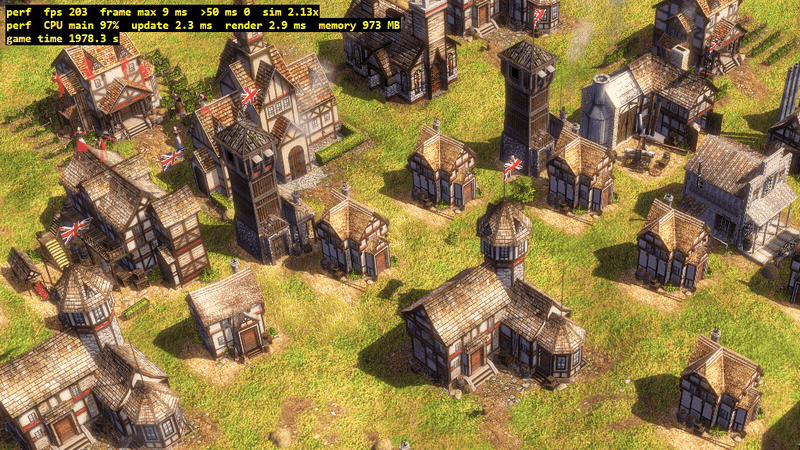

*In WoL, with `fastVertexFill` (the 32-minute five-player save of the tables below, map revealed, the camera still on
Queen Victoria's first Town Center, 1920×1080, Direct3D 9):* the British flags on the Town Center and the houses
wave as usual. The picture is the same as without the key by design, since the same bytes reach the video card; only
the frame rate changes. The overlay at the top gives the frame rate once a second: 184 FPS on average over the 32 s
take, the render part 3.1 ms per frame.
[Full video (MP4)](media/fastVertexFill-wol.mp4).

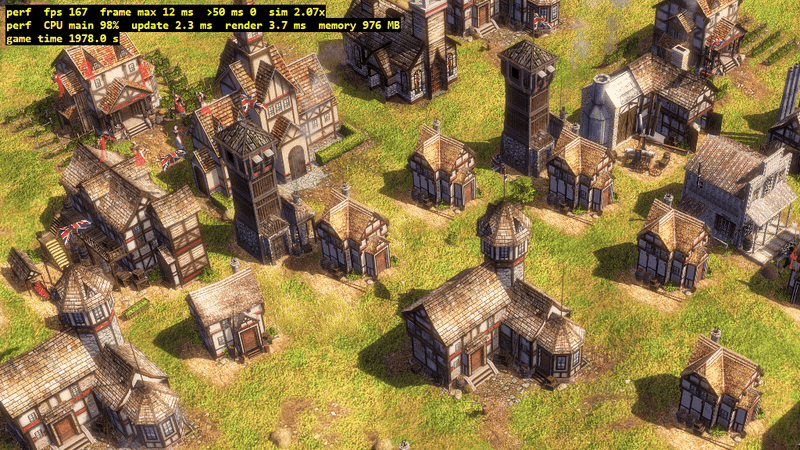

*In WoL, key off (the same save, camera and window):* the same flags and the same picture, at 155 FPS on average,
the render part 4.0 ms: the key gave +19 % in this pair of takes (one take each, measured while the video was being
recorded; the tables below have the 60 s runs).
[Full video (MP4)](media/fastVertexFill-wol-control.mp4).

```
fastVertexFill [log] [verify]
```

- **In the game today:** the flags that wave on Town Centers, other buildings and ships are cloth: a grid of
  points the game moves every frame. To draw a flag, the exe writes the grid into video memory twice, once for
  each side of the cloth, and it builds the second side by reading back the first one it has just written. Video
  memory of that kind is made for writing; reading from it is very slow. With flags on screen, that reading
  alone took 5.5 to 7.8 % of the game's main thread in the test below.
- **Effect:** the second side is built from the game's own copy of the grid. The flags get the same bytes, so
  the picture is the same, and the frame is shorter.
- **Measured** in a late 8-AI game of the stock game ([performance.md](performance.md), §11, "fastVertexFill"),
  60 s per run, with stock Direct3D 9 on an NVIDIA RTX 4090; each number is one run:

  | Window | Without | With | Change | Render time per frame | The flags' share of the main thread |
  |---|---|---|---|---|---|
  | 1920×1080 | 188.7 / 193.5 FPS | 203.4 / 204.0 FPS | **+7 %** | 3.05 → 2.72 ms | 6.5–7.0 % → 0.0 % |
  | 2560×1600 | 201.8 / 203.7 FPS | 217.9 / 216.8 FPS | **+7 %** | 2.80 → 2.49 ms | 5.5–5.6 % → 0.0 % |
  | 3840×2160 | 190.5 / 188.5 FPS | 198.8 / 210.7 FPS | **+8 %** (+4 % and +12 %) | 3.05 → 2.70 ms | 7.4–7.8 % → 0.0 % |
  | 1280×720 (no flag drawn) | 253.4 FPS | 256.9 FPS | none (within noise) | 1.79 → 1.76 ms | 0.0 % → 0.0 % |

  The simulation's time per frame, the frames over 50 ms (0 or 1 per run either way) and the memory did not
  change.
- **Measured in WoL** (2026-11-10, [performance.md](performance.md), §11, "fastVertexFill in WoL"): a 32-minute
  five-player save (four European AIs, 456 units), 60 s per run, stock Direct3D 9, the same PC. WoL keeps the
  window inside the monitor, so the runs asked at 2560×1600 and 3840×2160 drew 2560×1440. The flags take more of
  the frame in WoL than in the stock game, so the gain is larger:

  | View | Window | Without | With | Change | Render time per frame | The flags' share of the main thread |
  |---|---|---|---|---|---|---|
  | A Town Center, map revealed | 1920×1080 | 162.5 / 161.8 FPS | 180.0 / 185.7 FPS | **+13 %** | 3.90 → 3.27 ms | 12–13 % → 0.0 % |
  | A Town Center, map revealed | 2560×1440 (four pairs) | 141.8–166.5 FPS (mean 152.6) | 174.6–182.6 FPS (mean 178.5) | **+17 %** (+8 to +24 % per pair) | 3.72–4.34 → 3.17–3.36 ms | 11.5–13.6 % → 0.0 % |
  | A battle in a town | 2560×1440 | 126.0 FPS | 147.3 FPS | **+17 %** | 5.33 → 4.30 ms | 7.7 % → 0.0 % |
  | The save's own camera (player 1's base) | 2560×1440 | 276.0 FPS | 316.4 FPS | **+15 %** (lowest 5 %: 135 → 238) | 1.55 → 1.26 ms | 4.2 % → 0.0 % |

  The simulation's time per frame did not rise, and the frames over 50 ms (4–12 per run, WoL's own file loads)
  were the same with and without the key. Most runs had another program using up to 1.6 cores of the 16.
- **With DXVK** (a Direct3D 9 to Vulkan wrapper some players use): the same reading made DXVK 3.1.1 slower
  than stock Direct3D 9 in this test (179.6 FPS). With the key it gave 237.2 FPS, with no `dxvk.conf` (one run each).
  In WoL, at 2560×1440 on the Town Center (one run each): DXVK with no `dxvk.conf` 97.0 FPS without the key (the
  flags 38.5 % of the main thread) and **194.3 FPS with it**; with `d3d9.cachedWriteOnlyBuffers = True`, 179.6 and
  187.0 FPS. With the key on, DXVK needs no `dxvk.conf` in WoL either, and both are ahead of stock Direct3D 9 with
  the key (178.5 FPS).
- **Limits:**
  - it only helps while cloth flags are on screen; with none, the code does not run and nothing changes;
  - the gain follows how many flags are drawn, in the view or in the water's reflection: in the test, one Town
    Center's flag was on screen at 2560×1600, and at 1280×720 the camera showed none;
  - it was measured on one PC. How slow that reading is depends on the video driver, so the gain can be smaller
    or larger on another card.
- **WoL needs:** nothing. To let players switch it in the options menu, see [`menuOptions`](#menuoptions).
  - `verify` is a correctness test: the stock code fills the flags, and every fill is compared, byte for byte,
    with what the key would have written. It is slower than stock.
  - `log` writes the session's counts at exit.
- **Log:**
  - at startup, `fastVertexFill: the cloth flags' vertices are built without reading the locked vertex buffer
    (display only: same bytes)`;
  - `hook reached: fastVertexFill cloth flag fill (0x40D523)` the first time a flag is drawn;
  - with `verify`, at exit: `fastVertexFill verify: N fills checked against the stock loops (V vertices), M
    mismatches, …`. M must be 0.
- **Simulation:** no. It changes how the flags' vertices reach the video card, not which vertices, and it
  touches nothing the game rules read, so players do not need the same setting.
- **Status:** confirmed in single player (2026-11-10).
  - On the stock game: `verify` compared 76,365 fills (10.5 million vertices) of a 60 s run of a 25-minute
    save with the stock code and found no mismatch; the game also changed resolution twice (a new Direct3D
    device each time) and was minimized and restored with the key on.
  - In WoL, beside the other keys of this guide: `verify` compared 105,340 fills (15.6 million vertices) of a
    five-player skirmish (a Dutch player and German, British, French and Spanish AIs, 2.4 game minutes) with no
    mismatch and no XS error; with the key on, Highlanders and Jaegers fought beside an Ethiopian Town Center
    and its flag was drawn. On the 32-minute save of the table above, `verify` compared 158,397 fills (17.5
    million vertices): no mismatch.
  - Beside WoL's own `uhc.dll` (2026-11-10), with the `dinput8.dll` of this project in a WoL install (WoL's
    `uhc.dll`, `wol.cfg` and `data\uhc` untouched, their hashes the same after): `dinput8.dll 0.3.0`,
    `fastVertexFill: applied`, no FAILED; the hook was reached; `verify` compared 129,140 fills (15.4 million
    vertices) with no mismatch; in a skirmish against a German AI (Otto von Bismarck, 29 units after 4 minutes)
    `xsErrorLog` logged no XS message, the Town Center's flag was drawn, and two resolution changes and a
    minimize and restore went on drawing. Frame rate on the same save, the key line on and off, two runs each:
    152.5 → 176.0 FPS (**+15 %**) at 1920×1080 and 153.8 → 174.8 FPS (**+14 %**) at 2560×1440. That install has
    ReShade's `d3d9.dll`, so these numbers include ReShade: compare them with each other, not with the table above.
    Removing `dinput8.dll` and `engine-ext\` gives WoL's main menu again.
  - Not tested: multiplayer, a full-length game, other video cards and drivers.

#### fastLastInLine

*The game no longer freezes for a third of a second each time a player gets a home city shipment.*

**Added:** Thursday 2026-11-12 08:17

```
fastLastInLine [log] [verify]
```

- **In the game today:** after a home city shipment (or a card that becomes available again), the game works out
  for that player which tech of each line is "last in line", the one the command panels show. It does it by
  testing every tech against every other tech and its prerequisites. With WoL's 10,542 techs that is about
  170 million tests: a frame of 340–590 ms, once per shipment of any player, AI or human. In a 32-minute
  five-player save these frames were 74 % of all the time spent in frames over 50 ms
  ([performance.md](performance.md), §9, "What WoL's stutters are").
- **Effect:** the DLL builds once, when the data loads, the list of which techs require which tech, and tests
  only those, with the game's own tests. The result is the same bits; the work takes 0.4–1.6 ms.
- **`verify`** lets the game's own code run as well and compares every bit with the DLL's; each recompute logs
  a line with the bits that differ (must be 0) and both times. `log` writes a line per recompute.
- **WoL needs:** the line `fastLastInLine` in `wol.cfg`: then it is on for everyone. To let players turn it off in
  the options menu, also name it on the [`menuOptions`](#menuoptions) line and add its `OptionFastLastInLine` field;
  it still starts on, and stays on until a player switches it off. Checked in WoL (2026-11-12): with no choice
  stored the entry shows On and the key applies; Off chosen in Graphics Options is stored, the next start does not
  apply the key, and the entry reads back Off.
- **Multiplayer:** the game computes exactly the same thing, so players may set it differently. Not tested in
  multiplayer.
- **Measured in WoL** (the 32-minute five-player save, 150 s per run, key off and on in turns):

  | | Off | On | Off | On |
  |---|---|---|---|---|
  | Frames over 50 ms | 12 | **3** | 15 | **3** |
  | Frames over 100 ms | 6 | **1** | 11 | **2** |
  | Longest frame | 382 ms | **191 ms** | 384 ms | **243 ms** |

  What is left over 100 ms is mostly the AI's `towerManager` rule, whose `sin` and `cos` are slow in
  `aiWoLMain.xs`; a fixed copy of that file is described in [performance.md](performance.md), §9, "What WoL's
  stutters are".
- **Status:** confirmed in single player. `verify` found 0 differing bits in 31 recomputes: 14 on the save, 7 in a
  new skirmish, 6 with WoL's own DLL and our `dinput8.dll` (applied, hooks reached, nothing failed), 4 in the stock
  game. Not tested in multiplayer. No video: the change is a freeze that no longer happens, which a GIF does not
  show; the frame times are above.

#### rendererOption

*Adds a Renderer choice to the options menu: DirectX 9, or Vulkan for more frames per second.*

**Added:** Tuesday 2026-11-10 14:43 · **Filmed in WoL:** Tuesday 2026-11-10 17:34

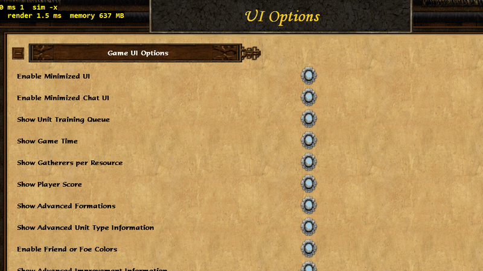

*In WoL, with `fastVertexFill` and `rendererOption log`, at the main menu (1920×1080):* Options → Graphics Options
shows the Renderer entry on DirectX 9. The cursor rests on it and its tooltip shows; the list opens, Vulkan (DXVK) is
picked, and OK goes back to the main menu with the choice stored (`uhc-options.cfg`: `renderer vulkan`; the log:
`Vulkan chosen in the menu; it takes effect at the next start`).
[Full video (MP4)](media/rendererOption-wol.mp4).

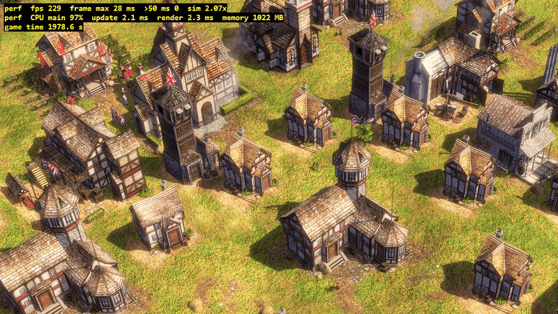

*The next start, with Vulkan (DXVK 3.1.1 loaded from `dxvk\`, no DXVK option since `fastVertexFill` is on), in the
late save and Town Center view of `fastVertexFill`'s videos:* 203 FPS on average over the 32 s take, the render part
2.7 ms per frame. The picture is the same as with DirectX 9.
[Full video (MP4)](media/rendererOption-vulkan-wol.mp4).

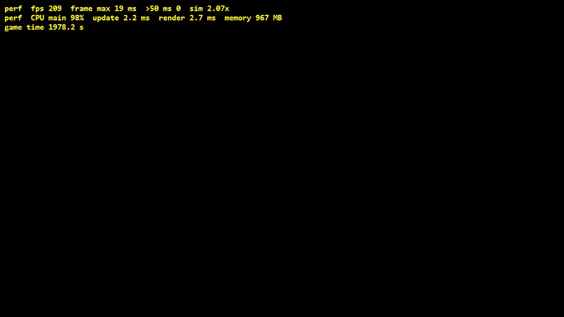

*Control, DirectX 9 chosen (both keys on, the same scene):* the same picture at 182 FPS on average, the render part
3.2 ms: Vulkan gave +12 % in this pair of takes (one take each, filmed while the video was being recorded).
[Full video (MP4)](media/rendererOption-wol-control.mp4).

```
rendererOption [vulkan|dx9] [folder=<dir>] [log] [conf=<DXVK options>]
```

- **In WoL today:** the game draws with Direct3D 9. A player can install DXVK (a free library that runs Direct3D 9
  games on Vulkan) by hand, two files next to the exe, and with the right option it is faster
  ([performance.md](performance.md), §11, "DXVK in WoL"); nothing in the game offers it.
- **Effect:** Options → Graphics shows a **Renderer** list with *DirectX 9* and *Vulkan (DXVK)*. The choice is used
  from the next start. With Vulkan, the DLL loads DXVK's `d3d9.dll` from the `dxvk` folder next to the exe. No file
  next to the exe changes and the profile is not touched: the choice is kept in `uhc-options.cfg` next to `UHC.log`.
  DirectX 9 stays the default. The same menu can switch other keys on or off: [`menuOptions`](#menuoptions).
- **DXVK's option:** without [`fastVertexFill`](#fastvertexfill), DXVK is only fast with
  `d3d9.cachedWriteOnlyBuffers = True`, so the DLL gives it that option. With `fastVertexFill` on, the slow read-back
  that option works around is gone, and DXVK gets no option. The log says which one and why.
- **WoL needs:**
  1. the `dxvk` folder of the release zip (DXVK 3.1.1's 32-bit `d3d9.dll` and its license) next to `age3y.exe`;
  2. the field in `data\options.xml`, in the Graphics group (here after Anti-alias Quality). Plain text works; the
     first `<value>` is DirectX 9, the second Vulkan:

     ```xml
     <field>
         DropDown
         <name>OptionRenderer</name>
         <label>Renderer</label>
         <value>DirectX 9</value>
         <value>Vulkan (DXVK)</value>
         <tooltip>Vulkan draws the game through DXVK (the dxvk folder): usually more frames per second. Takes effect when the game starts again.</tooltip>
     </field>
     ```
  3. WoL's large-address-aware exe, which WoL ships: DXVK takes about 250 MB more address space.
- **Arguments:** `vulkan` or `dx9` is the choice of a player who never picked one (default `dx9`); `folder=<dir>` is
  where `d3d9.dll` is, relative to the exe or absolute (default `dxvk`); `log` logs every read and write of the entry;
  `conf=` replaces DXVK's options and takes the rest of the line (several options separated by `;`). A player who
  sets `DXVK_CONFIG` in Windows' environment keeps it.
- **During a match** the entry is greyed out, as the other options that need a restart.
- **If Vulkan fails:** no `dxvk` folder, a broken `d3d9.dll`, or no Vulkan on the PC: the game starts with DirectX 9
  and the log says why. If a start with Vulkan crashes or hangs before its first frame, the next start uses DirectX 9
  and stores it, so the player can always get back to the menu.
- **Log:**
  - at startup, `rendererOption: <path>\uhc-options.cfg: Vulkan` (or `DirectX 9`, or `no choice stored yet`), then
    `rendererOption: Vulkan: <path>\dxvk\d3d9.dll loaded at 0x…; the game's Direct3DCreate9 is DXVK's`; then
    `rendererOption: no DXVK options (fastVertexFill is on, …)` or `rendererOption: DXVK_CONFIG=d3d9.cachedWriteOnlyBuffers
    = True (fastVertexFill is off, failed or in verify mode)`, `Direct3DCreate9(0x20) answered by DXVK`,
    `CreateDevice -> hr 0x00000000` and `first frame presented (hr 0x00000000); start marker removed`;
  - when the options screen opens, `rendererOption: options screen field OptionRenderer (…); shows Vulkan`;
  - on Apply, `rendererOption: Vulkan chosen in the menu; it takes effect at the next start`;
  - DXVK's own log, `dxvk\age3y_d3d9.log`: `Found config env: d3d9.cachedWriteOnlyBuffers = True` near its top when
    the option is given.
- **Limits:**
  - **a restart is needed** to change the renderer;
  - one PC was measured (an NVIDIA RTX 4090): another card or driver, an integrated GPU (DXVK needs Vulkan 1.3) and
    exclusive fullscreen with Alt+Tab are untested;
  - **multiplayer is untested** (see "Simulation");
  - about 250 MB more address space, so only with a large-address-aware exe;
  - it does not touch the stutters (the frames over 100 ms), which come from the game's file loads.
- **Simulation:** no. It changes which library draws, not what the game computes, and the x87 control word of the
  game's main thread stays as with Direct3D 9. Players may choose differently, but no multiplayer game has been run
  with DXVK yet.
- **Measured** in WoL ([performance.md](performance.md), §11, "rendererOption"), a late five-player save, the camera on
  a Town Center, 60 s per run, on an NVIDIA RTX 4090:

  | Window | Direct3D 9 + `fastVertexFill` | Vulkan from the menu + `fastVertexFill` (the default: no DXVK option) | the same with the option | DXVK installed by hand, with the option, no `fastVertexFill` |
  |---|---|---|---|---|
  | 1920×1080 | 180.6 FPS | **196.5 / 194.4** (+8 %) | 182.8 / 178.9 | 181.3 |
  | 2560×1440 | 180.7 FPS | **200.2 / 194.0** (+9 %) | 184.5 / 190.0 | 188.6 |

  Vulkan chosen in the menu is as fast as DXVK installed by hand (178.7 and 191.2 FPS with the same option, within
  1.5 %). The PC was not idle during these runs (a browser used about half a core), so take the numbers as a
  comparison between the variants.
- **Status:** confirmed in single player (2026-11-10), on WoL's exe and data:
  - the menu: the entry shows in Graphics Options (English and Spanish copies), the choice survives a restart, and
    the profile written after Options → OK is byte for byte the one a game without the key writes (both change
    only `optionrefreshrate`, which the stock screen rewrites);
  - the switch: Vulkan → restart → DXVK 3.1.1 loaded from `dxvk\`, the device created, the first frame presented; back
    to DirectX 9 → restart → the system's Direct3D 9;
  - the safety net: no `dxvk` folder, a `d3d9.dll` that is not a DLL, and a start marker left behind: all three
    started with DirectX 9 and said why in the log (the third also stored DirectX 9);
  - with Vulkan from the menu: a 32-minute save with four AIs played 3.5 game minutes (the AIs fought and built), then
    minimize and restore, two resolution changes, a save and its load: no fault, frames and the game clock went on;
    with every key of `examples\Startup\uhc.cfg` and `fastVertexFill`: 40 keys applied, none failed; the x87 control
    word 0x007F after CreateDevice and 0x027F in play, as with Direct3D 9;
  - beside WoL's own DLL (`dinput8.dll`, with `engine-ext\`): the entry shows and switches, DXVK loads and draws, and
    removing it leaves WoL's folder byte for byte as it was. ReShade, which that copy has as `d3d9.dll` next to the
    exe, is not used with Vulkan (DXVK is loaded by its full path), so ReShade's effects are off while Vulkan is
    chosen.
  - Not tested: multiplayer, another video card or driver, exclusive fullscreen and Alt+Tab, a stock (not
    large-address-aware) exe with DXVK.

#### menuOptions

*Lets the player switch some of the performance keys on or off in the game's options menu.*

**Added:** Thursday 2026-11-12 11:40

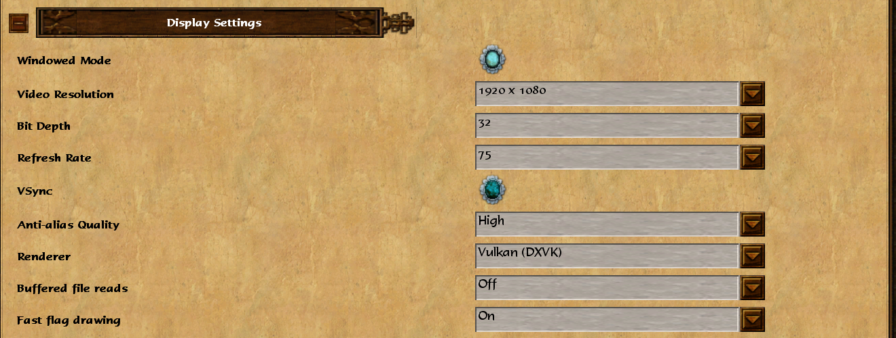

*In WoL, with `rendererOption` and `menuOptions bufferedFileReads fastVertexFill` (1920×1080):* Options → Graphics
Options with the three entries switched (Vulkan, buffered reads Off, flag drawing On) just before OK. No video: the
switch itself is the same dropdown as the Renderer's, filmed in [`rendererOption`](#rendereroption).

```
menuOptions <key> [<key> ...]        the keys: bufferedFileReads, fastVertexFill, fastLastInLine
```

- **In WoL today:** `bufferedFileReads` and `fastVertexFill` are on or off for every player as `wol.cfg` says; a
  player who wants the other setting has to edit the cfg.
- **Effect:** each key named on the line gets an Off / On entry in the options menu (Options → Graphics, next to
  [`rendererOption`](#rendereroption)'s Renderer). The choice is used from the next start and kept in
  `uhc-options.cfg` next to `UHC.log`, as the renderer's; the profile is not touched.
- **Who decides, in order:**
  1. a key **not** named on a `menuOptions` line: its own line in the cfg alone, as before;
  2. a named key, once the player has chosen in the menu: the player's choice;
  3. a named key the player never switched: its own line in the cfg. With the line (and its arguments, such as
     `bufferedFileReads 64 readahead`), it starts on; without it, it starts off.

  So the mod keeps control: it decides which keys players may switch, what each starts as, and the arguments a key
  applies with. A key switched on in the menu with no line in the cfg applies with its defaults.
- **WoL needs:** a field per key in `data\options.xml`, in the Graphics group (here after the Renderer field). The name
  is fixed per key; the label and tooltip are free text; the first `<value>` is Off, the second On:

  ```xml
  <field>
      DropDown
      <name>OptionBufferedReads</name>
      <label>Buffered file reads</label>
      <value>Off</value>
      <value>On</value>
      <tooltip>Reads the game's files through a buffer instead of many tiny reads: faster loading, shorter stutters. Takes effect when the game starts again.</tooltip>
  </field>
  <field>
      DropDown
      <name>OptionFastVertexFill</name>
      <label>Fast flag drawing</label>
      <value>Off</value>
      <value>On</value>
      <tooltip>Draws the waving flags without reading back from video memory: more frames per second with flags on screen. Takes effect when the game starts again.</tooltip>
  </field>
  <field>
      DropDown
      <name>OptionFastLastInLine</name>
      <label>No freeze on shipments</label>
      <value>Off</value>
      <value>On</value>
      <tooltip>Removes the short freeze after each home city shipment. Takes effect when the game starts again.</tooltip>
  </field>
  ```

  Add a field only for a key named on the `menuOptions` line: a field whose key is not named shows as an empty list,
  as any `<name>` the game does not know. Without the fields, the menu is the stock one.
- **Example** (`wol.cfg`): `bufferedFileReads` and `fastLastInLine` start on, `fastVertexFill` starts off, and players
  can switch all three:

  ```
  menuOptions bufferedFileReads fastVertexFill fastLastInLine
  bufferedFileReads
  fastLastInLine
  ```
- **During a match** the entries are greyed out, as the other options that need a restart.
- **Log:**
  - at startup, before the keys: `menuOptions: bufferedFileReads follows OptionBufferedReads: on (no choice stored
    yet: its cfg line)` (or `(the player's choice)`), one line per key, then `menuOptions: applied (2 keys follow the
    options menu)`; then the key's own `applied` line, or none when it is off;
  - when the options screen opens, `bufferedFileReads: options screen field OptionBufferedReads (…); shows on`;
  - on Apply, `bufferedFileReads: off chosen in the menu; it takes effect at the next start`, and the line
    `bufferedFileReads off` in `uhc-options.cfg`;
  - a name that cannot follow the menu: `menuOptions: <name> cannot follow the options menu (these can: …); ignored`,
    and `menuOptions: FAILED`; the other names still work.
- **Simulation:** no. Both keys change how the game reads its files or feeds the video card, not what it computes, so
  players may choose differently. Only such keys can be named; `fastLastInLine` (the same bits as stock) could be added
  the same way, as one line of the DLL.
- **Status:** confirmed in single player (2026-11-12), in WoL with this DLL, beside `rendererOption`, over seven
  starts:
  - the three entries show in Graphics Options with the start values (Renderer DirectX 9, buffered reads On from its
    cfg line, flag drawing Off with no cfg line); switched to Vulkan / Off / On and OK: `uhc-options.cfg` holds
    `renderer vulkan`, `bufferedFileReads off`, `fastVertexFill on`;
  - the next start: DXVK loaded and drew, `fastVertexFill: applied` (no cfg line: its defaults) and its hook reached,
    no `bufferedFileReads` line; the menu showed the stored values;
  - switched back (DirectX 9 / On / Off), with a `fastVertexFill` line added to the cfg: the system's `d3d9.dll`,
    `bufferedFileReads: applied`, and `fastVertexFill` not applied despite its cfg line (the player's choice wins);
  - `menuOptions bogusKey`: logged, `menuOptions: FAILED`, and both keys followed their cfg lines alone although the
    file said `fastVertexFill off`; the fields of keys not named showed as empty lists, as with no hook at all;
  - WoL's own `options.xml` (no fields) with the line: the stock Graphics Options;
  - the profile was byte for byte the same after every OK.

  Not tested: multiplayer, `dinput8.dll` beside WoL's DLL, a choice made during a match (the entries are greyed out
  there).

#### xsErrorLog

*The log shows why an AI script failed to compile, with its file and line.*

**Added:** Friday 2026-11-06 12:56

```
xsErrorLog [lines]
```

- **In WoL today:** a broken AI script shows only `XS: Error 0003: could not compile file 'aiLoaderStandard.xs'`, and the AI does
  nothing. `tools/re/trace_xs.py` was the only way to see the cause.
- **Effect:** the XS compiler's messages go to `UHC.log`, or `engine-ext\engine-ext.log`, with file and line, for at most `lines`
  lines (200 by default). The log says when it stops. It changes nothing in the game, so players may set it differently.
- **Log:** `xsErrorLog: applied`, `hook reached: xsErrorLog report (0x43A3A4)`, `hook reached: xsErrorLog message (0xA5667F)`, and
  `xsErrorLog: C:\...\AI4\aiWoLMain.xs(33806): Error 0324: invalid expression, likely is not enclosed by parentheses.`
- **Tested in WoL (2026-11-06):** a broken script gave its 6 messages and Error 0003, key off none; a cap of 3 stopped and said so;
  beside WoL's DLL, the same lines. A clean skirmish of 165 s reached neither hook. Not shown: a runtime message. Array errors, an
  unknown rule, a division by zero and a recursion of 400 print nothing, and an unbounded recursion ended the game.

#### dataLint

*Lists, while loading, everything in the mod's data that the game silently ignores.*

**Added:** Friday 2026-11-06 12:52

```
dataLint [log] [file]
```

- **What it does:** while the data loads, it says what the data asks for and the game drops: unknown `<UnitType>`, proto and action
  tags, Data subtypes, `<ModifyType>` names with no stat, `<ProtoAction>` names not in the unit's tactics, and effects the game
  deletes. Stock says nothing about any of them.
- **Output:** one line per name, with how many times and the first proto or tech, up to 40 per kind, then a summary. `log`: all of
  them. `file`: the whole report, with every deleted effect, in `dataLint.txt` next to the log.
- **No effect on the game:** it changes nothing, and nothing runs after the load.
- **Tested in WoL (2026-11-06):** 105 names on WoL's data, among them about 518 `TechStatus` effects on techs that do not exist and 88
  `<ModifyType>GATHER`. One typo per kind was caught. Beside WoL's DLL too. The load time was not measured well, as other games
  were running. Not covered: unknown `<Flag>` names, and why an effect was deleted.

#### multipleInstances

*Lets this copy of the game run beside a copy from another folder.*

**Added:** Wednesday 2026-10-28 19:12

```
multipleInstances [background]
```

A tool for testing, not for WoL's players: nothing needs porting.

- **In WoL today:** one copy of the game per machine. A second copy, even one started from another
  folder, stops at "Only one copy of the game can run at a time".
- **Effect:** this copy no longer collides with copies in other folders. Two copies started from the
  same folder still refuse each other, because they would share that folder's files (`UHC.log`, the
  `perfExecFile` file, …). Only one of the two copies needs the key.
- **`background` and your mouse:** this copy also ignores the real mouse and keyboard: it does not follow the
  cursor, real clicks and keys do not reach it, and it cannot move or confine your cursor. Only messages posted by a
  test tool reach it. Don't use it to play.
- **`background`:** this copy's windows open behind every other window, stay there and never take the
  focus. The copy cannot cover another window or receive the clicks and keys meant for it. This is
  for unattended tests driven through `perfExecFile`
  ([developer guide](developer-guide.md#driving-the-game-unattended)). Define
  `config("DontPauseWhenLosingFocus")` too: a game in progress pauses whenever its window is not
  focused, which with `background` is always.
- **Shared files:** every copy of WoL uses the same `Documents\My Games\Wars of Liberty` folder: the
  profile (the last copy to exit writes it), saved games, scenarios and the game's own `Age3Log.txt`.
  Give saves and scenarios different names in each copy.
- **WoL needs:** nothing.
- **Log:**
  - at startup, `multipleInstances: this copy may run beside copies in other folders (semaphore suffix -XXXXXXXX)`;
  - when the game checks for another copy, `multipleInstances: single-instance semaphore "…" renamed to "…-XXXXXXXX"`;
  - with `background`, one line per window: `multipleInstances background: window of class … placed at the bottom, never activated`.
- **Simulation:** no.
- **Status:** confirmed on 2026-10-28 with two copies on one machine.
  - A copy with `multipleInstances background` started while a copy without the key sat at the main
    menu. It loaded a 25-minute save and ran a 60 s benchmark at 179 FPS (195 when alone).
  - Its log showed the stock name `Global\Age3` renamed to `Global\Age3-BCD865D7`.
  - Sampled every second, its window stayed second from the bottom of 50 windows and was never the
    focused window. The copy without the key did take the focus when it started.
  - Every video in this guide marked `--background` was filmed with this key, on the WoL copy.
  - Not tested: three or more copies, multiplayer.

#### compatMode

*Brings back the 16-bit display modes that current graphics drivers no longer list.*

**Added:** Tuesday 2026-11-03 10:43

```
compatMode
```

- **Effect:** every 32-bit display mode the graphics card reports is also offered as a 16-bit mode.
  Current drivers report only 32-bit modes, so the game's list has no 16-bit entry. `wol.cfg` has
  this line.
- **Log:** `compatMode: 32-bit display modes are also offered at 16 bits`; at startup, `hook
  reached: compatMode (0x54D6D1): <W>x<H> also offered at 16 bits`.
- **Simulation:** display only.
- **Status:** confirmed (2026-11-03): the hook runs at startup for the adapter's modes and the game
  starts and plays normally.

### Population, decks and limits

Caps that are fixed in the exe.

| Key | What it does | WoL's DLL | WoL also needs | In-game status |
|---|---|---|---|---|
| [`basePop`, `extraPop`](#basepop-and-extrapop) | Raises the population caps (200 and 50 in the exe) and removes the 250 hard cap. | in WoL's DLL | Enough population buildings: 20 houses of 10 give 200 today. | confirmed |
| [`decimalPopulation`](#decimalpopulation) | Population with decimals: `<PopulationCount>0.5`, `<PopulationCapAddition>7.5` and decimal amounts in their tech effects; the counter and the tooltips show them. | **new** | The decimals in `protoy` and `techtreey`. | confirmed (single player, also a skirmish vs AI) |
| [`deckCardCount`](#deckcardcount) | Raises the 25-card deck cap. | in WoL's DLL | A higher `<maxdecksize>` in `data\homecitylevels.xml` (25 at all 132 levels today). | confirmed above the level table; see the section |
| [`selectionLimit`](#selectionlimit) | A selection holds up to N units (50 in the exe). `wol.cfg` sets 75. | **in `wol.cfg`** | Nothing. | confirmed |
| [`noAILimit`](#noailimit) | Shows every `AI4\*.personality` file in game setup. WoL uses `noAILimitV2` instead. | in WoL's DLL | The personality files. | confirmed |
| [`noAILimitV2`](#noailimitv2) | Shows WoL's 52 `AI4\*.personality` files in game setup. Without it, a random AI crashes the game. | **in `wol.cfg`** | The personality files. | confirmed |
| [`enableAllTeams`](#enableallteams) | Teams 3 and 4 in the single-player game setup. | **in `wol.cfg`** | Nothing. | partly confirmed |

#### basePop and extraPop

*Raises the maximum population a player can reach.*

**Added:** Wednesday 2026-10-28 10:56 · **Filmed in WoL:** Wednesday 2026-11-04 11:29

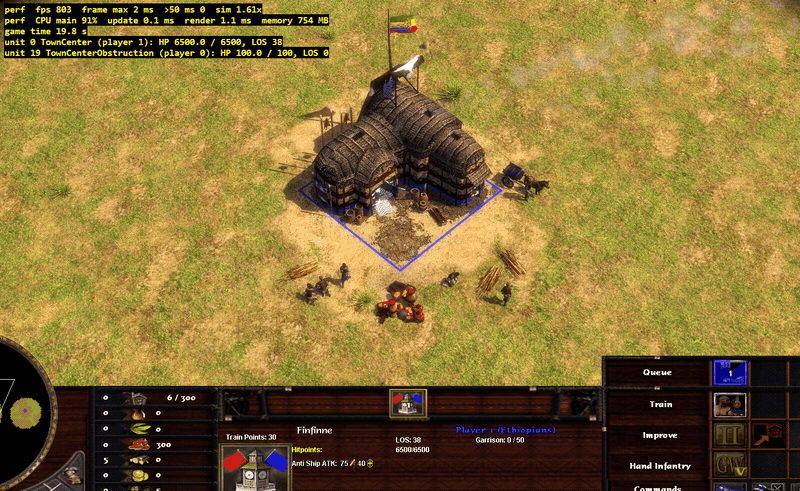

*In WoL, with `basePop 300` (three `BloodFactory`, +100 population each, for the test):* the counter reads
`6 / 300`. [Full video (MP4)](media/basePop-wol.mp4).

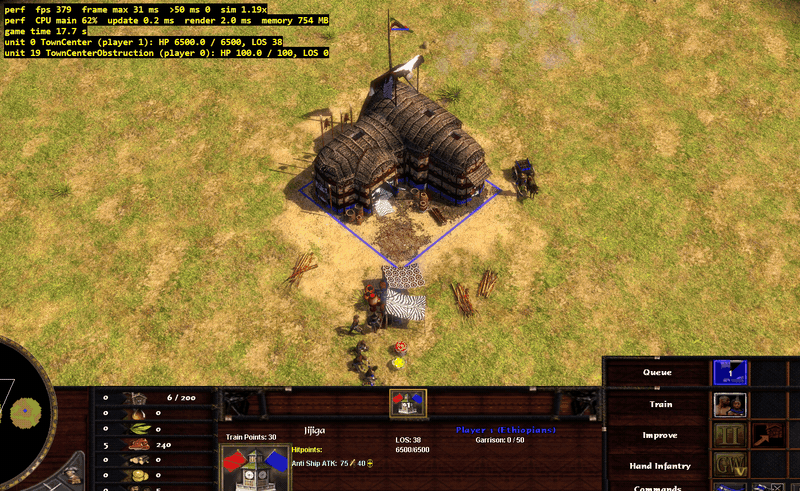

*In WoL, key off (the same scene):* the exe stops the cap at 200: `6 / 200`.
[Full video (MP4)](media/basePop-wol-control.mp4).

```
basePop <N>              N from 0 to 10000, 200 in the exe
extraPop <N>             N from 0 to 10000, 50 in the exe
```

- **In WoL today:** `wol.cfg` does not set these keys, so the exe's limits apply. The cap is what the
  player's buildings provide (houses, Town Centers, …), limited to 200 plus the extra population
  granted by techs and cards, which is itself limited to 50. It is also limited to that extra
  population plus a world-level value of 200. Then a player bonus is added, and the result never
  exceeds 250.
- **Effect:** the 200 becomes `basePop`, the 50 becomes `extraPop`, and the world-level clamp and the
  250 cap are removed. Either key alone keeps the other at the exe's value.
- **WoL needs:** buildings must still provide the population. WoL's `House`, `Manor`, `HouseAztec` and
  `ypHouseIndian` give 10 each with a `BuildLimit` of 20, so to reach 300 raise one of the two in
  `protoy.xml`.
- **Not changed:** the shared team population mode keeps the exe's limit of 200 per player.
- **With [`decimalPopulation`](#decimalpopulation):** both limits stay in whole population
  (`basePop 300` is 300 population with any K).
- **Log:** `basePop/extraPop: base X, extra Y (…)`;
  `basePop/extraPop: expected integers from 0 to 10000`;
  `hook reached: basePop/extraPop/decimalPopulation (0x4581F3)`.
- **Simulation:** yes.
- **Status:** confirmed in single player, in WoL (2026-11-04): the cap reads 300 with `basePop 300`, and 200
  without it. On the stock game a skirmish went past 200 with `basePop 300`. Not tested in WoL: a
  player's real population above 200, and `extraPop` above 50.
- **Fixed from the original DLL:** upstream missed the path taken when the extra population is negative,
  where the stock 200/250 limits stayed active.

#### decimalPopulation

*Units and population buildings can use fractions, such as half a population slot.*

**Added:** Thursday 2026-10-29 21:24 · **Filmed in WoL:** Wednesday 2026-11-04 09:59

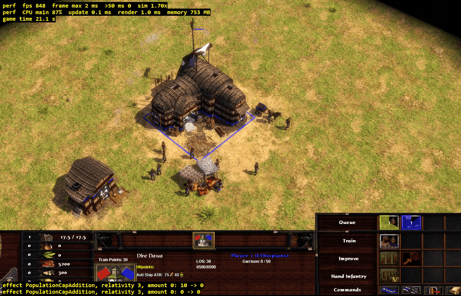

*In WoL, with `decimalPopulation 10 log` (Ethiopians, the Town Center selected):* in the bed's data, for
the test, a villager costs 1.5 population and a house gives 7.5. The panel reads `17.5 / 17.5` with 11
villagers and the Explorer, and the next villager in the queue waits: there is no room for 1.5.
[Full video (MP4)](media/decimalPopulation-wol.mp4).

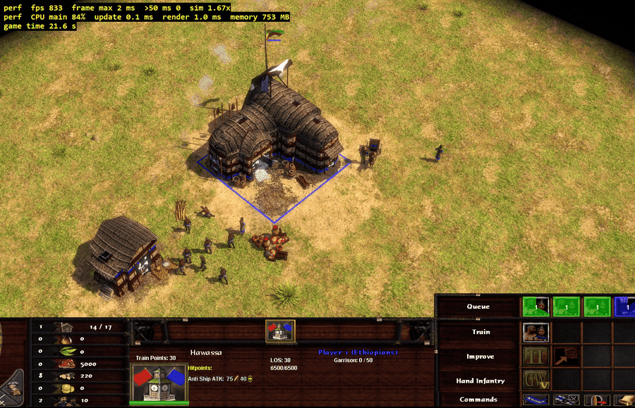

*In WoL, key off (the same data):* the exe drops the decimals: a villager costs 1 and the house gives 7,
so the panel reads `14 / 17` with 13 villagers and the queue goes on.
[Full video (MP4)](media/decimalPopulation-wol-control.mp4).

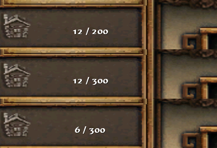

*The limits:* a test tech gives `PopulationCap` +300 at 12 population. With `decimalPopulation 10` the cap stops at the exe's 200; with `basePop 300` added, at 300; with `basePop 300` alone (the control), at 300, the decimals dropped (6 population).

```
decimalPopulation [<K>] [log]      K from 2 to 1000, default 10: population in steps of 1/K
```

- **In WoL today:** `<PopulationCount>` and `<PopulationCapAddition>` are whole numbers. The exe reads
  them with `%d`, so `0.5` becomes 0 (a free unit) and `7.5` becomes 7, with no message. WoL's `Kami`
  has `<PopulationCount>0.5</PopulationCount>` and is free for that reason. A player's population,
  the population its queues reserve and its cap are sums of them, and every test (can this unit be
  queued, can it spawn, is the player at the cap) compares those sums.
- **Effect:** both tags take decimals, and population works in steps of 1/K. Inside the engine
  every population number is kept K times larger, so all of its tests stay exact:
  - **tech effects:** `PopulationCount` and `PopulationCapAddition` (on protos) and
    `PopulationCap` (on the player) take decimal amounts (`amount='0.5'`). `Absolute` adds the
    amount and `Assign` sets it, rounded to the nearest step; `BasePercent` is rounded to the
    nearest step too (the exe truncates it, so a decrease came out one step high: 1.5 × 0.6 gives
    0.9, the exe's formula 1.0); `Percent` multiplies by a whole number, as in the exe. A
    `PopulationCount` effect that would bring a unit to 0 or less still gives it 1, as in the exe.
    WoL's `techtreey.xml` has 97 `PopulationCount`, 44 `PopulationCapAddition` and 20
    `PopulationCap` effects;
  - **limits:** the cap keeps the exe's limits (200 from buildings, plus 0 to 50 extra, at most 250),
    or those of [`basePop` and `extraPop`](#basepop-and-extrapop), in whole population;
  - **interface:** the population counter (`{totalPop} / {popcap}`, and `{pop}` and `{futurepop}`) and
    its tooltip show decimals (`16.5 / 17.5`), and so do the population cost in unit tooltips (red when
    it does not fit), the unit help (`Population: 0.5`) and the population of a shipment;
  - **AI and scripts:** XS still sees whole numbers. `kbGetPop`, `kbGetPopCap`,
    `trPlayerGetPopulation`, `aiGetEconomyPop`, `aiGetMilitaryPop`, `aiGetAvailableEconomyPop`,
    `aiGetAvailableMilitaryPop`, `aiGetCurrentEconomyPop`, `aiGetPopNeeds`, `kbGetPopCapAddition`
    and `kbGetPopulationSlotsBy{QueryID,UnitTypeID}` return the population rounded to the nearest
    whole number (halves away from zero); `kbGetPopSlots` (a unit's cost) rounds up, so a unit
    that costs population never reads as 0 (an AI script may divide by it);
    `kbUnitPickGet{Minimum,Maximum}Pop` round, and keep −1 as −1. `aiSetEconomyPop`,
    `aiSetMilitaryPop` and `kbUnitPickSet{Minimum,Maximum}Pop` take whole numbers as before (−1
    stays −1).
- **WoL needs:** the decimals, in the two tags and in the effect amounts. With the key, `Kami` costs
  0.5 and stops being free: decide if that is what you want. Whole numbers behave exactly as without
  the key. A UI gadget that shows `{pop}`, `{popcap}`, `{futurepop}` or `{totalPop}` now gets text
  such as `12.5` instead of a number; that is fine in a `formatText` gadget, which is how WoL uses
  them.
- **Choosing K:** 10 for one decimal (0.5, 1.5), 100 for two (0.25), or any value from 2 to 1000.
  Texts show up to three decimals, trailing zeros dropped (K = 3 shows 0.333).
- **Not adapted:** the post-game timeline's population curves draw K times the population: a player
  with 9 population is drawn at 90 (seen in game). The AI's debug text (`AIDebugPopToggle`) does the
  same (read in the code, not seen).
- **Saved games** keep the population as stored: load them with the same K. A game saved without
  the key, or with another K, loads with wrong populations.
- **Log:** at startup `decimalPopulation: population in 1/10 steps (<PopulationCount> and
  <PopulationCapAddition> take decimals; caps (stock limits), effects, 19 XS syscalls and the
  population texts scaled)` (`(basePop/extraPop limits)` with those keys; `, decimal values and
  changes logged` with `log`); `decimalPopulation: expected a scale from 2 to 1000 and/or log, got
  "x"`. Hooks: `hook reached: decimalPopulation <PopulationCount> (0x5FB92E)`,
  `… <PopulationCapAddition> (0x5FD719)`, `… effect PopulationCount (0x8FA835)`,
  `… effect PopulationCapAddition (0x8FA8CF)`, `… PopulationCap effect (0x8D87AB)`,
  `… start cap bonus (0xA0D2D1)`, `basePop/extraPop/decimalPopulation (0x4581F3)`,
  `… data ref totalpop` (and `popcap`, `futurepop`, `pop`), `… colorizePop argument (0x6F576F)`,
  `… printed population (unit help, costs)` (and `(colorizePop)`, `(population help)`), and one
  `… XS <name>` per syscall. With `log` (at most 200 lines): each decimal value read
  (`decimalPopulation: Settler <PopulationCount>1.5</PopulationCount> = 1.5`), each effect
  (`decimalPopulation: effect PopulationCount, relativity 2, amount 0.6: 1.5 -> 0.9`; relativity 1
  is `Absolute`, 2 `BasePercent`, 3 `Assign`), and each XS setter's value when it changes
  (`decimalPopulation: aiSetEconomyPop(80) stored as 800`).
- **Simulation:** yes: every player needs the same key and the same K. Not tested in multiplayer.
- **Status:** confirmed in single player.
  - **In WoL (2026-11-04):** Ethiopian villagers at 1.5 and a house at 7.5, K = 10: the panel reads
    `17.5 / 17.5` and the next villager waits; without the key, `14 / 17` and the queue goes on.
  - **On the stock game (2026-10-29),** K = 10 and 100, with the data of
    [`tools/pop_testdata.py`](../tools/README.md#pop_testdatapy): training refused and allowed at the
    right sums, the four effect modes, `PopulationCapAddition` and `PopulationCap`, the counter, its
    tooltip and the tooltips' cost in red, a saved game (K = 100, saved at 17 / 20, loaded at
    17 / 20), bad values (`1`, `abc`, `5000` log the error and `FAILED`), shipment tooltips, the
    shared team population, and all 19 XS syscalls. Three skirmishes against two Hard AIs ran with no
    XS error, and a Russian AI reached 62.5 population of a 95 cap.
  - **Not run:** multiplayer; taking back a `PopulationCap` effect (0x8D20AB): a trigger that sets the
    tech's status back does not take its effects back, and no path that does was found; the unit help
    `Population: %d` (FUN_004C8748).

#### deckCardCount

*Home city decks can hold more than 25 cards.*

**Added:** Wednesday 2026-10-28 10:56

```
deckCardCount <N>        N from 20 to 10000
```

- **In WoL today:** `wol.cfg` does not set this key, so the exe's cap applies. The maximum deck size of
  a home city is the `<maxdecksize>` of its level in `data\homecitylevels.xml`, clamped to 20..25. A
  home city whose level is past the end of that table gets 25. WoL's table has 132 levels, all with
  `<maxdecksize>25</maxdecksize>`.
- **Effect:** the upper clamp becomes N instead of 25, and levels past the table get N.
- **WoL needs:** to reach N cards at normal levels, raise `<maxdecksize>` in `data\homecitylevels.xml`,
  which is plain XML in WoL. Without that edit, only home cities above the last level (131) get N
  cards.
- **Check:**
  - a deck can only hold cards that its home city has unlocked, so a 40-card deck also needs a home
    city with at least 40 unlocked cards, i.e. a high level;
  - in the deck screen, the deck must accept more than 25 cards;
  - `UHC.log` must show `hook reached: deckCardCount (0x7EF026)`.

  Home cities are shared between copies of WoL
  ([notes](#adding-these-features-to-wol)).
- **Log:** `deckCardCount: limit N`; `deckCardCount: expected an integer from 20 to 10000`;
  `hook reached: deckCardCount (0x7EF026)`.
- **Simulation:** decks are part of the game setup; give every player the same value.
- **Status:**
  - confirmed on the stock game with 40 cards for a Japanese home city of level 9999 (past the table);
  - with a raised `homecitylevels.xml`, the engine's level table reads 40 at every level, but
    building a 40-card deck at a normal level has not been tried in game yet;
  - not filmed in WoL yet.

#### selectionLimit

*Changes how many units fit in one selection.*

**Added:** Monday 2026-11-02 20:33 · **Filmed in WoL:** Wednesday 2026-11-04 13:58

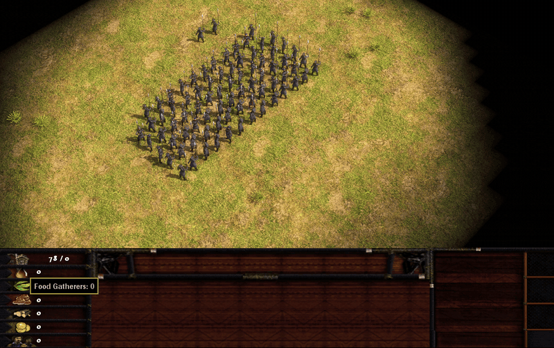

*In WoL:* with `selectionLimit 75`, a box over 78 Pikemen selects 75 (the number on the selection icon).
[Full video (MP4)](media/selectionLimit-wol.mp4).

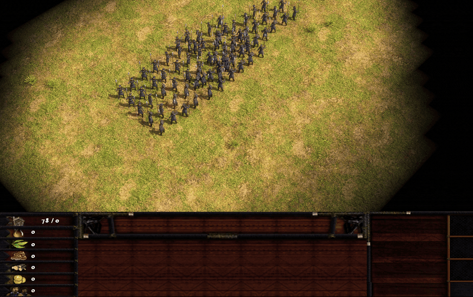

*In WoL, key off (the same scene):* the same box stops at 50. [Full video (MP4)](media/selectionLimit-wol-control.mp4).

```
selectionLimit N
```

- **Effect:** one selection holds up to N units (1 to 200; 50 in the exe), for box selection, double
  click and control groups alike. `wol.cfg` has `selectionLimit 75`.
- **Log:** `selectionLimit: a selection holds up to N units (stock 50)` (`; above 75 not tested`
  for larger values); `selectionLimit: needs a number from 1 to 200` for a bad value (not
  applied).
- **Simulation:** no: it only changes what the local player can select. Players may set it
  differently.
- **Status:** confirmed (single player, on WoL): with 75, a box over 78 Pikemen selected 75; without the
  key, 50.

#### noAILimit

*Game setup lists every AI personality in the folder, not just the built-in ones.*

**Added:** Wednesday 2026-10-28 10:56

```
noAILimit
```

- **Effect:** the AI personality list in game setup shows every `AI4\*.personality` file of WoL's
  folder, sorted by file name (case-insensitive). The exe's built-in list has 14 stock personalities.
  The folder name and the extension are read from the exe, so WoL's `AI4\` works. WoL's `wol.cfg` uses
  [`noAILimitV2`](#noailimitv2), which gives the same list.
- **WoL needs:** the personality files. To add one, copy a file of `AI4\` to a new name and change its
  fields. WoL's `wolRauparaha.personality` is a good model:

  ```xml
  <AI>
     <version>2</version>
     <script>_TeRauparaha</script>
     <nameID>1001432</nameID>
     <tooltipID>1001433</tooltipID>
     <forcedciv>Maori</forcedciv>
     <rushboom>0</rushboom>
     <icon>WoL\ui\singleplayer\cpai_avatar_maori-xs</icon>
     <chatset>huayna</chatset>
     <playerNames>
        <nameID>1001432<civ>Maori</civ></nameID>
     </playerNames>
  </AI>
  ```

  `nameID` and `tooltipID` are string table IDs. Give each personality its own strings in
  `data\stringtabley.xml`.
- **Log:** `noAILimit: N personalities from <folder>\AI3\*.personality`;
  `noAILimit: no personality files match …; keeping the stock list`;
  `hook reached: noAILimit (0x603B0B)`.
- **Simulation:** the list feeds game setup; every player needs the same personality files.
- **Status:** confirmed on the stock game: an added personality appeared in game setup and played.
- **Fixed from the original DLL:** upstream leaves two of the function's variables uninitialized.

#### noAILimitV2

*The version of noAILimit that WoL uses: game setup lists all its AI personalities.*

**Added:** Monday 2026-11-02 19:51

```
noAILimitV2
```

- **In WoL without it:** the game has only the exe's stock personalities, which WoL does not ship. A
  random-personality AI gets one of them, starts with no civ, and the game crashes at 0x7C252C.
- **Effect:** the same list as `noAILimit`, every `AI4\*.personality` file sorted by file name, 52 in
  WoL. It is installed later in the same function: the exe's code that builds the built-in list runs,
  then only its count and table are replaced. With both keys, `noAILimit` is used.
- **Log:** `noAILimitV2: N personalities from <folder>\AI3\*.personality`;
  `hook reached: noAILimitV2 (0x603C34)`.
- **Simulation:** as `noAILimit`.
- **Status:** confirmed (2026-11-02): the list held WoL's 52 personality files, sorted, with a random
  personality playing a skirmish. A hardware breakpoint at 0x603C4F read the same table (52 names,
  `ai22` first) with WoL's own DLL and with this one.

#### enableAllTeams

*Single-player game setup also offers Teams 3 and 4.*

**Added:** Monday 2026-11-02 20:40 · **Filmed in WoL:** Wednesday 2026-11-04 13:58

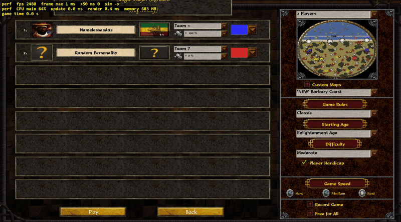

*In WoL:* the setup's team list offers Team 1 to 4. [Full video (MP4)](media/enableAllTeams-wol.mp4).


*In WoL, key off (the same screen):* only Team 1 and Team 2. [Full video (MP4)](media/enableAllTeams-wol-control.mp4).

```
enableAllTeams
```

- **Effect:** the single-player game setup offers Team 3 and Team 4 besides Team 1, Team 2 and
  "?". The multiplayer lobby is not changed yet.
- **WoL needs:** nothing: string IDs 36143 and 36144, `Team 3` and `Team 4`, are in WoL's string table.
- **Log:** `enableAllTeams: Team 3 and Team 4 in the single-player setup (multiplayer lobby not
  changed yet)`; `hook reached: enableAllTeams setup list (0x7A0709)`.
- **Simulation:** it only adds choices; the teams chosen are part of the game setup as usual.
- **Status:** partly confirmed (2026-11-02, single player): the list shows Team 1–4 and "?", and
  a skirmish with Team 3 against Team 4 started and played; how the game numbers the teams inside was not
  read.
- **Fixed from the original DLL:** upstream loads the temporary string's destructor but never calls it
  (a leak per list fill).

### New data and scripting

New names the game's data and scripts can use.

| Key | What it does | WoL's DLL | WoL also needs | In-game status |
|---|---|---|---|---|
| [`customAbstractTypes`](#customabstracttypes) | Turns every name in `data\uhc\customabstracttypes.xml` (47 today) into an abstract unit type that protos, techs, auras and XS scripts can use. | always on | The file. | confirmed |
| [`auraStacking`](#aurastacking) | `<NoStack>` and `<ForbidUnitType>` on any aura. | **new** | The tags on the aura. | confirmed |
| [`customProtoUnitCommands`](#customprotounitcommands) | Adds the command types (buttons) listed in `data\uhc\customprotounitcommands.xml` (55 today). | always on | The file, and the `<Command>` lines that use them. | confirmed |
| [`customHotkeyContexts`](#customhotkeycontexts) | Makes keymap contexts named `<ProtoName>Accel` work, such as WoL's `WOLBarracksGreekAccel`. Today the exe drops them. | **new** | Those contexts in `data\DefaultKeyMapY.xml`; WoL's file already has three. | confirmed (single player) |
| [`techRenameEffect`](#techrenameeffect) | The tech effect `SetTechName`: a tech gives another tech a new name, rollover and help text, for the players it reaches only. | **in `wol.cfg`**, but WoL's renames for all players | `<Effect type='SetTechName' …/>` in a tech, and the string IDs in `stringtabley.xml`. | confirmed (single player) |
| [`customSyscalls`](#customsyscalls) | Loads `wolPlugin.upl` and `wolai.upl` and adds the XS syscalls they register. WoL's AI needs it. | **in `wol.cfg`** | The plugins. | confirmed |
| [`customCheats`](#customcheats) | The cheats of WoL's plugins work in the chat. | **in `wol.cfg`** | `customSyscalls`, and plugins that register cheats. | confirmed |
| [`kbUnitSyscalls`](#kbunitsyscalls) | Five KB syscalls for AI scripts: a unit's inventory, its workers and its targeters. | always on | AI scripts that call them. | confirmed |

#### customAbstractTypes

*A mod can create its own unit categories for its data, techs, auras and scripts.*

**Added:** Monday 2026-11-02 20:04

```
customAbstractTypes [file]
```

- **In WoL today:** WoL's DLL reads `data\uhc\customabstracttypes.xml` always, so `wol.cfg` has no line
  for it. This DLL needs the line. Without it, WoL's 47 types are dropped from about 2,800 `<UnitType>`
  uses, and the AI does not compile (`cUnitTypeAbstractWoLHandCavalry`).
- **Effect:** every name in the file becomes an abstract unit type, as if it were compiled into the
  game: protos list it in `<UnitType>`, techs and auras target it, XS scripts use `cUnitType<Name>`.
  The exe drops any `<UnitType>` that is not on its built-in list, silently. The names get their IDs in
  file order, before the types other keys add, so their IDs do not depend on the other keys.
- **WoL needs:** the file, by default `data\uhc\customabstracttypes.xml` (relative to the game folder; an
  absolute path works too). To add a type, add a line to WoL's file:

  ```xml
  <AbstractTypes>
     <AbstractType stringId="430103">AbstractWoLCavalry</AbstractType>  <!-- comment -->
     <AbstractType>AbstractTrainLimitOne</AbstractType>
  </AbstractTypes>
  ```

  A name is letters, digits and `_`. `stringId` is read but not used yet (a display name for the
  type). A name the game already knows keeps its ID.
- **Log:** `customAbstractTypes: N abstract types from <file> (M with a stringId, not used yet)`;
  on each data load, one `unit types: <Name> -> <ID> (bit …), added` line per name;
  `customAbstractTypes: cannot read <file>`; `<Name> is listed twice`.
- **Simulation:** changes the data every player loads: everyone needs the same file.
- **Status:** confirmed (2026-11-02, single player, on WoL): WoL's 47 names registered (IDs 3837–3883),
  carried by the protos that list them (668 protos for the most used one), and WoL's AI scripts, which
  use `cUnitType<Name>` constants, compiled. Before it, `aiLoaderStandard.xs` failed on
  `cUnitTypeAbstractWoLHandCavalry`.

#### customProtoUnitCommands

*A mod can add its own command buttons to units and buildings.*

**Added:** Tuesday 2026-11-03 08:39 · **Filmed in WoL:** Wednesday 2026-11-04 13:58

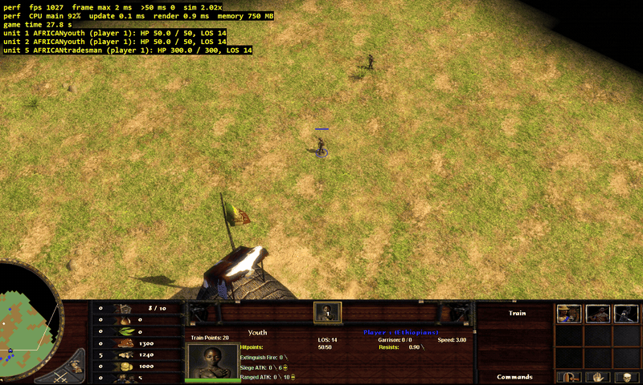

*In WoL (Zulu `AFRICANyouth`):* the unit's `<Command>` buttons use WoL's command types. Their tooltips come
from `protounitcommands.xml`, and a real click on each runs its command: two transforms into "maturing"
units, which become a Tradesman and a Bowman about 10 s later.
[Full video (MP4)](media/customProtoUnitCommands-wol.mp4).


*In WoL, key off (the same scene):* the same unit has no such buttons, and the clicks do nothing.
[Full video (MP4)](media/customProtoUnitCommands-wol-control.mp4).

```
customProtoUnitCommands [file]
```

- **In WoL today:** WoL's DLL does this always, so `wol.cfg` has no line for it. This DLL needs the line.
  Without it, WoL's 55 command types and their `<Command>` buttons on 36 protos are dropped.
- **Effect:** every `<CommandType>` name in the file becomes a command type, like the 129 compiled into
  the exe (`MarketBuy1` ... `Tactic32` ... `RansomExplorerAsian`). Entries of `protounitcommands.xml` with
  that `<name>` and protos' `<Command>` tags with that name are kept instead of dropped, so the button
  shows and runs its `<command>`.
- **WoL needs:** the file (default `data\uhc\customprotounitcommands.xml`). To add one:

  ```xml
  <ProtoUnitCommandTypes>
    <CommandType>TransformWOLCentralAmericaBananaMaturing</CommandType>
  </ProtoUnitCommandTypes>
  ```

  plus a `protounitcommands.xml` entry and a `<Command>` per button, as for any other type. Names are
  letters, digits and `_`; a name the exe already knows is skipped.
- **Buttons on the tactics page** (`page="9"`) of a building show only for the buildings the exe lets
  switch tactics (Factory, Rice Paddy...); the key does not change that. So the Fazenda's four tactic
  buttons need more than this key, and they were not seen in a test.
- **Log:** `customProtoUnitCommands: N command type(s) from <file>; M command records`; when the
  game builds its tables, `customProtoUnitCommands: N command type(s) added (IDs 129..), K already
  known, R refused`.
- **Simulation:** changes the data: every player needs the same file.
- **Status:** confirmed (2026-11-03, single player, on WoL): with WoL's 55 names, a Zulu `AFRICANyouth`
  showed its six transform buttons with their tooltips, and two clicks transformed two units; each
  became a maturing unit and then the final unit (a Tradesman, a Bowman). The maturing unit trains the
  final unit with a `Maintain` action that the Zulu start tech `Age0zulu` enables. Without the key the
  same unit showed none. The game's command records are a fixed array (130), and a first build that
  only added the names showed no button and wrote past it; the key enlarges the array.

#### customHotkeyContexts

*Units and buildings added by a mod can have their own hotkeys.*

**Added:** Thursday 2026-10-29 06:39 · **Filmed in WoL:** Friday 2026-11-06 14:35

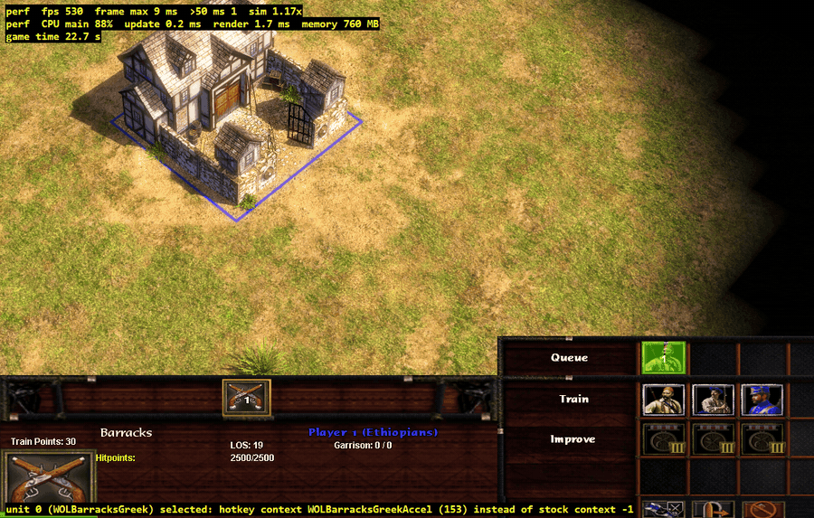

*In WoL, with `customHotkeyContexts log` (Greeks in age II, the Greek barracks selected):* WoL's own
`DefaultKeyMapY.xml` maps `o` to `tis("Klepht")` in the context `WOLBarracksGreekAccel`, which the
exe does not know. The DLL registers it (`registered keymap context WOLBarracksGreekAccel as context
153`) and turns it on when the barracks is selected; three real presses of `o` queue three Klephts.
[Full video (MP4)](media/customHotkeyContexts-wol.mp4).

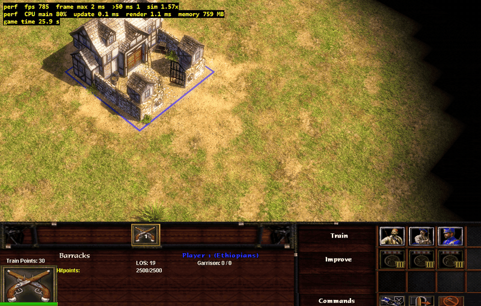

*In WoL, key off (the same scene and key presses):* the context is dropped when the keymap loads,
so `o` does nothing and no Klepht is queued.
[Full video (MP4)](media/customHotkeyContexts-wol-control.mp4).

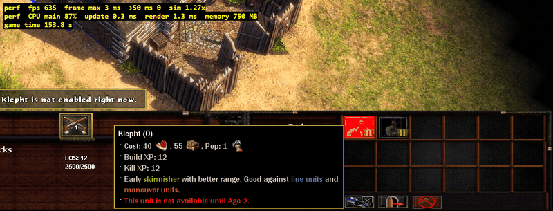

*In WoL, with `customHotkeyContexts log` (test data: Klepht enabled for Ethiopians, the Greek barracks selected):* the tooltip reads
`Klepht (O)`. [Full video (MP4)](media/customHotkeyContexts-tooltip-wol.mp4).

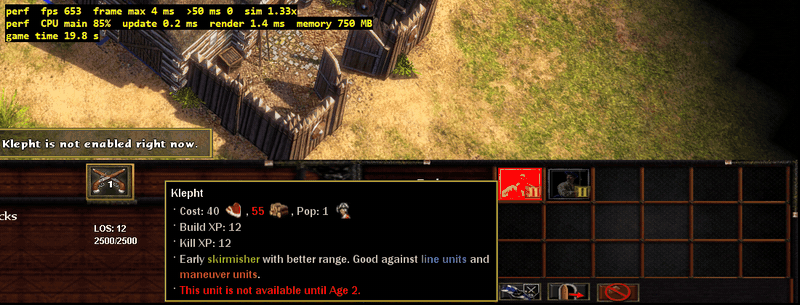

*In WoL, key off (the same data):* `Klepht`, with no letter. `Scytheman (P)` keeps its letter: a stock context has it.
[Full video (MP4)](media/customHotkeyContexts-tooltip-wol-control.mp4).

```
customHotkeyContexts [log]
```

- **In WoL today:** every hotkey in `data\DefaultKeyMapY.xml` belongs to a `<context>`, e.g. `BarracksAccel`
  for the keys that train units while a Barracks is selected. The exe knows a fixed list of 123 context
  names (35 of them are unit contexts, `TownCenterAccel` … `WonderAccel`) and silently drops every
  `<keymapdata>` whose context is not on that list. So the entries of WoL's three new contexts,
  `WOLBarracksGreekAccel`, `WOLBarracksKoreanAccel` and `WOLStableGreekAccel`, do nothing. Which context a
  selected unit turns on is also fixed in the exe: a table of about 40 protos (for example
  `ypCaravanserai` → `StableAccel`), plus shrines and wonders by unit type. A selected unit that is not
  a building but has a `<Train>` list only ever gets `BuildAccel`.
- **Effect:** a `<context>` named `<ProtoName>Accel` that the exe does not know is registered when
  the game reads the keymap, so its entries are kept. `<ProtoName>` is the `name` of a `<Unit>` in
  `protoy.xml` (case does not matter). While a unit of that proto is selected, that context is on,
  **instead of** the context the exe gives that proto, if it had one. Selecting anything else switches
  it off. Contexts the exe already knows are never redirected.
- **Which units use it:** only units that enter a hotkey context at all:
  - a building with a `<Train>` list;
  - any other unit with a `<Train>` list (a wagon, a settler), which then enters its own context
    instead of `BuildAccel`;
  - a fire pit (`AbstractFirePit`);
  - a unit whose proto has the flag `EnterHotkeyContext`.

  Other units (a soldier, a hero) never enter a context, so theirs stays off although it is
  registered: give them the flag `EnterHotkeyContext`.
- **WoL needs:** nothing for its three contexts: `DefaultKeyMapY.xml` already names them this way. For a
  new one, add its entries to that file. `<context>` is `<ProtoName>Accel`:

  ```xml
  <keymapgroup name="Greek Barracks Hotkeys" displayname="Greek Barracks Hotkeys">
    <keymapdata>
      <name>Train Klepht</name>
      <displayname>Train Klepht</displayname>
      <event>o</event>
      <context>WOLBarracksGreekAccel</context>
      <command>tis("Klepht")</command>
    </keymapdata>
  </keymapgroup>
  ```

  An added context replaces the one the exe would turn on, so copy into it every key the unit should
  keep. For a trainer that is not a building, copy the `BuildAccel` keys it needs.
- **`log`:** one line each time the selection turns an added context on (repeats of the same unit
  and context are not logged again in a game), and once per proto when a unit that is not a
  building enters its context.
- **Log:**
  - at startup, `customHotkeyContexts: a keymap context named <ProtoName>Accel that the game does
    not know becomes that proto's hotkey context` (`, every switch logged` with `log`);
  - when the keymap is read, `hook reached: customHotkeyContexts (0x5C1778)` and one line per added
    context: `customHotkeyContexts: registered keymap context WOLBarracksGreekAccel as context 153`;
  - on the first selection, `hook reached: customHotkeyContexts (0x79F1A5)` and `… (0x79F897)`; on
    the first selected trainer that is not a building, `… (0x64A034)`;
  - with `log`: `customHotkeyContexts: unit N (WOLBarracksGreek) selected: hotkey context
    WOLBarracksGreekAccel (153) instead of stock context -1` (-1: the proto had none) and `customHotkeyContexts: unit N
    (ForgeCaravan) is not a building: units of this proto enter hotkey context ForgeCaravanAccel
    (152) instead of BuildAccel (logged once per proto)`;
  - when the context table is too full: `customHotkeyContexts: N contexts are registered; keymap
    context X not registered, its entries are dropped (the last 32 of the 255 context IDs stay free
    for the game)`.
- **The letter in the tooltip:** a key of an added context shows on its button, as a stock one does. A unit mapped in a stock context
  and in an added one shows the stock letter. Only `tis("Proto")` counts, not `tis("Proto",5)`.
- **Tested in WoL (2026-11-06, tooltip):** 41 protos gain a letter (556 to 597) and no stock letter changes; the same after a load and
  beside WoL's DLL; an AI skirmish of 100 s with no XS error. Not tested: tech buttons, the building branch, multiplayer.
- **Limits:**
  - at most 255 contexts in all; the DLL stops adding at ID 222 to leave the game room. About 70 can
    be added: the game registers about 151 before the keymap;
  - names the exe already knows (`SettlerAccel`, `CoveredWagonAccel`, …) keep the exe's meaning;
  - a context is on only for the last unit of the selection;
- **Simulation:** no. A hotkey issues the same command as clicking the button, so players may set
  the key differently. Not tested in multiplayer.
- **Status:** confirmed in single player. In WoL (2026-11-03), three real presses of `o` queued three
  Klephts at the selected Greek barracks; without the key the context is dropped and the same presses
  do nothing. On the stock game (2026-10-29), test contexts on a Sacred Field, a Caravanserai (instead
  of its `StableAccel`) and a market wagon (not a building, instead of `BuildAccel`) switched by the
  log. Not tested in WoL: a trainer that is not a building.

#### techRenameEffect

*A tech can rename another tech, only for the players it reaches.*

**Added:** Thursday 2026-10-29 06:39 · **Filmed in WoL:** Wednesday 2026-11-04 12:48

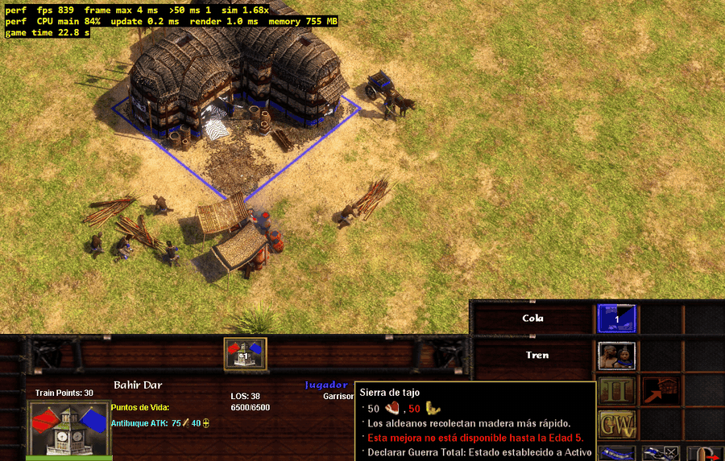

*In WoL, with `techRenameEffect log` (Ethiopians; the cursor rests on the Town Center's GW button
so its rollover stays on screen):* a test tech (`UHCRenameTest`, appended to the bed's techtree and
removed after) carries `<Effect type='SetTechName' tech='GreatWarButton' newName='11070'
newRolloverTextID='10670'/>` and turns on at 22 s. "Declare Total War" becomes "Gang Saw", with its
rollover; cost and effect stay those of `GreatWarButton`. [Full video (MP4)](media/techRenameEffect-wol.mp4).

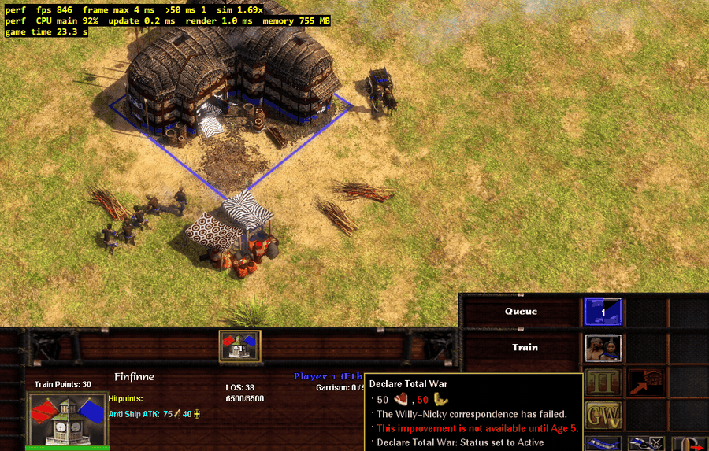

*In WoL, key off (both `techRenameEffect` and WoL's `enableTechRenameEffect` line removed from the
cfg):* the game drops the `SetTechName` effect, and the button stays "Declare Total War".
[Full video (MP4)](media/techRenameEffect-wol-control.mp4).

```
techRenameEffect [log]
enableTechRenameEffect [log]     the same key under WoL's name
```

- **In WoL today:** `wol.cfg` has `enableTechRenameEffect`, and WoL's DLL adds the effect `SetTechName`.
  It writes the new string IDs into the database's copy of the tech, which all players share: when one
  civ's tech renames a tech, every player sees the new name. WoL's `techtreey.xml` has no `SetTechName`
  yet. The exe's own `SetName` effect renames a *unit* for one player.
- **What changes for WoL:** the same effect and attributes, so WoL's data works unchanged, but the
  rename reaches only the players of the tech that carries it. To have this, replace WoL's handler
  with the code in the porting guide.
- **Effect:** adds the tech effect `SetTechName`. When a tech that carries it becomes active for a
  player, the named tech shows the new name, rollover and help text **for that player only**. If
  the carrier is a team tech, every member of the team gets the rename. Costs, prerequisites,
  effects, icon and research stay as before.
- **WoL needs:** the effect in the `<Effects>` of any tech:

  ```xml
  <Effect type='SetTechName' tech='HuntingDogs' newName='11070' newRolloverTextID='10670'/>
  ```

  | Attribute | Meaning |
  |---|---|
  | `tech` | Required. The name of the tech to rename. |
  | `newName` | New `DisplayNameID` (the button and message name). |
  | `newRolloverTextID` | New `RolloverTextID` (the button's rollover). |
  | `newLongRolloverTextID` | New `LongRolloverTextID` (the long help text). WoL's effect has no such attribute. |

  The three string IDs are optional, but at least one must be given; leave one out, or write `-1`, to
  keep that text. The IDs come from `data\stringtabley.xml`. "Per civ" means placing the effect in a
  tech that only that civ gets, such as its `Age0<Civ>` shadow tech or a home city card's tech.
- **Where the new texts show:** wherever the game reads the tech through the player's own tech
  tree: the buttons and rollovers of that player's buildings and the "researching" /
  "researched" messages. From the code, these keep the original texts: the in-game help (F1), the home
  city screens and every screen outside a game. Other players and observers see the original texts.
- **When:** from the moment the carrier tech becomes active. A saved game re-applies the rename
  when it loads (static reading; not tested). Nothing undoes a rename: a carrier that is
  deactivated later leaves the new texts, as `SetName` does. Two carriers that rename
  the same tech for one player: the last one applied wins, text by text.
- **Without the key** the game does not know `SetTechName`: it drops each such effect with its own
  error and loads the rest of the techtree.
- **`log`:** one line per `SetTechName` read from the data and one per rename.
- **Log:** at startup `techRenameEffect: the tech effect SetTechName (tech, newName,
  newRolloverTextID, newLongRolloverTextID) renames a tech for the players it reaches (multiplayer
  unverified)` (the line starts with `enableTechRenameEffect:` under WoL's key name; with `log`,
  `…reaches, every rename logged (multiplayer unverified)`), then
  `techRenameEffect/enableTechRenameEffect: applied`; at data load `hook reached: techRenameEffect
  register (0x524CB5)`, `techRenameEffect: effect type SetTechName -> 17` and, at the first effect
  read, `hook reached: techRenameEffect factory (0x62146F)`. Data errors are always logged, and
  the effect is dropped while the rest of the file loads:
  - `techRenameEffect: SetTechName: unknown tech 'X'; this effect is dropped`;
  - `techRenameEffect: SetTechName without tech='...'; this effect is dropped`;
  - `techRenameEffect: SetTechName on X: newName='abc' is not a string ID (a number from 0, or -1 to
    keep the text); this effect is dropped`;
  - `techRenameEffect: SetTechName on X sets none of newName, newRolloverTextID,
    newLongRolloverTextID; this effect is dropped`.

  With `log`: `techRenameEffect: read SetTechName on X (tech N): newName …` per effect read, and
  `techRenameEffect: player P: tech N (X), from tech M: name a -> b, rollover c -> d, long rollover
  e -> f (node …, NodeData … -> copy …)` per rename.
- **Simulation:** no gameplay change: only string IDs differ. The effect does run inside the
  simulation (tech activation), so give every player the same setting; multiplayer is not tested.
- **Status:** confirmed in single player. In WoL (2026-11-04), a test tech renamed `GreatWarButton` for
  player 1, and the button and its rollover changed. On the stock game (2026-10-29), memory showed the
  database's tech data, which other players see, unchanged, and only player 1's copy with the new IDs;
  a second effect naming an unknown tech was logged and dropped, and the techtree still loaded. Saved
  games were not tested.

#### customSyscalls

*Loads plugins that add new functions to AI, map, trigger and UI scripts.*

**Added:** Monday 2026-11-02 20:13 · **Filmed in WoL:** Wednesday 2026-11-04 13:58

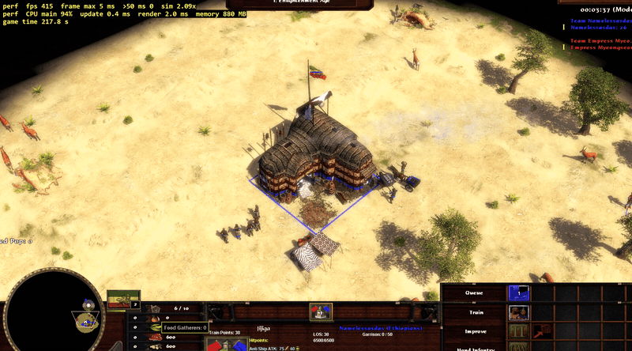

*In WoL (a skirmish against the AI):* with `customSyscalls wolPlugin.upl wolai.upl`, WoL's AI compiles and
plays: no XS error, and it gathers and trains from the start.
[Full video (MP4)](media/customSyscalls-wol.mp4).

```
customSyscalls [file or pattern ...]
```

- **In WoL without it:** the AI does not compile (`aiWoLMain.xs` calls `kbGetTechID` 36 times), and 36
  `RM4\ESOC_*` maps need it too.
- **Effect:** loads plugins (`.upl` files) and adds the XS syscalls they register to AI, trigger,
  random-map and UI scripts. Without arguments it loads every `*.upl` file in the game folder; with
  arguments, the files or patterns listed, relative to the game folder. A plugin that crashes while it
  starts is logged and skipped. `wol.cfg` has `customSyscalls wolPlugin.upl wolai.upl`.
- **Plugins:** a `.upl` is a 32-bit DLL that exports `int UHCPluginMain(UHCPluginInfo*)` (cdecl).
  `UHCPluginInfo` holds five cdecl function pointers, in this order:
  `RegisterCheat(text, enabled, callback)`,
  `RegisterSyscall(group, returnType, name, function, paramCount, comment)` (returns a handle),
  `SyscallSetParam(handle, index, type, defaultValue)`, `CheatAddResource(playerData, resource,
  amount, flag)` and `CheatSpawnUnit(playerData, protoName)`. Groups: 0 AI, 1 HC, 2 KB, 3 RM,
  4 TR, 5 UI, 6 UI2, 7 XS. Types: 1 void, 2 int, 4 float, 8 bool, 16 string, 32 vector. A
  syscall function is cdecl and takes the XS arguments in order. WoL's two plugins load unchanged.
  Cheats go to the game with `customCheats` (below).
- **Log:** `customSyscalls: <file>: N syscalls, M cheats (UHCPluginMain returned R)`;
  `customSyscalls: K of L plugin(s) loaded, …`; once per script module,
  `syscalls: group XS: N added, M refused`; a refused syscall (a name the game already has, a bad
  type) is named, and the others still register; `hook reached: syscall group XS (0x6257D9)` and
  the other seven groups.
- **Simulation:** scripts compiled with these syscalls need them on every player's machine:
  everyone needs the same plugins.
- **Status:** confirmed (2026-11-02, single player, on WoL): both plugins loaded (17 syscalls in the XS,
  AI and KB groups, 33 cheats collected), and WoL's AI compiled and played a skirmish.
- **Fixed from the original DLL:** upstream's syscall table overflows into the population and deck limits
  when the list is long, loads plugins by bare file name (directories do not resolve), and stops
  a whole group at the first refused syscall.

#### customCheats

*Cheats added by plugins work when typed in the chat.*

**Added:** Monday 2026-11-02 20:47 · **Filmed in WoL:** Wednesday 2026-11-04 13:58

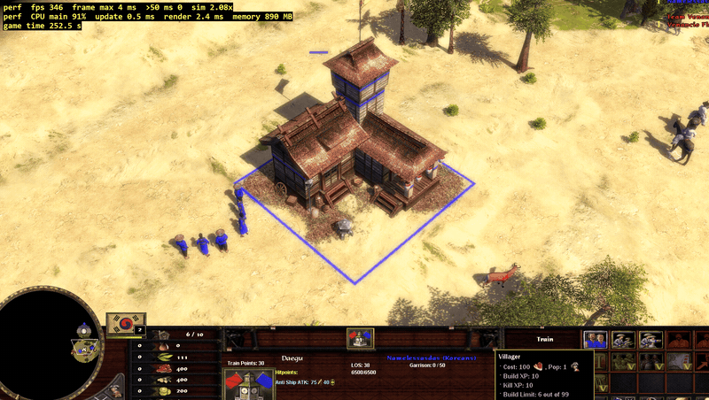

*In WoL (a skirmish):* `kill 'em all`, a cheat of `wolPlugin.upl` typed in the chat, spawns 50 Cannons.
[Full video (MP4)](media/customCheats-wol.mp4).

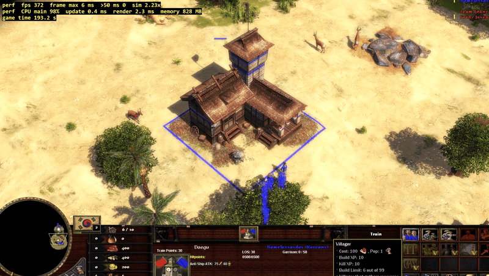

*In WoL, key off (the same scene):* the same text does nothing. [Full video (MP4)](media/customCheats-wol-control.mp4).

```
customCheats
```

- **Effect:** the 33 cheats that WoL's plugins register (see `customSyscalls`) work in the chat like the
  game's own: typed as written (lower case), they run on every player's machine through the game's
  cheat command. Plugins load when either `customSyscalls` or `customCheats` is set;
  without `customSyscalls` their syscalls are ignored.
- **Log:** `customCheats: N plugin cheat(s) added to the cheat table (M entries)` the first time
  the table is built; `hook reached: customCheats cheat table (0x551FE6)`.
- **Simulation:** a cheat runs as a game command, as the game's own cheats do; every player needs the
  same plugins.
- **Status:** confirmed (single player, on WoL): 33 plugin cheats added after the exe's 23, and `kill 'em
  all` spawned 50 Cannons in a skirmish; none without the key. Cheats do not run in a scenario.

#### kbUnitSyscalls

*AI scripts can ask about a unit's resources, its workers and which units target it.*

**Added:** Tuesday 2026-11-03 08:16 · **Filmed in WoL:** Wednesday 2026-11-04 13:58

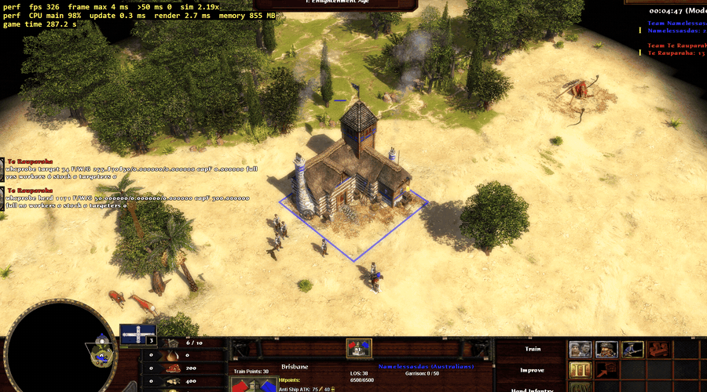

*In WoL (the Maori AI Te Rauparaha):* its script calls the five syscalls, compiles and plays; a test rule
prints them in the chat for what the AI's villagers gather and for its livestock. Without the key this
AI does not compile (`Error 0172`), so there is no control video.
[Full video (MP4)](media/kbUnitSyscalls-wol.mp4).

```
kbUnitSyscalls
```

- **In WoL today:** WoL's DLL has these always, so `wol.cfg` has no line for them. This DLL needs the
  line. Only the Maori personality Te Rauparaha uses them (`AI4\_TeRauparaha.xs`, 38 calls), and without
  them that AI does not compile (`Error 0172` on `kbUnitGetCurrentInventory`).
- **Effect:** adds five KB syscalls for AI scripts, about resource units. "The player" is the AI whose
  script runs.

  | Syscall | Returns |
  |---|---|
  | `float kbUnitGetCurrentInventory(int unitID, int resourceID)` | the amount of that resource the unit holds (a mine's gold, a bush's food, an animal's food) |
  | `float kbUnitGetInventoryCapacity(int unitID, int resourceID)` | how much of it the unit can hold (its proto's carry capacity) |
  | `bool kbUnitIsInventoryFull(int unitID)` | the engine's own "inventory full" test (for livestock: fully fattened) |
  | `int kbUnitGetNumberWorkersIfSeeable(int unitID)` | for a unit the player can see, the number of its gatherers the player can see; 0 if it cannot see the unit. The exe's `kbUnitGetNumberWorkers` answers only for the player's own units |
  | `int kbUnitGetNumberTargeters(int unitID)` | the number of the player's gatherers ordered to the unit that are not working it yet |

  An unknown unit ID gives 0 (inventory), false, or -1 (the two counts).
- **WoL needs:** nothing; AI scripts call the syscalls. A script that calls them fails to compile
  without the key (`XS: Error 0003: could not compile file ...`).
- **Log:** `kbUnitSyscalls: 5 kb syscalls added`, then `syscalls: group KB: 5 added, 0 refused`
  when the game builds its KB syscalls; the first call of each, `hook reached: kbUnitSyscalls
  <name>`.
- **Simulation:** reads only; AI scripts run on the host, so only the host needs the line.
- **Status:** confirmed (2026-11-03, single player, against the AI Te Rauparaha): the script compiled and
  ran. A test rule printed the syscalls every 20 s: a hunted animal's food fell from 207.7 to 62.5 while
  `kbUnitGetNumberWorkersIfSeeable` gave 6 (`kbUnitGetNumberWorkers` gave 0 for that Gaia unit; game
  memory showed the same 6 gatherer IDs); the AI's livestock showed food 50 of capacity 300, not full; a
  mine and a bush at full showed "full". `kbUnitGetNumberTargeters` was reached but gave 0 in that
  window (every gatherer was already working its target).

#### auraStacking

*Several carriers of the same aura no longer multiply it, and an aura can skip chosen units.*

**Added:** Friday 2026-11-06 13:44 · **Filmed in WoL:** Friday 2026-11-06 13:44

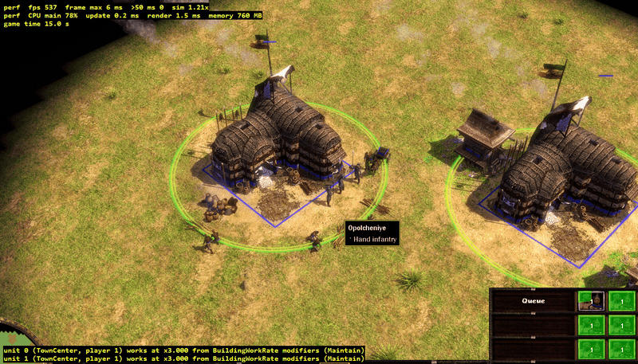

*In WoL, with `auraStacking log` (Ethiopians, 5 `Pikeman` with a test aura `BuildingWorkRate` ×3 and `<NoStack>`, `ring_work.xml`):*
the Town Centers in range work at ×3. [Full video (MP4)](media/auraStacking-wol.mp4).

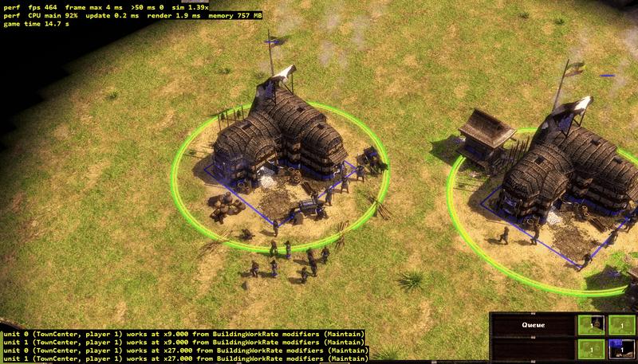

*In WoL, key off (the same data):* the game skips the tag, the auras multiply and they work at ×27.
[Full video (MP4)](media/auraStacking-wol-control.mp4).

```
auraStacking [log]
```

```xml
<action>
    <name>MyAura</name>
    <type>AutoRangedModify</type>
    <nostack>1</nostack>
    <forbidunittype>Hussar</forbidunittype>
</action>
```

- **In WoL today:** every carrier of an aura multiplies: five of ×4 give ×1024.
- **`<NoStack>`:** a target holds this aura from one carrier. When that one dies or it leaves its range, the next takes over,
  0.6 s later in the test. Another aura still multiplies with it. For stock auras and those of `buildingWorkRateAuras`,
  `resourceGatherAuras` and `unitResourceAuras`, where each target is paid by one carrier.
- **`<ForbidUnitType>`** (or `<ForbidAbstractType>`, more than once): the aura leaves those units alone, on any aura.
- **Same aura:** the same proto and action name. Two protos sharing a tactics file are two auras, and the first carrier stays: the
  strongest does not win.
- **Changes the simulation:** every player needs the same setting and data.
- **Saved games:** nothing to do: the mark is in the modifier, which the game saves.
- **Log:** `auraStacking: applied`, `hook reached: auraStacking filter (0x9D0633)`, `auraStacking applied (0x9D0675)`, and with `log`
  `auraStacking: unit 1 holds unit 6`, `unit 2 leaves unit 6 alone: it holds this aura`.
- **Not covered:** the applier of auras with no range, FUN_009D7328, and powers.
- **Tested in WoL (2026-11-06):** a stock Speed ×4 aura, ×256 with 4 carriers and ×4 with the tag; `resourceGatherAuras` ×1024 against
  ×4; `buildingWorkRateAuras` ×64 against ×4; two Sawmills on three trees, one payer each; two auras ×8; a Hussar forbidden from an
  `AbstractCavalry` aura, 0 modifiers; a loaded game kept one modifier; beside WoL's DLL; an AI skirmish of 100 s with no XS error.
  Performance could not be compared: other games were running, and the two runs do not carry the same modifiers. Not tested:
  multiplayer, recorded games.

### Civs

What the exe decides by civ.

| Key | What it does | WoL's DLL | WoL also needs | In-game status |
|---|---|---|---|---|
| [`asianCivs`](#asiancivs) | Egyptians, Ethiopians, Koreans, Zulu and Maori count as Asian civs: consulate, export and wonders. | **in `wol.cfg`** | Those civs' data. | confirmed |
| [`nativeCivs`](#nativecivs) | WallMapu, Tupinamba and Tawantinsuyu count as native civs: fire pit, dances and council age-up. Without it, WallMapu's age-up crashes the game. | **in `wol.cfg`** | Those civs' data. | confirmed |
| [`twoScoutCivs`](#twoscoutcivs) | The Koreans get the interface of the civs that start with two heroes. | **in `wol.cfg`** | A second hero. | not tested in game |
| [`bigButtonCivs`](#bigbuttoncivs-and-nobigbuttonblds), [`noBigButtonBlds`](#bigbuttoncivs-and-nobigbuttonblds) | Gives the command panel's big button to the listed civs, and takes it from the listed buildings. | **in `wol.cfg`** | Nothing. | partly confirmed |
| [`danceBonusCivs`](#dancebonuscivs) | Lets the civs you list get the fire pit's Training, XPTrickle, Gathering and Regeneration dances, which the exe applies only to `XPIroquois`, `XPSioux`, `XPAztec` and `XPSPC`. | **new** | A building with `AbstractFirePit`, its dance enabled for those civs, and villagers that can work on it. | confirmed (single player) |
| [`wonderCivUnitType`](#wondercivunittype) | `Rangatira` may start the Maori age-up. Without it, the Maori cannot age up. | **in `wol.cfg`** | Nothing. | confirmed |
| [`startingTC`](#startingtc) | Lets buildings of a marked type be a player's first town center, the unit the placement rules call `FirstTC` (no enemy building within 65 m), not only a `TownCenter`; one also replaces a first town center that is gone, dead or about to expire. | **new** | That unit type on the starting buildings in `protoy` (e.g. `MaoriPa`), or an existing type or proto name in the cfg. | confirmed (single player) |
| [`civFirstTC`](#civfirsttc) | A civ's `<firstTC>Proto</firstTC>` in `civs.xml` replaces the `TownCenter` that random maps place for its players (not in a Nomad start); that building is their first town center (`FirstTC`) and receives their town starting units. | **new** | The tag in `civs.xml`; for the town starting units, `<Flag>StartingColonyBuilding</Flag>` on the proto and the proto in `placementrules\colonies.xml` `<starttypes>`; for shipments, `hcShipmentPointFallback FirstTC`. | confirmed (single player; Nomad start not tested) |
| [`firstTC`](#firsttc) | One line for `civFirstTC` and `startingTC`, with the town units and shipments worked out from the civ's tag. | **new** | `<firstTC>` in `civs.xml`, and the proto in `placementrules\colonies.xml` `<starttypes>`. | confirmed (single player) |
| [`customRevolutionBanners`](#customrevolutionbanners) | Shows a banner for each of WoL's 29 `XPRevolution<Name>` techs, not only O'Higgins. | **in `wol.cfg`** | A banner texture per revolution. | partly confirmed |
| [`removeFameRestriction`](#removefamerestriction) | Shows Fame, XP and shipment costs on politician screens, and Fame/XP icons on home city cards. | **in `wol.cfg`** | Two icon textures. | not tested in game |

#### asianCivs

*Chosen civs count as Asian: consulate, exports and age-up by wonders.*

**Added:** Monday 2026-11-02 20:27 · **Filmed in WoL:** Wednesday 2026-11-04 13:58

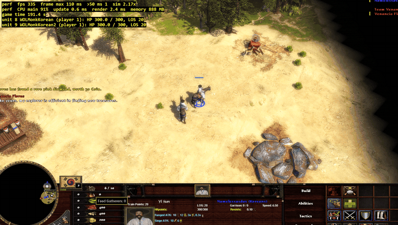

*In WoL (a Korean skirmish):* the two Korean monks show their hero names (`explorerUnits`), then a real
click on the villager's age-up button opens the list with the Koreans' five wonders.
[Full video (MP4)](media/asianCivs-wol.mp4).

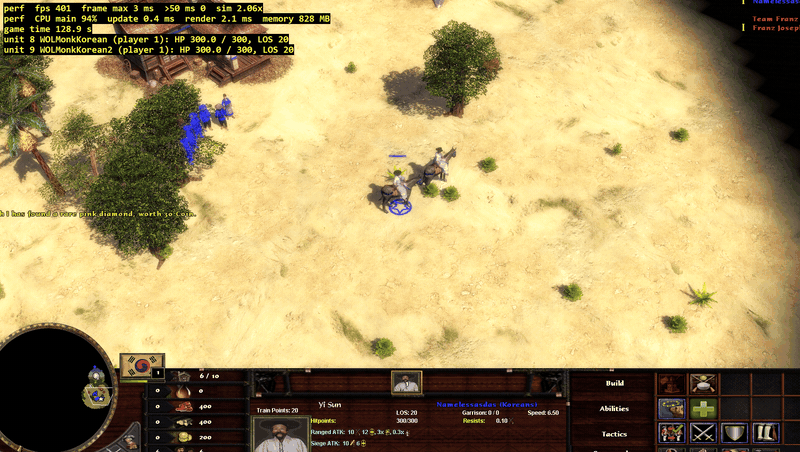

*In WoL, key off (the same scene):* the same click opens nothing.
[Full video (MP4)](media/asianCivs-wol-control.mp4).

```
asianCivs Civ [Civ ...] [log]
```

- **In WoL today:** `wol.cfg` has `asianCivs Egyptians Ethiopians Koreans Zulu Maori`. Without the line
  those civs lose export, the consulate and the wonder age-up.
- **Effect:** the listed civs (names from `civs.xml`) count as Asian civs where the game compares a
  player's civ with the Asian civs: the extended Asian-civ test (consulate, export and the other Asian
  features that call it), the Asian civs' value branch, and the wonder age-up list. In that list a
  listed civ gets the wonders whose civ name is its name in the cfg; the exe gives a civ that is not
  Chinese, Japanese or Indian no wonder at all.
- **WoL needs:** for the wonder age-up, entries in `data\politiciandata.xml` with `nativeciv="<Civ>"` and
  the civ's wonders. The file has 20 entries each for `Koreans` and `Maori`, which are the model.
- **Log:** `asianCivs: N civ(s) count as Asian civs`; when `civs.xml` is read, one
  `asianCivs: <Civ> -> civ <ID>` line per name (`… is not a civ in civs.xml; ignored` otherwise);
  with `log`, `asianCivs: <Civ> gets its wonders in the age-up list` once;
  `hook reached: asianCivs isAsianCiv (0x454F1D)`, `… civ value (0x8D6AC4)`,
  `… wonder age-up (0x818284)`.
- **Simulation:** changes what the listed civs may do: every player needs the same line.
- **Status:** confirmed (single player, a skirmish on WoL): the five civs resolved, and a Korean villager
  opened the wonder age-up list with its five wonders; without the key, nothing opens.
- **Fixed from the original DLL:** upstream tests EAX instead of AL after `0x49A2D8` in the wonder list,
  so the "civ has no entry" path (EAX = 0xFFFFFF00) counted as true.

#### nativeCivs

*Chosen civs count as native: fire pit, dances and age-up by council.*

**Added:** Monday 2026-11-02 21:19 · **Filmed in WoL:** Wednesday 2026-11-04 13:58

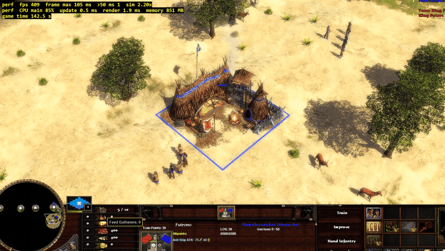

*In WoL (a WallMapu skirmish):* the Town Center opens the council age-up list with its five council
members. There is no video without the key: the same click closes the game.
[Full video (MP4)](media/nativeCivs-wol.mp4).

```
nativeCivs Civ [Civ ...]
```

- **In WoL today:** `wol.cfg` has `NativeCivs Tupinamba WallMapu Tawantinsuyu`. Without the line, the
  WallMapu age-up closes the game: the civ is taken for a European one, and the politician dialog reads
  a gadget it does not have (0x81A5FB to 0x81A80C in the exe).
- **Effect:** the listed civs count as native civs: the civ flag the `civs.xml` loader sets for
  the native civs, the game's native civ tests, the fire pit's Training, XPTrickle, Gathering and
  Regeneration dances (through the same four gates as `danceBonusCivs`), and the council age-up
  list, where a listed civ gets the council members whose civ name is its name in the cfg.
- **WoL needs:** for the council age-up, entries in `data\politiciandata.xml` with `nativeciv="<Civ>"`.
  The file has 20 each for `WallMapu`, `Tupinamba` and `Tawantinsuyu`.
- **Log:** `nativeCivs: N civ(s) count as native civs`; `nativeCivs: K of N civ(s) marked native
  in civs.xml`; `nativeCivs: <Civ> -> civ <ID>` and `danceBonusCivs: <Civ> -> civ <ID>` when
  `civs.xml` is read; `hook reached: nativeCivs civ flags (0x52B581)`, `... test 2 (0x51271F)`,
  `... isNativeCiv (0x453D5E)`, `... test 7 (0x67B0A5)`, `... test 9 (0x8D52AF)`,
  `... council age-up (0x81ADEB)`.
- **Simulation:** changes what the listed civs may do: every player needs the same line.
- **Status:** confirmed (2026-11-03, single player): the three civs marked native, every hook ran in a
  skirmish, the four dance gates resolved them, and the WallMapu Town Center opened the council age-up
  list with its five council members. Without the key, the same click closed the game.
- **Fixed from the original DLL:** upstream compares a dword where isNativeCiv compares a byte, and its
  council hook clobbers EAX.

#### twoScoutCivs

*Chosen civs get the interface of the civs that start with two heroes.*

**Added:** Monday 2026-11-02 21:10

```
twoScoutCivs Civ [Civ ...]
```

- **Effect:** the listed civs get the hero interface of the civs that start with two heroes (Japanese
  and Indians) in the four places the game decides it by civ. `wol.cfg` has `twoScoutCivs Koreans`.
- **Log:** `twoScoutCivs: N civ(s) get the two-hero UI`; `twoScoutCivs: <Civ> -> civ <ID>` when
  `civs.xml` is read; `hook reached: twoScoutCivs hero UI 1 (0x77EBB2)` to `... 4 (0x77DFF4)`.
- **Simulation:** no: interface only.
- **Status:** implemented, not tested in game (2026-11-02): the four functions did not run during a
  skirmish, in the home city menus or in its customize screen; they are probably the new home city
  dialog, which names the heroes.

#### bigButtonCivs and noBigButtonBlds

*Chooses which civs get the command panel's big button, and which buildings don't.*

**Added:** Monday 2026-11-02 21:19

```
bigButtonCivs Civ [Civ ...]
noBigButtonBlds Proto [Proto ...]
```

- **Effect:** the command panel's big button, which the exe gives to native civs, also goes to the
  listed civs; and neither native nor listed civs get it on a building of a `noBigButtonBlds` proto.
  Either line may be used alone. `wol.cfg` has `bigButtonCivs Tawantinsuyu WallMapu Tupinamba` and a
  `noBigButtonBlds` list that starts with `SANmonument`.
- **Log:** `bigButtonCivs/noBigButtonBlds: N civ(s) get the native big button, M building proto(s)
  never show it`; `hook reached: bigButtonCivs command panel (0x461BD8)`.
- **Simulation:** no: interface only.
- **Status:** partly confirmed (2026-11-02, single player): the hook ran when a WallMapu Town Center was
  selected; a building of a listed proto was not checked.

#### danceBonusCivs

*Chosen civs can use the fire pit dances that normally work only for native civs.*

**Added:** Thursday 2026-10-29 06:39 · **Filmed in WoL:** Friday 2026-11-06 13:55

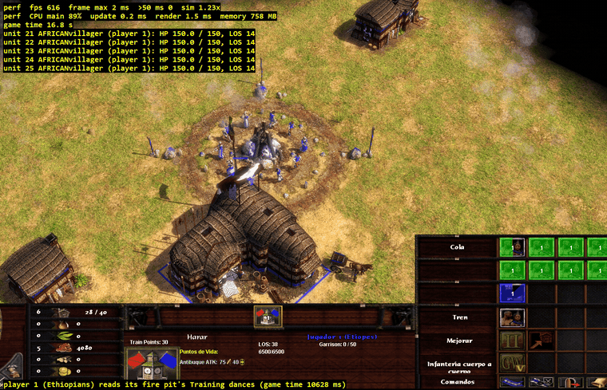

*In WoL, with `danceBonusCivs Ethiopians log` (Ethiopians, the Town Center selected so its queue
shows):* ten settlers do WoL's Fertility Dance (`FertilityDance`, a `Training` dance, turned on for
the test by an appended tech, removed after) at a fire pit while the TC trains villagers. The
Ethiopian TC gets the dance's train bonus (`reads its fire pit's Training dances`): 4 villagers
trained by 65 s of game time. [Full video (MP4)](media/danceBonusCivs-wol.mp4).

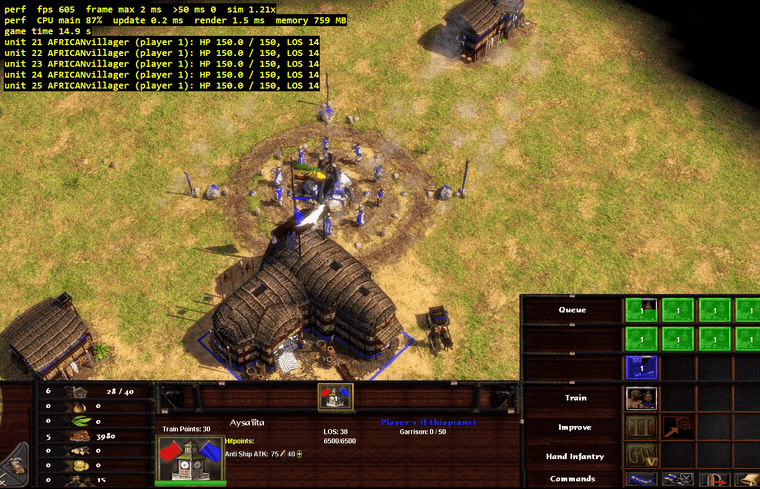

*In WoL, key off (the same scene):* the settlers dance but the bonus applies only to the native
civs, so the TC trains at its normal rate: 2 villagers by 65 s.
[Full video (MP4)](media/danceBonusCivs-wol-control.mp4).

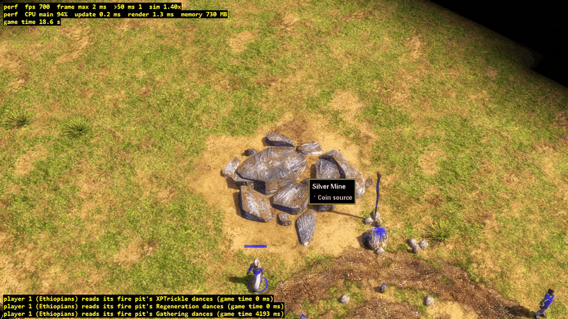

*In WoL (Ethiopians, 9 dancers at a `FirePit`, test data):* the Gathering dance and then the XP dance, with the miners' rate and the XP
in the corner. [Full video (MP4)](media/danceBonusCivs-all-wol.mp4).

- **Tested in WoL (2026-11-06):** Gathering ×1.47–1.50 against none with the key off; XPTrickle 7.0–7.3 XP/s against about 2.0. WoL's
  tactics do not use `GatherRateIncrease`: add it to a dance to use it. Training: 4 villagers against 2 at 65 s.

```
danceBonusCivs <Civ> [<Civ> ...] [log]     civ names as in civs.xml; several lines add up
```

- **In WoL today:** a fire pit dance is a tactic of the building (`data\tactics\firepit.tactics`); its
  actions have `<type>DanceBonus</type>` and a `<dancebonustype>`. Four kinds act by themselves for any
  civ that owns the building and has the tactic: `UnitModification`, `UnitSpawn`, `PopCap` and
  `WarChiefRansom`. The other four are applied by the engine where it needs them, and only for the
  civs `XPIroquois`, `XPSioux`, `XPAztec` and `XPSPC`, a list fixed in the exe:
  - `Training`: train rate (Fertility Dance, action `VillagerTrainFaster`);
  - `XPTrickle`: XP trickle (Gift Dance, `XPTrickleIncrease`);
  - `Gathering`: gather rate of every resource (the action `GatherRateIncrease` is in
    `firepit.tactics`);
  - `Regeneration`: heals the units of `<modifyabstracttype>` that have been idle for 3.5 s (Healing
    Dance, `RegenAllUnits`).

  For any other civ these four dances run, the villagers dance and (except Gift Dance) the tooltip
  even shows the bonus, but nothing happens. WoL's own key `danceCiv` only changes interface checks.
- **Effect:** the listed civs get these four kinds exactly as those four civs do: the same strength,
  the same building (the player's first `AbstractFirePit` building) and the same targets. The civ does
  not become "native" for anything else, unlike [`nativeCivs`](#nativecivs), which also misses the Gift
  Dance.
- **WoL needs:**
  - the internal civ names (the `<name>` in `civs.xml`: `Ethiopians`, `Greeks`, …); case does not
    matter;
  - a building with `<UnitType>AbstractFirePit</UnitType>`: WoL's `FirePit`, `WOLMaypole`, `SANmonument`
    or the `ypWCSummerPalace2` to `5`. Only the player's first such building is read, and the dancer
    count needs that type;
  - the dance tactic in the building's tactics file, enabled for the civ by a tech, and a button for
    it;
  - villagers that can work on the building (a `Gather` rate for it in their tactics:
    `settler.tactics` already has `FirePit`).
- **`log`:** one line the first time each player passes each of the four checks in a game. A
  listed civ with no fire pit gets the line too: the check passes, then the engine finds no
  building and the bonus stays 1.0.
- **Log:** at startup `danceBonusCivs: civs A, B get the fire pit's Training, XPTrickle, Gathering
  and Regeneration dances like the native civs (multiplayer unverified)` (with `log`: `…civs, each
  player's first use of each kind logged (multiplayer unverified)`); on the first use with each
  data load, one `danceBonusCivs: <Civ> -> civ <ID>` line per name, or `danceBonusCivs: <Civ> is not
  a civ in civs.xml; ignored` (and, when no name is valid, `danceBonusCivs: none of the listed civs
  exists; the four dance kinds stay native-only`). In a game: `hook reached: danceBonusCivs
  Training (0x8D47AB)`, `… XPTrickle (0x4E0DFF)`, `… Gathering (0x4ECD53)` and `… Regeneration
  (0x49048B)` the first time the game evaluates each kind for any player. With `log`:
  `danceBonusCivs: player N (<Civ>) reads its fire pit's <Kind> dances (game time T ms)`. Without
  any civ name: `danceBonusCivs: expected "danceBonusCivs <Civ> [<Civ> ...] [log]" with at least
  one civ name; feature not applied`.
- **Limits:**
  - only the player's first `AbstractFirePit` building counts, as for the native civs;
  - each listed civ now looks for its fire pit (a scan of its units) on every train, gather-rate,
    XP trickle and regeneration evaluation, as the native civs always did. List only the civs that
    can own a dance building;
  - new dance kinds, more dance buttons and several dance buildings per player are not covered.
- **Simulation:** yes.
- **Status:** confirmed in single player for the four kinds. `Training` in WoL (2026-11-04): Ethiopian settlers
  dancing the Fertility Dance, 4 villagers by 65 s, 2 without the key. `Regeneration` in WoL
  ([overhealSources](#overhealsources)), and on the stock game (2026-10-29), where damaged units healed
  to full with the key and stayed at 90 without. `Gathering` and `XPTrickle` in WoL (2026-11-06, the test above):
  Gathering ×1.47–1.50 against none with the key off, XPTrickle 7.0–7.3 XP/s against about 2.0.

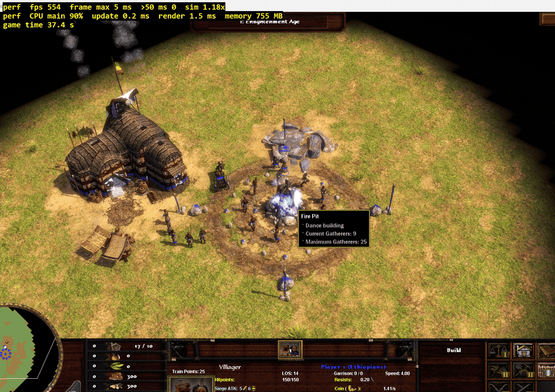
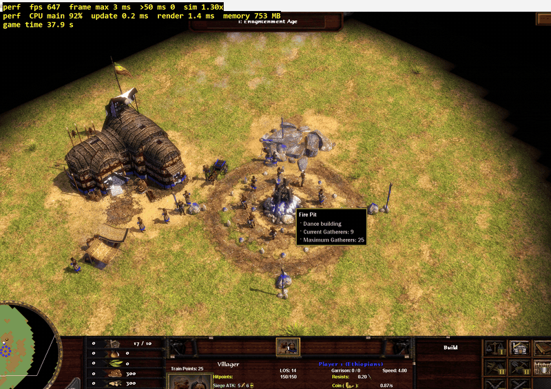

*In WoL (Ethiopians, 9 dancers, `<DanceWeight>3`, a test Gathering dance):* the selected miner's rate is in the panel.
[Full video (MP4)](media/danceBonusCivs-weight-wol.mp4). [Control, no tag](media/danceBonusCivs-weight-wol-control.mp4).

- **`<DanceWeight>N</DanceWeight>`** in a proto: that unit counts as N dancers, from 0 to 1000, instead of 1 for a villager and 2 for
  any other unit. Tested: 1.19/s with no dance, 1.74/s, 2.88/s with weight 3 (expected ×2.35, measured ×2.42, not explained),
  1.20/s with weight 0.
- **The fire pit** is now found through a memory of where it is in the player's list, without changing what the game finds.
  With 60 miners no gain could be measured: 0.36–0.39 ms against 0.39–0.46 ms, other games running.
- **A resource dance, in data:** a `DanceBonus` of type `UnitModification` with `<modifytype>AutoGatherRate</modifytype>` multiplies the
  trickle of the buildings it names, and needs no key. On `Building`, multiplier 0.2, 9 dancers: a Sawmill went from 1.75 to 4.9 wood/s.
  `UnitResource` does nothing in a dance: only an aura reads it. There is no cost discount: no stat exists for it.

#### wonderCivUnitType

*Chosen units can start a wonder age-up.*

**Added:** Tuesday 2026-11-03 07:25 · **Filmed in WoL:** Wednesday 2026-11-04 13:58

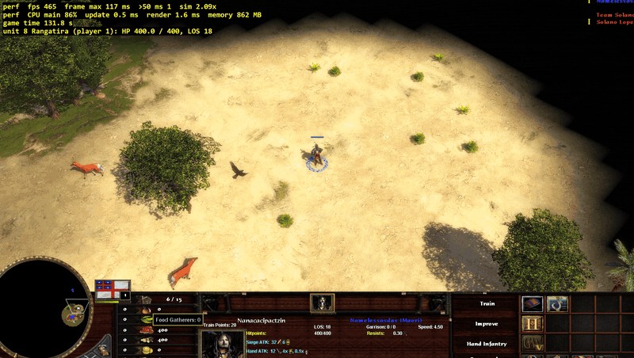

*In WoL (a Maori skirmish):* the Maori age up with voyages and start without a Town Center. The
`Rangatira` opens the age-up list. [Full video (MP4)](media/wonderCivUnitType-wol.mp4).

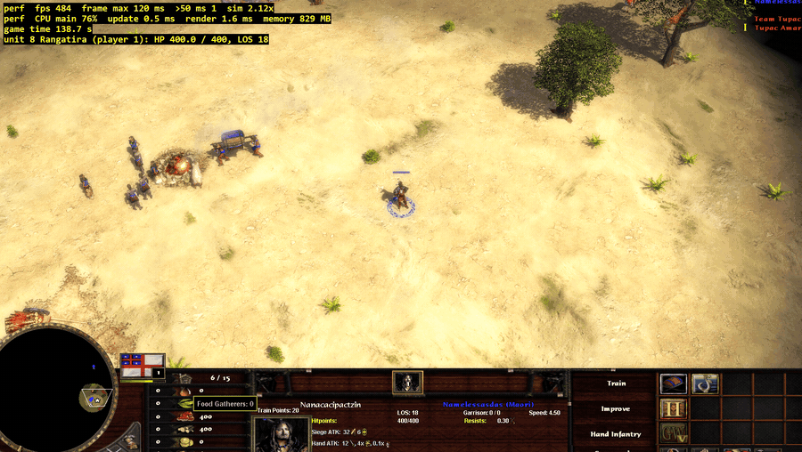

*In WoL, key off (the same scene):* the same click opens nothing.
[Full video (MP4)](media/wonderCivUnitType-wol-control.mp4).

```
wonderCivUnitType Proto [Proto ...]
```

- **In WoL without it:** the Maori cannot age up: their Rangatira cannot start the voyage.
- **Effect:** for a civ that ages up with wonders (the Asian civs and those of
  [`asianCivs`](#asiancivs)), units of the listed protos may start the age-up and place its wonder,
  besides the units the exe accepts (abstract type 16h). `wol.cfg` has `wonderCivUnitType Rangatira`.
- **Log:** `wonderCivUnitType: N proto(s) may place the age-up wonder of a wonder civ`; when
  `protoy.xml` is read, `wonderCivUnitType: K of N protos found in the data`; the first time it
  applies, `wonderCivUnitType: <Proto> accepted for the wonder age-up`.
- **Simulation:** changes who may age up: every player needs the same line.
- **Status:** confirmed (2026-11-03, single player): the Maori Rangatira opened the age-up list; without
  the key the same click opened nothing.

#### startingTC

*Another building can act as a player's first Town Center, and replace one that is lost.*

**Added:** Thursday 2026-10-29 10:35 · **Filmed in WoL:** Wednesday 2026-11-04 11:13

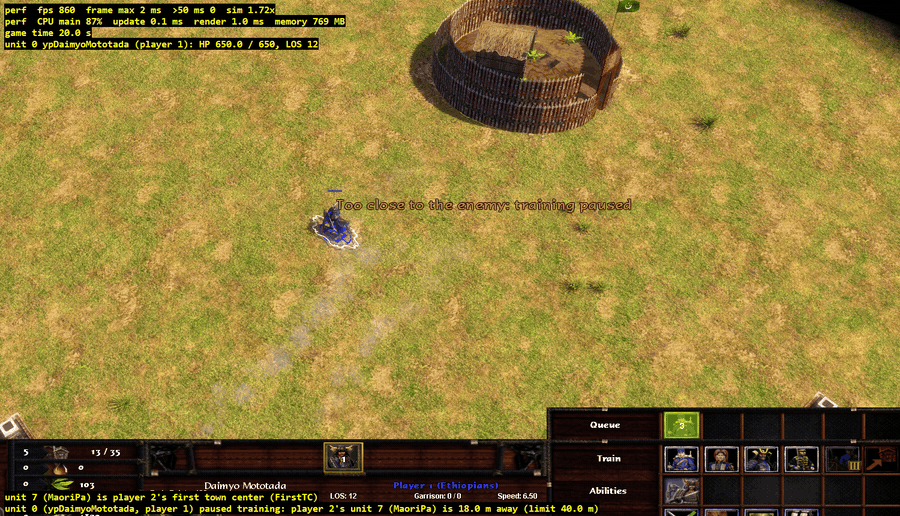

*In WoL, with `startingTC MaoriPa log` and `noTrainNearEnemyTC 40 log` (Japanese Daimyo selected, Maori
enemy; the fog is off for the video):* the Maori `Age0Maori` start: the enemy's `TownCenter` dies at once
and the `MaoriPa` replaces it (`unit 8 (MaoriPa) replaces player 2's first town center 7 (TownCenter),
which is dead`). So the Daimyo, 18 m from the Pa, cannot train: its 3 Kihei wait until the Pa falls at
58 s of game time. [Full video (MP4)](media/startingTC-wol.mp4).

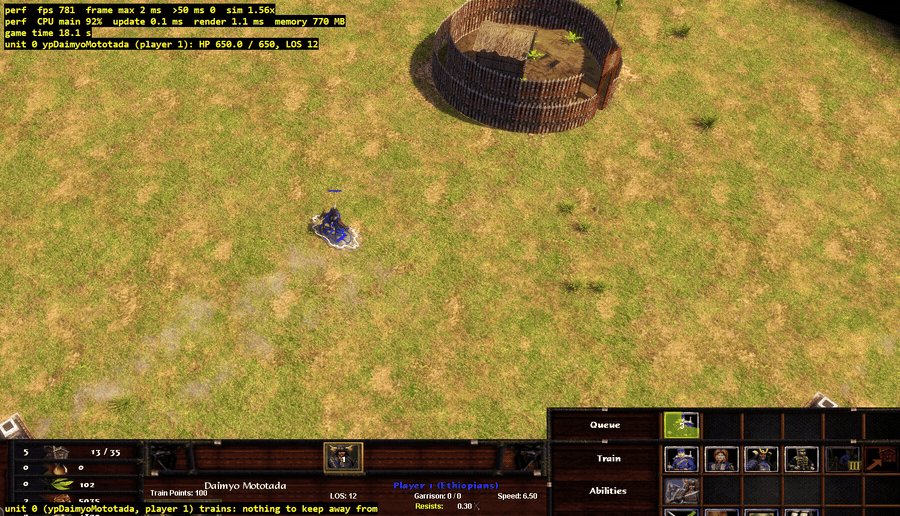

*In WoL, key off (the same scene):* the Maori's first town center stays the dead `TownCenter`, so the Pa
protects nothing, and the 3 Kihei train next to it (`trains: nothing to keep away from`).
[Full video (MP4)](media/startingTC-wol-control.mp4).

```
startingTC [<UnitType>] [log]          default AbstractStartingTC
```

- **In WoL today:** each player has one *first town center*, the unit the placement rules call
  `FirstTC`: the first unit of the exact proto `TownCenter` that is added to him (placed by the map,
  shipped, built, converted). The placement rules use it twice: no building within 65 m of an enemy's
  first town center (`buildingsmall.xml`, `buildinglarge.xml`, …: error 25521), and, in a no-rush game
  (`norushonly`), buildings only within 75 m of a team's first town center. The choice is made once and
  never undone:
  - a player who starts with another building (a Pa, a Presidio) has no first town center, so no enemy
    is kept 65 m away from him;
  - a player whose first town center dies keeps the dead one, and the rules skip him too.

  WoL's Maori start is the second case (static reading of WoL's techtree and of the exe): `Age0Maori`
  gives `TownCenter` a `Lifespan` of 0.5 s, then a free `MaoriPa`. The Pa is added while the town center
  still lives, so the first town center stays the town center, which dies half a second later. From
  then on the Maori have no 65 m protection, and the no-rush rule fails for their team.
- **Effect:** a building whose proto is of `<UnitType>` can be a first town center too:
  - a player who has none takes the first marked building added to him, as the exe takes a
    `TownCenter`;
  - a player whose first town center is **gone** (no longer in the game), **dead**, or has a
    **pending lifespan** (it is about to expire, like WoL's town center under `Lifespan 0.5`)
    takes the next marked building added to him instead.

  The `FirstTC` rules then measure from that building. A `TownCenter` behaves as before, and a live
  first town center with no lifespan is never replaced.
- **What it does not cover:** only the `FirstTC` rules follow the marked building. Other code
  still looks for the `TownCenter` proto itself (scoping of request #3, static reading):
  - the age-up picker (`uiPoliticianUI`) and the age-up progress display;
  - the start camera;
  - the AI: its automatic main base, its build plan and its chat lines;
  - the `trPlayerToggleAllowTCSpawning` gate on `Maintain`;
  - the town starting units (`<townstartingunit>`: settlers, crates), which go to the first
    built `TownCenter` ([`civFirstTC`](#civfirsttc) sends them to its own building);
  - the `CoveredWagon` build limit and a Town Center's fixed repair cost.

  The home city shipment point is covered by [`hcShipmentPointFallback`](#hcshipmentpointfallback):
  list `FirstTC` there (the marked building that is the player's first town center), or the marked
  protos. For a civ that starts with another building on every map, see [`civFirstTC`](#civfirsttc), as
  Mandos designed request #3 ([wol-requests.md](wol-requests.md)); the other checks above stay as they
  are.
- **WoL needs the marker** on the buildings that stand in for a town center at the start, in
  `data\protoy.xml`: `MaoriPa`, `Presidio`, `EGYtowncenterCARAVAN` and the `*Colony` protos
  (`AmericanColony`, `FrenchColony`, …):

  ```xml
  <Unit id ='…' name ='MaoriPa'>
      ...
      <UnitType>AbstractStartingTC</UnitType>
  ```

  The DLL registers the marker. An existing type or proto name works too (`startingTC MaoriPa`).
  `TownCenter` needs nothing. `Age0Maori` needs no change: the Pa replaces the dying town center the
  moment it is added.
- **Choose the marked protos with care:** once a player's first town center is dead or gone, the
  next marked building he gets becomes his first town center, wherever it stands. Mark the
  buildings that replace a town center, not a common building. A `TownCenter` built after the first
  one died does not replace it, unless `TownCenter` is marked too.
- **With [`civFirstTC`](#civfirsttc):** both keys can be on; they share the hook that sets a
  player's first town center. A player with none takes the first unit added to it that is a
  `TownCenter`, of its civ's `<firstTC>` proto, or of the marked type. Only `startingTC`
  replaces a first town center that is gone, dead or about to expire.
- **`log`:** one line for each marked building that becomes a first town center. This happens
  about once per player per game, so it can stay on.
- **Log:** at startup `startingTC: units of unittype X can be a player's first town center
  (FirstTC) like TownCenter, and replace one that is gone, dead or has a pending lifespan
  (multiplayer unverified)` (with `log`: `…pending lifespan, every new FirstTC logged (multiplayer
  unverified)`); when the data loads, `unit types: X -> <ID> …`; in a game,
  `hook reached: startingTC (0x49880A)` and `hook reached: FirstTC proto check (0x506B3B)` (the
  hook it shares with `civFirstTC`) as the map's first units are added to their players. With
  `log`:
  - `startingTC: unit N (Market) is player 2's first town center (FirstTC)`;
  - `startingTC: unit N (MaoriPa) replaces player 2's first town center M (TownCenter), whose
    lifespan ends in 0.50 s`, or `…first town center M (TownCenter), which is dead`, or `…first
    town center M, which is gone`.
- **Limits:**
  - a first town center captured by another player is not replaced: it still exists and lives;
  - a dead first town center is replaced only when a marked building is added afterwards; nothing
    happens at its death;
  - the no-rush rule passes for everyone while **any** player has no first town center. A player who
    gets one through this key therefore turns that rule back on for the whole game, as a `TownCenter`
    would.
- **Simulation:** yes: the first town center decides where buildings may be placed. Every player
  needs the same line and the same data. It also adds a unit type when the name is new.
- **Status:** confirmed in single player. In WoL (2026-11-04), the Maori case: a `MaoriPa` replaced the
  dead `TownCenter` of a player with `Age0Maori`, and `noTrainNearEnemyTC` measured from the Pa; without
  the key the Pa was no first town center. In a scenario the Pa is placed by the map, because the free
  `MaoriPa` of `Age0Maori` comes from the home city, which a scenario player lacks. On the stock game
  (2026-10-29): a marked `Market` for a player with no Town Center became his first town center. Not
  driven in game: the visible effect on placement (the 65 m refusal), and a pending lifespan: in the test
  the town center was already dead.

#### civFirstTC

*Each civ can start random maps with its own building instead of a Town Center.*

**Added:** Thursday 2026-10-29 12:03 · **Filmed in WoL:** Wednesday 2026-11-04 11:29

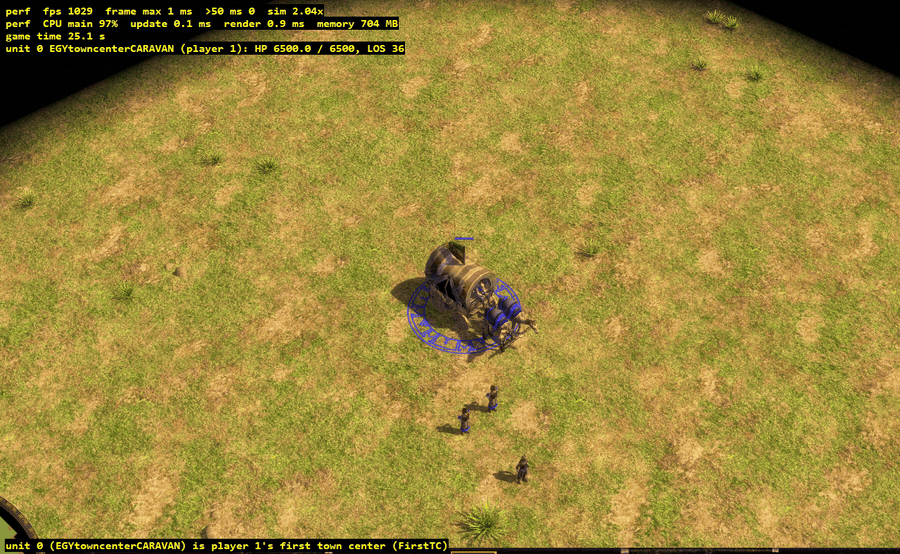

*In WoL, with `civFirstTC log` (Ethiopians with `<firstTC>EGYtowncenterCARAVAN</firstTC>` in `civs.xml`, for
the test, removed after):* the test map places a `TownCenter` for player 1, and the player gets the
caravan instead, which is its first town center (`unit 0 (EGYtowncenterCARAVAN) is player 1's first town
center (FirstTC)`). No town starting units come, because this proto has no `StartingColonyBuilding`.
[Full video (MP4)](media/civFirstTC-wol.mp4).

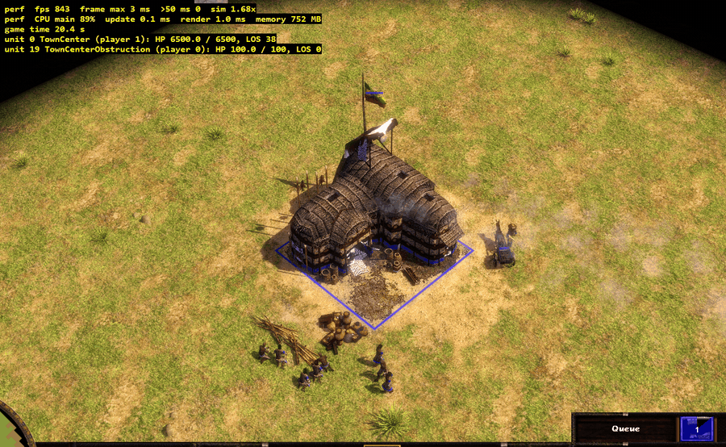

*In WoL, key off (the same data and map):* the exe ignores the tag: the same map places the `TownCenter`,
and its town starting units appear. [Full video (MP4)](media/civFirstTC-wol-control.mp4).

```
civFirstTC [log]
```

In `civs.xml`, inside a `<civ>`, next to its `<startingunit>` entries:

```xml
<civ>
    <name>Egyptians</name>
    ...
    <firstTC>EGYtowncenterCARAVAN</firstTC>
</civ>
```

- **In WoL today:** no civ in `civs.xml` has this tag. Each random map script places the players' first buildings itself,
  usually `rmAddObjectDefItem(startingTCID, "TownCenter", 1, 0.0)` and then an `rmPlaceObjectDef*` call,
  or a `CoveredWagon` in a Nomad start (`rmGetNomadStart()`). That is why the Maori start with a
  `TownCenter` that a tech removes ([`startingTC`](#startingtc)). `civs.xml` only lists a civ's units: `<startingunit>` (placed by
  `rmCreateStartingUnitsObjectDef`) and `<townstartingunit>` (settlers and crates that appear at
  the first built Town Center). A civ therefore cannot start with another building unless every
  map script is changed, and only a `TownCenter` becomes the player's first town center
  (`FirstTC`, see [`startingTC`](#startingtc)).
- **Effect,** for the players of a civ that has `<firstTC>Proto</firstTC>`:
  - **Map placement:** where a random map places `TownCenter` through an object def, the player
    gets `Proto` instead, at the same place. The placement uses the larger of the two footprints.
    The same object def still places a `TownCenter` for the players of other civs, and the map
    scripts are not changed. Items are compared by proto ID, so any spelling of `TownCenter` in a
    script counts.
  - **First town center:** the building becomes the player's `FirstTC`, as a `TownCenter` does: the
    placement rules (no enemy building within 65 m, the no-rush rule),
    [`noTrainNearEnemyTC`](#notrainnearenemytc) and `hcShipmentPointFallback FirstTC` use it. A
    unit of that proto added in any other way while the player has no first town center becomes
    it too, so a scenario or a saved game loaded later gets the same first town center.
  - **Town starting units:** the civ's `<townstartingunit>` units appear at the building, when the
    data below allows it.
- **Nomad start:** when `rmGetNomadStart()` is true, nothing is substituted: the map's own start
  (a `CoveredWagon`) stays, and a building of the `<firstTC>` proto does not become the first
  town center through this key. A `TownCenter` the player builds becomes it.
- **Not substituted:** a `TownCenter` from the civ's `<startingunit>` list (the
  `Special_StartingUnits` object def of `rmCreateStartingUnitsObjectDef`, whose items the game
  rebuilds from the civ's list), by design; and Town Centers that triggers, cards, techs or
  players create.
- **The tag:** its name may be written in any case; its text is a proto name as in `protoy.xml`
  (matched in any case; spaces around it are dropped); the last `<firstTC>` of a civ counts. An
  empty tag, or a name that is not a proto, leaves the civ's players with `TownCenter` (logged).
  `<firstTC>TownCenter</firstTC>` changes nothing. The exe ignores the tag, so the file still loads with
  the key off: the civ then starts with its `TownCenter`.
- **WoL needs:**
  - **`data\civs.xml`:** the tag.
  - **For the town starting units,** two more edits. Without them the player gets those units
    only once the player builds a `TownCenter`; none is lost.
    - `<Flag>StartingColonyBuilding</Flag>` on the proto, in `protoy.xml`. The game asks for the town
      starting units when a unit with that flag is created; `TownCenter`
      has it, `Market` does not. In the test, a Market without the flag became the first town
      center and a colony started at it, but no settler came.
    - The proto in the `<starttypes>` of `placementrules\colonies.xml`, e.g.
      `<type maxcount="1">Market</type>`. The units spawn only at a building where a colony
      starts; otherwise the log says `no colony starts at player N's first town center …`.
  - **For shipments:** the exe's fallback of the shipment point knows only 10 building types
    (`TownCenter`, `Outpost`, forts, …). Add `hcShipmentPointFallback FirstTC` (or the proto name)
    so that home city shipments arrive at the building
    ([hcShipmentPointFallback](#hcshipmentpointfallback)).
  - `TownCenter` also has the flags `ColonyPlacementCenter`, `HasGatherPoint`,
    `AllowAutoGarrison` and `ShowGarrisonButton`, which `Market` lacks. This key needs none of
    them; what they change on another building was not tested.
- **What it does not cover:** other code still looks for the `TownCenter` proto itself:
  - the AI scripts: in the test, an AI whose civ had the tag got its Market and its settlers, then
    stayed idle, because its scripts expect a Town Center. WoL's AI must learn the new building;
  - the engine's automatic AI main base;
  - the age-up picker (`uiPoliticianUI`);
  - the start camera (it looks for `TownCenter`, then `CoveredWagon`, `Explorer`, …);
  - the `trPlayerToggleAllowTCSpawning` gate on `Maintain`.

  The [`startingTC`](#startingtc) section lists the rest.
- **With other keys:** [`startingTC`](#startingtc) can be on too: the two share the hook that sets
  the first town center, and only `startingTC` replaces one that is gone, dead or about to
  expire. [`hcShipmentPointFallback`](#hcshipmentpointfallback) `FirstTC` sends shipments to the
  building, and [`noTrainNearEnemyTC`](#notrainnearenemytc) measures to its edge.
- **`log`:** adds a line for each substitution (per player and object def, when the map is
  generated), one when the building becomes a first town center, and one per game and player
  when the town starting units go to it. That is a few lines per game, so it can stay on.
- **Log:**
  - at startup, `civFirstTC: a civ's <firstTC> proto in civs.xml replaces the TownCenter random
    maps place for its players (not in a Nomad start) and is their first town center (FirstTC)
    (multiplayer unverified)` (with `log`: `…(FirstTC), every substitution logged (multiplayer
    unverified)`);
  - each time `civs.xml` is read, for each tag: `civFirstTC: civ N (Egyptians) starts with Market
    instead of TownCenter`, or `civFirstTC: civ N (Egyptians): empty <firstTC>; its players keep
    TownCenter`;
  - the first time a name is used after the data loads, if it is not a proto: `civFirstTC: civ N
    (Egyptians): <firstTC> names no proto unit (Markt); its players keep TownCenter`;
  - once per game for each player and building, when no colony starts at the building:
    `civFirstTC: no colony starts at player 1's first town center N (Market): its town starting
    units wait for a TownCenter (add the proto to placementrules\colonies.xml <starttypes>)`;
  - `hook reached: civFirstTC civs.xml (0x52BB07)` when `civs.xml` is read, `civFirstTC map
    placement (0x925F4C)` when the map places its first object def, `FirstTC proto check
    (0x506B3B)` (the hook it shares with `startingTC`) and `civFirstTC town units (0x679AC8)` in
    a game.

  With `log`:
  - `civFirstTC: player 1 gets Market instead of TownCenter in object def D 'startingTC'`;
  - `civFirstTC: player 1 keeps TownCenter in object def D 'startingTC' (Nomad start)`;
  - `civFirstTC: unit N (Market) is player 1's first town center (FirstTC)`;
  - `civFirstTC: player 1's town starting units go to its first town center N (Market)`, once per
    game for each player and building.
- **Simulation:** yes: the substitution, the first town center and the town starting units are
  all game state. Every machine needs the same line, `civs.xml`, `placementrules\colonies.xml`
  and `protoy`. A recorded game generates its map again when it is played back, so playback needs
  them too. The key adds no unit type.
- **Status:** confirmed in single player. In WoL (2026-11-04), the Ethiopians with `EGYtowncenterCARAVAN`: the
  substitution and the first town center, on a test map. On the stock game (2026-10-29), with
  `<firstTC>Market</firstTC>`:
  - a test map that places a `TownCenter` for both players: the tagged civ got a Market, which became
    its first town center, and the other kept its `TownCenter`;
  - a skirmish on Mongolia, with the Market in `colonies.xml` `<starttypes>`: without
    `StartingColonyBuilding` a colony started at it but no settler came; with the flag, 6 Settlers
    spawned at it;
  - an AI of a tagged civ got a Market and its settlers, then stayed idle. An Iroquois AI without the
    tag kept its Town Center and played normally, and a shipment landed at player 1's Market
    ([hcShipmentPointFallback](#hcshipmentpointfallback)).

  Not tested: a skirmish in WoL, the town starting units at a WoL building, WoL's AI with the tag, a Nomad
  start, multiplayer, recorded games, the `no colony` log line.

#### firstTC

*One line that sets up a civ's own starting building, with its starting units and shipments.*

**Added:** Friday 2026-11-06 13:11 · **Filmed in WoL:** Friday 2026-11-06 14:06

```
firstTC [UnitType] [log]
```

One line for [`civFirstTC`](#civfirsttc) and [`startingTC`](#startingtc): the first always, the second when a type is named. A plain
`firstTC` registers no marker, so it does not change the unit type count. If `startingTC` or `civFirstTC` is in the cfg too, that key
keeps its own line. Bad arguments fail only the `startingTC` part.

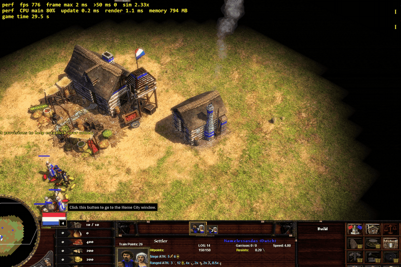

*In WoL, with `firstTC log` (Dutch, `<firstTC>Market</firstTC>`, the Market in `<starttypes>`, no flag in `protoy`):* the town units and
crates come to the Market, and a card's workers arrive there. [Full video (MP4)](media/firstTC-derived-wol.mp4).

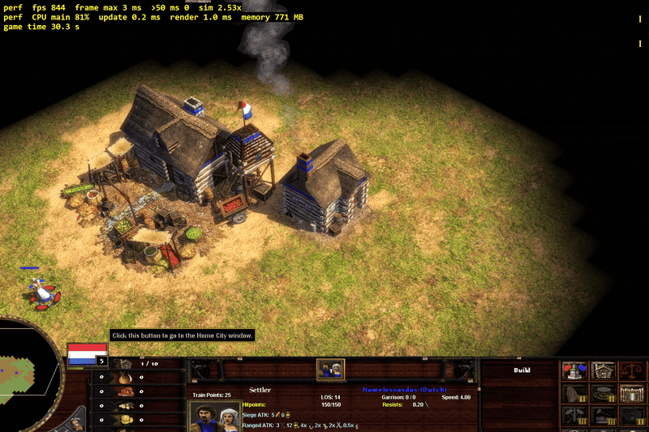

*In WoL, with `civFirstTC log` (the same data):* nothing comes, and the card is refused. [Full video (MP4)](media/firstTC-derived-wol-control.mp4).

- **What it derives from the tag:** `StartingColonyBuilding`, for that civ's first town center only, without writing the proto, and
  `FirstTC` first in `hcShipmentPointFallback`'s list, with or without that key. The `<starttypes>` entry in `colonies.xml` is still yours.
- **Tested in WoL (2026-11-06, Dutch):** town units, 400 food, 200 wood, 200 gold, and 2 -> 5 workers from a card; `civFirstTC` alone, none
  of it. An AI skirmish of 80 s had no XS error. A card needs population: the Market gives none, so the test has a House. Not tested:
  a loaded game, beside WoL's DLL, multiplayer.

#### customRevolutionBanners

*Each revolution shows its own banner, not just O'Higgins.*

**Added:** Wednesday 2026-10-28 10:56

```
customRevolutionBanners
```

- **Effect:** every revolution tech named `XPRevolution<Name>` shows the banner texture
  `ui\ingame\politicians\REV_banner_<Name>`. The exe shows a banner only for `XPRevolutionOHiggins`
  (`REV_banner_chile`), and that one is kept. `wol.cfg` has this line.
- **WoL needs:** `art\ui\ingame\politicians\REV_banner_<Name>.ddt` for each revolution. WoL's 29 revolution
  techs include `XPRevolutionWOLAlbania` and `XPRevolutionWOLAlgeria`, and their banners are already
  loose in that folder (`rev_banner_wolalbania.ddt`, …). A new revolution only needs its file. File
  names are not case-sensitive.
- **Log:** `hook reached: customRevolutionBanners (0x81A7CC)`.
- **Simulation:** no (interface only).
- **Status:** partly confirmed, on the stock game: the hook runs and the O'Higgins banner still shows.
  WoL's banners were not tested with this DLL.
- **Fixed from the original DLL:** the banner path is bounded; upstream overflows its buffer on long tech
  names.

#### removeFameRestriction

*Age-up screens show Fame, XP and shipment costs, and home city cards show Fame and XP icons.*

**Added:** Wednesday 2026-10-28 10:56

```
removeFameRestriction
```

Three changes:
1. **Politician (age-up) screens** list the Fame, XP and shipment costs of a choice. The second
   politician screen also lists the export resource. The exe shows only food, wood, gold and, on the
   first screen, export.
2. **Home city cards** that cost Fame or XP show an icon for those resources.
3. **"Fame trickle":** the built-in abstract unit type `FavoriteUnit` is renamed `Fame` (same ID). The
   original UnHardcoded project applies this change under that name; how it enables a Fame trickle was
   not traced. WoL's `protoy.xml` and `techtreey.xml` use neither name.

- **WoL needs:** the icons `art\ui\home_city\xp_hc_icon.ddt` and `art\ui\home_city\fame_hc_icon.ddt`.
  They are not in WoL's art, loose or in the archives. Without them, those cards show no icon. `wol.cfg`
  has this line.
- **Log:** `removeFameRestriction: icons need …`;
  `hook reached: removeFameRestriction costs #1 (0x80E490)` (also `#2`, `icon load`,
  `fame icon case`, `XP icon case`).
- **Simulation:** the unit type rename changes game data; give every player the same setting.
- **Status:** not tested in game, on any game.
- **Fixed from the original DLL:** on the second politician screen, upstream passes the wrong object
  as the owner of each cost line.

### Healing and hit points

Who heals, whom, and how far.

| Key | What it does | WoL's DLL | WoL also needs | In-game status |
|---|---|---|---|---|
| [`healNonIdle`](#healnonidle) | Lets healers marked with a unit type heal units that are busy (moving, fighting or doing something else); options pick the states and a lower rate on busy units. | **new** | That unit type on the healers in `protoy.xml`, or the name of an existing type (`xpMedicineMan`, `AbstractMonk`). | confirmed (automatic healing) |
| [`smartHealTargets`](#smarthealtargets) | A healer's automatic search heals the best candidate, not the first: listed unit types, then the lowest HP ratio, the nearest, the lowest unit ID; with `switch`, a running heal moves to a much worse unit. | **new** | Nothing (unit types or proto names are optional). | confirmed |
| [`overhealHitpointBars`](#overhealhitpointbars) | The HP bars and HP texts of marked units take `InitialHitpoints` as 100 %, not `MaxHitpoints`. | **new** | `MaxHitpoints` above `InitialHitpoints` on those units (no unit has it today), and the unit type on them, or an existing type such as `AbstractCavalryInfantry`. | confirmed (single player, UI) |
| [`overhealSources`](#overhealsources) | Only source healers heal those units above `InitialHitpoints`, each type up to its own cap and at its own rate; every other heal stops there. | **new** | `overhealHitpointBars`, and the source unit type on the healers that may overheal. | confirmed |
| [`overhealDecay`](#overhealdecay) | The HP of those units above `InitialHitpoints` goes back down to it over time, except while an own unit of a chosen type is near. | **new** | `overhealHitpointBars`. | confirmed |

#### healNonIdle

*Chosen healers also heal units that are moving or fighting.*

**Added:** Wednesday 2026-10-28 12:48 · **Filmed in WoL:** Wednesday 2026-11-11 15:49

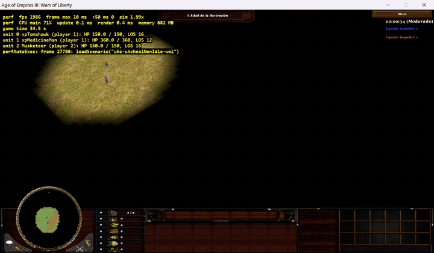

*In WoL, with `healNonIdle xpMedicineMan` (Iroquois; the two units are selected):* a Tomahawk fights
a `WOLLineInfantry` while the medicine man heals it between hits: its bar drops with each hit and
fills again. It wins and ends at full HP.
[Full video (MP4)](media/healNonIdle-wol.mp4).

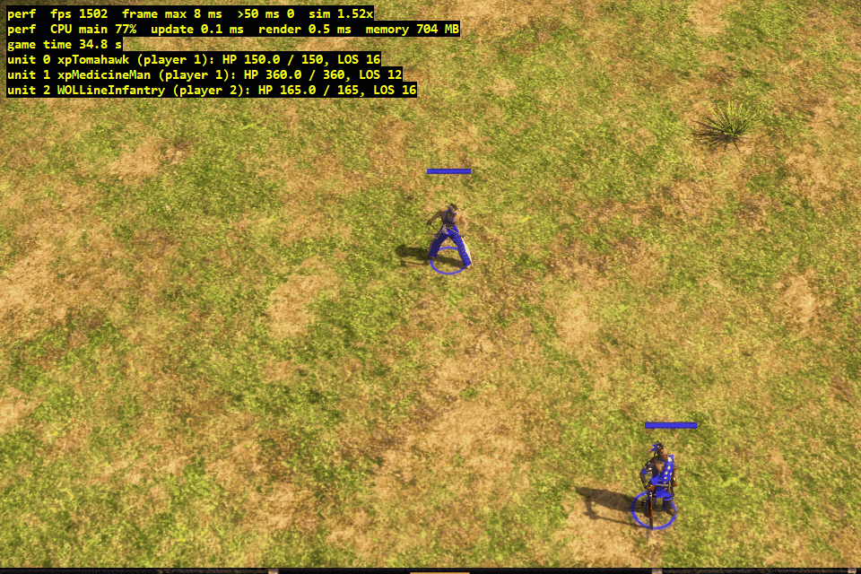

*In WoL, key off (the same scene):* the medicine man does not heal the fighting Tomahawk; its bar
only shrinks and it dies at about 57 s of game time, the enemy left at 70 HP. The medicine man is
next.
[Full video (MP4)](media/healNonIdle-wol-control.mp4).

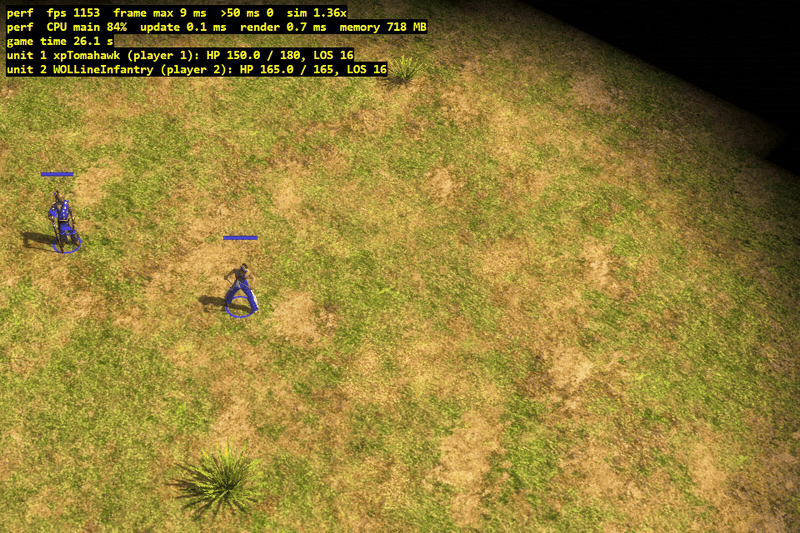

*In WoL, with `healNonIdle busyRate=50` (the medicine man gets the marker by a tech, the same scene with a
`WOLLineInfantry` walking in at 22 s; the two units are selected):* the medicine man heals the fighting Tomahawk at half
speed: it falls from 150 to 46.6 HP and wins at about 54 s, then is healed to 150 at the full rate.
[Full video (MP4)](media/healNonIdle-busyrate-wol.mp4).

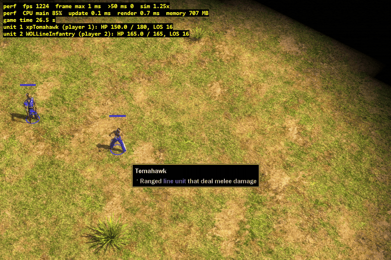

*In WoL, `healNonIdle` with no option (busyRate 100, the same scene):* the Tomahawk stays between 126 and 135 HP through
the fight and wins at 128.9. [Full video (MP4)](media/healNonIdle-busyrate-wol-control.mp4).

```
healNonIdle [<UnitType>] [moving] [fighting] [busyRate=<percent>]   default AbstractHealNonIdle, both states, 100
```

- **`moving`, `fighting`:** the busy states a marked healer may heal. With neither, both (as before these options).
  With one alone, the other keeps its stock test: with `moving`, a fighting unit is no candidate of the search and a heal
  ends when its target fights; with `fighting`, the same for a moving unit. A unit doing anything else (gathering,
  building) counts as before. The two tests are the ones the stock heal tick uses: "moving" is the target's current
  action moving, "fighting" the exe's own fight test.
- **`busyRate=<percent>`** (1 to 1000, default 100): a heal tick whose target is moving or fighting adds that percent of
  what it would add; an idle target is healed at the full rate. `busyRate=50%` works too.
- **A bad option** stops the key: `healNonIdle: busyRate=abc: expected busyRate=<percent>, 1 to 1000; feature not
  applied`, or `…: expected healNonIdle [UnitType] [moving] [fighting] [busyRate=<percent>]; feature not applied`.
- **Measured in WoL (2026-11-11),** the scene above, the Tomahawk's HP when the enemy dies: `busyRate=50` 46.6 (fight
  from 28 to 54 s); no option 128.9; `moving` alone, not healed while fighting: it dies at about 50 s, the enemy left at
  32 HP, as with the key off. Idle, the medicine man heals about 10 HP/s; at 50 % about 5 HP/s.
- **Saved games:** nothing is kept in the DLL; the options act on each tick.
- **Through a tech:** with [`unitTypeTechs`](#unittypetechs), `AddUnitType` with the marker on one player's healers
  (`<Target type ='ProtoUnit'>xpMedicineMan</Target>`) turns the key on for that player only. Tested in WoL
  (2026-11-11): Player 1's medicine man healed his fighting Tomahawk (it lost 4.3 HP/s and won at 77.6 HP), Player
  2's, without the tech, did not heal his (6.3 HP/s, dead).

- **In WoL today:** a healer (`Surgeon`, `NAnurse`, `xpMedicineMan`, a monk) only picks targets that are
  idle, and stops healing as soon as its target moves or fights. So a healer behind a line of infantry
  does nothing during a fight.
- **Effect:** healers whose proto is of `<UnitType>` also pick targets that are busy (moving, fighting
  or doing something else), and keep healing them while they move or fight. The other checks still
  apply: the target must be damaged, a valid heal target for that healer, and reachable. Any other
  healer behaves as before.
- **WoL needs:** the name of an existing type or proto needs no data change: `healNonIdle xpMedicineMan`
  (the video) applies the feature to that proto, `healNonIdle AbstractMonk` to WoL's 11 monks. To choose
  the healers one by one, use a marker. Abstract unit types are a fixed list compiled into the exe, and
  any other `<UnitType>` in `protoy.xml` is silently dropped, so this DLL **registers `<UnitType>` as a
  new abstract type** when the data does not define it. List it on any healer in `data\protoy.xml`:

  ```xml
  <Unit id ='424' name ='Surgeon'>
      ...
      <UnitType>LogicalTypeHealed</UnitType>
      <UnitType>AbstractHealNonIdle</UnitType>
  ```

  In WoL's own DLL, add the name to `data\uhc\customabstracttypes.xml` instead.
- **Monks and other fighting healers** may still choose to attack instead of heal: that is the unit's
  own behavior and is not changed. Pure healers such as `Surgeon`, `NAnurse` and `xpMedicineMan` show the
  feature best.
- **Log:** `healNonIdle: healers of unittype X heal busy targets (multiplayer unverified)` (`moving (not fighting)` or
  `fighting (not moving)` with one state; `…targets, at 50 % of their rate…` with busyRate, and in a game `hook reached:
  healNonIdle busyRate (0x9E0CC7)`); when
  the data loads, `hook reached: abstract unit types (0x51BA31)` and
  `unit types: X -> <ID> (bit B of N), added` (or `already defined`); in a game,
  `hook reached: healNonIdle auto-search (0x9CD9C7)` and `hook reached: healNonIdle (0x9E0C79)`.
- **Check the data:** with the game running, `python -I tools/re/inspect_unittypes.py
  AbstractHealNonIdle` lists the protos that carry the type.
- **Simulation:** yes. It also adds a unit type, which changes the unit type count.
- **Status:** confirmed in WoL (2026-11-04), through the automatic search: the medicine man heals the
  fighting Tomahawk, which wins at full HP; without the key it dies at about 57 s. A direct order
  (right-click) on a fighting unit was not verified. The options (2026-11-11): the numbers above, a saved game, an AI
  skirmish of 100 s with every heal and overheal key on and no XS error. Not tested: `fighting` alone, multiplayer.

#### smartHealTargets

*Healers go for the units that need healing most, not the first they find.*

**Added:** Thursday 2026-10-29 13:19 · **Filmed in WoL:** Wednesday 2026-11-11 15:50

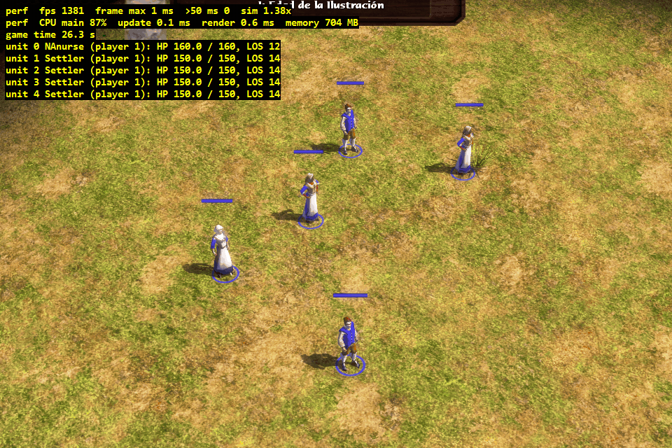

*In WoL, with `smartHealTargets log` (United States; the units are selected, so their HP bars show):*
four settlers are hit at once (90, 70, 45 and 33 % HP); the `NAnurse` heals the one at 33 % first
(8.2 m away), then 45, 70 and 90 %.
[Full video (MP4)](media/smartHealTargets-wol.mp4).

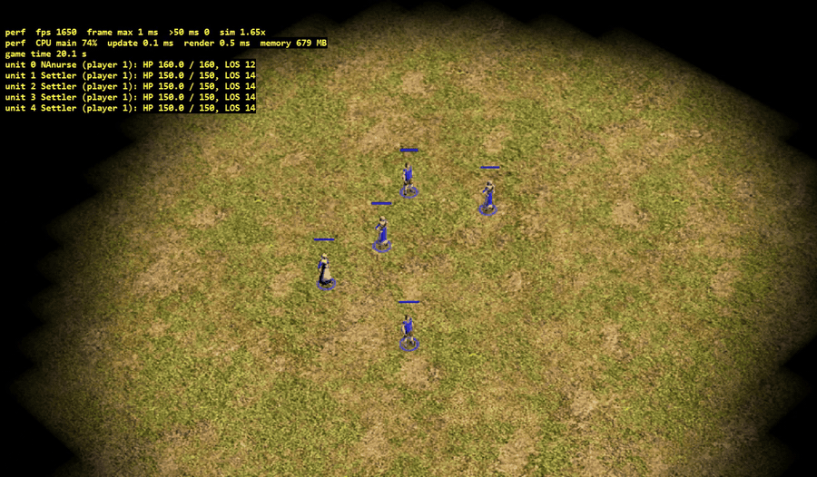

*In WoL, key off (the same scene):* the nurse takes the first settler the query returns, the one
at 45 % 4 m away, while the one at 33 % waits at 50 HP; the settlers at 70 and 90 % wait too.
[Full video (MP4)](media/smartHealTargets-wol-control.mp4).


*In WoL, with `smartHealTargets switch=20 log` (a `NAnurse`, three settlers hit at 18, 23 and 25 s; all selected):* the
nurse heals the first settler from 33 %; when the second falls to 47 % she leaves the first at 70 % (more than 20 %
higher) and heals the one at 20 % at once, then tops the three up in turns. [Full video (MP4)](media/smartHealTargets-switch-wol.mp4).

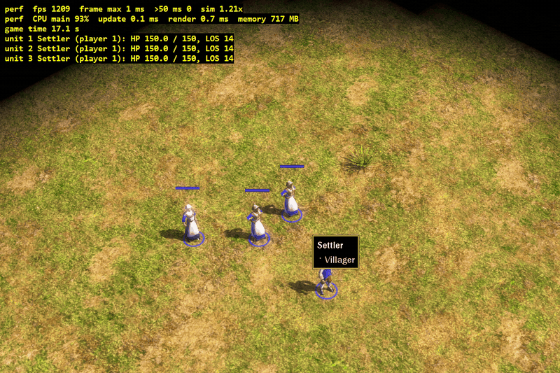

*In WoL, `smartHealTargets log` without `switch` (the same scene):* she heals the first settler to full while the one at 20 %
waits at 30 HP for about 5 s. [Full video (MP4)](media/smartHealTargets-switch-wol-control.mp4).

```
smartHealTargets [<UnitType> ...] [switch=<percent>] [log]   up to 8 types, in priority order
```

- **`switch=<percent>`** (1 to 100; default off): stock never looks again while a heal runs. With the option, once a
  second of game time, a heal this search started is checked against the units the search would accept now: if one
  ranks at the target's listed type or before it and its HP ratio is lower than the target's by more than the margin
  (`switch=20`: a target at 70 % is left for a unit below 50 %), the heal ends as when the target is full, and the
  healer's next search takes the best unit, as above. The margin keeps it from flipping back and forth: a unit only a
  little worse does not interrupt. A heal the player ordered is never checked.
- **Measured in WoL (2026-11-11),** the scene above: with `switch=20` the settler hit to 20 % at 25 s was healed from
  that second; without it, from about 29.5 s, after the first one was full. All three were full by about 56 s either way.
  With a gap of 17 % (63 % against 47 %), no switch.
- **Saved games:** the healer's last pick lives in the DLL, so after a load a heal started before the save is not
  checked (it runs to the end as without the option); every heal started after the load is. The same on every machine
  that loads the save. Tested: a save while the nurse healed the first settler, loaded: she healed it to full, then
  switched as usual.
- **A bad option** stops the key: `smartHealTargets: switch=0: expected switch=<percent>, 1 to 100; feature not applied`.

- **In WoL today:** an idle healer looks for a unit to heal on its own: it asks for the units around it
  and heals the **first** one that passes every test (damaged, alive, idle, a valid heal
  target, not already healed by others, in range). The order is the query's, so a healer often
  tops up a nearly full unit next to it while a badly hurt one waits.
- **Effect:** the same tests decide which units can be healed, and among them the healer picks:
  1. the unit types you list, in their order (a unit of none of them comes after them);
  2. then the lowest HP ratio (HP / max);
  3. then the nearest to the healer;
  4. then the lowest unit ID.

  No memory address and no query order is used, so every machine picks the same unit. With no
  type, it is the most hurt unit in reach. Only the automatic search changes: a direct order
  (right-click) heals what the player chose.
- **Every healer:** the key applies to every healer, with no marker on the healers: the search is
  the same function for surgeons, nurses, monks, priests and the others, and the key only reorders
  units the exe already accepts. Name a type to favour targets, e.g.
  `smartHealTargets AbstractInfantry Settler`.
- **With `healNonIdle`:** both keys hook the same search at different points and work together:
  marked healers also see busy units, and the best of all candidates is healed.
- **Log:** `smartHealTargets: automatic heal searches pick the best candidate: <types, >lowest HP
  ratio, nearest, lowest unit ID (multiplayer unverified)`; in a game `hook reached:
  smartHealTargets candidate (0x9CDA36)` and `pick (0x9CDA58)`; with `log`, every pick (the first
  200): `smartHealTargets: unit 0 (Surgeon) heals unit 4 (Settler, rank 0, HP ratio 0.333, 10.0
  m) among 4 candidates; stock would heal unit 1 (Settler, HP ratio 0.900)`. With `switch`, the startup line adds `; a
  running heal switches to a candidate more than 20 % lower`, a game `hook reached: smartHealTargets switch
  (0x9E0C3A)`, and `log` each switch: `smartHealTargets: unit 0 (NAnurse) leaves unit 1 (Settler, rank 0, HP ratio
  0.703) for a better candidate, unit 2 (Settler, rank 0, HP ratio 0.467; switch margin 0.20)`.
- **Simulation:** yes, every machine needs the same line. A listed name that is not a type yet is
  registered as a marker unit type, which changes the unit type count.
- **Status:** confirmed in single player. In WoL (2026-11-04), a `NAnurse` with four settlers hit at once
  healed them in the order 33, 45, 70, 90 %; without the key it took the first the query returned, at
  45 %. On the stock game (2026-10-29), with a listed type, that type came first, and with
  `healNonIdle` both hooks ran. A skirmish against the AI with the key on played normally. `switch` (2026-11-11):
  the numbers above, a saved game, an AI skirmish of 100 s with every heal key on and no XS error. Multiplayer
  was not tested.

#### overhealHitpointBars

*Health bars treat a unit's normal health as 100 %, and show any extra as overheal.*

**Added:** Thursday 2026-10-29 10:35 · **Filmed in WoL:** Friday 2026-11-06 12:40


*In WoL, with `overhealHitpointBars segment stat log`, `overhealSources log` and `overhealDecay 2 3 log`
(Iroquois; the Tomahawk selected):* for the test the Tomahawk is marked and has `MaxHitpoints` 180 over
its 150, and the medicine man is a source healer (bed data, removed after). It is hit, the medicine man
heals it past its 100 %, and the panel reads `180/150` and, in orange, `Overheal: 30/30`, and the end of
the bar under the portrait changes colour. When he is killed at 62 s it loses 2 HP a second back to 150,
and the row and the colour go. The Aenna next to it, not marked,
stops at 110.
[Full video (MP4)](media/overhealHitpointBars-wol.mp4).


*In WoL, keys off (the same data and scene):* the panel counts the 180 as the 100 % (`180/180`), there
is no row, and nothing brings the Tomahawk back down after the healer dies.
[Full video (MP4)](media/overhealHitpointBars-wol-control.mp4).


*In WoL, damage after the overheal (the same keys, no `overhealDecay`; the Tomahawk selected):* at
`180/150` the end of the portrait bar has the overheal colour. A hit takes it to `110/150`: WoL's normal
bar comes back, 73 % green on its dark background. At `60/150` it is the yellow bar.
[Full video (MP4)](media/overhealHitpointBars-damage-wol.mp4).


*In WoL, a group (three marked Tomahawks selected):* at 180 each the portrait bar shows their average
overheal. When one is hit down to 80 the bar is the group's normal one, 84 % green, with no overheal
colour, although the other two still have it: the colour shows only while every selected unit is at or
above its 100 %. [Full video (MP4)](media/overhealHitpointBars-group-wol.mp4).

```
overhealHitpointBars [<UnitType> ...] [segment[=RRGGBB]] [bar=<texture>] [stat[=<Label>]] [log]   default AbstractOverheal; up to 8 types
```


*In WoL (Ethiopians, Pikeman with the marker, a tech with `subtype='MaxHPOnly'` 1.20 BasePercent at 22 s):* the HP stay at 122 and the
room above 100 % grows. [Full video (MP4)](media/overhealHitpointBars-maxonly-wol.mp4).


*In WoL, the same tech with the stock subtype `Hitpoints`:* HP and InitialHitpoints go to 151.5, so the unit stays at 100 %.
[Full video (MP4)](media/overhealHitpointBars-maxonly-wol-control.mp4).

- **`MaxHPOnly`:** the tech Data subtype that writes only MaxHitpoints. Units keep their HP and new ones keep InitialHitpoints.
- **Tested in WoL (2026-11-06):** 135.85 -> 164.45 with HP 122.9, kept by a saved game; a marked House showed 1290/1200 and a Caravel
  850/800, both with the Overheal row, HP written in memory. Not tested: auto-repair above 100 %, multiplayer.
- **In WoL today:** a unit is created with its proto's `<InitialHitpoints>` and can be healed up to
  `<MaxHitpoints>`. Every HP display takes `MaxHitpoints` as 100 %: the floating HP bar over a unit, the
  selection panel's HP bar (green, yellow below 66 %, red below 33 %), and the texts `HP/max`, or
  `HP/max (base+bonus)` when techs raised the max. WoL plans `MaxHitpoints` = 1.1 × `InitialHitpoints` on
  infantry and cavalry, so that healers can push them above their starting HP. Today no unit in
  `protoy.xml` has it, and with that data every fresh unit would show as damaged: a 91 % bar and
  `150/165`.
- **Effect:** for a unit whose proto is of `<UnitType>` and has `InitialHitpoints` below
  `MaxHitpoints`, the displays take `InitialHitpoints` as 100 %:
  - a fresh unit (HP = `InitialHitpoints`) shows a full bar and `150/150`;
  - an overhealed unit shows a full bar (the bar is not drawn past 100 %) and `165/150`;
  - a damaged unit shows its HP against `InitialHitpoints`: 105 HP is a 70 % green bar and `105/150`,
    where the exe shows a 64 % yellow bar and `105/165`;
  - the selection's average health counts each unit at most 100 %;
  - `(base+bonus)`: the base is the proto's `InitialHitpoints` in the data, the bonus what techs
    added since.

  Units of other types, and marked units whose `InitialHitpoints` is not below `MaxHitpoints`, display
  as before.
- **`segment`** (Overwatch style): the HP above 100 % is shown too.
  - The floating bar stays full and the overheal is drawn over its right end, in orange: a unit at
    165/150 has its right 10 % orange; from twice its 100 % the whole bar is orange. The bar keeps its
    width.
  - The unit panel's HP text above 100 % is orange too (`165/150`), through the game's own colour
    markup.
  - `segment=RRGGBB` sets another colour (hex, e.g. `segment=40C0FF`).
  - The floating bar is drawn in the player's colour, so the segment sits next to it.
  - No data change is needed beyond the marker for these.
  - The bar under the selected unit's portrait shows the overheal too, on the game's own green bar:
    while the selected units have overheal, the green part ends earlier and the right end shows the
    overheal, (HP − 100 %) / 100 % of its width (the average of the selected units). Below 100 % the
    green, yellow or red bar shows as without the key.
- **`stat`:** in WoL's minimized interface (`optionminimizedui`), which has no stat panel, the row goes in
  the unit panel, in the gadgets `unitResourceRateLabel` and `unitResourceRateValue` that
  `showGatherRate` also uses, with one unit selected and only while it has overheal: `Overheal: 30/30`,
  the HP above its 100 % and the most it can have (max − 100 %), truncated like the HP row. A gathering
  unit shows its rate instead, since the row is one. With `segment` the value is in the segment colour.
  The label is `Overheal`, or `stat=<Label>`: one word, `_` for a space (`stat=Sobre_curación`; UTF-8 or
  ANSI), or a number, which takes that string from `stringtabley.xml` (`stat=90001`), so a language can
  translate it.
  - In the normal interface, the same row goes in the "Unit information" panel, right after the HP
    row, for every marked unit, and the rows below move down one.
- **What does not change:** the hit points themselves, healing (healers still heal up to
  `MaxHitpoints`, which is what makes the overheal possible), techs, auras, AI, triggers and every
  other game rule: they all keep reading `MaxHitpoints`.
- **Choosing the units:** an existing type works with no marker: `overhealHitpointBars
  AbstractCavalryInfantry` covers the 910 protos that carry that type, WoL's infantry and cavalry. A
  proto name works too, and up to 8 names may follow the key on one line. The default marker
  `AbstractOverheal` is registered by the DLL, like `healNonIdle`'s.
- **WoL needs:** `<MaxHitpoints>` above `<InitialHitpoints>` on the units, in `data\protoy.xml`:

  ```xml
  <Unit name ='Tomahawk'>
      ...
      <InitialHitpoints>150.0000</InitialHitpoints>
      <MaxHitpoints>165.0000</MaxHitpoints>
  ```

- **Techs and auras:** a `Hitpoints` tech adds the same amount to the max, to `InitialHitpoints` and to the HP of a built unit, so a
  unit at its 100 % stays there: 141.75/156.75 went to 158.25/173.25 with `BasePercent`, and 139.28/154.28 to 154.70/169.70 with
  `Percent`, as a new unit gets. A unit at its max stays at its max. Only an unbuilt unit is scaled. An aura or
  modifier that changes one unit's max scales its reference by the same factor, so a full unit stays
  full (seen on the stock game: a Golden Pavilion's MaxHP x1.1 aura took a unit from `165/150` to
  `181/165 (150+15)`, `Overheal 15/15` to `16/16`). In a skirmish, an Explorer marked for a test (400 /
  440 in the data) showed `180/180` and `Overheal 0/40`: a start-of-game effect lowers both values by
  the same amount, and the reference follows it.
- **The portrait bar needs no data change.** It is WoL's `unitselectionpanel-unitHealthBarGreen`. While
  there is overheal the DLL changes the texture of that bar's background and shortens its green part,
  and puts the background back when the overheal ends. The default texture is the game's
  `ui\ingame\ingame_ui_health_yellow`. `bar=<texture>` chooses another (a path with no extension), for
  example your own orange DDT.
- **`log`:** one line for the first unit of each proto whose reference differs from its max (once
  per proto name in a session).
- **Log:** at startup `overhealHitpointBars: HP bars and HP texts of units of unittype X take
  InitialHitpoints as 100 % (display only)` (several types are listed as `X, Y`; with `log`: `…as
  100 %, the first unit of each proto logged (display only)`); when the data loads, `unit types: X
  -> <ID> …`; in a game, `hook reached: overhealHitpointBars (0x45FAAF)` (the first floating HP
  bar), `(0x4C5014)` (the first selection), and for the HP texts `(0x698B35)`, `(0x4D7575)` with
  `(0x4D7615)`, or `(0x9AFA2A)` with `(0x9AFA4E)`, depending on which panel shows them. With
  `log`: `overhealHitpointBars: unit N (Tomahawk) HP 150.0 is shown against 150.0 instead of its
  max 165.0 (InitialHitpoints 150.0, MaxHitpoints 165.0); logged once per proto`.
  With `segment`: the startup line adds `HP above it shown as a segment and texts coloured
  FF8C00`; in a game `hook reached: overhealHitpointBars segment queue (0x45FB6C)`, `segment fit
  (0x45C4B9)`, `segment vertices (0x45CB72)` and `text (0x4D7651)` (`text (0x69A9C0)` for the
  `(base+bonus)` form); with `log`, `overhealHitpointBars: unit N (Tomahawk) HP 165.0 is above its
  100 % 150.0: overheal segment of 10.0 % of the bar; logged once per proto`; and, only if a frame
  ever has more bars than the vertex buffer holds (about 9,700), `… bars do not fit in the vertex
  buffer …: this frame's K overheal segments were dropped (logged once)`. A wrong colour stops the
  key: `overhealHitpointBars: segment=…: expected segment or segment=RRGGBB (hex); feature not
  applied`. The portrait bar: `hook reached: overhealHitpointBars portrait bar (0x4C83DF)`; with `log`,
  `the portrait bar shows an overheal of 10.0 % of the bar (1 units; logged once)`.
  With `stat`: the startup line adds `an overheal stat row labelled 'Overheal'` (or `labelled by
  string N`); in a game `hook reached: overhealHitpointBars stat row (0x4D76DB)`; with `log`,
  `stat row 2 of unit N (Tomahawk): overheal 15/15 (logged once)` (with its colour markup). A bad
  label stops the key: `overhealHitpointBars: stat=…: expected stat or stat=<label> (a word, '_'
  for a space, or a string table ID); feature not applied`.
- **Limits:**
  - without `segment` the floating bar stops at 100 %;
  - in the minimized interface `unitHitPointsValue` prints colour markup as text (seen in game), so the
    HP text stays white and only the `stat` row is coloured. The ObjectInfo panel (the scenario
    editor's) is not coloured either;
  - other places still compare HP with `MaxHitpoints` and see a fresh marked unit as damaged: the
    damage-state visuals, the AutoRepairUnit command check (moot for infantry and cavalry), and the
    HP shown in tech and card rollovers;
  - whether the multi-selection stack buttons draw their own HP bars was not established.
- **Simulation:** no. Only display code is hooked (floating bars, the selection's group, three HP
  texts, the portrait bar, the stat row); every game rule reads the real max. Players may set it differently. A new marker name
  adds a unit type, which changes the unit type count: load saved games and replays with the same
  cfg.
- **Status:** confirmed in single player.
  - **In WoL (2026-11-04):** a marked Tomahawk at `180/150` with `Overheal: 30/30` in the unit panel and the
    end of WoL's portrait bar in the overheal colour, which shrinks with the decay and is gone at
    `150/150`; a damaged unmarked Aenna selected in between shows its normal bar; without the keys,
    `180/180` and no row. A Tomahawk hit from `180/150` to `110/150` goes back to WoL's normal bar, 73 %
    green with its dark background, and at `60/150` to the yellow one. With three marked Tomahawks
    selected, the bar shows their average overheal; when one falls below its 100 % (80, 180, 180) it
    shows the group's normal bar, 84 % green, with no overheal, although the other two still have it.
  - **On the stock game (2026-10-29), normal interface:** fresh units at `150/150` with a full bar, the
    orange segment and text, `segment=40C0FF`, a `Hitpoints` tech (`189/174 (150+24)`), an allied
    player's units, the aura case
    above, and a skirmish against the AI.
  - **Not tested:** the portrait bar in the normal interface since it moved to the game's own bar, the
    ObjectInfo panel, multiplayer.

#### overhealSources

*Only chosen healers can heal a unit above its normal health.*

**Added:** Thursday 2026-10-29 13:37 · **Filmed in WoL:** Wednesday 2026-11-11 15:51


*In WoL, with `overhealSources log` (a `NAnurse` next to the marked Tomahawk, selected):* the Tomahawk
is hit at 24 s. The nurse is not a source healer: she heals it to `150/150` and stops (`a heal of unit 1
stops at its 100 %`). At 52 s a source medicine man appears, and the panel climbs to `179/150`, with
`Overheal: 29/30`. [Full video (MP4)](media/overhealSources-wol.mp4).


*In WoL, key off (the same scene):* the nurse herself heals it past its 100 %.
[Full video (MP4)](media/overhealSources-wol-control.mp4).


*In WoL, an area heal, the Regeneration dance (Ethiopian fire pit, `danceBonusCivs Ethiopians`; the
tactic is turned on for the test):* it heals the marked Tomahawk to `150/150` and stops there, because
a dance is not a source. [Full video (MP4)](media/overhealSources-dance-wol.mp4).


*In WoL, key off (the same scene):* the dance takes it to `180/150`, `Overheal: 30/30`.
[Full video (MP4)](media/overhealSources-dance-wol-control.mp4).


*In WoL, with `overhealSources AbstractOverhealer cap=110 rate=50 log` (Player 1's medicine man is a source through a
tech; the Tomahawk, 150 of 180, selected; `overhealDecay 2 1` with `holdNear xpMedicineMan 12`):* hit to 105 at 18 s, it is
healed at about 10 HP/s to 150, then at 5 HP/s, and stops at `165/150`, 110 %.
[Full video (MP4)](media/overhealSources-cap-wol.mp4).


*In WoL, `overhealSources AbstractOverhealer log` with no option (the same scene, `overhealDecay 2 1` without
`holdNear`):* healed at 10 HP/s all the way to 180, its max; the decay then takes a little and the medicine man heals it
back. [Full video (MP4)](media/overhealSources-cap-wol-control.mp4).

```
overhealSources [<UnitType> [cap=<percent>] [rate=<percent>] ...] [log]   default AbstractOverhealer; up to 8 types
```

- **`cap=<percent>`** (100 to 1000) after a source type: its healers heal a marked unit to at most that percent of its
  100 %, and never above `MaxHitpoints` (the default, as before). Their heal action ends there and their search skips a
  unit at its cap, as for a normal healer at the 100 %. `cap=100` makes the type a normal healer for marked units.
- **`rate=<percent>`** (1 to 1000, default 100) after a source type: the part of each of its heals that lands above the
  100 % is that percent of the stock amount; below the 100 % the heal is unchanged.
- **Per type:** the options belong to the type they follow, e.g. `overhealSources AbstractMonk cap=105 Surgeon cap=120
  rate=50`. A healer of several listed types takes the options of the first one listed. `50%` works too.
- **A bad option** stops the key: `overhealSources: cap=110: expected <UnitType> [cap=<percent>, 100 to 1000]
  [rate=<percent>, 1 to 1000] after each source type; feature not applied` (also for an option before any type).
- **Measured in WoL (2026-11-11),** the scene above: 107.8 → 123.6 → 140.0 in steps of 1.6 s (about 10 HP/s), then
  152.7 → 160.4 in 1.55 s (5.0 HP/s), held at 165.0; without the options 159.0 → 174.8 in 1.57 s (10 HP/s) up to 180.
  At the start, a fresh Tomahawk (150) was taken to 165 by the source, 180 without the cap.
- **Saved games:** nothing is kept in the DLL.

- **Needs** [`overhealHitpointBars`](#overhealhitpointbars): its unit types mark the units that
  have overheal, and its 100 % (`InitialHitpoints`, scaled when an aura changes the max) is the
  limit here. Without that line the key is not applied.
- **Effect,** for a marked unit:
  - a healer whose proto is of a source type (default `AbstractOverhealer`, a new marker; an existing
    type or a proto name works too) heals it up to `MaxHitpoints`;
  - any other healer heals it only up to its 100 %: its automatic search does not pick a marked
    unit at its 100 %, and its heal action ends when the unit gets there (the healer goes idle);
    a direct order on such a unit ends at once;
  - every other way of gaining HP stops at the 100 % too: regeneration, the Regeneration dance,
    area heals, self heals, powers and triggers that add HP. Only the single-target heal action of
    a source healer overheals. Damage, and code that sets HP rather than adding it (creation,
    transforms, the aura rescale), are not touched.

  Unmarked units heal as before.
- **WoL needs:** the source type on the healers that may overheal, e.g.
  `<UnitType>AbstractOverhealer</UnitType>` on `xpMedicineMan` in `data\protoy.xml`, or name an existing
  type: `overhealSources AbstractMonk`, or a proto: `overhealSources xpMedicineMan`.
- **Log:** `overhealSources: only healers of unittype X heal marked units above their 100 %; every
  other heal stops there (multiplayer unverified)`; when the data loads `unit types: X -> <ID> …`;
  in a game `hook reached: overhealSources heal search (0x9CD984)`, `heal tick (0x9E0BBB)`, `heal
  (0x9E0CE9)` and `overheal add HP (0x4823A3)`. With `log`, the first of each proto: `overhealSources:
  a heal of unit N (Tomahawk) stops at its 100 % 150.0 (…; not from a source healer)` and `…unit N
  (Tomahawk) is healed above its 100 % 150.0 by a source healer (…; rate 50 %)`; with a cap, `overhealSources: a
  source heal of unit N (xpTomahawk) stops at its cap 165.0, 110 % of its 100 % 150.0 (…)`. The startup line lists the
  options after each type: `AbstractOverhealer (up to 110 %, rate 50 % above 100 %)`. Without
  `overhealHitpointBars`: `overhealSources: needs overhealHitpointBars, …; feature not applied`.
- **Simulation:** yes. Every machine needs the same line (and `overhealHitpointBars` with the same
  types). The source type is a new unit type, which changes the unit type count.
- **Status:** confirmed in single player.
  - **In WoL (2026-11-04):** a `NAnurse` healed a marked Tomahawk to `150/150` and stopped, and a source
    medicine man took it to `179/150`; without the key the nurse herself went past it. The Regeneration
    dance stopped at `150/150`, and went to `180/150` without the key.
  - **On the stock game (2026-10-29):** a healing building stopped at the 100 %, an idle surgeon ignored
    a marked unit at its 100 %, a direct order ended on arrival, and a unit's own regeneration stopped
    at its 100 %. A knocked-out hero still gets up, at about 40 % of its HP. A skirmish against the AI
    played normally.
  - **`cap` and `rate` (2026-11-11, WoL):** the numbers above; the source type given to one player's medicine man by
    an `AddUnitType` tech ([`unitTypeTechs`](#unittypetechs)): Player 1's took his fresh Tomahawk to 165; Player 2's Tomahawk, without
    the tech, stayed at 150; an AI skirmish of 100 s with every heal and overheal key on, no XS error.
  - **Not tested:** powers (`PowerHeal` goes through the same add-HP entry, 0x7C378C / 0x8CCA6F),
    multiplayer.

#### overhealDecay

*Extra health above a unit's normal maximum slowly wears off.*

**Added:** Thursday 2026-10-29 13:50 · **Filmed in WoL:** Wednesday 2026-11-11 15:52


*In WoL, with `overhealDecay 2 1 log` (Menelik II marked for the test, 400 of 480 HP):* Explorers
regenerate, and the decay takes back what goes above the 100 %: he stays at `400/400`, with no row.
[Full video (MP4)](media/overhealDecay-wol.mp4).


*In WoL, key off (the same scene):* he regenerates past his 100 %, and the panel climbs with it:
`447/400`, `Overheal: 47/80`, on the way to 480. [Full video (MP4)](media/overhealDecay-wol-control.mp4).


*In WoL, with `overhealDecay 2 1 holdNear xpAenna 12 holdNear xpMedicineMan 12 log` (and `overhealSources
AbstractOverhealer cap=110 rate=50`; the Tomahawk and the Aenna beside it selected):* the source medicine man takes the
Tomahawk to `165/150` and is removed at 20 s; the Aenna, 2 m away, holds the overheal at 165 until it is removed at 34 s;
then 2 HP/s back to 150 at 41.6 s. [Full video (MP4)](media/overhealDecay-holdnear-wol.mp4).


*In WoL, `overhealDecay 2 1 log` without `holdNear` (the same scene; `overhealSources` with no cap, so it starts at
180):* the decay starts when the medicine man goes at 20 s, with the Aenna still there: 180 to 150 by 34.9 s.
[Full video (MP4)](media/overhealDecay-holdnear-wol-control.mp4).

```
overhealDecay <rate>[%] [<delay>] [<UnitType> ...] [holdNear <UnitType> <metres> ...] [log]
```

- **`holdNear <UnitType> <metres>`** (up to 4; more than 0, at most 200 m): a unit due to decay keeps its HP while a
  unit of that type (or proto) **of the same player**, alive and built, other than itself, is within that distance
  (measured to the other unit's edge, as the game's own area queries do). Allies' units do not hold it: an ally's
  healer does not change a player's own decay. A held moment is skipped, not saved up: the decay resumes at the same
  rate when no such unit is near (the `delay` still counts from the last gain). Typical: `holdNear AbstractOverhealer
  12`, so the overheal lasts while a source healer stays with the unit, and the "re-heal it" micro goes.
- **A bad `holdNear`** stops the key: `overhealDecay: expected holdNear <UnitType> <metres> (more than 0, at most 200;
  up to 4); feature not applied`.
- **Measured in WoL (2026-11-11),** the scene above: held at 165.0 from 20 to 34 s, then 163.1, 159.6, 156.0, 152.7 and
  150.0 at 41.5 s; the same after loading a game saved at 26 s (165 until 34 s, 150.0 at 41.6 s). Without `holdNear`,
  179.8 at 19.9 s down to 150.0 at 34.9 s.

- **Needs** [`overhealHitpointBars`](#overhealhitpointbars): its types mark the units and its
  100 % (`InitialHitpoints`, scaled when an aura changes the max) is where the decay stops.
- **Effect:** a marked unit whose HP is above its 100 % loses `rate` HP per second (`2`), or
  `rate` percent of its 100 % per second (`1%`), counted in game time (paused games and game speed
  follow), once `delay` seconds (default 0, decimals allowed) have passed since it last gained HP
  above its 100 %. It stops exactly at its 100 %: the decay never goes below it and never kills.
  With unit types (or proto names) listed, only marked units of those types decay. Works with or
  without [`overhealSources`](#overhealsources): with it, only source healers create overheal to
  decay; without it, any heal above the 100 % does.
- **What counts as a gain:** any heal that takes the unit above its 100 % (healers, area heals,
  powers…) restarts the delay. Regeneration (the unit's own, and the Regeneration dance) does not:
  it heals a little on every step, so it would hold the delay forever; a unit that regenerates
  above its 100 % decays at once (the rate minus what it regenerates). With `overhealSources`,
  regeneration never passes the 100 % anyway. HP that a unit has above its 100 % without any gain
  (a transform into another marked proto, for instance) does not decay until its next gain.
- **Log:** `overhealDecay: marked units above their 100 % lose R HP per second of game time, D s
  after their last gain, down to it (multiplayer unverified)`; in a game `hook reached: overheal add
  HP (0x4823A3)`, `hook reached: world update (0x481A57)`, `hook reached: overhealDecay
  regeneration (0x490881)` and, with a Regeneration dance, `overhealDecay Regeneration dance
  (0x67A03B)`. With `log`, the first of each proto:
  `overhealDecay: unit N (Tomahawk) decays from 165.0 toward its 100 % 150.0 at 2.00 HP/s` and
  `… is back at its 100 % 150.0`. Without `overhealHitpointBars`: `overhealDecay: needs
  overhealHitpointBars, …; feature not applied`; a bad rate: `overhealDecay: expected <HP per
  second>[%] [delay seconds] [UnitType ...] [log], …; feature not applied`. With `holdNear`, the startup line adds `;
  held while their player has a unit of xpAenna within 12.0 m`, and `log` writes each start and end of a hold (the
  first 200): `overhealDecay: unit 1 (xpTomahawk) holds its overheal at HP 165.0: unit 2 (xpAenna) of xpAenna is within
  12.0 m` and `… decays again from HP 165.0: no unit that holds it is near`.
- **Simulation:** yes, every machine needs the same line. A listed name that is not a type yet is
  registered as a marker unit type.
- **Saved games:** the delay goes on after a load. Saved at 11 s with `overhealDecay 5 20`, the decay ran from 24.2 s
  to 30.2 s in both runs (WoL, 2026-11-06). A unit transformed while it waits loses that until its next gain.
  `holdNear` keeps nothing of its own: it looks again on every tick.
- **Status:** confirmed in single player.
  - **In WoL (2026-11-04):** with `overhealDecay 2 1`, Menelik II, marked, stayed at `400/400` while he
    regenerated; without the key he went to `447/400` and on. With `overhealDecay 2 3`, a Tomahawk fell
    back to 150 after its healer died.
  - **On the stock game (2026-10-29):** `overhealDecay 2% 1 Musketeer` took 3 HP per second (2 % of 150)
    down to 150, and naming another proto left that unit alone; other players' units decay too; poison
    (`damageOverTime`) ticked normally; a skirmish against the AI played normally. Only the game world
    decays: the world update also runs for the home city's world, which the key ignores.
  - **`holdNear` (2026-11-11, WoL):** the numbers above, a saved game, an AI skirmish of 100 s with every heal and
    overheal key on and no XS error.
  - **Not tested:** multiplayer; `holdNear` with a unit of another player beside the unit (the Gaia unit tried for it
    attacked the Tomahawk).

### Combat

Attacks, armor, and what a hit does.

| Key | What it does | WoL's DLL | WoL also needs | In-game status |
|---|---|---|---|---|
| [`multiarmor`](#multiarmor) | A proto keeps one armor per damage type, and `Armor` tech effects change the one their `damagetype` names. | **in `wol.cfg`** | Several `<Armor>` lines on the protos. | confirmed |
| [`snareValues`](#snarevalues) | The factor and length of `<TargetSpeedBoost>`, per action and by tech. | **new** | The tags on the action. | confirmed |
| [`detonationDeath`](#detonationdeath) | `<DetonationProtoAction>` makes a unit fire an action around itself when it dies. | **new** | The tag, and an action with `DamageArea`. | confirmed |
| [`dodgeAnyUnit`](#dodgeanyunit-dodgesoundset-and-criticalsoundset) | Lets units marked with a unit type dodge hits like the Japanese monk (no damage, 15 % of the hits, while their player has `YPDodge`). | **new** | That unit type on the units in `protoy.xml`, or a type or proto name in the cfg, and `YPDodge` active for their players. | confirmed (single player) |
| [`dodgeSoundSet`, `criticalSoundSet`](#dodgeanyunit-dodgesoundset-and-criticalsoundset) | Chooses the sound set a unit plays when it dodges or lands a critical hit. | **new** | A sound set name in the cfg. | confirmed (single player, from the log) |
| [`dodgeChance`](#dodgechance) | A dodge chance per unit type, with the tech it needs (or none) and a filter for ranged or melee hits; the first matching rule decides. | **new** | A unit type or proto name in the cfg, and the rule's tech active for their players unless `notech`. | confirmed (single player) |
| [`damageOverTime`](#damageovertime) | Poison: an attack that names an attachment proto keeps damaging its target every few seconds after the hit. | **new** | `<AttachProtoUnit>` on the attack, a new attachment proto in `protoy.xml`, and a small tactics file. | confirmed (single player) |
| [`spreadAnyAccuracy`](#spreadanyaccuracy) | Reads `<maxspread>` and `<spreadfactor>`, which 317 of WoL's tactics files have and the exe ignores, for every miss, and makes every shot of marked units, `InstantBallistics` included, scatter like that whatever their accuracy and hit what it lands on. | **new** | The tags are there; the unit type or proto name of the units that should always scatter, in the cfg. | confirmed (single player) |
| [`accuracyTechs`](#accuracytechs) | A tech can change an action's `<Accuracy>`, with a `Data` effect of subtype `Accuracy`. | **new** | The `Data` effects in `techtreey.xml`. | confirmed |
| [`containedUnitsROF`](#containedunitsrof) | An attack with `<ScaleByContainedUnits target="ROF">` fires faster with the units inside: its ROF is divided by their number, at most `<DamageFactorCap>`. | **new** | The attribute on the attacks that want it (none has it today). | confirmed |
| [`broadsideMuzzleLimit`](#broadsidemuzzlelimit) | Lets a ship's broadside fire from up to N muzzles per side instead of 6. | **new** | A ship model with more than 6 muzzles per side: `ypTekkousen` has 10. | confirmed (single player) |
| [`cantBeSlowed`](#cantbeslowed) | A unit with the type `CantBeSlowed` ignores `TargetSpeedBoost`. | **new** | The type on the protos that want it. | confirmed |
| [`killBountyTechs`, `resourceBounty` and `teamKillBounty`](#killbountytechs-resourcebounty-and-teamkillbounty) | Techs change a proto's `<Bounty>`, `<Bounty resourcetype>` pays a resource, and the type `TeamKillBounty` pays the killer's whole team. | **new** | The effects and tags. Turning on `killBountyTechs` turns on WoL's 10 `subtype='Bounty'` effects. | confirmed |
| [`pillageGold`](#pillagegold) | A unit of the type `AbstractCanPillage` steals `<PillageAmount>` gold from the owner of the building it hits with its `BuildingAttack`. | **new** | The type and the tag on the protos. | confirmed |
| [`veterancyBonus`](#veterancybonus) | `<VeterancyBonus>` rows make a proto stronger with its kills; defaults by unit type, added rows and rank names in `veterancy.xml`. | **new** | The rows on the protos that want them. | confirmed |
| [`snareOnlyHitUnit`](#snareonlyhitunit) | A snared unit no longer slows the group it moves with; only the hit unit slows. | **new** | Nothing. | confirmed (single player) |
| [`rofFix`](#roffix-stunmovingtargetfix-nodamageonunbuiltfoundations-and-fallenherotacticsfix), [`stunMovingTargetFix`](#roffix-stunmovingtargetfix-nodamageonunbuiltfoundations-and-fallenherotacticsfix), [`noDamageOnUnbuiltFoundations`](#roffix-stunmovingtargetfix-nodamageonunbuiltfoundations-and-fallenherotacticsfix), [`fallenHeroTacticsFix`](#roffix-stunmovingtargetfix-nodamageonunbuiltfoundations-and-fallenherotacticsfix) | Four small combat fixes: orders keep the attack timer, stuns survive a moving target, unbuilt foundations take no damage, units keep their tactic when knocked out. | always on | Nothing. | applied, effects not seen yet |
| [`removeConversionRestriction`](#removeconversionrestriction) | Lets `ConvertGuardian` convert any unit, not only treasure guardians. | **in `wol.cfg`** | Nothing. | not confirmed |

#### detonationDeath

*A unit can deal area damage around itself when it dies.*

**Added:** Thursday 2026-11-05 10:21 · **Filmed in WoL:** Thursday 2026-11-05 16:40


*In WoL, with the key (a test action on `Settler`: 1000 Siege, `DamageArea` 6, `GAIAEnemy`):* a trigger kills a settler and the
4 enemy `Coureur` around it die; another kills one of 3 settlers beside 3 enemy settlers, and all six go in a chain. The blue
`Coureur` in the middle is out of range. The blast has no effect of its own on screen.
[Full video (MP4)](media/detonationDeath-wol.mp4).


*In WoL, key off (the same data):* the settlers die and nothing else happens.
[Full video (MP4)](media/detonationDeath-wol-control.mp4).

```
detonationDeath [log]
```

```xml
<Unit name="Settler">
    <DetonationProtoAction>Build</DetonationProtoAction>
    <ProtoAction>
        <Name>Build</Name>
        <Damage>1000.000000</Damage>
        <DamageType>Siege</DamageType>
        <DamageArea>6.000000</DamageArea>
        <DamageFlags>GAIAEnemy</DamageFlags>
    </ProtoAction>
</Unit>
```

- **In WoL today:** no unit can do something when it dies. `selfdestruct` in a tactics file is another thing: the unit dies from
  its own attack. JTMaston's #39.
- **Effect:** when a unit of that proto dies, the action named by the tag fires around it: the stock area damage, with the
  action's damage, `DamageArea`, damage type, bonuses and `DamageFlags`. The action needs `DamageArea` above 0, and the proto
  must have it: an action its tactics file does not list does nothing, and the log says so.
- **Use an action the unit does not attack with.** The tag reads any action with a `<Damage>`, so `Build` works on a settler. If
  it is the unit's weapon, raising the damage also raises its normal attacks.
- **Which deaths:** combat, a kill by a trigger, an expired `Lifespan`, and a unit that dies in a blast. Not `Destroy` (the
  trigger that removes a unit with no death).
- **Chains:** a unit that dies from a blast fires too, later in the same pass of the game's kill queue, not inside the blast.
- **Friendly fire:** `DamageFlags` decides it, as on any attack. {FF}
- **Techs:** the action is the player's copy, so a tech that changes its damage counts.
- **The other three tags (2026-11-05):**
  - `<DetonationCommand>Name</DetonationCommand>`: the unit detonates when it is **deleted**. Give the proto a command of
    that name whose `<command>` in `protounitcommands.xml` is `uiDeleteSelectedUnit`, the same console command the stock
    Delete button and the Delete key run (register the name with `customProtoUnitCommands`); the button and the key then
    both detonate the unit. Without this tag a delete gives no blast, whatever the other tags say. The name is not
    checked against the proto's commands: the tag only says that a delete detonates.
  - `<DetonationHitpointThreshold>Ratio</DetonationHitpointThreshold>` (0 to 1): when a loss of hit points leaves the unit at
    or under that share of its max HP (the modifiers counted), it detonates by itself: it is killed as if by the blow,
    and the blast fires. A unit inside another does not; the blow that kills it outright goes the normal way.
  - `<DetonationHitpointDecay>HP per second</DetonationHitpointDecay>`: with a threshold, the unit does not die at once:
    from the threshold on it loses that many HP per second of game time, through the game's HP setter (the damage
    visuals follow), and detonates when it reaches 0, or earlier if anything kills it. Healed back over the threshold,
    the decay stops until the next loss takes it under again. Not kept in a saved game: after a load the unit decays
    again from its next loss under the threshold.

  Only `<DetonationProtoAction>` is needed for any of them: a threshold or a command without it does nothing.
  at an HP ratio) and `DetonationHitpointDecay`. Without the threshold, one tag is the whole of it: there is no flag to set.
- **Multiplayer:** it changes the simulation: every player needs the same setting and data.
- **Log:** `detonationDeath: the proto tags DetonationProtoAction, DetonationCommand, DetonationHitpointThreshold and DetonationHitpointDecay are on`, with `log` `detonationDeath: proto 296 detonates on its command Detonate (a delete)` / `detonates at 25 % of its hit points` / `loses 100.00 hit points a second under its threshold`, and in game `detonationDeath: unit 0, proto 323: HP 79.5 of 165.0 (48 %) under the threshold 50 %: kill queued`, `… loses 100.00 HP a second from here`, `unit 0 decayed to 0: kill queued`, a blast line ending in `(a delete)`, or `deleted without a DetonationCommand, no blast`, and with `log`: `detonationDeath: proto 294 fires Build` and
- **Performance:** every loss of hit points asks the tag table once (a map lookup by proto ID), and the decay walks only
  the decaying units each world update. Measured with `perfprobe.py` (60 s, 30 Pikemen against 30, no tag on them): key on 1467 fps, main thread 79 %, longest frame 2.5 s (the load) and no frame over 50 ms after it; key off 1444 fps, 81 %, 3.7 s. With 30 Musketeers of 4000 HP against 30 that carry a threshold and a decay of 100 HP/s the game ran at 640 fps against 1461 and the render time tripled: that is the decaying units themselves (the HP setter's damage visuals on 30 units every update), not the hook, which runs on untagged units at no measurable cost.
  `detonationDeath: unit 8, proto 294, at 195.0, 45.0, kill flags 0 0 0`. Kill flags 1 0 0: a trigger's kill; 0 0 0 anything else seen.


*In WoL, with the key (a Musketeer of 4000 HP, threshold 0.25, decay 100, a trigger that takes 76 % of its HP):* from
960 HP it loses 100 a second and detonates at 0. [Full video (MP4)](media/detonationDeath-threshold-wol.mp4).


*In WoL, key off (the same data):* it stays at 960 HP. [Full video (MP4)](media/detonationDeath-threshold-wol-control.mp4).


*In WoL, with the key (the same Musketeer, `<DetonationCommand>`, the Delete key):* the blast line, `kill flags 1 0 0
(a delete)`. [Full video (MP4)](media/detonationDeath-command-wol.mp4).


*In WoL, key off (the same data):* the Delete key removes it with no line.
[Full video (MP4)](media/detonationDeath-command-wol-control.mp4).

- **Tested in WoL (2026-11-05, the three tags):** a Grenadier with `MusketVolleyRangedAttack` and threshold 0.5 under three
  Pikemen: `HP 79.5 of 165.0 (48 %) under the threshold 50 %: kill queued`, then the blast with flags 0 0 0, and the unit
  gone; with the key off it fought on and died at 0. A Musketeer of 4000 HP with threshold 0.25 and decay 100, taken to
  960 HP by a trigger: 236.7 HP two seconds later, `decayed to 0: kill queued`, the blast; with the key off it stayed at
  960. The same Musketeer with `<DetonationCommand>Detonate</DetonationCommand>`, selected by console and the real
  Delete key: the blast line `kill flags 1 0 0 (a delete)` and the unit gone; a Grenadier without the command, deleted
  the same way: `deleted without a DetonationCommand, no blast`, dead. Not tested: a proto with the stock flag 0Dh (the
  kill-queue branch of the delete), a delete from the command panel's button (the same console command), the decay
  across a saved game, a unit healed back over the threshold, multiplayer. The blasts of these WoL actions have no
  `<DamageArea>`, so they hit nothing: the log lines are the proof.
- **Tested in WoL (2026-11-05):**
  - Performance, with `resourceDebt`, `sharedBuildLimit`, `transformSpan`, `veterancyBonus` and `detonationDeath` on and off, twice each, on 320 units in combat, about 120 of them with a timer: update 0.72 and 0.68 ms on, 0.72 and 0.73 off, and no more frames over 50 ms. A key-specific A/B was not run, and that scene did not show gatherers at work, so the gather hooks of `resourceDebt` were not measured under load.
  - A kill by trigger, combat with 6 `Pikeman`, an expired `Lifespan`: each killed the enemy `Coureur` around it.
  - `Destroy`: no blast, and the 3 `Coureur` kept 180 HP.
  - Own units in the blast with `GAIAEnemy`: 180 HP kept, the enemy's dead. With `GAIAEnemySelfAlly`: the own ones died too.
  - A chain of 3 + 3 settlers of both players: 23, then 26, 27 and 28, then 24 and 25, with no recursion.
  - Key off: no blast, in the same scene.
  - Not tested: a unit that dies garrisoned, and a building that dies with units inside: four trigger attempts left nobody
    inside (`[unit+74h]` stayed 0). The player's delete key: the console's `uiDeleteSelectedUnit` crashes the stock game at
    0x7E51C8 with or without keys. Multiplayer, and an A/B: with four games open the numbers are not clean.

#### multiarmor

*A unit can have a different armor against each damage type.*

**Added:** Tuesday 2026-11-03 09:33 · **Filmed in WoL:** Wednesday 2026-11-04 13:58


*In WoL:* a `HonorGuard`, with `<Armor type="Hand" value="0.2"/>` and `<Armor type="Ranged" value="0.2"/>`,
under three Pikemen. Its Hand armor counts, so it lasts longer and leaves a Pikeman at 33 HP.
[Full video (MP4)](media/multiarmor-wol.mp4).


*In WoL, key off (the same scene):* the unit keeps only its last armor, Ranged, and falls sooner, with that
Pikeman at 56 HP. [Full video (MP4)](media/multiarmor-wol-control.mp4).

```
multiarmor
```

- **In WoL today:** `wol.cfg` has this line, and 32 protos and 76 tech effects depend on it. Without it,
  the exe keeps one armor per proto: each `<Armor>` replaces the one before, so only the last one
  counts. It also reads no `damagetype` on effects: an `Armor` effect always changes that one armor.
- **Effect:** a proto keeps one armor per damage type, and an `Armor` tech effect changes the one its
  `damagetype` names. The unit uses the armor of the incoming damage type. An effect whose `damagetype`
  is the last armor's type, or that has no `damagetype`, works as in the exe.
- **WoL needs:** several `<Armor>` lines on the proto, as `HonorGuard` has, and `damagetype` on the
  effects:

  ```xml
  <Armor type="Hand" value="0.2000" />
  <Armor type="Ranged" value="0.2000" />
  ```

  ```xml
  <Effect type='Data' amount='1.50' subtype='Armor' damagetype='Ranged' relativity='BasePercent'>
    <Target type='ProtoUnit'>AbstractLightInfantry</Target></Effect>
  ```

  Up to 8 armors per proto. An effect on a damage type the proto has no armor for starts from 0 (so
  `BasePercent` changes nothing there).
- **What stays as it is:** the unit panel shows the last armor only.
- **Saved games:** the other armors' tech changes are not saved, but a load applies the effects again: tested on 2026-11-06, a
  `Pikeman` hit `HonorGuard` for 19 with an `Armor` effect on `Hand`, and for 19 again after a load in a new process.
- **Log:** `multiarmor: protos keep one armor per damage type; ...`; `multiarmor: <Proto> has N
  armors` for the first proto with several; `multiarmor: an Armor effect changed damage type T of
  <Proto> (now V; stock type S kept)` the first time an effect goes to another armor;
  `unknown damagetype "..."` for a name the game does not know.
- **Simulation:** changes combat: every player needs the same line.
- **Status:** confirmed (2026-11-03, single player, on WoL): `HonorGuard` took 38 per pike hit with the
  key and 47.5 without it. `gwDreadnought`, with `GWantitorpedobulge` (+0.1 Ranged, +0.1 Siege effects):
  with the key Siege went to 0.4 and Ranged to 0.5; without it Siege went to 0.5. Performance A/B in a
  battle of 160 units, 60 s each: 1263 / 1289 fps, update 0.138 / 0.136 ms, one frame over 50 ms each
  (no measurable cost).

#### dodgeAnyUnit, dodgeSoundSet and criticalSoundSet

*Any chosen unit can dodge hits like the Japanese monk, with its own dodge and critical sounds.*

**Added:** Wednesday 2026-10-28 19:12 · **Filmed in WoL:** Wednesday 2026-11-04 14:48


*In WoL, with `dodgeAnyUnit Settler log`, `dodgeSoundSet Settler PowerCriticalStrike` and `criticalSoundSet
ypMonkChinese PowerEvade` (`YPDodge` active; the units selected):* three `WOLJaeger` fight three settlers
and a Chinese monk. The settlers dodge at the exe's 15 %: 3 hits in this run (`dodged a hit`). Each dodge
plays the critical's sound set and each of the monk's critical hits the dodge's, swapped so that the log
shows the choice (`plays sound set PowerCriticalStrike`, 3 times, and `plays sound set PowerEvade`, 6
times). A GIF has no sound: the log is what shows it. [Full video (MP4)](media/dodgeAnyUnit-wol.mp4).


*In WoL, keys off (the same scene):* no settler dodges, and no sound set is logged.
[Full video (MP4)](media/dodgeAnyUnit-wol-control.mp4).

```
dodgeAnyUnit [<UnitType>] [log]          default AbstractDodge
dodgeSoundSet <UnitType> <SoundSet>      one line per unit type; the first match wins
criticalSoundSet <UnitType> <SoundSet>   one line per unit type; the first match wins
```

- **In WoL today:** a hit can be dodged (it does no damage) only when the target is a Japanese monk: the
  exe compares the target's proto with `ypMonkJapanese`, `ypMonkJapanese2` and `ypMonkJapanese3`. The
  dodge then needs the tech `YPDodge` to be active for the target's player (`ypMonasteryJapaneseCombat`
  activates it), and happens on 15 % of the hits. A dodge shows a floating text and plays the sound set
  `PowerEvade`; a critical hit (an attack with `<HitPercentType>CriticalAttack</HitPercentType>`, e.g.
  the Chinese monk's) plays `PowerCriticalStrike`. Both sound sets are the same for every unit.
- **Effect of `dodgeAnyUnit`:** units whose proto is of `<UnitType>` can dodge too, through the same
  code: the `YPDodge` tech of their player, the 15 % roll, the floating text and the sound are
  unchanged. The Japanese monks keep dodging.
- **The other edition's proto tags (2026-11-05):** with `dodgeAnyUnit` on, a proto with
  `<CanDodgeAttacks>1</CanDodgeAttacks>` dodges every kind of hit with the percent of `<DodgeChance>P</DodgeChance>` (15
  if absent), no tech needed, as a `dodgeChance X P notech all` rule would; the tags are tested before the cfg rules
  and need no marker type. They are elements, not `<Flag>` entries. With `log`, every roll of such a unit:
  `dodgeChance: unit 7 (Pikeman), CanDodgeAttacks (50.0 %): roll 312 -> dodged`. In WoL (2026-11-05) four Pikemen with
  the tags at 50 % under four Musketeers rolled 197 times and dodged 106.
- **Their tech subtypes (2026-11-05):** `subtype='EnableDodge'` (`Assign` 0 off, else on; base: the tag) and
  `subtype='DodgeChance'` (the percent; base: the tag's, or 15) as `Data` effects on a proto change that for one
  player's copy. The relativity is the stock one of every `Data` effect: `Absolute` adds the amount, `Percent` and `BasePercent` multiply, `Assign` sets it; the removal of the tech undoes it. The log calls those rolls `CanDodgeAttacks, by tech`. In WoL
  (2026-11-05) `DodgeChance` 90 (`Assign`) on player 1: its Pikemen rolled 78 times at 90.0 %, player 2's 116 times
  at the tag's 50.0 %.
- **WoL needs:** a type or proto name in the cfg (`dodgeAnyUnit Settler`, `dodgeAnyUnit AbstractInfantry`)
  needs no data change, or put the marker `AbstractDodge` on the protos. Then make `YPDodge` active for
  the players who should have it, from a tech of that civ, such as its `Age0<Civ>` tech or a home city
  card:

  ```xml
  <Effect type ='TechStatus' status ='active'>YPDodge</Effect>
  ```

- **Effect of `dodgeSoundSet` / `criticalSoundSet`:** a unit of `<UnitType>` (a unit type, which may be a
  marker, or a proto name) plays `<SoundSet>` instead of the usual set: when it dodges, for
  `dodgeSoundSet`; when it lands a critical hit, for `criticalSoundSet` (the sound belongs to the
  attacker). `<SoundSet>` is the name of a sound set of the game's sound data (`soundsetsy.xml`). A unit
  that matches no line keeps the usual sound. These two keys work with or without `dodgeAnyUnit`.
- **`log`:** writes one line per dodge, and, while `dodgeAnyUnit … log` is set, one line per
  dodge or critical sound with the set it played. Use it to check your data, not in a release:
  a long game writes many lines.
- **Log:** `dodgeAnyUnit: units of unittype X can dodge like ypMonkJapanese (tech ypDodge, 15 %)`
  and one `dodgeSoundSet:` / `criticalSoundSet:` line per rule; when the data loads,
  `unit types: X -> <ID> …`; in a game, `hook reached: dodge test (0x49ACE5)` (the first time a
  unit with a player is hit while the tech tree exists), `hook reached: dodgeSoundSet (0x6A2628)`
  (the first visible dodge) and `hook reached: criticalSoundSet (0x6A2A9A)` (the first critical
  hit). With `log`: `dodgeAnyUnit: unit N (Proto) dodged a hit` and
  `dodgeSoundSet: unit N (Proto) plays sound set S`.
- **Simulation:** `dodgeAnyUnit` yes (a dodged hit does no damage; it also adds a unit type, which
  changes the unit type count). The sound keys no.
- **Status:** confirmed in single player. In WoL (2026-11-04): settlers dodging at 15 %, and both sound
  keys picking their set, in the log; without the keys, nothing. On the stock game (2026-10-28), a marked
  Explorer dodged 5 hits of four attackers in 30 s, a Japanese monk next to it still dodged, and with a
  marker no unit had the Explorer never dodged. The sound itself was not listened to, and the floating
  text was not checked.

#### dodgeChance

*Each unit type can have its own chance to dodge ranged hits, melee hits or both.*

**Added:** Thursday 2026-10-29 16:57 · **Filmed in WoL:** Wednesday 2026-11-04 12:48


*In WoL, with `dodgeChance ypSettlerJapanese 50 notech ranged log` and `dodgeAnyUnit Settler log`
(`YPDodge` active; the villagers are selected):* three Redcoats shoot four villagers that do not
shoot back. The two Japanese settlers dodge 15 of their 27 rolls, the European settler dodges at the
exe's 15 %, and the unmarked Indian settler, which never dodges, dies first.
[Full video (MP4)](media/dodge-wol.mp4).


*In WoL, keys off (the same scene):* no villager dodges; every hit takes HP off the bars and all four are
dead before 60 s of game time. With so few shots the time they last varies from run to run; the rolls
are what the rule sets.
[Full video (MP4)](media/dodge-wol-control.mp4).

```
dodgeChance <UnitType> <percent> [tech <TechName> | notech] [ranged | melee | all] [log]
```

One line per rule; several lines add up, and the first rule that matches a hit decides.

- **In WoL today:** only the three Japanese monks dodge, on 15 % of the hits (15 of the 101 values of the
  roll), while their player has `YPDodge` ([dodgeAnyUnit](#dodgeanyunit-dodgesoundset-and-criticalsoundset)).
- **Effect:** each hit on a unit is matched against the rules, in cfg order. A rule matches
  when the unit's proto is of `<UnitType>` (a marker, an existing type or a proto name) and, with
  `ranged` or `melee`, when the hit's damage type is `Ranged` or `Hand` (of `damagetypes.xml`;
  `all`, the default, matches every hit, `Siege` included). The first matching rule decides:
  - its tech must be active for the unit's player: `YPDodge` by default;
    `tech <TechName>` another tech; `notech` none. Otherwise the hit lands;
  - the hit is then dodged with `<percent>` % chance: 0 to 100, one decimal at most (`12.5`),
    drawn from the game's synced random numbers. 0 % and 100 % draw nothing;
  - a dodge is the exe's dodge: no damage, the floating text, the dodge sound (`dodgeSoundSet` still
    picks it).

  A rule's units dodge with or without `dodgeAnyUnit`. A hit that no rule matches keeps the other keys'
  behaviour: a unit with `dodgeAnyUnit`'s marker gets 15 % with `YPDodge`, a Japanese monk its usual
  dodge, any other unit no dodge.
- **Per damage type:** `dodgeChance X 40 ranged` then `dodgeChance X 10 melee` gives 40 % against
  ranged hits and 10 % against melee hits; siege hits match neither and fall back as above.
  `dodgeChance X 0 melee` alone stops marked units from dodging melee hits.
- **WoL needs:** a type or proto name in the rule, or a marker on the units, as for
  [dodgeAnyUnit](#dodgeanyunit-dodgesoundset-and-criticalsoundset), and the rule's tech active for their
  players (none with `notech`).
- **`log`** (on any line): once per data load, each rule's resolved tech and damage type; then
  one line per roll: `dodgeChance: unit N (Explorer), rule 1 (50.0 %): roll 238 -> dodged` (the
  roll is 0..999 and dodges below the percent × 10; −1 when nothing is drawn), or `… rule 2: tech
  X not active -> hit`. For checking data: a long game writes many lines.
- **Log:** at startup `dodgeChance: rule K: units of X dodge P % of ranged hits, with tech T
  (multiplayer unverified)`; in a game `hook reached: dodge test (0x49ACE5)`. A tech or damage
  type that does not exist is logged once per data load and disables its rule (the next rules
  still apply): `dodgeChance: rule K (X): no tech named T; rule disabled`. A bad line stops the
  key, and the other dodge keys with it: `dodgeChance: expected "dodgeChance <UnitType> <percent
  0-100> …" (bad percent 150); feature not applied` or `dodgeChance X: unexpected argument …`,
  then `dodgeAnyUnit/dodgeChance/dodgeSoundSet/criticalSoundSet: FAILED`.
- **Simulation:** yes, every player needs the same lines. The rolls use the stream of the game's synced
  random numbers that the exe's dodge uses, only for hits that a rule between 0 and 100 %
  matches, the same on every machine. A rule's type that the data does not define adds a unit
  type: load saved games and replays with the same cfg.
- **Status:** confirmed in single player. In WoL (2026-11-04): `dodgeChance ypSettlerJapanese 50 notech
  ranged` gave 15 dodges in 27 rolls, and nobody dodged without the keys. On the stock game (2026-10-29):
  - 50 % `ranged`: 18 dodges in 46 rolls, then 28 in 50; 0 % `melee`: 0 in 57;
  - 30 % `notech`, `YPDodge` not active: 20 in 71;
  - 100 % with an active tech: 49 of 49; a rule whose tech was not active: 15 hits, no dodge;
  - an unknown tech: logged, the rule disabled; bad lines (`150`, `12.25`, `-5`, an unknown word, no
    percent, `tech` with no name): logged, the key not applied, the game normal;
  - a skirmish against the AI with these keys on played normally.

  Not tested: multiplayer, siege hits.

#### damageOverTime

*Attacks can poison a target, which keeps taking damage after the hit.*

**Added:** Wednesday 2026-10-28 16:34 · **Filmed in WoL:** Friday 2026-11-06 13:02


*In WoL, with `damageOverTime log` (Iroquois; the archers are selected):* three Aenna whose arrows
carry a poison (4 Ranged a second for 8 s, up to 3 stacks, half speed, green tick text, written by
`dot_testdata.py --wol`) meet a charging Landsknecht. With three stacks each tick takes 12 (the
green numbers over it, the `(x3)` lines), the poison halves its speed (`speed 2.25`), and the last tick
kills it at about 40 s of game time, after it killed one archer.
[Full video (MP4)](media/damageOverTime-wol.mp4).


*In WoL, key off (the same data and scene):* the arrows do only their own damage; the Landsknecht kills
all three archers and lives, with 4 HP. [Full video (MP4)](media/damageOverTime-wol-control.mp4).


*In WoL, with `damageOverTime log noticktext`:* the same fight, with the same ticks, and no green numbers
over the unit. [Full video (MP4)](media/damageOverTime-noticktext-wol.mp4).

```
damageOverTime [log] [noticktext]
```


*In WoL, with `damageOverTime log` (test data: `xpAenna` with `<AttachModel>effects\uhc_rings\ring_damage.xml</AttachModel>`,
Settlers as targets):* each poisoned unit wears the ring, and a corpse does not. [Full video (MP4)](media/damageOverTime-model-wol.mp4).


*In WoL, key off (the same scene):* arrows only, no ring. [Full video (MP4)](media/damageOverTime-model-wol-control.mp4).

- **`<AttachModel>path.xml</AttachModel>`:** the unit carries that model while poisoned, as an aura's `<modelattachment>`. Two
  poisons with the same model share it until the last ends. A visual: nothing reaches the simulation. A file that is not in
  the game logs one line and shows nothing.
- **Saved games:** running poisons go on after a load, with their stacks, next tick and attacker: a copy lives on the unit.
- **Tested in WoL (2026-11-06, model and saves):** a poison saved after its attacker died went from 2652.0 to 2636.0 and ended at game
  time 27656, the same ticks as with no save; with the attacker alive every tick matched. 694 fps against 664, update 0.18 ms
  against 0.19, with 16 attackers (other games running). An AI skirmish of 100 s, saved and loaded, had no XS error. Not tested:
  a target transformed just before a save, 100 stacks, beside WoL's DLL, multiplayer.
- **In WoL today:** there is no damage over time. The exe still contains Age of Mythology's poison, but
  the function that would apply it is empty, so nothing happens.
- **Effect:** an attack whose `<ProtoAction>` lists `<AttachProtoUnit>X</AttachProtoUnit>` poisons
  every unit it damages.
  - For X's `<Lifespan>` seconds, the unit takes the damage of X's `Attaching` action every `ROF`
    seconds. The first tick comes one ROF after the hit.
  - Each tick is a normal hit: the damage type, the damage bonuses, the armor and X's
    `DamageFlags` apply, also after the attacking unit is gone. Kills and XP go to the attacker's
    player. (Bonuses and kill credit follow from the code; see the status below.)
  - Once the attacking unit is gone, the ticks still hurt but no longer cause the reactions to a
    hit, such as retaliation and under-attack alerts.
  - Another hit by the same player renews the duration and keeps the tick timer (with
    `<AttachMaxStacks>`, it adds a stack instead; see below).
  - Poisons from different players, or from different attachment protos, run side by side.
  - It works with every kind of attack tested: hand attacks, instant shots, flying arrows, grenades
    and cannon balls, and area damage (one grenade poisoned all four units it hit).
- **WoL needs** three pieces:
  1. **The attacks.** Add the tag inside the attacker's existing `<ProtoAction>` blocks in
     `protoy.xml`:

     ```xml
     <ProtoAction>
         <Name>StaggerRangedAttack</Name>
         ...
         <AttachProtoUnit>PoisonArrow</AttachProtoUnit>
     </ProtoAction>
     ```

     - The game reads a `<ProtoAction>` only when its `<Name>` is its first child and names an
       action of the unit's tactics file. It skips any other block without a message, and the
       tag with it.
     - A unit has one attack per stance, and each needs its own tag. Use the `<Name>`s of the unit's
       existing blocks. `xpAenna` (`archer.tactics`), for example, has no `RangedAttack`: its ranged
       attacks are `StaggerRangedAttack`, `DefendRangedAttack` and others, and its melee attacks are
       `MeleeHandAttack`, `DefendHandAttack` and `StaggerHandAttack`.
     - The load-time line `<Unit>/<Action> attaches <X>` in `UHC.log` lists every tag the game
       read.

  2. **The attachment proto X**, a new `<Unit>` in `protoy.xml`. It holds data only: it is never
     created in the world.

     ```xml
     <Unit id ='6055515' name ='PoisonArrow'>
         <DBID>6055515</DBID>
         <Lifespan>6.0</Lifespan>
         <Tactics>uhcattachment.tactics</Tactics>
         <ProtoAction>
             <Name>Attaching</Name>
             <Damage>4.0</Damage>
             <DamageType>Ranged</DamageType>
             <ROF>1.0</ROF>
             <DamageFlags>GAIAEnemy</DamageFlags>
             <DamageBonus type ='AbstractInfantry'>1.5</DamageBonus>
         </ProtoAction>
     </Unit>
     ```

     - `id` and `DBID`: WoL's IDs are not in order. Any value that no other unit uses works: the
       largest in WoL's `protoy.xml` is 6055514 for both, and the test used the next one.
     - `Lifespan` is the duration in seconds and `ROF` the seconds between ticks, so a poison
       deals Lifespan ÷ ROF ticks, rounded down (6 here).
     - `DamageFlags` says whose units the ticks hurt: `GAIA`, `Self`, `Ally` and `Enemy`,
       combined, as in `GAIAEnemy`. Without the tag they hurt everyone. Treasure guardians and
       animals are Gaia. The attack's own `DamageFlags` decide what gets poisoned. A poisoned unit
       that X's flags exclude takes `0.00` damage per tick, for example after a conversion.
     - Techs can change X for the player who researches them. Target X by name: the attacker's
       own upgrades do not reach it. Two effects apply:
       - its `Lifespan` (`subtype ='Lifespan'`), from the next hit;
       - the damage of its `Attaching` action, from the next tick:
         `<Effect type ='Data' action ='Attaching' amount ='1.25' subtype ='Damage'
         relativity ='BasePercent'><Target type ='ProtoUnit'>PoisonArrow</Target></Effect>`.

       This DLL has no tech effect for ROF, so the tick interval is always the `<ROF>` of the data.
  3. **A tactics file for X.** The game ignores a `<ProtoAction>` whose name is not an action in
     the proto's tactics file, so X needs one with an action named `Attaching`. Save
     [examples/data/tactics/uhcattachment.tactics](../examples/data/tactics/uhcattachment.tactics)
     as `data\tactics\uhcattachment.tactics`; one file serves every attachment proto:

     ```xml
     <tactics>
       <action>
         <name>Attaching</name>
         <type>Attack</type>
         <rate type="Unit">1.0</rate>
       </action>
       <tactic>Normal<action priority="100">Attaching</action></tactic>
     </tactics>
     ```

     Keep `<tactic>Normal` and its `<action>` on one line, as here. A line break after the tactic
     name can break every AI player in the game ([tactics files](#tactics-files)).
- **Optional tags**, in the same attacker `<ProtoAction>` as `<AttachProtoUnit>` (each one changes
  only the poisons of that attack; without them the poison is the one above):

  ```xml
  <ProtoAction>
      <Name>StaggerRangedAttack</Name>
      ...
      <AttachProtoUnit>PoisonArrow</AttachProtoUnit>
      <AttachMaxStacks>3</AttachMaxStacks>
      <AttachSnare>0.5</AttachSnare>
      <AttachTickText>40FF40</AttachTickText>
  </ProtoAction>
  ```

  - **`<AttachMaxStacks>N</AttachMaxStacks>`** (a whole number from 1 to 100): each hit adds a
    stack, up to N, and a tick deals X's damage times the stacks alive at that moment (the
    damage type, bonuses and armor apply to the whole). **Each stack expires on its own,**
    Lifespan seconds after the hit that made it; a hit at N stacks renews the oldest one. So
    steady hits keep N stacks, and when the hits stop the ticks fall back one stack at a time
    (15, 10, 5 in the tests). N = 1 is the poison without the tag. When attacks with different N
    hit the same unit with the same X, the last hit's N counts.
  - **`<AttachSnare>F</AttachSnare>`** (a number from 0 to 10): while poisoned, a unit that can
    move goes at F times its speed. It is the snare of `<TargetSpeedBoost>` (a speed modifier that
    multiplies), with F instead of 0.65; it starts with the poison, is renewed at every tick, and ends
    a quarter of a second after the last tick. Only the first snare counts when several apply, and [`snareOnlyHitUnit`](#snareonlyhitunit) treats
    it as a snare. Buildings are not slowed.
  - **`<AttachTickText>RRGGBB</AttachTickText>`** (a colour in hex; empty for green 40FF40): each
    tick shows the damage it dealt, for example `-15`, over the unit in that colour. It is the floating
    text of the dodge, without its rise, and only the player whose screen shows the unit sees it.
    `damageOverTime noticktext` in a player's `wol.cfg` turns all tick texts off for that player; it
    changes nothing else.

  A value the DLL cannot read is logged and that tag is ignored.
- **Not done:**
  - the exe's `Poison` flag is not used.
- **`log`** writes every poison, renewal, tick and end to `UHC.log`, and once per attack the
  attacks that deal damage without `<AttachProtoUnit>` (`damage by proto N (Name), action A …:
  no <AttachProtoUnit> there`, at most 200 a session), which tells you the name the game uses for
  an attack. Use it while tuning the numbers; in a long game the log grows quickly.
- **Log:**
  - at startup, `damageOverTime: <AttachProtoUnit> in protoy.xml ProtoActions attaches damage
    over time, with <AttachMaxStacks>, <AttachSnare> and <AttachTickText> (multiplayer
    unverified)` (with `noticktext`, `…; tick texts off on this machine …`);
  - while the data loads, `hook reached: action tag (0x5FA11E)` (the tag hook it shares with
    `spreadAnyAccuracy`) and, for each
    tag, `damageOverTime: <Proto>/<Action> attaches <X>`, `…: up to <N> stacks`, `…: poisoned
    units move at <F> times their speed`, `…: ticks shown in colour <RRGGBB>`, or why a value was
    ignored (`<AttachMaxStacks>…</AttachMaxStacks> is not a whole number from 1 to 100; ignored`,
    and the same for the other two); an attack with the optional tags but no `<AttachProtoUnit>`
    logs `… but no <AttachProtoUnit>; ignored` on its first hit;
  - on the first hit with each tag, `damageOverTime: <X> -> proto <ID>: Lifespan <L> s, Attaching
    every <N> ms`, or the reason it cannot work:
    - `<X> is not a proto unit`: the name in `<AttachProtoUnit>` is not the name of a unit;
    - `<X> has no ProtoAction named Attaching`: the tactics file is missing, or has no action
      named `Attaching`;
  - the first poison and the first tick of a run: `damageOverTime: poison: unit <N> (<proto>) by
    player <P>, proto <X>, stack <S>/<N> …` and `damageOverTime: tick: unit <N> (<proto>) took <D>
    damage (x<stacks>), <H> hitpoints left …`; a tick line ends with `, attacker gone` once the
    attacking unit no longer exists, `, army unit` for a unit of an AI army, and `, speed <V>`
    (the unit's current speed) with `<AttachSnare>`;
  - once each: `… has Lifespan 0.00; unit <N> not poisoned` (set a Lifespan), and
    `unit <N> is no longer alive and damageable; not poisoned` (the hit killed the unit, which is
    normal);
  - with `log`, also `poison renewed` and `poison on unit <N> ended …: expired`, `unit dead or
    not damageable`, or `unit gone`;
  - when you leave a game with poisons still running and start or load another one,
    `damageOverTime: another game started; <N> running poison(s) dropped`, or
    `damageOverTime: the data was reloaded; <N> running poison(s) dropped`. That is normal;
  - `hook reached: damageOverTime TakeDamage (0x49B3D9)` and `hook reached: world update
    (0x481A57)` (the world update wrapper, shared with `overhealDecay`).
- **Check:** hit a unit once and pull back. Its hitpoints keep dropping by one tick every ROF
  seconds. In the tests, poisoned guardians and animals sometimes jumped back to full hitpoints,
  most likely when they went back to their spot. The exe does that (not traced), and it can hide the
  poison; the `log` lines show the ticks anyway.
- **Simulation:** yes. Every player needs the same data and the same key; `noticktext` only
  changes what that player sees and may differ.
- **Status:** confirmed in single player.
  - **In WoL (2026-11-04):** three Aenna with a poison of 4 Ranged a second for 8 s, up to 3 stacks, half
    speed and a green tick text (`tools/dot_testdata.py --wol`): ticks of 12 at three stacks killed a
    Landsknecht at about 40 s of game time; without the key it killed all three archers. `noticktext`
    took the numbers off.
  - **On the stock game (2026-10-28 and 29),** with `tools/dot_testdata.py`:
    - hand attacks, instant shots, flying arrows, grenades (one poisoned all four units it hit) and
      cannon balls; Gaia units too;
    - `DamageBonus` on X (18 a tick on a Hussar, 4.80 on infantry), a tech on X (from 18 to 36), and
      `DamageFlags`: a poisoned unit converted to the attacker's side took 0.00 per tick;
    - a removed attacker: the ticks went on and killed the unit, and the kill gave the attacker's
      player its XP bounty. A unit that is only killed keeps its ID while its body lies there, so the
      attacker counts as gone once the body disappears;
    - invalid values (`dot_testdata.py --bad`), each logged and ignored;
    - AI: in 12 minutes, 49 poisons and 242 ticks between two AIs; in a 25-minute game with a 120 s
      poison, 902 ticks after the attacker was gone; no XS error and no crash;
  - **Not tested:** poison in an AI game of WoL, multiplayer.
  - **Not reproduced:** a tick on a unit of an engine army after the attacking unit is gone (the p11 = 0
    path of [how-it-works](how-it-works.md#damageovertime)). No unit carried the army flag in any test,
    so that guard stays a reading of the code.

#### spreadAnyAccuracy

*Missed shots follow the data's spread, and chosen units' shots, musket shots included, scatter and hit what they land on.*

**Added:** Friday 2026-10-30 10:12 · **Filmed in WoL:** Sunday 2026-11-08 09:58


*In WoL, with `spreadAnyAccuracy Escopetero log` (the Escopeteros are selected):* four Escopeteros
(WoL's own data: accuracy 0.41, `maxspread` 3 and `spreadfactor` 1.5 in their tactics, `DamageArea`
1) shoot eight charging Scythemen. Every shot, hits included, is logged as made a ground shot at a
point up to 3 m away, and it hurts whoever stands within 1 m of it.
[Full video (MP4)](media/spreadAnyAccuracy-wol.mp4).


*In WoL, key off (the same scene):* the 59 % of shots that miss do no damage, the hits damage their
target. In this melee-range fight the total damage is about the same either way, with or without the
key. [Full video (MP4)](media/spreadAnyAccuracy-wol-control.mp4).


*In WoL, with `spreadAnyAccuracy Skirmisher log` (the Skirmishers are selected):* four Skirmishers (WoL's own
`wolInfantryRanged.tactics`: `InstantBallistics`, `maxspread` 5, `spreadfactor` 0.25, no `DamageArea`) fire at
nine Mortars. Each tracer flies to its own point up to 5 m off; a shot that lands on another Mortar hurts that one,
the others hit nothing. After 47 s of game time the most hurt Mortar had lost 12 HP, and seven had lost some.
[Full video (MP4)](media/spreadAnyAccuracy-instant-wol.mp4).


*In WoL, key off (the same scene):* every musket shot is a sure hit on its target: the nearest Mortar is down
from 300 to 36 HP at 47 s, and the eight others are untouched.
[Full video (MP4)](media/spreadAnyAccuracy-instant-wol-control.mp4).


*In WoL, with `spreadAnyAccuracy log` (Ethiopians, test data: a marked Catapult, `SpreadFactor` 2.8, `MaxSpread` 10):* its shots at
5 still Settlers land up to 10 m off, and all 5 are alive after 22 s. [Full video (MP4)](media/spreadAnyAccuracy-ground-wol.mp4).


*In WoL, the Catapult not marked:* its shots land on the target and 3 Settlers die.
[Full video (MP4)](media/spreadAnyAccuracy-ground-wol-control.mp4).

```
spreadAnyAccuracy [<UnitType>] [log]     default AbstractSpreadAnyAccuracy
```

- **In WoL today:** an `InstantBallistics` shot (most muskets) is a sure hit on its target. Each other ranged
  shot rolls its `Accuracy` when it is fired (the roll also counts the distance, so even accuracy 1.0 misses about 8 % of the shots at 16 m).
  A hit flies to its target and damages it. A miss lands at a random point up to `r` away on each axis,
  with `r = min(0.25 × distance, 5)` for every unit, and **deals no damage at all**, not even with
  `<DamageArea>`. The `<maxspread>` and `<spreadfactor>` lines of WoL's tactics files (317 files, 647
  actions) are ignored: the exe has no code for them.
- **Effect:**
  - Every action reads **`<MaxSpread>`** (a number from 0 to 100, in metres) and
    **`<SpreadFactor>`** (a number from 0 to 10), in a tactics file's `<action>` or in a `protoy.xml`
    `<ProtoAction>` (a `<ProtoAction>` overrides the tactics file). Without a tag the exe's value stays
    (5 and 0.25).
  - **Every miss** of every unit uses its action's values: `r = min(SpreadFactor × distance,
    MaxSpread)`. The random draws are the exe's; only `r` changes. So the key changes every miss of
    WoL's 647 actions at once, with their current values: check the balance.
  - **Units of `<UnitType>`** scatter every shot that rolls, whatever the accuracy (1.0 and
    `PerfectAccuracy` included): each shot lands at the offset point as a **ground shot** (what
    grenades and mortars fire) and deals its attack where it lands. With `<DamageArea>` the units
    within that radius of the point take the damage, the target included when it is close enough;
    without `<DamageArea>` the shot hits the unit it lands on, if any.
  - **Their `InstantBallistics` shots** (sure hits in the exe, which never roll) scatter the same way:
    the tracer flies to a point drawn with the same formula and the same random draws. If that point
    is inside the target's footprint, the target takes the hit as before. If not: with `<DamageArea>`
    the area damage lands at the point; without it, the shot hits the unit whose footprint holds the
    point (any player's, the shooter's own side included, as a stray bullet would), or nothing.
  - **"The unit it lands on":** a unit whose footprint (its obstruction) holds the point, alive, not a
    projectile, and not a Gaia resource (trees, mines, hunts, crates: a shot passes them). If two
    hold it, the nearest centre wins. Its damage, armor and bonuses are those of a normal hit.
  - Unmarked units keep their hits; only their misses change.
- **WoL needs:**

  ```xml
  <!-- data\tactics\<file>.tactics, in the <action> (keep <name> first) -->
  <maxspread>3</maxspread>
  <spreadfactor>1.5</spreadfactor>
  ```

  ```xml
  <!-- or protoy.xml, per proto -->
  <Unit id ='...' name ='Escopetero'>
      ...
      <UnitType>AbstractSpreadAnyAccuracy</UnitType>
      <ProtoAction>
          <Name>VolleyRangedAttack</Name>
          ...
          <DamageArea>2.000000</DamageArea>
          <DamageFlags>GAIAEnemy</DamageFlags>
          <MaxSpread>3</MaxSpread>
          <SpreadFactor>1.5</SpreadFactor>
      </ProtoAction>
  ```

  A marked attack without `<DamageArea>` hits only what its shots land on: with WoL's usual
  `maxspread` 5 and `spreadfactor` 0.25 a musket at 16 m scatters up to 4 m each way, so most shots at a
  lone soldier hit nothing (see "Status" below). Give the attacks that should stay precise small values.
  The marker is registered by the DLL, like `healNonIdle`'s; an existing type or proto name works too
  (`spreadAnyAccuracy Escopetero`). The DLL also looks up the type `Resource` (for the Gaia resources a
  stray shot passes); the log says `unit types: Resource -> <ID> ..., already defined`.
- **Ground shots:** a marked unit's `TargetGround` shot scatters with the action's values. It stays a ground shot, so it deals its area
  damage where it lands, or without `<DamageArea>` hits the unit it lands on. Against a building the same Catapult went through the roll instead.
- **`ballisticPrecalcHits` off:** a marked unit still scatters, and other units stay as stock.
- **Not covered:**
  - shots with no target unit (the flight physics decide them);
  - `<NumberProjectiles>`: a shot is still one projectile;
  - a stray shot whose shooter died before it landed acts as in the exe (an instant shot hits its target, a
    ground shot without `<DamageArea>` hits nothing);
  - saved games do not keep which instant shots in flight were scattered: one fired just before the save
    hits its target after the load.
- **`log`:** one line per value that differs from the exe's 5 / 0.25 (the first 200 per data load),
  the first 5 offset shots of each attack (at most 100): who shot, a miss or a marked shot, `r`
  and the values used; the first 5 landings of each marked attack (at most 100): where it landed and
  what it hit; and a count per game at 25, 50, 100, 200, ... marked shots. Invalid values are logged
  with or without `log`.
- **Log:**
  - at startup, `spreadAnyAccuracy: <MaxSpread> and <SpreadFactor> are read per action (stock 5.0
    and 0.25) and every miss uses them; units of unittype X scatter every precalculated and
    InstantBallistics shot, and a stray shot hits what it lands on (multiplayer unverified)` (with `log`:
    `…; values and shots logged …`);
  - while the data loads, `unit types: X -> <ID> …`, `hook reached: action tag (0x5FA11E)` and,
    for each invalid value, `spreadAnyAccuracy: Escopetero/VolleyRangedAttack (protoy):
    <MaxSpread>abc</MaxSpread> is not a number from 0 to 100; ignored` (or `… before the action's
    <name>; ignored (put <name> first)`); with `log`, `spreadAnyAccuracy:
    Crossbowman/VolleyRangedAttack (tactics): MaxSpread 20.00`;
  - in a game, `hook reached: spreadAnyAccuracy hit roll (0x499890)`, `… miss offset (0x4CEF7B)`
    and `… miss radius (0x4CF00B)`, then at the first miss `spreadAnyAccuracy: 622 action(s) of this
    data carry <MaxSpread> or <SpreadFactor>, 23 of them with values other than the stock 5.0 and
    0.25` (once per data load). With `log`: `spreadAnyAccuracy: shot by unit 20
    (xpAenna/VolleyRangedAttack): marked unit, a hit made a ground shot at the offset point, r =
    3.00 m (SpreadFactor 1.50, MaxSpread 3.00)` or `shot by unit 1 (Crossbowman/VolleyRangedAttack):
    a miss, r = 20.00 m (SpreadFactor 2.00, MaxSpread 20.00)`; for `InstantBallistics`, `shot by unit 2
    (Skirmisher/VolleyRangedAttack): marked unit, an InstantBallistics shot aimed at the offset point, at
    (48.6, 38.7), r = 4.02 m (...)`, then at its landing `shot by unit 0 (Skirmisher/VolleyRangedAttack)
    lands at (53.1, 41.1) (instant, 3.44 m from its target's obstruction): it hits unit 4 (Settler, player 2,
    at 53.0, 41.0)` (or `it hits nothing`, `the area damage lands there`, `inside its target's obstruction,
    the target takes the hit`); a ground shot without `DamageArea` says `(a ground shot)`. The count:
    `spreadAnyAccuracy: 100 marked shots so far: InstantBallistics 10 on the target, 0 area damage at the
    point, 14 on another unit, 76 on nothing; ground shots without DamageArea 0 on a unit, 0 on nothing`.
    The hooks: `hook reached: spreadAnyAccuracy instant shot (0x4A9455)` and `… attack applier (0x49BE95)`.
- **Simulation:** yes (where shots land and what they damage; it also adds a unit type, which
  changes the unit type count).
- **Status:** confirmed in single player.
  - **In WoL (2026-11-08), `InstantBallistics` and stray hits, WoL's data unchanged:**
    - four marked Skirmishers against nine Mortars (videos): over 200 marked shots of that scene (two runs),
      21 landed on the target, 39 on another Mortar and 140 on nothing; in the take the hits spread over seven
      Mortars, the most hurt at 288 / 300 HP after 47 s. Key off: the target was at 36 HP, the others untouched;
    - four marked `WOLMAORITrenchRifleman` (`InstantBallistics`, `DamageArea` 2): of 50 shots, 5 inside the
      target and 45 as area damage at the point; all nine Mortars took damage;
    - four marked Crossbowmen (arrows, no `DamageArea`), whose marked shots did no damage at all before: of 50
      ground shots, 11 hit the Mortar they landed on and 39 nothing;
    - every logged landing was the point the launch drew (162 instant shots compared one by one); a saved game
      loaded and the fight went on; a skirmish of 110 s against a German AI with `spreadAnyAccuracy
      AbstractRangedInfantry log`: the AI built and trained, no `XS: Error`;
    - `perfprobe.py`, 60 s of the Skirmisher scene each: key on 590 fps, update 0.16 ms, main thread 76 %, no
      frame over 50 ms; key off 595 fps, 0.17 ms, 78 %, one frame over 50 ms.
  - **In WoL (2026-11-04):** WoL's own Escopeteros, as in the videos. The total damage in that fight at
    melee range is about the same with and without the key.
  - **On the stock game (2026-10-30):** values read from a tactics file (20 / 2) and from `<ProtoAction>`
    lines, which overrode the file (3 / 1.5); invalid values (`abc`, `-1`, `1000`, `2x`, `-3`) logged and
    ignored; unmarked misses with `r = 20 m`, and with the default `0.25 × d`; marked archers with
    accuracy 1 or `PerfectAccuracy`, every shot a ground shot; marked archers with `DamageArea` 2.5
    killed by area hits, and without it hit nothing; marked Grenadiers (`TargetGround`) never reached
    the hooks; a skirmish against two AIs played normally.
  - **Not tested:** multiplayer. The area damage of the ground shots was seen on HP, the
    landing points only on video and in the log.

#### accuracyTechs

*Techs can change how accurate an attack is.*

**Added:** Thursday 2026-11-05 09:22 · **Filmed in WoL:** Thursday 2026-11-05 10:29


*In WoL, with the key (Ethiopians, ten `Crossbowman` each side, a test tech that sets `Accuracy` 0.05 on the player's
own, which are selected):* they keep firing and miss, and the enemy's stand at full health while they fall.
[Full video (MP4)](media/accuracyTechs-wol.mp4).


*In WoL, key off (the same scene):* the effect is dropped and both sides lose men.
[Full video (MP4)](media/accuracyTechs-wol-control.mp4).

```
accuracyTechs [log]
```

```xml
<Effect type ='Data' action ='VolleyRangedAttack' amount ='0.80' subtype ='Accuracy' relativity ='Assign'>
    <Target type ='ProtoUnit'>Crossbowman</Target></Effect>
<Effect type ='Data' allactions ='1' amount ='0.80' subtype ='Accuracy' relativity ='BasePercent'>
    <Target type ='ProtoUnit'>Crossbowman</Target></Effect>
```

- **In WoL today:** `<Accuracy>` is read from the tactics and no tech can touch it. JTMaston's #45.
- **Effect:** the new subtype changes the action of that player's proto, as `TrackRating` does. It takes `action` or
  `allactions='1'`, and every relativity. A proto without that action is left alone.
- **It only changes what is one proto's:** tactics files are shared, but a tech on `Crossbowman` did not reach `Longbowman`,
  which uses the same `archer.tactics`, nor the enemy's `Crossbowman`.
- **Muskets do not read it:** an action with `<InstantBallistics>` or `<PerfectAccuracy>` never rolls, so the effect changes
  a number nothing reads. `musketBayonet.tactics` has it on its ranged attacks; `grenadier.tactics` and `archer.tactics` do
  not. Melee actions have no use for it either.
- **What the number does:** hit chance in % = accuracy × 100 − half the distance in metres, see
  [`spreadAnyAccuracy`](#spreadanyaccuracy). So 0.05 misses from 8 m on. A miss deals no damage.
- **`BasePercent` adds to the current value:** current + base × amount − base. On 0.05 with a base of 1, an amount of 0.5
  gives −0.45, which never hits. The game does not stop it.
- **Bad data:** an effect with no `action` and no `allactions`, or an action that does not exist, is dropped and logged,
  and the rest of the tech works.
- **Saved games:** on loading, the effects are applied again.
- **Multiplayer:** the value is in the simulation: every player needs the same setting.
- **Log:** `accuracyTechs: the Data subtype Accuracy is on`, `hook reached: tech subtype lookup (0x61FF5D)`, `tech subtype
  apply (0x8F978D)`, and with `log` one line per action: `accuracyTechs: action 68, relativity 3, amount 0.05: 1 -> 0.05`.
  The number is the action's ID, the same for every proto.
- **Tested in WoL (2026-11-05):**
  - `Assign` 0.05: the enemy's 8 `Crossbowman` ended at 100 HP each; key off, both sides were hit.
  - Beside it, 8 `Longbowman` a side kept fighting evenly, both sides losing men.
  - `BasePercent`, `Percent` and `Absolute` on one action: 0.05, −0.45, −0.225, −0.125.
  - Removal through `Age0Egyptian`: 10 actions, 0.5 → 1 with `allactions`.
  - A saved game: the enemy still at 100 HP after loading, and still 15 s later.
  - A skirmish with a European AI (`wolOtto`) and both this key and `cratePriority` on: no XS error, 15 units at 120 s.
  - Not tested: multiplayer.

#### containedUnitsROF

*A building, or any unit that holds units, attacks faster with more units inside.*

**Added:** Sunday 2026-11-08 10:10 · **Filmed in WoL:** Sunday 2026-11-08 10:10


*In WoL, with `containedUnitsROF log` (a Blockhouse whose `RangedAttack` has `target="ROF"`, test data; scenario
players, the Blockhouse selected):* it does not fire while empty; two settlers go in at 30 s and it fires every 1.5 s,
two more at 55 s and it fires every 0.75 s. The log at the bottom gives the interval. The enemy settlers fall faster.
[Full video (MP4)](media/containedUnitsROF-wol.mp4).


*In WoL, key off (the same scene and data):* the Blockhouse fires every 3 s, empty or full.
[Full video (MP4)](media/containedUnitsROF-wol-control.mp4).

```
containedUnitsROF [log]
```

- **In WoL today:** `<ScaleByContainedUnits>` multiplies only the damage of a ranged attack. The exe reads the tag's text
  as a number and only `1` turns it on, so an empty tag does nothing. It never reads an attribute. No WoL action has the
  attribute yet.
- **Effect:** an attack whose `<ScaleByContainedUnits>` has `target="ROF"` (any case) waits its ROF divided by the
  units inside, at most `<DamageFactorCap>` when the action has one. Its damage stays the data's. With nobody inside it
  does not attack at all, as with `<ActiveIfContainsUnits>`. Melee (`HandAttack`) and ranged attacks both work. No
  `target`, or `target="Damage"`: the stock damage multiplier. On an AutoGather action, use
  [`autoGatherScaleByContained`](#autogatherscalebycontained).

  ```xml
  <action>
      <name stringid="38133">RangedAttack</name>
      ...
      <scalebycontainedunits target="ROF"></scalebycontainedunits>
      <damagefactorcap>3</damagefactorcap>
  </action>
  ```

  The tag also works in a `<ProtoAction>` of `protoy.xml`. An empty tag, or `1`, turns it on; `0` turns it off. When an
  action has the tag twice (its tactics file, then its `<ProtoAction>`), the last one counts.
- **The rate:** ROF 3 s with 2 inside is 1.5 s; with 4 inside and a cap of 3, 1 s. Rate-of-fire techs and auras still
  multiply the result, as in stock. An empty building waits; with `<ActiveIfContainsUnits>0</ActiveIfContainsUnits>`
  written after the tag, it fires at its own ROF instead.
- **Not covered:** the panel still shows the data's ROF, and the AI's own estimate of the unit's damage per second does
  not know the speed-up. A ROF that something other than the action sets (an ability's own) is not divided.
- **Log:** `containedUnitsROF: applied`, `hook reached: containedUnitsROF tag (0x5FEE0C)`, `attack start (0x4A1189)` and
  `shot (0x48F8B5)`. With `log`, one line per action that has the attribute while the data loads, and a line each time
  the interval of one changes: `Blockhouse/RangedAttack (unit 0, player 1): 2 inside, cap -1.00, ROF 3000 -> 1500 ms`
  (at most 100).
- **Simulation:** changes combat: every player needs the same line.
- **Saved games:** nothing to keep: the tag is read again when the game loads, and the count is the units inside.
- **Tested in WoL (2026-11-08), shots counted from the game's own timer (the wait each attack starts), per game minute:**
  - Blockhouse (`RangedAttack`, ROF 3 s, `target="ROF"`): 0 with nobody inside, 38.4 with 2, 78.5 with 4. With
    `<damagefactorcap>3</damagefactorcap>`: 0, 38.5 and 58.4.
  - Melee: a Pikeman given `<MaxContained>4</MaxContained>`, `AbstractVillager` and the attribute on its
    `MeleeHandAttack` in `protoy.xml` (ROF 1.5 s), settlers put inside by a trigger: 0, 78.4 with 2, 157 with 4.
  - The stock tag with the key on (`<scalebycontainedunits>1</scalebycontainedunits>`, no attribute): 20 a minute with 0,
    2 or 4 inside, and the damage per shot 0, then about twice and four times the base, as without the key.
  - Key off with the attribute: 20 a minute for the Blockhouse and 40 for the Pikeman, inside or not.
  - A saved game at 2 inside: after the load, 76.9 a minute with 4 inside and none once they left.
  - A skirmish with a European AI (`wolOtto`) for 100 s: no XS error, 10 settlers and a Manor.
  - 30 Crossbowmen against 30 Hussars and two Blockhouses with units inside, 60 s: 787 fps, update 0.2 ms, no frame over
    50 ms; key off 728 fps, update 0.2 ms, none over 50 ms.
  - Not tested: multiplayer, beside WoL's DLL, a ship or another unit that really holds units in WoL's data.

#### broadsideMuzzleLimit

*Ships can fire their broadsides from more than 6 cannons per side.*

**Added:** Thursday 2026-10-29 06:39 · **Filmed in WoL:** Wednesday 2026-11-04 13:58


*In WoL, with `broadsideMuzzleLimit 11 ypTekkousen log` (Japanese, on a water map):* a Tekkousen
created in the game fights two Fluyts. Its broadside gets all 10 muzzles per side of its model
(`has 10 right and 10 left muzzle slots (limit 11 per side)`), and it sinks both, with 110 HP left. A scan of 17 WoL
warships with a limit of 30 found no other model above 6 per side (Battleship, Galleon, Frigate,
Destroyer 6; Geobukseon, Joukisen, Windjammer 5; Corvette 4; Dreadnought 3).
[Full video (MP4)](media/broadsideMuzzleLimit-wol.mp4).


*In WoL, key off (the same scene):* the exe keeps 6 slots per side, so the Tekkousen fires fewer shots per
volley, and it sinks first, at about 47 s of game time. [Full video (MP4)](media/broadsideMuzzleLimit-wol-control.mp4).

```
broadsideMuzzleLimit <N> [<UnitType>] [log]     N from 1 to 255; without a UnitType, every ship
```

- **In WoL today:** most ships' attacks are `BroadsideAttack` actions in their tactics file: the normal
  ranged attack of the warships (the Tekkousen uses `frigate.tactics`), the action of the
  `PowerBroadside` ability, and the ironclad's long-range shot. When such an action is set up, each
  muzzle of the ship's model gets a firing slot; the muzzles are the model's MuzzleR (right) and MuzzleL
  (left) attach points. The exe keeps at most **6 slots per side**, and only **1** when the attack has
  `<SingleUsePlayer>`. A volley fires one projectile per slot on the side that faces the target, so a
  ship fires at most 6 shots per side whatever its model has. The Tekkousen's model has 10 muzzles per
  side, and 4 of them never fire. `<NumberProjectiles>` is not read at all.
- **Effect:** for the matched ships the limit becomes N.
  - The model still decides how many muzzles there are: a model with 5 per side fires 5 whatever N
    is.
  - `SingleUsePlayer` attacks keep 1 per side, and ships that do not match keep 6.
  - N below 6 lowers the limit.
- **Choosing the ships:** `<UnitType>` can be a proto name (`broadsideMuzzleLimit 11 ypTekkousen`), an
  existing unit type (`AbstractWarShip`), or a new marker, which the DLL registers like `healNonIdle`'s.
  With no `<UnitType>`, every ship gets the limit. The exe only gives muzzle slots to units of the built-in type `Ship`.
- **Which attacks:** every `BroadsideAttack` action of a matched ship, its normal attack as well as
  the ability's. In continuous fire, more slots mean a longer rotation over more muzzles: the rate
  stays about one shot per `ROF`. A single-volley ability (`PowerBroadside`) fires all its slots
  once, so it gains the most. Attacks of type `Attack` never use muzzle slots.
- **WoL needs:** a ship model with more than 6 muzzle attach points per side. Of 17 WoL warships scanned,
  only the Tekkousen has them (see the video). Two rules of the exe stay:
  - the right side drives both schedules: the left side fires at most as many shots as the right
    side has slots, and a model with no MuzzleR point never fires its broadside;
  - each slot waits a random 0.25 to 1.75 × `ROF` after the previous one (sync RNG).
- **When it takes effect:** an action gets its slots when it is set up, which is when it is
  created. A saved game keeps the slot count its actions were saved with.
- **`log`:** one line per action set-up of a matched ship, with the slots it got, at most 500
  lines per run.
- **Log:** at startup `broadsideMuzzleLimit: ships of unittype X use up to N muzzles per side in a
  broadside (stock 6; SingleUsePlayer attacks keep 1) (multiplayer unverified)` (without a type,
  `broadsideMuzzleLimit: every ship uses up to N …`; with `log`, `…keep 1), every set-up logged
  (multiplayer unverified)`); when the data loads, `unit types: X -> <ID> …`; in a game,
  `hook reached: broadsideMuzzleLimit (0x5033D5)` the first time any ship's broadside action is
  set up, and with `log` `hook reached: broadsideMuzzleLimit log (0x5034E2)` and
  `broadsideMuzzleLimit: unit N (ypTekkousen) has 10 right and 10 left muzzle slots (limit 11 per
  side)` (`limit 1` there means a `SingleUsePlayer` attack). Bad arguments: `broadsideMuzzleLimit:
  expected "broadsideMuzzleLimit <N> [UnitType] [log]" with N from 1 to 255, got "X"; feature not
  applied`, and `broadsideMuzzleLimit: N lines, expected one; feature not applied` for a second
  line.
- **Simulation:** yes: more projectiles, and one more sync-RNG draw per extra slot and volley. A
  new marker also adds a unit type.
- **Status:** confirmed in single player, in WoL (2026-11-03) with `broadsideMuzzleLimit 11 ypTekkousen
  log`: the Tekkousen got `10 right and 10 left muzzle slots` and fired from all of them. The
  `PowerBroadside` ability and `SingleUsePlayer` attacks were not tested. WoL's ironclad long-range
  attack has `SingleUsePlayer`, so it keeps 1. A projectile count set in the data, independent of the
  model (`numberprojectiles`), is a different and larger change; it is not provided.

#### cantBeSlowed

*Chosen units can't be slowed by attacks, and chosen attackers can't slow others.*

**Added:** Thursday 2026-11-05 09:39 · **Filmed in WoL:** Thursday 2026-11-05 15:23


*In WoL, with `cantBeSlowed` (Ethiopians, a marked `Halberdier` and an unmarked `Skirmisher` of the same speed, two Uhlans
on each):* the Halberdier walks away and the Skirmisher falls behind. [Full video (MP4)](media/cantBeSlowed-wol.mp4).


*In WoL, key off (the same data):* both are snared and walk level. [Full video (MP4)](media/cantBeSlowed-wol-control.mp4).


*In WoL, with `cantBeSlowed` and `CannotSnare` on the Uhlan (Ethiopians; two Settlers of 4000 HP walking the same way, two
Uhlans on the upper one and two Hussars on the lower one):* the Settler under the Uhlans is not snared and pulls ahead.
[Full video (MP4)](media/cantBeSlowed-cannotsnare-wol.mp4).


*In WoL, key off (the same data):* both Settlers are snared and walk level.
[Full video (MP4)](media/cantBeSlowed-cannotsnare-wol-control.mp4).

```
cantBeSlowed [log]
```

```xml
<Unit name="Halberdier">
    <UnitType>CantBeSlowed</UnitType>
</Unit>
<Unit name="Uhlan">
    <UnitType>CannotSnare</UnitType>
</Unit>
```

- **In WoL today:** every `TargetSpeedBoost` attack slows its target to 0.65 of its speed for 3 s. JTMaston's #38.
- **Effect:** a unit whose proto has the type `CantBeSlowed` is not snared. The hit still does its damage. A
  `damageOverTime` poison with `<AttachSnare>` does not slow it either. A unit whose proto has the type `CannotSnare`
  (DE's flag of that name) does not snare with its own `TargetSpeedBoost` attacks, nor with a poison it attaches; its
  hits still do their damage. Both types are DE's names, so DE data works unchanged.
- **What it does not cover:** a speed aura or tech, which are not snares. A poison whose attacker is gone (dead or
  deleted) snares as stock on its later ticks: the attacker's type cannot be read any more.
- **Multiplayer:** it changes the simulation: every player needs the same setting and data.
- **Log:** `cantBeSlowed: the abstract types CantBeSlowed (on the target) and CannotSnare (on the attacker) are on`,
  `hook reached: cantBeSlowed (0x4DD201)`, and with `log` `cantBeSlowed: proto 316 ignores a snare` or
  `cantBeSlowed: proto 171 does not snare (CannotSnare)`.
- **Tested in WoL (2026-11-05):** a Halberdier and a Skirmisher of speed 4 with 4000 HP, 58 m apart, walking off with two
  Uhlans on each. With the key the Halberdier was 19.5 m ahead at the first reading, and the log shows 16 snares ignored.
  With the key off it was 4.5 m ahead, and no line. A marked Halberdier under three archers with `<AttachSnare>` logged
  19 snares ignored in 20 s. Not tested: multiplayer.
- **`CannotSnare` tested in WoL (2026-11-05):** two Settlers of 4000 HP, speed 4, walking 44 m, one under two Uhlans
  with the type and one under two stock Hussars. With the key the first was 10 m ahead after 10 s of walking (63.8
  against 53.6 on the x axis) and the log counted 35 snares not applied; with the key off both walked level and the log
  had no line. The hook was reached in the first fight (`hook reached: cantBeSlowed (0x4DD201)`). Not tested: a poison's
  `AttachSnare` from a `CannotSnare` unit, multiplayer.
#### veterancyBonus

*Units grow stronger as they get kills.*

**Added:** Thursday 2026-11-05 10:17 · **Filmed in WoL:** Wednesday 2026-11-11 15:36


*In WoL, with the key (Ethiopians, 3 `Hussar` against 9 `Crossbowman`, rows ×1.5 damage at 1 kill, ×1.5 hit points at 2,
×2 damage at 3; [`steadyHitpointBars`](#steadyhitpointbars) on in all four videos, so the bars do not jump):* two hussars survive
with 504 and 346 hit points, and the log shows the ranks.
[Full video (MP4)](media/veterancyBonus-wol.mp4).


*In WoL, key off (the same data):* the two that survive end with 299 and 113. The game skips a tag it does not know.
[Full video (MP4)](media/veterancyBonus-wol-control.mp4).


*In WoL, with `art\effects\uhc_rings` and the `veterancy.xml` below (Ethiopians, 2 `Hussar` against 10 `Crossbowman`; the
Hussar has no rows of its own, so it takes the `AbstractCavalry` defaults; the Crossbowman's own row replaces the
`AbstractInfantry` one):* each rank shows its mark over the unit's HP bar, clear of it: one bronze chevron, two silver,
three gold, then one white star over the gold chevrons at rank 4 and two at rank 5, and the floating text gives the
rank's name in its colour (`Veteran` in bronze, `Champion` in gold). The surviving Hussar ends at rank 5 with 8 kills.
[Full video (MP4)](media/veterancyBonus-icons-wol.mp4).


*In WoL, key off (the same scene, the rings folder and `veterancy.xml` still there):* no marks and no names, and both
Hussars die. [Full video (MP4)](media/veterancyBonus-icons-wol-control.mp4).

```
veterancyBonus [log] [file.xml]
```

```xml
<Unit name="Hussar">
    <VeterancyBonus kills="1" modifytype="Damage">1.5</VeterancyBonus>
    <VeterancyBonus kills="2" modifytype="MaxHP">1.5</VeterancyBonus>
    <VeterancyBonus kills="3" modifytype="Damage">2.0</VeterancyBonus>
    <VeterancyBonus kills="4" modifytype="MaxHP" op="add">50</VeterancyBonus>
</Unit>
```

`data\uhc\veterancy.xml` (`engine-ext\veterancy.xml` for the `dinput8.dll` build; another file with `veterancyBonus
log my.xml`), optional, holds rows by unit type and the names of the ranks:

```xml
<Veterancy>
    <VeterancyDefault unittype="AbstractCavalry">
        <VeterancyBonus kills="1" modifytype="Damage">1.5</VeterancyBonus>
        <VeterancyBonus kills="2" modifytype="MaxHP" op="add">100</VeterancyBonus>
        <VeterancyBonus kills="3" modifytype="Damage" op="add">0.5</VeterancyBonus>
        <VeterancyBonus kills="4" modifytype="Damage">2.0</VeterancyBonus>
        <VeterancyBonus kills="5" modifytype="MaxHP" op="add">200</VeterancyBonus>
    </VeterancyDefault>
    <VeterancyDefault unittype="AbstractInfantry">
        <VeterancyBonus kills="1" modifytype="Damage">1.3</VeterancyBonus>
    </VeterancyDefault>
    <VeterancyRank rank="1" name="Veteran" color="CD7F32"/>
    <VeterancyRank rank="2" name="Elite" color="C8CDD7"/>
    <VeterancyRank rank="3" name="Champion" color="FFCD28"/>
    <VeterancyRank rank="4" name="32485" color="E04040"/>
    <VeterancyRank rank="5" name="Legend" color="40C0FF"/>
</Veterancy>
```

- **In WoL today:** no unit changes with its kills. The stock flag `ExperienceUnit` has no reader in the exe. JTMaston's #42.
- **Effect:** each row says that from that many kills on, the stat is multiplied by that value **in all**: above, damage is
  ×1.5 from the first kill and ×2.0, not ×3.0, from the third. `modifytype` takes every `<ModifyType>` name. A rank is each
  distinct `kills` value, and reaching one shows `Rank N` over the unit, or the rank's name.
- **Default rows (2026-11-11):** a `<VeterancyDefault unittype="...">` of `veterancy.xml` gives its rows to every proto of
  that unit type (an abstract type or a proto name) that has **no** `<VeterancyBonus>` of its own: a proto's own rows replace
  the defaults entirely, they are not added to them. A proto of two listed types takes the first block of the file that it
  matches. The type is the player's copy's, so a tech that adds a unit type (`unitTypeTechs`) counts. In the video the
  Crossbowman's own row (×1.2) won over the `AbstractInfantry` default (×1.3), and the Hussar, with no rows, took the
  `AbstractCavalry` ones.
- **Adding instead of multiplying (2026-11-11):** `op="add"` on a row (`op="mul"` is the default) adds the value, again
  **in all**: `+0.5` then `+0.8` is `+0.8` from that rank on. What it adds to depends on the stat, as in the game's own
  stat sum: `MaxHP` and `Speed` start from the unit's own hit points and speed, so `op="add">100` is 100 hit points more;
  every other stat (`Damage`, `ROF`, `LOS`, `Armor`, the gather rates...) is a factor that starts at 1.0, so `op="add">0.5` is
  +50 % of the base, added, not multiplied. Legacy has no `Range` stat, so DE's `RangeAbsolute` +1 has no equivalent. The
  game applies a unit's modifiers of one stat oldest first, so a multiply row and an add row of the same stat give
  `(1 × 1.5) + 0.5` or `(1 + 0.5) × 1.5` by which rank came first: in the test, ×1.5 at 1 kill, +0.5 at 3 and ×2.0 at 4 made
  a Hussar's hit on a Settler 26.4 (base) → 39.6 → 52.8 → 70.4, that is ×2.667 = `(1.5 + 0.5) × 2.0/1.5`; the panel's hand
  attack read 49 at rank 2 and 88 at rank 5 (×1.5 and ×2.667 of 33). `MaxHP` +100 then +200 took the max from 352 to 452 and 552, and the current hit points rise in
  proportion, as with ×.
- **Rank names and colours (2026-11-11):** `<VeterancyRank rank="N" name="..." color="RRGGBB"/>` names a rank and gives it a
  colour (a leading `#` is accepted). A `name` made of digits is a string ID of the string table (`32485` showed `Hero`).
  The floating text over the unit shows the name in that colour, and the unit panel's row shows it too, coloured with the
  string table's `<color=r, g, b>` markup (`Legend` in light blue, `6 kills`). A rank with no `<VeterancyRank>` stays
  `Rank N`, in gold. The names are display only.
- **The file:** missing, it is no error (no defaults, no names); named on the cfg line and missing, or not well-formed XML,
  the key is not applied and the log says why. A row without `kills`, `modifytype` or a value, an `op` other than `mul` or
  `add`, a `kills` below 1, a multiplier of 0 or less, an add of 0, an unknown `modifytype` or `unittype`, a rank below 1, a
  colour that is not six hex digits and an unknown element are each logged and skipped; the unit types and `modifytype`
  names are read at the first kill of a game, so those lines come then. The file can be UTF-8 or UTF-16.
- **What counts as a kill:** the killing blow of a unit, in melee or at range, on a unit of another player. **Not** Gaia, so
  hunting gives no rank, and treasure guardians give none either; not a unit of its own; not a trigger's kill, nor a blow from a
  unit already dead. Stock's flag is not needed.
- **Hit points:** `MaxHP` raises the current ones in proportion: 212.6 became 318.9 at ×1.5.
- **Rank marks:** with `art\effects\uhc_rings` in the game, a unit with a rank shows one to three chevrons, then at ranks 4 and 5
  the three gold chevrons with one or two white stars over them (2026-11-11); a rank above the fifth keeps rank 5's mark.
  The stars sit over the chevrons, away from the HP bar, and the chevrons stay where rank 3 has them. With no such folder
  the log says so once and the bonuses work as before. Display only: it
  changes nothing in the simulation. In the minimized interface the unit panel's row shows `Rank 3` and `3 kills`. The art is
  our own: DE's are images in its selection panel.
- **Above the HP bar (2026-11-08):** the marks sat on the bar, and the three gold chevrons covered it. Every rank now starts from
  the same lowest chevron, higher up. Bar and mark scale alike with the camera, so the gap holds at any zoom: seen at the default
  camera and close up, on cavalry, infantry and artillery. Units packed together can still put a mark over a neighbour's bar.
  Not checked: ships, buildings.
- **Tested in WoL (2026-11-06, marks):** ranks 1 to 3 shown; the mark left at death; a `TransformUnit` Hussar → Cuirassier kept it;
  a saved game loaded with it; with the folder gone, one log line and no crash. 1214 fps against 1252 with the key off, update
  0.17 ms against 0.16, no frame over 50 ms with the key on (60 s, `perfprobe.py`). An AI skirmish of 100 s had 19 units and no XS
  error. Not tested: a transform to a proto with no rows, a rank above the third, multiplayer, recorded games.
- **Transforms:** a `TransformUnit` tech keeps the count, and gives the bonuses of the **new** proto's rows for those kills: a
  proto with no rows has none until it becomes one with rows. A trigger's `Change Unit Type` takes another path and is not
  covered.
- **Garrison:** a garrisoned unit keeps its rank and bonuses.
- **Saved games:** the count and the bonuses are the game's own stat modifiers, so they are saved: after loading, the count
  went on from 7 and the damage stayed at ×3.
- **Techs (2026-11-05):** two `Data` effects on a proto act on one player's copy: `subtype='VeterancyEnable'`
  (`relativity='Assign'` and amount 0 turns the rows off for that player, anything else on; base 1) and
  `subtype='VeterancyBonus'` (a factor on what every row adds: a row of 1.5 with amount 2 gives ×2.0, with 0.5 gives
  ×1.25; base 1). The relativity is the stock one of every `Data` effect: `Absolute` adds the amount, `Percent` and `BasePercent` multiply, `Assign` sets it; the removal of the tech undoes it. Ranks already granted are game modifiers and stay as they were; the
  factor shows in the log as `, x2`. In WoL (2026-11-05) the Pikeman with a row of 1.5 at 1 kill and the tech of
  amount 2 (`Assign`) on player 1: player 1's Pikemen logged `rank 1, x2` and player 2's `rank 1, x1.5`; with
  `VeterancyEnable` 0 player 1's logged no rank. A tech cannot add or change the rows themselves. A tech that
  changes a stat works with the rows as with any modifier.
- **Interface:** the rank marks above, the floating text when a rank is reached and the unit panel's row; DE's rank icons in
  the selection panel are not there. Damage and hit points in the panel are the game's, with the modifiers.
- **Multiplayer:** it changes the simulation: every player needs the same setting and data. `Rank N` is local.
- **Log:** `veterancyBonus: the proto tag VeterancyBonus is on`, `hook reached: veterancyBonus kill (0x4D4F37)`, and with `log`:
  `veterancyBonus: proto 318: from 1 kills, stat 2 x1.5`, `veterancyBonus: unit 0, proto 318: 3 kills, a new rank, rank 3`,
  `veterancyBonus: unit 0 keeps 4 kills as proto 324`; an add row logs `+0.5` where a multiply row logs `x1.5`, and the first
  kill of a game logs `veterancyBonus: 5 default rows for unit type AbstractCavalry (3654)`. A row without `kills`,
  `modifytype` or a value is logged and ignored.
- **Tested in WoL (2026-11-11, default rows, `op="add"`, names, ranks 4 and 5):** the data above, with `steadyHitpointBars`.
  The hits and the panel as given above; a saved game at rank 5 and 6 kills loaded with its mark, `Legend`, `6 kills`,
  370/552 hit points and 88 hand attack; an AI skirmish of 100 s (`wolOtto`, Germans) with the defaults on its cavalry and
  infantry: the AI built and gathered, no `XS: Error`; a file of bad rows and a malformed file as described; the control,
  key off, the same scene: no marks, both Hussars dead. 880 to 1200 fps, no frame over 50 ms (`--perf`). Not tested: a
  transform to or from a proto that takes defaults, multiplayer, a `perfprobe.py` A/B (the new work runs on a kill, at the
  first kill of a game and in the panel row of one selected unit).
- **Tested in WoL (2026-11-05):**
  - Performance, with `resourceDebt`, `sharedBuildLimit`, `transformSpan`, `veterancyBonus` and `detonationDeath` on and off, twice each, on 320 units in combat, about 120 of them with a timer: update 0.72 and 0.68 ms on, 0.72 and 0.73 off, and no more frames over 50 ms. A key-specific A/B was not run, and that scene did not show gatherers at work, so the gather hooks of `resourceDebt` were not measured under load.
  - With `transformSpan` on the same units: Hussars of 2 kills went to Dragoon and back in 15 s and kept their count; one killed as a Dragoon and came back with 3. `36 applied, 0 failed`.
  - Hits on a Settler, base 26.4: ×1.5 39.6, ×2 52.8, ×3 at 8 kills 79.2. Against the same unit with no rows: 26.4 all game.
  - Ranged: a `Crossbowman` went from 18 to 27 a hit, and its hit points rose at the second kill.
  - Garrisoned for about 8 s and thrown out when the Town Center fell: 52.8 a hit after it, and 79.2 at the
    next rank.
  - Saved at 7 kills and loaded: 8, 9 … 13 kills, 79.2 a hit, no bonus twice.
  - `TransformUnit`, `Hussar` to `Dragoon`, both with rows, at 4 kills: 5 kills on as `Dragoon`, ×2 on its hits.
  - A hunter with rows killed a deer: no count.
  - A European AI (`wolVictoria`) in a skirmish, rows on `Hussar`: all four of its hussars reached a rank, up to 3, no `Error 0003`.
  - Not tested: killing a unit of its own, a treasure guardian, multiplayer. The hook runs only on a killing blow, so there
    was no `perfprobe.py` A/B, and four games were open.

#### snareOnlyHitUnit

*A slowed unit no longer slows the group moving with it.*

**Added:** Thursday 2026-10-29 06:39 · **Filmed in WoL:** Wednesday 2026-11-04 12:48


*In WoL, with `snareOnlyHitUnit log` (British, the camera follows the group):* six Redcoats march
east in one group while an Uhlan chases and lances them (`handCavalry.tactics`, a
`TargetSpeedBoost` attack). Each snared Redcoat counts at its full speed toward the group's pace
(`counts 4.000 instead of 2.600 toward its group's pace`): it falls back alone while the others go
on, and the group reaches the end of the map (151 m) at 50 s of game time.
[Full video (MP4)](media/snareOnlyHitUnit-wol.mp4).


*In WoL, key off (the same scene):* every snare slows the whole group to the snared unit's pace, so
it stays together and arrives at about 54 s; at 41-42 s its mean position is 117 m against 123 m
with the key (sampled once a second).
[Full video (MP4)](media/snareOnlyHitUnit-wol-control.mp4).

```
snareOnlyHitUnit [log]
```

- **In WoL today:** an attack whose tactics action has `<TargetSpeedBoost>1</TargetSpeedBoost>` snares its
  target: the target's speed is multiplied by 0.65 for 3 seconds. WoL gives it to most melee attacks and
  many more. A unit that moves in a group (several units ordered together) does not use its own speed: the group
  moves at the speed of its slowest member. One snared unit therefore slows its whole group to
  0.65× for 3 s.
- **Effect:** the group's pace ignores the snare: a snared member counts with the speed it would
  have without it (other speed modifiers, such as auras, still count). While the snare lasts, the
  snared member also no longer makes the group wait when it falls behind its place in the
  formation. Only the hit unit slows down.
- **After the snare:** the exe's rule for stragglers applies again. If the unit is then more than
  2 m behind its place, the group moves at 0.83× its speed until the unit is back, as for a unit
  that got stuck. A unit snared again and again keeps falling behind while the group goes on.
- **WoL needs:** nothing. Every `<TargetSpeedBoost>` attack is covered, and only those: the attacker's own
  `<SpeedBoost>`, speed auras and techs still act on the group.
- **`log`:** one line per snare and unit when the snare is left out of the group's pace, and one
  when the snared unit falls behind without making the group wait.
- **Log:** at startup `snareOnlyHitUnit: a snared unit (TargetSpeedBoost) no longer slows its
  group; the group neither paces at nor waits for it while the snare lasts (multiplayer
  unverified)` (with `log`: `…lasts, every snared member logged (multiplayer unverified)`); in a
  game, `hook reached: snareOnlyHitUnit (0x4FD3FD)` (the first time any group recomputes its
  speed), and `(0x4FA17D)`, `(0x6AA514)` or `(0x6AA56A)` the first time a member falls more than
  2 m behind its place. With `log`: `snareOnlyHitUnit: unit N (Redcoat) is snared; it counts
  4.000 instead of 2.600 toward its group's pace` and `snareOnlyHitUnit: unit N (Redcoat) is
  snared and lags behind its formation slot; its group does not wait for it (0x4FA17D)`.
- **Limits:** a unit that is not in a group already slowed alone. A snare is exclusive: while a unit is
  snared, its later speed modifiers are ignored and several snares do not stack; the key keeps that.
  The value and duration (0.65, 3 s) do not change.
- **Simulation:** yes.
- **Status:** confirmed in single player. In WoL (2026-11-04), six Redcoats harassed by an Uhlan reached the
  end of the map at 50 s with the key and about 54 s without, positions sampled once a second.

#### killBountyTechs, resourceBounty and teamKillBounty

*Techs can change kill rewards, which can pay resources or reach the killer's whole team.*

**Added:** Thursday 2026-11-05 09:39 · **Filmed in WoL:** Thursday 2026-11-05 09:39


*In WoL, with `killBountyTechs` (Ethiopians, a test tech sets the bounty of the enemy's `Settler` to 100):* each kill
shows +100. [Full video (MP4)](media/killBountyTechs-wol.mp4).


*In WoL, key off (the same scene):* each kill shows the data's +10. [Full video (MP4)](media/killBountyTechs-wol-control.mp4).


*In WoL, with `resourceBounty` (`<Bounty resourcetype="Wood">30</Bounty>` on `Pikeman`):* each kill adds 30 wood.
[Full video (MP4)](media/resourceBounty-wol.mp4).


*In WoL, key off (the same data):* no wood; the stock game reads that tag's number as XP.
[Full video (MP4)](media/resourceBounty-wol-control.mp4).


*In WoL, with `teamKillBounty` (`Dragoon` marked, the human and an ally against a third player):* the log says each
kill paid 2 players. [Full video (MP4)](media/teamKillBounty-wol.mp4).


*In WoL, key off (the same scene):* each kill pays 1 player. [Full video (MP4)](media/teamKillBounty-wol-control.mp4).

```
killBountyTechs [log]
resourceBounty [log]
teamKillBounty [log]
```

```xml
<!-- techtreey.xml -->
<Effect type ='Data' amount ='1.50' subtype ='KillBounty' relativity ='Percent'>
    <Target type ='ProtoUnit'>Settler</Target></Effect>

<!-- protoy.xml -->
<Unit name="Dragoon">
    <Bounty>17</Bounty>
    <Bounty resourcetype="Gold">50</Bounty>
    <UnitType>TeamKillBounty</UnitType>
</Unit>
```

- **In WoL today:** `<Bounty>` is a fixed amount of XP, for the killer alone. WoL's data already has 10 effects with
  `subtype='Bounty'`, which the stock game drops: the subtype does not exist. JTMaston's #34 and #35.
- **`killBountyTechs`:** the subtypes `KillBounty`, DE's name, and `Bounty` change a proto's `<Bounty>`, with every
  relativity, on one proto or an abstract type. **Turning the key on also turns on those 10 effects in WoL's data.**
- **Whose tech:** the value is in the copy of the **victim's** owner. A tech changes what the enemy gets for killing
  that player's units. A tech cannot change what its own player gets for kills: that is the `Bounty` aura.
- **`resourceBounty`:** `<Bounty resourcetype="Gold">N</Bounty>` pays N of that resource at the kill, beside the XP of a
  plain `<Bounty>`, and a proto can have several. It reads any resource name of the data.
  - A tech does not change it: `KillBounty` is the XP. The `Bounty` aura does not reach it either.
  - Killing your own unit pays nothing.
  - With the key off the tag's number is read as **XP**, and the last `<Bounty>` of the proto wins.
- **`teamKillBounty`:** a victim whose proto has the type `TeamKillBounty` pays its XP, and with `resourceBounty` its
  resources, to the killer's whole team. **Each member gets the full amount;** it is not split. The floating text shows
  on the killer's side only.
- **Multiplayer:** they change the simulation: every player needs the same setting and data.
- **Log:** `killBountyTechs: the Data subtypes KillBounty and Bounty are on`, `hook reached: tech subtype apply
  (0x8F978D)`, `resourceBounty (0x4D4E0C)`, `teamKillBounty (0x49BDAB)`. With `log`: `killBountyTechs: proto 294,
  relativity 3, amount 100: 10 -> 100`, `resourceBounty: proto 295 killed: 30 of resource 1 to 1 player(s)`,
  `teamKillBounty: proto 324: 34 XP to the killer's whole team`. A `resourcetype` that is no resource is logged and ignored.
- **Tested in WoL (2026-11-05), reading each player's XP and resources in memory, in a 3-player scenario (two teams):**
  - One kill each: `Assign` 100 paid 100, `Percent` 3 on 8 paid 24, `BasePercent` 2 on 8 with `subtype='Bounty'` paid 16,
    `Absolute` 50 on 12 paid 62.
  - An abstract target: `Percent` 2 on `AbstractCavalry` reached each cavalry proto, and a Hussar paid 40.
  - Removal: 15 → 22.5 → 15 through `Age0Egyptian`.
  - Saved game: after a load the five kills paid the same.
  - Team: a marked Hussar paid 40 XP to the killer and to the ally; a marked Dragoon 34 XP and 50 gold to each; an
    unmarked Pikeman 24 XP and 30 wood to the killer alone.
  - The keys on with no data: the stock 10, 8, 8, 12 and 20, to the killer alone.
  - A skirmish with a European AI (`wolOtto`), the keys on, and so WoL's 10 `subtype='Bounty'` effects active: the AI
    compiled and had 16 units at 120 s.
  - Cost, with `cantBeSlowed` too: 70 Uhlans against 70 marked Halberdiers, on and off twice, with another copy running.
    The game's update stayed at 0.13 ms, and the fight ended the same way, 6 to 8 Halberdiers left. Frames came out 3 to 7%
    lower in the runs with the keys, with the scenes not identical, so read that as noise until a cleaner run.
  - Not tested: multiplayer, a kill by a building or a ship, a `Bounty` aura beside `teamKillBounty`.

#### pillageGold

*Chosen units steal gold from enemies whose buildings they hit.*

**Added:** Thursday 2026-11-05 13:29 · **Filmed in WoL:** Thursday 2026-11-05 13:29


*In WoL, with the key (`AbstractCanPillage` and `<PillageAmount>5</PillageAmount>` on `Pikeman`):* each torch that lands
moves 5 gold from the Barracks' owner to the attacker. The gold line on top is read from the game.
[Full video (MP4)](media/pillageGold-wol.mp4).


*In WoL, key off (the same scene and data):* the same torches, and the gold of both players stays where it was.
[Full video (MP4)](media/pillageGold-wol-control.mp4).

```
pillageGold [log]
```

```xml
<Unit name="Pikeman">
    <UnitType>AbstractCanPillage</UnitType>
    <ProtoAction>
        <Name>BuildingAttack</Name>
        <PillageAmount>5</PillageAmount>   <!-- after <Name> -->
        <Damage>32.000000</Damage>
    </ProtoAction>
</Unit>
```

- **In WoL today:** nothing takes a resource from another player by attacking. JTMaston's #47.
- **What it does:** both are needed: the type on the proto, the tag on the action. On each hit of that action on a building
  of an enemy, the attacker's owner gets the gold its victim loses. It is a real transfer: no gold is created, and the
  gather multiplier does not apply. One hit is one torch that lands, so the rate is the action's `ROF`.
- **Only gold.** A victim with no gold gives nothing, and the attacker gets nothing. A victim with less than the amount
  gives what it has: 12 gold and a tag of 5 pays 5, 5 and 2.
- **Which action:** the one that has the tag. `CoverBuildingAttack` is the same attack in another stance: with no tag of its
  own it uses `BuildingAttack`'s amount, and with one it uses its own, so a unit does not stop stealing when it takes cover.
- **Against what:** enemy buildings. A unit that hits a unit steals nothing, with the tag on that action too. The game
  sends no attack at an own or allied building, and the fight stops the moment two players ally.
- **Attacker dead before its torch lands:** nothing is stolen. The damage stays.
- **Shared resources:** the add 0x49A98A splits an amount among the team when the world's flag `[world+6912h]` is on. So
  with that option each side's team shares the transfer. If a teammate of the victim has less than its share, it stops at 0
  and the attacker still gets the full amount. Read in the code, not played.
- **Changes the simulation:** every player needs the same setting and data.
- **Saved games:** nothing is saved. The amounts come from the data, and the gold is the game's own.
- **Log:** `pillageGold: AbstractCanPillage units steal gold with an action's <PillageAmount>`, `hook reached: pillageGold
  hit (0x49B73C)`, and with `log` `pillageGold: proto Pikeman, action 15: 5 gold a hit` and, for the first 200 hits,
  `pillageGold: unit 1 of player 1 took 5 gold from player 2 (Barracks): 995 -> 990, the attacker has 10`.
- **Tested** in WoL, with a Barracks of player 2, reading both stockpiles:
  - `CoverBuildingAttack` (2026-11-06, the action put in `Pikeman`'s Normal tactic, so the stance change itself was not driven):
    tag only on `BuildingAttack`, 48 hits of 5; its own tag of 2, 47 hits of 2; `BuildingAttack`, 48 hits of 5.
  - Beside WoL's own DLL, as `dinput8.dll`, with `veterancyBonus`, `transformSpan` and `resourceDebt` on: 48 hits of 5, victim 1000 -> 760, attacker 0 -> 240.
  - 3 Pikemen with the type and the tag: 66 hits in 46 s, each exactly 5: 1000 to 670, and the attacker 0 to 330. The two
    always added up to 1000.
  - `Skirmisher` with the tag and no type: the Barracks went from 2288.8 to 1866.4 HP, 0 stolen.
  - `Crossbowman` with the type and no tag: 2356 to 2116 HP, 0 stolen.
  - 2 tagged Pikemen against `Settler`, with their `MeleeHandAttack`: 0 stolen. With the tag on `MeleeHandAttack`: 2 Settlers
    dead, 0 stolen.
  - Pikemen switched to `Cover` during the fight: 13 hits paid, then the Barracks went on losing 15.2 HP a hit, half of the
    30.4 before, the rate of `CoverBuildingAttack`, with no more gold.
  - A victim with 0 gold: the Barracks from 1952.8 to 1132 HP, 0 stolen. A victim with 12: 5, 5, 2, then nothing.
  - Own and allied Barracks: the Pikemen did not attack it, 2500 of 2500 HP. Two enemies that ally at 12 s: 9 hits paid and
    the attack stopped there, at 2226.4 HP.
- A game saved with the attacker at 120 gold and the victim at 880, and loaded in a new process: the same 12 hits, to 180
    and 820, and the sum stays 1000. Loaded in the same process too, 12 hits with no jump.
- A skirmish against a European AI, `wolOtto` (Germans), with the type and the tag on `Pikeman`, `Crossbowman`, `Skirmisher`
    and `Rodelero`: no Error 0003, and the AI went from 14 units at 60 s to 26 at 240 s, with a Manor built.
  - Cost: the hook adds a map lookup to each hit that has an attacker, after a test of an empty map. No A/B yet: other
    games ran on the machine, so the numbers would not be clean.
  - Not tested: multiplayer, shared resources, an attacker that dies with its torch in the air, an action with splash.

#### rofFix, stunMovingTargetFix, noDamageOnUnbuiltFoundations and fallenHeroTacticsFix

*Four combat fixes: attack timing, stuns, damage to foundations and knocked-out units' tactics.*

**Added:** Tuesday 2026-11-03 11:26

```
rofFix
stunMovingTargetFix
noDamageOnUnbuiltFoundations
fallenHeroTacticsFix
```

WoL's DLL does these four always, so `wol.cfg` has no lines for them. This DLL needs the lines, and with
them WoL plays as it does with its own DLL.

- **rofFix:** ordering a unit to use an ability or command no longer clears its attack timer, so
  orders cannot be used to fire sooner.
- **stunMovingTargetFix:** a stun action is no longer cancelled when its target check fails (a
  target that moves away).
- **noDamageOnUnbuiltFoundations:** a building whose construction has not started yet (a
  foundation just placed) takes no damage, unless the attacker's player is in the state the game
  sets when an effect changes that player's diplomacy with every other player.
- **fallenHeroTacticsFix:** a unit keeps the tactic its player chose when it is knocked out,
  stunned or building; the exe resets it to the first tactic.
- **Log:** one line per key at startup; `noDamageOnUnbuiltFoundations: <Proto> (an unbuilt
  foundation) took no damage from player N` the first time it applies.
- **Simulation:** change combat: every player needs the same lines.
- **Status:** applied and running in WoL (2026-11-03): the four load, and the damage test runs on every
  hit with no change to normal damage (a finished House took 20 per shot with the key). Their effects
  were not seen in a test yet: the trigger that should place a foundation placed none.

#### removeConversionRestriction

*The action that converts treasure guardians can convert any unit.*

**Added:** Wednesday 2026-10-28 10:56

```
removeConversionRestriction
```

- **Effect:** the `ConvertGuardian` action, which converts treasure guardians, may target any unit. The
  exe checks a unit flag that only treasure guardians have. `wol.cfg` has this line.
- **Who has the action:** explorers, war chiefs and some cavalry list it in their tactics (59 uses in
  WoL's tactics files), and a tech enables it (for example the `HCXPMorningStar` card).
- **Check:** this key writes no `hook reached` line, because it only removes one branch. Check it
  in game: a unit with `ConvertGuardian` converts a unit that is not a treasure guardian.
- **Simulation:** yes.
- **Status:** not confirmed: one test with the Sioux war chief, on the stock game, was inconclusive.

#### snareValues

*Each attack or tech can set how much and how long it slows a target.*

**Added:** Friday 2026-11-06 13:25 · **Filmed in WoL:** Friday 2026-11-06 14:33


*In WoL (Pikeman against Crossbowman, `SnareFactor` 0.3, `SnareDuration` 6):* the log shows each snare.
[Full video (MP4)](media/snareValues-wol.mp4). [Control, key off](media/snareValues-wol-control.mp4).

```
snareValues [strongest] [log]
```

```xml
<SnareFactor>0.3</SnareFactor>      <!-- a speed factor, from 0 to 10 -->
<SnareDuration>6</SnareDuration>    <!-- seconds, above 0 -->
```

- **In WoL today:** every `<TargetSpeedBoost>` is 0.65 for 3 s.
- **Where:** in a `<ProtoAction>` or tactics `<action>` with `<TargetSpeedBoost>`, after `<Name>`.
- **By tech:** the Data subtypes `SnareFactor` and `SnareDuration`, with `action` or `allactions`. `Assign` sets, `BasePercent`
  multiplies the tag's value, `Absolute` adds. A duration of 0 or less means no snare.
- **With other keys:** after `cantBeSlowed`, whose rules stay. `<AttachSnare>` is apart.
- **Tested in WoL (2026-11-06):** stock 0.65 for 2.93 s; tags 0.3 and 6 s; a tech 0.5 and 12 s, also after a load; a duration of 0, none;
  bad tags logged. An AI skirmish of 100 s had 15 units and no XS error. Not tested: beside WoL's DLL, multiplayer.


*In WoL, with `snareValues strongest log` (Pikeman 0.8 for 40 s, Halberdier 0.3 for 5 s, a Settler running away):* the 0.3 counts, and
the attackers catch it. It lost 1070 HP. [Full video (MP4)](media/snareValues-strongest-wol.mp4).


*In WoL, without `strongest` (the same scene):* the 0.8 came first, the 0.3 does nothing, and the Settler gets away after 449 HP.
[Full video (MP4)](media/snareValues-strongest-wol-control.mp4).

- **`strongest`:** of the snares on a unit, the slowest counts. In stock the oldest does, so a weak long snare hides a strong new
  one. When the strongest ends, the next counts by itself. `<AttachSnare>` is one more snare here.
- **Tested in WoL (2026-11-06, strongest):** 1.20 against 3.20; 3.20 when the 0.3 ended; a loaded game went on at 1.50 with a speed boost;
  `<AttachSnare>` 0.5 over 0.8, 2.00 against 3.20, with `damageOverTime`, `snareOnlyHitUnit` and `cantBeSlowed` on; an AI skirmish of
  100 s had 16 units and no XS error; 1686 fps against 1639 with 60 units fighting and other games open, in a scene with no swap.
  Not tested: beside WoL's DLL, multiplayer.

### Gathering and farms

Resources, gatherers, and what pays for them.

| Key | What it does | WoL's DLL | WoL also needs | In-game status |
|---|---|---|---|---|
| [`gatherFix`](#gatherfix) | Gatherers collect on a fixed interval, so the gather rate is the data's and not the animation's. WoL's balance assumes it. | always on | Nothing. | confirmed |
| [`linkedResource`](#linkedresource) | A resource building gathers the stock of a mine beside it. | **new** | The tags on a resource building of your own. | confirmed |
| [`showGatherRate`](#showgatherrate) | Shows a gathering unit's rate per second in WoL's unit panel, and through the data ref `{currentUnitGatherRateString}`. | **new** | Nothing; for the data ref, a `formatText` gadget. | confirmed (single player, UI) |
| [`workRateByAbstractType`](#workratebyabstracttype) | A `WorkRate` effect on an abstract type, `AbstractMine` by default, also reaches the rates a unit has for the protos of that type. | **new** | Take `AbstractMine` off the buildings the techs already name, or those techs count twice on them. | confirmed |
| [`autoGatherScaleByContained`](#autogatherscalebycontained) | `<ScaleByContainedUnits>` also works on AutoGather actions: the rate is multiplied by the units inside. | **new** | `<scalebycontainedunits>1</scalebycontainedunits>` on the action. | confirmed |
| [`unitResourceAuras`](#unitresourceauras) | An `AutoRangedModify` action with `<ModifyType>UnitResource</ModifyType>` gathers from the units around it, with DE's tags. | **new** | Nothing: WoL's `sawmill.tactics` already has such an aura. | confirmed |
| [`resourceGatherAuras`](#resourcegatherauras) | Auras can change the gather rate of one kind of target (`MineGatherRate`, …) or one resource (`GoldGatherRate`, …). | **new** | A `<ModifyType>` with those names. | confirmed |
| [`resourceDebt`](#resourcedebt) | Only trickles and the rates of units may take a stockpile below 0. | **new** | A negative `ResourceTrickleRate` and `MinimumResourceTrickleRate`, or a negative AutoGather. | confirmed |
| [`cratePriority`](#cratepriority) | The order in which a civ's units gather crates, instead of the exe's hardcoded one. | **new** | One line per civ in `wol.cfg`. | confirmed |
| [`enableFarmAnim`](#enablefarmanim-enablerectfarmanim-and-farmingradius), [`enableRectFarmAnim`](#enablefarmanim-enablerectfarmanim-and-farmingradius), [`farmingRadius`](#enablefarmanim-enablerectfarmanim-and-farmingradius) | Mill and Rice Paddy gathering on WoL's farm buildings, and a gather area per building. | **in `wol.cfg`** | Nothing. | confirmed |
| [`nowalkfarm`](#nowalkfarm) | Gatherers on a farm keep the spot they take. | **in `wol.cfg`** | Nothing. | confirmed |
| [`betterfreedynamicunit`](#betterfreedynamicunit) | Dynamic free units grow smoothly with game time, not in 2-minute steps. | **in `wol.cfg`** | Nothing. | confirmed |
| [`marketUnits`](#marketunits) | Owning a unit of a listed proto (`WOLMarketGreek`, `SoukCaravan`, …) counts as owning a Market. | **in `wol.cfg`** | Nothing. | confirmed |

#### gatherFix

*Units gather at the rate set in the data, whatever their animation does.*

**Added:** Tuesday 2026-11-03 11:15 · **Filmed in WoL:** Wednesday 2026-11-04 13:58


*In WoL, with `gatherFix`:* four settlers on a Mill and three on trees gather at the rate the data gives:
167 food and 128 wood at 92 s of game time. [Full video (MP4)](media/gatherFix-wol.mp4).


*In WoL, key off (the same scene):* the rate follows the animation: 222 food and 153 wood at the same
time. [Full video (MP4)](media/gatherFix-wol-control.mp4).

```
gatherFix
```

- **In WoL today:** WoL's DLL does this always, so `wol.cfg` has no line for it. This DLL needs the line,
  and without it WoL's economy is wrong: the exe collects once per loop of the gather animation, an
  amount for the animation's length, which makes the real rate depend on the animation.
- **Effect:** gatherers collect on a fixed time interval, so the gather rate is the one in the data.
- **Log:** `gatherFix: gatherers collect on a fixed interval, ...`; the first collection, `interval
  I s (protoAction+78h V), collectStuff | collectStuff_2`.
- **Simulation:** changes gathering: every player needs the same line.
- **Performance:** a collection every 0.5 s per gatherer. With 40 gatherers: update 0.143 / 0.142
  ms with / without, no frame over 50 ms, about 10% fewer frames per second (711–733 vs 815).
- **Status:** confirmed (single player, on WoL): in 120 s, 3 settlers on trees (rate 0.5) gathered 179.5
  wood with the key (0.50 per second each) and 281.3 without it (0.78), and 4 on a Mill 235.5 food against
  367.3.

#### showGatherRate

*The unit panel shows how fast a gathering unit collects resources.*

**Added:** Thursday 2026-10-29 10:35 · **Filmed in WoL:** Friday 2026-11-06 13:36


*In WoL, with `showGatherRate log` (Ethiopians, in the minimized interface, no data change):* a
villager gathers berries, and the unit panel shows `Food (icon): 0.67/s` in WoL's own rate gadgets.
[Full video (MP4)](media/showGatherRate-wol.mp4).


*In WoL, key off (the same scene):* the panel shows no rate.
[Full video (MP4)](media/showGatherRate-wol-control.mp4).


*In WoL, with `showGatherRate` (Dutch, 5 Settlers selected, 3 on a Mine and 2 on a bush):* the row shows 3.60 coin and 2.68 food, the
sum of the group. [Full video (MP4)](media/showGatherRate-group-wol.mp4).


*In WoL, key off (the same scene):* no row. [Full video (MP4)](media/showGatherRate-group-wol-control.mp4).

```
showGatherRate [<UnitType>] [log]      no UnitType: every unit
```

- **In WoL today:** with WoL's minimized interface (`optionminimizedui`) the exe never fills the stat
  panel. The unit panel has one rate row, the gadgets `unitselectionpanel-unitResourceRateLabel` and
  `...RateValue` of `data\uiunitselectionmin.xml`, and writes it only for **AutoGather** units, such as a
  Bank. A villager has no such row: its rate exists only inside the gather code. The data refs
  `currentUnitGatherRate`, `currentUnitGatherRateFloat` and `currentUnitGatherRateString` exist in the
  exe but always fail (their provider is an empty stub), and WoL's `uimainnew.xml` uses
  `{currentUnitGatherRate(gold)}` in a tooltip.
- **Effect:** when **one** unit is selected and it is gathering (berries, a hunt, a tree, a mine, a farm,
  a crate, a sheep, …), the unit panel's rate row shows `Food (icon): 0.67/s`, or `8/s` for a whole
  number. The rate is the one the game used for the unit's last gather loop: the proto's gather rate
  for that target type with techs and work-rate modifiers, the Gathering dance and the player's gather
  multiplier. It is the amount per second the stockpile receives while the unit gathers. The row
  appears after the unit's first gather loop (about 1 to 2 s after it starts) and goes away as soon as
  the unit does something else, or at most 2.5 s after its last loop. The label is the resource's name
  from the string table.
- **The normal interface:** with `optionminimizedui` off, the same row goes in the stat panel
  (`uiunitstatpanel3`), right after the HP row. WoL's panel has 5 rows, so its last row drops out while
  the gather row shows.
- **`<UnitType>`:** only units whose proto is of that unit type (or that proto) get the row. A
  new name is registered as an abstract unit type, like `healNonIdle`'s marker. A name that no
  unit has turns the row off and keeps the data ref.
- **Hiding the row for a proto:** `<Flag>DoNotShowAutoGatherRate</Flag>`, the exe's flag for the
  AutoGather row, hides this row too. No proto in WoL has it.
- **The data ref, for WoL's own gadgets:** `{currentUnitGatherRateString}` in a `formatText` gadget
  returns `Food 0.67/s` (`Food 8/s` for a whole number) for the data refs' current unit (the one refs
  such as `{currentUnitLOS}` show), and an empty string when that unit is not gathering. Give the gadget
  a `datarefreshrate`, as WoL does for `{currentUnitLOS}`:

  ```xml
  <gadget name="myGatherRate" type="formatText" datarefreshrate=".5" ...>Gather: {currentUnitGatherRateString}</gadget>
  ```

  The data ref works for any unit, with or without `<UnitType>`, and ignores the stat panel's
  rules (selection size, `DoNotShowAutoGatherRate`). `{currentUnitGatherRate}` (whole number) and
  `{currentUnitGatherRateFloat}` are **not** changed: they keep failing.
- **WoL needs:** nothing. A file without those gadgets shows no rate; the data ref still works in any
  gadget.
- **Limits:**
  - in the minimized interface a group shows the sum per resource, with an icon and a number each when there are several; the stat
    panel of the normal interface still takes one unit;
  - the AutoGather row's other conditions apply too: a building must be finished, and the selection must
    pass a test whose meaning is not known (a selection byte; possibly units the player does not own);
  - a unit gathering into its own inventory, such as a Sheep at a pen, shows its Gather rate, 0.50/s; its AutoGather on top, 0.20/s,
    is not counted, so the Sheep fattens at 0.70/s;
  - a target of type `AbstractShrine` and a defeated player give nothing, so they show no row;
  - the rate is that of the last gather loop: a tech researched during a loop shows from the next
    loop on;
  - the row follows the panel's own refresh.
- **Tested in WoL (2026-11-06, groups):** 5 Dutch Settlers showed 3.60 coin with the player's gold at +3.617/s; the same after a load; 41
  keys applied with the panel's others on; an AI skirmish of 132 s with no XS error. The first gather tick pays 0.49 s after a unit
  starts, so the row has little to wait for.
- **`log`:** one line the first time a unit's rate for a resource is shown in the panel, and one the
  first time the data ref returns it. A new game starts the list again.
- **Log:** at startup `showGatherRate: the stat panel shows the gather rate per second of a
  selected gathering unit, and {currentUnitGatherRateString} returns it (UI only)` (with a unit
  type: `…of a selected unit of unittype X, and {currentUnitGatherRateString} returns it for any
  unit (UI only)`; with `log`, `…, each unit's first rate per resource logged (UI only)`); with a
  unit type, when the data loads, `unit types: X -> <ID> …`. In a game:
  `hook reached: showGatherRate record (0x4ED044)` (the first gather loop of any unit),
  `hook reached: showGatherRate panel (0x4D7834)` (the first stat panel fill),
  `hook reached: unit panel row (0x699456)` (the first unit panel fill of the minimized interface, the
  hook it shares with `overhealHitpointBars stat`),
  `hook reached: showGatherRate row value (0x69AFE0)` (the first rate row, this one or an AutoGather
  row), and `hook reached: showGatherRate data ref (0x5D2D3C)` (the first time a gadget
  reads the data ref). With `log`: `showGatherRate: unit N (AFRICANvillager) of player 1 gathers Food
  (resource 2) at 0.670/s from unit T (BerryBush), shown in the stat panel` (or `…, shown in the data
  ref currentUnitGatherRateString`).
- **Simulation:** no. The hook in the gather code copies the rate into the DLL's memory and writes
  nothing in the game; everything else is the interface. Players may set it differently (not
  tested in multiplayer).
- **Status:** confirmed in single player, in the interface. In WoL (2026-11-04), with the minimized
  interface: the row in the unit panel, gone when the villager stops and with two villagers selected,
  and the data ref. In the normal interface, on the stock game (2026-10-29): the row under the HP row.
  Other targets, whole-number rates, a `<UnitType>` and `DoNotShowAutoGatherRate` were not tested.

#### workRateByAbstractType

*Techs that boost gathering from a category, like mines, also reach units' specific rates.*

**Added:** Wednesday 2026-11-04 16:29 · **Filmed in WoL:** Wednesday 2026-11-04 16:29


*In WoL, with `showGatherRate` and `workRateByAbstractType log=MuslimSettler` (Ethiopians, an
`OlivePlantation`, WoL's own mining techs):* `Amalgamation`, `HCSilversmith` and `HCIronmonger` each add
20 %, and the villager's rate in the panel goes from 0.28 to 0.34, 0.39 and 0.45 coin per second.
[Full video (MP4)](media/workRateByAbstractType-wol.mp4).


*In WoL, key off (the same scene):* the three techs change nothing here, and the rate stays at 0.28.
[Full video (MP4)](media/workRateByAbstractType-wol-control.mp4).

```
workRateByAbstractType [UnitType ...] [log | log=<Proto>]
```

- **Why (JTMaston's #11):** a unit's rate for a target is its rate for that exact proto if it has one,
  and only if not, its rate for an abstract type of the target. A `WorkRate` effect changes the one rate it
  names. A villager has its own `Plantation` rate, so a mining tech never reached a Plantation, although the
  Plantation carries `AbstractMine`.
- **Effect:** when a `WorkRate` effect names a listed type (default `AbstractMine`, up to 8), the same
  change goes to every rate the unit has for a proto of that type, with the same relativity and amount.
  Removing the effect takes it back. A unit with no rate of its own for that proto is left alone: it already
  reads the abstract rate.
- **Each player's rates:** the change is made on the player whose tech it is.
- **WoL also needs a data decision.** Of WoL's 177 techs with a `WorkRate` effect on `AbstractMine`, 75 name
  no other proto of that type: those are the ones the key fixes. The other 102 already name `Plantation`,
  `OlivePlantation` or another such proto, and with the key they count **twice** on it while it carries
  `AbstractMine` (`ImpExcessiveTaxation`, ×1.5 twice: a Settler's `Plantation` rate goes 0.35 → 0.525 →
  0.70). JTMaston's plan is to take the tag off the plantations; then those buildings keep exactly the techs
  that name them, and the key serves the buildings that keep the tag.

  <details>
  <summary>The 102 techs that name both</summary>

  `Age0Dutch`, `CapitolDualMonarchy`, `ChurchCodeNapoleon`, `ChurchEconmediaManor`, `EarthCeremony`, `EarthGiftCeremony`, `EUpoliticianDutchUK`, `EUpoliticianFrenchUK`, `HCAycinenaWykeTreaty`, `HCBerthierRifle`, `HCCardGeologicalSurvey`, `HCCasadeMoneda`, `HCEconomicTheoryChile`, `HCEGYFRANCE1`, `HCEGYFRANCE10`, `HCEGYFRANCE11`, `HCEGYFRANCE12`, `HCEGYFRANCE13`, `HCEGYFRANCE14`, `HCEGYFRANCE15`, `HCEGYFRANCE16`, `HCEGYFRANCE17`, `HCEGYFRANCE18`, `HCEGYFRANCE19`, `HCEGYFRANCE2`, `HCEGYFRANCE20`, `HCEGYFRANCE21`, `HCEGYFRANCE22`, `HCEGYFRANCE23`, `HCEGYFRANCE24`, `HCEGYFRANCE25`, `HCEGYFRANCE26`, `HCEGYFRANCE27`, `HCEGYFRANCE28`, `HCEGYFRANCE29`, `HCEGYFRANCE3`, `HCEGYFRANCE30`, `HCEGYFRANCE4`, `HCEGYFRANCE5`, `HCEGYFRANCE6`, `HCEGYFRANCE7`, `HCEGYFRANCE8`, `HCEGYFRANCE9`, `HCEUEconomicTheoryAH`, `HCEURoyalMintAH`, `HCExtractivism`, `HCGuilds`, `HCLlanquihueArtisans`, `HCMinieBall`, `HCRoyalMint`, `HCRoyalMintChile`, `HCShipAfricanAskaris1Egypt`, `HCShipAfricanAskaris2Egypt`, `HCShipAfricanAskaris3Egypt`, `HCShipAfricanAskaris4Egypt`, `HCShipAfricanEscortEgypt1`, `HCShipAfricanEscortEgypt2`, `HCShipAfricanEscortEgypt3`, `HCShipAfricanEscortEgypt4`, `HCShipConsulateFrench1`, `HCShipConsulateFrench2`, `HCShipConsulateFrench3`, `HCShipConsulateFrench4`, `HCVillaCosmopolis`, `HCXPEconomicTheory`, `ImmigrantMetaStuff`, `ImpExcessiveTaxation`, `ImpExcessiveTributeNative`, `MapucheIronmonger`, `MapucheRoyalMint`, `MapucheSilversmith`, `MEPerCourtFR1`, `MEPerCourtFR2`, `MEPerCourtFR3`, `NAtechUSAuniquetechunion07`, `NAtechUSAuniquetechunion08`, `NAtexaco04`, `NatXPKlamathWorkEthos`, `NatXPNavajoCraftsmanship`, `TicketOfLeave`, `WhipSlaves`, `WhipSlaves2`, `WhipSlaves3`, `WhipSlaves4`, `WhipSlaves5`, `WOLHCAntwerpDiamondDistrict`, `WOLHCEconomicTheoryDanish`, `WOLHCGumbootDance`, `WOLHCHermitKingdom`, `WOLHCQueteletIndex`, `WOLHCRoyalMintDanish`, `WOLNatJadidONE`, `ypBigConsulateFrench`, `ypBigConsulateSPCFrench`, `ypBigSequesterInitialClone1`, `ypBigSequesterInitialFrench`, `ypBigSequesterRemoveClone1`, `YPHCChonindoTeam`, `YPHCEconomicTheoryAsia`, `YPHCRoyalMintIndians`, `ypImpExcessiveTributeAsian`, `YPNatSufiFasting`

  </details>

- **Log:** `workRateByAbstractType: applied`, `hook reached: workRateByAbstractType apply (0x8F987C)`, and at
  the first such effect `AbstractMine has 33 protos`. With `log=<Proto>`, each change to that unit's rates,
  `MuslimSettler, rate for OlivePlantation (through AbstractMine): 0.280 -> 0.336`. Plain `log` writes every
  unit's, up to 2000 lines: for debugging only, it stalled the game about 3 s per tech in WoL.
- **Arguments:** a proto name is ignored with a log line the first time an effect names it; an unknown name
  is registered as a type with no protos. More than 8 types, or `log=` with no proto: not applied.
- **Simulation:** changes gathering: every player needs the same line.
- **Saved games:** the rates are rebuilt on load through the same effects, so they load right, and no effect
  counts twice (a Settler's `Plantation` rate was 0.42 before and after, in a new process, and the next tech
  took it to 0.49). The game needs the same line.
- **Performance:** it runs only when a tech applies, never per unit or per tick. In the filmed scene, without
  `log`: longest frame 10 ms against 13 ms for the control, no frame over 50 ms in either.
- **The Torp's tags, tested in WoL (2026-11-06, Ethiopians, `tools/torp_testdata.py`):** one Sawmill, five auras: a Mine paid
  with an own Plantation in range that never did, one BerryBush of two, a Deer and a Sheep only once a trigger killed them,
  two crates at 4/s; `ModifyRate` 0.5 took the Mine from 0.80 to 0.39 per update and the log said `0.27 -> 0.135`;
  `ActionEnable` 0 took a tree aura from 7 takes to none. With 9 Sawmills on 3 Mines and 4 bushes: 895 fps against 898 with
  the key off, update 0.14 ms in both, no frame over 50 ms (60 s, `perfprobe.py`). Not tested: a loaded game with these
  tags, an AI that builds them, a real Torp's 14 m trees, multiplayer.
- **Status:** confirmed (single player, on WoL): the rates above; a real removal, `Age0Egyptian` at game
  start with `workRateByAbstractType All`, took 0.536 back to 0.670; with `AbstractMine` taken off `Plantation`
  in `protoy.xml`, 32 protos and no change to its rate; a skirmish against the AI, which played on (16 to 24
  units in 120 s of game time). Multiplayer not tested.

#### autoGatherScaleByContained

*A building's automatic income grows with the units inside it.*

**Added:** Wednesday 2026-11-04 17:03 · **Filmed in WoL:** Wednesday 2026-11-04 17:03


*In WoL, with `autoGatherScaleByContained` (Ethiopians; a test AutoGather of 0.25 gold on a Blockhouse, with
the tag):* the villagers go in one by one and the panel's rate follows: 0.50/s with 2 inside, 1/s with 4.
When they leave, the row goes and the gold stops at 20. [Full video (MP4)](media/autoGatherScaleByContained-wol.mp4).


*In WoL, key off (the same scene):* the rate is 0.25/s with anyone or no one inside.
[Full video (MP4)](media/autoGatherScaleByContained-wol-control.mp4).

```
autoGatherScaleByContained
```

- **In WoL today:** `<ScaleByContainedUnits>` is read only by attacks. An AutoGather action accepts the tag and
  ignores it. `<ActiveIfContainsUnits>`, which WoL's `barn.tactics` uses, is on or off and no more.
- **Effect:** an AutoGather action with the tag multiplies its rate by the units inside, as an attack multiplies
  its damage, at most `<DamageFactorCap>` when the action has one. With nobody inside the rate is 0, also as in
  an attack. The rate rows of the panels show the result.

  ```xml
  <action>
      <name stringid="43295">AutoGather</name>
      <type>AutoGather</type>
      <active>1</active>
      <persistent>1</persistent>
      <Rate type ='Gold'>0.25</Rate>
      <scalebycontainedunits>1</scalebycontainedunits>
      <damagefactorcap>3</damagefactorcap>
  </action>
  ```

- **Not covered:** rate of fire, which is [`containedUnitsROF`](#containedunitsrof). WoL has no AutoGather action with the
  tag today, so the key changes nothing until one is added.
- **Log:** `autoGatherScaleByContained: applied`, `hook reached: autoGatherScaleByContained (0x49EBE4)`.
- **Simulation:** changes gathering: every player needs the same line.
- **Saved games:** nothing to keep: the rate is computed from the units inside.
- **Performance:** runs on every AutoGather update, a few instructions without the tag. With 40 Blockhouses with
  the tag, for 60 s: update 0.1 ms with and without, longest frame 10 and 9 ms, no frame over 50 ms in either.
- **Status:** confirmed (single player, on WoL): the rates above; 6 inside with `<damagefactorcap>3`: 0.75/s; an
  argument: `FAILED`.

#### unitResourceAuras

*An aura earns resources from the units in its range, such as nearby trees.*

**Added:** Wednesday 2026-11-04 17:21 · **Filmed in WoL:** Friday 2026-11-06 11:33


*In WoL, with `unitResourceAuras log` (Ethiopians, WoL's own `WOLSawmill` and its `AreaGatherTree`, with
[`ring_wood.xml`](#aura-rings) in its `<modelattachment>`):* the 4 trees in the Sawmill's reach, on a slope, wear the amber ring on the ground, and the 3
beyond it do not. It takes 0.05 wood per second from each, 0.20 wood/s on top of its AutoGather; the log shows a take about every
3 s and the trees going down. [Full video (MP4)](media/unitResourceAuras-wol.mp4).


*In WoL, the same aura with a test `<modifyamount>15` and `<maxrange>10`:* each ringed tree gives 15 wood per second. It goes when its 300 wood are
out, and its ring with it, and the next tree takes the ring: 10 trees in all.
[Full video (MP4)](media/unitResourceAuras-depleted-wol.mp4).


*In WoL, key off (the first scene, the same data):* only the AutoGather works: 441 wood at 81 s of game time, the trees keep their
wood and no tree has a ring. [Full video (MP4)](media/unitResourceAuras-wol-control.mp4).

```
unitResourceAuras [log]
```


*In WoL, the Torp's tags on `WOLSawmill` (Ethiopians, test data, marker `aura_<colour>.xml`):* a coin over the Mine, a drumstick
over the bush and the two carcasses, and no mark on the live Deer or the Plantation.
[Full video (MP4)](media/unitResourceAuras-torp-wol.mp4).


*In WoL, key off (the same data, the marker there):* stock hangs the model on every unit of the type, a live Sheep and the
Plantation too, and nothing is gathered. [Full video (MP4)](media/unitResourceAuras-torp-wol-control.mp4).

- **The ring:** a `UnitResource` aura does not run the stock update, so the key hangs the [aura's ring](#aura-rings) itself: on
  the units that gave resources in that update, and it takes it off when they stop, when the aura's owner dies, or at the limit
  of `<ModifyTargetLimit>`. A target in two auras keeps its ring until the last one lets go.
- **WoL's data today shows no ring:** `sawmill.tactics` names `effects\ypack_auras\torpgatherpower.xml`, which is in no folder
  and no `.bar` of WoL. The log says so once: `the action 692 has a <ModelAttachment> that is not in the game`. Name
  `effects\uhc_rings\ring_wood.xml` there, as these videos do, or ship that model.
- **Rings, tested in WoL (2026-11-05):** with `econpower.xml`, one model per tree and no repeats; off when the Sawmill dies;
  back once per tree after loading a saved game, and off again when the Sawmill dies after the load. WoL's data: no repeats,
  one line in the log. With 9 Sawmills and 29 rings or more (the log stops at 200 lines): update 0.12 ms with rings and
  without, 1136 and 1147 fps with, 1170 and 1156 without. A German AI with the key on had 17 units at 120 s, with no `Error
  0003`. Not tested: two Sawmills sharing a tree, multiplayer.

- **In WoL today:** WoL's `sawmill.tactics` has DE's `AreaGatherTree` aura, on `WOLSawmill` and `WOLSawmillSwedish`,
  and the exe reads it as nothing: `UnitResource`, `ModifyAmount`, `ModifyTargetLimit` and `TargetGaia` are unknown
  to it.
- **Effect:** on each update of the aura, about every 3 s, each unit in range gives its owner `<ModifyAmount>` per
  second of its main resource:

  ```xml
  <action>
      <name stringid="91720">AreaGatherTree</name>
      <type>AutoRangedModify</type>
      <modifyabstracttype>Tree</modifyabstracttype>   <!-- or modifyprotoid -->
      <targetgaia>1</targetgaia>                      <!-- Gaia's units too; without it, only the owner's -->
      <active>1</active>
      <maxrange>6.2</maxrange>
      <persistent>1</persistent>
      <modifytype>UnitResource</modifytype>
      <modifyamount>0.05</modifyamount>               <!-- per target, per second -->
      <modifytargetlimit>5</modifytargetlimit>        <!-- at most this many targets; no tag: all -->
  </action>
  ```

  A tree with no wood left goes, as when villagers finish it. The payment follows the player's gather multiplier.
  A target with an endless resource pays and is not drained, as in gathering.
- **The Torp's tags (2026-11-06), in the action, flags written with 1 or empty:**
  - `<IncludeGaia>`: the same as `<TargetGaia>`: Gaia's units count too. Other players' units never do.
  - `<DeadExclusive>`: only dead units, a killed deer or sheep. `<DoNotIgnoreDead>`: dead units count too. With neither, dead
    units are skipped. **A change:** before this they counted. WoL's `sawmill.tactics` has `<DoNotIgnoreDead>`, so it
    behaves the same.
  - `<SingleUnit>`: one target at a time, kept until it is used up.
  - `<ForbidUnitType>Plantation</ForbidUnitType>`: a unit type or a proto that never pays, though it has the target type.
  - `<ForceUpdateMode>` is read as nothing: the take follows the game time between updates anyway.
- **Several auras on a building:** each has its own clock and rings. Before 2026-11-06 only the first paid in each update.
- **Techs:** `ModifyRate` and `ModifyAmount`, two names of one new Data subtype, change `<ModifyAmount>` for one player's copy
  of the action, with every relativity: `<Effect type='Data' subtype='ModifyRate' action='AreaGatherMine' amount='0.5'
  relativity='BasePercent'><Target type='ProtoUnit'>WOLSawmill</Target></Effect>`. The stock `ActionEnable` turns an aura
  off or on, and its markers go with it.
- **The rates in the panel:** `<ShowUnitResourceActionRates>1</ShowUnitResourceActionRates>` in the proto, an element, as the
  stock flag parser drops a flag it does not know. In the minimized interface the unit panel's rate row shows, per
  resource, the icon and the auras' take per second plus the building's AutoGather, in the order of the resources.
  Two resources fit: in WoL's layout at 1920×1080 a third shows its icon with no number. It shows while an aura pays.
  **Pending:** the stat panel of the normal interface.
- **Not covered:** other players' units are never targets. Stock has no `SquareAura`; `NoStack` comes with [`auraStacking`](#aurastacking).
- **Log:** `unitResourceAuras: applied`, `hook reached: unitResourceAuras (0x9D033E)`, and while the data loads
  `hook reached: ModifyType names (0x5FE6D7)`. With `log`, the first 200 takes: `unit 0 (WOLSawmill) took 0.142 of
  resource 1 from unit 2 (TreeNewEngland), 299.1 left`.
- **Simulation:** changes gathering: every player needs the same line.
- **Saved games:** the rest of the state is the game's; the time of each aura's last update restarts on a load, which
  loses at most one update. Tested in a new process: the takes went on from the saved amounts.
- **Performance:** the hook runs a few instructions on every aura update, and the work only on these auras. In the
  filmed scene, longest frame 7 ms without `log`, no frame over 50 ms.
- **Status:** confirmed (single player, on WoL): the rates above; with a limit of 2, two trees at a time, and new ones
  as they went; without `<targetgaia>`, nothing from Gaia's trees; an argument: `FAILED`. `buildingWorkRateAuras`,
  which now shares the name hook, still gives its x3. An AI that builds Sawmills and multiplayer were not tested.

#### linkedResource

*A resource building draws its income from a mine beside it.*

**Added:** Friday 2026-11-06 08:01 · **Filmed in WoL:** Friday 2026-11-06 09:06


*In WoL, with `linkedResource log` (Ethiopians, test data: `UhcMonastery`, a copy of the stock orchard's proto and model,
a Mine 9 m away, two villagers):* the building shows the Mine's gold, the villagers work the building, and all of it
comes off the Mine. [Full video (MP4)](media/linkedResource-wol.mp4).


*In WoL, key off (the same data):* the villagers take the building's own 900 gold, the trickle pays from nothing, and the Mine
stays at 2000. [Full video (MP4)](media/linkedResource-wol-control.mp4).


*In WoL, with `linkedResource log` (Japanese, test data: the model of WoL's Ethiopian monastery, a 200-gold mine and a Mine):*
villagers place and build it, it links, the first mine runs out, and it links to the second. The log is in the corner.
[Full video (MP4)](media/linkedResource-model-wol.mp4).

```
linkedResource [log]
```

```xml
<Unit name="UhcMonastery">
    <InitialResource resourcetype="Gold">900</InitialResource>
    <ResourceSubType>Gold</ResourceSubType>
    <UnitType>Resource</UnitType>
    <UnitType>Gold</UnitType>
    <UnitType>AbstractMine</UnitType>
    <LinkedResourceType>AbstractMine</LinkedResourceType>
    <LinkedResourceRange>8</LinkedResourceRange>
    <ProtoAction><Name>AutoGatherGold</Name><Rate type="Gold">0.5</Rate></ProtoAction>
</Unit>
```

```xml
<action>
    <name>AutoGatherGold</name>
    <type>AutoGather</type>
    <active>1</active>
    <persistent>1</persistent>
    <gatherlinkedresource>1</gatherlinkedresource>
</action>
```

The mechanic of DE's Ethiopian Mountain Monastery, without its Influence, which TAD does not have.

- **In WoL today:** a resource building holds its own stock, and an AutoGather pays from nothing.
- **The building, in data:** a copy of `ypBerryBuilding` as above, **without** `DieAtZeroResources`, or it dies at 0.
  `AbstractMine` makes villagers mine it at their mine rate and lets mining techs reach it (with
  [`workRateByAbstractType`](#workratebyabstracttype)).
- **`<LinkedResourceType>`:** a unit type or a proto. The building links to the nearest unit of it in `<LinkedResourceRange>`
  metres (default 8, to the mine's edge), any owner, Gaia too, that holds something. Another tagged building is never a mine.
- **While linked:** its inventory shows the mine's, so the panel reads the mine's gold, and every take by a villager goes to
  the mine, which ends as if it were mined. The stock it had is replaced.
- **`<GatherLinkedResource>1` on an AutoGather action:** it pays what the source holds and takes it from there: the mine, or
  the building's own stock when it has no mine. Nothing when empty. Techs change it as any AutoGather: DE's `Yield` is a
  `WorkRate` here. DE's `InventoryAmount` and `BuildLimit` are stock.
- **The mine ends:** the building stands at 0, and villagers and the trickle stop. It links to another mine in range within a
  second and the trickle goes on, but the villagers stay idle until they are ordered back.
- **No mine in range:** it uses its own stock.
- **Placing:** anywhere: there is no socket or snap, and it looks for a mine once a second while it has none. As a foundation
  it takes nothing and links when finished. A builder needs it in its `<Train>` list and the civ needs an `Enable` effect
  on it in a tech, or the game says it is "not obtainable by your civilization".
- **The AI:** WoL's AI scripts do not know the building, so an AI builds and works it only with a rule of your own
  (`AI_RULE` in `tools/monastery_testdata.py`):
  - to build: `createLocationBuildPlan(proto, 1, 100, true, -1, site, 2)`, then `cBuildPlanCenterPositionDistance` 6. The site
    needs room: `orchard.xml` wants 8 m from any building, and a site between the mine and the Town Center failed. The side
    of the mine away from the Town Center worked;
  - to work it: a `cPlanGather` plan with `cGatherPlanResourceUnitTypeFilter` = the proto, `cGatherPlanResourceType` =
    `cResourceGold` and `aiPlanAddUnitType`, as WoL's scripts do for the Tupi Wigham. With `aiTaskUnitWork` alone, only the trickle paid;
  - `aiPlanGetState` gives −1 for any plan that is gone, and a finished plan is gone too: −1 is not a failure.
- **Handicap:** every pay is multiplied by the player's handicap. A villager takes x from the mine and pays x × handicap, as in
  stock, and `<GatherLinkedResource>` does the same: the source loses the rate and the player gets the rate × handicap. A mine lasts the
  same at any handicap. How DE does this was not checked: its exe does not finish a REA analysis.
- **Not covered:** DE's `AreaHeal`: the stock `Heal` action on a building healed nobody around it, idle or not, so a heal
  needs an aura. `GatherableByAllies` and Influence.
- **Do not combine:** the stock tags `<SingleUse>` and `<AddResourcesToInventory>` on the building's AutoGather. The first pays
  the whole inventory at once and the second adds to it, on a path the key does not hook, so with a link they work on the
  copy: gold from nothing, or an add that the next copy overwrites. Any positive add on a linked building is lost the same way.
- **Bad values:** an unknown `<LinkedResourceType>` or a range of 0 or less is logged and ignored, and the building uses its
  own stock. An unknown argument of the key logs FAILED.
- **Multiplayer:** it changes the simulation: every player needs the same setting and data.
- **Saved games:** the link is found again at the first take or the next second.
- **Log:** `linkedResource: the proto tags ... are on`, `hook reached: linkedResource recreate (0x9BFE5A)`,
  `linkedResource inventory (0x49A5E6)`, `linkedResource AutoGather (0x4C378A)`, and with `log`
  `linkedResource: unit 1 linked to unit 2, 9.1 m`, `unit 1 lost unit 2 (0 left)`.
- **Performance:** one map lookup per take from anything once the data has a tagged proto, and a tick four times a second over
  the tagged buildings. With 8 villagers and a trickle: 858 fps against 846 with the key off, update 0.14 ms in both, no
  frame over 50 ms (60 s, `perfprobe.py`).
- **Tested in WoL (2026-11-06, Ethiopians, `tools/monastery_testdata.py`):** in 32 s the Mine lost 30.95 gold and the player gained
  30.95, with the trickle and one villager. A mine of 200 with two villagers and the trickle gave the player 200.0001, went,
  and the building stood at 0 with the trickle stopped. With no mine, the building lost 47.29 of its 900 and the player
  gained 47.29. Key off: the Mine stayed at 2000. With [`unitResourceAuras`](#unitresourceauras) on and a Torp beside them,
  the Mine lost 23.06 and the player gained 23.06 in 31 s, and a game saved there and loaded kept the link with Mine and
  player summing 2000 from its first second. A skirmish with the key on, no tagged building: the AI had 14 units at
  100 s and no XS error. Villagers were ordered by console (`uiWorkAtPointer` with the camera on the target).
  **Japanese skirmish:** placed and built by three villagers with the monastery's model, linked at 9.0 m, lost the 200-gold mine,
  and linked to the Mine at 11.0 m. The human's handicap there was 2.0, from `gameplayer1handicap` 100 in the profile (1.0 with 0):
  on a stock Mine with the key off villagers took 1.8/s and paid 3.6/s. With the Dutch at that handicap, the trickle took 0.506/s and
  paid 1.012/s, and with 3 villagers on the building 2.319/s and 4.638/s. In a scenario, handicap 1, 0.499/s both ways. **German
  AI**, handicap 0.65 (`aiWoLMain.xs`, Moderate): a plain build plan built it in 60 s and it linked at 6.0 m. With a gather plan, 3
  settlers and the trickle, the Mine lost 2.28/s and the AI gained 1.48/s; no XS error. **Beside WoL's DLL** (`dinput8.dll`, its `uhc.dll` `c070d138`): applied, the three hooks reached, the Mine at
  1386.66 and the player at 613.24, a sum of 2000; key off, the Mine stayed at 2000.
  Not tested: `createSimpleBuildPlan`, an AI that chooses it with no rule of yours, allies gathering, multiplayer.

#### resourceGatherAuras

*Auras can boost gathering of a single resource or one kind of target.*

**Added:** Wednesday 2026-11-04 18:04 · **Filmed in WoL:** Friday 2026-11-06 11:33


*In WoL, with `showGatherRate` and `resourceGatherAuras` (Ethiopians; a test aura `MineGatherRate` ×2 with
[`ring_gold.xml`](#aura-rings) on the Explorer, 40 m, the Mine on a small hill):* eight settlers gather a mine, trees, berries and a
Mill, all in range. Only the two at the mine wear the ring, which lies on the ground. The selected miner's rate is 1.20 coin/s,
and at 68 s the player has 136 gold; wood and food go as in the control. [Full video (MP4)](media/resourceGatherAuras-wol.mp4).


*In WoL, key off (the same scene):* 0.60 coin/s, and 67 gold at 67 s. The exe does not know the name, so the aura does nothing, and
it still hangs its ring on settlers that gather something else: the ring alone proves nothing.
[Full video (MP4)](media/resourceGatherAuras-wol-control.mp4).

```
resourceGatherAuras [log]
```

- **In WoL today:** `<ModifyType>GatherRate</ModifyType>` multiplies everything a unit gathers. JTMaston's #32 asks for one
  resource at a time.
- **Effect:** seven more names for `<ModifyType>`, on any aura or `<unitModify>`:

  | Name | Reaches the gather rate on |
  |---|---|
  | `MineGatherRate` | targets with `AbstractMine`, so WoL's plantations too |
  | `TreeGatherRate` | targets with `Tree` |
  | `FarmingGatherRate` | targets with `AbstractFarm` |
  | `NaturalFoodGatherRate` | food from anything else: hunts, berries |
  | `FoodGatherRate`, `WoodGatherRate`, `GoldGatherRate` | that resource, from any target |

  The first four are DE's names. The aura is written as any other:

  ```xml
  <modifyabstracttype>AbstractVillager</modifyabstracttype>
  <modifytype>MineGatherRate</modifytype>
  <modifymultiplier>2</modifymultiplier>
  ```

  A name by target and one by resource multiply each other.
- **The ring:** an [aura's ring](#aura-rings) follows the bonus. With this key, on one of the seven names, it is only on a unit
  gathering what the name fits: a `MineGatherRate` aura leaves a villager cutting wood without one, and a villager who changes
  task gets or loses it at the aura's next update, about every 3 s.
- **Not covered:** AutoGather rates; `<ModifyType>AutoGatherRate</ModifyType>` still reaches all of them. The stat panel's
  `GatherRate` line does not change; `showGatherRate` shows the real rate.
- **Log:** `resourceGatherAuras: applied`, `hook reached: resourceGatherAuras (0x4ED02A)`; with `log`, the first 200
  factors, `unit 1, resource 0, target MineGold: x2.000`.
- **Order:** in `kFeatures` it goes after `showGatherRate`, which verifies the bytes of the call this key redirects.
- **Simulation:** changes gathering: every player needs the same line.
- **Saved games:** nothing to keep: the modifiers are the game's.
- **Performance:** one more call per gather tick. With 30 gatherers under the aura, for 60 s: update 0.1 ms with and
  without, longest frame 8 and 9 ms, no frame over 50 ms in either. With the ring, 15 at a mine and 15 at trees under one aura,
  `perfprobe.py`, two runs of 60 s each way, with the gold at 2089 with the key and 1037 without: update 0.18 ms in all four,
  747 and 756 fps with, 746 and 749 without, no frame over 50 ms.
- **Status:** confirmed (single player, on WoL): each of the seven names gave its factor, from the log, on a mine, trees,
  berries and a Mill. In a skirmish with the five keys of this batch on, the AI as Germans played on (16 to 25 units in
  150 s of game time). The ring (2026-11-05): a villager sent from the mine to a tree lost it, and the factors in the log were
  only on the mine. In a skirmish with a ringed aura on every Explorer, the AI as Germans went from 13 to 19 units in 168 s, with
  the ring hooks reached. Multiplayer not tested.

#### resourceDebt

*Ongoing drains can take a resource below zero; other costs still stop at zero.*

**Added:** Wednesday 2026-11-04 18:04 · **Filmed in WoL:** Thursday 2026-11-05 08:01


*In WoL, with `resourceDebt Food Gold` (Ethiopians, a test tech with a food trickle of −10/s):* a trigger takes 150 gold of 100
and the gold stops at 0. A tech takes 300 food of the little left and the food stops at 0. Only the trickle goes below 0: −20,
then −80. A trigger then gives 400 food, which pays the debt and leaves 239, and the trickle takes it below 0 again.
[Full video (MP4)](media/resourceDebt-wol.mp4).


*In WoL, key off (the same scene):* the food stops at 0 at every step. [Full video (MP4)](media/resourceDebt-wol-control.mp4).


*In WoL, with `resourceDebt Gold` (a test tech gives a Bank an AutoGather of −10 gold):* the gold goes from 100 to −208, −440 and
−560. [Full video (MP4)](media/resourceDebt-autogather-wol.mp4).


*In WoL, key off (the same scene):* stock ignores a negative AutoGather and the gold stays at 100.
[Full video (MP4)](media/resourceDebt-autogather-wol-control.mp4).

```
resourceDebt [Food] [Wood] [Gold] [log]       no resource: the three
```

- **In WoL today:** a negative trickle drains a stockpile, and it stops at 0. JTMaston's #24 asks for debt, with no penalties.
- **What may go below 0 (JTMaston's rule, 2026-11-05):** only these three, for the listed resources:

  | Source | Stock | With the key |
  |---|---|---|
  | Global trickle: `ResourceTrickleRate` by tech on the player | Drains, stops at 0 | Goes below 0 |
  | A unit's AutoGather with a negative rate | Does nothing: the rate reads 0 | Drains and goes below 0 |
  | A gatherer whose rate turns negative | The gathering ends | Goes on, and drains |

- **Everything else stops at 0:** tech effects, triggers, XS, costs, shipments and any other caller. A tech can never leave a
  player negative: a tech that took 100000 gold left 0, a trigger that took 100000 wood left 0.
- **Already in debt:** that floor is the debt itself. A tech that took 300 food at −80 left −80, a trigger that took 300 at −140
  left −140, so nothing but the three sources digs deeper. An income pays the debt, it does not wipe it: a tech that gave
  40 food at −180 left −140.
- **The trickle** needs both effects, as without the key: the rate is clamped to `MinimumResourceTrickleRate`, 0 by default.

  ```xml
  <Effect type ='Data' amount ='-20.00' subtype ='MinimumResourceTrickleRate' resource ='Food' relativity ='Absolute'>
      <Target type ='Player' /></Effect>
  <Effect type ='Data' amount ='-10.00' subtype ='ResourceTrickleRate' resource ='Food' relativity ='Absolute'>
      <Target type ='Player' /></Effect>
  ```

- **A unit:** a negative `<Rate>` in the AutoGather action of the proto, or a tech that sets it. The building must have the
  action enabled. WoL's `saqueo` has −15 of each resource, but its `saqueo.tactics` is not in the data, so it has no action and
  drains nothing, with or without the key.
- **A gatherer:** a `WorkRate` tech that turns the rate negative while the unit gathers. It drained 1 food per tick in the test.
  A negative rate from the start was not seen to begin gathering, so this path needs the action already running.
- **In debt:** a cost is compared with the stockpile, so nothing can be paid until it is above the cost again. At −1060 food an
  order to train did nothing: 11 units 34 s later, against one more villager in the same scene with food. No penalties.
- **Shared resources:** with the team option on, the add divides the amount among the teammates, each with its own floor, by the
  same rule. Tested on 2026-11-05 in a 3-player skirmish, the human and a British AI against a German AI, with a trickle of
  −20/s in the two AIs' start techs: both allies went into debt with the same number (−4.6), then the team's income paid
  it, and the lone German reached −150 and stalled at 6 units. The floor of the shared path with the key off was not
  shown: that run ended at 3 food. A skirmish on a test map cannot do this: it starts with 2 players whatever the
  profile says. `testbed.py scenario <map> --players 3` makes two teams, without the AI.
- **An AI in debt:** a Germans AI with a food trickle of −10/s and 5 settlers kept playing for 150 s with no XS error, its food
  around −15, and stayed at 14 units: what it gathered went to the debt, so it could not train. Its gatherers kept working.
- **Log:** `resourceDebt: trickles and unit rates may take Food below 0 (multiplayer unverified)`, and `hook reached: resourceDebt
  add (0x679A0E)`, `set (0x6798F4)`, `shared add (0x6799D4)`, `AutoGather rate (0x49EE07)`, `AutoGather gate (0x48D186)` and `gather
  gate (0x4ED03E)`. With `log`, the first 200 values below 0, with the caller:
  `resourceDebt: player 1, resource 2, from 0x004E0CFE: -80.0`, and `(held by the floor)` when the floor changed it. Resources: 0
  gold, 1 wood, 2 food. An unknown resource: `FAILED`.
- **Simulation:** every player needs the same line.
- **Saved games:** a game saved in debt loaded at −3220, with the debt intact and the floors working.
- **Performance:** runs only when a sum falls below 0, plus one test for each AutoGather amount and gather rate under 1e-6.
- **Status:** confirmed (single player, on WoL): the rates above, the refused order, the saved game, an AI in debt, the shared
  path on one player, and two allies (the human and a British AI) sharing a debt in a 3-player skirmish (2026-11-05). Not
  tested: the shared path's floor with the key off, multiplayer.

#### cratePriority

*Chooses the order in which each civ's units gather crates.*

**Added:** Thursday 2026-11-05 09:22 · **Filmed in WoL:** Thursday 2026-11-05 10:29


*In WoL, with `cratePriority all Gold Wood Food` (Swedish, the settlers selected):* at the start the settlers take the gold
crates first, then the wood, and the food last. [Full video (MP4)](media/cratePriority-wol.mp4).


*In WoL, key off (the same civ):* food first, then wood, and the gold last.
[Full video (MP4)](media/cratePriority-wol-control.mp4).

```
cratePriority <Civ> <Resource> <Resource> <Resource>   gathered first to last: Gold (or Coin), Wood and Food
cratePriority all <Resource> <Resource> <Resource>     for every civ with no line of its own
cratePriority log
```

```
cratePriority Dutch Food Wood Gold
cratePriority all Gold Wood Food
```

- **In WoL today:** the exe compares the civ's name. Dutch: Gold, Wood, Food. `Ottomans` and `Indians`: Wood, Food, Gold.
  The rest: Food, Wood, Gold. JTMaston's #33.
- **Effect:** a civ with a line gathers in that order. A civ with none keeps the exe's order, or takes the `all` line. One
  line per civ; a name the game does not know matches nobody. The names are the civ's in `civs.xml`.
- **Where it applies, both places the exe has it:** the score of a crate when a unit looks for one, which is what decides
  at the start of a game, and the next kind of crate when a unit runs out of one kind. Large crates go before small ones.
- **The next kind is a cycle:** after the last resource comes the first. So `Gold Food Wood` is the same cycle as the stock
  `Food Wood Gold`, and a unit that starts on wood goes on to gold in both; only the start of a game tells them apart.
- **The AI too:** its gatherers use the same code.
- **Multiplayer:** it changes the simulation: every player needs the same setting.
- **Log:** `cratePriority: applied`, and with `log`: `cratePriority: Swedish -> civ 23`, `cratePriority: civ 23, resource 0: rank 3`
  and `cratePriority: civ 1, after proto 425 look for proto 530`. A line with a missing or repeated resource: `FAILED`.
- **Tested in WoL (2026-11-05):**
  - A skirmish as the Swedish, `Gold Wood Food`: gold 200 at 5 s, then wood, food last. Key off: food 200 at 5 s, gold last.
  - Six crates, starting on wood: `Gold Wood Food` went on to food, then gold. Key off: gold, then food.
  - Lines for `Swedish` and `Germans` in a skirmish against a German AI: both civs used their own (civ 23 and 17 in the
    log), and a name the game does not know gave civ −1 and did nothing. No XS error, 15 AI units at 120 s.
  - Not tested: multiplayer.

#### enableFarmAnim, enableRectFarmAnim and farmingRadius

*A mod's farm buildings get Mill or Rice Paddy gathering, and their own work area.*

**Added:** Tuesday 2026-11-03 06:49 · **Filmed in WoL:** Wednesday 2026-11-04 13:58


*In WoL (Iroquois):* gatherers on `WOLFarmIroquois`, listed in `enableRectFarmAnim`, work inside its rows
with the farming animations; the log lines are the keys'. [Full video (MP4)](media/enableFarmAnim-wol.mp4).


*In WoL, keys off (the same scene):* the same gatherers stand bunched at one side of the building.
[Full video (MP4)](media/enableFarmAnim-wol-control.mp4).


*In WoL:* a plantation with `farmingRadius 3 12.0 12.0`: its gatherers spread far from it, up to 11.9 m
from its centre when measured, against about 5 m with the exe's 4.5.
[Full video (MP4)](media/farmingRadius-wol.mp4).

```
enableFarmAnim Proto [Proto ...]
enableRectFarmAnim Proto [Proto ...]
farmingRadius Index X Z [Index X Z ...]
```

- **Effect:** gatherers on a building of an `enableFarmAnim` proto are placed and animated as on a
  Mill (they spread over the area around it); on an `enableRectFarmAnim` proto, as on a Rice
  Paddy (they work in its rows). `farmingRadius` gives, per `enableFarmAnim` entry (`Index` counts
  that line's protos from 1), the X and Z extent of that spread (4.5 x 4.5 in the exe; up to 100). WoL's
  lines are `enableFarmAnim Fazenda OlivePlantation WOLPlantationIroquois WOLPasture Fountain`,
  `enableRectFarmAnim WOLFarmIroquois` and `farmingRadius 1 10.0 10.0 5 2.0 2.0`.
- **WoL needs:** the building still needs a gather action in its tactics: these keys change where and how
  gatherers work, not whether the building can be gathered. A building whose tactics only modify other
  gatherers (`ModifyGather...`), as `Fazenda.tactics` does, gets no gatherers.
- **Log:** `enableFarmAnim/enableRectFarmAnim: N proto(s) work like a Mill, M like a Rice Paddy`;
  when `protoy.xml` is read, `enableFarmAnim: K of N protos found in the data` (and each unknown
  name); `farmingRadius: N farm proto(s) get their own gather area`, or `needs enableFarmAnim`,
  `needs triples ...`, `bad triple ...` (not applied); `hook reached: enableFarmAnim site 1
  (0x4EDA85)` to `... 8`, `enableRectFarmAnim site 1` to `4`, `farmingRadius (0x9DE04D)`.
- **Simulation:** changes where gatherers stand (the spread uses the game's synced random
  numbers): every player needs the same lines.
- **Status:** confirmed (2026-11-03, single player, on WoL): with both lists, ten of the twelve placement
  sites and the radius ran, gatherers spread over `WOLPlantationIroquois` and worked inside the rows of
  `WOLFarmIroquois`, and without the keys they stood bunched at one side (gathering in both cases);
  `farmingRadius` 12 widened the spread from about 5 m to 11.9 m. Sites 3 and 8 did not run in
  that test.
- **Fixed from the original DLL:** upstream reloads EBP before site 1 instead of keeping it, jumps to the
  Mill and Rice Paddy branches without the registers those branches have, and at site 5 skips the
  Mill flag the code after it reads.

#### nowalkfarm

*Farmers stay in their spot instead of moving around the farm.*

**Added:** Tuesday 2026-11-03 10:43 · **Filmed in WoL:** Wednesday 2026-11-04 13:58


*In WoL:* the settlers on a Mill keep their spots. [Full video (MP4)](media/nowalkfarm-wol.mp4).


*In WoL, key off (the same scene):* each one walks to new spots around the field: 33 to 47 m in a minute
when measured. [Full video (MP4)](media/nowalkfarm-wol-control.mp4).

```
nowalkfarm
```

- **Effect:** gatherers on a farm keep the spot they take when they start; the exe moves them to a new
  spot around the farm from time to time. `wol.cfg` has this line.
- **Log:** `nowalkfarm: farm gatherers keep their first spot`.
- **Simulation:** changes where units stand: every player needs the same line.
- **Status:** confirmed (single player, on WoL): four settlers on a Mill moved 0 m in 60 s with the key and
  33–47 m each without it, gathering in both cases.

#### betterfreedynamicunit

*Free units that scale with game time grow smoothly, not in 2-minute steps.*

**Added:** Tuesday 2026-11-03 10:43 · **Filmed in WoL:** Wednesday 2026-11-04 13:58


*In WoL (an Argentinean skirmish, on a test map whose trigger turns on `Corderos`, −2 Sheep, at 205 s):* 3
Sheep, from 1.71 two-minute steps × 2 (`-> 3.417`). [Full video (MP4)](media/betterfreedynamicunit-wol.mp4).


*In WoL, key off (the same scene):* the exe rounds up to 2 steps: 4 Sheep.
[Full video (MP4)](media/betterfreedynamicunit-wol-control.mp4).

```
betterfreedynamicunit
```

- **Effect:** "dynamic" free units (a `FreeHomeCityUnit` effect with a negative `amount`, about 55 techs
  in WoL) grow smoothly with game time: `-amount × min(time / 2 min, 15)`. The exe uses a whole number
  of 2-minute steps, rounded up (at 3.5 steps it already counts 4). `wol.cfg` has this line.
- **WoL needs:** nothing beyond the negative amounts. The player needs a home city (the free units come
  from it; scenario players without one get none, with or without the key).
- **Log:** `betterfreedynamicunit: dynamic free units grow ...`; the first time, `amount A at S
  steps of 2 min -> N`.
- **Simulation:** changes how many units arrive: every player needs the same line.
- **Status:** confirmed (single player, on WoL): `Corderos` (−2 Sheep), set by a map trigger, at 205 s gave
  3 Sheep with the key and 4 without; at 420 s, 7 and 8.

#### marketUnits

*Owning a chosen unit lets a player trade resources as if they had a Market.*

**Added:** Monday 2026-11-02 21:10 · **Filmed in WoL:** Wednesday 2026-11-04 13:58


*In WoL (`WOLMarketGreek`):* with only that market building, three clicks buy 300 food (gold 1000 to 621).
[Full video (MP4)](media/marketUnits-wol.mp4).


*In WoL, key off (the same scene):* the same clicks change nothing. [Full video (MP4)](media/marketUnits-wol-control.mp4).

```
marketUnits Proto [Proto ...]
```

- **Effect:** owning a unit of a listed proto counts as owning a Market for buying and selling
  resources (the exe requires the `Market` proto or the second market type). `wol.cfg` lists
  `EGYmarketCARAVAN`, `WOLMarketGreek`, `WOLMarketIroquois`, `Basilica`, `NAstore`, `SoukCaravan` and more.
- **WoL needs:** the listed buildings need the market's buy and sell commands.
- **Log:** `marketUnits: N proto(s) count as a Market for trading`; when `protoy.xml` is read,
  `marketUnits: K of N protos found in the data` (and each unknown name);
  `hook reached: marketUnits trade test (0x7DEF70)`.
- **Simulation:** changes who may trade: every player needs the same line.
- **Status:** confirmed (single player, on WoL): with only a `WOLMarketGreek` and 1000 gold, buying food
  worked (food 0 to 300, gold 1000 to 621); without the key the same clicks changed nothing.

### Buildings and training

How buildings train, spawn, live and get replaced.

| Key | What it does | WoL's DLL | WoL also needs | In-game status |
|---|---|---|---|---|
| [`liveBuildingWorkRate`](#livebuildingworkrate) | Makes `BuildingWorkRate` techs (train, research and `Maintain` speed) apply to buildings that already stand, not only to those completed after the tech, and `TrainPoints` techs to units already queued or in training. | **new** | Nothing. | confirmed (single player) |
| [`sharedBuildLimit`](#sharedbuildlimit) | Protos share a build limit: by unit type, with weights, or across a team. | **new** | The tags on the protos that share. | confirmed |
| [`doNotQueue`](#donotqueue) | `<DoNotQueue/>` in a proto trains it ahead of what waits in the building. | **new** | The tag on the protos that want it. | confirmed |
| [`nextResearchFree`](#nextresearchfree) | A tech can make the next research of a building free, with a `Data` effect of subtype `NextResearchIsFree`. | **new** | The `Data` effects in `techtreey.xml`. | confirmed |
| [`researchGrants`](#researchgrants) | A building with `<ResearchGrantInterval>` gathers grant points over game time, and each point makes one of its player's researches cheaper or free. | **new** | The tags on the buildings that grant; optional `Data` effects in `techtreey.xml`. | confirmed (single player, also a skirmish vs AI) |
| [`trainBatchSize`](#trainbatchsize) | `<TrainBatchSize>N</TrainBatchSize>` in a proto limits how many of it share one Train action. | **new** | The tag on the protos that want it. | confirmed |
| [`costEscalationTechs`](#costescalationtechs) | A tech can change a proto's `<CostEscalation>`, with a `Data` effect of subtype `CostEscalation`. | **new** | The `Data` effects in `techtreey.xml`. | confirmed |
| [`buildingWorkRateAuras`](#buildingworkrateauras) | Lets auras and other stat modifiers use the `ModifyType` `BuildingWorkRate`, which scales train, research and `Maintain` speed. | **new** | An `AutoRangedModify` action (or a power) with that `ModifyType`. | confirmed (single player, `Maintain`) |
| [`maintainWaitForPop`](#maintainwaitforpop) | When a marked building's automatic production finishes a unit while its player is at the population cap, keeps the unit and spawns it as soon as there is room. | **new** | The name of an existing type or proto (`TownCenter`, `Factory`), or that unit type on the producing buildings in `protoy.xml`. | confirmed (single player) |
| [`trainSingleAbstractType`](#trainsingleabstracttype) | Marked units leave a training building one at a time, not as a batch. | **in `wol.cfg`** | `AbstractTrainLimitOne` on the protos (36 have it). | confirmed |
| [`noTrainNearEnemyTC`](#notrainnearenemytc) | Marked units (the Daimyos and the Shogun by default) do not train while they stand near an enemy's first Town Center or an enemy building of a `near` type, with a warning over your own held units; the queue resumes when the blocker dies. | **new** | Nothing for the Daimyos (20 protos carry `AbstractDaimyo`); with a new marker, that type on the trainers or on the blocking buildings in `protoy.xml`. | confirmed (single player) |
| [`lifespanAfterConstruction`](#lifespanafterconstruction) | Starts the `<Lifespan>` of marked buildings when their construction is finished, not when the foundation is placed. | **new** | A `<Lifespan>` on the buildings, and the unit type on them (or a type or proto name in the cfg). | confirmed (single player) |
| [`gaiaSocketsOnly`](#gaiasocketsonly) | Lets a socketed building (`TradingPost`, or WoL's on saltpeter) be placed only on a socket that Gaia owns, as the placement preview already shows. | **new** | Nothing for the global rule; with a new marker, that type on the sockets in `protoy.xml`. | not tested in game |
| [`repairWallGlobal`](#repairwallglobal) | A UI syscall that repairs every wall of the local player. | **in `wol.cfg`** | A button or hotkey that calls `repairWallGlobal()`. | confirmed |
| [`hcShipmentPointFallback`](#hcshipmentpointfallback) | When the building holding the shipment point dies and none of the exe's 10 fallback types (Town Center, Outpost, forts, …) is left, moves the point to the first alive building of the types you list, or to the player's first town center (`FirstTC`). | **new** | Nothing beyond the proto names in the cfg; `FirstTC` needs `startingTC` or `civFirstTC`. | confirmed (single player; `FirstTC` with `civFirstTC`) |
| [`annexFacing`](#annexfacing) | An annex (`<AnnexOf>Barracks</AnnexOf>` in its proto) faces the building it belongs to, also when the AI places it, and falls when that building dies or is destroyed. The turn is in steps of 90 degrees from the building's own axes, fixed at placement; a trigger's `Destroy` of the building drops its annexes too. | **new** | The tag on the annexes; a placement distance that leaves room for the turned annex. | confirmed (single player) |

#### liveBuildingWorkRate

*Techs that speed up training also reach existing buildings and queued units.*

**Added:** Thursday 2026-10-29 06:39 · **Filmed in WoL:** Wednesday 2026-11-04 12:48


*In WoL, with `liveBuildingWorkRate log` (an African civ's Town Center, selected so its queue
shows):* the TC trains 15 `AFRICANvillager`; at 30 s a test tech (`UHCBwrTest`, BuildingWorkRate x3
on `TownCenter`, appended to the bed's techtree for the test and removed after) turns on. The
standing TC works at 3.0 at once (`works at BuildingWorkRate 3.000, not its snapshot 1.000`), and
it has 12 villagers by 92 s (5 at the start).
[Full video (MP4)](media/liveBuildingWorkRate-wol.mp4).


*In WoL, key off (the same scene):* the exe keeps the TC's snapshot of 1.0, so the tech changes nothing
for it: 8 villagers by 92 s, the queue still long.
[Full video (MP4)](media/liveBuildingWorkRate-wol-control.mp4).


*In WoL, `TrainPoints`:* six `AFRICANvillager` are queued with their `TrainPoints` of 25, and a test tech
sets them to 6.25 at 30 s (`trains AFRICANvillager at TrainPoints 6.250, not the 25.000 it was queued
with`). The one in training finishes at once, and the others take 6.25 s each.
[Full video (MP4)](media/liveBuildingWorkRate-trainpoints-wol.mp4).


*In WoL, key off (the same scene):* the queue keeps the 25 points it took, so the tech reaches no villager
already queued: 8 units against 11 at the end. [Full video (MP4)](media/liveBuildingWorkRate-trainpoints-wol-control.mp4).

```
liveBuildingWorkRate [log]
```

- **In WoL today:** two kinds of tech change how fast units are trained, and the exe applies both late
  (WoL request #5, "workrate techs only affect units / buildings created after the tech"):
  - **`BuildingWorkRate`** (`type='Data' subtype='BuildingWorkRate'`, 15 techs in WoL). A building's
    `<BuildingWorkRate>` scales how fast it trains units, researches techs and spawns the units of its
    `Maintain` actions. The exe copies the proto's value into the building once, when the building is
    completed (for a unit with the flag `ForceBuildingData`, when it is created), and the train,
    research and `Maintain` code read that copy. The tech changes only the proto. So the buildings
    completed after the tech get the new speed, and the ones already standing keep the old one,
    although their panel shows the new value. Loading a saved game copies the value again for completed
    buildings, so the bug seems to vanish after a save and load.
  - **`TrainPoints`** (`type='Data' subtype='TrainPoints'` on the trained unit, 328 techs in WoL). Each
    queued unit (or batch) takes the unit's TrainPoints when it is queued and keeps them. A tech
    therefore misses the unit in training and every unit already in the queue, on old and new buildings
    alike; only the units queued after the tech train faster. A `Maintain` action takes them when its
    cycle starts, so the current cycle keeps the old time.
  - **Already live:** `ResearchPoints` (`type='Data' subtype='ResearchPoints'` on a tech, 85 techs in
    WoL). A research reads them on every tick, so the tech reaches every building, even a research in
    progress. WoL has no `WorkRate` / `WorkRateSpecific` effect with `action='Train'` or `'Research'`.
- **Effect:**
  - every building and `ForceBuildingData` unit trains, researches and spawns at its proto's
    current `BuildingWorkRate`;
  - a unit in training or in a queue, and the current `Maintain` cycle, take the trained unit's
    current `TrainPoints` on every tick. The progress already made is kept in points, as it is for
    research: when the points drop below it, the unit is done at once.

  So both techs apply at once to everything that exists, in both directions (a tech that is removed
  again, a trigger, any later change of the value). Units without building data already worked this way
  for `BuildingWorkRate`.
- **WoL needs:** nothing. It works with the techs WoL has:

  ```xml
  <Effect type ='Data' amount ='2.00' subtype ='BuildingWorkRate' relativity ='BasePercent'>
      <Target type ='ProtoUnit'>Stable</Target></Effect>
  <Effect type ='Data' amount ='0.75' subtype ='TrainPoints' relativity ='BasePercent'>
      <Target type ='ProtoUnit'>WOLLineInfantry</Target></Effect>
  ```

- **`YPForceTrainAtBaseTrainPoints`:** a trainer whose proto has this flag (the Confucian Academy and
  Summer Palace wonders) trains at the base proto's TrainPoints, which no tech changes; the key keeps
  that rule.
- **Not covered:** the action rates. `type='Data' subtype='WorkRate'` effects (gathering, building,
  healing, …) and `type='Data2' subtype='WorkRateSpecific'` effects are read live already (static
  reading), so they already reach existing units; this key does not change them.
- **Transformed buildings:** a building that changes proto in place (a `TransformUnit` tech) now works at
  the new proto's rate; the exe kept the old proto's copy.
- **`log`:** one line for each building whose speed this key changes, and for each trainer and
  unit type whose points it changes, the first time and again only if the values change later.
  Use it to check your data, not in a release.
- **Log:** at startup `liveBuildingWorkRate: train, research and Maintain speed follow the
  proto's current BuildingWorkRate, and queued, training and Maintain units their current
  TrainPoints (multiplayer unverified)` (with `log`: `…TrainPoints, every building and unit it
  changes logged (multiplayer unverified)`). In a game, `hook reached: liveBuildingWorkRate
  (0x9BFE33)` the first time any building trains, researches or spawns, `hook reached:
  liveBuildingWorkRate TrainPoints (0x9EA1FA)` the first time a unit trains, and `hook reached:
  liveBuildingWorkRate Maintain TrainPoints (0x9E27E4)` the first time a `Maintain` cycle runs.
  With `log`:
  - `liveBuildingWorkRate: unit N (Proto, player P) works at BuildingWorkRate 4.000, not its
    snapshot 1.000`;
  - `liveBuildingWorkRate: unit N (TownCenter, player 1) trains Settler at TrainPoints 6.250, not
    the 25.000 it was queued with`;
  - `liveBuildingWorkRate: unit N (BloodFactory, player 1) spawns Musketeer at 7.500 points per
    cycle, not the 30.000 its cycle started with`.
- **Limits:**
  - with `log`, a unit is logged once per unit ID (and trained type) and pair of values in a game;
    a new game starts the list again;
  - whether a building under construction can train or research was not checked. If it can, it
    now uses the proto's rate there, where the exe used 1.0. `Maintain` never runs on an unfinished
    building;
  - a queued unit that has not started yet keeps the points it was queued with until it starts
    (nothing reads them before), so the queue panel may show its old time until then.
- **Simulation:** yes. Saved games load with or without the key: the building's copy and the queued
  points are kept and saved as always (with the key, the values it last wrote).
- **Status:** confirmed in single player.
  - **In WoL (2026-11-04):** `BuildingWorkRate` x3 on `TownCenter`: the standing TC had 12 villagers by
    92 s, and 8 without the key. `TrainPoints` ×0.25 on `AFRICANvillager`: 11 units against 8.
  - **On the stock game (2026-10-29 and 30):** `Maintain`, 12 units against 3 with `BuildingWorkRate` 4
    on one player's factory, 3 and 3 without the key; `BuildingWorkRate` on train and research, a
    research in progress finishing 3.2 s after the tech; `TrainPoints` ×0.25, the unit in training
    done at the tech, the queued ones in 6.25 s, a `Maintain` cycle taking the new points at once, also
    after loading a game saved before the tech. An AI skirmish played with no XS error. A bad argument
    logged the error, and the key was not applied.

#### buildingWorkRateAuras

*Auras can change how fast units train, research, build, heal and repair.*

**Added:** Thursday 2026-10-29 10:35 · **Filmed in WoL:** Friday 2026-11-06 15:02


*In WoL, with `buildingWorkRateAuras log` (an African civ, the two Town Centers selected):* both TCs
train 10 `AFRICANvillager`; the Explorer next to the left one carries a test aura (`AutoRangedModify`, `BuildingWorkRate` x3, 10 m,
on `TownCenter`, with [`ring_work.xml`](#aura-rings), added to the bed's `explorer.tactics` and removed after). The ring is around
the left TC and not the right one. The left TC works at x3 (`works at x3.000 from BuildingWorkRate modifiers`) and trains 7
villagers while the right one trains 2. The 5 villagers that start beside the left TC are the civ's own, and are not counted.
[Full video (MP4)](media/buildingWorkRateAuras-wol.mp4).


*In WoL, key off (the same data and scene):* the exe reads `BuildingWorkRate` as no stat, so the aura does
nothing: each TC trains 2 villagers. The ring is there all the same: the game hangs it on what the aura reaches.
[Full video (MP4)](media/buildingWorkRateAuras-wol-control.mp4).

```
buildingWorkRateAuras [log]
```

- **In WoL today:** an aura (a tactics action of type `AutoRangedModify`) changes one stat of the units in
  range, named by `<ModifyType>`. The exe knows 13 names: `Speed`, `MaxHP`, `Damage`, `MovingDamage`,
  `Bounty`, `SiegeDamage`, `UnitDamage`, `LOS`, `Armor`, `GatherRate`, `AbilityROF`, `ROF` and
  `AutoGatherRate` (case is ignored). Any other name is read as "no stat" without an error, and the aura
  does nothing. `BuildingWorkRate`, the speed at which a building trains units, researches techs and
  spawns its `Maintain` units, is not one of them. `alguacil.tactics` already has such an aura
  (`GuatemalaAura`, `EscuelaPolitecnica`, 1.20), but it is `<active>0</active>` and no tech turns it on.
  Five tactics use `GATHER` (`GatherRate` is meant), two use `Hitpoints` (`MaxHP` is meant) and one uses
  `UnitResource`, which is no stat: those auras do nothing today, with or without this key.
- **Effect:** `BuildingWorkRate` becomes a valid `<ModifyType>`. A unit that a modifier with it
  reaches trains, researches and spawns its `Maintain` units at its normal rate times the
  modifier's `<ModifyMultiplier>`. The factor starts at 1.0, like `GatherRate`: several auras
  multiply each other, and an aura with `<ModifyExclusive>1</ModifyExclusive>` stops the ones
  after it, as for every other stat.
- **WoL needs:** an `AutoRangedModify` action with the new name, in the tactics file of the unit that
  carries the aura, listed in each of its tactics. Pick the buildings with `<ModifyProtoID>` or
  `<ModifyAbstractType>`. For example, the aura of the test, in `data\tactics\explorer.tactics`:

  ```xml
  <action>
      <name>UHCBwrAura</name>
      <type>AutoRangedModify</type>
      <active>1</active>
      <persistent>1</persistent>
      <maxrange>10</maxrange>
      <modifyprotoid>TownCenter</modifyprotoid>
      <modifytype>BuildingWorkRate</modifytype>
      <modifymultiplier>3.0</modifymultiplier>
  </action>
  ```

  and, in each of the unit's tactics, the action on the tactic name's line:
  `<tactic>Volley<action>UHCBwrAura</action>…` ([tactics files](#tactics-files)). The aura reaches only
  its owner's own units (unless its
  tactics action allows other players) and only finished ones (static reading). A power's
  `<unitModify apply='Multiply' amount='1.5'>BuildingWorkRate</unitModify>` works too (static
  reading, not tested).
- **With `liveBuildingWorkRate`:** the two combine. The aura multiplies the building's rate, which
  is the proto's current `BuildingWorkRate` with that key, or the copy taken when the building was
  completed without it.
- **With `noTrainNearEnemyTC`:** that key owns the Train call; its hook calls this key's factor
  through a shared pointer, so trainers still get it. The log says so at startup.
- **`log`:** one line when a unit's factor changes, and one when it is back to 1.0.
- **Log:** at startup `buildingWorkRateAuras: modifiers with ModifyType BuildingWorkRate (stat
  0x40) scale train, research and Maintain speed (multiplayer unverified)` (with `log`: `…speed,
  every change of a unit's factor logged (multiplayer unverified)`), and, with
  `noTrainNearEnemyTC`, `buildingWorkRateAuras: the Train call at 0x009EA410 is already hooked
  (noTrainNearEnemyTC); Train speed gets the factor only through that hook's call of
  g_uhcBwrTrainGetter`. While the data loads, `hook reached: ModifyType names (0x5FE6D7)`; in a game, `hook reached: buildingWorkRateAuras (calls of
  0x9BFE33)` (the first train, research or `Maintain` tick) and `hook reached:
  buildingWorkRateAuras: a unit with modifiers (calls of 0x9BFE33)`. With `log`:
  `buildingWorkRateAuras: unit N (BloodFactory, player 1) works at x4.000 from BuildingWorkRate
  modifiers (Maintain)` and `buildingWorkRateAuras: unit N (Proto, player P) works at x1.000
  again: no BuildingWorkRate modifier left (Train)`. The last word is `Train`, `Research`,
  `CommandResearch`, `Maintain`, or `through g_uhcBwrTrainGetter` for the Train call when
  `noTrainNearEnemyTC` owns it.
- **Limits:**
  - train, research, `Maintain`, build, heal and repair speed. Gathering has its own auras;
  - the aura's tooltip has no line for this stat;
  - with `log`, a unit is logged once per unit ID and factor in a session, so a unit of a later
    game with the same ID and factor is not logged again;
  - the value 0x40 that stands for the new stat is this DLL's choice. Another DLL that adds its own
    `ModifyType`s must not use it.
- **Simulation:** yes. A saved game keeps the modifier's stat; loading it without the key ignores
  it.
- **Status:** confirmed in single player. In WoL (2026-11-04), `Train`: an Explorer's aura x3 on a Town
  Center, 7 villagers against 2 at the TC out of range; without the key, 2 and 2. On the stock game
  (2026-10-29), `Maintain`: 11 units against 2, with `liveBuildingWorkRate` and `noTrainNearEnemyTC` on in
  the same run. Research speed, the removal of the aura, powers and saved games were not tested.
- **The panel's number:** `{currentUnitBuildingWorkRate}` and `{currentUnitBuildingWorkRateFloat}` give the rate the unit works at:
  3.00 under an aura x3, 1.00 beside it. WoL's interface does not show them: a gadget has to name them.
   
  [Video](media/buildingWorkRateAuras-panel-wol.mp4), [control](media/buildingWorkRateAuras-panel-wol-control.mp4).


*In WoL (Ethiopians, an Explorer's aura ×3 on `AFRICANvillager`, with `ring_work.xml`):* the Apartment is finished at 31 s.
[Full video (MP4)](media/buildingWorkRateAuras-build-wol.mp4).


*In WoL, key off (the same data; the ring is there all the same):* at 34 s it is half built.
[Full video (MP4)](media/buildingWorkRateAuras-build-wol-control.mp4).

- **Healing, building and repair:** the factor also multiplies the heal rate and the build rate of the unit it reaches, and the repair of
  a building it reaches. Repair is the building's own action, started by the command `repairUnit(id)`, not a villager's work, so the
  aura has to reach the building. It always applies with the key.
- **Tested in WoL (2026-11-06):** a House at 1912 points 3 s after placing, against 603; a Pikeman at 24.7 HP full in under 3.2 s, against
  113.6 at 4.7 s; a Barracks repaired from 1000 HP had 2468 at 28.3 s, against 1476.7, and 83 HP/s with no aura. Not tested: a loaded
  game with this part, beside WoL's DLL.


*In WoL (an Explorer's aura ×3 on `Barracks`, with `ring_work.xml`):* the Barracks' HP run three times as fast. [Full video
(MP4)](media/buildingWorkRateAuras-repair-wol.mp4).


*In WoL, key off (the same data; the ring is there all the same):* the stock 83 HP/s. [Full video
(MP4)](media/buildingWorkRateAuras-repair-wol-control.mp4).

#### maintainWaitForPop

*Automatically produced units wait for population room instead of being lost.*

**Added:** Thursday 2026-10-29 06:39 · **Filmed in WoL:** Friday 2026-11-06 11:33


*In WoL, with `maintainWaitForPop TownCenter log` (WoL's `Age0Ottoman` turns on the TC's
`MaintainSettlersOttoman`; the TC is selected):* the population is over its cap (11 of 10), so at
62 s the TC holds its finished settler (`holds a finished Settler (pop 1, 11 of 10 used)`). Two
settlers die at 70 s and the held one comes out at once (`releases its Settler (pop 1, 9 of 10
used)`). [Full video (MP4)](media/maintainWaitForPop-wol.mp4).


*In WoL, key off (the same scene):* the cycle that ended at full population is lost; after the
two deaths at 70 s the next settler needs a whole new cycle and appears about 23 s later.
[Full video (MP4)](media/maintainWaitForPop-wol-control.mp4).


*In WoL, with `maintainWaitForPop Factory log` (a Factory on its Cannon tactic, 7 of 10 population):* the finished Cannon waits, and
comes out as soon as population is freed. [Full video (MP4)](media/maintainWaitForPop-factory-wol.mp4).

```
maintainWaitForPop [<UnitType>] [log]     default AbstractMaintainWaitForPop
```

- **In WoL today:** some buildings produce units on their own, through a `Maintain` action in their
  tactics file: the factory's `SpawnCannon`, the Ottoman Town Center's settlers, the dock's `SpawnBoat`,
  the native trading posts' warriors, and many more. The building fills a timer: `<rate type="X">n</rate>`
  gives the unit X and n units per cycle, and the cycle costs n × X's `TrainPoints` at the building's
  work rate. When the timer is full, the game tries to spawn the units. A unit that does not fit in the
  player's population is not created, and the game does not check whether anything was spawned:
  - a normal action starts the next cycle from zero, so after a house is built the next unit comes a
    whole cycle later;
  - a `SingleUse` action (dock boats, native warriors) ends, so its units are lost.
- **Effect:** for a building whose proto is of `<UnitType>`, a cycle that ends while the first
  unit does not fit is **held**: the timer stays full and no new cycle starts. The unit spawns on
  the first game update with room (a unit dies, a house is finished, a tech raises the cap). A
  held `SingleUse` action waits instead of ending. Any other building behaves as before.
- **"Does not fit"** is exactly the exe's test that would have refused the unit: its
  `PopulationCount` against the player's current population and cap, with `AllowOverPopCap` and
  `AlwaysAllowOverPopCap`, and with the cap set by `basePop` / `extraPop`. A unit with no
  population cost is never held. After a revolution, settlers and coureurs are tested as
  `xpColonialMilitia`, as the game spawns them.
- **Which buildings:** the marker goes on the **producing building**, not on the produced unit. An
  existing type or proto name works with no data change: `maintainWaitForPop TownCenter` (the video),
  `maintainWaitForPop Factory`, or `maintainWaitForPop Building` for every building. To choose them one
  by one, list the default `AbstractMaintainWaitForPop` on the buildings in `data\protoy.xml`.
- **Balance:** this is a gameplay change. With `TownCenter`, a housed Ottoman player gets the next free
  settler as soon as a house is up, instead of a whole cycle later. Mark only the buildings you mean.
- **Limits** (the exe's rules, kept):
  - batches (`<rate>` above 1): a cycle is held only while its **first** unit does not fit. When there
    is room for some but not all, the spawn creates what fits and drops the rest;
  - `AbstractMonk` spawns: the exe may reuse an existing unit without testing the population, so they
    are never held;
  - a cycle that spawns nothing for another reason (the build limit, no room to place the unit) still
    restarts.
- **`log`:** one line when a building starts holding a unit and one when it releases it.
- **Log:** at startup `maintainWaitForPop: buildings of unittype X keep a finished Maintain unit
  until there is population room (multiplayer unverified)` (with `log`: `…room, holds and releases
  logged (multiplayer unverified)`); when the data loads, `unit types: X -> <ID> …`; in a game,
  `hook reached: maintainWaitForPop (0x6AB27D)` the first time any `Maintain` cycle ends. With
  `log`: `maintainWaitForPop: unit N (TownCenter) holds a finished Settler (pop 1, 10 of 10 used)`
  and `maintainWaitForPop: unit N (TownCenter) releases its Settler (pop 1, 9 of 10 used)`.
- **Saved games:** a held cycle is saved as a full timer, with no extra data. Loaded without the key, it
  behaves as a normal cycle.
- **Simulation:** yes. It may also add a unit type, which changes the unit type count.
- **Status:** confirmed in single player, in WoL (2026-11-04) with an Ottoman Town Center (`Age0Ottoman`
  gives it `MaintainSettlersOttoman`): it held its finished settler and released it right after two
  settlers died; without the key, the next settler came about 23 s later. A real Factory (2026-11-06): a Cannon held at 7 of 10 came at 154.8 s, right
after room at 150 s; key off, at 245.9 s, a whole cycle later. Batches and
  `SingleUse` spawns were not tested.

#### trainSingleAbstractType

*Chosen units leave the building one at a time, not as a group.*

**Added:** Tuesday 2026-11-03 07:25 · **Filmed in WoL:** Wednesday 2026-11-04 13:58


*In WoL (Germans):* three `WOLTotenkopfHussar` queued at once come out one at a time, the Barracks' queue
keeps the rest. [Full video (MP4)](media/trainSingleAbstractType-wol.mp4).


*In WoL, key off (the same scene):* the same order brings the three out together.
[Full video (MP4)](media/trainSingleAbstractType-wol-control.mp4).

```
trainSingleAbstractType [UnitType]
```

- **Effect:** units of the marker type (default `AbstractTrainLimitOne`) leave a training building one at
  a time, as monks do, instead of as one batch. `wol.cfg` has this line.
- **WoL needs:** `<UnitType>AbstractTrainLimitOne</UnitType>` on the protos (36 have it), and the name in
  `data\uhc\customabstracttypes.xml`.
- **Log:** `trainSingleAbstractType: units of unittype <Type> are trained one at a time`; the
  first time it applies, `trainSingleAbstractType: <Proto> is trained one at a time`.
- **Simulation:** changes how units are created: every player needs the same line.
- **Status:** confirmed (2026-11-03, single player, on WoL): a queue of `WOLTotenkopfHussar` produced one,
  then a second about a minute later; without the key the same queue produced three together (the
  proto's `BuildLimit` is 3).

#### noTrainNearEnemyTC

*Chosen units can't train while standing near an enemy Town Center.*

**Added:** Thursday 2026-10-29 10:35 · **Filmed in WoL:** Friday 2026-11-06 14:28


*In WoL, with `noTrainNearEnemyTC 40 near Settler log` (Japanese, the Daimyo selected so its queue
shows):* a Daimyo queues 3 Kihei with an enemy unit 12.1 m away (`near` also takes moving units). The
queue stays paused (`paused training: player 2's unit 7 (Settler) is 12.1 m away`) until that unit
dies at 48 s (`resumed training`), and then the Kihei come out.
[Full video (MP4)](media/noTrainNearEnemyTC-wol.mp4).


*In WoL, key off (the same scene):* nothing holds the queue: the 3 Kihei are out by 40 s of game
time, with the enemy still next to the Daimyo.
[Full video (MP4)](media/noTrainNearEnemyTC-wol-control.mp4).


*In WoL, `near Stable` and the warning, with `noTrainNearEnemyTC 40 near Stable near FirstTC log`:* the
Daimyo stands 23 m from the edge of an enemy Stable with 3 Kihei queued. The queue does not move, and
every 8 s of game time the red text "Too close to the enemy: training paused" appears over it. The Stable
is destroyed, the log reads `resumed training`, and the Kihei are trained.
[Full video (MP4)](media/noTrainNearEnemyTC-near-wol.mp4).


*In WoL, your own text:* with `warn=Too_close,_send_it_back!`, the same held Daimyo shows that text.
[Full video (MP4)](media/noTrainNearEnemyTC-warn-wol.mp4).

The enemy's first Town Center is filmed in [`startingTC`](#startingtc): the Pa that replaces it blocks the
Daimyo.

```
noTrainNearEnemyTC <meters> [<UnitType>] [near <UnitType>|FirstTC]... [nowarn | warn=<text> | warn=<stringID>] [log]
    default AbstractDaimyo, near FirstTC, the English warning; up to 4 near; one line
```

- **In WoL today:** each player remembers his first Town Center, the `FirstTC` of the placement rules (see
  [`startingTC`](#startingtc)). The rule `distanceatleastfromtype player=enemy distance=65 FirstTC` keeps
  buildings 65 m away from an enemy's first Town Center. Nothing limits a unit that trains: a Daimyo or
  the Shogun can walk into the enemy base and train an army next to his Town Center.
- **Effect:** a unit whose proto is of `<UnitType>` does not train while an enemy's first Town
  Center, or an enemy's unit of a `near` type, is alive and less than `<meters>` away. Its queue
  keeps the progress it has, and goes on as soon as nothing is that close any more (the blocker is
  destroyed). Nothing is refunded or cancelled, and the order is accepted as always. "Enemy" is
  the stance of the blocker's owner toward the trainer's player, as for `player=enemy` in the
  placement rules: your own and your allies' buildings never block, nor do Gaia's (natives,
  treasures).
- **Choosing the trainers:** the default `AbstractDaimyo` is a type that the Daimyos and the Shogun
  already have, so it needs no data change. In WoL it also covers `MapucheWarchief`, the `WOLGensui*`
  units, `EGYtowncenterCARAVAN`, `EGYbarracks3CARAVAN` and `DummyGather`: 20 protos in all. To pick the
  trainers yourself, give them a new marker (for example `AbstractNoTrainNearEnemyTC`) in `protoy.xml`, and
  name it in the cfg. A proto name works too.
- **Choosing what blocks (`near`):** without `near`, only an enemy's first Town Center blocks.
  Each `near <UnitType>` adds a type: a proto name (`near Stable`, `near Barracks`), a unit type
  (`near AbstractTownCenter` for every Town Center, not only the first) or a new marker that you put on
  the buildings in `protoy.xml`. As soon as the line has one `near`, only the listed
  entries block: add `near FirstTC` to keep the first Town Center. Up to 4 entries. A building
  blocks only once it is built (a foundation does not; static reading), and while it is alive. A
  type of moving units works too (units always count as built): `near Hussar` held a Daimyo
  while an enemy Hussar stood 17.3 m away.
- **How the distance is measured:** from the trainer's centre to the nearest edge of the
  blocker's footprint, 0 inside it. It is the engine's own distance, the one the placement rules
  use, so `65` matches the 65 m rule. For example, a Stable (3 × 5 m half-sizes) whose
  centre is 24 m from the Daimyo is 21 m away. For units without such a footprint (units that can
  move) the engine uses the centre distance minus the unit's radius × 1.41: a Hussar whose centre
  was 18.4 m away counted 17.3 m.
- **Choosing the distance:** `<meters>` is a number above 0 and at most 1000 (decimals allowed).
- **Which Town Center counts for `FirstTC`:** only each player's first Town Center, not every Town
  Center. A player whose first Town Center was destroyed gives no protection, even if he built
  another one. WoL's Maori (whose first Town Center dies at 0.5 s) are protected only with
  [`startingTC`](#startingtc) and the `MaoriPa` marked. A civ that starts with another building
  through [`civFirstTC`](#civfirsttc) is protected by that building (static reading; not tested
  with this key). `near AbstractTownCenter` covers every Town Center instead.
- **The warning:** while one of your units is held, a red text appears over it, at most once every
  8 s of game time per unit, and only on your own screen: other players see nothing, not even for
  units they can see. It is the dodge's floating text without its rise, so it stays over the unit for
  about 1.5 s. `warn=<text>` replaces the English default "Too close to the enemy: training paused": `_`
  stands for a space, at most 127 characters, UTF-8 (else the Windows code page). `warn=<number>` takes
  that string from the string table (`warn=63950` shows "Dodge!"), so a language can translate it in
  `stringtabley.xml`. `nowarn` turns it off.
- **A held trainer stays where it is.** A Daimyo with units in its queue does not move: a right-click on
  the ground sets its gather point, and move orders (a trigger, the console's
  `uiMoveAllMilitaryAtPointer`) are ignored until the queue is empty (seen in game). So a held Daimyo
  waits until the blocker is destroyed, or until the player cancels the queue (with a refund), moves it
  away and queues again.
- **With other keys:** with [`buildingWorkRateAuras`](#buildingworkrateauras), a trainer out of
  range trains at its aura-boosted rate, and with `liveBuildingWorkRate` at its proto's current
  rate: this key's hook calls the same getter.
- **`log`:** one line the first time each marked unit trains (whether it may train, with the
  nearest blocker and its distance), then one line each time it pauses or resumes, and one per
  warning. The list of logged units starts again at each data load; at most 1000 lines per session.
  Use it to check your data and your distance, not in a release.
- **Log:** at startup `noTrainNearEnemyTC: units of unittype X do not train within 40.0 m (from the
  trainer's centre to the edge of the building) of an enemy's Stable, an enemy's first Town Center
  (FirstTC), with a warning over the local player's held units, every pause and resume logged
  (multiplayer unverified)` (the warning and `log` parts only when on); when the data loads,
  `unit types: AbstractDaimyo -> <ID> (…), already defined` and one such line per `near` type; in a
  game, `hook reached: noTrainNearEnemyTC (0x9EA410)` the first time any unit or building trains.
  With `log`:
  - `noTrainNearEnemyTC: unit N (ypDaimyoKiyomasa, player 1) paused training: player 2's unit M
    (Stable) is 21.0 m away (limit 40.0 m)`;
  - `noTrainNearEnemyTC: unit N (…) resumed training: …`, with the nearest blocker left, or
    `nothing to keep away from`;
  - `noTrainNearEnemyTC: unit N (…) trains: …` the first time a unit trains with no block;
  - `noTrainNearEnemyTC: warning shown over unit N (ypDaimyoKiyomasa)` (`: refused by the engine`
    when the game did not take the text);
  - `noTrainNearEnemyTC: 1000 lines logged; the next changes are not`.

  A bad line, and the key is not applied:
  - `noTrainNearEnemyTC: expected "noTrainNearEnemyTC <meters> [UnitType] [near <UnitType> ...]
    [nowarn | warn=<text>] [log]" with meters above 0 and at most 1000, got "…"`;
  - `noTrainNearEnemyTC: near needs a unit type (or FirstTC), at most 4`;
  - `noTrainNearEnemyTC: warn=…: expected warn=<text> (at most 127 characters, '_' for a space) or
    warn=<string table ID>`;
  - `noTrainNearEnemyTC: unexpected argument … (expected: …)`.
- **Limits:**
  - training pauses; the command is not refused, and the interface still shows the queue (its
    progress bar stops);
  - a held trainer does not walk away with its queue (above);
  - `FirstTC` is only the first Town Center (see above);
  - the AI does not know about the rule: it may queue units in a Daimyo that stands near an enemy
    building and wait.
- **Simulation:** yes. Every player needs the same meters, trainer type and `near` entries; a new
  marker name adds a unit type. `nowarn` and `warn=` only change what the local player sees and may
  differ.
- **Status:** confirmed in single player.
  - **In WoL (2026-11-04):** `noTrainNearEnemyTC 40 near Settler`: a Daimyo held with an enemy unit
    12.1 m away, which resumed when the unit died; without the key the 3 Kihei were out by 40 s.
  - **In WoL (2026-11-04):** an enemy Stable's edge at 23.0 m, with 7 warnings, and the first town center
    through `startingTC` (a `MaoriPa` at 18.0 m).
  - **On the stock game (2026-10-29):** `nowarn`, `warn=` as a string ID, four bad lines (each logged, the
    key `FAILED`), an enemy's second Town Center and a moving Hussar as `near` types, a saved game loaded
    with the Daimyo held, and a skirmish against a Japanese AI with no XS error.
  - **Not tested:** a foundation near the trainer, multiplayer. For such a test, the Daimyo trains only
    from Age II and needs population room and food.


*In WoL, with `refuse log` (a Daimyo 25 m from a Stable):* each order is refused and nothing is charged.
[Full video (MP4)](media/noTrainNearEnemyTC-refuse-wol.mp4).


*In WoL, without `refuse` (the same scene):* the units queue, are paid for, and wait.
[Full video (MP4)](media/noTrainNearEnemyTC-refuse-wol-control.mp4).

- **`refuse`:** a held trainer takes no new unit, and nothing is charged. What it queued before walking in keeps its progress and waits.
- **The AI:** an AI whose order is refused does not look for another trainer. A German AI with its Town Center held asked once in
  125 s, with no XS error.
- **Tested in WoL (2026-11-06, refuse):** a Daimyo 25.0 m from a Stable: 3 orders refused and no cost, against 180 wood queued without it;
  after the Stable fell an order paid. Not tested: the second enqueue caller 0x8D60EA, a loaded game, beside WoL's DLL, multiplayer.

#### lifespanAfterConstruction

*A building's limited lifetime starts when it is finished, not when it is placed.*

**Added:** Thursday 2026-10-29 06:39 · **Filmed in WoL:** Friday 2026-11-06 12:40


*In WoL, with `lifespanAfterConstruction Outpost log` (Spanish, the settlers and the foundation
selected; 3x speed):* for the test the bed's Outpost gets `<Lifespan>15</Lifespan>` (removed after).
Two settlers build one: its lifespan waits while it is a foundation (`0 % built; its lifespan
(15.00 s left) waits`), the Outpost is finished at 59 s, and it comes down 15 s later.
[Full video (MP4)](media/lifespanAfterConstruction-wol.mp4).


*In WoL, key off (the same scene):* the countdown runs from the placement, so the foundation dies
half built 15 s later and leaves rubble. This is what happens to WoL buildings whose Lifespan is
shorter than their construction (`WOLVillagerMaturing`: Lifespan 10, BuildPoints 15).
[Full video (MP4)](media/lifespanAfterConstruction-wol-control.mp4).

```
lifespanAfterConstruction [<UnitType>] [log]     default AbstractLifespanAfterConstruction
```


*In WoL (Ethiopians, an Apartment with a test Lifespan of 40 s):* the panel shows `40 s once built` on the foundation, then counts
down. [Full video (MP4)](media/lifespanAfterConstruction-countdown-wol.mp4).


*In WoL, key off (the same data):* no row, and the lifespan runs from the placing.
[Full video (MP4)](media/lifespanAfterConstruction-countdown-wol-control.mp4).

- **Countdown:** the unit panel has a `Lifespan` row for a marked unit. Another key's row takes that place when it has something
  to show. Not tested: that case, and the row in a loaded game.
- **In WoL today:** `<Lifespan>` (seconds) is a countdown that starts when the unit is created. A
  building is created when its foundation is placed, so the countdown runs while the building is under
  construction, and nothing restarts it when the construction ends. A building whose Lifespan is
  shorter than its construction dies as a foundation, as `WOLVillagerMaturing` would (Lifespan 10,
  BuildPoints 15); any other one lives Lifespan minus its construction time once built. With
  `<Flag>AlphaFadeLifespan</Flag>`, which 38 of WoL's protos have, the fade-out before the end runs on its
  own timer from placement too, and its end kills the unit by itself.
- **Effect:** for a unit whose proto is of `<UnitType>`, the countdown and the lifespan fade-out do
  not advance while the unit is not fully built. When the construction is finished, both run from their
  full values: the building lives `Lifespan` seconds after it is finished. Any other unit, and every unit
  that is already built, behaves as before.
- **WoL needs:** a `<Lifespan>` on the protos, and an existing type or proto name in the cfg, with no data
  change: `lifespanAfterConstruction WOLVillagerMaturing` covers that proto, `lifespanAfterConstruction
  Building` every building. To choose them one by one, list the marker in `data\protoy.xml`:

  ```xml
  <Unit name ='WOLVillagerMaturing'>
      ...
      <Lifespan>10</Lifespan>
      <UnitType>AbstractLifespanAfterConstruction</UnitType>
  ```
- **"Built"** means the unit has no construction data, or its build percent is at least 100 %.
  Units that are not buildings (projectiles, rubble, …) are always built, so a marker on them
  changes nothing.
- **Destroyed or deleted foundations** are never held: once the unit is dying, its corpse fades and is
  removed as usual.
- **A Lifespan set during construction** (a tech with a `Lifespan` data effect, or a trigger) also
  waits for the construction.
- **`log`:** one line the first time each unit's countdown is held, one when its fade-out is held,
  and one when its countdown runs again, with the reason and the seconds left.
- **Log:** at startup `lifespanAfterConstruction: units of unittype X keep their Lifespan and its
  fade-out until their construction is finished (multiplayer unverified)` (with `log`:
  `…finished, every hold and start logged (multiplayer unverified)`); when the data loads,
  `unit types: X -> <ID> …`; in a game, `hook reached: lifespanAfterConstruction fade (0x482A1A)`
  (the first step of any game) and `hook reached: lifespanAfterConstruction (0x483EEC)` (the first
  time any unit with a Lifespan counts down, e.g. a cannonball). With `log`:
  - `lifespanAfterConstruction: unit N (Proto) is P % built; its lifespan (S s left) waits for the
    construction (game time T ms)`;
  - `lifespanAfterConstruction: unit N (Proto) is P % built; its fade-out (due in S s, D s long)
    waits for the construction (game time T ms)`;
  - `lifespanAfterConstruction: unit N (Proto) is built; its lifespan starts with S s left (game
    time T ms)`, or, instead of `is built; its lifespan starts`: `is dying; its lifespan runs as in
    stock`, `lost the marker unittype; its lifespan runs` or `is no longer held; its lifespan runs`.
- **Limits:**
  - `FadeInOnCreation` together with `AlphaFadeLifespan`: the creation fade-in reuses the lifespan fade's
    timer, so without the key such a unit dies right after its fade-in. With this key a marked building with both flags dies when its construction ends. Do not
    combine the two flags on a marked building;
  - the hold lasts while the unit is not fully built: if a building's percent dropped below 100 %
    again, its countdown would stop again.
- **Simulation:** yes. It may also add a unit type, which changes the unit type count.
- **Status:** confirmed in single player, in WoL (2026-11-04), with `lifespanAfterConstruction Outpost
  log` and `<Lifespan>15</Lifespan>` on the Outpost: held through its construction, finished at 59 s, down
  15 s later; without the key the foundation died half built. The `AlphaFadeLifespan` fade-out hold was
  not checked in game. To test it yourself, place the foundation in game: a building placed by a
  scenario is complete once the scenario is loaded.

#### gaiaSocketsOnly

*Socket buildings, like Trading Posts, can only go on sockets no player owns.*

**Added:** Thursday 2026-10-29 06:39

```
gaiaSocketsOnly [<UnitType>] [log]       no unit type: every socket follows the rule
```

- **In WoL today:** a building with `<SocketUnitType>` (`TradePostSocket` or `AIStart` in WoL's data) must
  stand exactly on a socket unit of that type. Only the placement preview checks the socket's owner: the
  building snaps onto a socket only if Gaia owns it, so a socket a player owns shows red. The check that
  decides (run when the order executes, on every machine, and before it by the UI and the AI) never reads
  the owner. According to the static reading, an order that carries the socket's exact position (an AI
  build plan) therefore builds on a player's socket: WoL reports this with its saltpeter sockets. A socket
  with the flag `ForceToGaia` never shows it, because it is created for Gaia.
- **Effect:** when a socketed building is placed, a socket that a player owns no longer counts. The order
  fails as if there were no socket. The rule also covers the socket's owner himself, as the preview does.
  Gaia sockets and the preview do not change.
- **`<UnitType>`:** only sockets whose proto is of that type (or that proto name) follow the rule. Use it
  to apply the rule to one kind of socket, for example a marker on the saltpeter socket:

  ```xml
  <Unit name ='ypSPCSaltpeterSocket'>
      ...
      <UnitType>AbstractGaiaOnlySocket</UnitType>
  ```

  The marker is registered by the DLL.
- **Not covered:** placement that skips this check or runs it without a player's knowledge: the
  scenario editor, units created by triggers or random map scripts, and the in-place
  transformation of a unit into a socketed building.
- **AI:** in tests with a socket that the AI owned (a Germans AI, `SocketTradeRoute` without `ForceToGaia`), neither a
  `createSimpleBuildPlan` for a Trading Post nor `aiTaskUnitBuild` at the socket's position built anything, **with the key
  off**, and this key's hook was never reached with it on. The AI's plans also go through the snap that takes only Gaia's
  sockets (0x87DB30 → 0xA036BB). So no path that reaches this check is known yet: WoL's exact steps are needed.
- **`log`:** one line per refused order, once per socket, owner, player and building in a game
  (at most 1000 per game): an AI build plan that picked a refused socket may retry on every
  update.
- **Log:** at startup `gaiaSocketsOnly: socketed buildings take only sockets owned by Gaia
  (multiplayer unverified)` or, with a unit type, `gaiaSocketsOnly: sockets of unittype X take a
  socketed building only while Gaia owns them (multiplayer unverified)` (`, refusals logged`
  before the parenthesis with `log`); with a unit type, when the data loads,
  `unit types: X -> <ID> …`; in a game, `hook reached: gaiaSocketsOnly (0x508CC1)` the first time
  a socketed building is checked exactly on a socket (any owner). With `log`:
  `gaiaSocketsOnly: refused TradingPost for player 1 on socket N (Proto), owned by player 2`.
- **Simulation:** yes. With a new marker it also adds a unit type.
- **Status:** implemented, not tested in game. In the test (2026-10-29, on the stock game) the interface
  itself refused a Trading Post on a player-owned socket: no foundation, and the message that it must be
  built near a native settlement or trade route. Scenario triggers cannot give build orders, so the order
  path that bypasses that check, WoL's case, was not driven: it needs a game against an AI that builds
  on a socket. The code was reviewed and no defect was found.

#### repairWallGlobal

*One button repairs all of a player's walls.*

**Added:** Tuesday 2026-11-03 10:43 · **Filmed in WoL:** Wednesday 2026-11-04 13:58


*In WoL:* three damaged walls (600 / 1500) are back at full a few seconds after one `repairWallGlobal()`.
[Full video (MP4)](media/repairWallGlobal-wol.mp4).


*In WoL, key off (the same scene):* the call does nothing, and the walls stay at 600.
[Full video (MP4)](media/repairWallGlobal-wol-control.mp4).

```
repairWallGlobal
```

- **Effect:** adds the UI syscall `repairWallGlobal()`, which orders the repair of every wall of
  the local player (the units of abstract type `AbstractWall`), as the single-wall repair does. WoL's walls
  have it in a command: `<command>repairWallGlobal</command>` in a `protounitcommands.xml` entry.
  `wol.cfg` has this line. Without it the button does nothing.
- **WoL needs:** nothing. The repair costs resources as any repair does.
- **Log:** `repairWallGlobal: UI syscall repairWallGlobal() added`; the first call, `hook reached:
  repairWallGlobal (player P: N wall(s) ordered to repair)`.
- **Simulation:** sends one game command per wall: safe in multiplayer.
- **Status:** confirmed (single player, on WoL): three `WallStraight5` at 600 / 1500 went back to 1500 after
  one call; without the key the call did nothing.

#### hcShipmentPointFallback

*Shipments find a new arrival point when none of the usual buildings is left.*

**Added:** Wednesday 2026-10-28 12:48 · **Filmed in WoL:** Friday 2026-11-06 13:50


*In WoL (an Ethiopian skirmish, on a test map with triggers), with `hcShipmentPointFallback houseafrican`:*
the Town Center falls at 180 s, and a shipment of food crates, `HCShipFoodCrates3`, lands beside the
player's house. [Full video (MP4)](media/hcShipmentPointFallback-wol.mp4).


*In WoL, key off (the same scene):* a house is not one of the exe's 10 types, so there is no shipment
point, and nothing arrives. [Full video (MP4)](media/hcShipmentPointFallback-wol-control.mp4).

```
hcShipmentPointFallback <Proto|FirstTC> [<Proto|FirstTC> ...]     1 to 64 entries
```


*In WoL, with `hcShipmentPointFallback LastResort` (Dutch, the Town Center falls at 16 s with a card on its way):* the House becomes the
point and the 3 workers arrive beside it. [Full video (MP4)](media/hcShipmentPointFallback-lastresort-wol.mp4).


*In WoL, key off (the same scene):* the game cancels the card and gives the ship back, and nothing arrives.
[Full video (MP4)](media/hcShipmentPointFallback-lastresort-wol-control.mp4).

- **With no point at all:** the game cancels the cards on their way and refunds the ship, so a card is not lost. The cards are red
  in the home city then.
- **`LastResort`** (any case), best listed last: any building of the player that passes the same checks, else a hero (`Hero`), in
  the order of the player's unit list. With neither, the stock refund and one line in the log.
- **Tested in WoL (2026-11-06, Dutch):** House: 2 -> 5 workers. Explorer only: 5 workers. Neither: the refund. Key off: 2 workers and
  the ship back.
- **In WoL today:** home city shipments arrive at the player's shipment point, a building
  (usually the Town Center). The game keeps that point while the building is alive and built.
  When it is destroyed or deleted, the game moves the point to the first alive, built building of
  the player among 10 fixed types, in this order: `TownCenter`, `Outpost`, `FortFrontier`,
  `WarHut`, `Blockhouse`, `NoblesHut`, any `AbstractAgraFort`, any `AbstractDaimyo`, `ypCastle`,
  `ypVillage`. If none of those is left, there is no shipment point (a `FreeHomeCityUnit` effect, for
  example, then creates nothing). WoL's civs that start with a `MaoriPa`, a `Presidio` or a colony
  building are in that case when it dies (read from the exe's search; not tested in game).
- **Effect:** after that list, the entries are tried in cfg order.
  - A **proto name:** the first alive building of the player of that proto that passes the same checks
    becomes the point. When there are several, the unit query's order decides, so every machine picks
    the same one.
  - **`FirstTC`** (any case): the player's first town center, the unit the placement rules call `FirstTC`.
    It becomes the point when it still belongs to the player and passes the same checks (alive, built). A
    first town center that was converted or captured is skipped: the game never clears `FirstTC`, so it
    can belong to another player.
- **`FirstTC` needs `startingTC` or `civFirstTC`:** the exe makes only a `TownCenter` a first town center,
  and its list already tries every `TownCenter` first, so without [`startingTC`](#startingtc) or
  [`civFirstTC`](#civfirsttc) the keyword finds nothing new (the key is still applied, with a warning in
  the log).
- **WoL needs:** proto names exactly as in `protoy.xml`, and `FirstTC` where it should be tried, e.g.
  `hcShipmentPointFallback FirstTC MaoriPa Presidio Barracks Market`. A proto named `FirstTC` cannot be
  listed: the keyword wins.
- **The point then stays:** once a building is the point it stays the point while
  it is alive and built, even if a Town Center is built later. The player can still move the flag.
- **Not affected:** the water shipment point and the consulate's drop point (`ypConsulate`) are
  chosen by other code.
- **Log:**
  - at startup, `hcShipmentPointFallback: N extra types after the stock list (multiplayer
    unverified)`; with `FirstTC` listed, `hcShipmentPointFallback: N extra types after the stock
    list, including each player's first town center (FirstTC) (multiplayer unverified)`;
  - at startup, with `FirstTC` but neither a `startingTC` nor a `civFirstTC` line:
    `hcShipmentPointFallback: FirstTC without startingTC: a first town center can only be a
    TownCenter, which the stock list already tries first`;
  - the first time in a run of the game that no stock fallback building is left,
    `hcShipmentPointFallback: <Name> -> proto <ID>` for each name (or `(unknown proto;
    skipped)`), `hcShipmentPointFallback: FirstTC -> each player's first town center (FirstTC)`
    for the keyword, and `hook reached: hcShipmentPointFallback (0x669E2E)`;
  - the first time a `FirstTC` entry is tried, `hook reached: hcShipmentPointFallback FirstTC
    (0x669E2E)`;
  - when a player's first town center is chosen, `hcShipmentPointFallback: player <N>'s shipment
    point -> unit <ID> (<Proto>), its first town center (FirstTC)`. The game also asks for the
    point while drawing the interface, so the line is written only when the chosen unit changes
    for that player.

  A move to another stock building, such as a second Town Center, logs nothing.
- **Simulation:** yes. Every choice reads only game state, so every machine with the same cfg
  picks the same building. Every player needs the same line (and the same `startingTC` or
  `civFirstTC` line).
- **Status:** confirmed in single player.
  - Proto names, in WoL (2026-11-04): with the Town Center dead, a shipment landed at a `houseafrican`, and
    nothing arrived without the key.
  - `FirstTC` with `civFirstTC`, on the stock game (2026-10-29): with no Town Center on the map, a card of 300 food landed
    beside the Market (`[hc+18Ch]` read its unit).
  - Not tested: `FirstTC` with `startingTC`, a converted first town center, water shipment points (the
    key does not change them).


*In WoL, with `hcShipmentPointFallback replace Market warn` (Dutch, a Market and an Outpost, the Town Center falls at 16 s):* the
workers arrive at the Market. [Full video (MP4)](media/hcShipmentPointFallback-replace-wol.mp4).


*In WoL, without `replace` (the same scene):* the stock list finds the Outpost first.
[Full video (MP4)](media/hcShipmentPointFallback-replace-wol-control.mp4).

- **`replace`:** the list runs instead of the ten stock types, not after them. Name `TownCenter` in it if you want it.
- **`warn`, `warn=My_text`:** when a card is queued and no point is left, the local player gets a chat line, at most every 30 s. `_`
  is a space. It reaches no game state, so players may set it differently.
- **Tested in WoL (2026-11-06, Dutch):** `replace Market`: the point went to the Market, 2 -> 5 workers; without it, to the Outpost.
  `warn=No_point_for_shipments`: the line showed. Not tested: `replace` in a loaded game or with an AI, beside WoL's DLL, multiplayer.

#### sharedBuildLimit

*Different units can share one build limit, even across a team.*

**Added:** Thursday 2026-11-05 09:26 · **Filmed in WoL:** Friday 2026-11-06 16:04


*In WoL, with the key (Ethiopians; `WOLLandwehr` has limit 6 and `Pikeman`, which reads Opolcheniye here, counts 2):*
one Opolcheniye, then three clicks on the Landwehr and a last Opolcheniye: 4 Landwehr and 1 Opolcheniye, a total of 6, and the buttons turn red. [Full video (MP4)](media/sharedBuildLimit-wol.mp4).


*In WoL, key off (the same data):* the same clicks give 5 Landwehr and 2 Opolcheniye, a total of 9 by the same count. [Full video (MP4)](media/sharedBuildLimit-wol-control.mp4).


*In WoL, with the key (Ethiopians; `OutpostWagon` trained at the Town Center with the limit of `Outpost`, 4 here):* with 2 Outposts and
a wagon, three clicks train one wagon and the button turns red. Both wagons build, and it stays red. An Outpost dies, the button comes
back, and one more wagon trains. [Full video (MP4)](media/sharedBuildLimit-wagon-wol.mp4).


*In WoL, key off (the same data):* the three clicks train three wagons, and with the Outposts at 4 the two left over cannot build.
[Full video (MP4)](media/sharedBuildLimit-wagon-wol-control.mp4).


*In WoL, with the key (`ypGoat` with a team limit of 10 over every `Herdable`, and a `Cow` that counts 2):* the ally's 4 Sheep and Cow leave
room for 4 Goats, and "10 out of 10" turns red. A Sheep of the ally dies, and another goes to the enemy: room 5, room 6, and 6 Goats.
[Full video (MP4)](media/sharedBuildLimit-team-wol.mp4).


*In WoL, key off (the same data):* the tooltip reads "6 out of 10" and only the player's own Goats count: 10, beside the ally's herd.
[Full video (MP4)](media/sharedBuildLimit-team-wol-control.mp4).

```
sharedBuildLimit [log]
```

```xml
<Unit name="Coureur">
    <SharedBuildLimitUnit>Settler</SharedBuildLimitUnit>
    <SharedBuildLimitUnitType weight="2">SettlerWagon</SharedBuildLimitUnitType>
    <SharedBuildLimitUnitType>AbstractWoLSettler</SharedBuildLimitUnitType>
</Unit>
<Unit name="Cow">
    <SharedBuildLimitUnitType>AbstractBovine</SharedBuildLimitUnitType>
    <TeamBuildLimit>1</TeamBuildLimit>
</Unit>
```

- **In WoL today:** each proto has its own `BuildLimit`, and no unit counts toward another's. JTMaston's #29 and #30.
- **`<SharedBuildLimitUnit>`:** whose limit applies. Without it, the proto's own. It is read from the player's copy, so a
  tech reaches it, and a civ's limit too: `Age0German` assigns its `Settler` 84, and that is what counts.
- **`<SharedBuildLimitUnitType>`:** what counts toward the limit, an abstract type or a proto, repeatable. Without it, only
  the proto itself. `weight="N"` is how much each of them counts, default 1. If the type does not reach the proto
  itself, the proto still counts, with weight 1. Queued units count, as stock counts its own. When two lines reach
  the same proto, the first one sets its weight, so a specific proto goes before the type that holds it.
- **`<TeamBuildLimit>1</TeamBuildLimit>`:** the same units of the player's allies count too.
- **`<UseSharedBuildLimit>1</UseSharedBuildLimit>`** (2026-11-05): the other edition's flag, as an element. Accepted and
  shown in the log; the lists alone are enough, so data written without it works as before.
- **`<SharedBuildLimitUnitTypes weight="N">Type</SharedBuildLimitUnitTypes>`:** the plural spelling of
  `<SharedBuildLimitUnitType>`, read the same way.
- **`<SettlerBuildLimit>1</SettlerBuildLimit>`** (#30 with the other edition's names, 2026-11-05): the proto's limit is
  the one of its civ's settler, which civs.xml names per civ with `<SettlerProtoName>Proto</SettlerProtoName>` (a child
  of `<civ>`, like `<firstTC>`), and every unit of the type `LogicalTypeSettlerBuildLimit` counts toward it with weight
  1, besides what `<SharedBuildLimitUnitType>` lists. A civ without the tag keeps the proto's own limit; the type does
  not exist in the stock data: `customAbstractTypes` is not needed, the key registers it.
- **`subtype='EnableSharedBuildLimit'`** (a `Data` tech effect on a proto, 2026-11-05): `relativity='Assign'` with
  amount 0 turns the share off for that player's copy of the proto, which then keeps its own limit; anything else
  turns it on again (base 1). The relativity is the stock one of every `Data` effect: `Absolute` adds the amount, `Percent` and `BasePercent` multiply, `Assign` sets it; the removal of the tech undoes it. The other edition's `SharedBuildLimitUnit` and
  `AddSharedBuildLimitUnitType` subtypes carry a name, which a `Data` effect's amount cannot: not built. In WoL
  (2026-11-05) a tech with amount 0 on the villager of the settler test above logged `1 -> 0` and the same order
  trained all 3 (8 villagers), with no `room` line.
- **Tag each proto that must stop:** a tag acts on the proto that carries it. `OutpostWagon` with the limit of `Outpost`
  stops the wagons once the Outposts are all there, and leaves `Outpost` untagged, or the last wagon, which counts
  until it builds, would forbid its own Outpost. A villager can still take the last place while a wagon is on the
  road: that wagon stays alive and cannot build until an Outpost dies, as `Outpost` is at its stock limit.
- **#30 without the civ tag:** the limit per civ is the proto's limit as the civ's techs leave it, and the type is
  in the data. WoL has no `AbstractWoLSettler` yet: `customAbstractTypes` registers it.
- **The tooltip:** "Build Limit: 15 out of 15" is the whole group, and the limit, in the units of the proto: with weight 2 and
  limit 6 it says "out of 3". The button turns red when the proto does not fit.
- **A batch that does not fit is cut:** a Shift+click of 5 with room for 4 trains 4 and pays 4, as stock does at a limit.
- **Over the limit:** if the group is already over, nothing more trains; no unit is removed.
- **Cards:** a card sent from the home city that does not fit whole shows red and cannot be sent, with no partial delivery.
  That is stock's check, and the key only gives it the group's room, so the card sees the whole group.
- **Effects that skip that check:** a tech made active by a trigger and an age-up Politician deliver all their units, over
  the limit, with or without the key: a stock `BuildLimit` of 6 went from 6 to 14 with the `HCShipPikemen1` tech set by a
  trigger. The units stay, and training stops until the group is back under the limit.
- **Multiplayer:** it changes the simulation: every player needs the same setting and data.
- **Log:** `sharedBuildLimit: the proto tags are on, and the civ tag SettlerProtoName`, `hook reached: sharedBuildLimit limit (0x4C7B5F)`, `hook reached: civ tags civs.xml (0x52BB07)`, `sharedBuildLimit: civ 1 (Ethiopians): its settler is AFRICANvillager (SettlerProtoName)`, and with `log`:
  `sharedBuildLimit: proto 295: limit of 2182, 2 protos count, own weight 2`, and at each change `sharedBuildLimit: player 1,
  proto 295: room 2 of 6 (stock -1)`. Room is what the proto's own count is compared with.
- **Performance:** on and off, twice each, with the selected TC's proto in a group of 110 protos: 635–641 fps on, 640–649
  off, 0.23 ms of update in all four. That scene had 14 villagers: the 120 asked for did not fit on the map.
- **Tested in WoL (2026-11-05):**
  - A real 3-player skirmish, the human and a British AI against a German AI, `Settler` limited to 14 with `TeamBuildLimit`: the ally stopped at 8 beside the human's 6 (`room 8 of 14`), and the lone German had room for 14 and reached 12 in 5 minutes. Key off, the ally reached 14 alone.
  - `AbstractVillager` on `AFRICANvillager`, limit 15, 9 alive and 3 `Coureur`: eight clicks trained 3 and charged 300, and
    the tooltip said "15 out of 15".
  - Two protos with weights, limit 6 (the video): 2 alive, one Opolcheniye of weight 2, three clicks on the Landwehr and
    a last Opolcheniye left 4 and 1. Key off: 5 and 2.
  - A real Shift+click of 5 with room for 4: 4 trained, 310 food at 77.5; a second one was refused and charged nothing.
  - `TeamBuildLimit` with an ally's 3 `WOLLandwehr`: room 3 of 6.
  - `TeamBuildLimit` in a `scenario --players 3`, limit 6: the ally's 2 Pikemen and 1 Landwehr counted, the enemy's 5 Landwehr
    did not, and six clicks left 3 of ours. Key off: 6.
  - A German AI with a limit of 12 by `Age0German`: it stopped at 12 settlers, kept playing, no XS error.
  - A German AI with its villagers, infantry and cavalry in one group of 24, against the same scene with the key off, 270 s:
    it stopped training at 14 Settlers, and ended with 28 because 8 Hussars and 6 Skirmishers came from its age-up
    Politicians. From 180 s to 270 s it trained nothing more, and no XS error appeared. Key off: 33 and growing.
  - The Swedish "3 Hussars" card sent from the home city: red with a stock limit of 6 and 6 alive, and with 7 and 6 alive,
    where one fits and three do not; red with a group of 3 Hussars and 3 Pikemen, limit 6; sent, and 3 arrived, with 4 and 4,
    limit 20.
  - A real `OutpostWagon` (2026-11-06, the video), limit 4, 2 Outposts and 1 wagon: three clicks trained 1, 4 in all. Both built
    their Outposts, and at 4 Outposts a click trained nothing. One Outpost died: `room 1 of 4`, one wagon trained, a second click
    nothing. Key off: 4 wagons and 2 Outposts, and only two can build.
  - A `Settler` took the last place with 3 Outposts and a wagon alive: 4 and 1. The wagon's own placement was refused, and
    the wagon stayed alive: `Outpost` is untagged, so that is its stock limit.
  - A team's livestock (2026-11-06, the video), `scenario --players 3`: `ypGoat` limit 10 with the ally's 4 Sheep and a Cow of weight 2
    gave `room 4 of 10`, and six clicks trained 4. The Sheep killed gave room 5, the one converted to the enemy room 6: 6 Goats, 2 Sheep
    and the Cow make 10, and two more clicks trained nothing. The enemy's Sheep never counted. The Cow passed from the ally to
    the player on its own in that run, and still counted 2. Key off: 10 Goats beside the same herd.
  - Weights that overlap (2026-11-06): `Cow` at 2 before `Herdable` counted 2; the proto itself at 2 before `Herdable` gave
    "own weight 2", and 3 Goats beside 4 Sheep, limit 10.
  - Not tested: `FreeHomeCityUnitShipped` with room, an AI's own home city card at the limit, multiplayer.
#### doNotQueue

*A chosen unit skips the queue and trains first.*

**Added:** Thursday 2026-11-05 09:33 · **Filmed in WoL:** Friday 2026-11-06 10:47


*In WoL, with the key (Ethiopians, `<DoNotQueue/>` on `Pikeman`):* with two batches of `WOLLandwehr` in the Barracks, a batch
of Pikemen jumps to the first place of the queue, and comes out first. The Landwehr that was training waits with its
progress. [Full video (MP4)](media/doNotQueue-wol.mp4).


*In WoL, key off (the same data):* the Pikemen wait at the end of the queue. The game skips the tag it does not know.
[Full video (MP4)](media/doNotQueue-wol-control.mp4).


*In WoL, with `doNotQueue log` (Dutch, test data: `<Flag>DoNotQueue</Flag>` on `HCShoreLeaveDutch`):* the Settlers' card is on its
way, Shore Leave goes in front of it, and the Settlers' card waits at 12 of 40 and goes on after it.
[Full video (MP4)](media/doNotQueue-shipment-wol.mp4).


*In WoL, key off (the same data):* Shore Leave waits behind the Settlers. [Full video (MP4)](media/doNotQueue-shipment-wol-control.mp4).

```
doNotQueue [log]
```

```xml
<Unit name="Pikeman">
    <DoNotQueue/>
</Unit>
```

- **In WoL today:** a unit waits behind all that is queued in its building. JTMaston's #40.
- **Effect:** a tagged unit goes to the first place of the queue, also ahead of a research.
- **What was training** stops and keeps its progress: it goes on when the tagged unit is done. In the test, 2 Pikemen took
  26 s and the first batch of Landwehr came out 26 s later than without the key. If you want the running item to finish
  first, this is not it.
- **Several tagged units** keep their order among them.
- **Cost, cancel:** nothing changes: a batch of 5 was paid when queued, and its cancel gave back the 300.
- **Shipments are not covered.** A static reading found no queue of cards to reorder: the send (0x8577D2, 0x858299) pays and
  starts the card at once, and the list that refuses a card, `[hc+4D8h]`, is the `Blockade` effect's. What a flag on a card
  should do has to be decided first.
- **The tech flag `DoNotQueue`** is another thing: it has a stock reader, a method of the Research action, used only under a
  world setting that is not known yet. WoL's 16 techs with it are not changed by this key.
- **Multiplayer:** it changes the simulation: every player needs the same setting and the same data.
- **Log:** `doNotQueue: the proto tag DoNotQueue is on`, `hook reached: proto tags (0x51DB0F)`, and with `log`:
  `doNotQueue: proto 295 has the tag`, and `doNotQueue: proto 295 goes from place 19 to place 16 of 20` for each move.
- **Tested in WoL (2026-11-05):**
  - 3 batches of 5 `WOLLandwehr` then 2 Pikemen: the Pikemen came out at 45 s and the first Landwehr at 60 s. Key off: the
    first Landwehr at 34 s, and the Pikemen after all of them.
  - A batch of 5 ahead of a running research and a batch of Landwehr: first in the queue, and the research kept its progress.
  - Its cancel gave back the 300 it cost. The queue kept its order through a saved game, and the Pikemen came out first.
  - A skirmish with a European AI (`wolOtto`) with `Settler` and `Musketeer` tagged: it compiled and had 19 units at 120 s, but
    no tagged unit found anything to pass, so the move itself did not run for the AI.
  - Not tested: a building with a Maintain, multiplayer.

- **Shipments:** the stock tech flag on a card's tech puts the card before the first card without the flag, and the card on its
  way keeps its progress. Only the first card of the queue advances. WoL's 16 techs with the flag are not cards, so nothing
  changes for them.
- **Tested in WoL (2026-11-06, shipments):** with the flag, cards arrived at 67 s and 95 s; key off, at 58 s and 101 s. A saved game
  kept the order and the progress; a cancel refunded the ship; a German AI sent a card with no XS error. Not tested: two flagged
  cards in a row, an AI's flagged card, the home city's models, beside WoL's DLL, multiplayer.

#### nextResearchFree

*A tech can make a building's next research free.*

**Added:** Thursday 2026-11-05 09:33 · **Filmed in WoL:** Thursday 2026-11-05 10:29


*In WoL, with the key (Ethiopians, a test tech and two test researches of 300 wood at the Market):* the first research takes
no wood and the second takes 300. [Full video (MP4)](media/nextResearchFree-wol.mp4).


*In WoL, key off (the same data):* the effect is dropped and both researches take 300.
[Full video (MP4)](media/nextResearchFree-wol-control.mp4).

```
nextResearchFree [log]
```

```xml
<Effect type ='Data' amount ='1.00' subtype ='NextResearchIsFree' relativity ='Absolute'>
    <Target type ='ProtoUnit'>Market</Target></Effect>
```

- **In WoL today:** nothing does this. JTMaston's #37. DE's name for the subtype, `SetNextResearchFree`, works too.
- **Effect:** the next research started in a building of that proto, for that player, costs nothing. `amount` is how many
  researches; `relativity` is required by the game and not used.
- **One count per proto:** two Markets of a player share it, and it does not reach another proto.
- **No resources needed:** with 0 wood the button starts the research. The button and its tooltip still show the normal
  price.
- **Cancel:** the free research gives nothing back, and the free turn is spent. A paid one refunds as usual.
- **Saved games:** the count is not saved. A load applies the tech again, so an unused turn stays, but **a spent one comes
  back**.
- **Removal:** taking the effect away takes that many turns from the count, down to 0. Not tested in game.
- **Multiplayer:** it changes the simulation: every player needs the same setting.
- **Log:** `nextResearchFree: the Data subtype NextResearchIsFree is on`, `hook reached: research payment (0x9E67E1)`
  (`nextResearchFree research (0x9E67E1)` before 2026-11-11, when the payment became a hook shared with
  [`researchGrants`](#researchgrants)), and with `log`: `nextResearchFree: proto 444: effect applied, 1 left`, `proto 444:
  a free research, 0 left`.
- **With `researchGrants`:** a research this key makes free is not asked of that key, so it spends no grant point.
- **Tested in WoL (2026-11-05):**
  - One turn, three researches of 300 wood: 2000, 2000, 1700, 1400, and a cancel of the third gave back 300. Key off: 2000,
    1700, 1400, 1100.
  - With 0 wood: by the real button and by console it started. Its cancel left 0, and the next research was refused for
    lack of 300 wood.
  - A saved game with the turn unused: free after the load. With the turn spent and the research still running: the count
    came back to 1, and a second research asked for by console did not start and logged nothing (not understood).
  - A skirmish with a European AI with the key on compiled and played; it did not use the effect.
  - Not tested: `CommandResearch` (0x9D54CF: its hook was not reached), an AI using the effect, a type as target, multiplayer.
  - Again with the shared payment (2026-11-11), `researchGrants` off: the effect at 150 s, a research of 300 wood at the
    Market free (4100 stayed 4100, refund copy 0), the next one at the Market paid 50 (4100 to 4050). With `researchGrants`
    on, the free research left the Market's grant points at 4.

#### researchGrants

*A building gathers grant points over time, and each point makes one of its player's researches cheaper or free.*

**Added:** Wednesday 2026-11-11 16:01 · **Filmed in WoL:** Wednesday 2026-11-11 16:01


*In WoL, with the key (Ethiopians, the Market with `ResearchGrantInterval` 20 and `ResearchGrantMax` 3, four test
researches of 300 wood at the Town Center):* the Market's row in the unit panel counts its points and the seconds to the
next one; the first three researches take no wood and a point each, the fourth, with no point left, takes 300.
[Full video (MP4)](media/researchGrants-wol.mp4).


*In WoL, key off (the same data):* no row, and each of the four researches takes 300 wood. The game skips the tags it
does not know. [Full video (MP4)](media/researchGrants-wol-control.mp4).

```
researchGrants [log]
```

```xml
<Unit name="Market">
    <ResearchGrantInterval>240</ResearchGrantInterval>
    <ResearchGrantMax>3</ResearchGrantMax>
    <ResearchGrantCost>0</ResearchGrantCost>
    <ResearchGrantTime>1</ResearchGrantTime>
    <ResearchGrantScope>all</ResearchGrantScope>
    <ResearchGrantMinCost>0</ResearchGrantMinCost>
</Unit>
```

| Tag | Value | Default |
|---|---|---|
| `ResearchGrantInterval` | Game seconds per point, 1 to 36000. **Required**: a proto has grants only with it. | none |
| `ResearchGrantMax` | The most points the building stores, 1 to 1000. | 1 |
| `ResearchGrantCost` | The share of the cost paid with a point, 0 to 1: 0 is free, 0.5 half. | 0 |
| `ResearchGrantTime` | The research time factor with a point, 0.01 to 100: 2 takes twice as long, 0.5 half as long. | 1 |
| `ResearchGrantScope` | `all`: a research in any of the player's buildings; `self`: only one in this building. | `all` |
| `ResearchGrantMinCost` | A point goes on a research the player could pay only when its total cost is at least this. | 0 |

- **In WoL today:** nothing does this. Any civ and any building: the tags go on whatever proto should have them.
- **Points:** every living, finished building of the proto gains a point per interval of game time, up to its cap. At
  the cap its timer waits at 0; the timer starts again when a point is spent. A foundation gains nothing until it is
  built. The points belong to the building: two Markets count apart.
- **When a point is spent** (there is no button: the rule decides). When a research is paid, the paying player's
  buildings with a point, in scope, are the candidates. A point goes on it when:
  - the tech costs something (or the building's Time factor is not 1), and
  - the player **cannot pay the full cost**, or the tech's total cost (all resources added) is **at least
    `ResearchGrantMinCost`**.

  With the default `ResearchGrantMinCost` 0 every research with a cost takes a point while there is one. Raise it to
  keep the points for the expensive techs: cheaper ones then use a point only when the player is short of resources.
  The building with the most points pays (the lowest unit ID on a tie, the same on every machine).
- **What a point does:** the research costs `ResearchGrantCost` of its price (rounded as the game rounds costs), and
  takes `ResearchGrantTime` times as long. With a share below 1 the player needs only that share.
- **Cancel:** the research gives back what was paid (nothing for a free one, half for a half) and never the point, as
  with `nextResearchFree`.
- **Tech effects** (`type='Data'`, on the player's copy of the proto):
  - `subtype='ResearchGrantInterval'` and `subtype='ResearchGrantMax'` change the interval and the cap from the tags'
    values, with the stock relativity (`Absolute` adds, `Percent` and `BasePercent` multiply, `Assign` sets). A card of
    -10 `Absolute` on a 20 s interval makes it 10 s.
  - `subtype='ResearchGrantPoints'` gives that many points at once to each of the player's finished buildings of the
    proto, up to the cap: "pay to skip the wait". Removing the tech takes nothing back.
  - On a proto without `ResearchGrantInterval` they are logged and ignored.

  ```xml
  <Effect type='Data' amount='-10.00' subtype='ResearchGrantInterval' relativity='Absolute'>
      <Target type='ProtoUnit'>Market</Target></Effect>
  <Effect type='Data' amount='2.00' subtype='ResearchGrantPoints' relativity='Absolute'>
      <Target type='ProtoUnit'>Market</Target></Effect>
  ```
- **Unit panel:** a selected building with grants shows `Research grants` `2/3, next in 14 s`, `3/3 (full)` or
  `0/3 once built`.
- **With `nextResearchFree`:** a research that key makes free spends no grant point.
- **The AI** gets and spends points as players do: its researches go through the same payment.
- **Saved games:** the points and the timer are kept on the building, and so is the Time factor of a research that
  spent a point. The tech effects' values come back as the load applies the techs again.
- **Limits:**
  - destroying the building loses its points;
  - a transform in place (`TransformUnit`, a revolution) clears them: the building starts again from 0;
  - a building found at the start of a game, or created by a trigger, starts its timer when the key first sees it,
    within a world update;
  - the research cost shown on the button and in its tooltip is the full price.
- **Multiplayer:** it changes the simulation: every player needs the same setting. It uses only game state and game
  time; not tested in multiplayer.
- **Simulation:** yes.
- **Log:** `researchGrants: the proto tags ResearchGrant* and the Data subtypes ResearchGrantInterval, ResearchGrantMax
  and ResearchGrantPoints are on`, `hook reached: research payment (0x9E67E1)`, `hook reached: researchGrants research
  step (0x9E6622)`; a bad value: `researchGrants: proto 311 (Church): <ResearchGrantCost> needs a number from 0 to 1, not
  "2"; ignored`. With `log`: `unit 0 (Market) has 2/3 point(s) (game time 40000 ms)`, `unit 2 spends a point on tech
  10544 in unit 2: cost x0.50, time x2.00, 1 left`, `tech 10544 in unit 2 is done (game time 103014 ms)`.
- **Tested in WoL (2026-11-11),** scenario player 1 (Ethiopians) with a `Market` (interval 20, cap 3, cost 0, time 1,
  scope all, `MinCost` 100 from the second run) and an Iroquois `WOLMarketIroquois` (interval 20, cap 2, cost 0.5, time
  2, scope self), test techs of 300 wood and 20 research points:
  - points at 20.0, 40.0 and 60.0 s, then the Market stayed at 3/3 and the Iroquois market at 2/2;
  - three researches at the Town Center: free, wood 5300 kept, the Market's points 3, 2, 1, 0; the fourth paid 300 while
    the Iroquois market still had a point (scope self);
  - a research at the Iroquois market while it had more points than the Market: paid 150 (refund copy 150), and took
    39.97 s (63.05 to 103.01 s) against 20 s for the same tech at the Town Center;
  - `ResearchGrantPoints` +2 at 95 s: 1/3 to 3/3 at once; a card with interval -10 and cap +1 at 130 s: 4/4 at 140.0 s;
  - `MinCost` 100: a research of 50 wood with 4800 wood paid 50 and kept the point; with 0 wood the same research took a
    point and started free;
  - a saved game at 70 s with 1/3 and the timer at 7.6 s: the same after the load, the next point at the time it was due
    (82.7 s), and the Iroquois research kept its factor (done at 103.0 s, twice the stock time);
  - the Market killed at 120 s: `unit 0 is gone`; a Market created by a trigger at 125 s gained its first point at 145.0 s;
  - bad values on `Church` (-5, `everywhere`, 2, 0) logged and ignored; `ResearchGrantPoints` on `Barracks`, which has
    no tags, logged and ignored;
  - a skirmish against a German AI (`wolOtto`) with the tags on `TownCenter` too: it compiled and played (18 settlers, 2
    manors at 4 min, no `XS: Error`), and the AI spent a point at 332 s on `wuolaristocrat` at its Town Center.
  - Performance, 90 s from the load of the same scenario: see the A/B in `docs/how-it-works.md`.
  - Not tested: `CommandResearch` (a research from a `protounitcommands.xml` command, 0x9D54CF / 0x9D58FF), a cancel,
    a transform in place, multiplayer.

#### trainBatchSize

*Sets how many of a unit train together in one batch.*

**Added:** Thursday 2026-11-05 07:53 · **Filmed in WoL:** Thursday 2026-11-05 07:53


*In WoL, with the key (Ethiopians, `<TrainBatchSize>2</TrainBatchSize>` on `WOLLandwehr`):* five clicks make a queue of
2, 2 and 1, and the units come out in twos. [Full video (MP4)](media/trainBatchSize-wol.mp4).


*In WoL, key off (the same data):* the five clicks make one action of 5, and they come out together. The game skips the
tag it does not know. [Full video (MP4)](media/trainBatchSize-wol-control.mp4).

```
trainBatchSize [log]
```

```xml
<Unit name="WOLLandwehr">
    <TrainBatchSize>2</TrainBatchSize>
</Unit>
```

- **In WoL today:** the units per Train action are one number for all of a player's protos: 5 by default, or what a tech
  sets with `PlayerSpecificTrainLimitPerAction`. JTMaston's #31.
- **Effect:** a proto with the tag uses its number instead. A value from 1 is accepted; 1 means no batches. Each click
  fills the last action of that proto up to the limit, and the rest opens a new one, as stock does with its number.
- **Precedence:** the tag beats the tech: a proto with the tag ignores `PlayerSpecificTrainLimitPerAction`.
- **Shift+click:** the batch respects the tag: with 2 it queues 2, 2 and 1. Stock would make one action of the whole
  batch, so the key asks for it in pieces, and each piece pays as usual: 5 at 119.2 charged 596.
- **Above the default:** with 8, eight clicks share one action. A Shift+click still asks for 5.
- **A tech changes it per player (2026-11-05):** the effect `<Effect type='Data' subtype='TrainBatchSize' amount='3'
  relativity='Absolute'><Target type='ProtoUnit'>X</Target></Effect>` changes the size for that player's copy of the
  proto, from the tag's size (or the stock 5 without a tag). The relativity is the stock one of every `Data` effect: `Absolute` adds the amount, `Percent` and `BasePercent` multiply, `Assign` sets it; the removal of the tech undoes it. Another
  player's units keep the tag. With `log`: `trainBatchSize: proto 1842, tech subtype TrainBatchSize, relativity 1,
  amount 3: 1 -> 4`. In WoL (2026-11-05) that tech on the villager with `DontTrainInBatches` gave
  `queues up to 4 per action (stock 5)` and an order for 3 was one action.
- **The flags of the other edition, as elements (2026-11-05):** `<DontTrainInBatches>1</DontTrainInBatches>` is a
  `TrainBatchSize` of 1 (an explicit `<TrainBatchSize>` wins, whatever the order), and
  `<ForceBatchTrain>1</ForceBatchTrain>` is read and changes nothing: the multi-block trains it affects do not exist
  here. Both are elements, not `<Flag>` entries: the stock flag parser drops a flag name it does not know. With `log`:
  `trainBatchSize: proto 1842 has DontTrainInBatches: one per action`.
- **Multiplayer:** it changes the simulation: every player needs the same setting and the same data.
- **Log:** `trainBatchSize: the proto tags TrainBatchSize, DontTrainInBatches and ForceBatchTrain are on`, `hook reached: proto tags (0x51DB0F)`, `trainBatchSize
  limit (0x9CE645)`, and with `log`: `trainBatchSize: proto 2182 has 2` and `trainBatchSize: proto 2182 queues up to 2 per
  action (stock 5)`. A value below 1 is logged and ignored.
- **Tested in WoL (2026-11-05):**
  - 2 on `WOLLandwehr`: five clicks queued 2, 2 and 1. Key off: one action of 5.
  - A real Shift+click with 2: 2, 2 and 1, and 596 food.
  - 8, beside `PlayerSpecificTrainLimitPerAction` at 3: one action of 8; the log says `queues up to 8 per action (stock 3)`.
  - A skirmish with a European AI (`wolOtto`) with the key on: it trained through the hook and had 16 units at 120 s.
  - Not tested: multiplayer.

#### costEscalationTechs

*Techs can change how fast a unit's cost rises as more are trained.*

**Added:** Thursday 2026-11-05 07:36 · **Filmed in WoL:** Thursday 2026-11-05 07:36


*In WoL, with the key (Ethiopians, 9 `WOLLandwehr` alive and a test tech that sets 1.2):* the button's cost goes from
85 to 464, and the food drops by what the button says. [Full video (MP4)](media/costEscalationTechs-wol.mp4).


*In WoL, key off (the same scene):* the tech does nothing and the cost stays near 85.
[Full video (MP4)](media/costEscalationTechs-wol-control.mp4).

```
costEscalationTechs [log]
```

```xml
<Effect type ='Data' amount ='1.20' subtype ='CostEscalation' relativity ='Assign'>
    <Target type ='ProtoUnit'>WOLLandwehr</Target></Effect>
```

- **In WoL today:** `WOLLandwehr` has 1.015 and `WolLandwehrCav` 1.025, and no tech can touch them. JTMaston's #46.
- **Effect:** the new subtype changes the value of that player's proto. It takes every relativity: `Assign`, `Percent`,
  `BasePercent` and `Absolute`. Any proto can have it: one with no tag starts at 1, which is no escalation.
- **How the game charges it:** cost × escalation^N, N being that player's units of the proto **alive**. **Queued units do
  not count:** three clicks in a row on 9 alive and 1.2 charged 387 each, and the next unit cost 464 once one had come
  out. The cost is read at the click, so a tech does not change what a queued unit already paid.
- **Rounding:** the food falls by the rounded value and the button shows it cut: 386.98 shows 386 and charges 387.
- **Batches:** a Shift+click batch pays every unit, each at the same price: 5 at 85.8 charged 429 (the user, by hand,
  2026-11-05).
- **Saved games:** on loading, the effects are applied again and the value comes back (1.26 in the test, the same cost).
- **Removal:** undone by the stock value function (1.06575 → 1.015 through `Age0Egyptian`, which the game applies and
  removes at a scenario's start). Setting a tech unobtainable does not remove effects, with or without this key.
- **Off:** the subtype is unknown, as in stock: the effect is dropped and the rest of the tech works.
- **Multiplayer:** the value is in the simulation: every player needs the same setting.
- **Log:** `costEscalationTechs: the Data subtype CostEscalation is on`, `hook reached: tech subtype apply (0x8F978D)`, and
  with `log` one line per change: `costEscalationTechs: proto 2182, relativity 3, amount 1.2: 1.015 -> 1.2`.
- **Tested in WoL (2026-11-05):**
  - 1.015 at 9 alive showed 85, and 87 at 10, and charged 86.
  - `Assign` 1.2 showed 386, 464 and 557 at 9, 10 and 11 alive, and charged 387, 465 and 557.
  - `Percent` 1.05 on top gave 1.26: 756 at 10 alive and 1200 at 12.
  - A skirmish with a European AI (`wolVictoria`) with the key on: the AI compiled and had 12 units at 90 s.
  - A Shift+click of 5 on 1.015 and 9 alive charged 429, from 20000 to 19571.
  - `BasePercent` 1.10 then `Absolute` 0.05 on 1.015: the cost at 3 alive was 119, which is 75 × 1.1665³.
  - Not tested: multiplayer.

#### annexFacing

*An annex turns to face the building it belongs to, and falls with it.*

**Added:** Sunday 2026-11-08 10:23 · **Filmed in WoL:** Sunday 2026-11-08 10:23


*In WoL, with `annexFacing log` (a loaded saved game; test data: `<AnnexOf>Barracks</AnnexOf>` on `WOLTorp`):* the four Torps
around the Barracks each face it, the east one built by the Barracks itself, the others by a villager. At 540 s a trigger
kills the Barracks and the four Torps fall with it at once (`unit 0 died: its annex 9 falls with it (found by the rule)`;
the log lines at the start are from an earlier run of the same save). [Full video (MP4)](media/annexFacing-wol.mp4).


*In WoL, key off (the same data):* the Torps keep the ghost's stock angle, the same on every side, and stand after the
Barracks dies. [Full video (MP4)](media/annexFacing-wol-control.mp4).

```
annexFacing [log]
```

```xml
<Unit name="WOLTorp">
    <AnnexOf>Barracks</AnnexOf>       <!-- the parent: a unit type or a proto; repeat the line for several -->
    <AnnexRange>12</AnnexRange>       <!-- optional: metres from the parent's footprint to the annex's centre, default 12 -->
</Unit>
```

- **In WoL today:** a building that "trains" a building (`<Train>` on Barracks, Stable, Church, `IrishHouse`, Market) places it
  at the ghost's angle, and the annex outlives its parent. JTMaston's #44; the four pairs are only test cases.
- **Which way it turns:** to the parent's side it stands on. The annex's front points at the parent, lined up with the parent's
  own axes, so a parent turned 22.5° gets annexes turned 22.5° too. The turn is fixed at placement.
- **The parent:** the building in the build command (the one that "trains" the annex) when it is of the type, yours and within
  `AnnexRange`; otherwise the nearest one of yours of the type in range (an annex a villager builds). No parent in range: the
  stock angle.
- **Several parents:** `<AnnexOf>` may be repeated (`WOLHof`: `Church` and `IrishHouse`); any of them can be the parent.
- **The AI turns them too** (2026-11-08): an AI build plan tests its spots and its final spot with the turned annex, so it keeps
  only spots where the turned annex fits. No AI script of WoL builds annexes today; a test rule did.
- **The placement preview turns too** before the click, and its green or red follows the turned shape, because the game's
  obstruction and placement test turn with the building (a proto with `<Flag>DontRotateObstruction</Flag>` keeps a square
  footprint).
- **Give the annex room in its placement file.** `distanceatmostfromtype` measures from the annex's centre to the parent's
  footprint. Facing the parent, the annex's `ObstructionRadiusZ` points at it, so the distance must be at least that radius
  plus a gap: the Torp (radius Z 4) did not fit with `annexTorp.xml`'s 4 and fitted with 6 (the test data).
- **When the parent dies, its annexes die at once**, as by a trigger's kill (their own death and rubble), in the same update.
  Another parent's annexes live, even beside it. A trigger's `Destroy` of the parent kills them too (2026-11-08; `Destroy` skips
  the game's kill queue, so the key watches that trigger's call itself; `detonationDeath` still gives no blast on a `Destroy`).
- **A converted parent** (a trigger's `Convert`) keeps nothing linked: the link wants the same owner, so when the converted
  parent dies later its old annexes stand, and after a load the rule does not give them to it either. They stay the old
  owner's, unattached. This is the decided behaviour (2026-11-08), as JTMaston asked: the annexes do not follow the parent
  and do not fall when it is converted.
- **Saved games:** the angle is saved with the building. The link is not: after loading, an annex's parent is the building of
  the type, yours, in range, that it faces (its front lined up with that building and pointing to it), the nearest.
- **Multiplayer:** the turn is made by the build command's own execution on every machine, from game state only, and the
  falls by the death of the parent: every player needs the same setting and data. Not played in multiplayer.
- **What WoL's data allows for the four pairs (2026-11-08):**
  - `WOLPaddock` beside a `Stable` (radii 3 × 5): `annexPaddock.xml`'s 5 is enough, as the Paddock's radius Z is 4.
  - `WOLHof` beside a `Church`: `annexHof.xml`'s 4 is too short, as for the Torp; 6 worked. `IrishHouse` trains the Hof but
    has no `BuildAnnex` rate for it, and the file wants a `Church` within 4 (a placement file has no "or"), so an `IrishHouse`
    alone cannot place one.
  - `WOLMaypole` beside a `Market`: placed and built at once, 2 m from the Market, in spite of the file's
    `obstructionatleastfromtype ... 5 ... Building`. It is square (2 × 2), so its turn changes only the model.
  - `church.tactics` and `autogatherer.tactics` (the Market's) have `Spawn…` actions before `BuildAnnex`, as `barracks.tactics`
    has `SpawnSpawner`: the test data put `BuildAnnex` first in all three. The Church and the Market then placed their own
    annex.
- **In WoL's data, two things block the test case itself, with or without the key:**
  - the Barracks cannot place its Torp: the game takes the first action of the Barracks' tactic that can work on the Torp,
    and in `barracks.tactics` that is `SpawnSpawner`, which is inactive, so the order is refused. With `BuildAnnex` moved first
    in the `Normal` tactic (the test data) the Barracks builds it;
  - a Barracks that built one Torp is refused a second build order (the game keeps the building's last build target), so
    the other Torps of the test were placed by a villager.
- **Log:** `annexFacing: the proto tags AnnexOf and AnnexRange are on (multiplayer unverified)`, `hook reached: annexFacing
  ghost (0x96E4E7)`, `hook reached: annexFacing build command (0x7D7CF1)`, `hook reached: annexFacing AI placement
  (0x73D7D2)`, `hook reached: annexFacing AI spot scan (0x87DB9F)`, `hook reached: unit deaths (0x493D8F)` (a kill) and
  `hook reached: unit destroys (0x9828E7)` (a trigger's `Destroy`), and with `log`: `annexFacing: proto 2814 at 37.2, 38.7,
  player 1: faces unit 0 (its builder), forward -1.000, 0.000 -> -1.000, 0.000`, `annexFacing: unit 6 (proto 2814) is the
  annex of unit 0`, `annexFacing: AI plan, player …, proto … at …: tested facing unit …, forward …` (once per spot), `annexFacing: unit 0
  died: its annex 9 falls with it (linked at placement)`.
- **Tested in WoL (2026-11-08, Ethiopians, scenario, test data):**
  - The premise, key off: a Torp turned 90° by the stock wheel rotation did not fit east of a Barracks where the unturned
    one fitted, and fitted north of it where the unturned one overlapped: the footprint turns.
  - Four Torps around one Barracks: east `-1, 0` (yaw −90°), west `1, 0` (90°), north `0, -1` (0°), south `0, 1` (180°), each
    facing it; the preview showed the same angle before each click.
  - A Barracks turned 22° (`trUnitCreate` takes whole degrees): Torps at yaw −112° and 158°, lined up with it.
  - Two Barracks 10 m apart: the Torp between them, built by the left one, faced it and fell with it; the right one's Torp
    lived. After loading, the rule picked the left one for that Torp (the right one is in range, behind it).
  - A trigger's kill of the first Barracks: its four Torps died at once, linked; the same after loading the saved game, found
    by the rule. The saved game kept every Torp's angle.
  - Key off: the Torps kept the stock angle (`0, -1` on every side) and stood after the Barracks died.
  - A skirmish against a Swedish AI (`wolOscar`) with the key and the test data, 100 s: no XS error, the AI built a house and
    had 9 settlers; it placed no Torp in that time. Bad option (`annexFacing banana`): logged, `FAILED`, nothing written.
  - **Round 2 (2026-11-08, test data for all four pairs, `<AnnexOf>` on each):**
    - A Swedish AI (`wolOscar`) with a test rule that asks for 4 Torps by its Barracks: 4 placed in 170 s, each tested once, each
      facing it (west ones `1, 0`, east ones `-1, 0`). With the AI's final test turned but not its scan of spots, it placed 3 and
      then tested one spot east of the Barracks 188 times, where only the unturned Torp fits. No XS error in either.
    - Four `WOLPaddock` around a `Stable`, three `WOLHof` around a `Church` (the fourth side was off the map) and three
      `WOLMaypole` around a `Market`: each faced its parent, the first one built by the parent itself.
    - A trigger's `Destroy` of a Barracks: its 2 Torps fell; the `Stable`'s 4 Paddocks, the `Church`'s 3 Hofs and the
      `Market`'s 3 Maypoles fell with them at their kills; after loading the saved game, the same, found by the rule.
    - A Barracks converted to the enemy by a trigger, then killed: its Torp stood, in the game and after loading.
    - Not tested: multiplayer, recorded games, a real conversion by a unit, an `IrishHouse` as parent in game.

### Techs and transforms

What happens when a tech activates or a unit changes proto.

| Key | What it does | WoL's DLL | WoL also needs | In-game status |
|---|---|---|---|---|
| [`hcTargetTechs`](#hctargettechs) | The tech flags `HCTargetEnemy` and `HCTargetAll` send a tech's effects to the owner's enemies, or to every player. | **new** | The flag on the techs that want it. | confirmed |
| [`unitTypeTechs`](#unittypetechs) | Data tech effects `AddUnitType` and `RemoveUnitType`, for one player's copy of a proto. | **new** | The effects in your techs. | confirmed |
| [`techPrereqRecheck`](#techprereqrecheck) | Re-checks techs whose prerequisites count units (`<TypeCount>`) when units are created or die, not only at the player's next house, age-up or tech change. | **new** | Nothing: WoL has 12 `<TypeCount>` prerequisites in 9 techs. | confirmed (single player) |
| [`transformUpdatesLOS`](#transformupdateslos) | A unit transformed in place (a `TransformUnit` tech effect, a revolution) takes the line of sight of its new proto. | **new** | Nothing. | confirmed (single player) |
| [`transformSpan`](#transformspan) | `transformspan='<seconds>'` on a `TransformUnit` effect turns the units back when the time ends. | **new** | The attribute on the effects that want it. | confirmed (single player) |
| [`transformInventory`](#transforminventory) | A unit transformed in place (a `TransformUnit` tech effect, a revolution) takes its new proto's `InitialResource` when the two protos hold different resource types. | **new** | Nothing; with a new marker, that type on the target protos. | confirmed (single player) |

#### hcTargetTechs

*A tech can affect the owner's enemies, or every player.*

**Added:** Thursday 2026-11-05 10:21 · **Filmed in WoL:** Thursday 2026-11-05 10:21


*In WoL, with the key (Ethiopians against a test player, a test tech with `HCTargetEnemy`, Hitpoints ×0.5 on `Hussar`):* the
tech goes active for player 1, and only player 2's Hussar drops, from 352 to 176: the top lines show both, and the enemy is
off screen. [Full video (MP4)](media/hcTargetTechs-wol.mp4).


*In WoL, key off (the same data):* the flag means nothing, and the tech halves the owner's Hussar.
[Full video (MP4)](media/hcTargetTechs-wol-control.mp4).

```
hcTargetTechs [log]
```

```xml
<Tech name ='HCMyPlague' type ='Normal'>
    <Flag>HomeCity</Flag>
    <Flag>HCTargetEnemy</Flag>
    ...
</Tech>
```

- **In WoL today:** a tech reaches its owner, or the team with `TeamTech`. JTMaston's #36.
- **Effect:** `HCTargetEnemy` sends the tech's effects to every enemy of the owner, and not to the owner; `HCTargetAll`
  to every player, the owner included, without Gaia. It works on any tech, not only a card.
- **What stays with the owner:** the tech itself: it goes active in the owner's tree, its button and its status are his.
  Effects that act on a unit (the card's gather point, the ship) get no unit on the targets, since it would be the owner's.
- **Who is an enemy:** the check runs when the tech applies, again at a removal, and again when a game is loaded. If the
  diplomacy changed in between, those can differ.
- **Beside `TeamTech`:** the new flag wins.
- **Saved games:** the effects that stock re-applies after a load are re-applied on the targets.
- **Off:** the game skips a flag it does not know, and the tech acts on its owner.
- **Multiplayer:** it changes the simulation: every player needs the same setting.
- **Log:** `hcTargetTechs: the tech flags HCTargetEnemy and HCTargetAll are on`, `hook reached: hcTargetTechs remove (0x94DCB2)`,
  `hcTargetTechs load (0x94DDEA)`, and with `log`: `hcTargetTechs: apply tech 10542 of player 1`, `hcTargetTechs: effects on
  player 2`, and `remove` and `load` lines.
- **Tested in WoL (2026-11-05):**
  - `HCTargetEnemy` ×0.5 on Hussar: player 2's 320 → 160, player 1's stayed 384. Key off: the owner's dropped, 352 → 176.
  - `HCTargetAll` ×2 on Pikeman: both players doubled. A plain tech beside them: only its owner.
  - Removal, through `Age0Egyptian`: the effect on the enemy went back, 1.06575 → 1.015.
  - A saved game: 160, 234 and 260 stayed the same after the load, and the log shows the three `load` lines.
  - {CARD}
  - Not tested: 3 or more players (a test map starts with 2, and editing the shared profile needs no other game open),
    multiplayer.

#### techPrereqRecheck

*Techs that depend on unit counts unlock or lock as soon as the count changes.*

**Added:** Thursday 2026-10-29 06:39 · **Filmed in WoL:** Wednesday 2026-11-04 12:48


*In WoL, with `techPrereqRecheck log` (Ethiopians: the Explorer is Menelik II, selected so his HP
shows in the panel):* a trigger creates a Dock at 24 s. A test tech (`UHCTypeCountDock`: no research
time, prerequisite one living Dock, Explorer hit points x0.5; appended to the bed's techtree and
removed after) is the same pattern as WoL's `WOLEnableInfanteDeMarina`. It activates in the same
update (`prerequisites now met ... game time 24002 ms`): 400/400 becomes 200/200.
[Full video (MP4)](media/techPrereqRecheck-wol.mp4).


*In WoL, key off (the same scene):* the Dock stands but nothing re-checks the tech, so the Explorer
keeps 400 HP (the exe waits for a tech change or a house).
[Full video (MP4)](media/techPrereqRecheck-wol-control.mp4).

```
techPrereqRecheck [N] [full] [log]       N: check each player every N world updates (default 1)
```

- **In WoL today:** the game evaluates a tech's `<Prereqs>` only when the player's tech tree is marked for a re-check: when one of the player's techs changes status (researched, activated,
  made obtainable, a shipment), at an age-up, at a home city level-up, and when the player's
  population cap changes (a house is built or destroyed). Creating or killing any other unit never
  does. A `<TypeCount>` prerequisite counts the player's units, so it is noticed late: a tech with
  `<TypeCount unit='Dock' count='1' state='noneState aliveState' operator='gte'/>`, the pattern of
  WoL's `WOLEnableInfanteDeMarina`, waits for the player's next house after the first dock is built. WoL
  has 12 `<TypeCount>` prerequisites in 9 techs.
- **Effect:** on every world update (or every N), for each tech with a `<TypeCount>` prerequisite, the
  DLL evaluates the tech's prerequisites for each player exactly as the exe's re-check does, and
  compares the result with the one the game cached. On a difference it starts the exe's re-check at
  once, the same as after a house:
  - a tech with no research time (`<ResearchPoints>0</ResearchPoints>`) whose prerequisites are now
    met activates;
  - a `Volatile` tech activates or deactivates;
  - the AI's tech list and the UI are updated.

  Techs without `<TypeCount>` are not checked by the DLL, but the re-check it starts re-evaluates them
  too.
- **`N`:** each player is checked every N world updates, offset by its player number so the
  players' checks are spread out. A larger N costs less and reacts later.
- **`full`:** for measurements only. It starts the exe's re-check of every tech for each player every N
  updates, whether anything changed or not. That re-check walks every tech, and WoL has 10,552, so use a
  large N (e.g. 60).
- **Writing `<TypeCount>`** (from the exe's XML handler, static reading):
  - all four attributes are required: `unit`, `count`, `operator`, `state`. Without one, the game
    drops the prerequisite with an error;
  - `state` is a list of words. It starts as "any state"; `noneState` clears it, then
    `aliveState`, `deadState` and `buildingState` add those states. A lone `state='aliveState'`
    still means any state: write `state='noneState aliveState'`;
  - `operator` is read as substrings `lt`, `e` and `gt`, so `gte` means "greater or equal";
  - `count` is read as an integer.

  ```xml
  <Tech name ='WOLEnableInfanteDeMarina' type ='Normal'>
      <DBID>…</DBID>
      <ResearchPoints>0.0000</ResearchPoints>
      <Status>OBTAINABLE</Status>
      <Flag>Shadow</Flag>
      <Prereqs>
          <TypeCount unit ='Dock' count ='1' state ='noneState aliveState' operator ='gte'></TypeCount></Prereqs>
      <Effects>…</Effects>
  </Tech>
  ```
- **`log`:** one line per re-check started, and a summary per game minute (checks, evaluations,
  re-checks started, time spent in the checks). Use it to check your data or measure the cost,
  not in a release.
- **Log:**
  - at startup, `techPrereqRecheck: techs with TypeCount prerequisites are re-checked every N
    world update(s); a change starts the stock re-check (multiplayer unverified)` (with `log`,
    `…; every re-check and a summary every game minute are logged (multiplayer unverified)`; with
    `full`, `techPrereqRecheck: full: the stock re-check of every tech runs every N world
    update(s) for each player (multiplayer unverified)`);
  - in a game, `hook reached: techPrereqRecheck (0x491A18)`;
  - once per data load, `techPrereqRecheck: K tech(s) of T have TypeCount prerequisites (P in
    all)` and one `techPrereqRecheck:   tech <ID> (<Name>), n TypeCount prerequisite(s)` line per
    tech, up to 100. With none: `…; nothing to re-check`;
  - the first re-check is always logged: `techPrereqRecheck: player P, tech <ID> (<Name>):
    prerequisites now met; stock re-check at step S, game time T ms (add log to see every
    re-check)` (or `no longer met`). With `log`, every re-check is, and every game minute
    `techPrereqRecheck: game minute M: … check(s), … evaluation(s), … re-check(s) started, … full
    pass(es) requested, … us in checks`;
  - a bad argument: `techPrereqRecheck: unexpected argument X (expected: [N] [full] [log], N a whole
    number of world updates from 1 to 1000000); feature not applied`.
- **Limits:**
  - the counts are the ones the player's knowledge base keeps, the counts XS `kbUnitCount` reads;
  - only `<TypeCount>` prerequisites are watched; `<Culture>` and `<Civilization>` prerequisites
    after a civilization change are not;
  - a tech that is not relevant to the player yet (unobtainable and not named by its civ's techs)
    has no status entry. Nothing evaluates it until a status change creates one.
- **Simulation:** yes: techs activate earlier. Every player needs the same setting, N included. The check reads only game state and the world's step count.
- **Status:** confirmed in single player. In WoL (2026-11-04), a test tech with one living Dock as its
  prerequisite activated in the same update as the Dock (24 s); without the key it never did in that
  scene. On the stock game (2026-10-29), with two test techs, a unit's creation and a unit's death each
  activated theirs at once, for about 4 ms per game minute. The cost with WoL's 9 techs was not
  measured.

#### transformUpdatesLOS

*A transformed unit gets the line of sight of its new form.*

**Added:** Thursday 2026-10-29 06:39 · **Filmed in WoL:** Wednesday 2026-11-04 12:48


*In WoL, with `transformUpdatesLOS log` (Romanians, the units selected):* WoL's
`ShiftingCalarasToVanator` turns four Calarashi (LOS 15) into Vanatori (LOS 22) at 26 s; they take
LOS 22 at once (`LOS 15 -> 22`, the panel and the lit area grow).
[Full video (MP4)](media/transformUpdatesLOS-wol.mp4).


*In WoL, key off (the same scene):* the Vanatori keep the Calarashi's LOS 15 (the panel shows 15)
and the lit area does not change. Some WoL cards work around the bug in their data:
`WOLHCItaliaIrredenta` (Pikeman 12 to WOLAlpino 28) also assigns LOS 28 to the Alpino, so it is
right with or without the key; 45 of WoL's transforms have no such line.
[Full video (MP4)](media/transformUpdatesLOS-wol-control.mp4).

```
transformUpdatesLOS [log]
```

- **In WoL today:** each unit has its own line of sight. The game copies it from the proto's `<LOS>` when
  the unit is created, when a building is finished, and when a tech changes that proto's LOS. A tech
  effect `<Effect type ='TransformUnit' fromprotoid ='A' toprotoid ='B'>` and a revolution change living
  units into another proto in place: the unit keeps its ID, HP ratio and orders, but also keeps A's LOS.
  So `ShiftingCalarasToVanator` leaves the Vanatori at the Calarashi's LOS 15 instead of 22, and a
  revolution leaves its Settlers at 14 instead of the `xpColonialMilitia`'s 18. The old LOS stays until
  something resets it, for example a later tech that changes B's LOS, so the bug looks random. Some
  cards work around it in their data (see the video); 45 of WoL's transforms do not.
- **Effect:** the transformed unit takes the LOS of its player's copy of B, so LOS techs that
  player already has for B count. The fog of war around it and everything else that reads its LOS
  use the new value from the moment it changes.
- **Units that keep their own LOS:** a unit whose LOS is not its old proto's at the moment of the
  transform keeps it. The exe gives some units a LOS of their own on purpose: a foundation under
  construction and a knocked-out hero (6). One case is kept by mistake: a unit converted from another
  player keeps the LOS of its former owner's copy of the proto (the exe does not update it on
  conversion), so if the two players' LOS techs for that proto differ, a later transform leaves
  that unit's LOS alone too. With `log` these units show up as `keeps its own LOS`.
- **Not affected (already right):** transforms that replace the unit with a new unit,
  such as walls into gates, and the trigger effect "Change Unit Type" (`trUnitChangeProtoUnit`),
  which takes another path: in game the unit kept its ID and already had the new proto's LOS.
- **WoL needs:** nothing. The key covers every in-place transform; there is no per-unit marker.
- **`log`:** one line per unit transformed in place. A tech that transforms many units writes one
  line for each.
- **Log:** at startup `transformUpdatesLOS: units transformed in place (TransformUnit, revolution)
  take their new proto's LOS (multiplayer unverified)` (with `log`: `…LOS, every transform logged
  (multiplayer unverified)`); in a game, `hook reached: transformUpdatesLOS (0x9C763F)` the first
  time a unit is transformed in place. With `log`: `transformUpdatesLOS: unit N (Calarashi ->
  Vanator) LOS 15 -> 22`, or `transformUpdatesLOS: unit N (A -> B) keeps its own LOS 6 (its
  proto's is 18)`.
- **Simulation:** yes: line of sight decides what a player sees and what units can target.
- **Status:** confirmed in single player, in WoL (2026-11-04): four Calarashi turned into Vanatori by
  `ShiftingCalarasToVanator` got LOS 22; without the key they kept 15. "Change Unit Type" never reached
  the hook and was already right. Revolutions were not tested.

#### transformInventory

*A transformed unit gets the resources of its new form.*

**Added:** Thursday 2026-10-29 10:35 · **Filmed in WoL:** Friday 2026-11-06 13:55


*In WoL, with `transformInventory log` (Ethiopians, the units selected so the panel shows the
crate):* WoL's card `HCCardDogTaxWar` turns two `PetWolf` into `CrateofCoin` at 24 s. Each crate
gets the coin crate's inventory (`inventory created: none -> {0: 100}`), and the panel shows
`Coin: 100.0`. [Full video (MP4)](media/transformInventory-wol.mp4).


*In WoL, key off (the same scene):* the crates have no inventory: the panel shows no coin line, and
they can never be gathered. [Full video (MP4)](media/transformInventory-wol-control.mp4).

```
transformInventory [all] [scale] [<UnitType>] [log]
```

- **In WoL today:** a unit that holds resources (a crate, a herdable, a mine, a tree) has its own resource
  inventory. The game fills it from the proto's `<InitialResource>` when the unit is created, and
  gatherers take from that inventory, not from the proto. A tech effect `<Effect type ='TransformUnit'
  fromprotoid ='A' toprotoid ='B'>` and a revolution change living units into another proto in place, but
  never touch the inventory: the unit keeps A's resource types and amounts, or has none at all. WoL has
  64 such effects (static scan of its techtree):
  - `CrateofCoin` → `CrateofXP` (`WOLNatAssyrianTWO`): the "XP crate" still holds 100 gold;
  - `MerinoRam` → `Cow` (`WOLHCBlueBreed`): the cow holds the ram's gold;
  - a pet or a priest → a crate (`HCCardDogTaxWar`, `WOLHCOrganizedSecularism`): the crate has no
    inventory, so it can never be gathered and never empties;
  - a later conversion or capture of such a unit makes it worse: the owner change rescales each resource
    by the proto's `InitialResource` and zeroes every type the proto does not list. A gold-holding XP
    crate that changes owner ends up with nothing.
- **Effect:** when the old and new protos list different resource types in `<InitialResource>`,
  the unit gets the new proto's `InitialResource` (its player's copy, so that player's
  `InventoryAmount` techs count), as if it had just been created. A unit that had no inventory
  gets one. A unit whose two protos list the same types keeps its inventory: a fattened goat turned into a
  cow keeps its food.
- **`all`:** also rebuilds units whose protos list the same types (a `ypGoatFat` with 300 food
  turned into a `Cow` gets the cow's 50), and removes the inventory of a unit whose new proto has
  no resources at all (as the trigger "Change Unit Type" does). Without `all`, such a unit keeps its old
  inventory.
- **`scale`:** the new amounts are scaled by the fraction of the old `InitialResource` the unit
  still held: a coin crate half gathered becomes half an XP crate. A unit that held more than its
  old `InitialResource` (fattened) gets the full new amounts.
- **`<UnitType>`:** only transforms into protos of that type are changed. A new name is registered as a
  marker unit type (like `healNonIdle`'s); an existing type or a proto name works too
  (`transformInventory AbstractResourceCrate`). Without a type, every in-place transform is covered.
- **WoL needs:** nothing, unless you use a marker. The key covers every `TransformUnit` effect and
  revolution. The trigger effect "Change Unit Type" and `uiTransformSelectedUnit` (the `*Maturing` units)
  already give the new proto's resources and are not changed.
- **Gatherers:** a unit already gathering a target whose resource type changes keeps gathering the old
  type; that amount is now 0, so it stops at its next gather tick and must be re-tasked. Without the key
  it would keep collecting the old resource.
- **`log`:** one line per unit transformed in place that holds or receives resources. A tech that
  transforms many units writes one line for each.
- **Log:** at startup `transformInventory: units transformed in place (TransformUnit, revolution)
  take their new proto's InitialResource when the resource types differ (multiplayer
  unverified)`. With a type the line reads `…(TransformUnit, revolution) into protos of unittype
  X take…`; with `all`, `…InitialResource always, and lose their inventory when it has none…`;
  `scale` adds `, scaled by the fraction left`, and `log` `, every transform logged`. With a type,
  when the data loads, `unit types: X -> <ID> …`. In a game, `hook reached: transformInventory
  (0x9C7625)` the first time any unit is transformed in place. With `log`:
  - `transformInventory: unit N (Sheep -> CrateofCoin) inventory rebuilt: {2: 53.6} -> {0: 100}`;
  - `transformInventory: unit N (PetWolf -> CrateofCoin) inventory created: none -> {0: 100}`;
  - `transformInventory: unit N (ypGoatFat -> Cow) keeps its inventory {2: 300} (same resource
    types)`;
  - `transformInventory: unit N (ypCrateofCoin1 -> Settler) keeps its inventory {0: 100} (the new
    proto has no resources; "all" frees it)`;
  - with `all`: `transformInventory: unit N (A -> B) inventory freed: {0: 100} -> none`;
  - with `scale`: `… inventory rebuilt: {1: 80} -> {2: 80} (scaled by 0.8)`;
  - `transformInventory: unit N (A -> B) got no inventory (pool exhausted)`, if the engine's
    inventory pool is empty (not seen).

  The numbers before the colons are resource IDs in the order the exe registers the resource names
  (0x5381E0): Gold 0, Wood 1, Food 2, Fame 3, SkillPoints 4, XP 5, Ships 6, Trade 7. That these are
  also the inventory's indices was checked in game for Food: a crate logged `{2: 100}` showed
  100 food in the game's panel. For the other resources it is an inference.
- **Simulation:** yes. Inventories decide what and how much gatherers collect, what the AI sees,
  and when a `DieAtZeroResources` unit dies. Every player needs the same DLL and the same line;
  `scale` divides two game values in the DLL, so every player also needs the same build.
- **Limits:** units that a saved game already holds with a mismatched inventory are not fixed when
  it loads; only their next transform fixes them. Callers of the in-place transform other than
  `TransformUnit` and the revolution (construction objects and a few internal ones) are covered
  too; WoL's data was not surveyed for them.
- **Status:** confirmed in single player. In WoL (2026-11-04), `HCCardDogTaxWar` turned two `PetWolf` into
  `CrateofCoin` with 100 coin each; without the key the crates had no inventory. On the stock game
  (2026-10-29), a test tech covered a change of resource type, a unit with no inventory, a unit with the
  same types (kept) and a new proto with no resources (kept without `all`). `all`, `scale`, a marker,
  revolutions and a conversion after a transform were not tested.
- **By effect:** `inventory='keep'`, `'rebuild'` or `'scale'` on a `TransformUnit` effect decides over the cfg: keep is stock, rebuild is
  `all`, scale is `all scale`. A transform with no effect, a turn back or a revolution, follows the cfg.
   
  [Video](media/transformInventory-effect-wol.mp4), [control with keep](media/transformInventory-effect-wol-control.mp4).

#### transformSpan

*A unit transformed by a tech turns back after a set time.*

**Added:** Thursday 2026-11-05 09:57 · **Filmed in WoL:** Thursday 2026-11-05 10:29


*In WoL, with the key (6 `Pikeman` and a test tech with `transformspan='20'`):* the units turn into `Rodelero`
and, 20 s of game time later, back into `Pikeman`, with the same IDs. [Full video (MP4)](media/transformSpan-wol.mp4).


*In WoL, key off (the same data):* the game skips the attribute, and the units stay `Rodelero`.
[Full video (MP4)](media/transformSpan-wol-control.mp4).

```
transformSpan [log]
```

```xml
<Effect type ='TransformUnit' toprotoid ='Rodelero' fromprotoid ='Pikeman' transformspan ='20' />
```

- **In WoL today:** a `TransformUnit` tech effect is one way. JTMaston's #41, with his design.
- **Effect:** `transformspan`, in seconds of game time, turns back each unit that effect transformed. A trained unit
  is not touched: the effect only ever acts on the units alive when it runs.
- **What comes back:** the same unit, with its ID, through the stock transform: HP by proportion (54/135 became 49.4/123.5,
  40% both), and [`transformInventory`](#transforminventory) and [`transformUpdatesLOS`](#transformupdateslos) act both ways.
- **Who is turned back:** a unit alive, of the proto the key gave it.
  - **Dead:** dropped.
  - **Transformed again with `transformspan`:** it goes back to its **first** proto, at the new end. A → B for 20 s, then
    B → C for 15 s at second 10, gave A at second 25.
  - **Transformed again without it:** the timer ends, and the unit stays. Any other way of changing it (a revolution, a
    trigger) leaves it as it is too, because the unit is no longer the proto the key gave it.
  - **Converted:** it turns back with its new owner.
  - **Garrisoned:** it turns back inside, even in a building that does not take that proto, and it comes out as usual. A
    `Settler` in a `Blockhouse` became a `Pikeman` there, and left it by the trigger `Ungarrison`.
- **Saved games:** the time survives. Each unit carries two modifiers of stats nothing reads, and a loaded game rebuilds the
  table from them. The effect is not run again on loading.
- **Another game:** pending units are dropped, by the game's step count, so the same IDs in a new game are not touched.
- **Off:** the game ignores the attribute and the transform is permanent, as today.
- **Multiplayer:** it changes the simulation: every player needs the same setting.
- **Performance:** one tick per world update. With nothing pending it is a compare. The A/B with `perfprobe.py` is still
  to do: the tests ran beside other games.
- **Log:** `transformSpan: TransformUnit effects take transformspan`, and with `log` one line per data effect, per unit
  transformed and per unit turned back: `transformSpan: unit 1, proto 295 -> 312, back to 295 in 20.0 s, at game time 30.0 s`,
  `transformSpan: unit 1 turned back, proto 312 -> 295, game time 50.0 s`, `transformSpan: unit 3 is gone`.
- **Tested in WoL (2026-11-05):**
  - Performance, with `resourceDebt`, `sharedBuildLimit`, `transformSpan`, `veterancyBonus` and `detonationDeath` on and off, twice each, on 320 units in combat, about 120 of them with a timer: update 0.72 and 0.68 ms on, 0.72 and 0.73 off, and no more frames over 50 ms. A key-specific A/B was not run, and that scene did not show gatherers at work, so the gather hooks of `resourceDebt` were not measured under load.
  - Every case above, each in its own scene.
  - A skirmish with a European AI (`wolOtto`) with the key on: it compiled, and had 15 units at 120 s.
  - Not tested: multiplayer, a revolution while pending, a transform of units inside a ship.

#### unitTypeTechs

*A tech can add or remove a unit category for one player only.*

**Added:** Friday 2026-11-06 14:15


*In WoL, with `unitTypeTechs log` and `dodgeChance AbstractDodge 50 notech log` (5 `Pikeman` a side, a tech on Player 1 only):* only
Player 1's Pikemen roll: 50 rolls and 31 dodged, none on Player 2's. [Full video (MP4)](media/addUnitType-wol.mp4).


*In WoL, key off (the same data):* the game drops the effect, and nobody rolls. [Full video (MP4)](media/addUnitType-wol-control.mp4).

```
unitTypeTechs [log]
```

```xml
<Effect type ='Data' amount ='1.00' subtype ='AddUnitType' unittype ='AbstractDodge' relativity ='Absolute'>
    <Target type ='ProtoUnit'>Pikeman</Target></Effect>
```

- **In WoL today:** a marker type sits on a proto for every player, so a card that unlocks a feature needs a second proto.
- **Effect:** the player's copy of the target proto gains or loses an abstract type. Everything that tests the unit sees it at once:
  `dodgeAnyUnit`, `dodgeChance`, `healNonIdle`, `overhealSources`, `spreadAnyAccuracy`, the damage bonuses and a `<Target>` by that type.
- **What does not follow:** stock's table of protos by type, built from the data and shared by all players. KB counts and queries by
  type, and so an AI's `kbUnitCount`, stay as the data says (read in the code, not tested in game).
- **`unittype`:** an abstract type that exists when the techs are read. A proto's name or an unknown one is logged and the effect dropped.
- **Base proto:** a type the base has comes back when a `RemoveUnitType` ends, and is not lost when an `AddUnitType` ends. Several
  techs count: a `RemoveUnitType` wins while it runs.
- **First techs:** an effect in a civ's first tech reaches every player of that civ.
- **Saved games:** nothing to do: the effects run again after a load.
- **Changes the simulation:** every player needs the same setting and data.
- **Log:** `unitTypeTechs: applied`, and with `log` `unitTypeTechs: proto Pikeman (player's copy), AddUnitType type 3884: bit on`.
- **Tested in WoL (2026-11-06):** the numbers above; 0 rolls key off; the bits held through a load in a new process; ending the
  effects, through `Age0Egyptian`, which stock applies and removes at a scenario's start; a `<Target>` by abstract type reached
  the copy; beside WoL's DLL, 54 rolls on one player; an AI skirmish of 100 s with no XS error. Not tested: `kbUnitCount` in game,
  `spreadAnyAccuracy` (only `dodgeChance` was driven), multiplayer, recorded games.
- **Tested in WoL (2026-11-11), the healing markers:** two test techs on Player 1 only, `AddUnitType` `AbstractHealNonIdle` and
  `AbstractOverhealer` on `xpMedicineMan` (the log: `unitTypeTechs: proto xpMedicineMan (player's copy), AddUnitType type 3884: bit
  on`, then 3885). Each side had a medicine man and a marked Tomahawk, the Tomahawks fighting each other: Player 1's healer chose and
  healed his fighting Tomahawk ([`healNonIdle`](#healnonidle), `busyRate=50`), which lost 4.3 HP/s and won at 77.6 HP, and had taken
  it to 165 of 150 before ([`overhealSources`](#overhealsources), `cap=110`); Player 2's healer, without the techs, never healed his
  Tomahawk during the fight (6.3 HP/s, dead at 36 s) and left it at 150.

### Interface

What the panels and the fog of war show.

| Key | What it does | WoL's DLL | WoL also needs | In-game status |
|---|---|---|---|---|
| [`abilitySlots`](#abilityslots) | Lets the command panel show up to N abilities per unit instead of 6. | **new** | Nothing: WoL's Explorer lists 8 abilities in `abilities.xml`. | confirmed (single player, UI) |
| [`displayedRange`](#displayedrange) | A selected unit shows a ring of the radius of `<DisplayedRange>`. | **new** | The two proto tags, and `tools/rings` in `art/effects/uhc_rings`. | confirmed |
| [`wonderPanelSkipAuras`](#wonderpanelskipauras) | The wonder power panel shows a wonder's first available ability that is not a passive aura, instead of only its first ability. | **new** | The power listed after the aura in `abilities.xml`, on an `AbstractWonder` with an `Abilities` command. | confirmed (single player, UI) |
| [`nativePreview`](#nativepreview) | Selecting an empty native socket shows the units and techs its Trading Post would offer, with their rollovers, read-only. | **new** | Nothing: WoL's 88 native sockets have `NativeSocket` and a `<SubCiv>`. With `tagged`, `<NativePreview/>` on the sockets that get it. | confirmed (single player, UI) |
| [`explorerUnits`](#explorerunits) | WoL's listed protos (40 triples) get a hero's name and knockout message. | **in `wol.cfg`** | The string IDs. | confirmed for names |
| [`noCorpseDopples`](#nocorpsedopples) | A dead unit of a marked type (a hunt's carcass) leaves no frozen copy in the fog of war. Live units are still remembered. | **new** | Nothing: WoL's hunts are `Doppled`; `noCorpseDopples Huntable` covers them. | confirmed (single player) |
| [`steadyHitpointBars`](#steadyhitpointbars) | The floating HP bars stay at one height over each unit instead of jumping when it attacks, gallops or idles. | **new** | Nothing. | confirmed (single player, UI) |

#### nativePreview

*Clicking a native village with no Trading Post shows what its Trading Post would offer: units and techs, which you can read but not buy.*

**Added:** Sunday 2026-11-08 10:31 · **Filmed in WoL:** Sunday 2026-11-08 10:31


*In WoL, with `nativePreview log` (Ethiopians, a Carib socket placed by a test map, no Trading Post on it):* the
selected Carib Settlement shows the Trading Post's panel for the Caribs: the Blowgunner and five techs, greyed, with the
age marks a real Trading Post shows. The cursor rests on Carib Warrior Societies, whose rollover is the stock one
("not available until Age 3"); three clicks on it do nothing, and the gold stays at 2000.
[Full video (MP4)](media/nativePreview-wol.mp4).


*In WoL, key off (the same scene and cursor):* the stock settlement panel, its portrait and quote, and no buttons.
[Full video (MP4)](media/nativePreview-wol-control.mp4).

```
nativePreview [tagged] [log] [<BuildingProto>]
```

```xml
<Unit name="SocketCaribs">
    <NativePreview/>       <!-- read only with "tagged" -->
</Unit>
```

- **In WoL today:** a native socket shows its portrait and a quote; what its Trading Post offers is listed only in the
  socket's tooltip, by name, and the techs' rollovers (cost, effects, required age) are seen only once the post stands.
- **Effect:** selecting a native socket with no building on it shows, in place of that panel, the command panel of the
  local player's Trading Post, with only the native's entries:
  - the `<Train>` entries the native's age tech enables (its `Data` effects of subtype `Enable`), and the `<Tech>` entries
    it makes obtainable or active (its `TechStatus` effects);
  - each button is disabled and has its normal rollover. A tech whose prerequisite is another tech is hidden until that
    one is researched, and a unit or tech that needs a later age shows its age mark, as on a real Trading Post;
  - a click or a shift-click does nothing: the buttons have no command.
- **Which sockets:** a proto with the unit type `NativeSocket` and a `<SubCiv>`. With `tagged`, only those whose proto
  also has `<NativePreview/>` (DE's tag). A socket with a Trading Post on it (tested; a foundation counts too, by the
  same lookup, untested), a trade route socket and every other unit keep the stock panels.
- **The building:** `TradingPost` by default; a proto name in the key uses that proto's list instead.
- **Same set as a real Trading Post (tested):** the Cree preview showed the Tracker and the Coureur des Bois (age II) and
  4 techs; a Trading Post built on that socket by the same player showed the same 2 units and 4 techs, with the same
  age marks. The Carib one shows 1 unit and 5 techs (Champion Caribs waits for Carib Warrior Societies).
- **What it does not show:** the Trading Post's commands (gather point, eject, delete) and the native's big button.
- **Multiplayer:** display only. The panel is this machine's, no command is sent, and nothing in the game changes.
- **Log:** `nativePreview: an empty native socket shows the panel of TradingPost for its native, read-only`, and with
  `log`, once per socket and game, `nativePreview: socket 4 (SocketCaribs, Caribs): 1 unit(s) and 6 tech(s) of
  TradingPost, read-only` (the entries collected; the panel hides the techs that wait for another tech).
- **Performance:** measured with `perfprobe.py`, 60 s each, the same scene: the preview 926 fps and 0.23 ms of update a
  frame, the key off (stock settlement panel) 1046 fps and 0.13 ms, an own Settler's command panel 829 fps and 0.2 ms; no
  frame over 50 ms in any. The cost is the one of any command panel.
- **Tested in WoL (2026-11-08):** Caribs and Cree sockets placed by a test map (the map also needs
  `rmAllocateSubCivs`/`rmSetSubCiv` for a Trading Post to be built there), Ethiopian player: the preview, its rollovers,
  clicks (no change of resources or units), a real Trading Post on the Cree socket (same set, and its socket keeps the
  stock panel), a saved game loaded, a trade route socket (stock), the key off, and a 100 s skirmish against the AI with
  no XS error. Not tested: `tagged` and another building proto, a native whose age tech enables units through another
  tech, hotkeys (a socket enters no hotkey context), the panel chooser's other modes (`[ui+3CCh]` not 0), multiplayer.

#### displayedRange

*A selected unit shows a ring on the ground marking its range.*

**Added:** Friday 2026-11-06 07:32 · **Filmed in WoL:** Friday 2026-11-06 07:32


*In WoL, with `displayedRange log` (Ethiopians, test data, a Sawmill with 14 and a Town Center with 20):* the ring shows
while the building is selected and goes when it is not. [Full video (MP4)](media/displayedRange-wol.mp4).


*In WoL, key off (the same data):* no ring. [Full video (MP4)](media/displayedRange-wol-control.mp4).

```
displayedRange [log]
```

```xml
<Unit name="WOLSawmill">
    <DisplayRange>1</DisplayRange>
    <DisplayedRange>14</DisplayedRange>
</Unit>
```

- **In WoL today:** nothing shows how far a building's aura reaches.
- **Effect:** a selected unit with both tags shows a thin white ring on the ground, centred on it, of the radius of
  `<DisplayedRange>`: the nearest of 4, 6, 8, 10, 12, 14, 16, 20, 24 and 30 m, the sizes in `tools/rings`.
- **Files:** `range_<metres>.xml`, its particle and its texture, in `art/effects/uhc_rings` for everyone who should see it.
- **How far an aura reaches:** its `<MaxRange>` goes from the centre of its unit to the edge of the target: a 6.2 m aura
  took trees at 6.0, 6.3 and 7.2 m, and not at 8.9 m. So a small range can stay under a big building's model.
- **Several units:** each selected unit with the tags shows its own, as long as it is selected.
- **Multiplayer:** display only: the selection is this machine's and a model is a visual. Every player can have it or not.
- **Log:** `displayedRange: the proto tags DisplayRange and DisplayedRange are on`, and with `log`
  `displayedRange: ring of 14.0 m on unit 1 (WOLSawmill)` and `ring off unit 1`.
- **Performance:** a tick four times a second over the selected units only. Not measured with `perfprobe.py`.
- **Tested in WoL (2026-11-06):** selecting a Sawmill and a Town Center by console, 14 m and 20 m, on and off in the log and on
  screen. Not tested: 24 and 30 m, a saved game, multiplayer.

#### abilitySlots

*The command panel can show more than 6 abilities per unit.*

**Added:** Thursday 2026-10-29 06:39 · **Filmed in WoL:** Wednesday 2026-11-04 12:48


*In WoL, with `abilitySlots 8 log` (Ethiopians; close-up of the selected Explorer's command
panel):* WoL's Explorer lists 8 abilities in `abilities.xml`. With `Industrialize` active, the Abilities
row shows Regen, Sharpshooter and Crackshot. At 24 s `WOLAbilityHeal` turns on and
ability 7 (PowerHeal) gets a button; at 30 s `WOLHCMachiavellianism` turns on and ability 8
(Counterintelligence) gets one too (`shows ability 7 of its list ... past the stock 6`).
[Full video (MP4)](media/abilitySlots-wol.mp4).


*In WoL, key off (the same scene):* the panel asks for the first 6 abilities only, so the two WoL
powers never get a button although their techs are active.
[Full video (MP4)](media/abilitySlots-wol-control.mp4).

```
abilitySlots <N> [log]      N from 6 (the exe's value) to 36
```

- **In WoL today:** a unit's abilities (powers such as Sharpshooter or Crackshot) are listed per proto in
  `data\abilities\abilities.xml`; a proto shows them on the Abilities page of its
  command panel through `<Command page ='11' column ='0'>Abilities</Command>`. The panel asks for
  the first 6 abilities of the unit's list, and only those:
  - an ability whose `<tech>` is not active, or whose `<age>` is not the player's age, gets no
    button, but it still counts as one of the 6;
  - an ability with `<NeverShowInGrid>` does not count;
  - an ability with `<AlwaysDisabledInGrid>` counts and is shown greyed.

  So a 7th ability never gets a button, even when its tech is active and the first 6 are all
  disabled.
- **Effect:** the panel asks for the first N abilities of the list. A unit with 6 abilities or
  fewer looks exactly as before. Enabled abilities past the 6th get buttons; a page with more than
  6 buttons wraps to the next row, as Train and Tech pages already do. The panel still has 6 rows
  of 6 buttons: whatever does not fit is not drawn.
- **WoL needs:** N at least the length of the longest ability list in `abilities.xml`: the Explorer has 8.
  A larger N costs a little: each refresh of the panel scans the whole ability list (471 entries) once
  per extra slot.
- **Existing data:** abilities that were silently dropped at position 7 or later now appear. In
  WoL, the 7th ability of `ypMonkJapanese`, `ypMonkJapanese2` and `ypMonkChinese` is an
  `AlwaysDisabledInGrid` aura (scoping, not tested): with the key it shows as a greyed button once
  its tech is active.
- **`log`:** one line per unit and ability the first time the panel shows a button past the 6th
  (once per unit ID and ability record in a game).
- **Log:** at startup `abilitySlots: the command panel asks for N abilities per unit (stock 6)`
  (with `log`: `…(stock 6), every button past the 6th logged once per unit`); without `log` the key
  writes no `hook reached` line, because it only changes one number. With `log`, in a game,
  `hook reached: abilitySlots log (0x696C70)` the first time any selected unit gets an ability
  button, and `abilitySlots: unit N (Explorer) shows ability 7 of its list (record R, power P,
  enabled), past the stock 6`: `record` is the ability's position in `abilities.xml`, counted from
  0 over the whole file; `greyed` instead of `enabled` means an `AlwaysDisabledInGrid` or
  recharging ability. A bad value: `abilitySlots: expected an integer from 6 to 36, then
  optionally log; feature not applied`.
- **Simulation:** no. Only the local command panel changes; a click sends the same
  `ability(record, unit)` command as any other button. Players may set it differently (static
  reading; not tested in multiplayer).
- **Limits:** the second row of a wrapped Abilities page may have no page label, or a stale one
  (not checked). The wonder power panel is separate: see `wonderPanelSkipAuras`.
- **Status:** confirmed in single player, in the interface, in WoL (2026-11-04): abilities 7 and 8 of the
  Explorer got buttons when their techs turned on, and none without the key.

#### wonderPanelSkipAuras

*The wonder power panel skips passive auras and shows the wonder's real power.*

**Added:** Thursday 2026-10-29 06:39 · **Filmed in WoL:** Wednesday 2026-11-04 12:48


*In WoL, with `wonderPanelSkipAuras log` (two Korean wonders; close-up of the bottom left):* for the
test, the bed's `abilities.xml` lists the passive `ypPowerShrineAura` before the Pyongyang Gate's
`PowerRighteousArmy` (removed after). The wonder power panel (above the resource counters) shows
the Righteous Army button: the DLL skips the aura (`shows its ability n=1 in the wonder power
panel`). [Full video (MP4)](media/wonderPanelSkipAuras-wol.mp4).


*In WoL, key off (the same data):* the exe asks only for the Gate's first ability, the aura, and adds
no button for it, so the panel shows the Puyong Hall's Whirlpool instead. In these WoL runs the
panel held one button at a time: with WoL's own data it shows the Gate's power and not the Puyong
Hall's. [Full video (MP4)](media/wonderPanelSkipAuras-wol-control.mp4).

```
wonderPanelSkipAuras [log]
```

- **In WoL today:** the wonders' global powers sit in the wonder power panel, a row of up to five buttons
  that is always on screen. For each wonder of the local player with `<Command page='11'
  column='1'>Abilities</Command>`, the panel asks for the wonder's **first** ability in `abilities.xml`
  and nothing else. It adds no button when that ability is
  `<alwaysdisabledingrid>true</alwaysdisabledingrid>`, as the passive auras are (`ypPowerShrineAura`, …),
  or is not available yet (its `<tech>` is not active, or its `<age>` is not the player's). So a power
  listed after an aura never gets a panel button, although the selected wonder's command panel shows
  both abilities.
- **Effect:** the panel tries the wonder's abilities in file order (up to 8) and shows the first one that
  is available and is not `alwaysdisabledingrid`. A wonder whose first ability already qualifies is shown
  as before. The button does what a command panel button does (`ability(<record>, <unit>, true)`).
- **WoL needs:** the wonder's proto must be an `AbstractWonder` (116 protos in WoL) with `<Command page='11'
  column='1'>Abilities</Command>`. In `data\abilities\abilities.xml`, list the power after the aura under
  the proto's lowercase name:

  ```xml
  <ypwjtoshogushrine2>
    <ability>ypPowerShrineAura
      <alwaysdisabledingrid>true</alwaysdisabledingrid>
    </ability>
    <ability>ypPowerInformers<rof>300</rof><castonself>true</castonself></ability>
  </ypwjtoshogushrine2>
  ```

  **Every child of a proto element must be `<ability>`:** any other tag makes the whole file fail to load,
  and then no unit has abilities (static reading).
- **Limits:** one panel button per `Abilities` command, so a wonder still shows a single global
  power; only `AbstractWonder` units appear in the panel; only the first 8 abilities of a wonder
  are tried.
- **Without the key** (not tested): listing the power *before* the aura, or marking the aura
  `<nevershowingrid>true</nevershowingrid>` (which also hides its icon from the command panel), should
  give the power its panel button.
- **`log`:** one line the first time in a game the panel shows an ability past the first.
- **Log:** at startup `wonderPanelSkipAuras: the wonder power panel shows a wonder's first
  available ability that is not a passive aura (AlwaysDisabledInGrid) (UI only)` (with `log`:
  `…(AlwaysDisabledInGrid), each ability it shows past the first logged once (UI only)`); in a
  game, `hook reached: wonderPanelSkipAuras (0x69EE5D)` once the panel looks at a wonder with an
  `Abilities` command. With `log`: `wonderPanelSkipAuras: unit N (Proto) shows its ability n=K in
  the wonder power panel (record R, power P)`, where K counts from 0.
- **Simulation:** no. Only what the panel shows changes; the button sends the same command a
  command panel button sends. Players may set it differently (not tested in multiplayer).
- **Status:** confirmed in single player, in the interface. In WoL (2026-11-04), as in the videos. On the
  stock game (2026-10-29), with a test ability after the Toshogu Shrine's aura, the panel showed 2
  buttons, and 1 with the key off.

#### explorerUnits

*Chosen units get a hero's name and knockout message.*

**Added:** Monday 2026-11-02 21:10

```
explorerUnits Proto Type StringID [Proto Type StringID ...]
```

- **Effect:** listed protos are heroes for two things: their name and their knockout message. `Type` picks
  the name: 1 the home city's explorer name, 0 the exe's path for other units, any other value the first
  of the home city's hero names (as the second monk of a two-hero civ). `StringID` is the message shown
  when the unit is knocked out. `wol.cfg` has 40 triples, such as `NatAgha 1 2040083`; 4 of its protos do
  not exist in WoL's data.
- **Log:** `explorerUnits: N hero proto(s)`; when `protoy.xml` is read, `explorerUnits: K of N
  protos found in the data` and each unknown name; `hook reached: explorerUnits hero name
  (0x6A012A)`, `... knockout message (0x50B01F)`; `explorerUnits: needs triples ...` or
  `bad triple ...` (not applied).
- **Simulation:** no: names and messages.
- **Status:** confirmed for names (2026-11-02, single player, on WoL): the Koreans' `WOLMonkKorean` and
  `WOLMonkKorean2` were named after the explorer and the first hero name of the home city; the knockout
  message was not driven. Video `asianCivs-koreans.mp4` (the two monks, then the wonder
  list).

#### noCorpseDopples

*Dead units, such as hunted animals, don't stay as ghosts in the fog of war.*

**Added:** Thursday 2026-10-29 06:39 · **Filmed in WoL:** Friday 2026-11-06 14:28


*In WoL, with `noCorpseDopples Deer log` (WoL's own data: its Deer and Bison are `Doppled`):* three
Rangers watch two herds; at 18 s three deer and three bison are killed, and at 26 s the Rangers walk
away, so the spot falls into the fog. The dead deer leave no copy (`left player 1's view dead; no
dopple`); the dead bison, not named by the rule, stay in the fog as frozen carcasses.
[Full video (MP4)](media/noCorpseDopples-wol.mp4).


*In WoL, key off (the same scene):* every carcass stays in the fog in its death pose, deer and
bison alike. [Full video (MP4)](media/noCorpseDopples-wol-control.mp4).

```
noCorpseDopples [<UnitType>] [log]      default AbstractNoCorpseDopple
```

- **In WoL today:** a *dopple* is the copy of a unit that a player keeps seeing in the fog of war after the
  unit left his view. Only protos with `<Flag>Doppled</Flag>` get one: 1,076 in WoL, buildings, mines,
  trees and most of its hunts, so that a herd stays where it was last seen. The game makes it when the
  unit leaves the player's view, for him and for the players who share his vision, and removes it only
  when the player sees the unit or the spot again. It never asks whether the unit is alive. So a carcass
  that still holds food when it leaves a player's view stays in his fog in its death pose, long after
  it was eaten or abandoned, until he looks at the spot again.
- **Effect:** a unit whose proto is of `<UnitType>` and that is not alive (0 hitpoints, killed)
  gets no dopple when it leaves a player's view, for any player: it simply disappears into the
  fog. A live unit of that type is still doppled. A carcass that is fully gathered was never
  doppled: the game takes it out of the world before it decays.
- **WoL needs:** nothing: `noCorpseDopples Huntable` covers every hunt (`Huntable` is a built-in type). A
  proto name works too (`noCorpseDopples Deer`). With the default marker, or any new name, add it to the
  protos in `data\protoy.xml`.
- **Do not mark livestock** or other `DoppleOnlyWhenDead` protos: that flag exists to leave a
  corpse dopple, and the key removes it.
- **`log`:** one line per dopple it skips, up to 1000 lines per session.
- **Log:** at startup `noCorpseDopples: dead units of unittype X leave no dopple in the fog of war
  (multiplayer unverified)` (with `log`: `…of war, every skipped dopple logged (multiplayer
  unverified)`); when the data loads, `unit types: X -> <ID> …` (`already defined` for `Huntable`
  or a proto name); in a game, `hook reached: noCorpseDopples (0x49534D)` the first time any
  doppled unit (a building, a tree, …) leaves a player's view. With `log`: `noCorpseDopples: unit N
  (Deer, hp 0.0) left player 1's view dead; no dopple`.
- **Limits:**
  - the dopple of a **live** animal that is then killed and eaten out of the player's sight still
    shows the live animal until he looks at the spot again. Removing dopples when a unit leaves
    the world would fix that; it is not implemented;
  - a saved game made without the key keeps the corpse dopples it already had;
  - `MutateDopples` protos (none in WoL's data) refresh their dopples through another path
    that the key does not cover.
- **Simulation:** probably not, but unverified. Dopples belong to the game state, which every
  machine keeps the same way; the key only reads that state (unit types, hitpoints). Give every
  player the same setting. With a new marker it also adds a unit type.
- **Status:** confirmed in single player, in WoL (2026-11-04), with `noCorpseDopples Deer log` on WoL's own
  data: the dead deer left no copy, and the dead bison, not named, stayed in the fog. Without the key,
  all of them stayed.


*In WoL, with `noCorpseDopples Huntable expire=20 log`:* the dopples made at 8.1 s end at 28.1 s, and the fog is empty.
[Full video (MP4)](media/noCorpseDopples-expire-wol.mp4).


*In WoL, without `expire=`:* the Deer were killed at 34 s out of sight, and their dopples stay.
[Full video (MP4)](media/noCorpseDopples-expire-wol-control.mp4).

- **`expire=<seconds>`:** every dopple of a marked proto ends that long after it was made, live or dead, so its going says nothing about
  the unit. Changes the simulation: every player needs the same line.
- **Tested in WoL (2026-11-06, expire):** with `expire=20`, dopples made at 8.2 s ended at 28.2 s; saved at 38 s with `expire=45`, they kept
  their time and ended at 53.2 s. Not tested: beside WoL's DLL, multiplayer.

#### steadyHitpointBars

*The health bars over units stay still instead of jumping up and down while the units fight or move.*

**Added:** Monday 2026-11-09 08:13 · **Filmed in WoL:** Monday 2026-11-09 08:13


*In WoL, with `steadyHitpointBars log` (Ethiopians, 3 `Hussar` and 3 `Pikeman` against 16 `Settler` and 3 `Crossbowman`,
the ranks of `veterancyBonus` on, the selected units' bars shown):* the Hussars charge, fight and stand; each bar keeps
one height over its rider, and the rank chevrons stay just above it. [Full video (MP4)](media/steadyHitpointBars-wol.mp4).


*In WoL, key off (the same scene):* a Hussar's bar drops by about 9 px when it swings or gallops and comes back when it
stands, also under a steady chevron. [Full video (MP4)](media/steadyHitpointBars-wol-control.mp4).

```
steadyHitpointBars [UnitType ...] [log]
```

- **In WoL today:** a unit's floating HP bar sits on the `HITPOINTBAR` tag of its current animation. A Hussar's idle
  animation has the tag, about 4.1 m up; its gallop has none, nor do some of its other animations, and then the game puts
  the bar at a height from the data instead, lower. So the bar jumps between the two each time the unit changes
  animation, every couple of seconds in a fight. The `veterancyBonus` chevrons, which hang at a fixed height, make it plain to see.
- **Effect:** each unit's bar keeps the height of its tag: the highest the tag reached over the last 3 to 6 seconds of
  animations that have it, and the middle of its sideways and forward sway. While the animation has no tag, the bar
  stays there. It moves towards a new height by at most 1.5 m a second, so a change of stance never jumps.
- **Which units:** every unit with a floating bar, or with types listed (unit types or proto names, up to 8), only the
  units of those types.
- **Buildings and ships:** a model whose tag does not move keeps its bar exactly where it was (a Caravel's tag is still
  at 9.86 m); a building without the tag, such as WoL's Barracks, keeps the stock place. A unit whose tag was never seen
  keeps the stock bar.
- **With `overhealHitpointBars segment`:** the orange segment is drawn at the bar's place, so it follows it.
- **With `veterancyBonus`:** the chevrons do not follow the tag at all (they hang on the unit, at a height per kind of
  unit); with the key, the bar stays at its idle height, where the chevrons were set to sit above it.
- **Multiplayer:** display only. Every player can have it or not, with other types.
- **Log:** `steadyHitpointBars: floating HP bars hold their position (every unit) (display only)`, and with `log`, once
  per proto: `steadyHitpointBars: unit 0 (Hussar): the bar holds at height 4.15 in model space; over 3 s the tag went
  from 4.07 to 4.15 (...), and 1244 of 4269 frames had no tag`.
- **Performance:** measured with `perfprobe.py`, 60 s each, the fight above: 1349 fps, 0.64 ms of render a frame and
  83 % of the main thread with the key; 1275 fps, 0.68 ms and 86 % without; no frame over 50 ms in either.
- **Tested in WoL (2026-11-09):** measured on the masters frame by frame: without the key, 7 of the 26 bars seen standing
  for 4 s or more moved by 6 to 28 px (a Hussar's: 9 px, back and forth); with it, none moved by more than 1 px once
  tracking errors were checked (2 px across 22 s of torch attacks on a Barracks, 1 px across 24 s of melee). Also a
  Hussar charge, Settlers, a Caravel and a Fluyt, a Barracks, a saved game loaded, and a 100 s skirmish against a
  European AI with no XS error. Not tested: an orange segment on screen (no Hussar was above its 100 % in this data),
  types listed in the key, beside WoL's DLL, multiplayer.

## 6. Editing the game data

Work on a copy of the WoL folder.

- **Most of WoL's data is plain XML, so an edit needs no tool.** Unlike the stock game, WoL ships no
  compiled twin of these files: edit the file, then restart the game.
  - In `data\`: `protoy.xml`, `techtreey.xml`, `stringtabley.xml`, `civs.xml`, `DefaultKeyMapY.xml`,
    `homecitylevels.xml`, the interface files such as `uiunitselectionmin.xml`.
  - In its folders: `data\abilities\abilities.xml`, `data\abilities\powers.xml`,
    `data\placementrules\colonies.xml`, and the 622 `data\tactics\*.tactics`.
- **Everything else is in archives:** `data\Data.bar`, `Data2.bar`, `Data3.bar`, and `art\Art*.bar` for
  textures. A loose file overrides the archive's copy.
- **XML or XMB: the newer one wins.** When a data file exists both as XML and as compiled `.xmb`, the
  game loads the XMB unless the XML file is newer. With only one of the two, it uses that one. WoL's
  only `.XMB` files in `data\` are `randomnames.xml.XMB` and `unithelpstrings.xml.XMB`: if you edit
  one of those two XML files, delete its XMB or compile it again. The rule was read from the game's
  loader (FUN_00599A7D, see [engine-symbols.md](engine-symbols.md), "Damage and poison").
- **A file that is only in an archive:**
  1. extract it;
  2. if it is compiled, convert it to XML with `xmbedit.py to-xml`;
  3. edit the XML;
  4. save it loose in `data\` under the stored name without `.xmb`.
- **List and extract archive files** with `tools\bar.py`. `--extract` recreates the stored path below
  the folder you give:

  ```
  python -I tools\bar.py "<WoL>\data\Data3.bar" tactics/explorer
  python -I tools\bar.py "<WoL>\data\Data3.bar" homecitylevels --extract work
  ```

- **Read and write XMB files** with `tools\xmbedit.py`:

  ```
  python -I tools\xmbedit.py to-xml work\Data\homecitylevels.xml.xmb homecitylevels.xml
  python -I tools\xmbedit.py from-xml "<WoL>\data\randomnames.xml" "<WoL>\data\randomnames.xml.XMB" --compress
  ```

- **A marker unit type** is one line inside the unit in `protoy.xml`, among its other unit types:
  `<UnitType>AbstractHealNonIdle</UnitType>`. A name the game does not know yet is dropped unless the
  key that uses it registers it (each section says so), or it is in
  `data\uhc\customabstracttypes.xml`, as with WoL's 47 own types.
- **Once the game has loaded,** `python -I tools\re\inspect_unittypes.py AbstractHealNonIdle` shows which
  protos carry a type.

### Tactics files

A proto's `<Tactics>` file (`data\tactics\<name>.tactics`) lists its actions and its tactics (`Volley`,
`Melee`, `Normal`, …). WoL ships all of them as plain XML, so the layout of their `<tactic>` lines
matters:

- **Keep the Windows (CRLF) line endings.** All 622 of WoL's files have them.
- **Why:** with Unix (LF) line endings, which many editors and scripts write, a line break after a
  tactic name stays part of the name. When the game compiles the AI scripts, it then defines the XS
  constant `cTacticNormal` twice. The compile fails, and no AI player does anything in any game after
  that file was loaded. The game only shows `XS: Error 0003: could not compile file
  'aiLoaderStandard.xs'.`; the cause, `Error 0014: 'cTacticNormal' is already defined.`, shows in
  `python -I tools\re\trace_xs.py <log file>` ([tools/README.md](../tools/README.md)).
- **A safe layout:** put the name and its first child on one line:
  `<tactic>Normal<action priority="100">Attaching</action></tactic>`. A compiled `.tactics.xmb` is also
  safe.
- **Tested** on the stock tactics files: the one-line layout, CRLF line endings and the compiled file
  worked in game; the LF layout with the name alone on its line broke the AI. Restart the game after
  fixing a file.
- **Extra action tags:** with [`spreadAnyAccuracy`](#spreadanyaccuracy), an `<action>` also reads
  `<maxspread>` and `<spreadfactor>`. Keep its `<name>` as the first child, as WoL's files do.

### Aura rings

A ring on the ground tells the player which units an aura is working on, as the one Karni Mata puts around the Indian
villagers. It is only data: the game hangs a model on each unit an aura reaches, and takes it off when the unit leaves. No key
is needed for the ring, though [`resourceGatherAuras`](#resourcegatherauras), [`unitResourceAuras`](#unitresourceauras) and
[`buildingWorkRateAuras`](#buildingworkrateauras) use it.


**1. Install the rings.** Copy every file of `tools/rings/` to `art\effects\uhc_rings\` in the game folder, and restart the game.
`tools/make_rings.py` draws them: no pixel and no mesh comes from a game.

**2. Put one on an aura.** Two tags on an `AutoRangedModify` action. A complete aura, in a unit's `.tactics` file:

```xml
<action>
	<name>MinersAura</name>
	<type>AutoRangedModify</type>
	<active>1</active>
	<persistent>1</persistent>
	<maxrange>40</maxrange>
	<modifyabstracttype>AbstractVillager</modifyabstracttype>
	<modifytype>MineGatherRate</modifytype>
	<modifymultiplier>2</modifymultiplier>
	<modelattachment>effects\uhc_rings\ring_gold.xml</modelattachment>
	<modelattachmentbone>bonethatdoesntexist</modelattachmentbone>
</action>
```

Then name it in each `<tactic>` of the file, `<action>MinersAura</action>`, keeping the file's [CRLF line endings](#tactics-files).
The bone is that word on purpose, as in `EconomicAuraKM`: with no such bone, the model goes at the unit's feet. WoL's
`sawmill.tactics` has a real case: `AreaGatherTree` wants `ring_wood.xml` in its `<modelattachment>`, see
[`unitResourceAuras`](#unitresourceauras).

**3. Pick the colour.** The colour is the model, so it can say what the aura does:

| Ring | Colour | For | `<modelattachment>` |
|---|---|---|---|
| wood | amber | gathering wood | `effects\uhc_rings\ring_wood.xml` |
| food | red | gathering food | `effects\uhc_rings\ring_food.xml` |
| gold | yellow | gathering gold | `effects\uhc_rings\ring_gold.xml` |
| work | green | gathers or works faster | `effects\uhc_rings\ring_work.xml` |
| damage | magenta | damage | `effects\uhc_rings\ring_damage.xml` |
| heal | white | hit points, healing | `effects\uhc_rings\ring_heal.xml` |
| speed | blue | moves faster | `effects\uhc_rings\ring_speed.xml` |

Each ring is a wide band in its colour, fading to a lighter one, and a thin line inside it, 70% opaque, so the ground shows through.
It stays on the ground on a slope: the particle has `terraininteractiontype` 1 and `terrainheight` 0.2, the setting stock's low effects use. A `<decal>` is not drawn on a hung model (tried), and that is why the rings are particles.

**4. The same file works on anything.** The `.xml` picks the size by what it hangs on, with `<logic type="UnitType">`:

| On | Radius | Lines |
|---|---|---|
| A unit, a tree, anything else | 2.2 m | |
| `AbstractCavalry`, `AbstractArtillery` | 4.6 m | twice as wide, as the game's own ring on cavalry |
| `AbstractTownCenter` | 20 m | as thick in metres as on a unit |
| `Building`, any other | 16 m | as thick in metres as on a unit |
| `AbstractHouse` | 9 m | as thick in metres as on a unit |

The first line that fits wins, top to bottom in `SHAPES` in the script. For a building of another size, add a line there, such
as `("wonder", "wonder", 30, 256)`: a unit type of the game, a name for the files, the radius, and the side of its texture.

**5. A new colour.** One line in `RINGS` in `tools/make_rings.py`, the main colour and the light one. Then
`python -I tools/make_rings.py` and copy the files again.

**What to know:**

- **The ring marks whom the aura reaches, not who gains.** A `MineGatherRate` aura reaches every villager, and only
  [`resourceGatherAuras`](#resourcegatherauras) keeps the ring off those who are not mining. For an aura of the game's own
  stats this is what you want. A `<modifyprotoid>` or `<modifyabstracttype>` that fits who gains is the rest of the job.
- **The ring needs no key, so it can lie.** With [`resourceGatherAuras`](#resourcegatherauras) off, the exe does not know the
  name and the aura does nothing, and still it hangs the ring on every villager in range. Ship the data with the key.
- **A model that is not in the game gives no error.** The aura works and shows nothing. With `unitResourceAuras` the log says
  so once. Check the path, and that `art\effects\uhc_rings\` is there on every player's copy.
- **The ring outlasts the aura by the particle's life, 2 s.** It is one particle that lives 2 s and is replaced at once: a model
  taken off a unit leaves its particles to die out. An aura updates about every 3 s, so a unit that walks in or out takes that
  long to change.
- **The game's own mesh is not a way to colour a ring.** `effects\ypack_auras\aura_econ` with `<replacetexture>` shows the new
  colour on an empty map, and falls back to the game's green and gold in a scene with a Town Center: on a real map every such
  ring looks the same. On a building it is also hidden: it stays 4 m wide and sits under the model. WoL's own rings are fine as
  they are: `effects\ypack_auras\econpower.xml`, `daimyopower.xml` and `frightpower.xml`, `effects\chiefpower\chiefpower.xml`,
  `effects\me_auras\aura_warlord.xml`, among others.
- **Tested in WoL (2026-11-05),** with a Town Center in the game: each ring in its colour, on infantry, cavalry, trees, Town
  Centers, a Barracks and a House; off when the aura's owner dies; no flicker in 220 frames of a master; off a villager sent from
  the mine to a tree; and beside WoL's own DLL. Saved games, multiplayer
  and hilly ground were not tested. How long a ring stays after its aura was not timed: the 2 s above is the particle's life.

More about the tools: [tools/README.md](../tools/README.md).

### The marker of a gathered resource

`aura_wood.xml`, `aura_food.xml` and `aura_gold.xml` in `tools/rings` are a ring plus a floating icon of that resource, the
same idea as DE's marker on what a Torp works, with our own art: name one in a `UnitResource` aura's
`<modelattachment>`. The icon is a sprite that faces the camera, at a height by kind of unit in `ICON_HEIGHTS` of
`tools/make_rings.py`. Plain rings stay as they were. Legacy shows only one of two particle systems in a logic branch,
so the icon is a second `<attachment>`, not a second `<assetreference>`.

### Rotating a building while placing it

No key and no DLL: the stock exe already does all of it. Only the key binding is missing. Add this line to the `Building
placement Mode` block of `Startup\gamey.con`, and Shift + mouse wheel turns the building's ghost by 22.5° a step:

```
map("shift-mousez", "building", "uiWheelRotatePlacedUnit")
```


*In WoL (Ethiopians, an Apartment, Shift + the real wheel, 6 steps up and 2 down):* the foundation and the finished building
stay at the ghost's angle.
[Full video (MP4)](media/buildingRotation-wol.mp4).

- **How it works in stock:** the wheel command turns the ghost, the build command carries the ghost's forward direction
  to every machine, and the foundation is created with it. It is part of the game's own command, so it is
  the same on every machine and in a recording (static reading; multiplayer not played).
- **Both directions:** a step up turns the ghost +22.5° and a step down −22.5°, so a full turn is 16 steps. Stock's
  `uiWheelRotatePlacedUnit` is the same for the Asian wonders' special powers.
- **A building that must not turn:** `<Flag>NotRotateable</Flag>`, a stock flag, on its proto: the ghost keeps its angle.
- **What it does not do:** turn a building that already stands, or turn it to face its builder: that is
  [`annexFacing`](#annexfacing) (#44).
- **Wheel alone:** with the Shift line, the wheel alone zooms and does not turn. `map("mousez", "building", …)`, the form stock
  uses in its `specialpower` block, turns with the wheel alone and takes the zoom away while placing; the zoom comes back
  when placing ends, and that line does not fire with Shift held.
- **Tested in WoL (2026-11-06):** with the real wheel and Shift, the ghost went from yaw −180° to −157.5°, −135°, −112.5° up and
  back down to −135°, −157.5°. Placed at −90°, the foundation and the finished building, 2500 HP, had −90°. With no line in
  `gamey.con`, Shift + wheel did not turn it. By console, a saved game loaded with the yaw, and argument 0 did nothing.
  With `NotRotateable` on the proto the ghost stayed at −180°. The obstruction turns too (2026-11-08): a `WOLTorp` turned 90°
  did not fit where the unturned one did, and fitted where it overlapped. Not tested: multiplayer, recorded games.

## 7. Multiplayer, saved games and replays

Nothing in this guide has been tested in multiplayer or in replays. What follows comes from reading
the code. Saved games were tested only where a section says so.

- **Every player needs the same DLL, the same `wol.cfg` and the same data.** That is how WoL ships
  already, and it is the safe rule for every key.
- **Keys that may differ between players,** because they change only what the local player sees or
  which keys work, or only what the log says: `ignoreRegistryPath`, `bufferedFileReads`, `fastVertexFill`, `rendererOption`, `multipleInstances`, `compatMode`,
  `selectionLimit`, `customHotkeyContexts`, `twoScoutCivs`, `bigButtonCivs`, `noBigButtonBlds`,
  `customRevolutionBanners`, `overhealHitpointBars`, `showGatherRate`, `abilitySlots`,
  `wonderPanelSkipAuras`, `explorerUnits`, `nativePreview`, `displayedRange`, `steadyHitpointBars`, `xsErrorLog`, `dataLint`,
  `dodgeSoundSet` and `criticalSoundSet`.
- **Everything else changes the game state,** or a list every machine must agree on. A difference
  between players can desynchronize the game. Each section has a **Simulation** line.
- **A key that adds a unit type** changes the unit type count: `healNonIdle`, `dodgeAnyUnit`, `spreadAnyAccuracy`,
  `removeFameRestriction`, and any key with a marker name the game does not know yet. Load saved games
  and replays with the same DLL and cfg they were made with.
- **Random map replays:** `civFirstTC` also needs the same `civs.xml`, `placementrules\colonies.xml` and
  `protoy.xml` when a recorded game plays back, because the map is generated again.
- **`buildingWorkRateAuras`:** its modifiers are saved with the game, but a game loaded without the
  key ignores them.
- **`decimalPopulation`** stores every population K times larger, and saved games keep it so: load them
  with the same K (tested with K = 100: a game saved at 17 / 20 loaded at 17 / 20).
- **No feature sends network commands of its own,** but for `repairWallGlobal`, which sends the game's
  own repair command: they all act inside the normal simulation, on every machine, in the same order.


**After a load, by key:**

| Key | After a load |
|---|---|
| `damageOverTime` | Goes on: stacks, next tick and attacker are kept on the unit. |
| `overhealDecay` | Goes on: the delay is kept on the unit. The first step decays nothing. |
| `veterancyBonus`, `transformSpan` | Go on: kept in the game's modifiers. |
| `detonationDeath` | The hit point decay restarts from the next loss. |
| `unitResourceAuras` | At most one update is lost; `SingleUnit` chooses its target again. |
| `linkedResource`, rings, marks | Found again at once. |
| `annexFacing` | The angle is saved with the building; the link is not: an annex's parent is found again by the facing rule. |
| `nextResearchFree` | A spent turn comes back. |

## 8. WoL's keys that are not implemented

These lines of WoL's `wol.cfg` work with WoL's DLL only. This project's DLL logs each one as `<key>: not
implemented yet; ignored`, and nothing changes:

| Key | What it does in WoL |
|---|---|
| `attackTypeIcons` | The icons of the attack types. |
| `enablerandomtecheffect` | The `RandomTech` tech effect. Nothing in WoL's data uses it today. |
| `flagoverrideeffect` | WoL's flags. |
| `optionhighpolycliff` | Higher-detail cliffs. |
| `alpha2coverage` | A graphics option. |
| `loadingScreenCount` | More loading screens. |
| `map` | The hotkey for `uhcSyncTrack()`, WoL's sync tracker. |

`tacticSwitching` is not implemented either, and `wol.cfg` does not use it. Their patch sites are
listed in [wol-uhc-map.md](wol-uhc-map.md).

## 9. Troubleshooting

- **No `UHC.log` at all,** although the game starts: the DLL next to the exe is WoL's. The log is always
  written next to the exe that loaded the DLL.
- **`does not hold the stock bytes`:** this DLL expects the exe's original bytes at that address, and
  something changed them: a different exe, or another tool. In a port, that line means another of
  WoL's patches already uses the site ([porting guide](porting-to-another-dll.md)).
- **A key you set is reported as `not implemented yet`:** check its spelling, or
  [section 8](#8-wols-keys-that-are-not-implemented). The log prints keys in lowercase.
- **A feature is `applied` but nothing changes:** look for its `hook reached` line after playing. If it
  is missing, the game never ran that code; check the feature's data requirements above.
  `ignoreRegistryPath`, `removeConversionRestriction` and `abilitySlots` without `log` write no such
  line: check them by their effect.
- **The unit panel shows nothing new:** the profile has `optionminimizedui` on, as WoL plays by default,
  and the exe skips the stat panel. Each section says what shows there.
- **Data changes are ignored:** the game is reading another folder. Check `ignoreRegistryPath`. Also
  check that a newer `.xmb` is not shadowing the `.xml` you edited ([section 6](#6-editing-the-game-data)).
- **A poison does nothing.** Read the `damageOverTime` lines of `UHC.log` in order
  ([damageOverTime](#damageovertime)):
  - **no `<Unit>/<Action> attaches <X>` line for that attack:** the game did not see the tag. Possible
    causes:
    - `ignoreRegistryPath` is off;
    - the tag is not inside a `<ProtoAction>` of `protoy.xml` (a tactics `<action>` or the `<Unit>`
      itself does not work);
    - the block's `<Name>` is not its first child, or is not an action of the unit's tactics file. The
      game skips such a block silently.
  - **`<X> is not a proto unit`:** the text of `<AttachProtoUnit>` is not the name of a `<Unit>`.
  - **`<X> has no ProtoAction named Attaching`:** X's tactics file is missing or has no `Attaching`
    action, or X's `<Tactics>` line comes after its `<ProtoAction>`.
  - **no `poison:` line:** that attack never dealt damage, or its hits killed the unit.
  - **`tick … took 0.00 damage`:** X's `DamageFlags` exclude that unit, or X's `Attaching` action has no
    `<Damage>`.
- **`XS: Error 0003: could not compile file 'aiLoaderStandard.xs'`** when a game starts, and the AI
  players do nothing: an AI script or the game's own declarations failed to compile. On this DLL,
  check that `customAbstractTypes` and `customSyscalls` are `applied`: WoL's AI needs both. Another
  cause is a tactics file with a line break after a tactic name ([tactics files](#tactics-files)).
  `tools\re\trace_xs.py` logs the hidden error that names the cause.
- **The resolution changed** after starting a copy: the copy shares your profile
  (`Documents\My Games\Wars of Liberty\Users3\<profile>.xml`) with the real WoL. Set it back in the
  options.
