# Modding guide

How to use `UHC.dll` in an Age of Empires III: The Asian Dynasties mod: what to install, how to
configure each feature, what data or art your mod must provide, and how to check that it works.

For how the features work inside the engine, see [how-it-works.md](how-it-works.md). To build
the DLL or reverse engineer new features, see [developer-guide.md](developer-guide.md).

Contents:
- [Adding UHC.dll to your mod](#adding-uhcdll-to-your-mod): start here
1. [What you need](#1-what-you-need)
2. [Mod folder layout](#2-mod-folder-layout)
3. [The uhc.cfg file](#3-the-uhccfg-file)
4. [Reading UHC.log](#4-reading-uhclog)
5. [Feature reference](#5-feature-reference)
6. [Editing the game data](#6-editing-the-game-data)
7. [Multiplayer, saved games and replays](#7-multiplayer-saved-games-and-replays)
8. [Keys from UHC 1.10 that are not implemented](#8-keys-from-uhc-110-that-are-not-implemented)
9. [Troubleshooting](#9-troubleshooting)

## Adding UHC.dll to your mod

**What you need:**
- **The release zip** `UHC-x.y.z.zip`, from
  [Releases](https://github.com/Gorgorito12/Unharcoded-AOE3--NEW/releases). It contains one folder,
  `UHC-x.y.z\`, which holds:
  - `UHC.dll`;
  - `Startup\uhc.cfg`, with every key commented out;
  - `README.txt` and `LICENSE.txt`.
- **`UHCPatcher.exe`**, from the `Release` folder of
  [AoE3UnHardcoded](https://github.com/danielpereira/AoE3UnHardcoded). You use it once, to add the
  loader to your mod's `age3y.exe`.
- **Python 3 and this repository's `tools/` folder**, only for keys that need data edits: a new
  marker unit type (`healNonIdle`, `dodgeAnyUnit` and the other keys that take a `<UnitType>`),
  `deckCardCount` at normal levels, reusing a stock banner for `customRevolutionBanners`,
  compiling `protoy.xml` again after the edits that `damageOverTime` needs, or taking a file such
  as `abilities.xml` out of the archives.
  - Get the tools from the source code: **Code → Download ZIP** on the repository page.
  - Install Python 3 from [python.org](https://www.python.org/downloads/). If `python` does not
    work in a new terminal, type `py` instead.
  - Run the commands in a terminal opened in the unzipped source folder: right-click the folder
    and choose **Open in Terminal**.

You do not need Visual Studio: building the DLL is only for changing it. **Your players need
nothing but your mod.**

**Steps:**
1. **Make your mod folder a complete game folder:** a copy of the game's `bin` folder with your
   mod's files on top.
   - The folder can live anywhere. Next to `bin` inside the game folder is fine, and that is
     where Wars of Liberty and Knights and Barbarians sit.
   - "Never modify the Steam install" means: never change or patch the files in `bin`, above all
     `bin\age3y.exe`.
2. **Patch the mod folder's `age3y.exe` once** with `UHCPatcher.exe`
   ([how](#getting-an-exe-with-the-uhc-loader)). The patcher also writes UHC 1.10's own `UHC.dll`
   and a new `Startup\uhc.cfg` next to the exe, and keeps the original exe as `age3y.backupuhc`.
3. **Copy this release over the patcher's files.** From the zip's `UHC-x.y.z\` folder, copy
   `UHC.dll` next to `age3y.exe` and the `Startup` folder into the mod folder, replacing both
   files. Do not extract the zip itself into the mod folder: its top folder would keep the files
   out of place.
   - If you run the patcher again later, first keep a copy of your own `Startup\uhc.cfg`.
   - Afterwards, copy this release's `UHC.dll` again and put your `uhc.cfg` back.
4. **Enable keys** in `Startup\uhc.cfg` by removing the `# ` in front of them:
   - always `ignoreRegistryPath`, so the game reads your mod folder's data and not the Steam
     install's;
   - then the keys you want. Add the data or art that each one needs
     ([what each key needs](#5-feature-reference)).
5. **Test.** Start the mod's `age3y.exe`, then read `UHC.log` next to it
   ([reading the log](#4-reading-uhclog)):
   - the first lines are `UHC.dll x.y.z` and `UHCMain: working directory <mod folder>`;
   - every key you enabled says `applied`;
   - in game, look for one of your own data changes, which proves the mod's data loaded.
6. **Ship.** On each player's PC, your mod must end up as a complete game folder containing your
   files, the patched `age3y.exe`, `UHC.dll` and `Startup\uhc.cfg`. UHC mods usually ship an
   installer that builds that folder from the player's own game install.
   - **Ship:** your changed files (for example `data\protoy.xml`, `data\protoy.xml.XMB`,
     `data\homecitylevels.xml`), the patched `age3y.exe`, `UHC.dll` and `Startup\uhc.cfg`.
   - **Leave out:** `UHC.log`, `age3y.backupuhc`, your backups and the tools' work folders.
   - **The installer** copies the player's TAD `bin` folder to the mod folder, then lays your
     files on top. If it runs `UHCPatcher.exe` on the player's copy instead of shipping a patched
     exe, it must copy `UHC.dll` and `Startup\uhc.cfg` after the patcher has run.

   Players can then start the mod's `age3y.exe` any way they like: double-click, shortcut or
   launcher. `UHC.dll` makes the exe's folder the working directory, as UHC 1.10 does.

**Notes:**
- **Multiplayer:** every player needs the same files
  ([section 7](#7-multiplayer-saved-games-and-replays)).
- **Home cities are shared.** They are stored in
  `Documents\My Games\Age of Empires 3\Savegame\sp_<City>_homecity.xml`, and the normal game and
  every mod copy use the same files. What the stock game does with a deck of more than 25 cards
  was not tested, so a mod that raises the deck size may want its players to use separate home
  cities for it.
- **If your mod already uses UHC 1.10:**
  - replace its `UHC.dll` with this one, then read `UHC.log`;
  - its `uhc.cfg` keeps working, since the UHC 1.10 syntax (`basePop=500`, `//` comments) is
    accepted;
  - keys that this DLL does not implement yet are reported and ignored
    ([section 8](#8-keys-from-uhc-110-that-are-not-implemented)).
- **If your mod ships its own `uhc.dll`** (for example Wars of Liberty): replacing it would lose
  its features, and the loader loads only one DLL. Rebuild the features you want inside your DLL
  instead, as described in [porting-to-another-dll.md](porting-to-another-dll.md). The cfg keys
  and data edits in this guide stay the same.

## 1. What you need

- **The Steam version of TAD.** Its `bin\age3y.exe` must be the stock build, SHA-256
  `b1a1dab7264d2db72e8f8ae1df1e419eecc223b40db00c9d1013a3bc77611d9d` (see
  [binaries.md](binaries.md)). Use it only as the source you copy from: never modify the Steam
  install. Check a file's hash in PowerShell with `Get-FileHash age3y.exe`.
- **Your mod folder:** a complete game folder (a copy of the game's `bin` folder, plus your
  files), containing:
  - an `age3y.exe` patched with the **UHC loader** (next section);
  - `UHC.dll`, from the release zip. To change the DLL itself, build it as described in
    [developer-guide.md](developer-guide.md);
  - `Startup\uhc.cfg`, which selects the features.
- **Python 3 and the `tools/` folder** of this repository's source code, only for keys that need
  data edits ([see above](#adding-uhcdll-to-your-mod)). They need no extra packages.

### Getting an exe with the UHC loader

The loader is a small patch to `age3y.exe`. When the game starts, it loads `UHC.dll` from the
exe's folder and calls it before the game's own startup code. Its exact bytes are in
[binaries.md](binaries.md). This project does not ship a patcher; use the one from the original
UnHardcoded project:

1. **Start from an unmodified exe.** Your mod folder's `age3y.exe` must be a copy of the
   unmodified Steam exe: `Get-FileHash age3y.exe` prints `B1A1DAB7…11D9D`.
   - The patcher writes at fixed file offsets.
   - The DLL only detects a different build (from the PE header) or a change at one of its own
     patch sites. Any other change goes unnoticed, so always start from the stock exe.
2. **Get the patcher.** Download `UHCPatcher.exe` from the `Release` folder of
   [danielpereira/AoE3UnHardcoded](https://github.com/danielpereira/AoE3UnHardcoded). Keep it
   **outside** the game folders, for example on the desktop: started from inside a game folder,
   it picks that folder's exe by itself.
3. **Apply the patch.** Drag the mod folder's `age3y.exe` onto `UHCPatcher.exe`. A dialog opens:
   - leave its checkboxes as they are and click **Apply**. They only choose the keys written into
     the `uhc.cfg` that you replace in the next step; the exe patch is the same whatever you
     tick;
   - keep the default config path, `Startup\uhc.cfg`.

   According to its source code (it was not run in this project's tests), the patcher:
   - keeps the original exe as `age3y.backupuhc` next to it;
   - patches the exe in place;
   - writes UHC 1.10's `UHC.dll` next to it and a new `Startup\uhc.cfg`, replacing any existing
     ones.
4. **Install this release.** Copy its `UHC.dll` and `Startup\uhc.cfg` over the patcher's, then
   start the game once. `UHC.log` must start with `UHC.dll x.y.z`,
   `UHCMain: working directory …` and `UHCMain: <path>\Startup\uhc.cfg, N keys`.
5. **Check that the Steam install was not touched:** `Get-FileHash` on the Steam
   `bin\age3y.exe` must still print `B1A1DAB7…11D9D`.

If something goes wrong:
- **`host is not a UHC-patched age3y.exe`:** the exe is not the stock build plus the loader, and
  the DLL does nothing.
- **The loader shows *Failed to load UHC.dll!* and the game exits:** `UHC.dll` is missing.
- **No `UHC.log` at all:** the `UHC.dll` next to the exe is still UHC 1.10's, which writes no
  log.

This DLL was tested with the Knights and Barbarians exe (SHA-256 `d21d0173…`, stock plus the
loader only).

## 2. Mod folder layout

```
<mod folder>\
    age3y.exe            the UHC-patched copy
    age3y.backupuhc      the original exe, kept by the patcher
    UHC.dll              this project
    UHC.log              written by UHC.dll; it grows by one block on every start
    Startup\uhc.cfg      the features to enable
    data\  art\  AI3\    the game files, and your mod's changes to them
```

- **Where the data comes from.** With [`ignoreRegistryPath`](#ignoreregistrypath), the game reads
  its data from the mod folder. Without it, the game reads the install folder stored in the
  registry, which for a Steam install is the Steam folder: the mod would then load the Steam data
  instead of its own.
- **The working directory.** `UHC.dll` makes the exe's folder the working directory at startup,
  as UHC 1.10 does. A double-click, a shortcut and a launcher therefore all start the mod the
  same way.
- **UHC.dll's own files.** It reads `Startup\uhc.cfg` from the exe's folder and writes `UHC.log`
  there.

## 3. The uhc.cfg file

Start from the `Startup\uhc.cfg` in the release zip, which lists every key, commented out. The
repository's [examples/Startup/uhc.cfg](../examples/Startup/uhc.cfg) is the same file with every
key enabled, using the values this project tests with: do not ship it as it is.

- **Syntax:** one key per line, followed by its arguments, separated by spaces or tabs. UHC
  1.10's syntax also works, since its patcher writes it: `basePop=500` (or `basePop = 500`).
- **Case:** keys are case-insensitive (`deckCardCount` = `deckcardcount`). Arguments keep their
  case.
- **Comments:** a line whose first word starts with `#`, and anything after `//` (UHC 1.10
  style), even at the end of a line. A `#` later in a line is **not** a comment: in
  `deckCardCount 40 # more cards`, the words `#`, `more` and `cards` are arguments.
- **One line per key:** a key that takes values reads only its first line. Write
  `hcShipmentPointFallback` once, with all its names. The exceptions: `dodgeSoundSet`,
  `criticalSoundSet`, `danceBonusCivs` and `perfAutoExec` read every line, and
  `broadsideMuzzleLimit` and `noTrainNearEnemyTC` refuse a second line.
- **Unknown keys:** a key this DLL does not handle, whether an upstream key or a misspelling, is
  logged in lowercase as `<key>: not implemented yet; ignored`.
- **Absent keys** keep the stock behavior.

## 4. Reading UHC.log

`UHC.log` is appended on every start; delete it before a test to read a single run.

| Line | Meaning |
|---|---|
| `UHC.dll x.y.z` | The version of the DLL that wrote this run. Always the first line of a run. |
| `UHCMain: working directory <folder>` | The DLL made the exe's folder the working directory ([section 2](#2-mod-folder-layout)). |
| `UHCMain: <path>, N keys` | The cfg was read; N distinct keys. |
| `UHCMain: host is not a UHC-patched age3y.exe; doing nothing` | Wrong exe. See [section 1](#getting-an-exe-with-the-uhc-loader). |
| `UHCMain: cannot read <path> (error N); no features applied` | The cfg is missing or unreadable. |
| `<feature>: applied` | The feature patched the game. |
| `<feature>: FAILED` | It did not. The line before says why (bad arguments, or the next row). |
| `<feature>: site <Name> at 0x… does not hold the stock bytes; feature not applied` | The exe differs from the stock build at that address. Nothing was written there. |
| `<key>: not implemented yet; ignored` | A key this DLL does not handle: an upstream key not implemented yet ([section 8](#8-keys-from-uhc-110-that-are-not-implemented)), or a misspelled key. |
| `UHCMain: N applied, M failed` | The summary of this start. |
| `hook reached: <name> (0x…)` | The first time the game ran that patched code. Use it to confirm that a feature is really used in a game. |

Feature-specific lines are listed in each section below.

## 5. Feature reference

Each feature that works in game shows a short clip of a test, with the live numbers (game time, hit points, LOS and the feature's own `log` lines) drawn over it by `tools/testbed.py record`, and a link to the full recording.

Each section gives the syntax, what changes in the game, what your mod must provide, how to
confirm it works, and its test status. "Changes the simulation" means every player in a
multiplayer game needs the same setting (see [section 7](#7-multiplayer-saved-games-and-replays)).

| Key | What it does | Your mod also needs | In-game status |
|---|---|---|---|
| [`ignoreRegistryPath`](#ignoreregistrypath) | Reads the game data from the mod folder (the exe's folder), instead of the install folder in the registry. | Nothing. Enable it in every mod folder that has its own data. | confirmed |
| [`deckCardCount`](#deckcardcount) | Raises the 25-card deck cap. | A `data\homecitylevels.xml` with a higher `<maxdecksize>` per level (stock: 20 to 25). | confirmed above the level table; see the section |
| [`basePop`, `extraPop`](#basepop-and-extrapop) | Raises the population caps (stock 200 and 50) and removes the 250 hard cap. | Enough houses or other population buildings to reach the new cap. | partly confirmed |
| [`decimalPopulation`](#decimalpopulation) | Population with decimals: `<PopulationCount>0.5`, `<PopulationCapAddition>7.5` and decimal amounts in their tech effects; the counter and the tooltips show them. | The decimals in `protoy` and `techtreey`. | confirmed (single player, also a skirmish vs AI) |
| [`noAILimit`](#noailimit) | Shows every `AI3\*.personality` file in game setup, not just the built-in 14. | The personality files. | confirmed |
| [`customRevolutionBanners`](#customrevolutionbanners) | Shows a banner for every `XPRevolution<Name>` tech, not only O'Higgins. | A banner texture per revolution. | partly confirmed |
| [`removeFameRestriction`](#removefamerestriction) | Shows Fame, XP and shipment costs on politician screens, and Fame/XP icons on home city cards. | Two icon textures. | not tested in game |
| [`removeConversionRestriction`](#removeconversionrestriction) | Lets `ConvertGuardian` convert any unit, not only treasure guardians. | Nothing. | not confirmed |
| [`hcShipmentPointFallback`](#hcshipmentpointfallback) | When the building holding the shipment point dies and none of the 10 stock fallback types (Town Center, Outpost, forts, …) is left, moves the point to the first alive building of the types you list, or to the player's first town center (`FirstTC`). | Nothing beyond the proto names in the cfg; `FirstTC` needs `startingTC` or `civFirstTC`. | confirmed (single player; `FirstTC` with `civFirstTC`) |
| [`healNonIdle`](#healnonidle) | Lets healers marked with a unit type heal units that are busy (moving, fighting or doing something else). | That unit type on the healers in `protoy`, or the name of an existing type. | confirmed (automatic healing) |
| [`smartHealTargets`](#smarthealtargets) | A healer's automatic search heals the best candidate, not the first: listed unit types, then the lowest HP ratio, the nearest, the lowest unit ID. | Nothing (unit types or proto names are optional). | confirmed |
| [`dodgeAnyUnit`](#dodgeanyunit-dodgesoundset-and-criticalsoundset) | Lets units marked with a unit type dodge hits like the Japanese monk (no damage, 15 % of the hits, while their player has `YPDodge`). | That unit type on the units in `protoy`, and `YPDodge` active for their players. | confirmed (single player) |
| [`dodgeChance`](#dodgechance) | A dodge chance per unit type, with the tech it needs (or none) and a filter for ranged or melee hits; the first matching rule decides. | That unit type on the units in `protoy`, and the rule's tech active for their players unless `notech`. | confirmed (single player) |
| [`dodgeSoundSet`, `criticalSoundSet`](#dodgeanyunit-dodgesoundset-and-criticalsoundset) | Chooses the sound set a unit plays when it dodges or lands a critical hit. | A sound set name in the cfg. | confirmed (single player, from the log) |
| [`damageOverTime`](#damageovertime) | Poison: an attack that names an attachment proto keeps damaging its target every few seconds after the hit. | `<AttachProtoUnit>` on the attack, a new attachment proto in `protoy`, and a small tactics file. | confirmed (single player) |
| [`spreadAnyAccuracy`](#spreadanyaccuracy) | Reads `<MaxSpread>` and `<SpreadFactor>` per attack (stock ignores them) for every miss, and makes every shot of marked units scatter like that whatever their accuracy, dealing its area damage where it lands. | The tags in the tactics files or `<ProtoAction>`; the unit type and a `<DamageArea>` on the attacks that should always scatter. | confirmed (single player) |
| [`liveBuildingWorkRate`](#livebuildingworkrate) | Makes `BuildingWorkRate` techs (train, research and `Maintain` speed) apply to buildings that already stand, not only to those completed after the tech, and `TrainPoints` techs to units already queued or in training. | Nothing. | confirmed (single player) |
| [`techPrereqRecheck`](#techprereqrecheck) | Re-checks techs whose prerequisites count units (`<TypeCount>`) when units are created or die, not only at the player's next house, age-up or tech change. | Techs with `<TypeCount>` prerequisites in `techtreey` (stock data has none). | confirmed (single player) |
| [`maintainWaitForPop`](#maintainwaitforpop) | When a marked building's automatic production finishes a unit while its player is at the population cap, keeps the unit and spawns it as soon as there is room. | That unit type on the producing buildings in `protoy`, or the name of an existing type or proto. | confirmed (single player) |
| [`transformUpdatesLOS`](#transformupdateslos) | A unit transformed in place (a `TransformUnit` tech effect, a revolution) takes the line of sight of its new proto. | Nothing. | confirmed (single player) |
| [`broadsideMuzzleLimit`](#broadsidemuzzlelimit) | Lets a ship's broadside fire from up to N muzzles per side instead of 6. | A ship model with more than 6 muzzles per side; for a new marker, that type on the ships in `protoy`. | confirmed (single player) |
| [`abilitySlots`](#abilityslots) | Lets the command panel show up to N abilities per unit instead of 6. | Units with more than 6 abilities in `abilities.xml`. | confirmed (single player, UI) |
| [`wonderPanelSkipAuras`](#wonderpanelskipauras) | The wonder power panel shows a wonder's first available ability that is not a passive aura, instead of only its first ability. | The power listed after the aura in `abilities.xml`, on an `AbstractWonder` with an `Abilities` command. | confirmed (single player, UI) |
| [`lifespanAfterConstruction`](#lifespanafterconstruction) | Starts the `<Lifespan>` of marked buildings when their construction is finished, not when the foundation is placed. | A `<Lifespan>` on the buildings, and the unit type on them (or a type or proto name in the cfg). | confirmed (single player) |
| [`gaiaSocketsOnly`](#gaiasocketsonly) | Lets a socketed building (TradingPost, or a mod's) be placed only on a socket that Gaia owns, as the placement preview already shows. | Nothing for the global rule; with a new marker, that type on the sockets in `protoy`. | not tested in game |
| [`customHotkeyContexts`](#customhotkeycontexts) | Lets a keymap context named `<ProtoName>Accel` hold the unit hotkeys of that proto (a new building, or a stock one the exe has no context for). | Those contexts in `data\DefaultKeyMapY.xml`. | partly confirmed |
| [`snareOnlyHitUnit`](#snareonlyhitunit) | A snared unit no longer slows the group it moves with; only the hit unit slows. | Nothing. | confirmed from the log (single player) |
| [`techRenameEffect`](#techrenameeffect) | Adds the tech effect `SetTechName`: a tech gives another tech a new name, rollover and help text, for the players it reaches only. | `<Effect type='SetTechName' …/>` in a tech, and the string IDs in your string table. | confirmed (single player) |
| [`noCorpseDopples`](#nocorpsedopples) | A dead unit of a marked type (a hunt's carcass) leaves no frozen copy in the fog of war. Live units are still remembered. | `<Flag>Doppled</Flag>` on those protos, and the unit type in the cfg (`Huntable` needs no data change). | confirmed (single player) |
| [`danceBonusCivs`](#dancebonuscivs) | Lets the civs you list get the fire pit's Training, XPTrickle, Gathering and Regeneration dances, which stock applies only to the native civs. | A building with `AbstractFirePit`, its dance enabled for those civs, and villagers that can work on it. | confirmed (single player, Healing Dance) |
| [`startingTC`](#startingtc) | Lets buildings of a marked type be a player's first town center, the unit the placement rules call `FirstTC` (no enemy building within 65 m), not only a `TownCenter`; one also replaces a first town center that is gone, dead or about to expire. | That unit type on the starting buildings in `protoy` (e.g. `MaoriPa`), or an existing type or proto name in the cfg. | confirmed from the log and memory (single player) |
| [`civFirstTC`](#civfirsttc) | A civ's `<firstTC>Proto</firstTC>` in `civs.xml` replaces the `TownCenter` that random maps place for its players (not in a Nomad start); that building is their first town center (`FirstTC`) and receives their town starting units. | The tag in `civs.xml`; for the town starting units, `<Flag>StartingColonyBuilding</Flag>` on the proto and the proto in `placementrules\colonies.xml` `<starttypes>`; for shipments, `hcShipmentPointFallback FirstTC`. | confirmed (single player; Nomad start not tested) |
| [`transformInventory`](#transforminventory) | A unit transformed in place (a `TransformUnit` tech effect, a revolution) takes its new proto's `InitialResource` when the two protos hold different resource types. | Nothing; with a new marker, that type on the target protos. | confirmed (single player) |
| [`noTrainNearEnemyTC`](#notrainnearenemytc) | Marked units (the Daimyos and the Shogun by default) do not train while they stand near an enemy's first Town Center or an enemy building of a `near` type, with a warning over your own held units; the queue resumes when the blocker dies. | Nothing for the Daimyos; with a new marker, that type on the trainers (or on the blocking buildings) in `protoy`. | confirmed (single player) |
| [`overhealHitpointBars`](#overhealhitpointbars) | The HP bars and HP texts of marked units take `InitialHitpoints` as 100 %, not `MaxHitpoints`. | `MaxHitpoints` above `InitialHitpoints` on those units, and the unit type on them (or an existing type in the cfg). | confirmed (single player, UI) |
| [`overhealSources`](#overhealsources) | Only source healers heal those units above `InitialHitpoints`; every other heal stops there. | `overhealHitpointBars`, and the source unit type on the healers that may overheal. | confirmed |
| [`overhealDecay`](#overhealdecay) | The HP of those units above `InitialHitpoints` goes back down to it over time. | `overhealHitpointBars`. | confirmed |
| [`showGatherRate`](#showgatherrate) | Shows a gathering unit's rate per second in the stat panel, and through the data ref `{currentUnitGatherRateString}`. | Nothing; for the data ref, a `formatText` gadget in your UI. | confirmed (single player, UI; the data ref not tested) |
| [`buildingWorkRateAuras`](#buildingworkrateauras) | Lets auras and other stat modifiers use the `ModifyType` `BuildingWorkRate`, which scales train, research and `Maintain` speed. | An `AutoRangedModify` action (or a power) with that `ModifyType`. | confirmed (single player, `Maintain`) |
| [`bufferedFileReads`](#bufferedfilereads) | Reads the game's files through a read-ahead buffer instead of millions of tiny reads, for fewer and shorter stutters and faster loading. | Nothing. | confirmed (single player) |
| [`multipleInstances`](#multipleinstances) | Lets this copy of the game run while a copy from another folder is running. With `background`, its window stays behind every other window and never takes the focus. | Nothing. | confirmed (two copies, single player) |

No feature has been tested in multiplayer yet.

### ignoreRegistryPath

```
ignoreRegistryPath
```

- **Effect:** the game uses its current working directory as the install folder instead of the
  path stored in the registry. Stock already falls back to the working directory when the
  registry value cannot be read; this makes it unconditional. Since `UHC.dll` makes the exe's
  folder the working directory at startup, the game reads the mod folder's data however it is
  started.
- **Your mod:** nothing more. Enable this key in every mod folder that has its own data.
- **Check:** your mod's changed data is used. This key writes no `hook reached` line, because it
  only rewrites one branch. On the test bed, the copy's edited `protoy.xml.XMB` was loaded instead
  of the Steam one, also when the game was started from another folder.
- **Simulation:** no.
- **Status:** confirmed.

### deckCardCount

```
deckCardCount <N>        N from 20 to 10000
```

- **How decks are limited in stock:** the maximum deck size of a home city is the
  `<maxdecksize>` of its level in `homecitylevels.xml`, clamped to 20..25. A home city whose
  level is past the end of that table gets 25. The stock table has 132 levels: 20 cards at level
  0, one more every 10 levels, 25 from level 50.
- **Effect:** the upper clamp becomes N instead of 25, and levels past the table get N.
- **Your mod:** to reach N cards at normal levels, also raise `<maxdecksize>` in
  `homecitylevels.xml`. The file exists only inside the archives, so take it out once, from a
  terminal opened in the unzipped source code folder:
  1. extract it:
     `python -I tools\bar.py "<mod>\data\Data3.bar" homecitylevels --extract work`. This writes
     `work\Data\homecitylevels.xml.xmb`;
  2. convert it to text:
     `python -I tools\xmbedit.py to-xml work\Data\homecitylevels.xml.xmb homecitylevels.xml`;
  3. in a text editor, set each `<maxdecksize>` you want (for example `40`);
  4. save the result as `<mod>\data\homecitylevels.xml`.

  The game reads that loose file instead of the archive copy: on the test bed, every level read
  back as 40 from the running game. A loose `homecitylevels.xml.xmb` works too. Without this file,
  only home cities above the last level (131) get N cards.
- **Check:**
  - a deck can only hold cards that its home city has unlocked, so a 40-card deck also needs a
    home city with at least 40 unlocked cards, i.e. a high level. The confirmed test used a
    Japanese home city of level 9999;
  - in the deck screen, the deck must accept more than 25 cards;
  - `UHC.log` must show `hook reached: deckCardCount (0x7EF026)`.

  Home cities are shared with the normal game (see the notes under
  [Adding UHC.dll to your mod](#adding-uhcdll-to-your-mod)).
- **Log:** `deckCardCount: limit N`; `deckCardCount: expected an integer from 20 to 10000`;
  `hook reached: deckCardCount (0x7EF026)`.
- **Simulation:** decks are part of the game setup; give every player the same value.
- **Status:**
  - confirmed with 40 cards for a Japanese home city of level 9999 (past the table);
  - with a raised `homecitylevels.xml`, the engine's level table reads 40 at every level, but
    building a 40-card deck at a normal level has not been tried in game yet.

### basePop and extraPop

```
basePop <N>              N from 0 to 10000, stock 200
extraPop <N>             N from 0 to 10000, stock 50
```

- **How population is capped in stock:** the cap is what the player's buildings provide (houses,
  Town Centers, …), limited to 200 plus the extra population granted by techs and cards, which
  is itself limited to 50. It is also limited to that extra population plus a world-level value
  (200 in stock). Then a player bonus is added, and the result never exceeds 250.
- **Effect:** the 200 becomes `basePop`, the 50 becomes `extraPop`, and the world-level clamp and
  the 250 cap are removed. Either key alone keeps the other at its stock value.
- **Your mod:** buildings must still provide the population. To actually reach 300, the player
  needs enough houses: raise the house `BuildLimit` or `PopulationCapAddition` in `protoy.xml`
  if needed.
- **Not changed:** the shared team population mode keeps its stock limit of 200 per player.
- **With [`decimalPopulation`](#decimalpopulation):** both limits stay in whole population
  (`basePop 300` is 300 population with any K).
- **Log:** `basePop/extraPop: base X, extra Y (…)`;
  `basePop/extraPop: expected integers from 0 to 10000`;
  `hook reached: basePop/extraPop/decimalPopulation (0x4581F3)`.
- **Simulation:** yes.
- **Status:** partly confirmed. A skirmish went past 200 with `basePop 300`; the limit reached was
  the number of houses that could be built.
- **Fixed from UHC 1.10:** upstream missed the path taken when the extra population is negative,
  where the stock 200/250 limits stayed active.

### decimalPopulation

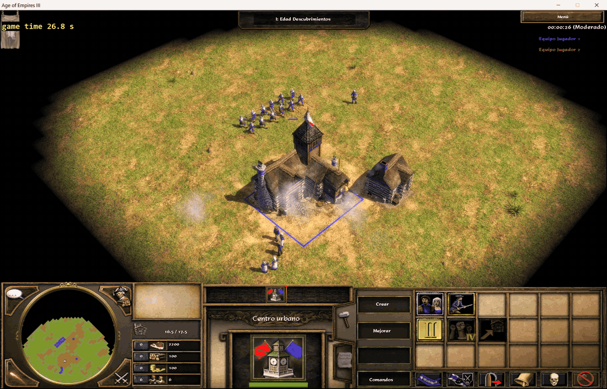

*1. `decimalPopulation 10 log`:* in the test data a Settler costs 1.5 population, a Pikeman 0.5, and a Manor gives 7.5. At 16.5 / 17.5 the Town Center refuses a Settler ("No hay más espacio de población para Colono") and its tooltip shows the cost `1.5` in red. A test tech at 35 s (the log lines at the top: Crossbowman 1.5 → 2, Town Center 10 → 12.5) makes room for two Settlers (20 / 20 with the queue), and a `PopulationCap` +2.5 at 56 s for one more (21.5 / 22.5). [Full video (MP4)](media/decimalPopulation.mp4).

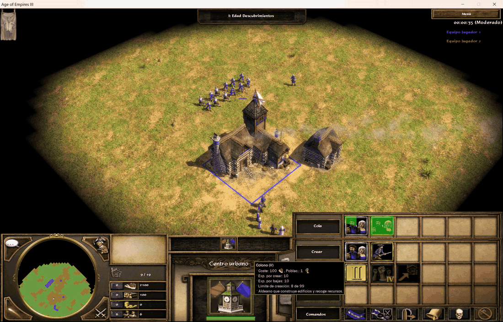

*2. The control, without the key:* the same data read by stock. `%d` drops the decimals: the Settler costs 1, the Pikemen nothing, the Manor gives 7 (9 / 17), and the Settlers train. [Full video (MP4)](media/decimalPopulation-control.mp4).


*3. The limits:* a test tech gives `PopulationCap` +300 at 12 population. With `decimalPopulation 10` the cap stops at stock's 200; with `basePop 300` added, at 300; with `basePop 300` alone (the control), at 300, the decimals dropped (6 population).

```
decimalPopulation [<K>] [log]      K from 2 to 1000, default 10: population in steps of 1/K
```

- **How stock behaves:** `<PopulationCount>` and `<PopulationCapAddition>` are whole numbers.
  The exe reads them with `%d`, so `0.5` becomes 0 (a free unit) and `7.5` becomes 7, with no
  message. A player's population, the population its queues reserve and its cap are sums of them,
  and every test (can this unit be queued, can it spawn, is the player at the cap) compares those
  sums.
- **Effect:** both tags take decimals, and population works in steps of 1/K. Inside the engine
  every population number is kept K times larger, so all of its tests stay exact:
  - **tech effects:** `PopulationCount` and `PopulationCapAddition` (on protos) and
    `PopulationCap` (on the player) take decimal amounts (`amount='0.5'`). `Absolute` adds the
    amount and `Assign` sets it, rounded to the nearest step; `BasePercent` is rounded to the
    nearest step too (stock truncates it, so a decrease came out one step high: 1.5 × 0.6 gives
    0.9, stock's formula 1.0); `Percent` multiplies by a whole number, as in stock. A
    `PopulationCount` effect that would bring a unit to 0 or less still gives it 1, as in stock;
  - **limits:** the cap keeps its stock limits (200 from buildings, plus 0 to 50 extra, at most
    250), or those of [`basePop` and `extraPop`](#basepop-and-extrapop), in whole population;
  - **interface:** the population counter (`{totalPop} / {popcap}`, and `{pop}` and
    `{futurepop}`) and its tooltip show decimals (`16.5 / 17.5`), and so do the population cost
    in unit tooltips (`Poblac.: 1.5`, red when it does not fit), the unit help
    (`Population: 0.5`) and the population of a shipment;
  - **AI and scripts:** XS still sees whole numbers. `kbGetPop`, `kbGetPopCap`,
    `trPlayerGetPopulation`, `aiGetEconomyPop`, `aiGetMilitaryPop`, `aiGetAvailableEconomyPop`,
    `aiGetAvailableMilitaryPop`, `aiGetCurrentEconomyPop`, `aiGetPopNeeds`, `kbGetPopCapAddition`
    and `kbGetPopulationSlotsBy{QueryID,UnitTypeID}` return the population rounded to the nearest
    whole number (halves away from zero); `kbGetPopSlots` (a unit's cost) rounds up, so a unit
    that costs population never reads as 0 (an AI script may divide by it);
    `kbUnitPickGet{Minimum,Maximum}Pop` round, and keep −1 as −1. `aiSetEconomyPop`,
    `aiSetMilitaryPop` and `kbUnitPickSet{Minimum,Maximum}Pop` take whole numbers as before (−1
    stays −1).
- **Your data:** the decimals, in the two tags and in the effect amounts. Whole numbers behave
  exactly as without the key. A UI gadget that shows `{pop}`, `{popcap}`, `{futurepop}` or
  `{totalPop}` now gets text such as `12.5` instead of a number; that is fine in a `formatText`
  gadget, which is how stock and WoL use them.
- **Choosing K:** 10 for one decimal (0.5, 1.5), 100 for two (0.25), or any value from 2 to 1000.
  Texts show up to three decimals, trailing zeros dropped (K = 3 shows 0.333).
- **Not adapted:** the post-game timeline (`Línea cronológica`, the curves `Toda la población`,
  `Población de aldeanos` and `Población de militares`) draws K times the population: a player
  with 9 population is drawn at 90 (seen in game). The AI's debug text (`AIDebugPopToggle`) does
  the same (read in the code, not seen).
- **Saved games** keep the population as stored: load them with the same K. A game saved without
  the key, or with another K, loads with wrong populations.
- **Log:** at startup `decimalPopulation: population in 1/10 steps (<PopulationCount> and
  <PopulationCapAddition> take decimals; caps (stock limits), effects, 19 XS syscalls and the
  population texts scaled)` (`(basePop/extraPop limits)` with those keys; `, decimal values and
  changes logged` with `log`); `decimalPopulation: expected a scale from 2 to 1000 and/or log, got
  "x"`. Hooks: `hook reached: decimalPopulation <PopulationCount> (0x5FB92E)`,
  `… <PopulationCapAddition> (0x5FD719)`, `… effect PopulationCount (0x8FA835)`,
  `… effect PopulationCapAddition (0x8FA8CF)`, `… PopulationCap effect (0x8D87AB)`,
  `… start cap bonus (0xA0D2D1)`, `basePop/extraPop/decimalPopulation (0x4581F3)`,
  `… data ref totalpop` (and `popcap`, `futurepop`, `pop`), `… colorizePop argument (0x6F576F)`,
  `… printed population (unit help, costs)` (and `(colorizePop)`, `(population help)`), and one
  `… XS <name>` per syscall. With `log` (at most 200 lines): each decimal value read
  (`decimalPopulation: Settler <PopulationCount>1.5</PopulationCount> = 1.5`), each effect
  (`decimalPopulation: effect PopulationCount, relativity 2, amount 0.6: 1.5 -> 0.9`; relativity 1
  is `Absolute`, 2 `BasePercent`, 3 `Assign`), and each XS setter's value when it changes
  (`decimalPopulation: aiSetEconomyPop(80) stored as 800`).
- **Simulation:** yes: every player needs the same key and the same K. Not tested in multiplayer.
- **Status:** confirmed in single player (2026-10-29), K = 10 and 100, with the data of
  [`tools/pop_testdata.py`](../tools/README.md#pop_testdatapy) in a test copy:
  - **values:** the log and memory showed Settler 1.5, Pikeman 0.5, Crossbowman 1.5, Manor 7.5,
    and a player with 6 Settlers, 12 Pikemen and a Crossbowman at 16.5 / 17.5 (top bar and
    memory);
  - **training** (real clicks on the Town Center, Settlers at 1.5): refused at 16.5 / 17.5 with
    the stock message, then at 17 / 20 two queued and the third refused, then at 22.5 one more and
    the next refused; the first Settler out brought the population to 18.5;
  - **effects:** `Absolute` (Crossbowman 1.5 → 2), `Assign` (Musketeer 1 → 0.5), `BasePercent`
    (Hussar 1.5 × 0.6 → 0.9, Pikeman 0.5 × 3 → 1.5, the population recounted to 29),
    `PopulationCapAddition` (Town Center 10 → 12.5) and `PopulationCap` (+2.5, and +300 against
    the limits of video 3);
  - **interface:** the counter, its tooltip (`La población actual es 21.5 / … máxima de 22.5`),
    the cost `1.5` in red and white in the Settler's tooltip;
  - **saved game:** with K = 100, a game saved at 17 / 20 loaded at 17 / 20, and its next trigger
    brought the cap to 22.5;
  - **bad values:** `1`, `abc` and `5000` logged the error and `FAILED`, and the game read the
    stock values;
  - **AI:** three skirmishes, three players (two Hard AIs): `aiSetEconomyPop(80)` stored as 800,
    `aiSetMilitaryPop(15)` and `(30)`; the Russian AI built houses and reached 62.5 population of
    a 95 cap (31 Settlers at 1.5, 8 Strelets, 8 Cossacks), no XS error. The other AI stayed at a
    cap of 10 in two games because that test copy's `House` has `Lifespan` 20 (an earlier test's
    data);
  - **every XS syscall:** all 19 reached. A probe rule added to the copy's AI (`aiChat` to
    player 1, every 45 s) printed, for a Portuguese AI, `pop 12/20 avEco 68 avMil 15 curEco 12
    needs 38` and `slots Settler 2 capadd Manor 8 TC 10 villagers 12 query 11 pick 7-42`: the
    Settler's 1.5 rounded up, the Manor's 7.5 rounded to 8, a pick's minimum and maximum (7, 42)
    read back as set; for the Spanish AI `avEco 70` (80 − 10.5). A trigger effect added to the
    copy's `typetest.xml` printed `trPlayerGetPopulation(1)` = 17 at 16.5 and at 17.0;
  - **shipments:** in game, the home city panel's card tooltips showed `2 colonos — Poblac.: 3`
    (red at 9 / 10) and `4 colonos — Poblac.: 6` (Settlers at 1.5; the tooltip of 0x710651);
  - **shared team population:** TAD's setup has no option for it, so the flag `[world+6913h]` was
    set in memory; the team path then capped the player at 200 after a `PopulationCap` +300 (its
    hook reached; unscaled it would have shown 20);
  - **`{pop}` and `{populationHelp}`:** no stock UI shows them (WoL's editor shows `{pop}`), so a
    loose `uimainnew.xml` in the test copy put `{pop}/{popcap}` in the counter and
    `{populationHelp}` in its tooltip: the counter read `16.5/17.5` and the tooltip
    `1 Centro urbano = 10, 1 Casa solariega = 7.5 Tamaño máx. ejército = 17.5` (the population
    help line and the max army size, both with decimals).

  Not run: multiplayer; taking back a `PopulationCap` effect (0x8D20AB): setting the tech's status
  back to 0 or 1 with a trigger does not take its effects back, and no stock path that does was
  found; the unit help `Población: %d` (FUN_004C8748, which the `trainsandcontains` row of the
  unit information panel calls; that row did not show for a Town Center, and a card on the home
  city screen, outside a game, shows no population).
- **New in this DLL:** not in UHC 1.10. WoL request #23 ([wol-requests.md](wol-requests.md)).

### noAILimit

```
noAILimit
```

- **Effect:** the AI personality list in game setup shows every `AI3\*.personality` file of the
  game folder, sorted by file name (case-insensitive). Stock shows a built-in list of 11
  personalities, 14 with TAD content. The folder name and the extension are read from the exe,
  so an exe patched to another folder (Wars of Liberty uses `AI4\`) works too.
- **Your mod:** add personality files. For example, a copy of `AI3\elizabeth.personality` saved as
  `AI3\mymod.personality`, with its fields changed:

  ```xml
  <AI>
     <version>2</version>
     <script>aiLoaderStandard</script>
     <nameID>33260</nameID>
     <tooltipID>41717</tooltipID>
     <forcedciv>japanese</forcedciv>
     <rushboom>-1</rushboom>
     <icon>ui\\singleplayer\\cpai_avatar_british</icon>
     <chatset>elizabeth</chatset>
     <playerNames>
        <nameID>33260<civ>Japanese</civ></nameID>
     </playerNames>
  </AI>
  ```

  `nameID` and `tooltipID` are string table IDs. Give each personality its own strings in your
  string table.
- **Log:** `noAILimit: N personalities from <folder>\AI3\*.personality`;
  `noAILimit: no personality files match …; keeping the stock list`;
  `hook reached: noAILimit (0x603B0B)`.
- **Simulation:** the list feeds game setup; every player needs the same personality files.
- **Status:** confirmed: an added personality appeared in game setup and played.
- **Fixed from UHC 1.10:** upstream leaves two of the function's variables uninitialized.

### noAILimitV2

```
noAILimitV2
```

- **Effect:** the same list as `noAILimit` (every personality file of the exe's AI folder, sorted
  by file name), installed later in the same stock function: the stock code that builds the
  built-in list runs, then only its count and table are replaced. For mods whose cfg already
  uses this name. With both keys, `noAILimit` is used.
- **Log:** `noAILimitV2: N personalities from <folder>\AI3\*.personality`;
  `hook reached: noAILimitV2 (0x603C34)`.
- **Simulation:** as `noAILimit`.
- **Status:** confirmed (2026-11-02): in a mod copy whose exe reads `AI4\`, the list held the 52
  personality files of that folder, sorted, with a random personality playing a skirmish.
  <!-- private -->In the Wars of Liberty copy (`C:\AoE3-UHC-WoLReal`), a hardware breakpoint at 0x603C4F read the same table (52 names, `ai22` first) with WoL's own DLL and with ours; without the key, a random-personality AI got a stock personality WoL does not ship, started with no civ, and the game crashed at 0x7C252C.
- **New in this DLL:** not in UHC 1.10. <!-- private -->

### customAbstractTypes

```
customAbstractTypes [file]
```

- **Effect:** every name in the file becomes an abstract unit type, as if it were compiled into the
  game: protos list it in `<UnitType>`, techs and auras target it, XS scripts use
  `cUnitType<Name>`. Stock drops any `<UnitType>` that is not on its built-in list, silently. The
  names get their IDs in file order, before the types other keys add, so their IDs do not depend
  on the other keys.
- **Your data:** the file, by default `data\uhc\customabstracttypes.xml` (relative to the game
  folder; an absolute path works too):

  ```xml
  <AbstractTypes>
     <AbstractType stringId="430103">AbstractMyCavalry</AbstractType>  <!-- comment -->
     <AbstractType>AbstractTrainLimitOne</AbstractType>
  </AbstractTypes>
  ```

  A name is letters, digits and `_`. `stringId` is read but not used yet (a display name for the
  type). A name the game already knows keeps its ID.
- **Log:** `customAbstractTypes: N abstract types from <file> (M with a stringId, not used yet)`;
  on each data load, one `unit types: <Name> -> <ID> (bit …), added` line per name;
  `customAbstractTypes: cannot read <file>`; `<Name> is listed twice`.
- **Simulation:** changes the data every player loads: everyone needs the same file.
- **Status:** confirmed (2026-11-02, single player): 47 names registered (IDs 3837–3883), carried
  by the protos that list them (668 protos for the most used one), and an AI script that uses
  `cUnitType<Name>` constants compiled. <!-- private -->In the Wars of Liberty copy, with WoL's own `data\uhc\customabstracttypes.xml`; before it, `aiLoaderStandard.xs` failed on `cUnitTypeAbstractWoLHandCavalry`.
- **New in this DLL:** not in UHC 1.10. <!-- private -->

### customSyscalls

<!-- private:begin -->
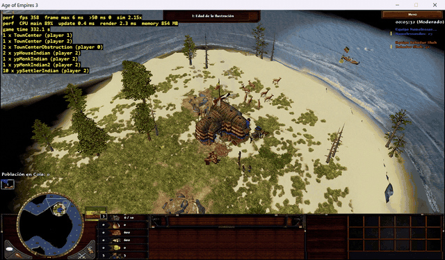

*In game:* With two plugins loaded, the AI of a mod whose scripts call their syscalls compiles and plays: the counter shows its settlers and houses growing (2x speed), with the performance numbers on top. [Full video (MP4)](media/customSyscalls-wol-ai.mp4).
<!-- private:end -->

```
customSyscalls [file or pattern ...]
```

- **Effect:** loads UHC plugins (`.upl` files) and adds the XS syscalls they register to AI,
  trigger, random-map and UI scripts. Without arguments it loads every `*.upl` file in the game
  folder; with arguments, the files or patterns listed, relative to the game folder. A plugin that
  crashes while it starts is logged and skipped.
- **Plugins:** a `.upl` is a 32-bit DLL that exports `int UHCPluginMain(UHCPluginInfo*)` (cdecl).
  `UHCPluginInfo` holds five cdecl function pointers, in this order:
  `RegisterCheat(text, enabled, callback)`,
  `RegisterSyscall(group, returnType, name, function, paramCount, comment)` (returns a handle),
  `SyscallSetParam(handle, index, type, defaultValue)`, `CheatAddResource(playerData, resource,
  amount, flag)` and `CheatSpawnUnit(playerData, protoName)`. Groups: 0 AI, 1 HC, 2 KB, 3 RM,
  4 TR, 5 UI, 6 UI2, 7 XS. Types: 1 void, 2 int, 4 float, 8 bool, 16 string, 32 vector. A
  syscall function is cdecl and takes the XS arguments in order. Existing UHC plugins work
  unchanged. Cheats go to the game with `customCheats` (below).
- **Log:** `customSyscalls: <file>: N syscalls, M cheats (UHCPluginMain returned R)`;
  `customSyscalls: K of L plugin(s) loaded, …`; once per script module,
  `syscalls: group XS: N added, M refused`; a refused syscall (a name the game already has, a bad
  type) is named, and the others still register; `hook reached: syscall group XS (0x6257D9)` and
  the other seven groups.
- **Simulation:** scripts compiled with these syscalls need them on every player's machine:
  everyone needs the same plugins.
- **Status:** confirmed (2026-11-02, single player): two plugins loaded (17 syscalls in the XS,
  AI and KB groups, 33 cheats collected), and an AI whose scripts call them compiled and played a
  skirmish. <!-- private -->In the Wars of Liberty copy, with `customSyscalls wolPlugin.upl wolai.upl`: `aiWoLMain.xs` calls `kbGetTechID` 36 times; video `wol-ai-plugins.mp4` (scratchpad, 2026-11-02).
<!-- private:begin -->
- **Fixed from UHC 1.10:** upstream's syscall table overflows into the population and deck limits
  when the list is long, loads plugins by bare file name (directories do not resolve), and stops
  a whole group at the first refused syscall.
<!-- private:end -->

### customCheats

<!-- private:begin -->
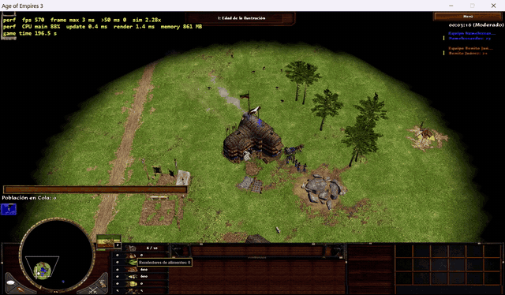

*In game:* A plugin cheat typed in the chat (second ~4) spawns 50 Cannons; the two frames over 100 ms are the moment the 50 units appear. [Full video (MP4)](media/customCheats.mp4).
<!-- private:end -->

```
customCheats
```

- **Effect:** the cheats that plugins register (see `customSyscalls`) work in the chat like the
  stock ones: typed as written (lower case), they run on every player's machine through the
  game's own cheat command. Plugins load when either `customSyscalls` or `customCheats` is set;
  without `customSyscalls` their syscalls are ignored.
- **Log:** `customCheats: N plugin cheat(s) added to the cheat table (M entries)` the first time
  the table is built; `hook reached: customCheats cheat table (0x551FE6)`.
- **Simulation:** a cheat runs as a game command, as the stock cheats do; every player needs the
  same plugins.
- **Status:** confirmed (2026-11-02, single player): 33 plugin cheats added after the 23 stock
  ones, and a plugin cheat that spawns 50 Cannons spawned them. Video `customCheats.mp4` (two
  frames over 100 ms while the 50 units appear). <!-- private -->In the WoL copy, `kill 'em all` from `wolPlugin.upl`.

### asianCivs

<!-- private:begin -->
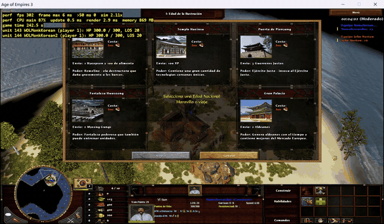

*In game:* A listed civ's two monks get their hero names (explorerUnits), then its villager opens the wonder age-up list with the civ's five wonders. [Full video (MP4)](media/asianCivs-koreans.mp4).
<!-- private:end -->

```
asianCivs Civ [Civ ...] [log]
```

- **Effect:** the listed civs (names from `civs.xml`) count as Asian civs where the game compares a
  player's civ with the Asian civs: the extended Asian-civ test (consulate, export and the other
  Asian features that call it), the Asian civs' value branch, and the wonder age-up list. In that
  list a listed civ gets the wonders whose civ name is its name in the cfg; stock gives a civ that
  is not Chinese, Japanese or Indian no wonder at all.
- **Your data:** for the wonder age-up, entries in `politiciandata.xml` with `nativeciv="<Civ>"`
  and the civ's wonders (the stock Indian entries are the model).
- **Log:** `asianCivs: N civ(s) count as Asian civs`; when `civs.xml` is read, one
  `asianCivs: <Civ> -> civ <ID>` line per name (`… is not a civ in civs.xml; ignored` otherwise);
  with `log`, `asianCivs: <Civ> gets its wonders in the age-up list` once;
  `hook reached: asianCivs isAsianCiv (0x454F1D)`, `… civ value (0x8D6AC4)`,
  `… wonder age-up (0x818284)`.
- **Simulation:** changes what the listed civs may do: every player needs the same line.
- **Status:** confirmed (2026-11-02, single player): five civs resolved, and a listed civ's
  villager opened the wonder age-up list with its five wonders. Video `asianCivs-koreans.mp4`. <!-- private -->In the WoL copy, the test profile's home city is Ethiopian, and WoL's wonders belong to the Koreans.
<!-- private:begin -->
- **Fixed from UHC 1.10:** upstream tests EAX instead of AL after `0x49A2D8` in the wonder list,
  so the "civ has no entry" path (EAX = 0xFFFFFF00) counted as true.
<!-- private:end -->

### selectionLimit

<!-- private:begin -->
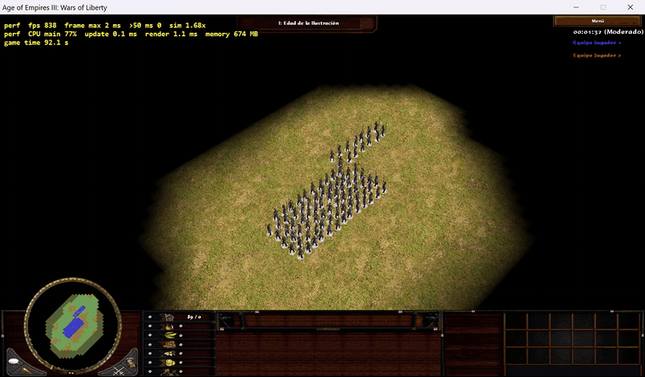

*In game:* With `selectionLimit 75`, a box over 89 Pikemen selects 75 (the number on the selection icon); without the key it stops at 50. [Full video (MP4)](media/selectionLimit.mp4).
<!-- private:end -->

```
selectionLimit N
```

- **Effect:** one selection holds up to N units (1 to 200; stock 50), for box selection, double
  click and control groups alike.
- **Log:** `selectionLimit: a selection holds up to N units (stock 50)` (`; above 75 not tested`
  for larger values); `selectionLimit: needs a number from 1 to 200` for a bad value (not
  applied).
- **Simulation:** no: it only changes what the local player can select. Players may set it
  differently.
- **Status:** confirmed (2026-11-02, single player): with 75, a box over 89 Pikemen selected 75;
  without the key, 50. Video `selectionLimit.mp4`, with `--perf` (no frame over 50 ms).
- **New in this DLL:** not in UHC 1.10. <!-- private -->

### enableAllTeams

<!-- private:begin -->
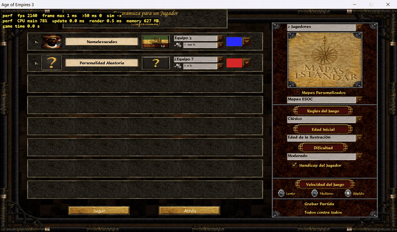

*In game:* The setup's team list offers Team 3 and Team 4; player 1 takes Team 3 and the AI Team 4 (1.5x speed). [Full video (MP4)](media/enableAllTeams.mp4).
<!-- private:end -->

```
enableAllTeams
```

- **Effect:** the single-player game setup offers Team 3 and Team 4 besides Team 1, Team 2 and
  "?". The multiplayer lobby is not changed yet.
- **Your data:** none (string IDs 36143 and 36144, `Team 3` / `Team 4`, are in the stock string
  table).
- **Log:** `enableAllTeams: Team 3 and Team 4 in the single-player setup (multiplayer lobby not
  changed yet)`; `hook reached: enableAllTeams setup list (0x7A0709)`.
- **Simulation:** it only adds choices; the teams chosen are part of the game setup as usual.
- **Status:** partly confirmed (2026-11-02, single player): the list shows Team 1–4 and "?", and
  a skirmish with Team 3 against Team 4 started and played; how the game numbers the teams
  inside was not read. Video `enableAllTeams.mp4`.
<!-- private:begin -->
- **Fixed from UHC 1.10:** upstream loads the temporary string's destructor but never calls it
  (a leak per list fill).
<!-- private:end -->

### twoScoutCivs

```
twoScoutCivs Civ [Civ ...]
```

- **Effect:** the listed civs get the hero interface of the civs that start with two heroes
  (Japanese and Indians) in the four places the game decides it by civ.
- **Log:** `twoScoutCivs: N civ(s) get the two-hero UI`; `twoScoutCivs: <Civ> -> civ <ID>` when
  `civs.xml` is read; `hook reached: twoScoutCivs hero UI 1 (0x77EBB2)` to `... 4 (0x77DFF4)`.
- **Simulation:** no: interface only.
- **Status:** implemented, not tested in game (2026-11-02): the four functions did not run during a
  skirmish, in the home city menus or in its customize screen; they are probably the new home city
  dialog, which names the heroes.

### marketUnits

<!-- private:begin -->
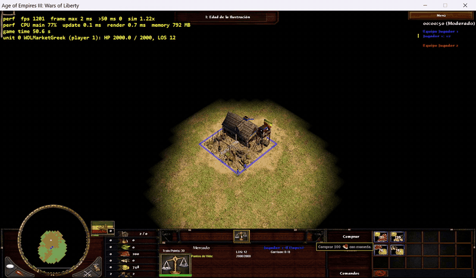

*In game:* With only a listed market building, each click buys 100 food (food 200 to 500, gold falling); without the key the same clicks change nothing. [Full video (MP4)](media/marketUnits.mp4).
<!-- private:end -->

```
marketUnits Proto [Proto ...]
```

- **Effect:** owning a unit of a listed proto counts as owning a Market for buying and selling
  resources (stock requires the `Market` proto or the second market type).
- **Your data:** the listed buildings need the market's buy and sell commands.
- **Log:** `marketUnits: N proto(s) count as a Market for trading`; when `protoy.xml` is read,
  `marketUnits: K of N protos found in the data` (and each unknown name);
  `hook reached: marketUnits trade test (0x7DEF70)`.
- **Simulation:** changes who may trade: every player needs the same line.
- **Status:** confirmed (2026-11-02, single player): with only a `WOLMarketGreek` and 1000 gold,
  buying food worked (food 0 to 500, gold 1000 to 362); without the key the same clicks changed
  nothing. Video `marketUnits.mp4`.

### explorerUnits

```
explorerUnits Proto Type StringID [Proto Type StringID ...]
```

- **Effect:** listed protos are heroes for two things: their name and their knockout message.
  `Type` picks the name: 1 the home city's explorer name, 0 the stock path for other units, any
  other value the first of the home city's hero names (as the second monk of a two-hero civ).
  `StringID` is the message shown when the unit is knocked out.
- **Log:** `explorerUnits: N hero proto(s)`; when `protoy.xml` is read, `explorerUnits: K of N
  protos found in the data` and each unknown name; `hook reached: explorerUnits hero name
  (0x6A012A)`, `... knockout message (0x50B01F)`; `explorerUnits: needs triples ...` or
  `bad triple ...` (not applied).
- **Simulation:** no: names and messages.
- **Status:** confirmed for names (2026-11-02, single player): a civ's two monks listed with
  Type 1 and Type 2 were named after the explorer and the first hero name of the home city; the
  knockout message was not driven. Video `asianCivs-koreans.mp4` (the two monks, then the wonder
  list).

### nativeCivs

<!-- private:begin -->
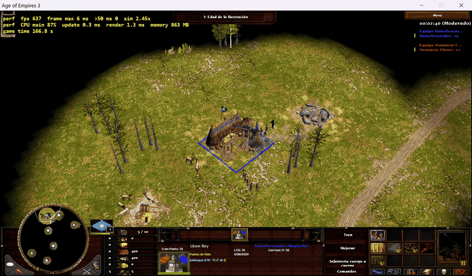

*In game:* A listed native civ's Town Center opens the council age-up list with its five council members; the log lines on top show the civ resolved by the native civ tests and the dance gates. [Full video (MP4)](media/nativeCivs-mapuche.mp4).
<!-- private:end -->

```
nativeCivs Civ [Civ ...]
```

- **Effect:** the listed civs count as native civs: the civ flag the `civs.xml` loader sets for
  the native civs, the game's native civ tests, the fire pit's Training, XPTrickle, Gathering and
  Regeneration dances (through the same four gates as `danceBonusCivs`), and the council age-up
  list, where a listed civ gets the council members whose civ name is its name in the cfg.
- **Your data:** for the council age-up, entries in `politiciandata.xml` with
  `nativeciv="<Civ>"` (the stock Iroquois entries are the model).
- **Log:** `nativeCivs: N civ(s) count as native civs`; `nativeCivs: K of N civ(s) marked native
  in civs.xml`; `nativeCivs: <Civ> -> civ <ID>` and `danceBonusCivs: <Civ> -> civ <ID>` when
  `civs.xml` is read; `hook reached: nativeCivs civ flags (0x52B581)`, `... test 2 (0x51271F)`,
  `... isNativeCiv (0x453D5E)`, `... test 7 (0x67B0A5)`, `... test 9 (0x8D52AF)`,
  `... council age-up (0x81ADEB)`.
- **Simulation:** changes what the listed civs may do: every player needs the same line.
- **Status:** confirmed (2026-11-03, single player): three civs marked native, every hook ran in
  a skirmish, the four dance gates resolved them, and a listed civ's Town Center opened the council
  age-up list with its five council members. Without the key, the same age-up click closed the
  game: the civ was taken for a European one, and the politician dialog read a gadget it does not
  have (stock code, 0x81A5FB to 0x81A80C). <!-- private -->Video `nativeCivs-mapuche.mp4`.
<!-- private:begin -->
- **Fixed from UHC 1.10:** upstream compares a dword where isNativeCiv compares a byte, and its
  council hook clobbers EAX.
<!-- private:end -->

### bigButtonCivs and noBigButtonBlds

```
bigButtonCivs Civ [Civ ...]
noBigButtonBlds Proto [Proto ...]
```

- **Effect:** the command panel's big button, which stock gives to native civs, also goes to the
  listed civs; and neither native nor listed civs get it on a building of a `noBigButtonBlds`
  proto. Either line may be used alone.
- **Log:** `bigButtonCivs/noBigButtonBlds: N civ(s) get the native big button, M building proto(s)
  never show it`; `hook reached: bigButtonCivs command panel (0x461BD8)`.
- **Simulation:** no: interface only.
- **Status:** partly confirmed (2026-11-02, single player): the hook ran when a listed civ's
  Town Center was selected; a building of a listed proto was not checked.

### enableFarmAnim, enableRectFarmAnim and farmingRadius

<!-- private:begin -->
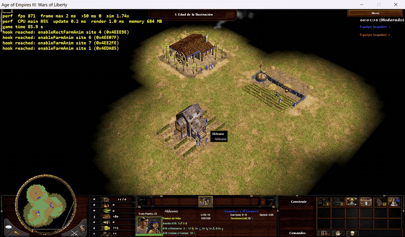

*In game:* Iroquois gatherers on a listed plantation (Mill-like, front) and a listed farm (Rice
Paddy-like, right) spread over the fields and use the farming animations; the log lines on top
are the keys'. [Full video (MP4)](media/enableFarmAnim.mp4). Without the keys
(left of the still below) the same gatherers stand bunched at one side of each building:
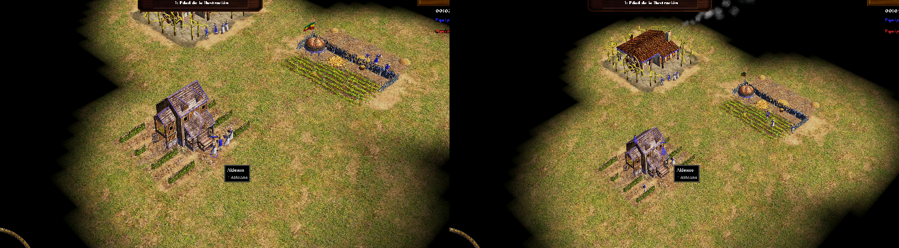

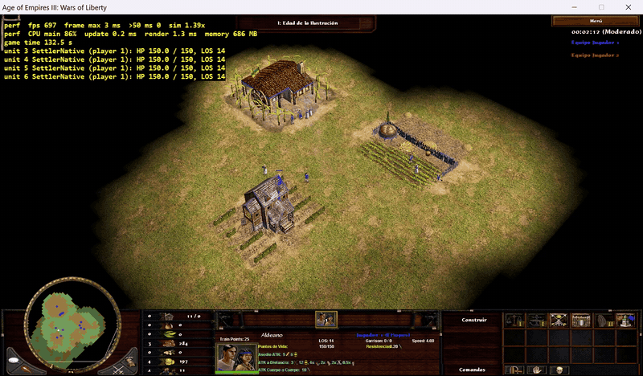

*In game:* the same plantation with `farmingRadius 3 12.0 12.0`: its four gatherers (HP lines on
top) range up to 11.9 m from its centre, against about 5 m with the stock 4.5.
[Full video (MP4)](media/farmingRadius-12.mp4).
<!-- private:end -->

```
enableFarmAnim Proto [Proto ...]
enableRectFarmAnim Proto [Proto ...]
farmingRadius Index X Z [Index X Z ...]
```

- **Effect:** gatherers on a building of an `enableFarmAnim` proto are placed and animated as on a
  Mill (they spread over the area around it); on an `enableRectFarmAnim` proto, as on a Rice
  Paddy (they work in its rows). `farmingRadius` gives, per `enableFarmAnim` entry (`Index` counts
  that line's protos from 1), the X and Z extent of that spread (stock 4.5 x 4.5; up to 100).
- **Your data:** the building still needs a gather action in its tactics (or the data's own way of
  gathering): these keys change where and how gatherers work, not whether the building can be
  gathered. A building whose tactics only modify other gatherers (`ModifyGather...`) gets no
  gatherers.
- **Log:** `enableFarmAnim/enableRectFarmAnim: N proto(s) work like a Mill, M like a Rice Paddy`;
  when `protoy.xml` is read, `enableFarmAnim: K of N protos found in the data` (and each unknown
  name); `farmingRadius: N farm proto(s) get their own gather area`, or `needs enableFarmAnim`,
  `needs triples ...`, `bad triple ...` (not applied); `hook reached: enableFarmAnim site 1
  (0x4EDA85)` to `... 8`, `enableRectFarmAnim site 1` to `4`, `farmingRadius (0x9DE04D)`.
- **Simulation:** changes where gatherers stand (the spread uses the game's synced random
  numbers): every player needs the same lines.
- **Status:** confirmed (2026-11-03, single player): with both lists, ten of the twelve placement
  sites and the radius ran, gatherers spread over a listed plantation and worked inside a listed
  farm's rows, and without the keys they stood bunched at one side (gathering in both cases);
  `farmingRadius` 12 widened the spread from about 5 m to 11.9 m. Sites 3 and 8 did not run in
  that test.
<!-- private:begin -->
- **Fixed from UHC 1.10:** upstream reloads EBP before site 1 instead of keeping it, jumps to the
  Mill and Rice Paddy branches without the registers those branches have, and at site 5 skips the
  Mill flag the code after it reads.
<!-- private:end -->

### trainSingleAbstractType

<!-- private:begin -->
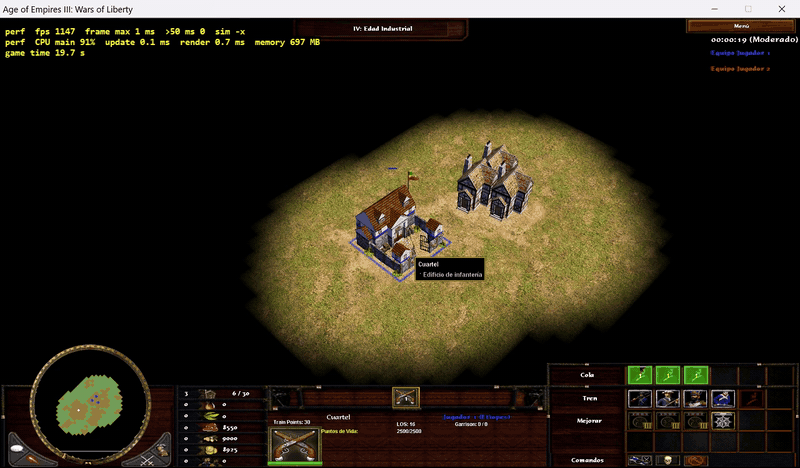

*In game:* three marked hussars queued at once come out one at a time (the unit lines on top grow
from one to two); without the key the same order brought three out together.
[Full video (MP4)](media/trainSingleAbstractType.mp4).
<!-- private:end -->

```
trainSingleAbstractType [UnitType]
```

- **Effect:** units of the marker type (default `AbstractTrainLimitOne`) leave a training
  building one at a time, as monks do in stock, instead of as one batch.
- **Your data:** `<UnitType>AbstractTrainLimitOne</UnitType>` (or your type) on the protos.
- **Log:** `trainSingleAbstractType: units of unittype <Type> are trained one at a time`; the
  first time it applies, `trainSingleAbstractType: <Proto> is trained one at a time`.
- **Simulation:** changes how units are created: every player needs the same line.
- **Status:** confirmed (2026-11-03, single player): a queue of marked hussars produced one, then
  a second about a minute later; without the key the same queue produced three together (the
  proto's `BuildLimit` is 3). Video `trainSingleAbstractType.mp4`.

### customRevolutionBanners

```
customRevolutionBanners
```

- **Effect:** every revolution tech named `XPRevolution<Name>` shows the banner texture
  `ui\ingame\politicians\REV_banner_<Name>`. Stock shows a banner only for
  `XPRevolutionOHiggins` (`REV_banner_chile`), and that one is kept.
- **Your mod:** provide `art\ui\ingame\politicians\REV_banner_<Name>.ddt` for each revolution.
  The stock revolution techs are `XPRevolutionBolivar`, `…Bonifacio`, `…Hidalgo`,
  `…Louverture`, `…OHiggins`, `…SanMartin`, `…Santander` and `…Washington`. The stock art
  (`art\Art4.bar`, `Art5.bar`) has eight banners named after countries: `argentina`, `brazil`,
  `chile`, `colombia`, `haiti`, `mexico`, `peru` and `usa`. To reuse one, extract it and save it
  under the tech's name, e.g. `REV_banner_mexico.ddt` as `REV_banner_Hidalgo.ddt`, or
  `REV_banner_usa.ddt` as `REV_banner_Washington.ddt`:

  ```
  python -I tools\bar.py "<mod>\art\Art4.bar" rev_banner_mexico --extract work
  ```

  This writes `work\Art\ui\ingame\politicians\REV_banner_mexico.ddt`. Rename it to
  `REV_banner_Hidalgo.ddt` and put it in `<mod>\art\ui\ingame\politicians\`.

  Loose files are the usual way to add art to a mod. For data files, a loose file replaces the
  archive copy (verified with `homecitylevels.xml`); for art, this was not tested.
- **Log:** `hook reached: customRevolutionBanners (0x81A7CC)`.
- **Simulation:** no (interface only).
- **Status:** partly confirmed: the hook runs and the O'Higgins banner still shows. Banners for
  other revolutions were not tested.
- **Fixed from UHC 1.10:** the banner path is bounded; upstream overflows its buffer on long tech
  names.

### removeFameRestriction

```
removeFameRestriction
```

Three changes:
1. **Politician (age-up) screens** list the Fame, XP and shipment costs of a choice. The second
   politician screen also lists the export resource. Stock shows only food, wood, gold and, on
   the first screen, export.
2. **Home city cards** that cost Fame or XP show an icon for those resources.
3. **"Fame trickle":** the built-in abstract unit type `FavoriteUnit` is renamed `Fame` (same
   ID). The original UnHardcoded project applies this change under that name; how it enables a
   Fame trickle was not traced. Stock data does not use `FavoriteUnit`.

- **Your mod:** provide the icons `art\ui\home_city\xp_hc_icon.ddt` and
  `art\ui\home_city\fame_hc_icon.ddt` (the names upstream uses). Without them, those cards show
  no icon, as in stock.
- **Log:** `removeFameRestriction: icons need …`;
  `hook reached: removeFameRestriction costs #1 (0x80E490)` (also `#2`, `icon load`,
  `fame icon case`, `XP icon case`).
- **Simulation:** the unit type rename changes game data; give every player the same setting.
- **Status:** not tested in game.
- **Fixed from UHC 1.10:** on the second politician screen, upstream passes the wrong object
  as the owner of each cost line.

### removeConversionRestriction

```
removeConversionRestriction
```

- **Effect:** the `ConvertGuardian` action, which converts treasure guardians, may target any
  unit. Stock checks a unit flag that only treasure guardians have.
- **Who has the action:** explorers, war chiefs and some cavalry list it in their tactics, and a
  tech enables it (for example the `HCXPMorningStar` card).
- **Check:** this key writes no `hook reached` line, because it only removes one branch. Check it
  in game: a unit with `ConvertGuardian` converts a unit that is not a treasure guardian.
- **Simulation:** yes.
- **Status:** not confirmed: one test with the Sioux war chief was inconclusive.

### hcShipmentPointFallback

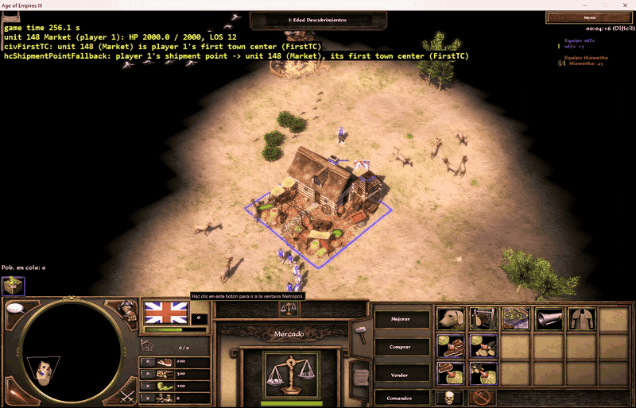

*In game:* No Town Center on the map: the food crates of a home city card land beside player 1's Market, its first town center (made by [`civFirstTC`](#civfirsttc)), through `hcShipmentPointFallback FirstTC`. [Full video (MP4)](media/hcShipmentPointFallback.mp4).

```
hcShipmentPointFallback <Proto|FirstTC> [<Proto|FirstTC> ...]     1 to 64 entries
```

- **How stock behaves:** home city shipments arrive at the player's shipment point, a building
  (usually the Town Center). The game keeps that point while the building is alive and built.
  When it is destroyed or deleted, the game moves the point to the first alive, built building of
  the player among 10 fixed types, in this order: `TownCenter`, `Outpost`, `FortFrontier`,
  `WarHut`, `Blockhouse`, `NoblesHut`, any `AbstractAgraFort`, any `AbstractDaimyo`, `ypCastle`,
  `ypVillage`. If none of those is left, there is no shipment point (a `FreeHomeCityUnit` effect,
  for example, then creates nothing).
- **Effect:** after that stock list, the entries are tried in cfg order.
  - A **proto name:** the first alive building of the player of that proto that passes the same
    checks as stock becomes the point. When there are several, the stock unit query order
    decides, so every machine picks the same one.
  - **`FirstTC`** (any case): the player's first town center, the unit the placement rules call
    `FirstTC`. It becomes the point when it still belongs to the player and passes the same
    checks as stock (alive, built). A first town center that was converted or captured is
    skipped: the game never clears `FirstTC`, so it can belong to another player.
- **`FirstTC` needs `startingTC` or `civFirstTC`:** stock makes only a `TownCenter` a first town
  center, and the stock list already tries every `TownCenter` first, so without
  [`startingTC`](#startingtc) or [`civFirstTC`](#civfirsttc) the keyword finds nothing new (the
  key is still applied, with a warning in the log). With one of them, another building, for
  example the Market a civ starts with instead of a Town Center, is the player's `FirstTC` and
  receives the shipments. Without this key, a player whose buildings are none of the 10 stock
  types has no shipment point at all (read from the stock search; not tested in game).
- **Your mod:** list proto names exactly as in `protoy.xml`, and `FirstTC` where it should be
  tried, e.g. `hcShipmentPointFallback Barracks Stable ArtilleryDepot Market Church`, or for WoL
  `hcShipmentPointFallback FirstTC Barracks Market` (with `startingTC` or `civFirstTC`). A proto
  named `FirstTC` cannot be listed: the keyword wins.
- **The point then stays:** as in stock, once a building is the point it stays the point while
  it is alive and built, even if a Town Center is built later. The player can still move the flag.
- **Not affected:** the water shipment point and the consulate's drop point (`ypConsulate`) are
  chosen by other code.
- **Log:**
  - at startup, `hcShipmentPointFallback: N extra types after the stock list (multiplayer
    unverified)`; with `FirstTC` listed, `hcShipmentPointFallback: N extra types after the stock
    list, including each player's first town center (FirstTC) (multiplayer unverified)`;
  - at startup, with `FirstTC` but neither a `startingTC` nor a `civFirstTC` line:
    `hcShipmentPointFallback: FirstTC without startingTC: a first town center can only be a
    TownCenter, which the stock list already tries first`;
  - the first time in a run of the game that no stock fallback building is left,
    `hcShipmentPointFallback: <Name> -> proto <ID>` for each name (or `(unknown proto;
    skipped)`), `hcShipmentPointFallback: FirstTC -> each player's first town center (FirstTC)`
    for the keyword, and `hook reached: hcShipmentPointFallback (0x669E2E)`;
  - the first time a `FirstTC` entry is tried, `hook reached: hcShipmentPointFallback FirstTC
    (0x669E2E)`;
  - when a player's first town center is chosen, `hcShipmentPointFallback: player <N>'s shipment
    point -> unit <ID> (<Proto>), its first town center (FirstTC)`. The game also asks for the
    point while drawing the interface, so the line is written only when the chosen unit changes
    for that player.

  A move to another stock building, such as a second Town Center, logs nothing.
- **Simulation:** yes. Every choice reads only game state, so every machine with the same cfg
  picks the same building. Every player needs the same line (and the same `startingTC` or
  `civFirstTC` line).
- **Status:**
  - proto names: confirmed: after deleting the Town Center, the point moved to a listed building
    and shipments arrived there;
  - `FirstTC`: confirmed in single player (2026-10-29) with `civFirstTC`. In a skirmish where
    player 1's civ started with a Market instead of a Town Center, a card of 300 food sent with no
    Town Center on the map logged `hcShipmentPointFallback: player 1's shipment point -> unit 148
    (Market), its first town center (FirstTC)`; the point `[hc+18Ch]` read 148 in memory, and
    three `CrateofFood` landed beside the Market (food 200 → 500). It also ran with
    `noTrainNearEnemyTC 65 log` on. Not tested: `FirstTC` with `startingTC`, and a converted
    first town center (the owner check);
  - water shipment points were not tested (the key does not change them).
- **New in this DLL:** not in UHC 1.10.

### healNonIdle

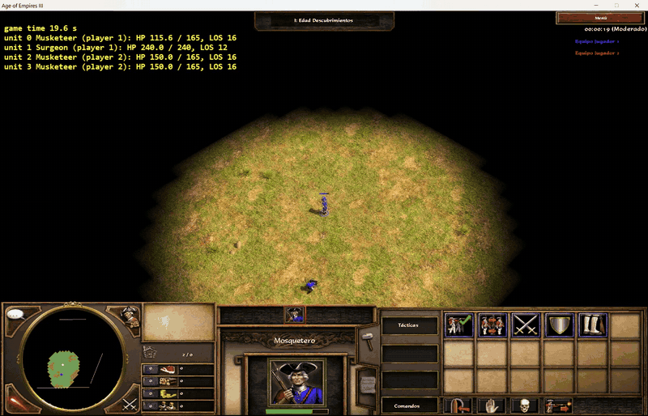

*1. With the key:* a musketeer exchanges fire with two enemy musketeers while the surgeon behind it heals it: its HP drops with the hits and climbs back during the fight, and it survives (2x speed). [Full video (MP4)](media/healNonIdle.mp4).

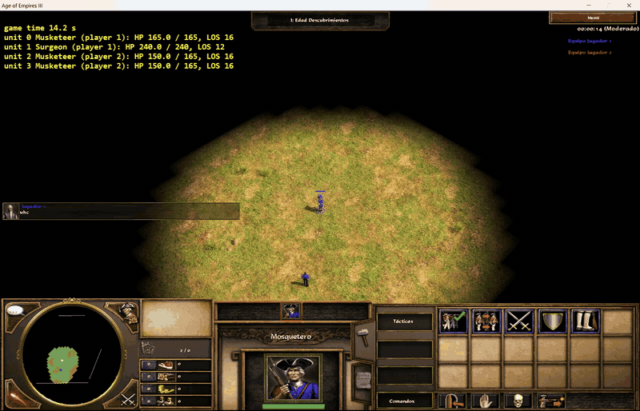

*2. Stock, key off (the same scene):* before the fight the surgeon heals the idle musketeer (113 to 131 HP); once the musketeer fights, the surgeon stops healing it and it dies at 38 s; the enemy musketeers then kill the surgeon too (2x speed). [Full video (MP4)](media/healNonIdle-stock.mp4).

```
healNonIdle [<UnitType>]      default AbstractHealNonIdle
```

- **How stock behaves:** a healer only picks targets that are idle. It also stops healing as soon
  as its target moves or fights.
- **Effect:** healers whose proto is of `<UnitType>` also pick targets that are busy (moving,
  fighting or doing something else), and keep healing them while they move or fight. All the
  other stock checks still apply: the target must be damaged, a valid heal target for that
  healer, and reachable. Any other healer behaves as in stock.
- **The marker type:** in TAD, abstract unit types are a fixed list compiled into the exe, and
  any other `<UnitType>` in `protoy.xml` is silently dropped. So this DLL **registers
  `<UnitType>` as a new abstract type** when the data does not define it. You can then list it on
  any healer:

  ```xml
  <Unit id ='424' name ='Surgeon'>
      ...
      <UnitType>LogicalTypeHealed</UnitType>
      <UnitType>AbstractHealNonIdle</UnitType>
  ```

  Edit both `data\protoy.xml` (plain text, by hand) and `data\protoy.xml.XMB`
  ([section 6](#6-editing-the-game-data)). For the XMB, run this from a terminal opened in the
  unzipped source code folder:

  ```
  python -I tools\xmbedit.py add-unittype "<mod>\data\protoy.xml.XMB" "<mod>\data\protoy.xml.XMB.new" Surgeon AbstractHealNonIdle
  ```

  Check the result with `python -I tools\xmbedit.py check "<mod>\data\protoy.xml.XMB.new"`, then
  rename `protoy.xml.XMB.new` to `protoy.xml.XMB`, keeping the old file as a backup.

  An existing type or proto name works too, with no data change: `healNonIdle AbstractMonk`
  applies the feature to every monk, `healNonIdle Surgeon` to surgeons only. This uses the same
  code path but was not tested in game.
- **Monks and other fighting healers** may still choose to attack instead of heal: that is the
  unit's own behavior and is not changed. Pure healers such as the Surgeon show the feature best.
- **Log:** `healNonIdle: healers of unittype X heal busy targets (multiplayer unverified)`; when
  the data loads, `hook reached: abstract unit types (0x51BA31)` and
  `unit types: X -> <ID> (bit B of N), added` (or `already defined`); in a game,
  `hook reached: healNonIdle auto-search (0x9CD9C7)` and `hook reached: healNonIdle (0x9E0C79)`.
- **Check the data:** with the game running, `python -I tools/re/inspect_unittypes.py
  AbstractHealNonIdle` lists the protos that carry the type.
- **Simulation:** yes. It also adds a unit type, which changes the unit type count.
- **Status:** confirmed: British surgeons marked with the type healed their explorer during a
  fight through their automatic search. A direct order (right-click) on a fighting unit was not
  verified.

### smartHealTargets

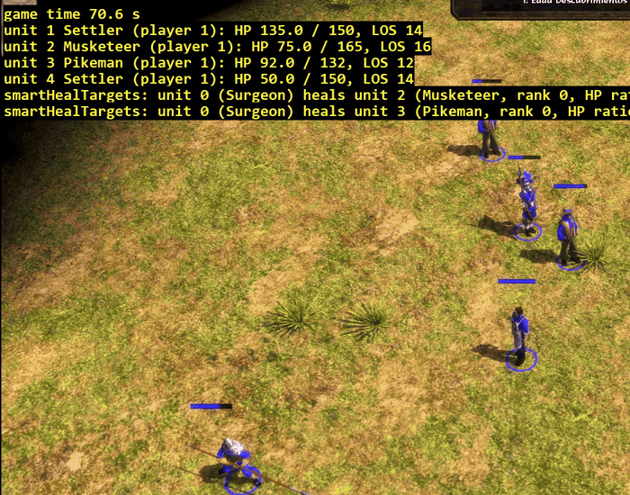

*In game:* four units are hit at once; the surgeon heals the one with the lowest HP ratio first (a settler at 33 %), then 45 %, 70 % and 90 %, where stock starts with the nearest settler at 90 %. The yellow lines show each pick next to stock's. [Full video (MP4)](media/smartHealTargets.mp4).

```
smartHealTargets [<UnitType> ...] [log]   up to 8 types, in priority order
```

- **How stock behaves:** an idle healer looks for a unit to heal on its own: it asks for the units
  around it and heals the **first** one that passes every test (damaged, alive, idle, a valid heal
  target, not already healed by others, in range). The order is the query's, so a healer often
  tops up a nearly full unit next to it while a badly hurt one waits.
- **Effect:** the same tests decide which units can be healed, and among them the healer picks:
  1. the unit types you list, in their order (a unit of none of them comes after them);
  2. then the lowest HP ratio (HP / max);
  3. then the nearest to the healer;
  4. then the lowest unit ID.

  No memory address and no query order is used, so every machine picks the same unit. With no
  type, it is the most hurt unit in reach. Only the automatic search changes: a direct order
  (right-click) heals what the player chose.
- **Every healer:** the key applies to every healer, with no marker on the healers: the search is
  the same function for surgeons, monks, priests and the others, and the key only reorders units
  the stock rules already accept. Names a type to favour targets instead, e.g.
  `smartHealTargets AbstractInfantry Settler`.
- **With `healNonIdle`:** both keys hook the same search at different points and work together:
  marked healers also see busy units, and the best of all candidates is healed.
- **Log:** `smartHealTargets: automatic heal searches pick the best candidate: <types, >lowest HP
  ratio, nearest, lowest unit ID (multiplayer unverified)`; in a game `hook reached:
  smartHealTargets candidate (0x9CDA36)` and `pick (0x9CDA58)`; with `log`, every pick (the first
  200): `smartHealTargets: unit 0 (Surgeon) heals unit 4 (Settler, rank 0, HP ratio 0.333, 10.0
  m) among 4 candidates; stock would heal unit 1 (Settler, HP ratio 0.900)`.
- **Simulation:** yes, every machine needs the same line. A listed name that is not a type yet is
  registered as a marker unit type, which changes the unit type count.
- **Status:** confirmed in single player (2026-10-29). A surgeon with four units hit at once
  (90 %, 45 %, 70 %, 33 %) healed them in the order 33, 45, 70, 90 %, where stock would have
  started with the 90 % settler; with `smartHealTargets Pikeman`, the pikeman (70 %) came first,
  then 33, 45, 90 %. Together with `healNonIdle` both hooks ran. A skirmish against the AI with
  the key on played normally. Multiplayer was not tested.
- **New in this DLL:** not in UHC 1.10.
- **New in this DLL:** not in UHC 1.10.

### dodgeAnyUnit, dodgeSoundSet and criticalSoundSet

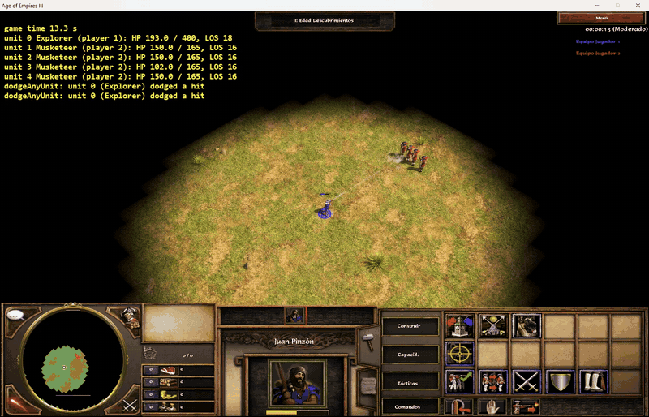

*In game:* An Explorer with AbstractDodge and the YPDodge tech dodges musketeer shots: each `dodged a hit` line is a shot that did no damage. [Full video (MP4)](media/dodgeAnyUnit.mp4).

```
dodgeAnyUnit [<UnitType>] [log]          default AbstractDodge
dodgeSoundSet <UnitType> <SoundSet>      one line per unit type; the first match wins
criticalSoundSet <UnitType> <SoundSet>   one line per unit type; the first match wins
```

- **How stock behaves:** a hit can be dodged (it does no damage) only when the target is a
  Japanese monk: the exe compares the target's proto with `ypMonkJapanese`, `ypMonkJapanese2`
  and `ypMonkJapanese3`. The dodge then needs the tech `YPDodge` to be active for the target's
  player (stock activates it with `ypMonasteryJapaneseCombat`), and happens on 15 % of the hits.
  A dodge shows a floating text and plays the sound set `PowerEvade`; a critical hit (an attack
  with `<HitPercentType>CriticalAttack</HitPercentType>`, e.g. the Chinese monk's) plays
  `PowerCriticalStrike`. Both sound sets are the same for every unit.
- **Effect of `dodgeAnyUnit`:** units whose proto is of `<UnitType>` can dodge too, through the
  same stock code: the `YPDodge` tech of their player, the 15 % roll, the floating text and the
  sound are unchanged. The Japanese monks keep dodging as in stock.
- **Giving units the dodge:** add the marker to their protos, and make `YPDodge` active for the
  players who should have it, from a tech of that civ (for example a starting tech, or a home
  city card):

  ```xml
  <Unit id ='288' name ='Explorer'>
      ...
      <UnitType>AbstractDodge</UnitType>
  ```

  ```xml
  <Effect type ='TechStatus' status ='active'>YPDodge</Effect>
  ```

  The marker is registered by the DLL, like `healNonIdle`'s; edit `protoy.xml` and its XMB as
  described there. An existing type or proto name works too (`dodgeAnyUnit AbstractInfantry`),
  with no data change.
- **Effect of `dodgeSoundSet` / `criticalSoundSet`:** a unit of `<UnitType>` (a unit type, which
  may be a marker, or a proto name) plays `<SoundSet>` instead of the stock set: when it dodges,
  for `dodgeSoundSet`; when it lands a critical hit, for `criticalSoundSet` (the sound belongs to
  the attacker). `<SoundSet>` is the name of a sound set of the game's sound data
  (`soundsetsy.xml` in TAD). A unit that matches no line keeps the stock sound. These two keys
  work with or without `dodgeAnyUnit`.
- **`log`:** writes one line per dodge, and, while `dodgeAnyUnit … log` is set, one line per
  dodge or critical sound with the set it played. Use it to check your data, not in a release:
  a long game writes many lines.
- **Log:** `dodgeAnyUnit: units of unittype X can dodge like ypMonkJapanese (tech ypDodge, 15 %)`
  and one `dodgeSoundSet:` / `criticalSoundSet:` line per rule; when the data loads,
  `unit types: X -> <ID> …`; in a game, `hook reached: dodge test (0x49ACE5)` (the first time a
  unit with a player is hit while the tech tree exists), `hook reached: dodgeSoundSet (0x6A2628)`
  (the first visible dodge) and `hook reached: criticalSoundSet (0x6A2A9A)` (the first critical
  hit). With `log`: `dodgeAnyUnit: unit N (Proto) dodged a hit` and
  `dodgeSoundSet: unit N (Proto) plays sound set S`.
- **Simulation:** `dodgeAnyUnit` yes (a dodged hit does no damage; it also adds a unit type, which
  changes the unit type count). The sound keys no.
- **Status:** confirmed in single player (test bed, 2026-10-28): an Explorer with
  `AbstractDodge`, with `YPDodge` active, dodged 5 of the hits of four musketeers in 30 s of game
  time; a Japanese monk next to it dodged as in stock. The floating text was not checked. With a marker no unit had, the
  Explorer never dodged and the monk still did. `dodgeSoundSet` picked the configured set for the
  Explorer, and `criticalSoundSet ypMonkChinese PowerEvade` for a Chinese monk's critical hits
  (seen in the log; the sound itself was not listened to).

### dodgeChance

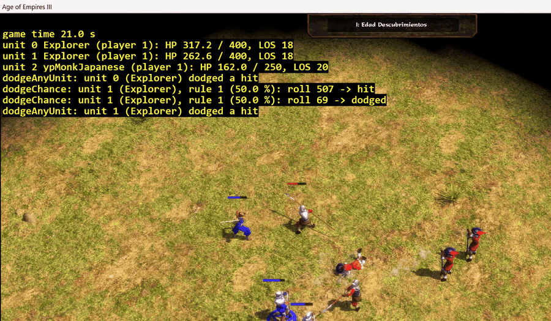

*In game:* `dodgeChance AbstractDodge 50 ranged log` and `dodgeChance AbstractDodge 0 melee`, with `YPDodge` active: two Explorers marked `AbstractDodge` against musketeers and pikemen. Each roll is a log line in the overlay: musket shots are dodged about half the time (`rule 1 (50.0 %): roll 238 -> dodged`, with the stock floating text), pike thrusts never (`rule 2 (0.0 %): roll -1 -> hit`). The Japanese monk, which no rule names, dodges as in stock (2x speed). [Full video (MP4)](media/dodgeChance.mp4).

```
dodgeChance <UnitType> <percent> [tech <TechName> | notech] [ranged | melee | all] [log]
```

One line per rule; several lines add up, and the first rule that matches a hit decides.

- **How stock behaves:** only the three Japanese monks dodge, on 15 % of the hits (15 of the
  101 values of the roll), while their player has `YPDodge` ([dodgeAnyUnit](#dodgeanyunit-dodgesoundset-and-criticalsoundset)).
- **Effect:** each hit on a unit is matched against the rules, in cfg order. A rule matches
  when the unit's proto is of `<UnitType>` (a marker, a stock type or a proto name) and, with
  `ranged` or `melee`, when the hit's damage type is `Ranged` or `Hand` (of `damagetypes.xml`;
  `all`, the default, matches every hit, `Siege` included). The first matching rule decides:
  - its tech must be active for the unit's player: `YPDodge` by default, as stock;
    `tech <TechName>` another tech; `notech` none. Otherwise the hit lands;
  - the hit is then dodged with `<percent>` % chance: 0 to 100, one decimal at most (`12.5`),
    drawn from the game's synced random numbers. 0 % and 100 % draw nothing;
  - a dodge is the stock dodge: no damage, the floating text, the dodge sound
    (`dodgeSoundSet` still picks it).

  A rule's units dodge with or without `dodgeAnyUnit`. A hit that no rule matches keeps the
  other keys' behaviour: a unit with `dodgeAnyUnit`'s marker gets the stock 15 % with
  `YPDodge`, a Japanese monk the stock dodge, any other unit no dodge.
- **Per damage type:** `dodgeChance X 40 ranged` then `dodgeChance X 10 melee` gives 40 % against
  ranged hits and 10 % against melee hits; siege hits match neither and fall back as above.
  `dodgeChance X 0 melee` alone stops marked units from dodging melee hits.
- **Data:** the unit type on the units, as for [dodgeAnyUnit](#dodgeanyunit-dodgesoundset-and-criticalsoundset),
  and the rule's tech active for their players (none with `notech`).
- **`log`** (on any line): once per data load, each rule's resolved tech and damage type; then
  one line per roll: `dodgeChance: unit N (Explorer), rule 1 (50.0 %): roll 238 -> dodged` (the
  roll is 0..999 and dodges below the percent × 10; −1 when nothing is drawn), or `… rule 2: tech
  X not active -> hit`. For checking data: a long game writes many lines.
- **Log:** at startup `dodgeChance: rule K: units of X dodge P % of ranged hits, with tech T
  (multiplayer unverified)`; in a game `hook reached: dodge test (0x49ACE5)`. A tech or damage
  type that does not exist is logged once per data load and disables its rule (the next rules
  still apply): `dodgeChance: rule K (X): no tech named T; rule disabled`. A bad line stops the
  key, and the other dodge keys with it: `dodgeChance: expected "dodgeChance <UnitType> <percent
  0-100> …" (bad percent 150); feature not applied` or `dodgeChance X: unexpected argument …`,
  then `dodgeAnyUnit/dodgeChance/dodgeSoundSet/criticalSoundSet: FAILED`.
- **Simulation:** yes, every player needs the same lines. The rolls use the stream of the game's
  synced random numbers that the stock dodge uses, only for hits that a rule between 0 and 100 %
  matches, the same on every machine. A rule's type that the data does not define adds a unit
  type: load saved games and replays with the same cfg.
- **Status:** confirmed in single player (2026-10-29):
  - 50 % `ranged`: 18 dodges in 46 rolls, then 28 in 50 in a second game; 0 % `melee`: 0 in 57;
  - 30 % `notech`, `YPDodge` not active: 20 in 71;
  - 100 % with `tech HCExplorerFrench`, active: 49 of 49 (the Explorers stayed at full HP); a
    monk rule whose tech was not active: 15 hits, no dodge, no fall back to the stock dodge;
  - an unknown tech: logged, the rule disabled; bad lines (`150`, `12.25`, `-5`, an unknown word,
    no percent, `tech` with no name): logged, the key not applied, the game normal;
  - with `dodgeAnyUnit log` and `dodgeSoundSet`, the dodges of the rules logged `dodged a hit`
    and played the configured set; without `dodgeChance` those keys behaved as before;
  - a skirmish against the AI with these keys on played normally.

  Not tested: multiplayer, siege hits, damage types other than the stock three.
- **New in this DLL:** not in UHC 1.10.
- **New in this DLL:** not in UHC 1.10. WoL request #1 and #1b
  ([wol-requests.md](wol-requests.md)).

### damageOverTime

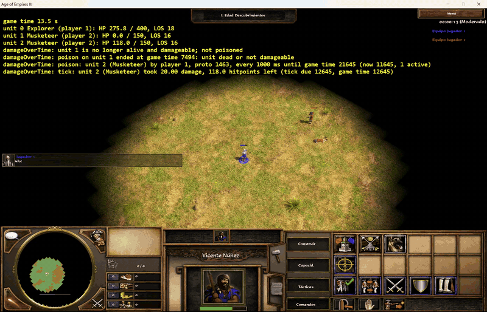

*1. The poison:* The Explorer's attack poisons a musketeer: 20 damage every second (the `tick` lines) until it dies. [Full video (MP4)](media/damageOverTime.mp4).

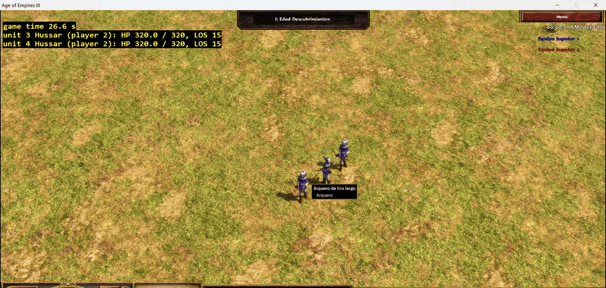

*2. `AttachMaxStacks`, `AttachSnare` and `AttachTickText`:* three Longbowmen whose arrows attach a 5 Siege poison with up to 3 stacks, a snare to half speed and a green tick text. Two Hussars charge them. The three first arrows put three stacks on one Hussar within a fraction of a second, so each tick deals 15 (`x3` in the overlay) and shows a small green `-15` over its health bar; its speed reads 3.38 instead of 6.75. When the archers are down the stacks expire one by one (10, then 5) and the last tick kills it (2x speed). [Full video (MP4)](media/damageOverTime-stacks.mp4).

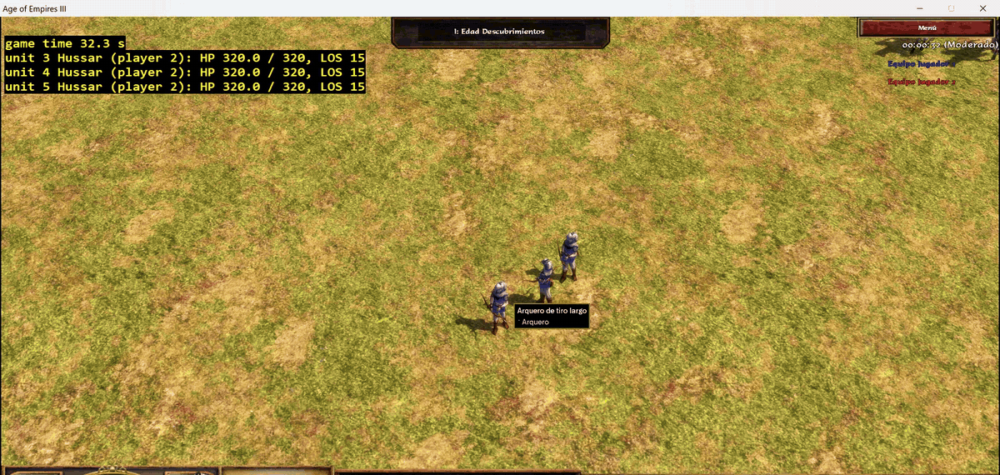

*3. `noticktext`, and the snare in a group:* the same fight with `damageOverTime log noticktext` and `snareOnlyHitUnit log`: three Hussars charge together, the poisoned one takes its 10 and 15-damage ticks with no green number over it, and the overlay shows `snareOnlyHitUnit` treating the poison's slow as a snare (`counts 6.750 instead of 3.375 toward its group's pace`, `lags behind its formation slot`) (2x speed). [Full video (MP4)](media/damageOverTime-noticktext.mp4).

```
damageOverTime [log] [noticktext]
```

- **How stock behaves:** TAD has no damage over time. The exe still contains Age of Mythology's
  poison, but the function that would apply it is empty, so nothing happens.
- **Effect:** an attack whose `<ProtoAction>` lists `<AttachProtoUnit>X</AttachProtoUnit>` poisons
  every unit it damages.
  - For X's `<Lifespan>` seconds, the unit takes the damage of X's `Attaching` action every `ROF`
    seconds. The first tick comes one ROF after the hit.
  - Each tick is a normal hit: the damage type, the damage bonuses, the armor and X's
    `DamageFlags` apply, also after the attacking unit is gone. Kills and XP go to the attacker's
    player. (Bonuses and kill credit follow from the code; see the status below.)
  - Once the attacking unit is gone, the ticks still hurt but no longer cause the reactions to a
    hit, such as retaliation and under-attack alerts.
  - Another hit by the same player renews the duration and keeps the tick timer (with
    `<AttachMaxStacks>`, it adds a stack instead; see below).
  - Poisons from different players, or from different attachment protos, run side by side.
  - It works with every kind of attack tested: hand attacks, instant shots, flying arrows,
    grenades and cannon balls, and area damage (one grenade poisoned all four musketeers it
    hit).
- **Your mod**, three pieces:
  1. **The attacks.** Add the tag inside the attacker's existing `<ProtoAction>` blocks in
     `protoy.xml`:

     ```xml
     <ProtoAction>
         <Name>VolleyRangedAttack</Name>
         ...
         <AttachProtoUnit>PoisonDart</AttachProtoUnit>
     </ProtoAction>
     ```

     - The game reads a `<ProtoAction>` only when its `<Name>` is its first child and names an
       action of the unit's tactics file. It skips any other block without a message, and the
       tag with it.
     - A unit has one attack per stance, and each needs its own tag. Use the `<Name>`s of the
       unit's existing blocks. The Skirmisher, for example, has no `RangedAttack`. Its ranged
       attacks are `VolleyRangedAttack`, `StaggerRangedAttack` and `DefendRangedAttack`, and its
       melee attacks are `VolleyHandAttack`, `StaggerHandAttack`, `DefendHandAttack` and
       `MeleeHandAttack`.
     - The load-time line `<Unit>/<Action> attaches <X>` in `UHC.log` lists every tag the game
       read.

  2. **The attachment proto X**, a new `<Unit>` in `protoy.xml`. It holds data only: it is never
     created in the world.

     ```xml
     <Unit id ='1463' name ='PoisonDart'>
         <DBID>2142</DBID>
         <Lifespan>6.0</Lifespan>
         <Tactics>uhcattachment.tactics</Tactics>
         <ProtoAction>
             <Name>Attaching</Name>
             <Damage>4.0</Damage>
             <DamageType>Ranged</DamageType>
             <ROF>1.0</ROF>
             <DamageFlags>GAIAEnemy</DamageFlags>
             <DamageBonus type ='AbstractInfantry'>1.5</DamageBonus>
         </ProtoAction>
     </Unit>
     ```

     - `id`: unit IDs in `protoy.xml` are numbered in order, so a new unit at the end takes the
       last ID plus one (1463 in stock TAD). `DBID`: any value that no other unit uses (2142 is
       free in stock).
     - `Lifespan` is the duration in seconds and `ROF` the seconds between ticks, so a poison
       deals Lifespan ÷ ROF ticks, rounded down (6 here).
     - `DamageFlags` says whose units the ticks hurt: `GAIA`, `Self`, `Ally` and `Enemy`,
       combined, as in `GAIAEnemy`. Without the tag they hurt everyone. Treasure guardians and
       animals are Gaia. The attack's own `DamageFlags` decide what gets poisoned. A poisoned unit
       that X's flags exclude takes `0.00` damage per tick, for example after a conversion.
     - Techs can change X for the player who researches them. Target X by name: the attacker's
       own upgrades do not reach it. Two effects apply:
       - its `Lifespan` (`subtype ='Lifespan'`), from the next hit;
       - the damage of its `Attaching` action, from the next tick:
         `<Effect type ='Data' action ='Attaching' amount ='1.25' subtype ='Damage'
         relativity ='BasePercent'><Target type ='ProtoUnit'>PoisonDart</Target></Effect>`.

       TAD has no tech effect for ROF, so the tick interval is always the `<ROF>` of the data.
       Techs on X were not tested in game.
  3. **A tactics file for X.** The game ignores a `<ProtoAction>` whose name is not an action in
     the proto's tactics file, so X needs one with an action named `Attaching`. Save
     [examples/data/tactics/uhcattachment.tactics](../examples/data/tactics/uhcattachment.tactics)
     as `data\tactics\uhcattachment.tactics`; one file serves every attachment proto:

     ```xml
     <tactics>
       <action>
         <name>Attaching</name>
         <type>Attack</type>
         <rate type="Unit">1.0</rate>
       </action>
       <tactic>Normal<action priority="100">Attaching</action></tactic>
     </tactics>
     ```

     Keep `<tactic>Normal` and its `<action>` on one line, as here, or ship the compiled
     `uhcattachment.tactics.xmb` next to the file. A line break after the tactic name can break
     every AI player in the game ([tactics files](#tactics-files)).

  After editing `protoy.xml`, make sure the game reads it rather than an older
  `protoy.xml.XMB` ([section 6](#6-editing-the-game-data)).
- **Optional tags**, in the same attacker `<ProtoAction>` as `<AttachProtoUnit>` (each one changes
  only the poisons of that attack; without them the poison is the one above):

  ```xml
  <ProtoAction>
      <Name>VolleyRangedAttack</Name>
      ...
      <AttachProtoUnit>PoisonDart</AttachProtoUnit>
      <AttachMaxStacks>3</AttachMaxStacks>
      <AttachSnare>0.5</AttachSnare>
      <AttachTickText>40FF40</AttachTickText>
  </ProtoAction>
  ```

  - **`<AttachMaxStacks>N</AttachMaxStacks>`** (a whole number from 1 to 100): each hit adds a
    stack, up to N, and a tick deals X's damage times the stacks alive at that moment (the
    damage type, bonuses and armor apply to the whole). **Each stack expires on its own,**
    Lifespan seconds after the hit that made it; a hit at N stacks renews the oldest one. So
    steady hits keep N stacks, and when the hits stop the ticks fall back one stack at a time
    (15, 10, 5 in the tests). N = 1 is the poison without the tag. When attacks with different N
    hit the same unit with the same X, the last hit's N counts.
  - **`<AttachSnare>F</AttachSnare>`** (a number from 0 to 10): while poisoned, a unit that can
    move goes at F times its speed. It is the stock snare of `<TargetSpeedBoost>` (a speed
    modifier that multiplies), with F instead of 0.65; it starts with the poison, is renewed at
    every tick, and ends a quarter of a second after the last tick. Like the stock snare, only
    the first snare counts when several apply, and [`snareOnlyHitUnit`](#snareonlyhitunit) treats
    it as a snare. Buildings are not slowed.
  - **`<AttachTickText>RRGGBB</AttachTickText>`** (a colour in hex; empty for green 40FF40): each
    tick shows the damage it dealt, for example `-15`, over the unit in that colour. It is the
    floating text of the stock dodge, without its rise, and only the player whose screen shows
    the unit sees it. `damageOverTime noticktext` in a player's `uhc.cfg` turns all tick texts
    off for that player; it changes nothing else.

  A value the DLL cannot read is logged and that tag is ignored.
- **Not done:**
  - no model or effect shows the poison, since X never exists in the world (`AttachTickText`
    shows the ticks as text);
  - poisons are not saved in saved games, so a loaded game starts without them (tested);
  - the stock `Poison` flag is not used.
- **`log`** writes every poison, renewal, tick and end to `UHC.log`, and once per attack the
  attacks that deal damage without `<AttachProtoUnit>` (`damage by proto N (Name), action A …:
  no <AttachProtoUnit> there`, at most 200 a session), which tells you the name the game uses for
  an attack. Use it while tuning the numbers; in a long game the log grows quickly.
- **Log:**
  - at startup, `damageOverTime: <AttachProtoUnit> in protoy.xml ProtoActions attaches damage
    over time, with <AttachMaxStacks>, <AttachSnare> and <AttachTickText> (multiplayer
    unverified)` (with `noticktext`, `…; tick texts off on this machine …`);
  - while the data loads, `hook reached: action tag (0x5FA11E)` (the tag hook it shares with
    `spreadAnyAccuracy`) and, for each
    tag, `damageOverTime: <Proto>/<Action> attaches <X>`, `…: up to <N> stacks`, `…: poisoned
    units move at <F> times their speed`, `…: ticks shown in colour <RRGGBB>`, or why a value was
    ignored (`<AttachMaxStacks>…</AttachMaxStacks> is not a whole number from 1 to 100; ignored`,
    and the same for the other two); an attack with the optional tags but no `<AttachProtoUnit>`
    logs `… but no <AttachProtoUnit>; ignored` on its first hit;
  - on the first hit with each tag, `damageOverTime: <X> -> proto <ID>: Lifespan <L> s, Attaching
    every <N> ms`, or the reason it cannot work:
    - `<X> is not a proto unit`: the name in `<AttachProtoUnit>` is not the name of a unit;
    - `<X> has no ProtoAction named Attaching`: the tactics file is missing, or has no action
      named `Attaching`;
  - the first poison and the first tick of a run: `damageOverTime: poison: unit <N> (<proto>) by
    player <P>, proto <X>, stack <S>/<N> …` and `damageOverTime: tick: unit <N> (<proto>) took <D>
    damage (x<stacks>), <H> hitpoints left …`; a tick line ends with `, attacker gone` once the
    attacking unit no longer exists, `, army unit` for a unit of an AI army, and `, speed <V>`
    (the unit's current speed) with `<AttachSnare>`;
  - once each: `… has Lifespan 0.00; unit <N> not poisoned` (set a Lifespan), and
    `unit <N> is no longer alive and damageable; not poisoned` (the hit killed the unit, which is
    normal);
  - with `log`, also `poison renewed` and `poison on unit <N> ended …: expired`, `unit dead or
    not damageable`, or `unit gone`;
  - when you leave a game with poisons still running and start or load another one,
    `damageOverTime: another game started; <N> running poison(s) dropped`, or
    `damageOverTime: the data was reloaded; <N> running poison(s) dropped`. That is normal;
  - `hook reached: damageOverTime TakeDamage (0x49B3D9)` and `hook reached: world update
    (0x481A57)` (the world update wrapper, shared with `overhealDecay`).
- **Check:** hit a unit once and pull back. Its hitpoints keep dropping by one tick every ROF
  seconds. In the tests, poisoned guardians and animals sometimes jumped back to full hitpoints,
  most likely when they went back to their spot. That is stock behavior (not traced), and it can
  hide the poison; the `log` lines show the ticks anyway.
- **Simulation:** yes. Every player needs the same data and the same key; `noticktext` only
  changes what that player sees and may differ.
- **Status:** confirmed in single player, by hand and with the unattended test
  ([developer-guide.md](developer-guide.md#driving-the-game-unattended)). With the Explorer's
  `HandAttack` and `VolleyRangedAttack` attaching a 20-damage, 1-second, 10-second poison:
  - against Musketeers, each tick took exactly 20 hitpoints every 1000 ms of game time;
  - leaving a game with a poison running dropped it when the next game started, a scenario or a
    skirmish (the `another game started` line);
  - lions, macaques and wandering horsemen (Gaia) took 20 damage per tick, 14 against the
    horsemen's ranged armor;
  - each hit renewed the poison, and several units died from the poison alone;
  - the AI's explorer poisoned units too, since the data applies to every player;
  - skirmishes started after a poison game, in the same session, had working AI players;
  - X's tactics file worked as XML alone, without its `.xmb`, in the one-line form above.

  Then, on 2026-10-29, with the data of `tools/dot_testdata.py` (one X per weapon, test maps
  without AI):
  - **area damage and a flying grenade:** one Grenadier grenade poisoned all four musketeers it
    hit (10 Siege per tick each, renewed by the next grenades, three of them died of it);
  - **flying arrows:** a Crossbowman's arrow poisoned a musketeer, 4.80 per tick (6 Hand less its
    20 % hand armor); Longbowman arrows too;
  - **a cannon ball:** a Falconet's shot poisoned the musketeer it did not kill, 15 per tick;
  - **`DamageBonus` on X:** the arrow's X (triple damage against `AbstractCavalry`) dealt 18 per
    tick to a Hussar and 4.80 to a musketeer;
  - **a tech on X:** a tech doubling the damage of X's `Attaching` action, turned on in the
    middle of the poison, took the next ticks from 18 to 36 (Hussar) and from 4.80 to 9.60
    (musketeer);
  - **DamageFlags:** with X set to `Enemy`, a poisoned musketeer converted to the attacker's side
    (trigger `Convert`) took 0.00 per tick from then on, also after the attacker died;
  - **attacker gone:** an Explorer removed (trigger `Destroy`) after its hit: the ticks went on
    (`attacker gone`) and killed the musketeer. A unit that is only killed keeps its ID while its
    body lies there, so the attacker counts as gone only once the body disappears;
  - **kill and XP credit:** that musketeer, killed by a tick after its attacker was removed, gave
    player 1 its 10 XP bounty (the XP rose by 14 in that second, against 4 from the steady XP
    trickle; read in memory, `[player+230h]`, entry 5);
  - **`AttachMaxStacks 3`, `AttachSnare 0.5`, `AttachTickText`:** on a Hussar, the ticks went 5,
    10, 15 as Longbowman arrows added stacks, and back to 10 and 5 as they expired one by one;
    its speed read 3.38 (6.75 × 0.5) while poisoned; the green ticks show in the video above;
  - **AI:** skirmishes (fast speed) between two AI players (Spanish and Portuguese, no teams)
    and the player, with this data plus the `--ai` data (a long poison on their Musketeers,
    Skirmishers, Pikemen and Hussars): in 12 minutes, 49 poisons and 242 ticks between the AIs'
    units; in another 25-minute game with a 120 s poison, 902 ticks after the attacking unit was
    gone; no XS error and no crash, both AIs kept playing;
  - `noticktext`: the startup line says the tick texts are off, and in a filmed fight the
    poisoned Hussar took its 15-damage ticks with no green number over it; noTrainNearEnemyTC's
    warning, which shares the floating text code, still showed in another game with this option;
  - **invalid values** (`dot_testdata.py --bad`): `<AttachMaxStacks>` 0, 101 and `abc`,
    `<AttachSnare>` -1, 20 and `x`, `<AttachTickText>` `GG0000` and `12345` each logged their
    "ignored" line at load; the Musketeer carrying them still poisoned with the defaults
    (`stack 1/1`, no slow, no text); an empty `<AttachTickText></AttachTickText>` took the default
    green; a Skirmisher with `<AttachMaxStacks>` but no `<AttachProtoUnit>` logged `… but no
    <AttachProtoUnit>; ignored` on its first hit and poisoned nothing;
  - **the snare in a group:** three Hussars charging together in formation, with
    [`snareOnlyHitUnit`](#snareonlyhitunit) `log` on: for the poisoned one that key logged `is
    snared; it counts 6.750 instead of 3.375 toward its group's pace` and `lags behind its
    formation slot; its group does not wait for it`, so the poison's slow is a snare for it;
  - **saved games:** a game saved with a poison running (its attacker already removed) and
    loaded at once logged `the data was reloaded; 1 running poison(s) dropped`; the Hussar kept
    its 60.4 hitpoints for the next 25 s instead of dying from the ticks, and the game went on.

  **Not reproduced:** a tick on a unit of an engine army after the attacking unit is gone (the
  p11 = 0 path of [how-it-works](how-it-works.md#damageovertime)). No unit ever carried the army
  flag in the tests (read in memory): not the AIs' military units at minute 26, not units sent by
  the scenario trigger `Army Deploy`, not units a map put in an army with `rmCreateArmy` /
  `rmAddUnitsToArmy`. So the attacker-gone ticks (902 in the AI game) never met that case; the
  guard stays a reading of the code. Multiplayer was not tested either.
- **New in this DLL:** not in UHC 1.10. It is a DE-style poison: the attack names an attachment
  proto that carries the duration and the damage.

### spreadAnyAccuracy

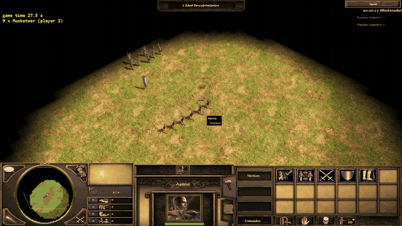

*In game:* six Aenna marked with AbstractSpreadAnyAccuracy (accuracy 1.0 in `archer.tactics`; `MaxSpread` 3, `SpreadFactor` 1.5 and `DamageArea` 2.5 in their `<ProtoAction>`) shoot nine musketeers: every shot is logged as a hit made a ground shot at the offset point, and the arrows land around the musketeers and damage them by area. [Full video (MP4)](media/spreadAnyAccuracy.mp4).

```
spreadAnyAccuracy [<UnitType>] [log]     default AbstractSpreadAnyAccuracy
```

- **How stock behaves:** each ranged shot that is not `InstantBallistics` rolls its `Accuracy` when
  it is fired (the roll also counts the distance, so even accuracy 1.0 misses about 8 % of the shots
  at 16 m). A hit flies to its target and damages it. A miss lands at a random point up to `r` away
  on each axis, with `r = min(0.25 × distance, 5)` for every unit, and **deals no damage at all**,
  not even with `<DamageArea>`. The `<maxspread>` and `<spreadfactor>` lines of the tactics files
  are ignored: the exe has no code for them.
- **Effect:**
  - Every action reads **`<MaxSpread>`** (a number from 0 to 100, in metres) and
    **`<SpreadFactor>`** (a number from 0 to 10), in a tactics file's `<action>` or in a `protoy`
    `<ProtoAction>` (a `<ProtoAction>` overrides the tactics file). Without a tag the stock value
    stays (5 and 0.25).
  - **Every miss** of every unit uses its action's values: `r = min(SpreadFactor × distance,
    MaxSpread)`. The random draws are the stock ones; only `r` changes.
  - **Units of `<UnitType>`** scatter every shot that rolls, whatever the accuracy (1.0 and
    `PerfectAccuracy` included): each shot lands at the offset point as a **ground shot** (what
    grenades and mortars fire) and deals its attack where it lands. With `<DamageArea>` the units
    within that radius of the point take the damage, the target included when it is close enough;
    without `<DamageArea>` the shot hits nothing.
  - Unmarked units keep the stock hits; only their misses change.
- **Your data:**

  ```xml
  <!-- data\tactics\<file>.tactics, in the <action> (keep <name> first) -->
  <maxspread>3</maxspread>
  <spreadfactor>1.5</spreadfactor>
  ```

  ```xml
  <!-- or protoy.xml, per proto -->
  <Unit id ='...' name ='Escopetero'>
      ...
      <UnitType>AbstractSpreadAnyAccuracy</UnitType>
      <ProtoAction>
          <Name>VolleyRangedAttack</Name>
          ...
          <DamageArea>2.000000</DamageArea>
          <DamageFlags>GAIAEnemy</DamageFlags>
          <MaxSpread>3</MaxSpread>
          <SpreadFactor>1.5</SpreadFactor>
      </ProtoAction>
  ```

  Mark only units whose attack has `<DamageArea>`, such as shotguns: a marked attack without area
  does no damage. The marker is registered by the DLL, like `healNonIdle`'s; an existing type or
  proto name works too (`spreadAnyAccuracy Escopetero`).
- **Not covered** (these shots never reach the code; they behave as in stock):
  - actions with `<InstantBallistics>` (sure hits: most muskets) or `<TargetGround>` (grenades,
    mortars). Of WoL's 647 actions with spread tags, 304 and 122; the current shotgun files
    (`wolinfantryrangedescopetero`, `wolinfantryrangedbacamarteer`, the trench fighter's volley)
    are covered;
  - shots at the ground with no target unit, and every shot when the startup cfg does not define
    `ballisticPrecalcHits` (the game's own `Startup\gamey.cfg` defines it; keep that line if your mod
    ships its own startup cfg);
  - `<NumberProjectiles>`: a shot is still one projectile.
- **`log`:** one line per value that differs from the stock 5 / 0.25 (the first 200 per data load),
  and the first 5 offset shots of each attack (at most 100): who shot, a miss or a marked shot, `r`
  and the values used. Invalid values are logged with or without `log`.
- **Log:**
  - at startup, `spreadAnyAccuracy: <MaxSpread> and <SpreadFactor> are read per action (stock 5.0
    and 0.25) and every miss uses them; units of unittype X scatter every precalculated shot
    (multiplayer unverified)` (with `log`: `…; values and shots logged …`);
  - while the data loads, `unit types: X -> <ID> …`, `hook reached: action tag (0x5FA11E)` and,
    for each invalid value, `spreadAnyAccuracy: Musketeer/VolleyRangedAttack (protoy):
    <MaxSpread>abc</MaxSpread> is not a number from 0 to 100; ignored` (or `… before the action's
    <name>; ignored (put <name> first)`); with `log`, `spreadAnyAccuracy:
    Crossbowman/VolleyRangedAttack (tactics): MaxSpread 20.00`;
  - in a game, `hook reached: spreadAnyAccuracy hit roll (0x499890)`, `… miss offset (0x4CEF7B)`
    and `… miss radius (0x4CF00B)`, then at the first miss `spreadAnyAccuracy: 622 action(s) of this
    data carry <MaxSpread> or <SpreadFactor>, 23 of them with values other than the stock 5.0 and
    0.25` (once per data load). With `log`: `spreadAnyAccuracy: shot by unit 20
    (xpAenna/VolleyRangedAttack): marked unit, a hit made a ground shot at the offset point, r =
    3.00 m (SpreadFactor 1.50, MaxSpread 3.00)` or `shot by unit 1 (Crossbowman/VolleyRangedAttack):
    a miss, r = 20.00 m (SpreadFactor 2.00, MaxSpread 20.00)`.
- **Simulation:** yes (where shots land and what they damage; it also adds a unit type, which
  changes the unit type count).
- **Status:** confirmed in single player (test bed, 2026-10-30), in fights of five units against
  musketeers:
  - the values: read from a loose `archer.tactics` (20 / 2) and from `<ProtoAction>` lines, which
    overrode the file (3 / 1.5); invalid values (`abc`, `-1`, `1000`, `2x`, `-3`) logged and ignored;
  - misses: unmarked Crossbowmen missed with `r = 20 m`, unmarked Chu Ko Nu with the stock
    `0.25 × d`;
  - marked units: every shot of Longbowmen with accuracy 1 (and in another run with
    `PerfectAccuracy`) became a ground shot with `r = 3 m`, and the musketeers they shot kept full
    HP (no `DamageArea`); stock Longbowmen won the same fight. Marked Aenna with `DamageArea` 2.5
    killed their musketeers by area hits. A marked unit with `MaxSpread` 0 hit its targets by area
    at the target's point;
  - marked Grenadiers (`TargetGround`) behaved as in stock, never reaching the hooks;
  - without the key, nothing was logged and the Longbowmen hit as in stock; with a bad argument the
    key logged `FAILED` and the game ran;
  - a skirmish against two AIs with the key and `damageOverTime` on played normally (the AI
    gathered, built, chatted), and the data reload at its start read the values again.

  Multiplayer, saved games and a loaded game were not tested; the area damage of the ground shots
  was seen on HP, the landing points only on video.
- **New in this DLL:** not in UHC 1.10. WoL request #2 ([wol-requests.md](wol-requests.md)).

### liveBuildingWorkRate

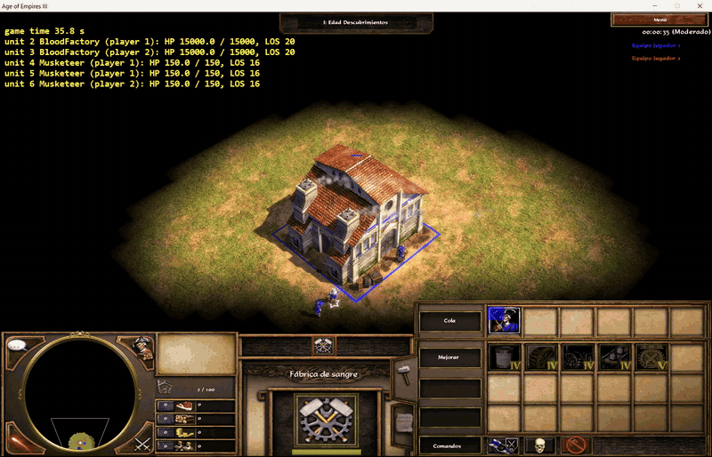

*In game:* Both Blood Factories already stand; a BuildingWorkRate 4 tech for player 1 speeds up its existing factory (musketeer counts, top left; 2x speed). [Full video (MP4)](media/liveBuildingWorkRate.mp4).

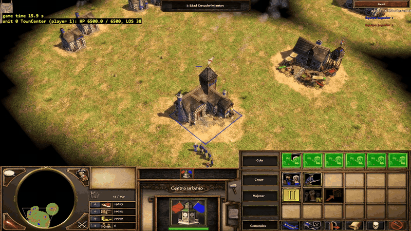

*TrainPoints:* Six settlers were queued at 12 s, with Settler `TrainPoints` 25; a test tech sets them to 6.25 at 30 s. The settler in training finishes at once (it already had more than 6.25 points of work) and the five already queued are trained in 6.25 s each; the log lines are at the top (2x speed). In stock all six would take 25 s. [Full video (MP4)](media/liveBuildingWorkRate-trainpoints.mp4).

```
liveBuildingWorkRate [log]
```

- **How stock behaves:** two kinds of tech change how fast units are trained, and stock applies
  both late (WoL request #5, "workrate techs only affect units / buildings created after the
  tech"):
  - **`BuildingWorkRate`** (`type='Data' subtype='BuildingWorkRate'`, 15 techs in WoL). A
    building's `<BuildingWorkRate>` (1.0 on every stock proto) scales how fast it trains units,
    researches techs and spawns the units of its `Maintain` actions. The exe copies the proto's
    value into the building once, when the building is completed (for a unit with the flag
    `ForceBuildingData`, when it is created), and the train, research and `Maintain` code read that
    copy. The tech changes only the proto. So the buildings completed after the tech get the new
    speed, and the ones already standing keep the old one, although their stat panel shows the new
    value. Loading a saved game copies the value again for completed buildings, so the bug seems to
    vanish after a save and load.
  - **`TrainPoints`** (`type='Data' subtype='TrainPoints'` on the trained unit, 328 techs in WoL).
    Each queued unit (or batch) takes the unit's TrainPoints when it is queued and keeps them. A
    tech therefore misses the unit in training and every unit already in the queue, on old and new
    buildings alike; only the units queued after the tech train faster. A `Maintain` action takes
    them when its cycle starts, so the current cycle keeps the old time.
  - **Already live in stock:** `ResearchPoints` (`type='Data' subtype='ResearchPoints'` on a tech,
    85 techs in WoL). A research reads them on every tick, so the tech reaches every building, even
    a research in progress (in game: one at 17 of 30 points finished at once when the tech set
    7.5). WoL has no `WorkRate` / `WorkRateSpecific` effect with `action='Train'` or `'Research'`.
- **Effect:**
  - every building and `ForceBuildingData` unit trains, researches and spawns at its proto's
    current `BuildingWorkRate`;
  - a unit in training or in a queue, and the current `Maintain` cycle, take the trained unit's
    current `TrainPoints` on every tick. The progress already made is kept in points, as it is for
    research: when the points drop below it, the unit is done at once.

  So both techs apply at once to everything that exists, in both directions (a tech that is
  removed again, a trigger, any later change of the value). Units without building data already
  worked this way for `BuildingWorkRate` in stock.
- **Your mod:** nothing. It works with the techs you have:

  ```xml
  <Effect type ='Data' amount ='2.00' subtype ='BuildingWorkRate' relativity ='BasePercent'>
      <Target type ='ProtoUnit'>Stable</Target></Effect>
  <Effect type ='Data' amount ='0.75' subtype ='TrainPoints' relativity ='BasePercent'>
      <Target type ='ProtoUnit'>Musketeer</Target></Effect>
  ```

- **`YPForceTrainAtBaseTrainPoints`:** a trainer whose proto has this flag (stock: the Confucian
  Academy and Summer Palace wonders) trains at the base proto's TrainPoints, which no tech changes
  (stock rule); the key keeps that rule.
- **Not covered:** the action rates. `type='Data' subtype='WorkRate'` effects (gathering,
  building, healing, …) and `type='Data2' subtype='WorkRateSpecific'` effects are read live by
  stock already (static reading), so they already reach existing units; this key does not change
  them.
- **Transformed buildings:** a building that changes proto in place (a `TransformUnit` tech) now
  works at the new proto's rate; stock kept the old proto's copy. With stock data there is no
  difference, since every stock proto has 1.0.
- **`log`:** one line for each building whose speed this key changes, and for each trainer and
  unit type whose points it changes, the first time and again only if the values change later.
  Use it to check your data, not in a release.
- **Log:** at startup `liveBuildingWorkRate: train, research and Maintain speed follow the
  proto's current BuildingWorkRate, and queued, training and Maintain units their current
  TrainPoints (multiplayer unverified)` (with `log`: `…TrainPoints, every building and unit it
  changes logged (multiplayer unverified)`). In a game, `hook reached: liveBuildingWorkRate
  (0x9BFE33)` the first time any building trains, researches or spawns, `hook reached:
  liveBuildingWorkRate TrainPoints (0x9EA1FA)` the first time a unit trains, and `hook reached:
  liveBuildingWorkRate Maintain TrainPoints (0x9E27E4)` the first time a `Maintain` cycle runs.
  With `log`:
  - `liveBuildingWorkRate: unit N (Proto, player P) works at BuildingWorkRate 4.000, not its
    snapshot 1.000`;
  - `liveBuildingWorkRate: unit N (TownCenter, player 1) trains Settler at TrainPoints 6.250, not
    the 25.000 it was queued with`;
  - `liveBuildingWorkRate: unit N (BloodFactory, player 1) spawns Musketeer at 7.500 points per
    cycle, not the 30.000 its cycle started with`.
- **Limits:**
  - with `log`, a unit is logged once per unit ID (and trained type) and pair of values in a game;
    a new game starts the list again;
  - whether a building under construction can train or research was not checked. If it can, it
    now uses the proto's rate there, where stock used 1.0. `Maintain` never runs on an unfinished
    building;
  - a queued unit that has not started yet keeps the points it was queued with until it starts
    (nothing reads them before), so the queue panel may show its old time until then.
- **Simulation:** yes. Saved games load with or without the key: the building's copy and the
  queued points are kept and saved as in stock (with the key, the values it last wrote).
- **Status:** confirmed in single player.
  - 2026-10-29, `Maintain`: each of two players got a `BloodFactory` (which spawns musketeers
    through a `Maintain` action) at 1 s; at 20 s a test tech gave player 1's `BloodFactory`
    `BuildingWorkRate` 4. At 112 s player 1 had 12 musketeers and player 2 had 3. With the key
    off, both had 3 (the bug).
  - 2026-10-30, train and research. A scenario: player 1's Town Center and Market placed by the
    map, a second Town Center and Market created 5 s after the test tech (30 s); the train and
    research progress read from memory every second.
    - `BuildingWorkRate` 4 on `TownCenter` and `Market`. Key off: the existing Town Center trained
      every settler in 25 s, also those queued after the tech; the new one in 6.25 s; the existing
      Market took 30 s for a research the tech landed in and 20 s for `HuntingDogs` after it, the
      new Market 7.5 s for `Gangsaw` (30 points). Key on: the settler in training sped up at 30 s
      and every later one took 6.25 s; the research in progress finished 3.2 s after the tech, and
      `HuntingDogs` took 5 s.
    - `TrainPoints` ×0.25 on `Settler` and `Musketeer`. Key off: the three settlers queued before
      the tech took 25 s each, though two of them started after it; the settlers queued after it
      took 6.25 s on the old and the new Town Center; the factory's current cycle kept 30 points.
      Key on: the settler in training finished at the tech and the queued ones took 6.25 s; the
      cycle took the new 7.5 points at once. The same with `buildingWorkRateAuras`,
      `noTrainNearEnemyTC` and `maintainWaitForPop` on, and again after loading a game saved
      before the tech.
    - `ResearchPoints` ×0.25: live in stock, with or without the key.
  - An AI skirmish with the key and those three keys on: both AIs trained and built, with no XS
    error.
  - `liveBuildingWorkRate foo`: logged as an unexpected argument, the key not applied.
- **New in this DLL:** not in UHC 1.10. WoL request #5 ([wol-requests.md](wol-requests.md)).

### techPrereqRecheck

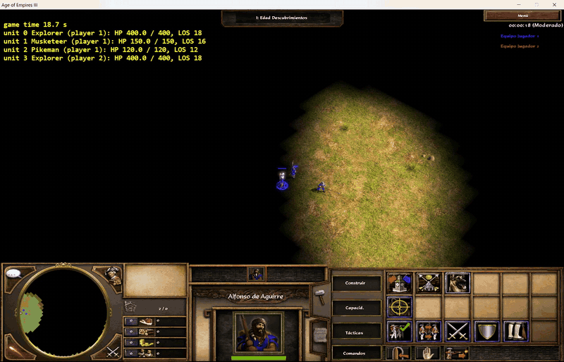

*In game:* A settler appears at 20 s and a musketeer dies at 32 s: the two TypeCount test techs activate at once (Explorer 400 to 200 HP, Pikeman 120 to 60). [Full video (MP4)](media/techPrereqRecheck.mp4).

```
techPrereqRecheck [N] [full] [log]       N: check each player every N world updates (default 1)
```

- **How stock behaves:** the game evaluates a tech's `<Prereqs>` only when the player's tech tree
  is marked for a re-check: when one of the player's techs changes status (researched, activated,
  made obtainable, a shipment), at an age-up, at a home city level-up, and when the player's
  population cap changes (a house is built or destroyed). Creating or killing any other unit never
  does. A `<TypeCount>` prerequisite counts the player's units, so it is noticed late: a tech with
  `<TypeCount unit='Dock' count='1' state='noneState aliveState' operator='gte'/>` waits for the
  player's next house after the first dock is built. Stock data has no `<TypeCount>`; WoL has 12
  in 9 techs.
- **Effect:** on every world update (or every N), for each tech with a `<TypeCount>`
  prerequisite, the DLL evaluates the tech's prerequisites for each player exactly as the stock
  re-check does, and compares the result with the one the game cached. On a difference it starts
  the stock re-check at once. What follows is the stock re-check, the same as after a house:
  - a tech with no research time (`<ResearchPoints>0</ResearchPoints>`) whose prerequisites are now
    met activates;
  - a `Volatile` tech activates or deactivates;
  - the AI's tech list and the UI are updated.

  Techs without `<TypeCount>` are not checked by the DLL, but the stock re-check it starts
  re-evaluates them too.
- **`N`:** each player is checked every N world updates, offset by its player number so the
  players' checks are spread out. A larger N costs less and reacts later.
- **`full`:** for measurements only. It starts the stock re-check of every tech for each player
  every N updates, whether anything changed or not. The stock re-check walks every tech, so use a
  large N (e.g. 60) on a big techtree.
- **Writing `<TypeCount>`** (from the stock XML handler, static reading):
  - all four attributes are required: `unit`, `count`, `operator`, `state`. Without one, the game
    drops the prerequisite with an error;
  - `state` is a list of words. It starts as "any state"; `noneState` clears it, then
    `aliveState`, `deadState` and `buildingState` add those states. A lone `state='aliveState'`
    still means any state: write `state='noneState aliveState'`;
  - `operator` is read as substrings `lt`, `e` and `gt`, so `gte` means "greater or equal";
  - `count` is read as an integer.

  ```xml
  <Tech name ='MyDockBonus' type ='Normal'>
      <DBID>…</DBID>
      <ResearchPoints>0.0000</ResearchPoints>
      <Status>OBTAINABLE</Status>
      <Flag>Shadow</Flag>
      <Prereqs>
          <TypeCount unit ='Dock' count ='1' state ='noneState aliveState' operator ='gte'></TypeCount></Prereqs>
      <Effects>…</Effects>
  </Tech>
  ```
- **`log`:** one line per re-check started, and a summary per game minute (checks, evaluations,
  re-checks started, time spent in the checks). Use it to check your data or measure the cost,
  not in a release.
- **Log:**
  - at startup, `techPrereqRecheck: techs with TypeCount prerequisites are re-checked every N
    world update(s); a change starts the stock re-check (multiplayer unverified)` (with `log`,
    `…; every re-check and a summary every game minute are logged (multiplayer unverified)`; with
    `full`, `techPrereqRecheck: full: the stock re-check of every tech runs every N world
    update(s) for each player (multiplayer unverified)`);
  - in a game, `hook reached: techPrereqRecheck (0x491A18)`;
  - once per data load, `techPrereqRecheck: K tech(s) of T have TypeCount prerequisites (P in
    all)` and one `techPrereqRecheck:   tech <ID> (<Name>), n TypeCount prerequisite(s)` line per
    tech, up to 100. With none: `…; nothing to re-check`;
  - the first re-check is always logged: `techPrereqRecheck: player P, tech <ID> (<Name>):
    prerequisites now met; stock re-check at step S, game time T ms (add log to see every
    re-check)` (or `no longer met`). With `log`, every re-check is, and every game minute
    `techPrereqRecheck: game minute M: … check(s), … evaluation(s), … re-check(s) started, … full
    pass(es) requested, … us in checks`;
  - a bad argument: `techPrereqRecheck: unexpected argument X (expected: [N] [full] [log], N a whole
    number of world updates from 1 to 1000000); feature not applied`.
- **Limits:**
  - the counts are the ones the player's knowledge base keeps, the counts XS `kbUnitCount` reads;
  - only `<TypeCount>` prerequisites are watched; `<Culture>` and `<Civilization>` prerequisites
    after a civilization change are not;
  - a tech that is not relevant to the player yet (unobtainable and not named by its civ's techs)
    has no status entry. Neither stock nor the DLL evaluates it until a status change creates one.
- **Simulation:** yes: techs activate earlier than in stock. Every player needs the same setting,
  N included. The check reads only game state and the world's step count.
- **Status:** confirmed in single player (2026-10-29). Two test techs with `<TypeCount>`
  prerequisites and no research time, one met when the player has a live Settler and one when he
  has no live Musketeer, activated in the same world update as the Settler's creation (20.0 s) and
  the Musketeer's death (32.0 s). With the key off they waited for an unrelated tech change at
  70 s. With these 2 techs, the checks cost about 4 ms per game minute (the `log` summary).
- **New in this DLL:** not in UHC 1.10. WoL request #6 ([wol-requests.md](wol-requests.md)).

### maintainWaitForPop

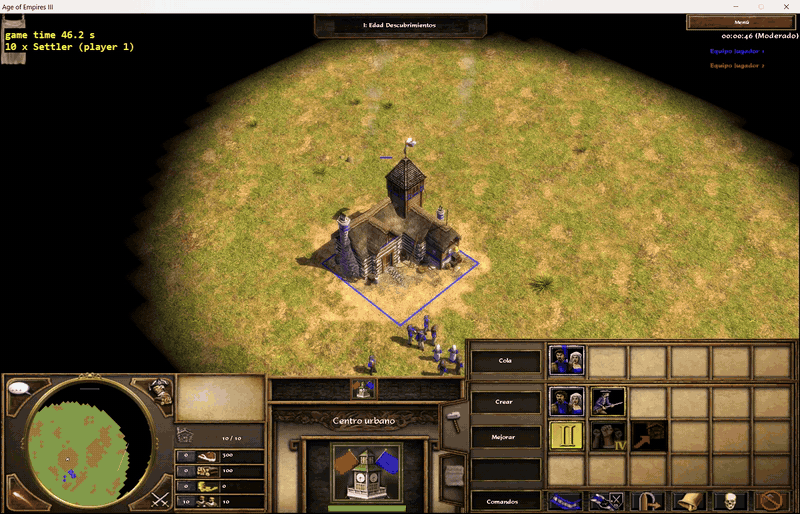

*In game:* An Ottoman Town Center at 10/10 population holds its finished settler and releases it right after two settlers die. [Full video (MP4)](media/maintainWaitForPop.mp4).

```
maintainWaitForPop [<UnitType>] [log]     default AbstractMaintainWaitForPop
```

- **How stock behaves:** some buildings produce units on their own, through a `Maintain` action
  in their tactics file: the factory's `SpawnCannon`, the Ottoman Town Center's settlers, the
  dock's `SpawnBoat`, the native trading posts' warriors, and many more in WoL. The building fills
  a timer: `<rate type="X">n</rate>` gives the unit X and n units per cycle, and the cycle costs
  n × X's `TrainPoints` at the building's work rate. When the timer is full, the game tries to
  spawn the units. A unit that does not fit in the player's population is not created, and the
  game does not check whether anything was spawned:
  - a normal action starts the next cycle from zero, so after a house is built the next unit
    comes a whole cycle later;
  - a `SingleUse` action (dock boats, native warriors) ends, so its units are lost.
- **Effect:** for a building whose proto is of `<UnitType>`, a cycle that ends while the first
  unit does not fit is **held**: the timer stays full and no new cycle starts. The unit spawns on
  the first game update with room (a unit dies, a house is finished, a tech raises the cap). A
  held `SingleUse` action waits instead of ending. Any other building behaves as in stock.
- **"Does not fit"** is exactly the stock test that would have refused the unit: its
  `PopulationCount` against the player's current population and cap, with `AllowOverPopCap` and
  `AlwaysAllowOverPopCap`, and with the cap set by `basePop` / `extraPop`. A unit with no
  population cost is never held. After a revolution, settlers and coureurs are tested as
  `xpColonialMilitia`, as the game spawns them.
- **Which buildings:** the marker goes on the **producing building**, not on the produced unit.
  - The default `AbstractMaintainWaitForPop` is registered by the DLL, like `healNonIdle`'s
    marker; list it on the buildings you want and edit `protoy.xml` and its XMB as described
    there:

    ```xml
    <Unit id ='348' name ='Factory'>
        ...
        <UnitType>AbstractMaintainWaitForPop</UnitType>
    ```

  - An existing type or proto name works with no data change: `maintainWaitForPop Factory` covers
    factories only, `maintainWaitForPop Building` every building.
- **Balance:** this is a gameplay change. With `Building`, a housed Ottoman player gets the next
  free settler as soon as a house is up, instead of a whole cycle later. Mark only the buildings
  you mean.
- **Limits** (stock behavior kept):
  - batches (`<rate>` above 1): a cycle is held only while its **first** unit does not fit. When
    there is room for some but not all, the stock spawn creates what fits and drops the rest;
  - `AbstractMonk` spawns: stock may reuse an existing unit without testing the population, so
    they are never held;
  - a cycle that spawns nothing for another reason (the build limit, no room to place the unit)
    still restarts as in stock.
- **`log`:** one line when a building starts holding a unit and one when it releases it.
- **Log:** at startup `maintainWaitForPop: buildings of unittype X keep a finished Maintain unit
  until there is population room (multiplayer unverified)` (with `log`: `…room, holds and releases
  logged (multiplayer unverified)`); when the data loads, `unit types: X -> <ID> …`; in a game,
  `hook reached: maintainWaitForPop (0x6AB27D)` the first time any `Maintain` cycle ends. With
  `log`: `maintainWaitForPop: unit N (TownCenter) holds a finished Settler (pop 1, 10 of 10 used)`
  and `maintainWaitForPop: unit N (TownCenter) releases its Settler (pop 1, 9 of 10 used)`.
- **Saved games:** a held cycle is saved as a full timer, with no extra data. Loaded without the
  key, it behaves as in stock.
- **Simulation:** yes. It may also add a unit type, which changes the unit type count.
- **Status:** confirmed in single player (2026-10-29), with an Ottoman Town Center (the tech
  `Age0Ottoman` gives it its settler `Maintain` action) at 10 of 10 population. It held its
  finished settler (`holds a finished Settler (pop 1, 10 of 10 used)`) and released it right after
  two settlers died (`releases its Settler (pop 1, 9 of 10 used)`). With the key off, no settler
  came until the next full cycle. Factory cannons, batches and `SingleUse` spawns were not tested.
- **New in this DLL:** not in UHC 1.10. WoL request #8 ([wol-requests.md](wol-requests.md)).

### transformUpdatesLOS

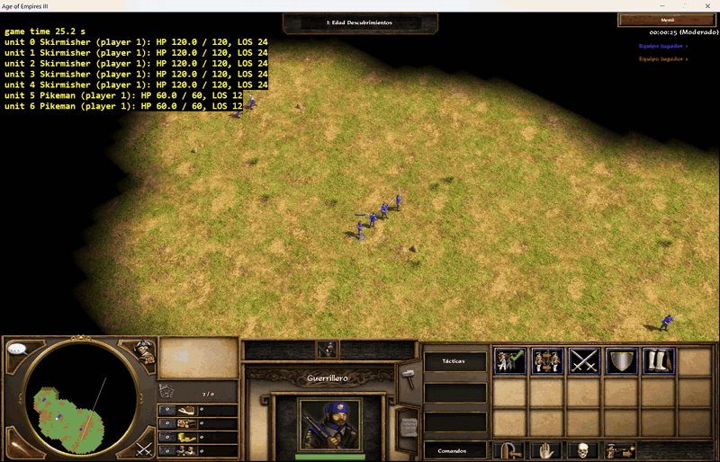

*In game:* Crossbowmen turned into Skirmishers by HCXPTirailleurs take the Skirmisher's LOS 24 (stock: they keep 20). [Full video (MP4)](media/transformUpdatesLOS.mp4).

```
transformUpdatesLOS [log]
```

- **How stock behaves:** each unit has its own line of sight. The game copies it from the proto's
  `<LOS>` when the unit is created, when a building is finished, and when a tech changes that
  proto's LOS. A tech effect `<Effect type ='TransformUnit' fromprotoid ='A' toprotoid ='B'>` and a
  revolution change living units into another proto in place: the unit keeps its ID, HP ratio
  and orders, but also keeps A's LOS. Stock TAD has four such pairs with different LOS values:
  `HCXPTirailleurs` (Crossbowman 20 → Skirmisher 24), `HCXPEveningStar` (xpAxeRider 12 →
  xpRifleRider 15), `YPHCBannerReforms` (ypChuKoNu 20 → ypArquebusier 24) and
  `YPHCSepoyRebellion` (ypSettlerIndian 14 → ypSepoy 16). A revolution turns Settlers (14) into
  xpColonialMilitia (18). The old LOS stays until something resets it, for example a later tech
  that changes B's LOS, so the bug looks random.
- **Effect:** the transformed unit takes the LOS of its player's copy of B, so LOS techs that
  player already has for B count. The fog of war around it and everything else that reads its LOS
  use the new value from the moment it changes.
- **Units that keep their own LOS:** a unit whose LOS is not its old proto's at the moment of the
  transform keeps it. Stock gives some units a LOS of their own on purpose: a foundation under
  construction and a knocked-out hero (6). One case is kept by mistake: a unit converted from
  another player keeps the LOS of its former owner's copy of the proto (stock does not update it
  on conversion), so if the two players' LOS techs for that proto differ, a later transform leaves
  that unit's LOS alone too. With `log` these units show up as `keeps its own LOS`.
- **Not affected (already right in stock):** transforms that replace the unit with a new unit,
  such as walls into gates, and the trigger effect "Change Unit Type" (`trUnitChangeProtoUnit`),
  which takes another path: in game the unit kept its ID and already had the new proto's LOS.
- **Your mod:** nothing. The key covers every in-place transform; there is no per-unit marker.
- **`log`:** one line per unit transformed in place. A tech that transforms many units writes one
  line for each.
- **Log:** at startup `transformUpdatesLOS: units transformed in place (TransformUnit, revolution)
  take their new proto's LOS (multiplayer unverified)` (with `log`: `…LOS, every transform logged
  (multiplayer unverified)`); in a game, `hook reached: transformUpdatesLOS (0x9C763F)` the first
  time a unit is transformed in place. With `log`: `transformUpdatesLOS: unit N (Crossbowman ->
  Skirmisher) LOS 20 -> 24`, or `transformUpdatesLOS: unit N (A -> B) keeps its own LOS 6 (its
  proto's is 18)`.
- **Simulation:** yes: line of sight decides what a player sees and what units can target.
- **Status:** confirmed in single player (2026-10-29). Four Crossbowmen turned into Skirmishers by
  `HCXPTirailleurs` got LOS 24, the Skirmisher's; with the key off they kept 20 (the bug).
  Pikemen turned into Rodeleros logged `12 -> 12`. "Change Unit Type" never reached the hook and
  was already right in stock. Revolutions were not tested.
- **New in this DLL:** not in UHC 1.10. WoL request #10 ([wol-requests.md](wol-requests.md)).

### broadsideMuzzleLimit

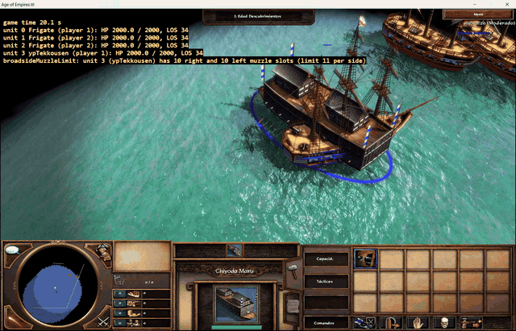

*In game:* The Tekkousen fires from all 10 muzzles per side of its model (stock: 6). [Full video (MP4)](media/broadsideMuzzleLimit.mp4).

```
broadsideMuzzleLimit <N> [<UnitType>] [log]     N from 1 to 255; without a UnitType, every ship
```

- **How stock behaves:** most ships' attacks are `BroadsideAttack` actions in their tactics file:
  the normal ranged attack of the TAD warships (the Tekkousen uses `frigate.tactics`), the action
  of the `PowerBroadside` ability, and the ironclad's long-range shot. When such an action is set
  up, each muzzle of the ship's model gets a firing slot; the muzzles are the model's MuzzleR
  (right) and MuzzleL (left) attach points. The exe keeps at most **6 slots per side**, and only
  **1** when the attack has `<SingleUsePlayer>`. A volley fires one projectile per slot on the side
  that faces the target, so a stock ship fires at most 6 shots per side whatever its model has.
  The Tekkousen's model has 10 muzzles per side, and 4 of them never fire. `<NumberProjectiles>`
  is not read at all in TAD.
- **Effect:** for the matched ships the limit becomes N.
  - The model still decides how many muzzles there are: a model with 5 per side fires 5 whatever N
    is.
  - `SingleUsePlayer` attacks keep 1 per side, and ships that do not match keep 6.
  - N below 6 lowers the limit.
- **Choosing the ships:** `<UnitType>` can be a proto name (`broadsideMuzzleLimit 11
  ypTekkousen`), a stock unit type (`AbstractWarShip`), or a new marker, which the DLL registers
  like `healNonIdle`'s (list it on the ships in `protoy.xml` and its XMB). With no `<UnitType>`,
  every ship gets the limit. The exe only gives muzzle slots to units of the built-in type `Ship`.
- **Which attacks:** every `BroadsideAttack` action of a matched ship, its normal attack as well as
  the ability's. In continuous fire, more slots mean a longer rotation over more muzzles: the rate
  stays about one shot per `ROF`. A single-volley ability (`PowerBroadside`) fires all its slots
  once, so it gains the most. Attacks of type `Attack` never use muzzle slots.
- **Your mod:** a ship model with more than 6 muzzle attach points per side. Two stock quirks stay:
  - the right side drives both schedules: the left side fires at most as many shots as the right
    side has slots, and a model with no MuzzleR point never fires its broadside;
  - each slot waits a random 0.25 to 1.75 × `ROF` after the previous one (sync RNG).
- **When it takes effect:** an action gets its slots when it is set up, which is when it is
  created. A saved game keeps the slot count its actions were saved with.
- **`log`:** one line per action set-up of a matched ship, with the slots it got, at most 500
  lines per run.
- **Log:** at startup `broadsideMuzzleLimit: ships of unittype X use up to N muzzles per side in a
  broadside (stock 6; SingleUsePlayer attacks keep 1) (multiplayer unverified)` (without a type,
  `broadsideMuzzleLimit: every ship uses up to N …`; with `log`, `…keep 1), every set-up logged
  (multiplayer unverified)`); when the data loads, `unit types: X -> <ID> …`; in a game,
  `hook reached: broadsideMuzzleLimit (0x5033D5)` the first time any ship's broadside action is
  set up, and with `log` `hook reached: broadsideMuzzleLimit log (0x5034E2)` and
  `broadsideMuzzleLimit: unit N (ypTekkousen) has 10 right and 10 left muzzle slots (limit 11 per
  side)` (`limit 1` there means a `SingleUsePlayer` attack). Bad arguments: `broadsideMuzzleLimit:
  expected "broadsideMuzzleLimit <N> [UnitType] [log]" with N from 1 to 255, got "X"; feature not
  applied`, and `broadsideMuzzleLimit: N lines, expected one; feature not applied` for a second
  line.
- **Simulation:** yes: more projectiles, and one more sync-RNG draw per extra slot and volley. A
  new marker also adds a unit type.
- **Status:** confirmed in single player (2026-10-29) with `broadsideMuzzleLimit 11 ypTekkousen
  log`: the Tekkousen got `10 right and 10 left muzzle slots` and fired from all of them. The
  `PowerBroadside` ability and `SingleUsePlayer` attacks were not tested.
- **New in this DLL:** not in UHC 1.10. WoL request #15 ([wol-requests.md](wol-requests.md)).
  According to the scoping (not tested), WoL's FloatingBattery and Battleship models have 7
  muzzles per side, and its ironclad long-range attack has `SingleUsePlayer`, so it keeps 1. A
  projectile count set in the data, independent of the model (`numberprojectiles`), is a
  different and larger change; it is not provided.

### abilitySlots

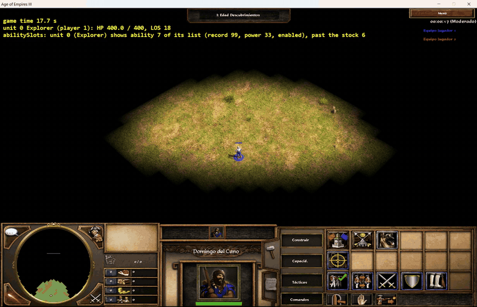

*In game:* The test Explorer's 7th ability gets a button, and its 8th when its tech activates (the first 6 are locked by techs). [Full video (MP4)](media/abilitySlots.mp4).

```
abilitySlots <N> [log]      N from 6 (stock) to 36
```

- **How stock behaves:** a unit's abilities (powers such as Sharpshooter or Crackshot) are listed
  per proto in `data\abilities\abilities.xml`; a proto shows them on the Abilities page of its
  command panel through `<Command page ='11' column ='0'>Abilities</Command>`. The panel asks for
  the first 6 abilities of the unit's list, and only those:
  - an ability whose `<tech>` is not active, or whose `<age>` is not the player's age, gets no
    button, but it still counts as one of the 6;
  - an ability with `<NeverShowInGrid>` does not count;
  - an ability with `<AlwaysDisabledInGrid>` counts and is shown greyed.

  So a 7th ability never gets a button, even when its tech is active and the first 6 are all
  disabled.
- **Effect:** the panel asks for the first N abilities of the list. A unit with 6 abilities or
  fewer looks exactly as before. Enabled abilities past the 6th get buttons; a page with more than
  6 buttons wraps to the next row, as Train and Tech pages already do. The panel still has 6 rows
  of 6 buttons: whatever does not fit is not drawn, as in stock.
- **Your mod:** use N at least the length of the longest ability list in your `abilities.xml`
  (WoL's explorer has 8). A larger N costs a little: each refresh of the panel scans the whole
  ability list once per extra slot.
- **Existing data:** abilities that were silently dropped at position 7 or later now appear. In
  WoL, the 7th ability of `ypMonkJapanese`, `ypMonkJapanese2` and `ypMonkChinese` is an
  `AlwaysDisabledInGrid` aura (scoping, not tested): with the key it shows as a greyed button once
  its tech is active.
- **`log`:** one line per unit and ability the first time the panel shows a button past the 6th
  (once per unit ID and ability record in a game).
- **Log:** at startup `abilitySlots: the command panel asks for N abilities per unit (stock 6)`
  (with `log`: `…(stock 6), every button past the 6th logged once per unit`); without `log` the key
  writes no `hook reached` line, because it only changes one number. With `log`, in a game,
  `hook reached: abilitySlots log (0x696C70)` the first time any selected unit gets an ability
  button, and `abilitySlots: unit N (Explorer) shows ability 7 of its list (record R, power P,
  enabled), past the stock 6`: `record` is the ability's position in `abilities.xml`, counted from
  0 over the whole file; `greyed` instead of `enabled` means an `AlwaysDisabledInGrid` or
  recharging ability. A bad value: `abilitySlots: expected an integer from 6 to 36, then
  optionally log; feature not applied`.
- **Simulation:** no. Only the local command panel changes; a click sends the same
  `ability(record, unit)` command as a stock button. Players may set it differently (static
  reading; not tested in multiplayer).
- **Limits:** the second row of a wrapped Abilities page may have no page label, or a stale one
  (not checked). The wonder power panel is separate: see `wonderPanelSkipAuras`.
- **Status:** confirmed in single player (2026-10-29), in the interface. A test Explorer with 8
  abilities, the first 6 locked by techs: with `abilitySlots 8` the 7th showed a button at once and
  the 8th when its tech was activated; with the key off, no ability button.
- **New in this DLL:** not in UHC 1.10. WoL request #16 ([wol-requests.md](wol-requests.md)).

### wonderPanelSkipAuras

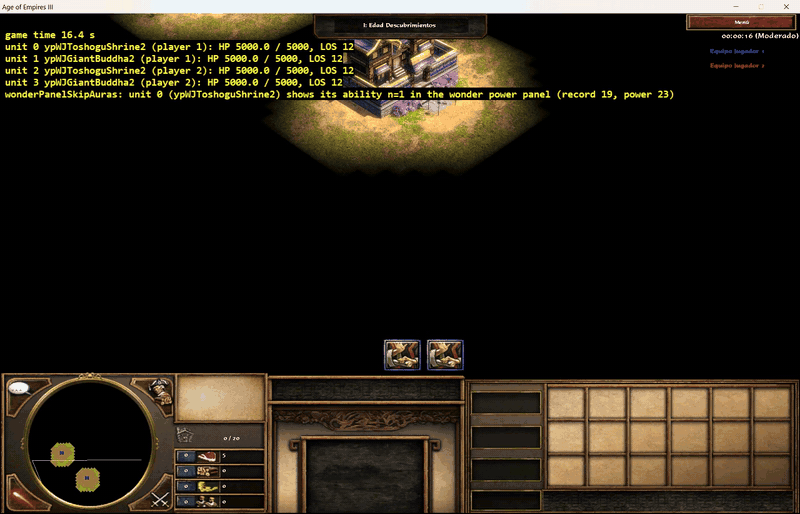

*In game:* The Toshogu Shrine's power, listed after its aura, gets a wonder panel button next to the Giant Buddha's. [Full video (MP4)](media/wonderPanelSkipAuras.mp4).

```
wonderPanelSkipAuras [log]
```

- **How stock behaves:** the Asian wonders' global powers sit in the wonder power panel, a row of
  up to five buttons that is always on screen. For each wonder of the local player with
  `<Command page='11' column='1'>Abilities</Command>`, the panel asks for the wonder's **first**
  ability in `abilities.xml` and nothing else. It adds no button when that ability is
  `<alwaysdisabledingrid>true</alwaysdisabledingrid>`, as every stock passive aura is
  (`ypPowerShrineAura`, …), or is not available yet (its `<tech>` is not active, or its `<age>` is
  not the player's). So a power listed after an aura (for example a power added to the Toshogu
  Shrine) never gets a panel button, although the selected wonder's command panel shows both
  abilities.
- **Effect:** the panel tries the wonder's abilities in file order (up to 8) and shows the first
  one that is available and is not `alwaysdisabledingrid`. A wonder whose first ability already
  qualifies is shown exactly as in stock, so with stock data nothing changes: every stock wonder
  has a single ability. The button does what a command panel button does
  (`ability(<record>, <unit>, true)`).
- **Your data:** the wonder's proto must be an `AbstractWonder` with
  `<Command page='11' column='1'>Abilities</Command>`. In `abilities.xml`, list the power after the
  aura under the proto's lowercase name:

  ```xml
  <ypwjtoshogushrine2>
    <ability>ypPowerShrineAura
      <alwaysdisabledingrid>true</alwaysdisabledingrid>
    </ability>
    <ability>ypPowerInformers<rof>300</rof><castonself>true</castonself></ability>
  </ypwjtoshogushrine2>
  ```

  The stock file is inside `Data3.bar`: extract it with `tools\bar.py`, convert it with
  `xmbedit.py to-xml`, and ship the edited `data\abilities\abilities.xml` with an
  `abilities.xml.xmb` compiled from it ([section 6](#6-editing-the-game-data)). **Every child of a
  proto element must be `<ability>`:** any other tag makes the whole file fail to load, and then no
  unit has abilities (static reading).
- **Limits:** one panel button per `Abilities` command, so a wonder still shows a single global
  power; only `AbstractWonder` units appear in the panel; only the first 8 abilities of a wonder
  are tried.
- **Without the key** (not tested): listing the power *before* the aura, or marking the aura
  `<nevershowingrid>true</nevershowingrid>` (which also hides its icon from the command panel),
  should give the power its panel button in stock.
- **`log`:** one line the first time in a game the panel shows each ability that stock would not
  have shown (an ability past the first).
- **Log:** at startup `wonderPanelSkipAuras: the wonder power panel shows a wonder's first
  available ability that is not a passive aura (AlwaysDisabledInGrid) (UI only)` (with `log`:
  `…(AlwaysDisabledInGrid), each ability it shows past the first logged once (UI only)`); in a
  game, `hook reached: wonderPanelSkipAuras (0x69EE5D)` once the panel looks at a wonder with an
  `Abilities` command. With `log`: `wonderPanelSkipAuras: unit N (Proto) shows its ability n=K in
  the wonder power panel (record R, power P)`, where K counts from 0.
- **Simulation:** no. Only what the panel shows changes; the button sends the same command a
  command panel button sends. Players may set it differently (not tested in multiplayer).
- **Status:** confirmed in single player (2026-10-29), in the interface: with a test ability added
  after the Toshogu Shrine's aura, the panel showed 2 buttons; with the key off, 1.
- **New in this DLL:** not in UHC 1.10. WoL request #20 ([wol-requests.md](wol-requests.md)).

### lifespanAfterConstruction

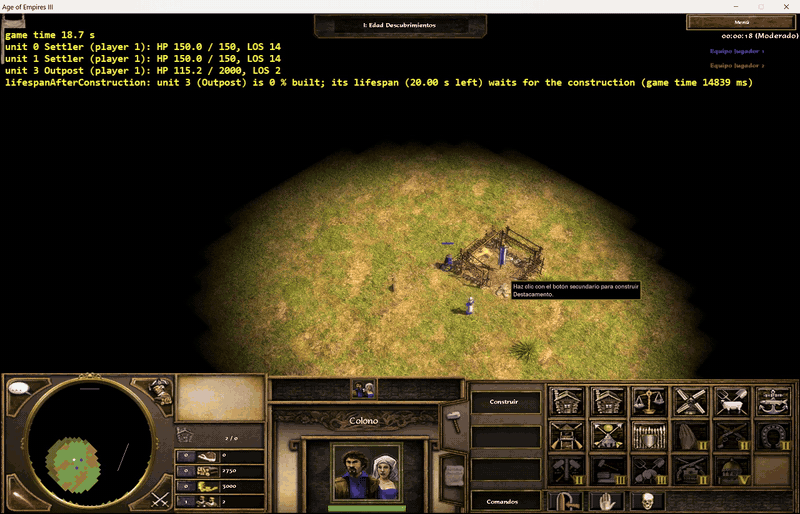

*In game:* An Outpost with a 20 s Lifespan keeps building past 20 s, is finished, then disappears 20 s later (3x speed). [Full video (MP4)](media/lifespanAfterConstruction.mp4).

```
lifespanAfterConstruction [<UnitType>] [log]     default AbstractLifespanAfterConstruction
```

- **How stock behaves:** `<Lifespan>` (seconds) is a countdown that starts when the unit is
  created. A building is created when its foundation is placed, so the countdown runs while the
  building is under construction, and nothing restarts it when the construction ends. A building
  whose Lifespan is shorter than its construction dies as a foundation; any other one lives
  Lifespan minus its construction time once built. With `<Flag>AlphaFadeLifespan</Flag>`, the
  fade-out before the end runs on its own timer from placement too, and its end kills the unit by
  itself. No stock building has a Lifespan; mods such as WoL use it (its `*Maturing` buildings).
- **Effect:** for a unit whose proto is of `<UnitType>`, the countdown and the lifespan fade-out do
  not advance while the unit is not fully built. When the construction is finished, both run from
  their full values as in stock: the building lives `Lifespan` seconds after it is finished. Any
  other unit, and every unit that is already built, behaves as in stock.
- **Marking the buildings:** the protos also need a `<Lifespan>`:

  ```xml
  <Unit id ='293' name ='House'>
      ...
      <Lifespan>20</Lifespan>
      <UnitType>AbstractLifespanAfterConstruction</UnitType>
  ```

  The marker is registered by the DLL, like `healNonIdle`'s; edit `protoy.xml` and its XMB as
  described there. An existing type or proto name works too, with no data change:
  `lifespanAfterConstruction Outpost` covers outposts only, `lifespanAfterConstruction Building`
  every building.
- **"Built"** means the unit has no construction data, or its build percent is at least 100 %.
  Units that are not buildings (projectiles, rubble, …) are always built, so a marker on them
  changes nothing.
- **Destroyed or deleted foundations** are never held: once the unit is dying, its corpse fades
  and is removed as in stock.
- **A Lifespan set during construction** (a tech with a `Lifespan` data effect, or a trigger) also
  waits for the construction.
- **`log`:** one line the first time each unit's countdown is held, one when its fade-out is held,
  and one when its countdown runs again, with the reason and the seconds left.
- **Log:** at startup `lifespanAfterConstruction: units of unittype X keep their Lifespan and its
  fade-out until their construction is finished (multiplayer unverified)` (with `log`:
  `…finished, every hold and start logged (multiplayer unverified)`); when the data loads,
  `unit types: X -> <ID> …`; in a game, `hook reached: lifespanAfterConstruction fade (0x482A1A)`
  (the first step of any game) and `hook reached: lifespanAfterConstruction (0x483EEC)` (the first
  time any unit with a Lifespan counts down, e.g. a cannonball). With `log`:
  - `lifespanAfterConstruction: unit N (Proto) is P % built; its lifespan (S s left) waits for the
    construction (game time T ms)`;
  - `lifespanAfterConstruction: unit N (Proto) is P % built; its fade-out (due in S s, D s long)
    waits for the construction (game time T ms)`;
  - `lifespanAfterConstruction: unit N (Proto) is built; its lifespan starts with S s left (game
    time T ms)`, or, instead of `is built; its lifespan starts`: `is dying; its lifespan runs as in
    stock`, `lost the marker unittype; its lifespan runs` or `is no longer held; its lifespan runs`.
- **Limits:**
  - `FadeInOnCreation` together with `AlphaFadeLifespan` (a stock limitation): the creation
    fade-in reuses the lifespan fade's timer, so in stock such a unit dies right after its fade-in.
    With this key a marked building with both flags dies when its construction ends. Do not
    combine the two flags on a marked building;
  - the hold lasts while the unit is not fully built: if a building's percent dropped below 100 %
    again, its countdown would stop again.
- **Simulation:** yes. It may also add a unit type, which changes the unit type count.
- **Status:** confirmed in single player (2026-10-29), with `lifespanAfterConstruction Outpost log`
  and test data (Outpost `Lifespan` 20, 50 build points, `PlaceAsFoundation`). An Outpost placed by
  a settler at 19.5 s was held through its construction, finished at 70.5 s (`its lifespan starts
  with 20.00 s left`) and died at about 90 s. In the control, an unmarked Outpost died at 20 s,
  still under construction (the bug). The `AlphaFadeLifespan` fade-out hold was not checked in
  game. To test it yourself, place the foundation in game: a building placed by a scenario is
  complete once the scenario is loaded.
- **New in this DLL:** not in UHC 1.10. WoL request #7 ([wol-requests.md](wol-requests.md)).

### gaiaSocketsOnly

```
gaiaSocketsOnly [<UnitType>] [log]       no unit type: every socket follows the rule
```

- **How stock behaves:** a building with `<SocketUnitType>` (stock: `TradingPost`,
  `ypTradingPostAsian`) must stand exactly on a socket unit of that type. Only the placement
  preview checks the socket's owner: the building snaps onto a socket only if Gaia owns it, so a
  socket a player owns shows red. The check that decides (run when the order executes, on every
  machine, and before it by the UI and the AI) never reads the owner. According to the static
  reading, an order that carries the socket's exact position (an AI build plan) therefore builds
  on a player's socket; WoL reports this with its saltpeter sockets. Stock data never shows it,
  because every stock socket has the flag `ForceToGaia` (it is created for Gaia).
- **Effect:** when a socketed building is placed, a socket that a player owns no longer counts.
  The order fails as if there were no socket. The rule also covers the socket's owner himself, as
  the stock preview does. Gaia sockets behave as in stock, and so does the preview.
- **`<UnitType>`:** only sockets whose proto is of that type (or that proto name) follow the rule;
  every other socket keeps the stock behavior. Use it to apply the rule to your own sockets only,
  for example a marker on the saltpeter socket:

  ```xml
  <Unit id ='…' name ='SaltpeterSocket'>
      ...
      <UnitType>AbstractGaiaOnlySocket</UnitType>
  ```

  The marker is registered by the DLL, like `healNonIdle`'s; edit `protoy.xml` and its XMB as
  described there. Without a unit type, in stock data the rule only matters for
  `ypTradingPostCapture` and `AIStart`, the two socket-typed protos without `ForceToGaia`.
- **Not covered:** placement that skips this check or runs it without a player's knowledge: the
  scenario editor, units created by triggers or random map scripts, and the in-place
  transformation of a unit into a socketed building.
- **AI:** an AI build plan that is given a socket takes the first socket of the right type,
  whatever its owner, and then fails its placement check on a refused one. An AI script that
  hands a build plan a socket should pick one that Gaia owns.
- **`log`:** one line per refused order, once per socket, owner, player and building in a game
  (at most 1000 per game): an AI build plan that picked a refused socket may retry on every
  update.
- **Log:** at startup `gaiaSocketsOnly: socketed buildings take only sockets owned by Gaia
  (multiplayer unverified)` or, with a unit type, `gaiaSocketsOnly: sockets of unittype X take a
  socketed building only while Gaia owns them (multiplayer unverified)` (`, refusals logged`
  before the parenthesis with `log`); with a unit type, when the data loads,
  `unit types: X -> <ID> …`; in a game, `hook reached: gaiaSocketsOnly (0x508CC1)` the first time
  a socketed building is checked exactly on a socket (any owner). With `log`:
  `gaiaSocketsOnly: refused TradingPost for player 1 on socket N (Proto), owned by player 2`.
- **Simulation:** yes. With a new marker it also adds a unit type.
- **Status:** implemented, not tested in game. In the test (2026-10-29) the stock interface itself
  refused a Trading Post on a player-owned socket: no foundation, and the message that it must be
  built near a native settlement or trade route. Scenario triggers cannot give build orders, so
  the order path that bypasses that check, WoL's case, was not driven. The code was reviewed
  adversarially and no defect was found.
- **New in this DLL:** not in UHC 1.10. WoL request #9 ([wol-requests.md](wol-requests.md)).

### customHotkeyContexts

```
customHotkeyContexts [log]
```

- **How stock behaves:** every hotkey in `DefaultKeyMapY.xml` belongs to a `<context>`, e.g.
  `BarracksAccel` for the keys that train units while a Barracks is selected. The exe knows a
  fixed list of 123 context names (35 of them are unit contexts, `TownCenterAccel` …
  `WonderAccel`) and silently drops every `<keymapdata>` whose context is not on that list. Which
  context a selected unit turns on is also fixed in the exe: a table of about 40 stock protos (for
  example `ypCaravanserai` → `StableAccel`), plus shrines and wonders by unit type. A mod's new
  building gets no context, so its hotkeys do nothing even when the keymap lists them. A selected
  unit that is not a building but has a `<Train>` list only ever gets `BuildAccel`.
- **Effect:** a `<context>` named `<ProtoName>Accel` that the exe does not know is registered when
  the game reads the keymap, so its entries are kept. `<ProtoName>` is the `name` of a `<Unit>` in
  `protoy.xml` (case does not matter). While a unit of that proto is selected, that context is on,
  **instead of** the proto's stock context, if it had one. Selecting anything else switches it off,
  as stock does with its own. Contexts the exe already knows are never redirected, so with the
  stock keymap nothing changes.
- **Which units use it:** only units that enter a hotkey context at all:
  - a building with a `<Train>` list;
  - any other unit with a `<Train>` list (a wagon, a settler), which then enters its own context
    instead of `BuildAccel`;
  - a fire pit (`AbstractFirePit`);
  - a unit whose proto has the flag `EnterHotkeyContext`.

  Other units (a soldier, a hero) never enter a context, so theirs stays off although it is
  registered: give them the flag `EnterHotkeyContext`.
- **Your mod:** add the contexts to `data\DefaultKeyMapY.xml` (a loose file there replaces the
  archive copy; that worked in the test). WoL's file already uses this naming for its new
  contexts:

  ```xml
  <keymapgroup name="Forge Hotkeys" displayname="Forge Hotkeys">
    <keymapdata>
      <name>Train AqUyli</name>
      <displayname>Train AqUyli</displayname>
      <event>o</event>
      <context>ForgeAccel</context>
      <command>tis("AqUyli")</command>
    </keymapdata>
  </keymapgroup>
  ```

  An added context replaces the stock one, so copy into it every stock key the unit should keep.
  For a trainer that is not a building, copy the `BuildAccel` keys it needs.
- **`log`:** one line each time the selection turns an added context on (repeats of the same unit
  and context are not logged again in a game), and once per proto when a unit that is not a
  building enters its context.
- **Log:**
  - at startup, `customHotkeyContexts: a keymap context named <ProtoName>Accel that the game does
    not know becomes that proto's hotkey context` (`, every switch logged` with `log`);
  - when the keymap is read, `hook reached: customHotkeyContexts (0x5C1778)` and one line per added
    context: `customHotkeyContexts: registered keymap context ForgeAccel as context 151`;
  - on the first selection, `hook reached: customHotkeyContexts (0x79F1A5)` and `… (0x79F897)`; on
    the first selected trainer that is not a building, `… (0x64A034)`;
  - with `log`: `customHotkeyContexts: unit N (Forge) selected: hotkey context ForgeAccel (151)
    instead of stock context -1` (-1: the proto had none) and `customHotkeyContexts: unit N
    (ForgeCaravan) is not a building: units of this proto enter hotkey context ForgeCaravanAccel
    (152) instead of BuildAccel (logged once per proto)`;
  - when the context table is too full: `customHotkeyContexts: N contexts are registered; keymap
    context X not registered, its entries are dropped (the last 32 of the 255 context IDs stay free
    for the game)`.
- **Limits:**
  - at most 255 contexts in all; the DLL stops adding at ID 222 to leave the game room. In the
    test the game had registered 151 contexts before the keymap, so about 70 can be added;
  - names the exe already knows (`SettlerAccel`, `CoveredWagonAccel`, …) stay as in stock;
  - a context is on only for the last unit of the selection, as in stock;
  - the hotkey letter on train-button tooltips comes from a fixed list of stock contexts, so keys
    of an added context are not shown there (static reading).
- **Simulation:** no. A hotkey issues the same command as clicking the button, so players may set
  the key differently. Not tested in multiplayer.
- **Status:** partly confirmed in single player (2026-10-29). With a loose keymap holding the test
  contexts `ypSacredFieldAccel`, `ypCaravanseraiAccel` and `ypMarketWagonAccel`, the three were
  registered (IDs 151 to 153), and selecting each unit switched to its context, per the log: the
  Sacred Field (no stock context), the Caravanserai (instead of stock context 72, `StableAccel`)
  and the market wagon, not a building (instead of `BuildAccel`). The key press itself was not
  tested: synthetic key presses do not reach the game's hotkeys.
- **New in this DLL:** not in UHC 1.10. WoL request #12 ([wol-requests.md](wol-requests.md)).

### snareOnlyHitUnit

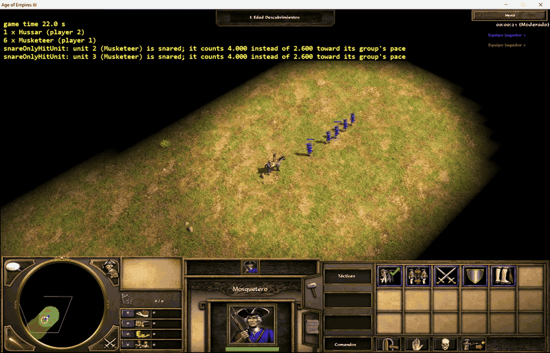

*In game:* A hussar snares musketeers of a marching group; the group keeps its pace (the camera follows the group). [Full video (MP4)](media/snareOnlyHitUnit.mp4).

```
snareOnlyHitUnit [log]
```

- **How stock behaves:** an attack whose tactics action has
  `<TargetSpeedBoost>1</TargetSpeedBoost>` snares its target: the target's speed is multiplied by
  0.65 for 3 seconds. Stock TAD gives it to most melee attacks; WoL uses it on many more. A unit
  that moves in a group (several units ordered together) does not use its own speed: the group
  moves at the speed of its slowest member. One snared unit therefore slows its whole group to
  0.65× for 3 s.
- **Effect:** the group's pace ignores the snare: a snared member counts with the speed it would
  have without it (other speed modifiers, such as auras, still count). While the snare lasts, the
  snared member also no longer makes the group wait when it falls behind its place in the
  formation. Only the hit unit slows down.
- **After the snare:** the stock rule for stragglers applies again. If the unit is then more than
  2 m behind its place, the group moves at 0.83× its speed until the unit is back, as for a unit
  that got stuck. A unit snared again and again keeps falling behind while the group goes on.
- **Your mod:** nothing. Every `<TargetSpeedBoost>` attack is covered, and only those: the
  attacker's own `<SpeedBoost>`, speed auras and techs keep their stock effect on the group.
- **`log`:** one line per snare and unit when the snare is left out of the group's pace, and one
  when the snared unit falls behind without making the group wait.
- **Log:** at startup `snareOnlyHitUnit: a snared unit (TargetSpeedBoost) no longer slows its
  group; the group neither paces at nor waits for it while the snare lasts (multiplayer
  unverified)` (with `log`: `…lasts, every snared member logged (multiplayer unverified)`); in a
  game, `hook reached: snareOnlyHitUnit (0x4FD3FD)` (the first time any group recomputes its
  speed), and `(0x4FA17D)`, `(0x6AA514)` or `(0x6AA56A)` the first time a member falls more than
  2 m behind its place. With `log`: `snareOnlyHitUnit: unit N (Musketeer) is snared; it counts
  4.000 instead of 2.600 toward its group's pace` and `snareOnlyHitUnit: unit N (Musketeer) is
  snared and lags behind its formation slot; its group does not wait for it (0x4FA17D)`.
- **Limits:** a unit that is not in a group already slowed alone in stock. A snare is exclusive in
  stock: while a unit is snared, its later speed modifiers are ignored and several snares do not
  stack; the key keeps that. The value and duration (0.65, 3 s) stay as in stock.
- **Simulation:** yes.
- **Status:** confirmed from the log in single player (2026-10-29), with no stock control run: a
  hussar snaring members of a group of 6 musketeers produced `is snared; it counts 4.000 instead of
  2.600 toward its group's pace` and `lags behind its formation slot; its group does not wait for
  it`, with the feature's `hook reached` lines. The group's positions were not measured against
  stock.
- **New in this DLL:** not in UHC 1.10. WoL request #13 ([wol-requests.md](wol-requests.md)).

### techRenameEffect

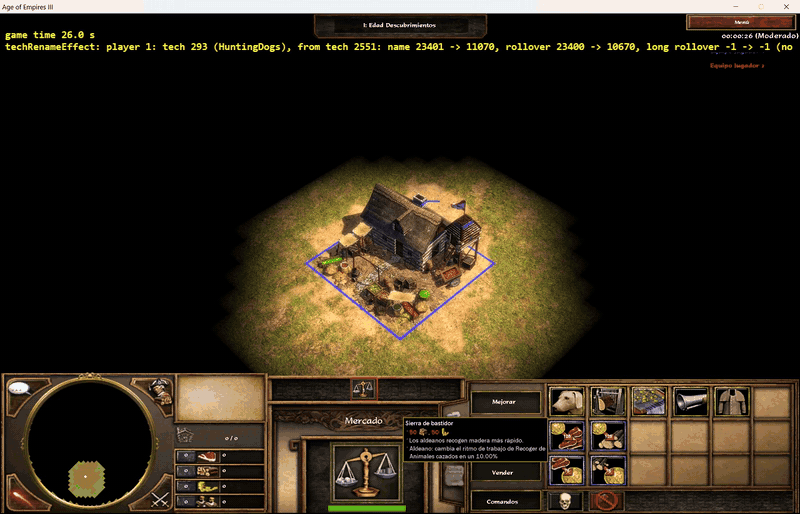

*In game:* Player 1's Hunting Dogs shows Gangsaw's name and text; its effect is still Hunting Dogs'. [Full video (MP4)](media/techRenameEffect.mp4).

```
techRenameEffect [log]
enableTechRenameEffect [log]     the same key under WoL's name
```

- **How stock behaves:** no tech effect changes a tech's texts; the stock `SetName` effect renames
  a *unit* for one player. WoL's `uhc.dll` adds a `SetTechName` effect (`enableTechRenameEffect`),
  but it writes the new string IDs into the database's copy of the tech, which all players share:
  when one civ's tech renames a tech, every player sees the new name.
- **Effect:** adds the tech effect `SetTechName`. When a tech that carries it becomes active for a
  player, the named tech shows the new name, rollover and help text **for that player only**. If
  the carrier is a team tech, every member of the team gets the rename. Costs, prerequisites,
  effects, icon and research stay as before.
- **Data:** put the effect in the `<Effects>` of any tech:

  ```xml
  <Effect type='SetTechName' tech='HuntingDogs' newName='11070' newRolloverTextID='10670'/>
  ```

  | Attribute | Meaning |
  |---|---|
  | `tech` | Required. The name of the tech to rename. |
  | `newName` | New `DisplayNameID` (the button and message name). |
  | `newRolloverTextID` | New `RolloverTextID` (the button's rollover). |
  | `newLongRolloverTextID` | New `LongRolloverTextID` (the long help text). WoL's effect has no such attribute. |

  The three string IDs are optional, but at least one must be given; leave one out, or write
  `-1`, to keep that text. The IDs come from your string table (`stringtabley.xml`). The
  attributes are WoL's, so WoL's data works unchanged. "Per civ" means placing the effect in a
  tech that only that civ gets, such as its `Age0<Civ>` shadow tech or a home city card's tech.
- **Where the new texts show:** wherever the game reads the tech through the player's own tech
  tree: the buttons and rollovers of that player's buildings and the "researching" /
  "researched" messages. From the code, these keep the stock texts: the in-game help (F1), the home
  city screens and every screen outside a game. Other players and observers see the stock texts.
- **When:** from the moment the carrier tech becomes active. A saved game re-applies the rename
  when it loads (static reading; not tested). Nothing undoes a rename: a carrier that is
  deactivated later leaves the new texts, as the stock `SetName` does. Two carriers that rename
  the same tech for one player: the last one applied wins, text by text.
- **Without the key** the game does not know `SetTechName`: it drops each such effect with its own
  error and loads the rest of the techtree.
- **`log`:** one line per `SetTechName` read from the data and one per rename.
- **Log:** at startup `techRenameEffect: the tech effect SetTechName (tech, newName,
  newRolloverTextID, newLongRolloverTextID) renames a tech for the players it reaches (multiplayer
  unverified)` (the line starts with `enableTechRenameEffect:` under WoL's key name; with `log`,
  `…reaches, every rename logged (multiplayer unverified)`), then
  `techRenameEffect/enableTechRenameEffect: applied`; at data load `hook reached: techRenameEffect
  register (0x524CB5)`, `techRenameEffect: effect type SetTechName -> 17` and, at the first effect
  read, `hook reached: techRenameEffect factory (0x62146F)`. Data errors are always logged, and
  the effect is dropped while the rest of the file loads:
  - `techRenameEffect: SetTechName: unknown tech 'X'; this effect is dropped`;
  - `techRenameEffect: SetTechName without tech='...'; this effect is dropped`;
  - `techRenameEffect: SetTechName on X: newName='abc' is not a string ID (a number from 0, or -1 to
    keep the text); this effect is dropped`;
  - `techRenameEffect: SetTechName on X sets none of newName, newRolloverTextID,
    newLongRolloverTextID; this effect is dropped`.

  With `log`: `techRenameEffect: read SetTechName on X (tech N): newName …` per effect read, and
  `techRenameEffect: player P: tech N (X), from tech M: name a -> b, rollover c -> d, long rollover
  e -> f (node …, NodeData … -> copy …)` per rename.
- **Simulation:** no gameplay change: only string IDs differ. The effect does run inside the
  simulation (tech activation), so give every player the same setting; multiplayer is not tested.
- **Status:** confirmed in single player (2026-10-29). A test tech for player 1 carried
  `SetTechName tech='HuntingDogs' newName='11070'` (Gang Saw's name) and `newRolloverTextID='10670'`.
  Player 1's Market showed Hunting Dogs as "Sierra de bastidor" (Gang Saw in the Spanish game) with
  Gang Saw's rollover. In memory, the database's tech data, which other players see, kept 23401 /
  23400, and only player 1's copy had 11070 / 10670. A second effect naming an unknown tech was
  logged and dropped, and the techtree still loaded. Saved games were not tested.
- **New in this DLL:** not in UHC 1.10. WoL request #17 ([wol-requests.md](wol-requests.md)).

### noCorpseDopples

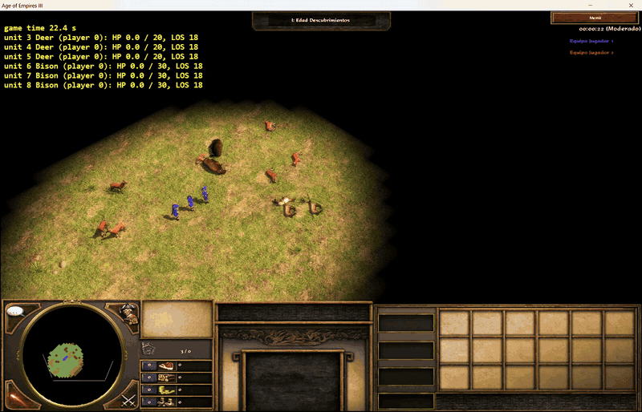

*In game:* Dead deer leave no frozen copy in the fog of war; the unmarked bison do (1.5x speed). [Full video (MP4)](media/noCorpseDopples.mp4).

```
noCorpseDopples [<UnitType>] [log]      default AbstractNoCorpseDopple
```

- **How stock behaves:** a *dopple* is the copy of a unit that a player keeps seeing in the fog of
  war after the unit left his view. Only protos with `<Flag>Doppled</Flag>` get one (stock:
  buildings, mines, trees, …). The game makes it when the unit leaves the player's view, for him
  and for the players who share his vision, and removes it only when the player sees the unit or
  the spot again. It never asks whether the unit is alive. Stock hunts use
  `VisibleUnderFogOnlyAfterSeen` instead. A mod that makes its hunts `Doppled`, so that a herd
  stays where it was last seen (WoL does this for most of its hunts), also gets corpse dopples: a
  carcass that still holds food when it leaves a player's view stays in his fog in its death pose,
  long after it was eaten or abandoned, until he looks at the spot again.
- **Effect:** a unit whose proto is of `<UnitType>` and that is not alive (0 hitpoints, killed)
  gets no dopple when it leaves a player's view, for any player: it simply disappears into the
  fog. A live unit of that type is still doppled. A carcass that is fully gathered was never
  doppled: the game takes it out of the world before it decays.
- **Choosing the units:** `noCorpseDopples Huntable` covers every hunt with no data change
  (`Huntable` is a built-in type). A proto name works too (`noCorpseDopples Deer`). With the
  default marker, or any new name, add it to the protos and edit `protoy.xml` and its XMB as for
  `healNonIdle`. Units without `<Flag>Doppled</Flag>` have no dopples anyway.
- **Do not mark livestock** or other `DoppleOnlyWhenDead` protos: that flag exists to leave a
  corpse dopple, and the key removes it.
- **`log`:** one line per dopple it skips, up to 1000 lines per session.
- **Log:** at startup `noCorpseDopples: dead units of unittype X leave no dopple in the fog of war
  (multiplayer unverified)` (with `log`: `…of war, every skipped dopple logged (multiplayer
  unverified)`); when the data loads, `unit types: X -> <ID> …` (`already defined` for `Huntable`
  or a proto name); in a game, `hook reached: noCorpseDopples (0x49534D)` the first time any
  doppled unit (a building, a tree, …) leaves a player's view. With `log`: `noCorpseDopples: unit N
  (Deer, hp 0.0) left player 1's view dead; no dopple`.
- **Limits:**
  - the dopple of a **live** animal that is then killed and eaten out of the player's sight still
    shows the live animal until he looks at the spot again. Removing dopples when a unit leaves
    the world would fix that; it is not implemented;
  - a saved game made without the key keeps the corpse dopples it already had;
  - `MutateDopples` protos (none in stock or WoL data) refresh their dopples through another path
    that the key does not cover.
- **Simulation:** probably not, but unverified. Dopples belong to the game state, which every
  machine keeps the same way; the key only reads that state (unit types, hitpoints). Give every
  player the same setting. With a new marker it also adds a unit type.
- **Status:** confirmed in single player (2026-10-29), with `noCorpseDopples Deer log` and Deer and
  Bison given `<Flag>Doppled</Flag>` in the test data: after leaving them, player 1 kept 6 dopples
  (3 dead Bison, 3 live Deer) and none for the 3 dead Deer. With the key off, 9 (the 3 dead Deer
  too).
- **New in this DLL:** not in UHC 1.10. WoL request #18 ([wol-requests.md](wol-requests.md)).

### danceBonusCivs

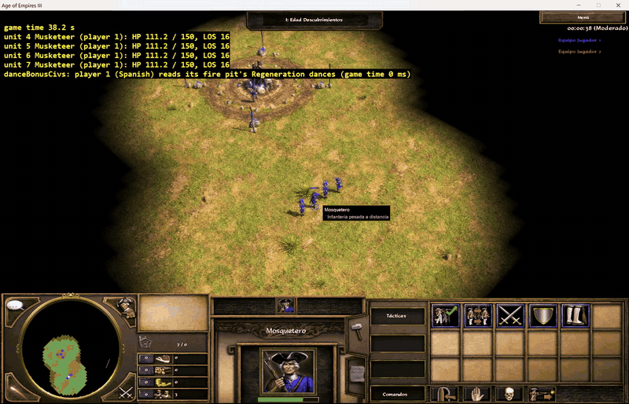

*In game:* A Spanish (non-native) fire pit's Regeneration dance heals musketeers from 120 to 150 HP (2x speed). [Full video (MP4)](media/danceBonusCivs.mp4).

```
danceBonusCivs <Civ> [<Civ> ...] [log]     civ names as in civs.xml; several lines add up
```

- **How stock behaves:** a fire pit dance is a tactic of the building (`firepit.tactics`); its
  actions have `<type>DanceBonus</type>` and a `<dancebonustype>`. Four kinds act by themselves for
  any civ that owns the building and has the tactic: `UnitModification`, `UnitSpawn`, `PopCap` and
  `WarChiefRansom`. The other four are applied by the engine where it needs them, and only for the
  civs `XPIroquois`, `XPSioux`, `XPAztec` and `XPSPC`:
  - `Training`: train rate (stock: Fertility Dance, action `VillagerTrainFaster`);
  - `XPTrickle`: XP trickle (Gift Dance, `XPTrickleIncrease`);
  - `Gathering`: gather rate of every resource (no stock dance uses it; the action
    `GatherRateIncrease` exists in `firepit.tactics`);
  - `Regeneration`: heals the units of `<modifyabstracttype>` that have been idle for 3.5 s
    (Healing Dance, `RegenAllUnits`).

  For any other civ these four dances run, the villagers dance and (except Gift Dance) the tooltip
  even shows the bonus, but nothing happens.
- **Effect:** the listed civs get these four kinds exactly as the native civs do: the same
  strength, the same building (the player's first `AbstractFirePit` building) and the same
  targets. The civ does not become "native" for anything else, unlike UHC 1.10's `nativeCivs`
  (which also misses the Gift Dance). The native civs keep the stock behavior.
- **Your mod needs:**
  - the internal civ names (the `<name>` in `civs.xml`: `British`, `Spanish`, a mod civ, …); case
    does not matter;
  - a building with `<UnitType>AbstractFirePit</UnitType>` (the stock `FirePit`, or your own). Only
    the player's first such building is read, and the dancer count needs that type;
  - the dance tactic in the building's tactics file, enabled for the civ by a tech, and a button
    for it;
  - villagers that can work on the building (a `Gather` rate for it in their tactics:
    `settler.tactics` already has `FirePit`).
- **`log`:** one line the first time each player passes each of the four checks in a game. A
  listed civ with no fire pit gets the line too: the check passes, then the engine finds no
  building and the bonus stays 1.0.
- **Log:** at startup `danceBonusCivs: civs A, B get the fire pit's Training, XPTrickle, Gathering
  and Regeneration dances like the native civs (multiplayer unverified)` (with `log`: `…civs, each
  player's first use of each kind logged (multiplayer unverified)`); on the first use with each
  data load, one `danceBonusCivs: <Civ> -> civ <ID>` line per name, or `danceBonusCivs: <Civ> is not
  a civ in civs.xml; ignored` (and, when no name is valid, `danceBonusCivs: none of the listed civs
  exists; the four dance kinds stay native-only`). In a game: `hook reached: danceBonusCivs
  Training (0x8D47AB)`, `… XPTrickle (0x4E0DFF)`, `… Gathering (0x4ECD53)` and `… Regeneration
  (0x49048B)` the first time the game evaluates each kind for any player. With `log`:
  `danceBonusCivs: player N (<Civ>) reads its fire pit's <Kind> dances (game time T ms)`. Without
  any civ name: `danceBonusCivs: expected "danceBonusCivs <Civ> [<Civ> ...] [log]" with at least
  one civ name; feature not applied`.
- **Limits:**
  - only the player's first `AbstractFirePit` building counts, as in stock;
  - each listed civ now looks for its fire pit (a scan of its units) on every train, gather-rate,
    XP trickle and regeneration evaluation, as the native civs always did. List only the civs that
    can own a dance building;
  - new dance kinds, more dance buttons and several dance buildings per player are not covered.
    WoL's own `uhc.dll` has a key `danceCiv`, which only changes interface checks; this is another
    key.
- **Simulation:** yes.
- **Status:** confirmed in single player (2026-10-29) for the Healing Dance. Player 1 was Spanish,
  with 3 settlers dancing at a `FirePit` whose tactic has `RegenAllUnits`: its damaged musketeers
  read 107 HP at the first check and healed to 150. With the key off, the same dancers left them at
  90. Training, XPTrickle and Gathering were not tested in game.
- **New in this DLL:** not in UHC 1.10. WoL request #19, first part
  ([wol-requests.md](wol-requests.md)).

### startingTC

```
startingTC [<UnitType>] [log]          default AbstractStartingTC
```

- **How stock behaves:** each player has one *first town center*, the unit the placement rules
  call `FirstTC`: the first unit of the exact proto `TownCenter` that is added to him (placed by
  the map, shipped, built, converted). The stock rules use it twice: no building within 65 m of an
  enemy's first town center (`buildingsmall.xml`, `buildinglarge.xml`, …: error 25521), and, in a
  no-rush game (`norushonly`), buildings only within 75 m of a team's first town center. The
  choice is made once and never undone:
  - a player who starts with another building (a Pa, a Presidio) has no first town center, so no
    enemy is kept 65 m away from him;
  - a player whose first town center dies keeps the dead one, and the rules skip him too.

  WoL's Maori start is the second case (static reading of WoL's techtree and of the exe):
  `Age0Maori` gives `TownCenter` a `Lifespan` of 0.5 s, then a free `MaoriPa`. The Pa is added
  while the town center still lives, so the first town center stays the town center, which dies
  half a second later. From then on the Maori have no 65 m protection, and the no-rush rule fails
  for their team.
- **Effect:** a building whose proto is of `<UnitType>` can be a first town center too:
  - a player who has none takes the first marked building added to him, as stock takes a
    `TownCenter`;
  - a player whose first town center is **gone** (no longer in the game), **dead**, or has a
    **pending lifespan** (it is about to expire, like WoL's town center under `Lifespan 0.5`)
    takes the next marked building added to him instead.

  The `FirstTC` rules then measure from that building. A `TownCenter` keeps its stock behavior,
  and a live first town center with no lifespan is never replaced.
- **What it does not cover:** only the `FirstTC` rules follow the marked building. Other code
  still looks for the `TownCenter` proto itself (scoping of request #3, static reading):
  - the age-up picker (`uiPoliticianUI`) and the age-up progress display;
  - the start camera;
  - the AI: its automatic main base, its build plan and its chat lines;
  - the `trPlayerToggleAllowTCSpawning` gate on `Maintain`;
  - the town starting units (`<townstartingunit>`: settlers, crates), which go to the first
    built `TownCenter` ([`civFirstTC`](#civfirsttc) sends them to its own building);
  - the `CoveredWagon` build limit and a Town Center's fixed repair cost.

  The home city shipment point is covered by
  [`hcShipmentPointFallback`](#hcshipmentpointfallback): list `FirstTC` there (the marked
  building that is the player's first town center), or the marked protos. For a civ that starts
  with another building on every map, see [`civFirstTC`](#civfirsttc), WoL's own design for
  request #3 ([wol-requests.md](wol-requests.md)); the other checks above stay stock.
- **Giving buildings the marker:** add it to the buildings that stand in for a town center at the
  start, e.g. WoL's `MaoriPa`, `Presidio`, `EGYtowncenterCARAVAN` and the `*Colony` protos:

  ```xml
  <Unit id ='…' name ='MaoriPa'>
      ...
      <UnitType>AbstractStartingTC</UnitType>
  ```

  The DLL registers the marker, like `healNonIdle`'s; edit `protoy.xml` and its XMB as described
  there. An existing type or proto name works too (`startingTC MaoriPa`). `TownCenter` needs
  nothing. WoL's `Age0Maori` needs no change: the Pa replaces the dying town center the moment it
  is added.
- **Choose the marked protos with care:** once a player's first town center is dead or gone, the
  next marked building he gets becomes his first town center, wherever it stands. Mark the
  buildings that replace a town center, not a common building. A `TownCenter` built after the
  first one died does not replace it (stock), unless `TownCenter` is marked too.
- **With [`civFirstTC`](#civfirsttc):** both keys can be on; they share the hook that sets a
  player's first town center. A player with none takes the first unit added to it that is a
  `TownCenter` (stock), of its civ's `<firstTC>` proto, or of the marked type. Only `startingTC`
  replaces a first town center that is gone, dead or about to expire.
- **`log`:** one line for each marked building that becomes a first town center. This happens
  about once per player per game, so it can stay on.
- **Log:** at startup `startingTC: units of unittype X can be a player's first town center
  (FirstTC) like TownCenter, and replace one that is gone, dead or has a pending lifespan
  (multiplayer unverified)` (with `log`: `…pending lifespan, every new FirstTC logged (multiplayer
  unverified)`); when the data loads, `unit types: X -> <ID> …`; in a game,
  `hook reached: startingTC (0x49880A)` and `hook reached: FirstTC proto check (0x506B3B)` (the
  hook it shares with `civFirstTC`) as the map's first units are added to their players. With
  `log`:
  - `startingTC: unit N (Market) is player 2's first town center (FirstTC)`;
  - `startingTC: unit N (MaoriPa) replaces player 2's first town center M (TownCenter), whose
    lifespan ends in 0.50 s`, or `…first town center M (TownCenter), which is dead`, or `…first
    town center M, which is gone`.
- **Limits:**
  - a first town center captured by another player is not replaced: it still exists and lives;
  - a dead first town center is replaced only when a marked building is added afterwards; nothing
    happens at its death;
  - the no-rush rule passes for everyone while **any** player has no first town center (stock). A
    player who gets one through this key therefore turns that rule back on for the whole game, as
    a stock town center would.
- **Simulation:** yes: the first town center decides where buildings may be placed. Every player
  needs the same line and the same data. It also adds a unit type when the name is new.
- **Status:** confirmed from the log and memory in single player (2026-10-29). A `Market` marked
  `AbstractStartingTC` and created for player 2, who had no Town Center, became his first town
  center: `startingTC: unit 3 (Market) is player 2's first town center (FirstTC)`, and
  `[player+4F0h]` read 3 for player 2, where stock leaves -1 (the Market is not a `TownCenter`).
  Not driven in game: the visible effect on placement (the 65 m refusal), and the replacement of a
  first town center that is dead or has a pending lifespan (WoL's Maori case).
- **New in this DLL:** not in UHC 1.10. WoL request #3, the part the placement rules read
  ([wol-requests.md](wol-requests.md)).

### civFirstTC

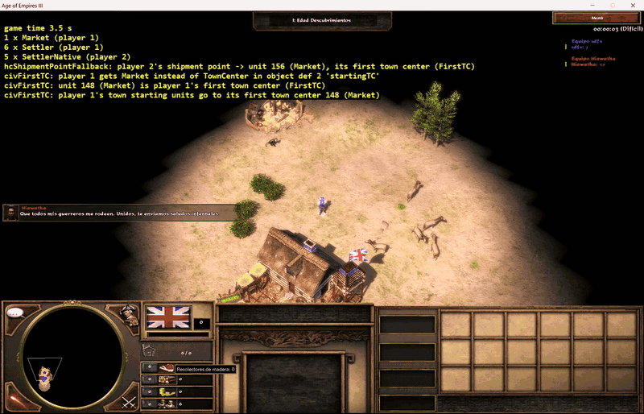

*In game:* A skirmish start on the stock map Mongolia: player 1, whose civ has `<firstTC>Market</firstTC>`, starts with a Market where the map puts the Town Center; then the Market is selected, with its 6 starting Settlers. The Iroquois AI, whose civ has no tag, keeps its Town Center. [Full video (MP4)](media/civFirstTC.mp4).

```
civFirstTC [log]
```

In `civs.xml`, inside a `<civ>`, next to its `<startingunit>` entries:

```xml
<civ>
    <name>Spanish</name>
    ...
    <firstTC>Market</firstTC>
</civ>
```

- **How stock behaves:** each random map script places the players' first buildings itself,
  usually `rmAddObjectDefItem(startingTCID, "TownCenter", 1, 0.0)` and then an
  `rmPlaceObjectDef*` call, or a `CoveredWagon` in a Nomad start (`rmGetNomadStart()`).
  `civs.xml` only lists a civ's units: `<startingunit>` (placed by
  `rmCreateStartingUnitsObjectDef`) and `<townstartingunit>` (settlers and crates that appear at
  the first built Town Center). A civ therefore cannot start with another building unless every
  map script is changed, and only a `TownCenter` becomes the player's first town center
  (`FirstTC`, see [`startingTC`](#startingtc)).
- **Effect,** for the players of a civ that has `<firstTC>Proto</firstTC>`:
  - **Map placement:** where a random map places `TownCenter` through an object def, the player
    gets `Proto` instead, at the same place. The placement uses the larger of the two footprints.
    The same object def still places a `TownCenter` for the players of other civs, and the map
    scripts are not changed. Items are compared by proto ID, so any spelling of `TownCenter` in a
    script counts.
  - **First town center:** the building becomes the player's `FirstTC`, as a stock `TownCenter`
    does: the placement rules (no enemy building within 65 m, the no-rush rule),
    [`noTrainNearEnemyTC`](#notrainnearenemytc) and `hcShipmentPointFallback FirstTC` use it. A
    unit of that proto added in any other way while the player has no first town center becomes
    it too, so a scenario or a saved game loaded later gets the same first town center.
  - **Town starting units:** the civ's `<townstartingunit>` units appear at the building, when the
    data below allows it.
- **Nomad start:** when `rmGetNomadStart()` is true, nothing is substituted: the map's own start
  (a `CoveredWagon`) stays, and a building of the `<firstTC>` proto does not become the first
  town center through this key. A `TownCenter` the player builds becomes it, as in stock.
- **Not substituted:** a `TownCenter` from the civ's `<startingunit>` list (the
  `Special_StartingUnits` object def of `rmCreateStartingUnitsObjectDef`, whose items the game
  rebuilds from the civ's list), by design; and Town Centers that triggers, cards, techs or
  players create.
- **The tag:** its name may be written in any case; its text is a proto name as in `protoy.xml`
  (matched in any case; spaces around it are dropped); the last `<firstTC>` of a civ counts. An
  empty tag, or a name that is not a proto, leaves the civ's players with `TownCenter` (logged).
  `<firstTC>TownCenter</firstTC>` changes nothing. The stock game ignores the tag, so the file
  still loads without the DLL or with the key off: the civ then starts with its `TownCenter`.
- **Data your mod needs:**
  - **`civs.xml`:** the tag. Keep the XML and its compiled `.xmb` in step, as for `protoy`
    ([section 6](#6-editing-the-game-data)); the test used a loose `data\civs.xml` and
    `data\civs.xml.xmb`.
  - **For the town starting units,** two more edits. Without them the player gets those units
    only once the player builds a `TownCenter`; none is lost.
    - `<Flag>StartingColonyBuilding</Flag>` on the proto, in `protoy.xml` and its XMB. The game
      asks for the town starting units when a unit with that flag is created; `TownCenter`
      has it, `Market` does not. In the test, a Market without the flag became the first town
      center and a colony started at it, but no settler came.
    - The proto in the `<starttypes>` of `placementrules\colonies.xml`, e.g.
      `<type maxcount="1">Market</type>`. The units spawn only at a building where a colony
      starts; otherwise the log says `no colony starts at player N's first town center …`.
  - **For shipments:** the stock fallback of the shipment point knows only 10 building types
    (`TownCenter`, `Outpost`, forts, …). Add `hcShipmentPointFallback FirstTC` (or the proto name)
    so that home city shipments arrive at the building
    ([hcShipmentPointFallback](#hcshipmentpointfallback)).
  - `TownCenter` also has the flags `ColonyPlacementCenter`, `HasGatherPoint`,
    `AllowAutoGarrison` and `ShowGarrisonButton`, which `Market` lacks. This key needs none of
    them; what they change on another building was not tested.
- **What it does not cover:** other code still looks for the `TownCenter` proto itself:
  - the AI scripts: in the test, an AI whose civ had the tag got its Market and its settlers, then
    stayed idle, because its scripts expect a Town Center (WoL's AI is WoL's part);
  - the engine's automatic AI main base;
  - the age-up picker (`uiPoliticianUI`);
  - the start camera (it looks for `TownCenter`, then `CoveredWagon`, `Explorer`, …);
  - the `trPlayerToggleAllowTCSpawning` gate on `Maintain`;
  - the water shipment point.

  The [`startingTC`](#startingtc) section lists the rest.
- **With other keys:** [`startingTC`](#startingtc) can be on too: the two share the hook that sets
  the first town center, and only `startingTC` replaces one that is gone, dead or about to
  expire. [`hcShipmentPointFallback`](#hcshipmentpointfallback) `FirstTC` sends shipments to the
  building, and [`noTrainNearEnemyTC`](#notrainnearenemytc) measures to its edge.
- **`log`:** adds a line for each substitution (per player and object def, when the map is
  generated), one when the building becomes a first town center, and one per game and player
  when the town starting units go to it. That is a few lines per game, so it can stay on.
- **Log:**
  - at startup, `civFirstTC: a civ's <firstTC> proto in civs.xml replaces the TownCenter random
    maps place for its players (not in a Nomad start) and is their first town center (FirstTC)
    (multiplayer unverified)` (with `log`: `…(FirstTC), every substitution logged (multiplayer
    unverified)`);
  - each time `civs.xml` is read, for each tag: `civFirstTC: civ N (Spanish) starts with Market
    instead of TownCenter`, or `civFirstTC: civ N (Spanish): empty <firstTC>; its players keep
    TownCenter`;
  - the first time a name is used after the data loads, if it is not a proto: `civFirstTC: civ N
    (Spanish): <firstTC> names no proto unit (Markt); its players keep TownCenter`;
  - once per game for each player and building, when no colony starts at the building:
    `civFirstTC: no colony starts at player 1's first town center N (Market): its town starting
    units wait for a TownCenter (add the proto to placementrules\colonies.xml <starttypes>)`;
  - `hook reached: civFirstTC civs.xml (0x52BB07)` when `civs.xml` is read, `civFirstTC map
    placement (0x925F4C)` when the map places its first object def, `FirstTC proto check
    (0x506B3B)` (the hook it shares with `startingTC`) and `civFirstTC town units (0x679AC8)` in
    a game.

  With `log`:
  - `civFirstTC: player 1 gets Market instead of TownCenter in object def D 'startingTC'`;
  - `civFirstTC: player 1 keeps TownCenter in object def D 'startingTC' (Nomad start)`;
  - `civFirstTC: unit N (Market) is player 1's first town center (FirstTC)`;
  - `civFirstTC: player 1's town starting units go to its first town center N (Market)`, once per
    game for each player and building.
- **Simulation:** yes: the substitution, the first town center and the town starting units are
  all game state. Every machine needs the same line, `civs.xml`, `placementrules\colonies.xml`
  and `protoy`. A recorded game generates its map again when it is played back, so playback needs
  them too. The key adds no unit type.
- **Status:** confirmed in single player (2026-10-29), with a loose `civs.xml` (and `.xmb`) that
  gives civs `<firstTC>Market</firstTC>`:
  - editor route, a test map that places a `TownCenter` for both players: player 1 (Spanish,
    tagged) got a Market, which became its first town center (`[player+4F0h]` in memory); player
    2 (British, untagged) kept its `TownCenter`. Scenario players have no home city, so no
    shipment was tried there;
  - skirmish on the stock map Mongolia, with the Market in `colonies.xml` `<starttypes>` but
    without `StartingColonyBuilding`: the map's own object def `startingTC` placed a Market for
    player 1, which became its first town center, and a colony started at it, but no settler
    came. With `<Flag>StartingColonyBuilding</Flag>` on the Market, 6 Settlers spawned at it
    (`player 1's town starting units go to its first town center 121 (Market)`). The AI, of a
    tagged civ, also got a Market and its settlers, then stayed idle (see above);
  - a skirmish against an Iroquois AI (untagged): it kept its Town Center and played normally,
    and a shipment to player 1 landed at its Market
    ([hcShipmentPointFallback](#hcshipmentpointfallback));
  - no XS error dialog in any of these games.

  Not tested: a Nomad start (TAD's skirmish setup has no Nomad option, and the editor route
  cannot set one), multiplayer, recorded games, the `no colony` log line, and any building other
  than the Market.
- **New in this DLL:** not in UHC 1.10. WoL request #3 ([wol-requests.md](wol-requests.md)), as
  redesigned by WoL's developer Mandos.

### transformInventory

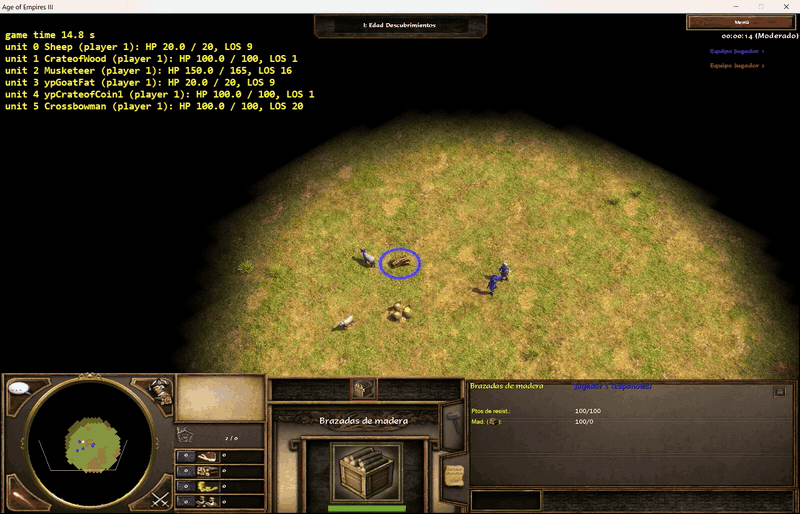

*In game:* A TransformUnit tech: the wood crate becomes a food crate that holds food (the panel shows `Alim.: 100`), the musketeer an XP crate with XP. [Full video (MP4)](media/transformInventory.mp4).

```
transformInventory [all] [scale] [<UnitType>] [log]
```

- **How stock behaves:** a unit that holds resources (a crate, a herdable, a mine, a tree) has
  its own resource inventory. The game fills it from the proto's `<InitialResource>` when the unit
  is created, and gatherers take from that inventory, not from the proto. A tech effect
  `<Effect type ='TransformUnit' fromprotoid ='A' toprotoid ='B'>` and a revolution change living
  units into another proto in place, but never touch the inventory: the unit keeps A's resource
  types and amounts, or has none at all. Stock TAD never hits this (none of its 7 `TransformUnit`
  effects involves an inventory). WoL has 64 such effects (static scan of its techtree):
  - `CrateofCoin` → `CrateofXP` (`WOLNatAssyrianTWO`): the "XP crate" still holds 100 gold;
  - `MerinoRam` → `Cow` (`WOLHCBlueBreed`): the cow holds the ram's gold;
  - a pet or a priest → a crate (`HCCardDogTaxWar`, `WOLHCOrganizedSecularism`): the crate has no
    inventory, so it can never be gathered and never empties;
  - a later conversion or capture of such a unit makes it worse: the owner change rescales each
    resource by the proto's `InitialResource` and zeroes every type the proto does not list. A
    gold-holding XP crate that changes owner ends up with nothing.
- **Effect:** when the old and new protos list different resource types in `<InitialResource>`,
  the unit gets the new proto's `InitialResource` (its player's copy, so that player's
  `InventoryAmount` techs count), as if it had just been created. A unit that had no inventory
  gets one. A unit whose two protos list the same types keeps its inventory, as in stock: a
  fattened goat turned into a cow keeps its food.
- **`all`:** also rebuilds units whose protos list the same types (a `ypGoatFat` with 300 food
  turned into a `Cow` gets the cow's 50), and removes the inventory of a unit whose new proto has
  no resources at all (as the trigger "Change Unit Type" does). Without `all`, such a unit keeps
  its old inventory, as in stock.
- **`scale`:** the new amounts are scaled by the fraction of the old `InitialResource` the unit
  still held: a coin crate half gathered becomes half an XP crate. A unit that held more than its
  old `InitialResource` (fattened) gets the full new amounts.
- **`<UnitType>`:** only transforms into protos of that type are changed; any other transform
  behaves as in stock. A new name is registered as a marker unit type (like `healNonIdle`'s); a
  stock type or a proto name works too (`transformInventory AbstractResourceCrate`). Without a
  type, every in-place transform is covered.
- **Your mod:** nothing, unless you use a marker. The key covers every `TransformUnit` effect and
  revolution. The trigger effect "Change Unit Type" and `uiTransformSelectedUnit` (WoL's
  `*Maturing`) already give the new proto's resources in stock and are not changed.
- **Gatherers:** a unit already gathering a target whose resource type changes keeps gathering the
  old type; that amount is now 0, so it stops at its next gather tick and must be re-tasked. In
  stock it would keep collecting the old resource.
- **`log`:** one line per unit transformed in place that holds or receives resources. A tech that
  transforms many units writes one line for each.
- **Log:** at startup `transformInventory: units transformed in place (TransformUnit, revolution)
  take their new proto's InitialResource when the resource types differ (multiplayer
  unverified)`. With a type the line reads `…(TransformUnit, revolution) into protos of unittype
  X take…`; with `all`, `…InitialResource always, and lose their inventory when it has none…`;
  `scale` adds `, scaled by the fraction left`, and `log` `, every transform logged`. With a type,
  when the data loads, `unit types: X -> <ID> …`. In a game, `hook reached: transformInventory
  (0x9C7625)` the first time any unit is transformed in place. With `log`:
  - `transformInventory: unit N (Sheep -> CrateofCoin) inventory rebuilt: {2: 53.6} -> {0: 100}`;
  - `transformInventory: unit N (Musketeer -> CrateofXP) inventory created: none -> {5: 100}`;
  - `transformInventory: unit N (ypGoatFat -> Cow) keeps its inventory {2: 300} (same resource
    types)`;
  - `transformInventory: unit N (ypCrateofCoin1 -> Pikeman) keeps its inventory {0: 100} (the new
    proto has no resources; "all" frees it)`;
  - with `all`: `transformInventory: unit N (A -> B) inventory freed: {0: 100} -> none`;
  - with `scale`: `… inventory rebuilt: {1: 80} -> {2: 80} (scaled by 0.8)`;
  - `transformInventory: unit N (A -> B) got no inventory (pool exhausted)`, if the engine's
    inventory pool is empty (not seen).

  The numbers before the colons are resource IDs in the order the exe registers the resource names
  (0x5381E0): Gold 0, Wood 1, Food 2, Fame 3, SkillPoints 4, XP 5, Ships 6, Trade 7. That these are
  also the inventory's indices was checked in game for Food: a crate logged `{2: 100}` showed
  100 food in the game's panel. For the other resources it is an inference.
- **Simulation:** yes. Inventories decide what and how much gatherers collect, what the AI sees,
  and when a `DieAtZeroResources` unit dies. Every player needs the same DLL and the same line;
  `scale` divides two game values in the DLL, so every player also needs the same build.
- **Limits:** units that a saved game already holds with a mismatched inventory are not fixed when
  it loads; only their next transform fixes them. Callers of the in-place transform other than
  `TransformUnit` and the revolution (construction objects and a few internal ones) are covered
  too; their stock data was not surveyed.
- **Status:** confirmed in single player (2026-10-29), with a test tech `UHCInvTransformTest` of
  six `TransformUnit` effects:
  - a Sheep holding 53.6 food became a `CrateofCoin` with 100 gold;
  - a `CrateofWood` (100 wood) became a `CrateofFood` with 100 food, which the game's panel then
    showed (`Alim.: 100`);
  - a Musketeer (no inventory) became a `CrateofXP` with a new inventory of 100 XP;
  - a `ypGoatFat` (300 food) became a `Cow` and kept its food (same resource types);
  - a `ypCrateofCoin1` (100 gold) became a Pikeman and kept its inventory, without `all` (the log
    says `all` frees it);
  - Crossbowman → Skirmisher: no inventory on either side, nothing logged.

  The stock behavior (the inventory is never rebuilt) comes from static analysis; no run with the
  key off was made. `all`, `scale`, a marker, revolutions and a conversion after a transform were
  not tested.
- **New in this DLL:** not in UHC 1.10. WoL request #4 ([wol-requests.md](wol-requests.md)).

### noTrainNearEnemyTC

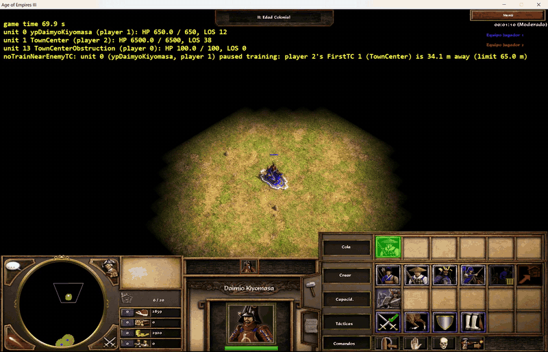

*1. Near an enemy's first Town Center:* A Daimyo 34 m from an enemy Town Center pauses its queue, then resumes when the Town Center dies (2.5x speed). [Full video (MP4)](media/noTrainNearEnemyTC.mp4).

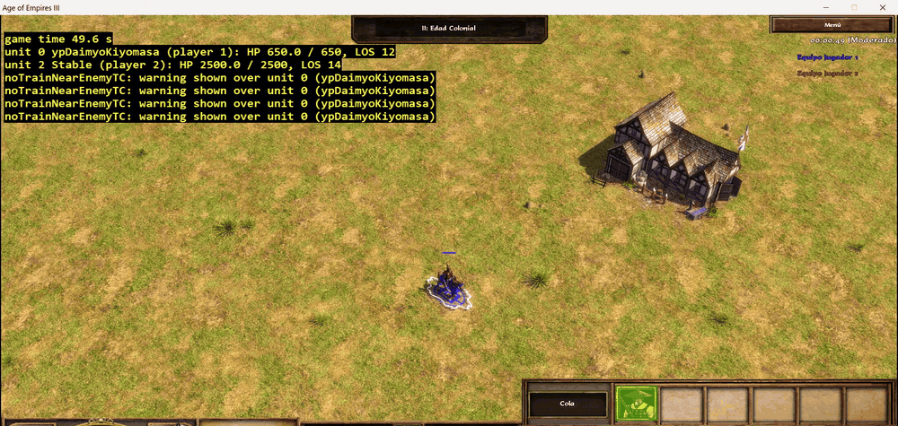

*2. `near Stable` and the warning:* `noTrainNearEnemyTC 40 near Stable near FirstTC log`, the camera on the Daimyo. It stands 21 m from the edge of an enemy Stable with 5 Ashigaru queued: the queue does not move, and every 8 s of game time the red text "Too close to the enemy: training paused" appears over it (the overlay shows each `warning shown` line). The Stable is destroyed at 75 s: the log reads `resumed training`, now with the enemy Town Center 138.6 m away as the nearest, and the Ashigaru are trained (2x speed). [Full video (MP4)](media/noTrainNearEnemyTC-near.mp4).

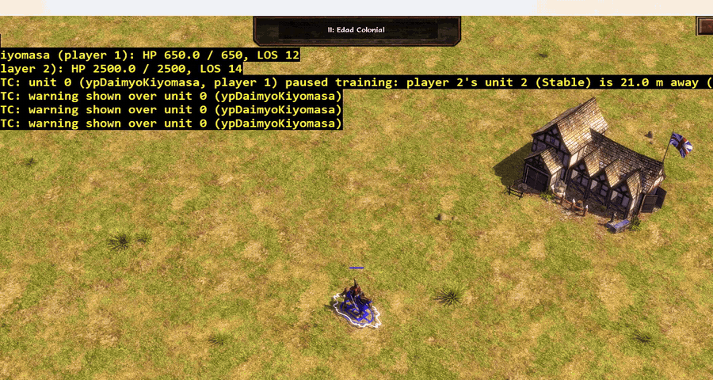

*3. Your own text:* with `warn=¡Demasiado_cerca!`, the same held Daimyo shows "¡Demasiado cerca!" (1.5x speed). [Full video (MP4)](media/noTrainNearEnemyTC-warn.mp4).

```
noTrainNearEnemyTC <meters> [<UnitType>] [near <UnitType>|FirstTC]... [nowarn | warn=<text> | warn=<stringID>] [log]
    default AbstractDaimyo, near FirstTC, the English warning; up to 4 near; one line
```

- **How stock behaves:** each player remembers his first Town Center, the `FirstTC` of the
  placement rules (see [`startingTC`](#startingtc)). The stock rule
  `distanceatleastfromtype player=enemy distance=65 FirstTC` keeps buildings 65 m away from an
  enemy's first Town Center. Nothing limits a unit that trains: a Daimyo or the Shogun can walk
  into the enemy base and train an army next to his Town Center.
- **Effect:** a unit whose proto is of `<UnitType>` does not train while an enemy's first Town
  Center, or an enemy's unit of a `near` type, is alive and less than `<meters>` away. Its queue
  keeps the progress it has, and goes on as soon as nothing is that close any more (the blocker is
  destroyed). Nothing is refunded or cancelled, and the order is accepted as in stock. "Enemy" is
  the stance of the blocker's owner toward the trainer's player, as for `player=enemy` in the
  placement rules: your own and your allies' buildings never block, nor do Gaia's (natives,
  treasures).
- **Choosing the trainers:** the default `AbstractDaimyo` is a stock type that the Daimyos and the
  Shogun already have, so it needs no data change. In WoL it also covers `MapucheWarchief`, the
  `WOLGensui*` units, `EGYtowncenterCARAVAN`, `EGYbarracks3CARAVAN` and `DummyGather` (static scan
  of WoL's `protoy`). To pick the trainers yourself, give them a new marker (for example
  `AbstractNoTrainNearEnemyTC`) in `protoy.xml` and its XMB, as for `healNonIdle`, and name it in
  the cfg. A proto name works too.
- **Choosing what blocks (`near`):** without `near`, only an enemy's first Town Center blocks.
  Each `near <UnitType>` adds a type: a proto name (`near Stable`, `near Barracks`), a stock type
  (`near AbstractTownCenter` for every Town Center, not only the first) or a new marker
  that you put on your buildings in `protoy`. As soon as the line has one `near`, only the listed
  entries block: add `near FirstTC` to keep the first Town Center. Up to 4 entries. A building
  blocks only once it is built (a foundation does not; static reading), and while it is alive. A
  type of moving units works too (units always count as built): `near Hussar` held a Daimyo
  while an enemy Hussar stood 17.3 m away.
- **How the distance is measured:** from the trainer's centre to the nearest edge of the
  blocker's footprint, 0 inside it. It is the engine's own distance, the one the placement rules
  use, so `65` matches the stock 65 m rule. For example, a Stable (3 × 5 m half-sizes) whose
  centre is 24 m from the Daimyo is 21 m away. For units without such a footprint (units that can
  move) the engine uses the centre distance minus the unit's radius × 1.41: a Hussar whose centre
  was 18.4 m away counted 17.3 m.
- **Choosing the distance:** `<meters>` is a number above 0 and at most 1000 (decimals allowed).
- **Which Town Center counts for `FirstTC`:** only each player's first Town Center, not every Town
  Center. A player whose first Town Center was destroyed gives no protection, even if he built
  another one. WoL's Maori (whose first Town Center dies at 0.5 s) are protected only with
  [`startingTC`](#startingtc) and the `MaoriPa` marked. A civ that starts with another building
  through [`civFirstTC`](#civfirsttc) is protected by that building (static reading; not tested
  with this key). `near AbstractTownCenter` covers every Town Center instead.
- **The warning:** while one of your units is held, a red text appears over it, at most once every
  8 s of game time per unit, and only on your own screen: other players see nothing, not even for
  units they can see. It is the stock dodge's floating text ("¡Esquiva!" uses it) without its rise,
  so it stays over the unit for about 1.5 s. `warn=<text>` replaces the English default "Too close
  to the enemy: training paused": `_` stands for a space, at most 127 characters, UTF-8 (else the
  Windows code page). `warn=<number>` takes that string from the string table (`warn=63950` shows
  the stock "Dodge!" in the game's language), so a mod can translate its own text in
  `stringtabley.xml`. `nowarn` turns it off.
- **A held trainer stays where it is.** In stock, a Daimyo with units in its queue does not move: a
  right-click on the ground sets its gather point, and move orders (a trigger, the console's
  `uiMoveAllMilitaryAtPointer`) are ignored until the queue is empty (seen in game). So a held
  Daimyo waits until the blocker is destroyed, or until the player cancels the queue (stock refund),
  moves it away and queues again.
- **With other keys:** with [`buildingWorkRateAuras`](#buildingworkrateauras), a trainer out of
  range trains at its aura-boosted rate, and with `liveBuildingWorkRate` at its proto's current
  rate: this key's hook calls the same getter.
- **`log`:** one line the first time each marked unit trains (whether it may train, with the
  nearest blocker and its distance), then one line each time it pauses or resumes, and one per
  warning. The list of logged units starts again at each data load; at most 1000 lines per session.
  Use it to check your data and your distance, not in a release.
- **Log:** at startup `noTrainNearEnemyTC: units of unittype X do not train within 40.0 m (from the
  trainer's centre to the edge of the building) of an enemy's Stable, an enemy's first Town Center
  (FirstTC), with a warning over the local player's held units, every pause and resume logged
  (multiplayer unverified)` (the warning and `log` parts only when on); when the data loads,
  `unit types: AbstractDaimyo -> <ID> (…), already defined` and one such line per `near` type; in a
  game, `hook reached: noTrainNearEnemyTC (0x9EA410)` the first time any unit or building trains.
  With `log`:
  - `noTrainNearEnemyTC: unit N (ypDaimyoKiyomasa, player 1) paused training: player 2's unit M
    (Stable) is 21.0 m away (limit 40.0 m)`;
  - `noTrainNearEnemyTC: unit N (…) resumed training: …`, with the nearest blocker left, or
    `nothing to keep away from`;
  - `noTrainNearEnemyTC: unit N (…) trains: …` the first time a unit trains with no block;
  - `noTrainNearEnemyTC: warning shown over unit N (ypDaimyoKiyomasa)` (`: refused by the engine`
    when the game did not take the text);
  - `noTrainNearEnemyTC: 1000 lines logged; the next changes are not`.

  A bad line, and the key is not applied:
  - `noTrainNearEnemyTC: expected "noTrainNearEnemyTC <meters> [UnitType] [near <UnitType> ...]
    [nowarn | warn=<text>] [log]" with meters above 0 and at most 1000, got "…"`;
  - `noTrainNearEnemyTC: near needs a unit type (or FirstTC), at most 4`;
  - `noTrainNearEnemyTC: warn=…: expected warn=<text> (at most 127 characters, '_' for a space) or
    warn=<string table ID>`;
  - `noTrainNearEnemyTC: unexpected argument … (expected: …)`.
- **Limits:**
  - training pauses; the command is not refused, and the interface still shows the queue (its
    progress bar stops);
  - a held trainer does not walk away with its queue (stock, above);
  - `FirstTC` is only the first Town Center (see above);
  - the AI does not know about the rule: it may queue units in a Daimyo that stands near an enemy
    building and wait.
- **Simulation:** yes. Every player needs the same meters, trainer type and `near` entries; a new
  marker name adds a unit type. `nowarn` and `warn=` only change what the local player sees and may
  differ.
- **Status:** confirmed in single player (2026-10-29), in a test map (no AI) unless noted:
  - `noTrainNearEnemyTC 65 log` (with every WoL key on): a `ypDaimyoKiyomasa` 34.1 m from player
    2's first Town Center made no progress on 2 `ypAshigaru`, and trained both once the Town Center
    was killed (`resumed training: no enemy FirstTC` in that version of the log). The same test
    with `nowarn`: paused at 34.1 m, no warning line, resumed when the Town Center died;
  - `noTrainNearEnemyTC 40 near Stable near FirstTC log`, with `liveBuildingWorkRate` and
    `buildingWorkRateAuras`: paused 21.0 m from a Stable's edge (Town Center 138.6 m away), 9
    warnings 8 s apart, all 5 Ashigaru trained once the Stable was killed; walked next to the enemy
    Town Center, it paused again (`player 2's unit 1 (TownCenter) is 6.4 m away`) with 1 Ashigaru
    queued (video 2);
  - `warn=¡Demasiado_cerca!` and `warn=63950` showed "¡Demasiado cerca!" and "¡Esquiva!" (video 3);
  - four bad lines (`near` with no type, 5 `near`, `warn=` empty, a 140-character text): one log
    line each, the key `FAILED`, the game normal;
  - AI: a skirmish against a Japanese AI with this key (`near Barracks near Stable near FirstTC`)
    and every WoL key on: the AI went from 15 to 25 units in 2 minutes and started its wonder, no
    XS error.

  - `noTrainNearEnemyTC 30 near AbstractTownCenter near Hussar log`: held by an enemy Hussar 17.3 m
    away (a moving type), and in another game by an enemy's second Town Center 22.0 m away (not
    its first; the first, 150 m away, did not count); each resumed when its blocker was removed,
    and the 3 queued Ashigaru were trained;
  - saved games: a game saved with the Daimyo held and loaded again logged `paused training` at
    once and stayed held until the blockers were removed (the decision keeps no state).

  Not tested: a foundation near the trainer, multiplayer. For such a test, the Daimyo trains only
  from Age II and needs population room and food.
- **New in this DLL:** not in UHC 1.10. WoL request #27 ([wol-requests.md](wol-requests.md)).

### overhealHitpointBars

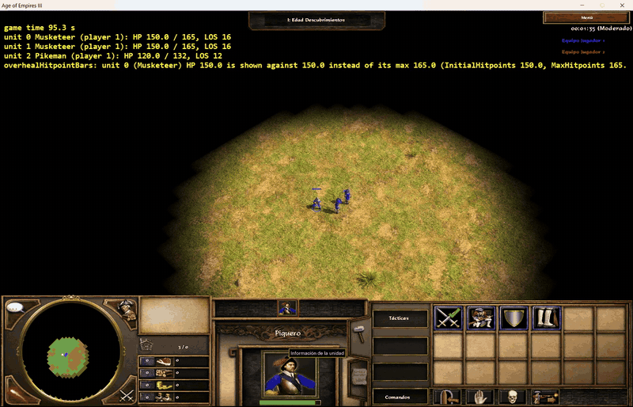

*1. The 100 %:* A marked musketeer (150 HP of 165 max) shows a full bar and 150/150; the overlay shows the real maximum. [Full video (MP4)](media/overhealHitpointBars.mp4).

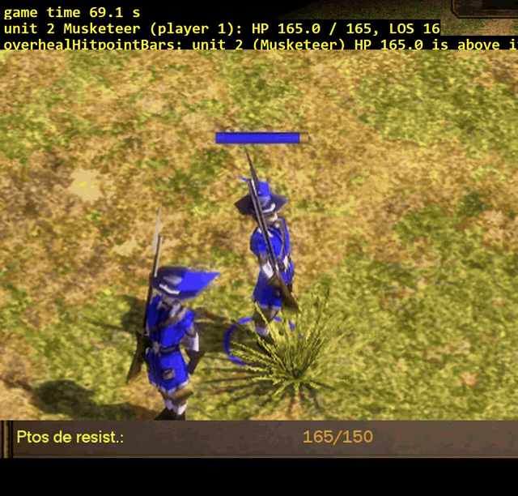

*2. `segment`, the floating bars:* A marked Musketeer takes damage (white `92/150`), a Surgeon heals it, and above 150 an orange segment appears over the right end of its full bar, with an orange `165/150`; the unmarked Pikeman keeps the stock bar. [Full video (MP4)](media/overhealHitpointBars-segment.mp4).

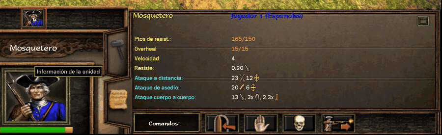

*3. `segment stat`, the portrait bar, the Overheal row and an aura* (the unit panel and its "Unit information" panel; the UI data has the overheal gadget below): the selected marked Musketeer starts at `165/150`: the bar under its portrait is green with the orange overheal at its right end, and the new row reads `Overheal 15/15` in orange. A hit takes it below its 100 %: the portrait shows the stock bar (green, then yellow at the second hit) and `Overheal 0/15`; the Surgeon heals it back and the orange end returns. Halfway, a Golden Pavilion whose tactic has the `UnitHitpointsIncrease2` aura (MaxHP x1.1) appears: the max goes from 165 to 181.5 and the 100 % follows it, from 150 to 165, so the text reads `181/165 (150+15)` and the row `Overheal 16/16` (2x speed). [Full video (MP4)](media/overhealHitpointBars-portrait.mp4).

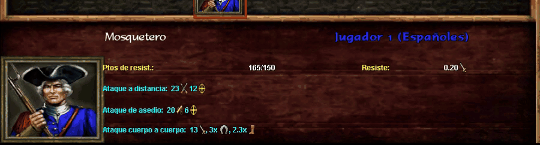

*4. The minimized UI* (the game option "minimized interface", `optionminimizedui`): its HP text (`unitHitPointsValue`) takes the 100 % too: `120/150` while the Surgeon heals, `165/150`, then `181/165` under the same aura. It stays white: that text gadget prints the colour markup as text, so it is not coloured. That layout has no portrait bar and no Overheal row (3x speed). [Full video (MP4)](media/overhealHitpointBars-minimized.mp4).

```
overhealHitpointBars [<UnitType> ...] [segment[=RRGGBB]] [stat[=<Label>]] [log]   default AbstractOverheal; up to 8 types
```

- **How stock behaves:** a unit is created with its proto's `<InitialHitpoints>` and can be healed
  up to `<MaxHitpoints>`. Every HP display takes `MaxHitpoints` as 100 %: the floating HP bar over
  a unit, the selection panel's HP bar (green, yellow below 66 %, red below 33 %), "Group Health",
  and the texts `HP/max`, or `HP/max (base+bonus)` when techs raised the max. A mod that gives
  units more `MaxHitpoints` than `InitialHitpoints`, so that healers can push them above their
  starting HP (WoL plans `MaxHitpoints` = 1.1 × `InitialHitpoints` on infantry and cavalry), shows
  every fresh unit as damaged: a 91 % bar and `150/165`.
- **Effect:** for a unit whose proto is of `<UnitType>` and has `InitialHitpoints` below
  `MaxHitpoints`, the displays take `InitialHitpoints` as 100 %:
  - a fresh unit (HP = `InitialHitpoints`) shows a full bar and `150/150`;
  - an overhealed unit shows a full bar (the bar is not drawn past 100 %) and `165/150`;
  - a damaged unit shows its HP against `InitialHitpoints`: 105 HP is a 70 % green bar and
    `105/150`, where stock shows a 64 % yellow bar and `105/165`;
  - the selection's average health counts each unit at most 100 %, so "Group Health" never reads
    above 100 %;
  - `(base+bonus)`: the base is the proto's `InitialHitpoints` in the data, the bonus what techs
    added since.

  Units of other types, and marked units whose `InitialHitpoints` is not below `MaxHitpoints`,
  display as in stock.
- **`segment`** (Overwatch style): the HP above 100 % is shown too.
  - The floating bar stays full and the overheal is drawn over its right end, in orange: a
    Musketeer at 165/150 has its right 10 % orange; from twice its 100 % the whole bar is orange.
    The bar keeps its width.
  - The unit panel's HP text above 100 % is orange too (`165/150`), through the game's own colour
    markup.
  - `segment=RRGGBB` sets another colour (hex, e.g. `segment=40C0FF`).
  - The floating bar is drawn in the player's colour (the stock bar is not green), so the segment
    sits next to the player's colour.
  - No data change is needed beyond the marker for these.
  - The bar under the selected unit's portrait shows the overheal too, when the UI data has a
    fourth bar for it (below, "The portrait bar"): while the selected units have overheal and the
    stock bar is full, that bar is drawn over it, its mask (green) on the left and its background
    (the overheal colour) on the right end, (HP − 100 %) / 100 % of its width (the average of the
    selected units). Below 100 % the stock green / yellow / red bar shows, as without the key.
- **`stat`**: the unit's "Unit information" panel (the stat rows next to the portrait) gets a row
  right after the HP row for a marked unit: `Overheal 15/15`, the HP above its 100 % and the most
  it can have (max − 100 %), truncated like the HP row, so `165/150` gives `15/15`. With
  `segment` the value is in the segment colour while it is above 0. The label is `Overheal`, or
  `stat=<Label>`: one word, `_` for a space (`stat=Sobre_curación`; UTF-8 or ANSI), or a number,
  which takes that string from the string table (`stat=90001`), so a mod can translate it. The
  rows below move down one, as for the stock "Group Health" row (whose label is also a literal).
- **What does not change:** the hit points themselves, healing (healers still heal up to
  `MaxHitpoints`, which is what makes the overheal possible), techs, auras, AI, triggers and every
  other game rule: they all keep reading `MaxHitpoints`.
- **Choosing the units:** the default marker `AbstractOverheal` is registered by the DLL, like
  `healNonIdle`'s; add it to the protos and edit `protoy.xml` and its XMB as described there. An
  existing type works with no data change: WoL can write `overhealHitpointBars
  AbstractCavalryInfantry` (WoL gives that type to its infantry and cavalry). A proto name works
  too, and up to 8 names may follow the key on one line.
- **Data:** give the units `<MaxHitpoints>` above `<InitialHitpoints>`:

  ```xml
  <Unit id ='286' name ='Musketeer'>
      ...
      <InitialHitpoints>150.0000</InitialHitpoints>
      <MaxHitpoints>165.0000</MaxHitpoints>
  ```

- **Techs and auras:** a `Hitpoints` tech adds the same amount to `InitialHitpoints` as to
  `MaxHitpoints`. A percentage tech therefore leaves a full unit slightly below 100 %: after
  +10 % on 150/165, `InitialHitpoints` is 166.5 and a unit that was at 150 HP has 165 (99 %). An
  aura or modifier that changes one unit's max scales its reference by the same factor, so a full
  unit stays full (seen in game: a Golden Pavilion's MaxHP x1.1 aura took a Musketeer from
  `165/150` to `181/165 (150+15)`, `Overheal 15/15` to `16/16`). In a skirmish, the British
  Explorer marked for a test (400 / 440 in the data) showed `180/180` and `Overheal 0/40`: a
  start-of-game effect lowers both values by the same amount, and the reference follows it.
- **The portrait bar (UI data).** The selection panel looks up its bars by name in
  `uiunitselection.xml` (`unitselectionpanel-unitHealthBarGreen`, `…Yellow`, `…Red`: three
  `progressBar` gadgets at the same place, of which it shows one). With `segment`, the key looks
  up a fourth, `unitselectionpanel-unitHealthBarOverheal`, and shows, fills and hides it itself.
  Without it, the portrait bar stays stock (the log says which). Give it the same place as the
  stock bars, a higher `z`, the overheal colour as its background and the HP colour as its mask;
  a progress bar draws nothing without a background (`progressbarbackground` together with
  `progressbarbackgroundsize`):

  ```xml
  <gadget name="unitselectionpanel-unitHealthBarOverheal" type="progressBar" size1024="420 756 519 766"
          z="111" progressbarbackground="ui\ingame\uhc_health_overheal" progressbarbackgroundsize="104 8"
          progressbarmask="ui\ingame\ingame_ui_health_green"/>
  ```

  right after `unitselectionpanel-unitHealthBarRed` in the TAD file (`Data3.bar`,
  `Data\uiunitselection.xml.xmb`; extract it with `tools/bar.py`, convert it with
  `tools/xmbedit.py to-xml`, add the line, compile it with `from-xml` and put the `.xmb` in the
  mod's `data\`). The background texture is the mod's: the tests used a 16 x 8 DXT1 orange
  gradient, `art\ui\ingame\uhc_health_overheal.ddt` (a stock colour such as
  `ui\ingame\ingame_ui_health_yellow` works too). The minimized UI layout
  (`uiunitselectionmin.xml`) has no such bar.
- **`log`:** one line for the first unit of each proto whose reference differs from its max (once
  per proto name in a session).
- **Log:** at startup `overhealHitpointBars: HP bars and HP texts of units of unittype X take
  InitialHitpoints as 100 % (display only)` (several types are listed as `X, Y`; with `log`: `…as
  100 %, the first unit of each proto logged (display only)`); when the data loads, `unit types: X
  -> <ID> …`; in a game, `hook reached: overhealHitpointBars (0x45FAAF)` (the first floating HP
  bar), `(0x4C5014)` (the first selection), and for the HP texts `(0x698B35)`, `(0x4D7575)` with
  `(0x4D7615)`, or `(0x9AFA2A)` with `(0x9AFA4E)`, depending on which panel shows them. With
  `log`: `overhealHitpointBars: unit N (Musketeer) HP 150.0 is shown against 150.0 instead of its
  max 165.0 (InitialHitpoints 150.0, MaxHitpoints 165.0); logged once per proto`.
  With `segment`: the startup line adds `HP above it shown as a segment and texts coloured
  FF8C00`; in a game `hook reached: overhealHitpointBars segment queue (0x45FB6C)`, `segment fit
  (0x45C4B9)`, `segment vertices (0x45CB72)` and `text (0x4D7651)` (`text (0x69A9C0)` for the
  `(base+bonus)` form); with `log`, `overhealHitpointBars: unit N (Musketeer) HP 165.0 is above its
  100 % 150.0: overheal segment of 10.0 % of the bar; logged once per proto`; and, only if a frame
  ever has more bars than the vertex buffer holds (about 9,700), `… bars do not fit in the vertex
  buffer …: this frame's K overheal segments were dropped (logged once)`. A wrong colour stops the
  key: `overhealHitpointBars: segment=…: expected segment or segment=RRGGBB (hex); feature not
  applied`. The portrait bar: `hook reached: overhealHitpointBars portrait bar (0x4C83DF)`, then
  `overhealHitpointBars: the UI has unitselectionpanel-unitHealthBarOverheal: the portrait bar
  shows the overheal (logged once)` or `the UI has no …: the portrait bar stays stock`; with `log`,
  `the portrait bar shows an overheal of 10.0 % of the bar (1 units; logged once)`.
  With `stat`: the startup line adds `an overheal stat row labelled 'Overheal'` (or `labelled by
  string N`); in a game `hook reached: overhealHitpointBars stat row (0x4D76DB)`; with `log`,
  `stat row 2 of unit N (Musketeer): overheal 15/15 (logged once)` (with its colour markup). A bad
  label stops the key: `overhealHitpointBars: stat=…: expected stat or stat=<label> (a word, '_'
  for a space, or a string table ID); feature not applied`.
- **Limits:**
  - without `segment` the floating bar stops at 100 %;
  - the portrait bar needs the fourth gadget in the UI data (above); only the stat row's HP text
    is coloured: the minimized UI's `unitHitPointsValue` prints the markup as text (seen in game),
    so it stays white, and the ObjectInfo panel (the scenario editor's) is not coloured either;
  - other places still compare HP with `MaxHitpoints` and see a fresh marked unit as damaged: the
    damage-state visuals, the AutoRepairUnit command check (moot for infantry and cavalry), and the
    HP shown in tech and card rollovers;
  - whether the multi-selection stack buttons draw their own HP bars was not established.
- **Simulation:** no. Only display code is hooked (floating bars, the selection's group, three HP
  texts, the portrait bar's gadget, the stat row); every game rule reads the stock max. Players may set it differently. A new marker name
  adds a unit type, which changes the unit type count: load saved games and replays with the same
  cfg.
- **Status:** confirmed in single player (2026-10-29), in the interface. A Musketeer marked
  `AbstractOverheal`, with `InitialHitpoints` 150 and `MaxHitpoints` 165, showed `Ptos de resist.:
  150/150` (the Spanish game's "Hit Points") and a full HP bar in its unit panel; the unmarked
  Pikeman (120/132) kept the stock bar, not full. The log showed `unit 0 (Musketeer) HP 150.0 is
  shown against 150.0 instead of its max 165.0 (InitialHitpoints 150.0, MaxHitpoints 165.0)`. The
  floating bars and the group bar were not compared on their own; an overhealed unit and the
  techs were not tested.
  `segment`: confirmed in single player (2026-10-29). Musketeers healed to 165 by a Surgeon showed
  the full bar with an orange segment over its right tenth and an orange `165/150`; a Musketeer
  damaged to 92 showed a partial bar and a white `92/150`; the unmarked Pikeman healed to 132/132
  and a fresh Musketeer (150/150) showed no segment. A skirmish against the AI with the key on
  played normally. Also confirmed: with `segment=40C0FF`, a Musketeer under a `Hitpoints` tech
  (+15 %) healed to its max showed a light-blue segment and `189/174 (150+24)` in light blue; an
  allied player 2 Musketeer showed its yellow bar with the light-blue segment and its panel
  `165/150` in light blue.
  Portrait bar and `stat`: confirmed in single player (2026-10-29), with the overheal gadget in the
  test copy's UI data: a Musketeer at `165/150` showed the portrait bar 90 % green and 10 % orange
  and `Overheal 15/15` in orange; damaged, the stock green or yellow bar and `Overheal 0/15`;
  under a Golden Pavilion's MaxHP aura, `181/165 (150+15)` and `Overheal 16/16` (a max changed by
  an aura). Selecting the Surgeon, the Pavilion, a mine or a tree after it showed their stock bar; a marked
  Explorer at its 100 % in a skirmish showed a green bar. The minimized UI's text read `120/150`
  and `181/165` (white). Without the gadget in the UI data the log says so and the bar is stock.
  Not tested: the ObjectInfo panel (an editor panel, `aeditorscreen.cpp`, which did not open with
  the clicks tried), multiplayer.
- **New in this DLL:** not in UHC 1.10. WoL request #21 ([wol-requests.md](wol-requests.md)).

### overhealSources

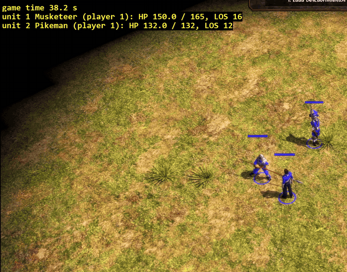

*1. A surgeon and a source monk:* a marked Musketeer (150 / 165) is hit to 90; the surgeon heals it back to 150 and stops; at second 75 an Indian monk marked `AbstractOverhealer` appears and takes it to 165 (the orange segment). The unmarked Pikeman is healed to its max, as in stock. [Full video (MP4)](media/overhealSources.mp4).

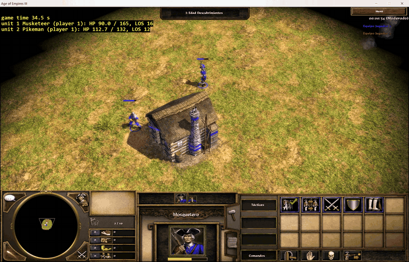

*2. A healing building, then an idle surgeon:* a Manor with `HCXPFlorenceNightingale` heals the marked Musketeer from 90 to 150 and stops there (the log line `a heal of unit 1 (Musketeer) stops at its 100 % 150.0`), and the unmarked Pikeman to 132 / 132. At second 60 a surgeon appears next to the Musketeer at 150 and stays idle (2x speed). [Full video (MP4)](media/overhealSources-building.mp4).

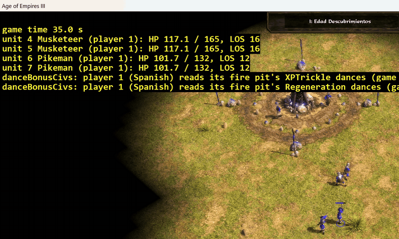

*3. An area heal that is not a building, the Regeneration dance:* three settlers dance at a fire pit whose tactic has `RegenAllUnits` (`danceBonusCivs` lets the Spanish player use it). It heals every idle unit: the two marked Musketeers go from 90 to 150 and stop there (the log line `a heal of unit 4 (Musketeer) stops at its 100 % 150.0`), the two unmarked Pikemen from 80 to 132, their max (2x speed). [Full video (MP4)](media/overhealSources-dance.mp4).

```
overhealSources [<UnitType> ...] [log]   default AbstractOverhealer; up to 8 types
```

- **Needs** [`overhealHitpointBars`](#overhealhitpointbars): its unit types mark the units that
  have overheal, and its 100 % (`InitialHitpoints`, scaled when an aura changes the max) is the
  limit here. Without that line the key is not applied.
- **Effect,** for a marked unit:
  - a healer whose proto is of a source type (default `AbstractOverhealer`, a new marker; an
    existing type or a proto name works too) heals it up to `MaxHitpoints`, as in stock;
  - any other healer heals it only up to its 100 %: its automatic search does not pick a marked
    unit at its 100 %, and its heal action ends when the unit gets there (the healer goes idle);
    a direct order on such a unit ends at once;
  - every other way of gaining HP stops at the 100 % too: regeneration, the Regeneration dance,
    area heals, self heals, powers and triggers that add HP. Only the single-target heal action of
    a source healer overheals. Damage, and code that sets HP rather than adding it (creation,
    transforms, the aura rescale), are not touched.

  Unmarked units heal as in stock.
- **Data:** the source type on the healers that may overheal, e.g.
  `<UnitType>AbstractOverhealer</UnitType>` on `ypMonkIndian` (in `protoy.xml` and its XMB), or name
  an existing type: `overhealSources AbstractMonk`.
- **Log:** `overhealSources: only healers of unittype X heal marked units above their 100 %; every
  other heal stops there (multiplayer unverified)`; when the data loads `unit types: X -> <ID> …`;
  in a game `hook reached: overhealSources heal search (0x9CD984)`, `heal tick (0x9E0BBB)`, `heal
  (0x9E0CE9)` and `overheal add HP (0x4823A3)`. With `log`, the first of each proto: `overhealSources:
  a heal of unit N (Musketeer) stops at its 100 % 150.0 (…; not from a source healer)` and `…unit N
  (Musketeer) is healed above its 100 % 150.0 by a source healer (…)`. Without
  `overhealHitpointBars`: `overhealSources: needs overhealHitpointBars, …; feature not applied`.
- **Simulation:** yes. Every machine needs the same line (and `overhealHitpointBars` with the same
  types). The source type is a new unit type, which changes the unit type count.
- **Status:** confirmed in single player (2026-10-29). A marked Musketeer hit to 90 was healed by a
  surgeon to 150 and stayed there (the surgeon idle) until an Indian monk marked as a source
  appeared and healed it to 165; an unmarked Pikeman was healed to its max. A skirmish against the
  AI with the key on played normally. Also confirmed:
  - a building that heals (a Manor with `HCXPFlorenceNightingale`) healed a damaged marked
    Musketeer only to 150 and an unmarked Pikeman to its max;
  - a surgeon that appeared next to a marked Musketeer at 150 stayed idle, and a direct order
    (right-click) on it made the surgeon walk to it and go idle on arrival, the Musketeer still at
    150;
  - a unit's own regeneration stops at its 100 %: an Indian monk marked for the test (250 / 275)
    stayed at 250 for 70 s, where it regenerates to 275 without the key. A knocked-out hero
    still gets up: stock revives it at about 40 % of its HP, below its 100 %;
  - an area heal that is not a building: the fire pit's Regeneration dance healed marked
    Musketeers from 90 only to 150, and unmarked Pikemen to their max 132.

  Not tested: powers (`PowerHeal` exists in `powers.xml`, but no TAD unit has it; its heal goes
  through the same add-HP entry, 0x7C378C / 0x8CCA6F), multiplayer.
- **New in this DLL:** not in UHC 1.10.

### overhealDecay

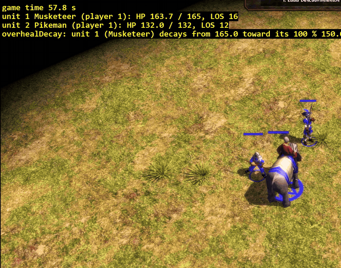

*1. After the healer dies:* `overhealDecay 2 3`. A source monk keeps a marked Musketeer at 165 (when it slips, the monk heals it back); at second 60 the monk is killed, and the Musketeer loses about 2 HP per second and stops at 150, its 100 %. [Full video (MP4)](media/overhealDecay.mp4).

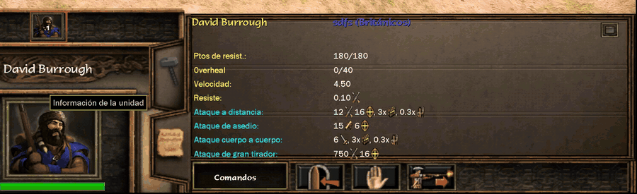

*2. A skirmish against the AI, against regeneration:* `overhealDecay 2 1` with the British Explorer marked for the test (its 100 % is 180 and its max 220 in this game). Explorers regenerate: the decay takes back what it regenerates above 180, so it stays at `180/180`, `Overheal 0/40`, and its portrait bar is green (2x speed). [Full video (MP4)](media/overhealDecay-skirmish.mp4).


*3. Control, the same skirmish without `overhealDecay`:* the Explorer regenerates past its 100 %, from 190 to 210 in these 30 s (`197/180`, `Overheal 17/40` in orange, the orange end on the portrait bar), up to 220 (2x speed). [Full video (MP4)](media/overhealDecay-skirmish-control.mp4).

```
overhealDecay <rate>[%] [<delay>] [<UnitType> ...] [log]
```

- **Needs** [`overhealHitpointBars`](#overhealhitpointbars): its types mark the units and its
  100 % (`InitialHitpoints`, scaled when an aura changes the max) is where the decay stops.
- **Effect:** a marked unit whose HP is above its 100 % loses `rate` HP per second (`2`), or
  `rate` percent of its 100 % per second (`1%`), counted in game time (paused games and game speed
  follow), once `delay` seconds (default 0, decimals allowed) have passed since it last gained HP
  above its 100 %. It stops exactly at its 100 %: the decay never goes below it and never kills.
  With unit types (or proto names) listed, only marked units of those types decay. Works with or
  without [`overhealSources`](#overhealsources): with it, only source healers create overheal to
  decay; without it, any heal above the 100 % does.
- **What counts as a gain:** any heal that takes the unit above its 100 % (healers, area heals,
  powers…) restarts the delay. Regeneration (the unit's own, and the Regeneration dance) does not:
  it heals a little on every step, so it would hold the delay forever; a unit that regenerates
  above its 100 % decays at once (the rate minus what it regenerates). With `overhealSources`,
  regeneration never passes the 100 % anyway. HP that a unit has above its 100 % without any gain
  (a transform into another marked proto, for instance) does not decay until its next gain.
- **Log:** `overhealDecay: marked units above their 100 % lose R HP per second of game time, D s
  after their last gain, down to it (multiplayer unverified)`; in a game `hook reached: overheal add
  HP (0x4823A3)`, `hook reached: world update (0x481A57)`, `hook reached: overhealDecay
  regeneration (0x490881)` and, with a Regeneration dance, `overhealDecay Regeneration dance
  (0x67A03B)`. With `log`, the first of each proto:
  `overhealDecay: unit N (Musketeer) decays from 165.0 toward its 100 % 150.0 at 2.00 HP/s` and
  `… is back at its 100 % 150.0`. Without `overhealHitpointBars`: `overhealDecay: needs
  overhealHitpointBars, …; feature not applied`; a bad rate: `overhealDecay: expected <HP per
  second>[%] [delay seconds] [UnitType ...] [log], …; feature not applied`.
- **Simulation:** yes, every machine needs the same line. A listed name that is not a type yet is
  registered as a marker unit type.
- **Status:** confirmed in single player (2026-10-29) with `overhealDecay 2 3`, together with
  `overhealHitpointBars`, `overhealSources` and `damageOverTime`: a marked Musketeer at 165 fell to
  160.2, 154.1 and 150.0 over about six seconds after its healer was killed, and stayed at 150; an
  unmarked Pikeman did not change. Poison (`damageOverTime`) still ticked normally in its own test
  copy. A skirmish against the AI with all these keys on played normally. Also confirmed:
  `overhealDecay 2% 1 Musketeer` took 3 HP per second (2 % of 150) off a Musketeer at 165 down to
  150; with `overhealDecay 2% 1 Pikeman` the Musketeer stayed at 165; player 2's overhealed units
  decay too. Only the game world decays: the world update also runs for the home city's world,
  which the key ignores.
  In a skirmish against the AI (2026-10-29, the home city world present): a marked British Explorer
  stayed at its 100 % (180) while regenerating; without the key it went past it, to 220. That
  test found a fault, now fixed: every regeneration step counted as a gain and restarted the
  delay, so an idle unit that regenerates never decayed (the AI's Explorer, moving and not
  regenerating, did). The AI played normally (its units 12 → 16 in a minute, no XS error). Not
  tested: multiplayer.
- **New in this DLL:** not in UHC 1.10.

### showGatherRate


*In game:* A settler gathering berries: the info panel row `Alim.: 0.67/s`. [Full video (MP4)](media/showGatherRate.mp4).

```
showGatherRate [<UnitType>] [log]      no UnitType: every unit
```

- **How stock behaves:** the stat panel (the rows next to the selected unit's portrait,
  `uiunitstatpanel3`, up to 9 rows) shows a rate per second only for **AutoGather** units, such as
  a Bank: right after the HP row, a row `Food (icon): 0.67/s`, or `8/s` for a whole number. A
  villager has no such row: its rate exists only inside the gather code, which runs once per
  gather animation loop, multiplies the rate by the loop's time and adds the result to the
  stockpile. The data refs `currentUnitGatherRate`, `currentUnitGatherRateFloat` and
  `currentUnitGatherRateString` exist in the exe but always fail (their provider is an empty
  stub).
- **Effect:** when **one** unit is selected and it is gathering (berries, a hunt, a tree, a mine,
  a farm, a crate, a sheep, …), the stat panel gets one more row after the HP row (and after a
  stock AutoGather row, if the unit has one), in the stock style: `Food (icon): 0.67/s`. The rate
  is the one the game used for the unit's last gather loop: the proto's gather rate for that
  target type with techs and work-rate modifiers, the Gathering dance and the player's gather
  multiplier. It is the amount per second the stockpile receives while the unit gathers. The row
  appears after the unit's first gather loop (about 1 to 2 s after it starts) and goes away as
  soon as the unit does something else, or at most 2.5 s (two loops for slow animations) after
  its last loop. The label is the resource's name from the string table, as in the stock row
  (`Alim.` in the Spanish game).
- **`<UnitType>`:** only units whose proto is of that unit type (or that proto) get the row. A
  new name is registered as an abstract unit type, like `healNonIdle`'s marker. A name that no
  unit has turns the row off and keeps the data ref.
- **Hiding the row for a proto:** `<Flag>DoNotShowAutoGatherRate</Flag>`, the stock flag that
  hides the stock AutoGather row, hides this row too.
- **The data ref, for your own UI:** `{currentUnitGatherRateString}` in a `formatText` gadget
  returns `Food 0.67/s` (`Food 8/s` for a whole number) for the data refs' current unit (the one
  the stock refs such as `{currentUnitLOS}` show), and an empty string when that unit is not
  gathering. Give the gadget a `datarefreshrate`, as WoL does for `{currentUnitLOS}`:

  ```xml
  <gadget name="myGatherRate" type="formatText" datarefreshrate=".5" ...>Gather: {currentUnitGatherRateString}</gadget>
  ```

  The data ref works for any unit, with or without `<UnitType>`, and ignores the stat panel's
  rules (selection size, `DoNotShowAutoGatherRate`). `{currentUnitGatherRate}` (whole number) and
  `{currentUnitGatherRateFloat}` are **not** changed: WoL's `uimainnew.xml` already uses
  `{currentUnitGatherRate(gold)}` in a tooltip, and they keep failing as in stock.
- **Your data:** nothing. A mod whose stat panel has fewer rows (WoL's `uiunitstatpanel3.xml` has
  5) loses its last row while the gather row is shown: the row goes right after HP and the rows
  after it move down. Such a mod may prefer the data ref and a `<UnitType>` that no unit has.
- **Limits:**
  - one selected unit only (the stock rule for the AutoGather row); nothing for a group;
  - the stock AutoGather row's other conditions apply too: a building must be finished, and the
    selection must pass a stock test whose meaning is not known (a selection byte; possibly units
    the player does not own);
  - gathering into the unit's own inventory (`<addresourcestoinventory>`, for example herd animals
    fattening at a pen) runs other code and gets no row;
  - a target of type `AbstractShrine` and a defeated player give nothing, so they show no row;
  - the rate is that of the last gather loop: a tech researched during a loop shows from the next
    loop on;
  - the row follows the stat panel's own refresh.
- **`log`:** one line the first time a unit's rate for a resource is shown in the stat panel, and
  one the first time the data ref returns it. A new game starts the list again.
- **Log:** at startup `showGatherRate: the stat panel shows the gather rate per second of a
  selected gathering unit, and {currentUnitGatherRateString} returns it (UI only)` (with a unit
  type: `…of a selected unit of unittype X, and {currentUnitGatherRateString} returns it for any
  unit (UI only)`; with `log`, `…, each unit's first rate per resource logged (UI only)`); with a
  unit type, when the data loads, `unit types: X -> <ID> …`. In a game:
  `hook reached: showGatherRate record (0x4ED044)` (the first gather loop of any unit),
  `hook reached: showGatherRate panel (0x4D7834)` (the first stat panel fill),
  `hook reached: showGatherRate row value (0x69AFE0)` (the first rate row, this one or a stock
  AutoGather row), and `hook reached: showGatherRate data ref (0x5D2D3C)` (the first time a gadget
  reads the data ref). With `log`: `showGatherRate: unit N (Settler) of player 1 gathers Alim.
  (resource 2) at 0.670/s from unit T (BerryBush), shown in the stat panel` (or `…, shown in the
  data ref currentUnitGatherRateString`).
- **Simulation:** no. The hook in the gather code copies the rate into the DLL's memory and writes
  nothing in the game; everything else is the interface. Players may set it differently (not
  tested in multiplayer).
- **Status:** confirmed in single player (2026-10-29), in the interface: a Settler gathering a
  `BerryBush` got a new row `Alim. (icon): 0.67/s` right under its HP row, and the log showed
  `showGatherRate: unit 0 (Settler) of player 1 gathers Alim. (resource 2) at 0.670/s from unit 1
  (BerryBush), shown in the stat panel`. Only that case was run: the data ref, other targets,
  whole-number rates, a `<UnitType>` and `DoNotShowAutoGatherRate` were not tested.
- **New in this DLL:** not in UHC 1.10. WoL request #28 ([wol-requests.md](wol-requests.md)).

### buildingWorkRateAuras


*In game:* An Explorer aura (BuildingWorkRate x4) speeds up the Blood Factory next to it: 11 musketeers against 2 (2x speed). [Full video (MP4)](media/buildingWorkRateAuras.mp4).

```
buildingWorkRateAuras [log]
```

- **How stock behaves:** an aura (a tactics action of type `AutoRangedModify`) changes one stat of
  the units in range, named by `<ModifyType>`. The exe knows 13 names: `Speed`, `MaxHP`, `Damage`,
  `MovingDamage`, `Bounty`, `SiegeDamage`, `UnitDamage`, `LOS`, `Armor`, `GatherRate`,
  `AbilityROF`, `ROF` and `AutoGatherRate` (case is ignored). Any other name is read as "no stat"
  without an error, and the aura does nothing. `BuildingWorkRate`, the speed at which a building
  trains units, researches techs and spawns its `Maintain` units, is not one of them.
- **Effect:** `BuildingWorkRate` becomes a valid `<ModifyType>`. A unit that a modifier with it
  reaches trains, researches and spawns its `Maintain` units at its normal rate times the
  modifier's `<ModifyMultiplier>`. The factor starts at 1.0, like `GatherRate`: several auras
  multiply each other, and an aura with `<ModifyExclusive>1</ModifyExclusive>` stops the ones
  after it, as for every stock stat.
- **Your mod:** an `AutoRangedModify` action with the new name, in the tactics file of the unit
  that carries the aura, listed in each of its tactics. Pick the buildings with `<ModifyProtoID>`
  or `<ModifyAbstractType>`. For example, an aura like the one of the in-game test, on the
  Explorer:

  ```xml
  <action>
      <name>UHCBwrAura</name>
      <type>AutoRangedModify</type>
      <active>1</active>
      <persistent>1</persistent>
      <maxrange>40</maxrange>
      <modifyprotoid>BloodFactory</modifyprotoid>
      <modifytype>BuildingWorkRate</modifytype>
      <modifymultiplier>4.0</modifymultiplier>
  </action>
  ```

  and, in each of the unit's tactics, the action on the tactic name's line:
  `<tactic>Volley<action>UHCBwrAura</action>…`. Ship the tactics file compiled
  ([Tactics files](#tactics-files)). The aura reaches only its owner's own units (unless its
  tactics action allows other players) and only finished ones (static reading). A power's
  `<unitModify apply='Multiply' amount='1.5'>BuildingWorkRate</unitModify>` works too (static
  reading, not tested).
- **With `liveBuildingWorkRate`:** the two combine. The aura multiplies the building's rate, which
  is the proto's current `BuildingWorkRate` with that key, or the copy taken when the building was
  completed without it.
- **With `noTrainNearEnemyTC`:** that key owns the Train call; its hook calls this key's factor
  through a shared pointer, so trainers still get it. The log says so at startup.
- **`log`:** one line when a unit's factor changes, and one when it is back to 1.0.
- **Log:** at startup `buildingWorkRateAuras: modifiers with ModifyType BuildingWorkRate (stat
  0x40) scale train, research and Maintain speed (multiplayer unverified)` (with `log`: `…speed,
  every change of a unit's factor logged (multiplayer unverified)`), and, with
  `noTrainNearEnemyTC`, `buildingWorkRateAuras: the Train call at 0x009EA410 is already hooked
  (noTrainNearEnemyTC); Train speed gets the factor only through that hook's call of
  g_uhcBwrTrainGetter`. While the data loads, `hook reached: buildingWorkRateAuras (0x5FE6D7)` and,
  once a tactics file uses the name, `hook reached: buildingWorkRateAuras ModifyType
  BuildingWorkRate (0x5FE6D7)`; in a game, `hook reached: buildingWorkRateAuras (calls of
  0x9BFE33)` (the first train, research or `Maintain` tick) and `hook reached:
  buildingWorkRateAuras: a unit with modifiers (calls of 0x9BFE33)`. With `log`:
  `buildingWorkRateAuras: unit N (BloodFactory, player 1) works at x4.000 from BuildingWorkRate
  modifiers (Maintain)` and `buildingWorkRateAuras: unit N (Proto, player P) works at x1.000
  again: no BuildingWorkRate modifier left (Train)`. The last word is `Train`, `Research`,
  `CommandResearch`, `Maintain`, or `through g_uhcBwrTrainGetter` for the Train call when
  `noTrainNearEnemyTC` owns it.
- **Limits:**
  - only train, research and `Maintain` speed. Build, repair and heal speed come from each
    action's own rate and are not covered. `GatherRate` and `AutoGatherRate` auras already work in
    stock;
  - the stat panel still shows the proto's `BuildingWorkRate`, and the aura's tooltip has no line
    for this stat;
  - with `log`, a unit is logged once per unit ID and factor in a session, so a unit of a later
    game with the same ID and factor is not logged again;
  - the value 0x40 that stands for the new stat is this DLL's choice. Another DLL that adds its own
    `ModifyType`s must not use it.
- **WoL data** (static scan): `alguacil.tactics` already has such an aura (`GuatemalaAura`,
  `EscuelaPolitecnica`, 1.20), but it is `<active>0</active>` and no tech turns it on. Five
  tactics use `GATHER` (`GatherRate` is meant), two use `Hitpoints` (`MaxHP` is meant) and one
  uses `UnitResource`, which is no stat: stock reads all three as unknown, so those auras do
  nothing, with or without this DLL.
- **Simulation:** yes. A saved game keeps the modifier's stat; loading it without the key ignores
  it.
- **Status:** confirmed in single player (2026-10-29), with an aura on the Explorer (multiplier
  4.0, range 40, `ModifyProtoID` `BloodFactory`): player 1's BloodFactory logged `works at x4.000
  from BuildingWorkRate modifiers (Maintain)` and spawned 11 musketeers, while player 2's factory,
  without the aura, spawned 2 in the same time. `liveBuildingWorkRate` and `noTrainNearEnemyTC`
  were on in the same run. Train and research speed, the removal of the aura, powers and saved
  games were not tested.
- **New in this DLL:** not in UHC 1.10. WoL request #22 ([wol-requests.md](wol-requests.md)).

### bufferedFileReads

```
bufferedFileReads [<KB>] [verify]      default 64 KB
```

- **How stock behaves:** the game reads its archives (`art\Art*.bar`, `data\Data*.bar`,
  `sound\*.bar`, …) and its loose files a few bytes at a time. It makes one Windows read call for
  every 1 to 16 bytes, about 10 million in a session. When a match needs a model or an animation
  it has not loaded yet, those reads run inside the frame, and the frame stalls (a stutter).
- **Effect:** every file the game opens for reading only gets a read-ahead buffer. One Windows read
  fills the buffer, and the game's small reads are served from memory. The game receives the
  same bytes.
- **Measured** in a late 8-AI game ([performance.md](performance.md), §9, "bufferedFileReads A/B"),
  on a 150 s recording:

  | | Without | With |
  |---|---|---|
  | Frames over 100 ms | 11 | 3 |
  | Frames over 50 ms | 19 | 11 |
  | Longest frame | 251 ms | 116 ms |
  | Time in file reads, whole session (most of it loading) | 14.9 s | 1.0 s |

- **What it does not fix:** most of the remaining stutter is the animation library (granny)
  setting up the model it just read. That is processing work, not reading.
- **Your mod:** nothing.
  - `<KB>` (4 to 1024) is the buffer size per open file.
  - `verify` also reads every buffered request from the file for real and compares the two. It is
    a correctness test and makes reading slower.
- **Log:**
  - at startup, `bufferedFileReads: read-only files get a 64 KB read-ahead buffer (multiplayer-safe: same bytes)`;
  - with `verify`, at exit: `bufferedFileReads verify: N buffered reads checked, M mismatches`.
    M must be 0.
- **Simulation:** no. It changes how the bytes are fetched, not which bytes, so players do not
  need the same setting.
- **Status:** confirmed in single player. On a 25-minute save, `verify` checked 7.5 million buffered
  reads against the file and found no mismatch. Not tested in multiplayer.
- **New in this DLL:** not in UHC 1.10.

### multipleInstances

```
multipleInstances [background]
```

- **How stock behaves:** one copy of the game per machine. A second copy, even one started from
  another folder, stops at "Only one copy of the game can run at a time" (in Spanish, "Sólo puede
  ejecutarse una copia del juego al mismo tiempo").
- **Effect:** this copy no longer collides with copies in other folders. Two copies started from the
  same folder still refuse each other, because they would share that folder's files (`UHC.log`, the
  `perfExecFile` file, …). Only one of the two copies needs the key.
- **`background`:** this copy's windows open behind every other window, stay there and never take the
  focus. The copy cannot cover another window or receive the clicks and keys meant for it. This is
  for unattended tests driven through `perfExecFile`
  ([developer guide](developer-guide.md#driving-the-game-unattended)). Define
  `config("DontPauseWhenLosingFocus")` too: a game in progress pauses whenever its window is not
  focused, which with `background` is always.
- **Shared files:** every copy uses the same `Documents\My Games\Age of Empires 3` folder: the profile
  (the last copy to exit writes it), saved games, scenarios and the game's own `Age3Log.txt`. Give
  saves and scenarios different names in each copy.
- **Your mod:** nothing.
- **Log:**
  - at startup, `multipleInstances: this copy may run beside copies in other folders (semaphore suffix -XXXXXXXX)`;
  - when the game checks for another copy, `multipleInstances: single-instance semaphore "…" renamed to "…-XXXXXXXX"`;
  - with `background`, one line per window: `multipleInstances background: window of class … placed at the bottom, never activated`.
- **Simulation:** no.
- **Status:** confirmed on 2026-10-28 with two copies on one machine.
  - A copy with `multipleInstances background` started while a copy without the key sat at the main
    menu. It loaded a 25-minute save and ran a 60 s benchmark at 179 FPS (195 when alone).
  - Its log showed the stock name `Global\Age3` renamed to `Global\Age3-BCD865D7`.
  - Sampled every second, its window stayed second from the bottom of 50 windows and was never the
    focused window. The copy without the key did take the focus when it started.
  - Not tested: three or more copies, multiplayer.
- **New in this DLL:** not in UHC 1.10.

## 6. Editing the game data

Work on your mod folder, never on the Steam install. Run the tools from a terminal opened in the
unzipped source code folder, the one that contains `tools\`, and give them full paths to your
mod's files.

- **Where data lives:**
  - loose files in `data\`: `protoy.xml`, `techtreey.xml`, `stringtabley.xml` and others,
    usually with a compiled `.XMB` twin next to them;
  - everything else is in archives: `data\Data*.bar` (tactics, home city files,
    `homecitylevels.xml`, …) and `art\Art*.bar` (textures).
- **A file that is only in an archive:**
  1. extract it;
  2. convert it to XML with `xmbedit.py to-xml`;
  3. edit the XML;
  4. save it loose in `data\` under the stored name without `.xmb`, so
     `Data\homecitylevels.xml.xmb` becomes `data\homecitylevels.xml`.

  The game then reads the loose file instead of the archive copy. This was verified with an
  edited `homecitylevels.xml`, and also with an edited compiled `homecitylevels.xml.xmb`.
- **XML or XMB: the newer one wins.** When a data file exists both as XML and as compiled `.xmb`,
  the game loads the XMB unless the XML file is newer; with only one of the two, it uses that one.
  This rule was read from the game's loader (FUN_00599A7D, see
  [engine-symbols.md](engine-symbols.md), "Damage and poison").
- **protoy: keep both files in step.** `data\` holds both `protoy.xml` (plain text) and
  `protoy.xml.XMB` (compiled). After editing `protoy.xml`, do one of these, so that no player can
  end up with the old XMB because of file times:
  - compile it again: `python -I tools\xmbedit.py from-xml "<mod>\data\protoy.xml"
    "<mod>\data\protoy.xml.XMB.new" --compress`, then `check` the `.new` file and rename it over
    `protoy.xml.XMB`, keeping the old file as a backup;
  - or apply the same edit to the XMB with `xmbedit.py` (`add-unittype` for unit types).

  Compiling the stock `protoy.xml` this way gives the same document as the stock
  `protoy.xml.XMB`, byte for byte once decompressed.
- **List and extract archive files** with `tools\bar.py`. `--extract` recreates the stored path
  below the folder you give, for example `work\Data\homecitylevels.xml.xmb`:

  ```
  python -I tools\bar.py "<mod>\data\Data3.bar" tactics/explorer
  python -I tools\bar.py "<mod>\data\Data3.bar" homecitylevels --extract work
  ```

- **Read and edit XMB files** with `tools\xmbedit.py`. The commands that read an XMB first confirm
  that they can re-encode it byte for byte, so an edit cannot change anything else:

  ```
  python -I tools\xmbedit.py check "<mod>\data\protoy.xml.XMB"
  python -I tools\xmbedit.py to-xml work\Data\homecitylevels.xml.xmb homecitylevels.xml
  python -I tools\xmbedit.py from-xml "<mod>\data\protoy.xml" "<mod>\data\protoy.xml.XMB.new" --compress
  python -I tools\xmbedit.py add-unittype "<mod>\data\protoy.xml.XMB" "<mod>\data\protoy.xml.XMB.new" Surgeon AbstractHealNonIdle ypMonkIndian AbstractHealNonIdle
  ```

  - `from-xml` compiles any XML file the way the stock files are stored. `--compress` gives the
    compressed form of the stock `protoy.xml.XMB`; without it the result is the plain form that
    the stock `.tactics.xmb` files use. Both load.

  - `add-unittype` prints what it added, and warns about unit names it cannot find; check the
    spelling against `protoy.xml`.
  - Before you replace the original, run `check` on the `.new` file. Then rename it over
    `protoy.xml.XMB`, keeping the old file as a backup.
  - Once the game has loaded, `python -I tools\re\inspect_unittypes.py AbstractHealNonIdle` shows
    which protos carry the type.

### Tactics files

A proto's `<Tactics>` file (`data\tactics\<name>.tactics`) lists its actions and its tactics
(`Volley`, `Melee`, `Normal`, …). The stock files are compiled `.tactics.xmb` files in the
archives. A mod can ship a tactics file as plain XML, but then the layout of its `<tactic>`
lines matters:

- **Put each tactic name and its first child on one line:**
  `<tactic>Normal<action priority="100">Attaching</action></tactic>`. The stock layout, with the
  name alone on its line, also works when the file has Windows (CRLF) line endings.
- **Why:** with Unix (LF) line endings, which many editors and scripts write, a line break after
  the name stays part of the name. When the game compiles the AI scripts, it then defines the XS
  constant `cTacticNormal` twice. The compile fails, and no AI player does anything in any game
  after that file was loaded. The game only shows `XS: Error 0003: could not compile file
  'aiLoaderStandard.xs'.`; the cause, `Error 0014: 'cTacticNormal' is already defined.`, shows in
  `python -I tools\re\trace_xs.py <log file>` ([tools/README.md](../tools/README.md)).
- **A compiled `.tactics.xmb` is always safe:** `from-xml` stores the name without the line
  break, as the stock files do. Ship it next to the XML or instead of it.
- **Tested:** the one-line layout, CRLF line endings and the compiled file worked in game; the
  LF layout with the name alone on its line broke the AI. Restart the game after fixing a file.
- **Extra action tags:** with [`spreadAnyAccuracy`](#spreadanyaccuracy), an `<action>` also reads
  `<maxspread>` and `<spreadfactor>`; keep its `<name>` as the first child, as the stock files do.
  A loose `data\tactics\archer.tactics.xmb` alone (no XML) replaced the archive's file in the test.

More about the tools: [tools/README.md](../tools/README.md).

## 7. Multiplayer, saved games and replays

- Every player needs the same `UHC.dll`, the same `uhc.cfg` and the same data.
- The keys that change the simulation are `deckCardCount`, `basePop`, `extraPop`, `noAILimit` (game
  setup), `removeFameRestriction`, `removeConversionRestriction`, `hcShipmentPointFallback`,

  `maintainWaitForPop`, `transformUpdatesLOS`, `broadsideMuzzleLimit`,
  `lifespanAfterConstruction`, `gaiaSocketsOnly`, `snareOnlyHitUnit`, `danceBonusCivs`,
  `startingTC`, `civFirstTC`, `transformInventory`, `noTrainNearEnemyTC`,
  `buildingWorkRateAuras` and `decimalPopulation` (with the same K). A difference in any of them between players can desynchronize the
  game. `civFirstTC` also needs the same `civs.xml`, `placementrules\colonies.xml` and `protoy`
  on every machine, and in a recorded game's playback, which generates the map again. `techRenameEffect` and
  `noCorpseDopples` change no gameplay as far as the code shows, but they act inside the
  simulation: give every player the same setting for them too.
- `bufferedFileReads`, `abilitySlots`, `wonderPanelSkipAuras`, `customHotkeyContexts`,
  `overhealHitpointBars`, `showGatherRate`, `dodgeSoundSet` and `criticalSoundSet` do not change
  the simulation (the interface keys only change what the local player sees or which keys work),
  so they may differ between players. `showGatherRate` reads the gather code on every machine but
  writes only the DLL's own memory.
- `damageOverTime` keeps its poisons in the DLL, not in the game state: a saved game loads without
  the poisons that were running. `buildingWorkRateAuras` modifiers are saved with the game, but a
  game loaded without the key ignores them. `decimalPopulation` stores every population K times
  larger, and saved games keep it so: load them with the same K (tested with K = 100: a game saved
  at 17 / 20 loaded at 17 / 20).
- `healNonIdle`, `dodgeAnyUnit` and `removeFameRestriction` change the unit type table, and so do
  `maintainWaitForPop`, `lifespanAfterConstruction`, `noCorpseDopples`, `broadsideMuzzleLimit`,

  proto name adds nothing; the defaults of `startingTC` and `overhealHitpointBars` are new names,
  `noTrainNearEnemyTC`'s `AbstractDaimyo` is a stock type). Load saved games and replays with the
  same DLL and cfg they were made with.
- Multiplayer and replays are untested for every key; saved games only where a section says so.
- No feature sends network commands of its own: they all act inside the normal simulation, on
  every machine, in the same deterministic order.

## 8. Keys from UHC 1.10 that are not implemented

This DLL has no code for these upstream keys. Like any key it does not handle, misspellings
included, each one is logged in lowercase as `<key>: not implemented yet; ignored`, and nothing
changes.

`enableAllTeams`, `customSyscalls`, `customCheats` (and `.upl` plugins), `enableFarmAnim`,
`enableRectFarmAnim`, `farmingRadius`, `marketUnits`, `tacticSwitching`, `attackTypeIcons`,
`explorerUnits`, `asianCivs`, `nativeCivs`, `bigButtonCivs`, `noBigButtonBlds`, `twoScoutCivs`.

Their patch sites are verified against the stock exe in
[uhc-address-map.md](uhc-address-map.md), with the upstream defects to avoid.

## 9. Troubleshooting

- **No `UHC.log` at all**, although the game starts. Either the `UHC.dll` next to the exe is still
  UHC 1.10's, which the patcher writes and which writes no log: copy this release's `UHC.dll`
  over it. Or the exe has no loader. The log is always written next to the exe that loaded the
  DLL.
- **`does not hold the stock bytes`:** the exe is not the stock Steam build, or another tool
  patched the same place. Start again from a copy of the stock exe.
- **A key you set is reported as `not implemented yet`:** check its spelling. The log prints keys
  in lowercase.
- **A feature is `applied` but nothing changes:** look for its `hook reached` line after playing.
  If it is missing, the game never ran that code; check the feature's data requirements above.
  `ignoreRegistryPath`, `removeConversionRestriction` and `abilitySlots` without `log` write no
  such line: check them by their effect.
- **Data changes are ignored:** the game is probably reading the Steam folder. Enable
  `ignoreRegistryPath`. Also check that a newer `.xmb` is not shadowing the `.xml` you edited
  ([section 6](#6-editing-the-game-data)).
- **A poison does nothing.** Read the `damageOverTime` lines of `UHC.log` in order
  ([damageOverTime](#damageovertime)):
  - **no `<Unit>/<Action> attaches <X>` line for that attack:** the game did not see the tag.
    Possible causes:
    - an older `protoy.xml.XMB` was loaded (compile it again, [section 6](#6-editing-the-game-data));
    - `ignoreRegistryPath` is off;
    - the tag is not inside a `<ProtoAction>` of `protoy.xml` (a tactics `<action>` or the `<Unit>`
      itself does not work);
    - the block's `<Name>` is not its first child, or is not an action of the unit's tactics file.
      The game skips such a block silently.
  - **`<X> is not a proto unit`:** the text of `<AttachProtoUnit>` is not the name of a `<Unit>`.
  - **`<X> has no ProtoAction named Attaching`:** X's tactics file is missing or has no
    `Attaching` action, or X's `<Tactics>` line comes after its `<ProtoAction>`.
  - **no `poison:` line:** that attack never dealt damage, or its hits killed the unit.
  - **`tick … took 0.00 damage`:** X's `DamageFlags` exclude that unit, or X's `Attaching` action
    has no `<Damage>`.
- **`XS: Error 0003: could not compile file 'aiLoaderStandard.xs'`** when a game starts, and the AI
  players do nothing: one of the AI scripts or the game's own declarations failed to compile. In
  this DLL's tests the cause was a tactics file shipped as XML with a line break after a tactic
  name ([tactics files](#tactics-files)). `tools\re\trace_xs.py` logs the hidden error that names
  the cause.
- **The resolution reset to 800x600** after starting a copy: the copy shares your user profile
  (`Documents\My Games\Age of Empires 3\Users3\<profile>.xml`) with the normal game. Set it back
  in the options.
