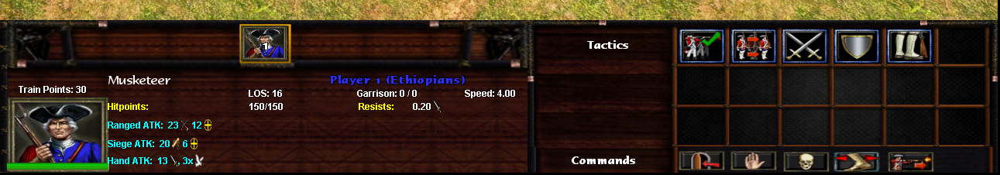
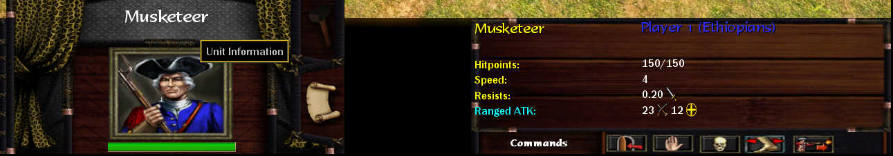
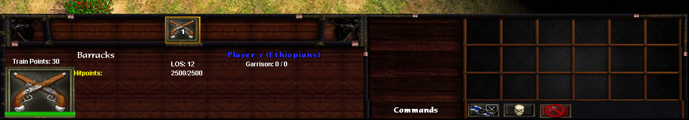
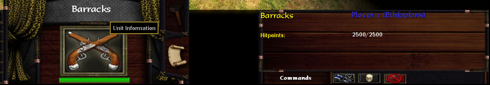
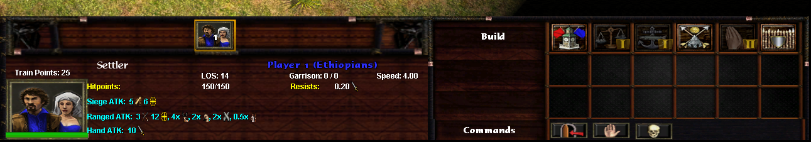
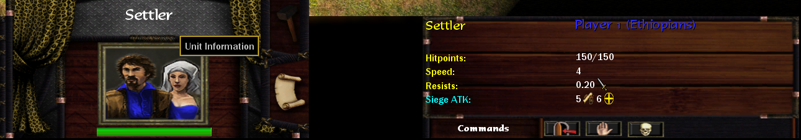
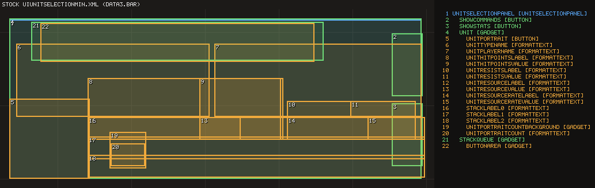
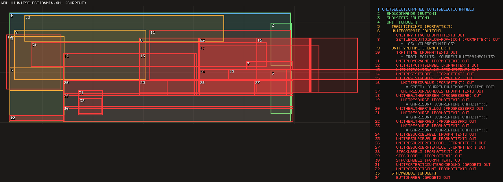
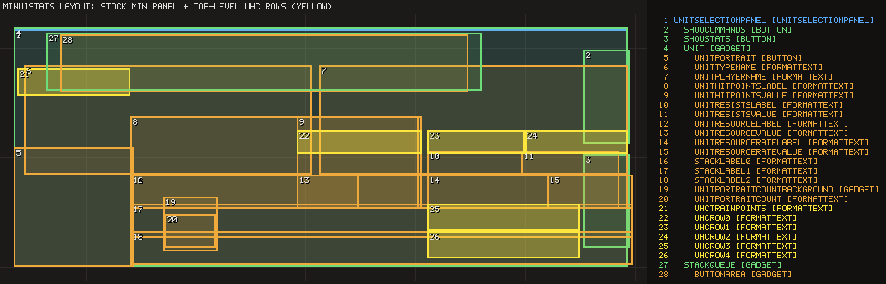

# Unit panel catalog: what the minimized UI could show

Request #67 of the WoL team (Dr.Maxy, 2026-11-16): the minimized in-game UI shows less than the big
UI. It should show the same or more, starting from the **original** minimized UI, with the UI's look
unchanged for now. The user widened it: a **data-driven** system, so that WoL can add or remove
information without a new DLL, and a catalog of everything that could be shown.

This page holds the research (how the game fills both panels, with REA), the catalog and the design. The first batch
is built (2026-11-17): [`minUIStats`](modding-guide.md#minuistats), with the four decisions in section 3. It is
written in English so that it can go to the WoL team as it is.

- Engine details, addresses and Evidence IDs: [engine-symbols.md, "Unit panels"](engine-symbols.md#unit-panels-the-big-stat-panel-and-the-minimized-selection-panel-wol-67-research-2026-11-17).
- REA bundle: `rea/evidence/age3y-b1a1dab7/minui-20261117.json`; snapshot `rea/snapshots/age3y-b1a1dab7.json`.
- Layout previews: `tools/ui_preview.py` in aoe3-blender-tools (branch `ui-preview`).

## 1. What the game does today

### Two panels, two files each

| Panel | Normal UI | Minimized UI (profile option `optionminimizedui`) | Filled by |
|---|---|---|---|
| Selection panel (portrait, name, health bar) | `uiunitselection.xml` | `uiunitselectionmin.xml` | FUN_004C7E52 |
| Stat panel ("Unit Information" tab) | `uiunitstatpanel3.xml` | `uiunitstatpanel3min.xml` | FUN_004D70ED |

- **Normal UI.** The stat panel has 9 rows (`unitstatpanel3-StackLabel0..8` / `StackValue0..8`) and
  the game writes them in this order: name and owner; hit points; then, as they apply, group health,
  the resource a unit holds, gatherers, AutoGather rate, **speed**, **resists**, one row per
  **attack**, and the special attacks. Rows it does not need are hidden.
- **Minimized UI.** The stat panel fill stops before its first row (0x4D7261), so the stat panel
  stays empty. Instead the selection panel's own block (0x6987D7..0x69A60F) writes a shorter list
  into the minimized file's gadgets: owner, hit points, resists, the resource held, the AutoGather
  rate, and **at most 3 attack rows** (`StackLabel0..2`, label only, no value gadget). It has
  **no speed row, no gatherers row, no group health row**, and the 4th attack onward is dropped.

### Why buildings show no armor

Both panels show the resists row only when the proto has the abstract type **`Unit`** (type 0) **and**
its armor value is above 0 (0x698BED in the minimized block, 0x69B34C in the stat panel). Buildings
do not carry `Unit`, so their armor is never shown, in either UI. In WoL's data, 53 buildings have an
armor above 0 (protoy.xml survey) and none of them shows it.

The game shows or hides the whole resists gadget, children included. WoL's
`unitselectionpanel-unitSpeedValue` (`Speed: {currentUnitMaxVelocityFloat}`) is a child of
`unitselectionpanel-unitResistsValue`, so it disappears with the armor: this is Dr.Maxy's "speed is
hooked into the Armor value". LOS is nested in the portrait and Train Points in the type name in the
same way; they show only because the game never hides those two.

### The `{currentUnit…}` texts

A `formatText` gadget's `{name}` is resolved by name in one table of the game (116 entries). Some
`currentUnit…` names work, some are dead:

| Works | Always empty (stub in the exe) |
|---|---|
| `currentUnitHP`, `MaximumHP`, `LOS`, `Inv`, `InvList`, `Attack`, `AttackText`, `AttackFloat`, `MaxVelocity`, `TrainPoints`, `BuildPoints`, `BuildingWorkRate`, `Recharge`, `Capacity`, `Name`, `ID`, `OwnerID`, `Group`, `PlayerIFF`, `IFFcolor`, `LimberPercent`, `CurrentAnimLength` (and the `…Float` forms) | `currentUnitAttackRange`, `MinAttackRange`, `BuildRate`, `GatherRate`, `AttackList`, `AttackString`, `GatherRateString` (our `showGatherRate` makes the last one work) |

`currentUnitMaxVelocity` reads the proto's **base** speed, without techs, snares or auras; the stat
panel's Speed row shows the unit's live speed. There is no armor text at all.

New names can be added to that table: the game checks only that each entry's number equals its
position and that its type is 1 to 4, and looks names up one by one. So the DLL can register any
catalog item as a new `{…}` text.

### WoL's files today (observed)

- `uiunitselectionmin.xml`: `unitselectionpanel-unitTypeName` (line 40) has no `/>` and no closing
  tag of its own, so every gadget after it down to line 68 (player name, hit points, resists,
  resource, rate, the three StackLabels, the three health bars, the portrait count) is its child; the
  extra `</gadget>` at line 88 closes the panel. The game copes with it, but it is probably not
  intended. The three `Garrison` texts hang under the three health bars, so one shows per colour.
- `uiunitstatpanel3.xml` (the **big** UI's stat panel) holds the stock *minimized* stat panel: 5 rows,
  not 9. So the big UI shows name, hit points, speed, resists and only **one** attack row; the other
  rows the game writes are lost. In the shots below the Musketeer shows `Ranged ATK` only, while the
  minimized UI shows its three attacks.

### Screenshots (C:\AoE3-UHC-WoLReal3, our DLL, 2026-11-17)

Same scene, minimized UI (WoL's files) on the left column, big UI (stat panel open) on the right.

| | Minimized UI | Big UI |
|---|---|---|
| Musketeer |  |  |
| Barracks |  |  |
| Settler |  |  |

The Barracks has no armor row and no speed in either UI (its armor is Siege 0, so here nothing is
lost; a building with armor above 0 would lose it the same way). The `LOS`, `Garrison` and
`Train Points` texts of the big UI are WoL's children of `tabStats` and did not show in these shots.

## 2. Catalog

Columns: **source**: where the exe (or our DLL) keeps it; **big / min**: shown today in the big UI's
stat panel / in the minimized UI (stock files); **applies to**: unit (U), building (B), ship (S),
group (G), resource object (R); **MP-safe**: every item is a read of the game state for the screen,
nothing is written, so all are safe in multiplayer; where an item shows something of an enemy unit
that the stock panels do not, it says so. "WoL text" = shown today only through WoL's own
`{currentUnit…}` gadgets.

### 2.1 What the big UI shows

| Data | Source in the exe | Big / min | Applies to | MP-safe | Notes |
|---|---|---|---|---|---|
| Unit name | 0x4702DC(unit) | yes / yes (`unitTypeName`) | all | yes | |
| Owner and civ, `Player 1 (Ethiopians)` | `%s (%s)`, player name and 0x4D83F9 (civ) | yes / yes (`unitPlayerName`) | all | yes | |
| Hit points, `150/150` or `181/165 (165+16)` | `[unit+64h]`; max 0x480408; base `[proto+98h]` | yes / yes | all | yes | The split form when techs raise the max. |
| Group health `%` | `[group+1Ch]` × 100 | only behind a game config flag (0x4020C3, name unknown) / bar colour only | G | yes | |
| Resource held, `Gold (icon): 4500/5000`, `Infinite` | 0x45EE8B, 0x4DBEC1 (type), 0x4E5979 (left), 0x494503 (initial), proto flag 24h | yes / yes (`unitResource…`, takes the first attack row's place) | R (mines, trees, bushes, crates, herdables) | yes | |
| Gatherers, `3 / 10` | string 34986, `%d / %d`, `[[proto+0E0h]+10h]` | yes / **no** | B (workplaces) | yes | The exact condition is partly unknown. |
| AutoGather rate, `Food (icon): 0.67/s` | 0x49EBE4 per resource | yes / yes (`unitResourceRate…`) | B, U (AutoGather) | yes | `showGatherRate` adds a villager's own rate; WoL.dll's `trickleDisplay` changes this block. |
| Speed | the unit's live max speed (vfunc +34h), `%.2f` | yes (type `Unit`, speed > 0) / **no** (WoL text: base speed) | U, S | yes | |
| Resists, `0.20 (hand icon)` | `[proto+0C4h]` value, `[proto+1D3h]` damage type; help text "Resists %1d%% of %2s (%3s) Damage" | yes / yes, **only type `Unit` with armor > 0** | U, S (never B) | yes | |
| Attack rows, `Ranged ATK: 23 (icon), 12 (range icon), 3x (icon)` | 0x487EEE lists the attack actions; damage `[[action+24h]]` × contained scaling (`[action+48h]` cap) × the unit's damage modifiers; type `[[action+24h]+5]`; range 0x4946D6; bonuses `[action+28h]`/`+2Ch`; area `[[action+24h]+6]` | yes, up to the rows left (9 in stock) / yes, **3 at most** (2 with a resource row) | U, B, S with attacks | yes | The help text adds "N Range", "N Range with N Area", "N Damage Area", "N.NX Bonus Damage against X (Y)". |
| Special attacks (Critical Strike, Lethal Strike, Guardian, Stomp, Convert, Bonus!) | `[action+44h]` flags, `[action+3Ch]` chance | yes / yes, both only with profile option 45h `optionenablerobustrollover` | U | yes | |

### 2.2 What the exe knows and never shows (or only through a `{…}` text)

| Data | Source in the exe | Big / min | Applies to | MP-safe | Notes |
|---|---|---|---|---|---|
| Armor of buildings | `[proto+0C4h]`, `[proto+1D3h]` | no / no | B | yes | Dr.Maxy's first example. |
| Armor per damage type (hand, ranged, siege) | stock: one per proto; the tactic's armor `[unit+58h]` (getter 0x49B323); our `multiarmor` adds the others | one type only / one type only | U, B, S | yes | |
| Live speed of every unit (with techs, snares, auras) | vfunc +34h | big only / no (WoL text = base speed `[proto+80h]`) | U, S | yes | Dr.Maxy's second example. |
| Rate of fire | `[action+34h]` ms per attack action | no / no | attacks | yes | Our `containedUnitsROF` and `numberOfShots` change it at run time (`rofreads`). |
| Max range | 0x4946D6 | as the range icon / as the range icon | attacks | yes | `{currentUnitAttackRange}` is a stub. |
| Min range | tactics action | no / no | attacks | yes | `{currentUnitMinAttackRange}` is a stub. |
| Area of damage | `[[action+24h]+6]` | help text only / help text only | attacks | yes | |
| Bonus multipliers | `[action+28h]`, count `+2Ch` | yes / yes (row) | attacks | yes | Abstract targets with special names (Siege Unit, Ships, …). |
| Line of sight | 0x48206D (with modifiers) | no / WoL text (`{currentUnitLOS}`) | all | yes | |
| Train points | provider 0x6F48B2 | no / WoL text | U | yes | |
| Build points | provider 0x6F4930 | no / no | B | yes | `{currentUnitBuildPoints}` works. |
| Building work rate | provider 0x6F49B1 | no / no | B | yes | |
| Population count | proto PopulationCount (field not located yet) | no / no | U | yes | |
| Cost | 0x480B1E (with CostEscalation `[proto+78h]`) | no / no | U, B | yes | Our `randomCost` and `costEscalationTechs` change it. |
| Bounty and XP | proto Bounty (field not located yet) | no / no | U | yes | Our `killBountyTechs`, `resourceBounty`. |
| Carried resources (a villager's load) | inventory, `{currentUnitInv}` 0x6F2B67, `{currentUnitInvList}` 0x6F6216 | no / no (to check in game) | U | yes | |
| Gather rate per resource (villager) | gather tick 0x4ECD87 | no / no | U | yes | Our `showGatherRate` (rate row). |
| Garrison, `2 / 10` | contained `[unit+74h]`, MaxContained; `{currentUnitCapacity()}` 0x6F5931 | no / WoL text | U, B, S | yes | |
| Build limit (used / max) | player data | no / no | U, B | yes | Our `sharedBuildLimit`. |
| Regeneration | unit regen 0x490881; Regeneration action 0x679EC6 | no / no | U, B | yes | |
| Lifespan left | `[proto+ACh]`, countdown in the lifespan tick 0x482BF6 | no / no | U, B | yes | Our `lifespanAfterConstruction`. |
| Ability recharge | `{currentUnitRecharge}` 0x6F462F | no / no | U | yes | |
| Limber (artillery) | `{currentUnitLimberPercent}` 0x6F5B80 | no / no | U | yes | |

### 2.3 What our keys add

All of them keep their state in the DLL, so a row reads it without touching the game.

| Data | Source (key) | Big / min today | Applies to | MP-safe | Notes |
|---|---|---|---|---|---|
| Veterancy rank, kills, bonus | `veterancyBonus` | rank mark on the unit / no | U | yes | |
| Overheal (HP above max), its decay | `overhealHitpointBars`, `overhealSources`, `overhealDecay` | HP text and bar / HP text | U, B | yes | |
| Lifespan left | `lifespanAfterConstruction` | no / no | U, B | yes | |
| Poison and damage over time on the unit | `damageOverTime` | no / no | U | yes | Damage per second and time left. |
| Auras acting on the unit | `auraStacking`, `unitResourceAuras`, `resourceGatherAuras`, `buildingWorkRateAuras` | ring only / ring only | U, B | yes | |
| Random cost range | `randomCost` | no / no | U | yes | |
| Inventory | `inventoryBars`, `transformInventory` | bar / bar | U, B | yes | |
| Shipment counts | `shipmentCounts` | no / no | player | yes | |
| More armors | `multiarmor` | no / no | U, B | yes | |
| Shots per attack, ROF with garrison | `numberOfShots`, `containedUnitsROF` | no / no | U, B | yes | |
| Snared or immune to snares | `snareValues`, `cantBeSlowed` | no / no | U | yes | |
| Stealth | `stealthTargeting` | no / no | U | yes | Of an enemy unit: show only what the player can already see. |
| Displayed range | `displayedRange` | range ring / range ring | U, B | yes | |
| Villager gather rate | `showGatherRate` | rate row / rate row | U | yes | |

### 2.4 For reference: the Definitive Edition

Not verified with REA: the DE exe does not finish a Ghidra analysis (docs/de-parity.md), so these are
leads from the exe's strings only, read on 2026-11-17, and nothing here says what DE lacks.

- The same stat panel rows (`unitstatpanel3-StackLabel%d` / `StackValue%d`) and the same
  `currentUnit…` names, plus named gadgets `unitstatpanel3_Owner`, `_Owner_Civ`, `_Owner_Status`,
  `_Civ_Image`, `_SocketDescription` and `_TollRegister`.
- The selection panel has `unitselectionpanel-veterancyIndicator`, `-empowerIndicator` and
  `-depowerIndicator`.
- Only `uiunitselection.xml` and `uiunitstatpanel3.xml` are named in the exe: no minimized files.
- Strings `AttackROF`, `AbilityROF` and the format `%d/s<icon="(%d)(%s)">`.

## 3. Design

**Built (2026-11-17), the first batch,** with these decisions of the user: the proposed layout (data-driven, so
Dr.Maxy can move the rows); building armor in the stock `Resists` spot, for any proto with an armor above 0; the
**live** speed, also as `{uhcSpeed}`; extra rows for the 4th attack on. `uhcArmor` was dropped for the stock spot.
The `{uhc...}` refs built: `uhcHitpoints`, `uhcSpeed`, `uhcBaseSpeed`, `uhcLOS`, `uhcArmor`, `uhcArmorValue`,
`uhcGarrison`, `uhcTrainPoints`, `uhcBuildPoints`. The rest of the catalog (ROF, ranges, cost, our keys' data) is
for a next batch. The design as written before the build follows.

### Mechanism

Both mechanisms of the plan are possible; the REA decides how each is used.

- **A, the big panel's row writer for the minimized UI.** The stat panel fill writes rows through
  the gadget handles stored in its own panel (`[panel+174h+i*4]`, `[panel+198h+i*4]`), and handles are
  global. So, in minimized mode, the DLL can let the fill run (it stops at 0x4D7261 today) with those
  18 handles swapped for the minimized selection panel's own row gadgets, then put them back. That
  gives **exactly** the big UI's rows (attacks, bonuses, special attacks, speed, resists, gatherers,
  and the rows our own keys add to that panel), with no formatting of our own. The fill already skips
  a missing gadget, so a layout with fewer rows just shows fewer.
- **B, new `{…}` texts.** One table, entries appended with the next number work like the stock ones
  (section 1). Every catalog item becomes a `{uhc…}` text that a WoL gadget can place anywhere.

**Recommended: both, as one key (`minUIStats`):**
1. a **row engine** that fills top-level gadgets `unitselectionpanel-uhcRow0..N` in the order a data
   file gives, one catalog item per row, and hides the rows it does not use;
2. the item `bigPanelRows` in that list, which is mechanism A: the big UI's rows, as the game writes
   them;
3. every item also registered as a `{uhc…}` text (mechanism B), for free text anywhere.

Gadgets are always **top-level** (children of `unitselectionpanel-unit`), never inside a gadget the
game shows or hides.

### Data file

`data\uhc\minuirows.xml` (`engine-ext\minuirows.xml` in the EngineExt build), read once at start-up.
A sketch:

```xml
<minUIRows>
  <!-- gadget: a top-level formatText of uiunitselectionmin.xml; item: a catalog name;
       label: text or a string ID before the value; types: abstract types or protos it applies to -->
  <row gadget="unitselectionpanel-uhcTrainPoints" item="trainPoints" label="Train Points: "/>
  <row gadget="unitselectionpanel-uhcRow0" item="los" label="LOS: "/>
  <row gadget="unitselectionpanel-uhcRow1" item="garrison" label="Garrison: " types="Building,Ship"/>
  <row gadget="unitselectionpanel-uhcRow2" item="speed" label="Speed: " types="Unit"/>
  <row gadget="unitselectionpanel-uhcArmor" item="armor" types="Building" icon="damageType"/>
  <rows gadget="unitselectionpanel-uhcRow%d" first="3" item="bigPanelRows" skip="name,hitpoints,resists"/>
</minUIRows>
```

A row whose item has nothing for the selection (no armor, no garrison) is hidden; `types` filters by
the unit's types; the order of the file is the order on screen. The `{…}` names are the item names
with a `uhc` prefix (`{uhcArmor}`, `{uhcSpeed}`, `{uhcRof}`, …).

### Layout previews (aoe3-blender-tools `tools/ui_preview.py`)

Numbers are the gadgets' order in the file; red = outside its parent's box (shows and hides with the
parent); yellow = new top-level rows.

| Stock minimized panel (Data3.bar) | WoL's current panel | Proposed: stock + top-level rows |
|---|---|---|
|  |  |  |

The proposed file ([`wol-fixes/min-ui/proposed-uiunitselectionmin.xml`](../wol-fixes/min-ui/proposed-uiunitselectionmin.xml),
a draft) is the stock one unchanged plus seven gadgets: `uhcTrainPoints` (above the
portrait), `uhcRow0..2` (LOS, garrison, speed, where WoL has them now), `uhcArmor` (on the stock
resists spot, used only when the stock one is hidden, i.e. buildings), `uhcRow3..4` (right of the
2nd and 3rd attack rows, for the big UI's extra rows). Dr.Maxy chooses the final places.

### Living with the other code

- **`AddUnitPanelRow`** (our shared hook at 0x699456, after the minimized AutoGather block) is not
  touched; mechanism A also brings the rows our keys add to the big panel (`showGatherRate`'s at
  0x4D7834).
- **WoL.dll `trickleDisplay`** patches 0x69920E..0x69922C; the new key writes nothing in
  0x6991BF..0x699456.
- **WoL.dll `forceMinUI`** sets the screen's copy of option 49h (0x761BF0) and the file choice of
  two other panels, but not the two places that read the profile option for the unit panels
  (0x4C8235, 0x4D721B). The key therefore decides "minimized" by the gadgets it finds by name in the
  loaded layout, not by the option: it works with and without `forceMinUI`, and with the profile
  option on or off.
- **Big UI unchanged**: the rows exist only in the minimized file, so nothing is written in the big
  UI. Without the key, nothing changes.

### Batches

1. Dr.Maxy's two examples and parity with the big UI: building armor, live speed (top-level), LOS,
   garrison, train points as top-level rows, and `bigPanelRows` (gatherers, group health, the 4th
   attack onward, special attacks).
2. What the user and Dr.Maxy pick from the catalog (2.2, 2.3).

### Questions for Dr.Maxy

1. Are the row places in the proposed preview fine, or do you want to place them yourself?
2. Building armor: on the stock "Resists" spot with the same look, or a row of its own?
3. Speed: the unit's live speed (with techs and snares, as the big UI shows), or the base speed your
   `{currentUnitMaxVelocityFloat}` shows today?
4. More than 3 attacks: extra rows, or a tooltip on the portrait with the whole list?
5. In your `uiunitselectionmin.xml`, `unitTypeName` (line 40) is never closed, so most of the panel is
   its child. Intended?
6. Your `uiunitstatpanel3.xml` (big UI) has the 5-row minimized stat panel, so the big UI shows only
   one attack. Intended, or should it have the stock 9 rows?
